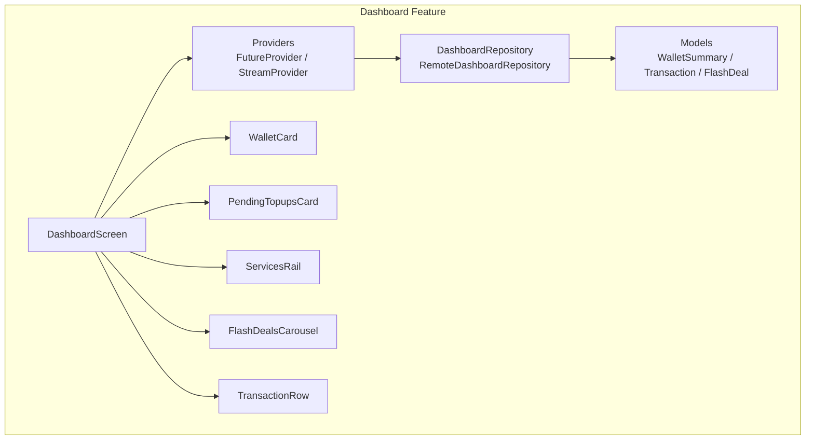
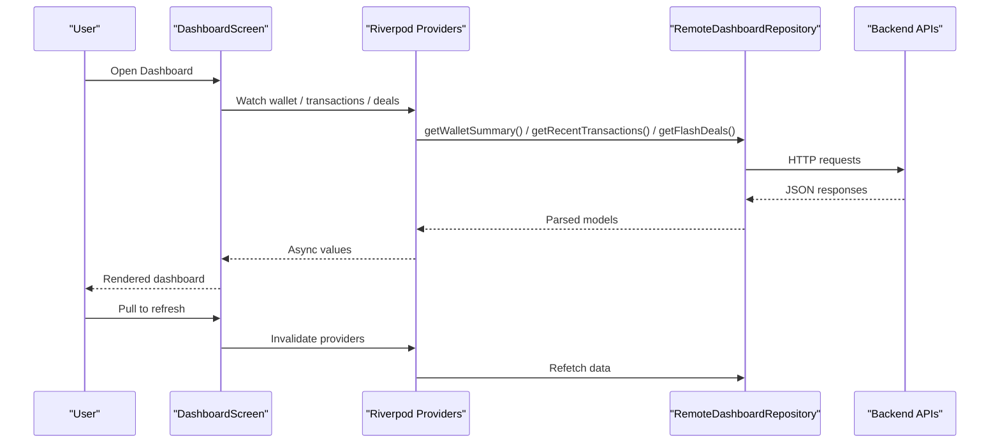
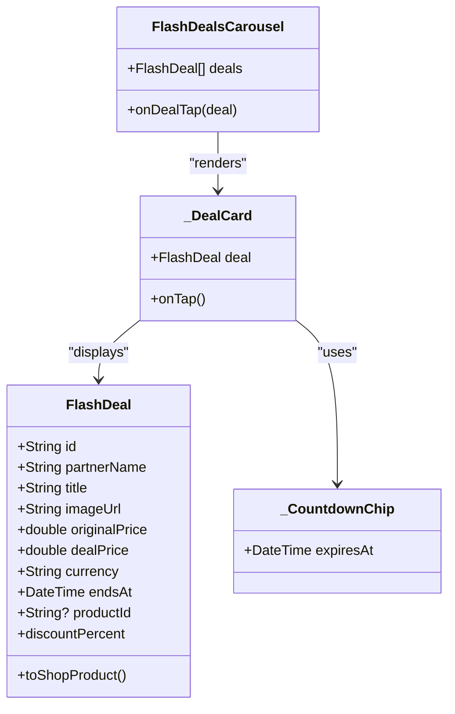
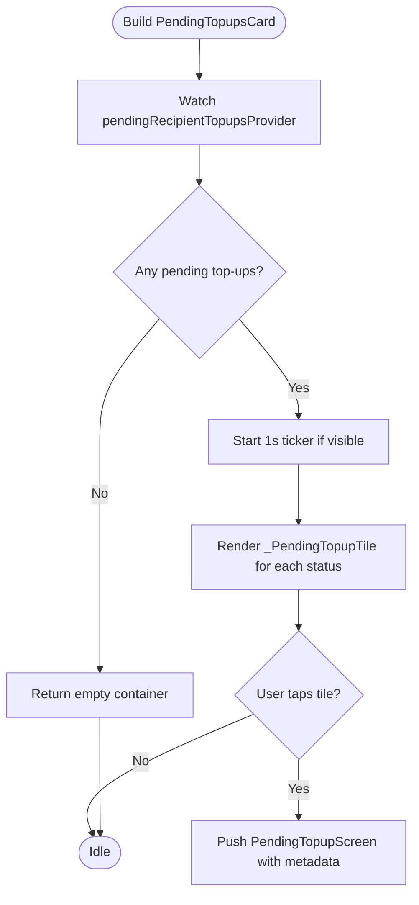
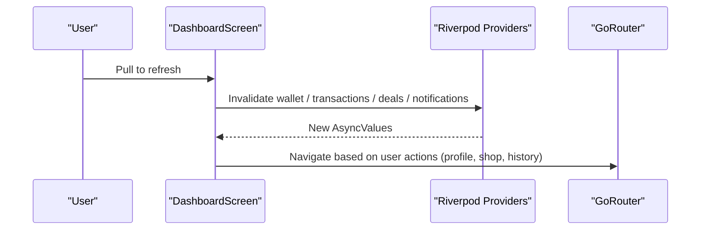
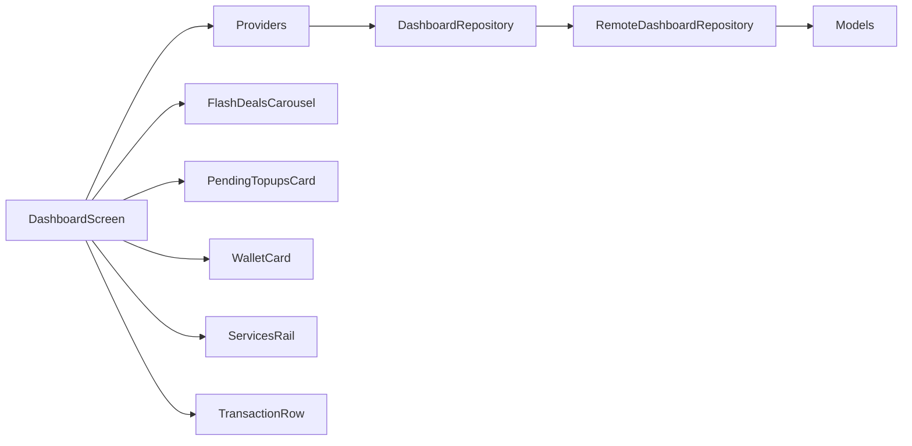

# Dashboard Widgets & Components

<cite>
**Referenced Files in This Document**
- [dashboard_screen.dart](file://lib/features/dashboard/screens/dashboard_screen.dart)
- [providers.dart](file://lib/features/dashboard/providers.dart)
- [dashboard_repository.dart](file://lib/features/dashboard/data/dashboard_repository.dart)
- [remote_dashboard_repository.dart](file://lib/features/dashboard/data/remote_dashboard_repository.dart)
- [dashboard_models.dart](file://lib/features/dashboard/data/dashboard_models.dart)
- [flash_deals_carousel.dart](file://lib/features/dashboard/widgets/flash_deals_carousel.dart)
- [pending_topups_card.dart](file://lib/features/dashboard/widgets/pending_topups_card.dart)
- [wallet_card.dart](file://lib/features/dashboard/widgets/wallet_card.dart)
- [transaction_tile.dart](file://lib/features/dashboard/widgets/transaction_tile.dart)
- [services_rail.dart](file://lib/features/dashboard/widgets/services_rail.dart)
- [quick_actions.dart](file://lib/features/dashboard/widgets/quick_actions.dart)
</cite>

## Table of Contents
1. [Introduction](#introduction)
2. [Project Structure](#project-structure)
3. [Core Components](#core-components)
4. [Architecture Overview](#architecture-overview)
5. [Detailed Component Analysis](#detailed-component-analysis)
6. [Dependency Analysis](#dependency-analysis)
7. [Performance Considerations](#performance-considerations)
8. [Troubleshooting Guide](#troubleshooting-guide)
9. [Conclusion](#conclusion)
10. [Appendices](#appendices)

## Introduction
This document explains the dashboard widget and reusable component architecture for the LidaPay Flutter application. It focuses on:
- The flash deals carousel implementation and its server-time countdown behavior.
- The pending top-ups card that surfaces recipient-decision-waiting transactions.
- The overall dashboard screen composition, including wallet, services rail, recent activity, and navigation integration.
- Widget architecture patterns, state sharing through Riverpod providers, responsive design techniques, lifecycle management, memory optimization, testing strategies, and performance guidance.

## Project Structure
The dashboard feature is organized by responsibility:
- Data models and repository contracts define the domain types and API boundaries.
- Providers orchestrate data fetching, polling, and shared UI state.
- Screens compose the user-facing layout.
- Widgets encapsulate reusable UI behaviors such as carousels, cards, tiles, and rails.

**Diagram sources**
- [dashboard_screen.dart:29-239](file://lib/features/dashboard/screens/dashboard_screen.dart#L29-L239)
- [providers.dart:16-31](file://lib/features/dashboard/providers.dart#L16-L31)
- [remote_dashboard_repository.dart:11-134](file://lib/features/dashboard/data/remote_dashboard_repository.dart#L11-L134)
- [dashboard_models.dart:7-36](file://lib/features/dashboard/data/dashboard_models.dart#L7-L36)
- [dashboard_models.dart:92-138](file://lib/features/dashboard/data/dashboard_models.dart#L92-L138)
- [dashboard_models.dart:330-381](file://lib/features/dashboard/data/dashboard_models.dart#L330-L381)

**Section sources**
- [dashboard_screen.dart:29-239](file://lib/features/dashboard/screens/dashboard_screen.dart#L29-L239)
- [providers.dart:16-31](file://lib/features/dashboard/providers.dart#L16-L31)
- [remote_dashboard_repository.dart:11-134](file://lib/features/dashboard/data/remote_dashboard_repository.dart#L11-L134)
- [dashboard_models.dart:7-36](file://lib/features/dashboard/data/dashboard_models.dart#L7-L36)
- [dashboard_models.dart:92-138](file://lib/features/dashboard/data/dashboard_models.dart#L92-L138)
- [dashboard_models.dart:330-381](file://lib/features/dashboard/data/dashboard_models.dart#L330-L381)

## Core Components
- DashboardScreen composes the main scrollable layout, manages pull-to-refresh, and wires navigation to other features.
- WalletCard displays balance visibility toggling, Lida Value, points, transaction count, and analytics volume.
- FlashDealsCarousel renders a paginated deal carousel with per-card countdown chips driven by server time.
- PendingTopupsCard shows one row per top-up waiting for recipient decision, with a live countdown and deep link to the full waiting screen.
- ServicesRail provides horizontal service shortcuts.
- TransactionRow renders compact transaction entries with status pills and network avatars.

Key responsibilities:
- Data loading and error handling are delegated to FutureProvider and StreamProvider instances.
- UI state (balance visibility, pending top-ups, recently settled top-ups) is shared via Riverpod providers.
- Navigation uses GoRouter routes for consistent routing across screens.

**Section sources**
- [dashboard_screen.dart:29-239](file://lib/features/dashboard/screens/dashboard_screen.dart#L29-L239)
- [wallet_card.dart:13-218](file://lib/features/dashboard/widgets/wallet_card.dart#L13-L218)
- [flash_deals_carousel.dart:14-48](file://lib/features/dashboard/widgets/flash_deals_carousel.dart#L14-L48)
- [pending_topups_card.dart:20-71](file://lib/features/dashboard/widgets/pending_topups_card.dart#L20-L71)
- [services_rail.dart:10-74](file://lib/features/dashboard/widgets/services_rail.dart#L10-L74)
- [transaction_tile.dart:40-163](file://lib/features/dashboard/widgets/transaction_tile.dart#L40-L163)

## Architecture Overview
The dashboard follows a layered approach:
- Presentation layer: Screen and widgets render UI and handle user interactions.
- State layer: Riverpod providers manage async data and reactive streams.
- Repository layer: DashboardRepository abstracts API calls; RemoteDashboardRepository implements them.
- Domain layer: Models represent wallet summaries, transactions, and flash deals.

**Diagram sources**
- [dashboard_screen.dart:32-48](file://lib/features/dashboard/screens/dashboard_screen.dart#L32-L48)
- [providers.dart:21-31](file://lib/features/dashboard/providers.dart#L21-L31)
- [remote_dashboard_repository.dart:20-44](file://lib/features/dashboard/data/remote_dashboard_repository.dart#L20-L44)
- [remote_dashboard_repository.dart:121-134](file://lib/features/dashboard/data/remote_dashboard_repository.dart#L121-L134)
- [remote_dashboard_repository.dart:137-177](file://lib/features/dashboard/data/remote_dashboard_repository.dart#L137-L177)

## Detailed Component Analysis

### Flash Deals Carousel
The carousel presents partner deals as swipeable cards with:
- A page view controller for pagination.
- Cached image loading with placeholder and error states.
- A discount badge, title, pricing, and a countdown chip.
- Server-authoritative expiry via FlashDeal.endsAt; the countdown ticks until expiration or ends with a static label.

**Diagram sources**
- [flash_deals_carousel.dart:14-48](file://lib/features/dashboard/widgets/flash_deals_carousel.dart#L14-L48)
- [flash_deals_carousel.dart:50-179](file://lib/features/dashboard/widgets/flash_deals_carousel.dart#L50-L179)
- [flash_deals_carousel.dart:183-271](file://lib/features/dashboard/widgets/flash_deals_carousel.dart#L183-L271)
- [dashboard_models.dart:330-381](file://lib/features/dashboard/data/dashboard_models.dart#L330-L381)

Implementation highlights:
- PageController is disposed in the state’s dispose method to avoid leaks.
- CountdownChip starts a periodic timer only while the deal has not expired; it cancels timers on update and disposal.
- Deal tap converts FlashDeal to ShopProduct and navigates to the shop flow.

**Section sources**
- [flash_deals_carousel.dart:14-48](file://lib/features/dashboard/widgets/flash_deals_carousel.dart#L14-L48)
- [flash_deals_carousel.dart:50-179](file://lib/features/dashboard/widgets/flash_deals_carousel.dart#L50-L179)
- [flash_deals_carousel.dart:183-271](file://lib/features/dashboard/widgets/flash_deals_carousel.dart#L183-L271)
- [dashboard_models.dart:330-381](file://lib/features/dashboard/data/dashboard_models.dart#L330-L381)

### Pending Topups Card
The pending top-ups card surfaces ledger rows where a recipient must accept or convert a top-up. It:
- Reads pending top-ups from a StreamProvider that polls backend status until terminal.
- Shows one tile per pending top-up with recipient info, amount/service label, and a mm:ss countdown.
- Navigates to the full waiting screen when tapped.

**Diagram sources**
- [pending_topups_card.dart:20-71](file://lib/features/dashboard/widgets/pending_topups_card.dart#L20-L71)
- [pending_topups_card.dart:73-204](file://lib/features/dashboard/widgets/pending_topups_card.dart#L73-L204)
- [providers.dart:141-249](file://lib/features/dashboard/providers.dart#L141-L249)

Behavior details:
- Visibility-aware ticker: a single Timer.periodic drives rebuilds only while items exist.
- Tile computes recipient, service label, formatted amount, and countdown string.
- Navigation passes PendingTopup metadata and callbacks to the waiting screen.

**Section sources**
- [pending_topups_card.dart:20-71](file://lib/features/dashboard/widgets/pending_topups_card.dart#L20-L71)
- [pending_topups_card.dart:73-204](file://lib/features/dashboard/widgets/pending_topups_card.dart#L73-L204)
- [providers.dart:141-249](file://lib/features/dashboard/providers.dart#L141-L249)

### Dashboard Screen Composition
DashboardScreen orchestrates:
- Header with user greeting, avatar, and unread notifications badge.
- Wallet summary card.
- Pending recipient decisions banner.
- Pending top-ups card.
- Services rail.
- Flash deals section with carousel.
- Recent activity grouped by day.

Refresh logic invalidates multiple providers concurrently and handles partial failures gracefully.

**Diagram sources**
- [dashboard_screen.dart:32-48](file://lib/features/dashboard/screens/dashboard_screen.dart#L32-L48)
- [dashboard_screen.dart:93-239](file://lib/features/dashboard/screens/dashboard_screen.dart#L93-L239)

**Section sources**
- [dashboard_screen.dart:29-239](file://lib/features/dashboard/screens/dashboard_screen.dart#L29-L239)

### Wallet Card
WalletCard provides:
- Balance visibility toggle using a local provider.
- Display of Lida Value units, points, transaction count, and analytics total volume.
- Deep links to related screens.

It reads recent transactions to compute total volume and uses theme-aware styling.

**Section sources**
- [wallet_card.dart:13-218](file://lib/features/dashboard/widgets/wallet_card.dart#L13-L218)

### Transaction Row and Status Pill
TransactionRow renders:
- Network-specific avatars for airtime/data transactions.
- Amount with directional sign and color based on credit/debit and status.
- Optional status text for pending/failed transactions.

StatusPill provides compact status labels with semantic colors.

**Section sources**
- [transaction_tile.dart:8-36](file://lib/features/dashboard/widgets/transaction_tile.dart#L8-L36)
- [transaction_tile.dart:40-205](file://lib/features/dashboard/widgets/transaction_tile.dart#L40-L205)

### Services Rail
ServicesRail offers a horizontal list of service shortcuts with icons, labels, captions, and deep links.

**Section sources**
- [services_rail.dart:10-74](file://lib/features/dashboard/widgets/services_rail.dart#L10-L74)

### Quick Actions
QuickActions provides icon-forward quick actions with haptic feedback and placeholder snackbar messages.

**Section sources**
- [quick_actions.dart:5-122](file://lib/features/dashboard/widgets/quick_actions.dart#L5-L122)

## Dependency Analysis
The dashboard depends on:
- Riverpod providers for reactive state and background polling.
- Repository abstraction for API access.
- Models for type-safe data representation.
- Router for navigation.

**Diagram sources**
- [dashboard_screen.dart:29-239](file://lib/features/dashboard/screens/dashboard_screen.dart#L29-L239)
- [providers.dart:16-31](file://lib/features/dashboard/providers.dart#L16-L31)
- [remote_dashboard_repository.dart:11-134](file://lib/features/dashboard/data/remote_dashboard_repository.dart#L11-L134)
- [dashboard_models.dart:7-36](file://lib/features/dashboard/data/dashboard_models.dart#L7-L36)

Coupling and cohesion:
- DashboardScreen is cohesive around composing sections and delegating data/state to providers.
- Providers encapsulate repository usage and expose typed streams/futures.
- Widgets are mostly stateless or consumer widgets, minimizing internal state and relying on providers.

Potential circular dependencies:
- None observed between dashboard modules; cross-feature references are unidirectional (e.g., dashboard to shop models).

External integrations:
- GoRouter for navigation.
- CachedNetworkImage for image caching in the carousel.
- Riverpod for state management.

**Section sources**
- [dashboard_screen.dart:29-239](file://lib/features/dashboard/screens/dashboard_screen.dart#L29-L239)
- [providers.dart:16-31](file://lib/features/dashboard/providers.dart#L16-L31)
- [remote_dashboard_repository.dart:11-134](file://lib/features/dashboard/data/remote_dashboard_repository.dart#L11-L134)

## Performance Considerations
- Image caching: Use cached network images for deal cards to reduce bandwidth and improve perceived performance.
- Timer discipline: Cancel timers in dispose and avoid unnecessary rebuilds; the pending top-ups card uses a visibility-aware ticker.
- Pagination: PageView.builder avoids building all deal cards at once.
- Independent failure: Wallet, Lida Value, and points endpoints degrade independently so the dashboard remains usable.
- Backoff strategy: Pending top-ups polling backs off when no successful response is received, reducing network pressure.
- Grouping: Recent activity groups transactions by day to reduce layout complexity.

[No sources needed since this section provides general guidance]

## Troubleshooting Guide
Common issues and resolutions:
- Missing wallet data: The repository falls back to account endpoint when wallet endpoint fails; ensure authentication is valid and user profile is available.
- Stale pending top-ups: If a top-up order returns 404, it is blacklisted and removed from tracking to prevent infinite polling loops.
- Countdown drift: Flash deal countdowns rely on server-provided endsAt; reconcile client clock drift if necessary.
- Refresh failures: Pull-to-refresh invalidates multiple providers; individual sections surface their own errors without blanking the entire screen.

Operational tips:
- Verify provider invalidation during refresh to ensure fresh data.
- Check ApiException status codes for 401 vs transient errors.
- Monitor StreamProvider autoDispose behavior to avoid leaks when navigating away.

**Section sources**
- [remote_dashboard_repository.dart:46-71](file://lib/features/dashboard/data/remote_dashboard_repository.dart#L46-L71)
- [providers.dart:166-200](file://lib/features/dashboard/providers.dart#L166-L200)
- [dashboard_screen.dart:32-48](file://lib/features/dashboard/screens/dashboard_screen.dart#L32-L48)

## Conclusion
The dashboard integrates wallet information, services, flash deals, and recent activity into a cohesive experience. Its architecture emphasizes:
- Clear separation of concerns between presentation, state, and data layers.
- Robust error handling and graceful degradation.
- Efficient rendering and lifecycle management for interactive components.
- Shared state through Riverpod providers for consistent UX across the app.

Adopting these patterns ensures maintainability, testability, and scalability as new widgets and features are added.

[No sources needed since this section summarizes without analyzing specific files]

## Appendices

### Creating Custom Dashboard Widgets
Guidelines:
- Prefer ConsumerWidget or ConsumerStatefulWidget when reading providers.
- Keep UI logic in widgets; delegate data fetching to providers.
- Use SurfaceCard and SectionHeader for consistent styling.
- Integrate navigation via GoRouter routes.

Example pattern:
- Define a widget that consumes a provider and renders content conditionally based on AsyncValue states.
- Handle user interactions by updating provider state or invoking navigation.

[No sources needed since this section provides general guidance]

### Integrating Third-Party Components
Recommendations:
- Wrap third-party widgets in your own components to centralize configuration and styling.
- Provide fallbacks for network/image loading errors.
- Ensure accessibility semantics are preserved or enhanced.

[No sources needed since this section provides general guidance]

### Optimizing Widget Performance
Best practices:
- Avoid rebuilding large subtrees by isolating state changes to small widgets.
- Use const constructors where possible.
- Debounce or throttle frequent updates; use visibility-aware timers.
- Cache expensive computations and memoize derived data in providers.

[No sources needed since this section provides general guidance]

### Widget Lifecycle Management and Memory Optimization
Key practices:
- Dispose controllers and timers in dispose methods.
- Use autoDispose for providers that should be cleaned up when no longer needed.
- Avoid holding references to BuildContext beyond build scope.
- Minimize object allocations inside build methods.

**Section sources**
- [flash_deals_carousel.dart:24-31](file://lib/features/dashboard/widgets/flash_deals_carousel.dart#L24-L31)
- [pending_topups_card.dart:27-47](file://lib/features/dashboard/widgets/pending_topups_card.dart#L27-L47)
- [providers.dart:141-142](file://lib/features/dashboard/providers.dart#L141-L142)

### Testing Strategies for Complex Dashboard Layouts
Approach:
- Unit test providers: verify data parsing, error handling, and stream emissions.
- Widget tests: assert rendering of skeleton, error, and success states.
- Integration tests: simulate pull-to-refresh and navigation flows.
- Mock repositories: isolate UI tests from network dependencies.

[No sources needed since this section provides general guidance]