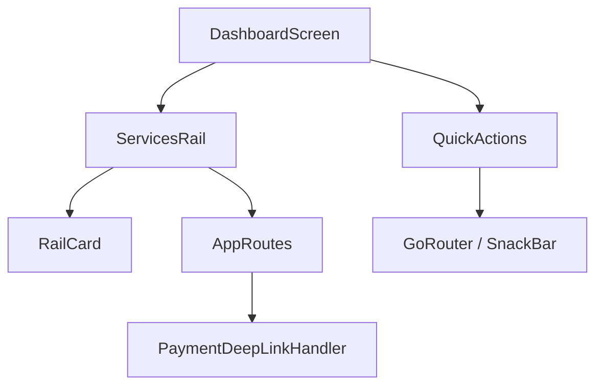
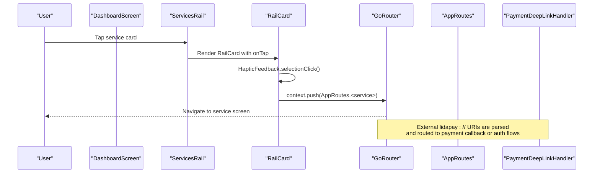
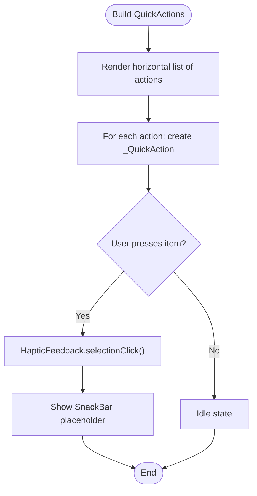
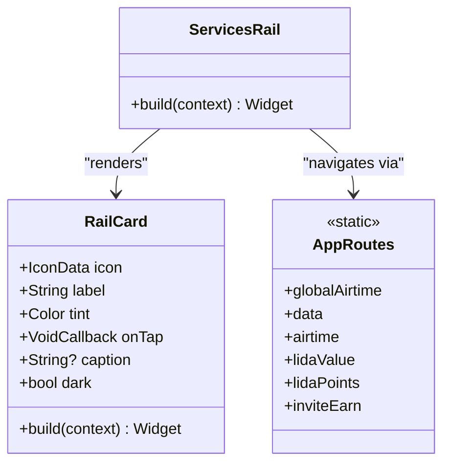
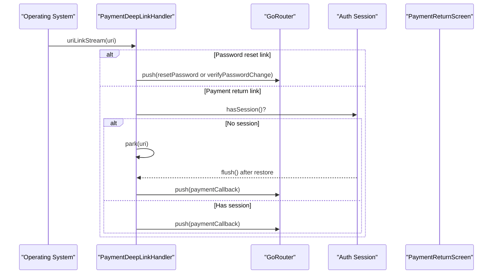
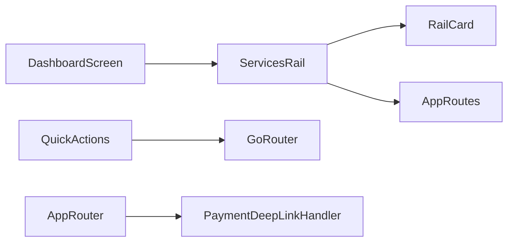

# Quick Actions System

<cite>
**Referenced Files in This Document**
- [quick_actions.dart](file://lib/features/dashboard/widgets/quick_actions.dart)
- [services_rail.dart](file://lib/features/dashboard/widgets/services_rail.dart)
- [rail_card.dart](file://lib/core/widgets/rail_card.dart)
- [dashboard_screen.dart](file://lib/features/dashboard/screens/dashboard_screen.dart)
- [services_screen.dart](file://lib/features/services/screens/services_screen.dart)
- [app_router.dart](file://lib/core/router/app_router.dart)
- [deep_links.dart](file://lib/core/deep_links.dart)
</cite>

## Table of Contents
1. [Introduction](#introduction)
2. [Project Structure](#project-structure)
3. [Core Components](#core-components)
4. [Architecture Overview](#architecture-overview)
5. [Detailed Component Analysis](#detailed-component-analysis)
6. [Dependency Analysis](#dependency-analysis)
7. [Performance Considerations](#performance-considerations)
8. [Troubleshooting Guide](#troubleshooting-guide)
9. [Conclusion](#conclusion)

## Introduction
This document explains the quick actions system and services rail functionality in the application. It covers:
- The quick actions widget used on the dashboard.
- The services rail component that provides deep-linked navigation to real service flows.
- Action configuration, routing logic, and integration with the global router.
- Examples for adding new quick actions, customizing icons and labels, and implementing deep linking.
- User interaction patterns, accessibility considerations, and performance optimizations for frequently accessed services.

The quick actions surface is intentionally split into two related but distinct areas:
- Dashboard quick actions: a compact horizontal row of high-frequency shortcuts.
- Services rail: a visually prominent horizontal rail of highlight services that navigate directly to implemented flows.

## Project Structure
The quick actions and services rail are implemented under the dashboard feature and core widgets:
- Dashboard quick actions live in a dedicated widget file.
- The services rail is another dashboard widget composed from a reusable rail card.
- Both components integrate with the central app router for navigation.
- Deep link handling is centralized in a dedicated handler and router configuration.

**Diagram sources**
- [dashboard_screen.dart:137-145](file://lib/features/dashboard/screens/dashboard_screen.dart#L137-L145)
- [services_rail.dart:10-74](file://lib/features/dashboard/widgets/services_rail.dart#L10-L74)
- [quick_actions.dart:5-58](file://lib/features/dashboard/widgets/quick_actions.dart#L5-L58)
- [rail_card.dart:8-28](file://lib/core/widgets/rail_card.dart#L8-L28)
- [app_router.dart:40-86](file://lib/core/router/app_router.dart#L40-L86)
- [deep_links.dart:11-36](file://lib/core/deep_links.dart#L11-L36)

**Section sources**
- [dashboard_screen.dart:137-145](file://lib/features/dashboard/screens/dashboard_screen.dart#L137-L145)
- [services_rail.dart:10-74](file://lib/features/dashboard/widgets/services_rail.dart#L10-L74)
- [quick_actions.dart:5-58](file://lib/features/dashboard/widgets/quick_actions.dart#L5-L58)
- [rail_card.dart:8-28](file://lib/core/widgets/rail_card.dart#L8-L28)
- [app_router.dart:40-86](file://lib/core/router/app_router.dart#L40-L86)
- [deep_links.dart:11-36](file://lib/core/deep_links.dart#L11-L36)

## Core Components
- QuickActions: A stateless widget rendering a horizontal list of icon-forward quick actions. Each action shows an icon, label, and color, and triggers haptic feedback plus a placeholder message.
- _QuickAction: A stateful widget providing press animation and accessible tap handling for individual quick actions.
- ServicesRail: A stateless widget rendering a horizontal rail of highlight services using RailCard. Each card deep-links to a route via GoRouter.
- RailCard: A reusable wide card for horizontal rails with tinted gradients, optional dark ink variant, caption text, and haptic feedback.
- AppRoutes: Centralized route constants used by both the services rail and other screens.
- PaymentDeepLinkHandler: Centralized deep link handler for payment returns and password reset links.

Key responsibilities:
- QuickActions focuses on presentation and immediate user feedback.
- ServicesRail focuses on navigation to fully implemented service flows.
- RailCard encapsulates visual styling and interaction behavior for rail items.
- AppRouter defines routes and guards navigation based on authentication state.
- Deep links handle external URIs and ensure correct routing even when the app starts from a link.

**Section sources**
- [quick_actions.dart:5-122](file://lib/features/dashboard/widgets/quick_actions.dart#L5-L122)
- [services_rail.dart:10-74](file://lib/features/dashboard/widgets/services_rail.dart#L10-L74)
- [rail_card.dart:8-123](file://lib/core/widgets/rail_card.dart#L8-L123)
- [app_router.dart:40-86](file://lib/core/router/app_router.dart#L40-L86)
- [deep_links.dart:11-159](file://lib/core/deep_links.dart#L11-L159)

## Architecture Overview
The quick actions system integrates UI widgets with the central router and deep link handler.

**Diagram sources**
- [services_rail.dart:22-69](file://lib/features/dashboard/widgets/services_rail.dart#L22-L69)
- [rail_card.dart:44-51](file://lib/core/widgets/rail_card.dart#L44-L51)
- [app_router.dart:103-164](file://lib/core/router/app_router.dart#L103-L164)
- [deep_links.dart:27-52](file://lib/core/deep_links.dart#L27-L52)

## Detailed Component Analysis

### QuickActions Widget
Purpose:
- Provide a compact horizontal row of quick shortcuts on the dashboard.
- Show icon, label, and brand color per action.
- Provide immediate tactile feedback and a placeholder message indicating future milestones.

Implementation highlights:
- Static action list defines icon, label, and color tuples.
- Horizontal ListView renders each action with spacing.
- Individual action uses AnimatedScale for press feedback.
- On tap, haptic feedback is triggered and a SnackBar informs users the action is coming soon.

Adding a new quick action:
- Add a new tuple to the static action list with icon, label, and color.
- Optionally wire onTap to a real navigation call if the action becomes available.

Customizing icons and labels:
- Change IconData for the desired Material icon.
- Update label string for clarity and localization readiness.
- Adjust color to match brand guidelines.

Accessibility considerations:
- Use semantic-friendly labels for screen readers.
- Ensure contrast between icon color and background.
- Keep labels concise so they fit within the constrained width.

Performance considerations:
- The widget is lightweight and stateless; interactions are local.
- Avoid heavy work inside onTap; defer to navigation or async operations off the UI thread.

**Diagram sources**
- [quick_actions.dart:28-58](file://lib/features/dashboard/widgets/quick_actions.dart#L28-L58)
- [quick_actions.dart:77-121](file://lib/features/dashboard/widgets/quick_actions.dart#L77-L121)

**Section sources**
- [quick_actions.dart:5-122](file://lib/features/dashboard/widgets/quick_actions.dart#L5-L122)

### ServicesRail Component
Purpose:
- Present highlight services on the home screen with rich visuals.
- Navigate directly to implemented service flows using GoRouter.

Implementation highlights:
- Uses RailCard for consistent visual style across rail items.
- Each card calls context.push with a route constant from AppRoutes.
- Supports a dark ink variant for premium services like Lida Value.

Service mapping:
- Global Airtime -> AppRoutes.globalAirtime
- Internet Data -> AppRoutes.data
- Buy Airtime -> AppRoutes.airtime
- Lida Value -> AppRoutes.lidaValue
- Lida Points -> AppRoutes.lidaPoints
- Invite & Earn -> AppRoutes.inviteEarn

Adding a new service rail item:
- Add a new RailCard entry with icon, label, caption, tint, and onTap pushing the corresponding AppRoutes path.
- Ensure the route exists in AppRoutes and is registered in the router.

Customization:
- Tint colors come from AppColors.
- Caption text provides additional context beneath the label.
- Dark mode support is provided via the dark flag for premium ink styling.

Accessibility considerations:
- Labels and captions should be descriptive and concise.
- Ensure sufficient contrast for both light and dark themes.
- Provide meaningful semantics through Flutter’s default semantics where possible.

Performance considerations:
- RailCard is stateful but performs minimal layout changes.
- Avoid expensive computations in onTap; delegate to navigation and let the router manage transitions.

**Diagram sources**
- [services_rail.dart:10-74](file://lib/features/dashboard/widgets/services_rail.dart#L10-L74)
- [rail_card.dart:8-28](file://lib/core/widgets/rail_card.dart#L8-L28)
- [app_router.dart:40-86](file://lib/core/router/app_router.dart#L40-L86)

**Section sources**
- [services_rail.dart:10-74](file://lib/features/dashboard/widgets/services_rail.dart#L10-L74)
- [rail_card.dart:8-123](file://lib/core/widgets/rail_card.dart#L8-L123)
- [app_router.dart:40-86](file://lib/core/router/app_router.dart#L40-L86)

### RailCard Reusable Component
Purpose:
- Provide a consistent, interactive card for horizontal rails.
- Support tinted gradients, optional dark ink variant, and caption text.

Interaction model:
- Detects press down/up/cancel states.
- Applies AnimatedScale for subtle press feedback.
- Triggers haptic feedback before invoking onTap.

Styling:
- Gradient backgrounds vary by tint and dark mode.
- Icon container uses glow shadows for emphasis.
- Label and caption use theme-aware colors.

Accessibility:
- Ensure text is readable against gradient backgrounds.
- Provide clear affordances for touch targets.

Performance:
- Minimal state changes during press animations.
- Avoid rebuilding large subtrees; keep content lightweight.

**Section sources**
- [rail_card.dart:8-123](file://lib/core/widgets/rail_card.dart#L8-L123)

### Routing and Navigation Handling
Central routing:
- AppRoutes defines all route constants for services, shop, profile, history, and special pages like payment callbacks.
- GoRouter configures guarded navigation based on authentication state.
- Shell branches organize major sections (home, services, shop, history, profile).

Service navigation:
- ServicesRail pushes routes such as airtime, data, global-airtime, lida-value, lida-points, invite-earn.
- These routes map to specific screens under the services branch.

Deep linking:
- PaymentDeepLinkHandler listens to lidapay:// URIs.
- Password reset links are handled without requiring a session.
- Payment return links are parked until a session exists, then routed to the payment callback page.
- Router redirect logic ensures deep links reach the correct destination even during cold starts.

**Diagram sources**
- [deep_links.dart:27-61](file://lib/core/deep_links.dart#L27-L61)
- [deep_links.dart:66-135](file://lib/core/deep_links.dart#L66-L135)
- [deep_links.dart:137-155](file://lib/core/deep_links.dart#L137-L155)
- [app_router.dart:103-164](file://lib/core/router/app_router.dart#L103-L164)

**Section sources**
- [app_router.dart:40-86](file://lib/core/router/app_router.dart#L40-L86)
- [app_router.dart:103-164](file://lib/core/router/app_router.dart#L103-L164)
- [deep_links.dart:27-155](file://lib/core/deep_links.dart#L27-L155)

### Services Screen Quick Actions
The services screen also includes a “Quick Actions” section with pill-style buttons for popular services. These pills navigate to routes similar to the services rail.

Highlights:
- Pill items include Global Airtime, Rewards, Referrals, and My Orders.
- Each pill calls context.push with the appropriate AppRoutes path.
- Visual style matches the services hub design.

Extending this section:
- Add a new _QuickActionPill entry with icon, label, color, and onTap.
- Ensure the route exists in AppRoutes and is registered.

**Section sources**
- [services_screen.dart:408-443](file://lib/features/services/screens/services_screen.dart#L408-L443)

## Dependency Analysis
Component relationships:
- DashboardScreen composes ServicesRail and displays it in the home feed.
- ServicesRail depends on RailCard for visual consistency and AppRoutes for navigation.
- QuickActions is independent but follows similar interaction patterns.
- AppRouter centralizes route definitions and guards navigation.
- PaymentDeepLinkHandler integrates with GoRouter to handle external URIs.

Potential coupling:
- ServicesRail tightly couples to AppRoutes constants; changing routes requires updating both constants and rail entries.
- Deep link handling relies on URI parsing rules; any backend changes to lidapay:// paths must be reflected in handlers.

External dependencies:
- GoRouter for declarative navigation.
- AppLinks plugin for deep link streams.
- Shared preferences for onboarding state and session restoration.

**Diagram sources**
- [dashboard_screen.dart:137-145](file://lib/features/dashboard/screens/dashboard_screen.dart#L137-L145)
- [services_rail.dart:22-69](file://lib/features/dashboard/widgets/services_rail.dart#L22-L69)
- [quick_actions.dart:43-52](file://lib/features/dashboard/widgets/quick_actions.dart#L43-L52)
- [app_router.dart:103-164](file://lib/core/router/app_router.dart#L103-L164)
- [deep_links.dart:27-52](file://lib/core/deep_links.dart#L27-L52)

**Section sources**
- [dashboard_screen.dart:137-145](file://lib/features/dashboard/screens/dashboard_screen.dart#L137-L145)
- [services_rail.dart:22-69](file://lib/features/dashboard/widgets/services_rail.dart#L22-L69)
- [quick_actions.dart:43-52](file://lib/features/dashboard/widgets/quick_actions.dart#L43-L52)
- [app_router.dart:103-164](file://lib/core/router/app_router.dart#L103-L164)
- [deep_links.dart:27-52](file://lib/core/deep_links.dart#L27-L52)

## Performance Considerations
- Prefer stateless widgets for static lists like QuickActions to avoid unnecessary rebuilds.
- Defer heavy operations (network calls, analytics) out of the UI thread; trigger them after navigation.
- Use GoRouter’s efficient navigation APIs (context.push/go) to minimize layout thrashing.
- Limit the number of visible rail items to reduce layout calculations on lower-end devices.
- Avoid recomputing colors or styles inside itemBuilder; cache them at the widget level when possible.
- For deep links, ensure handlers do not block startup; errors from missing platform channels should be swallowed gracefully.

[No sources needed since this section provides general guidance]

## Troubleshooting Guide
Common issues and resolutions:
- Service cards not navigating:
  - Verify the AppRoutes constant exists and is registered in the router.
  - Ensure context.push is called with the correct route.
- Deep links not working:
  - Confirm lidapay:// scheme is supported on the platform.
  - Check PaymentDeepLinkHandler.isPaymentReturn and isPasswordLink logic for updated backend paths.
  - Ensure session restoration occurs before routing payment returns.
- Accessibility problems:
  - Validate label readability and contrast in both light and dark themes.
  - Ensure tap targets meet minimum size guidelines.
- Performance regressions:
  - Profile the dashboard scroll performance when many rail items are present.
  - Avoid heavy computations in onTap; move to providers or services.

**Section sources**
- [deep_links.dart:27-52](file://lib/core/deep_links.dart#L27-L52)
- [deep_links.dart:66-135](file://lib/core/deep_links.dart#L66-L135)
- [app_router.dart:103-164](file://lib/core/router/app_router.dart#L103-L164)

## Conclusion
The quick actions system combines a compact dashboard shortcut row with a visually rich services rail that navigates to implemented flows. QuickActions provides immediate feedback and placeholders for upcoming features, while ServicesRail offers direct access to core services via GoRouter. RailCard standardizes the rail card experience, and AppRoutes centralizes navigation. Deep link handling ensures external URIs route correctly, even when the app starts from a link. To extend the system, add new actions or rail items with clear labels, appropriate icons, and proper route wiring, while keeping accessibility and performance in mind.

[No sources needed since this section summarizes without analyzing specific files]