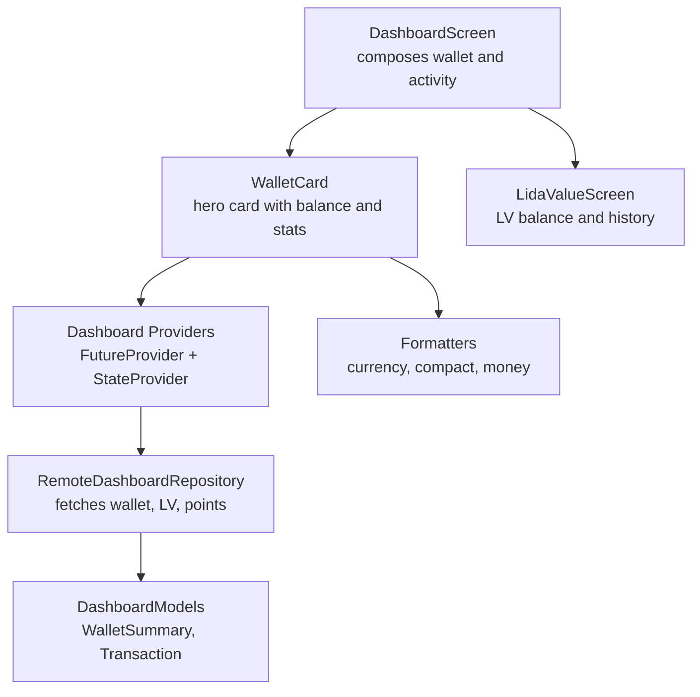
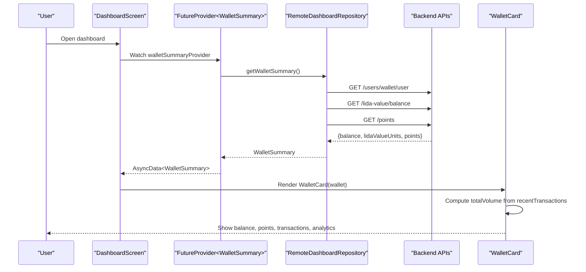
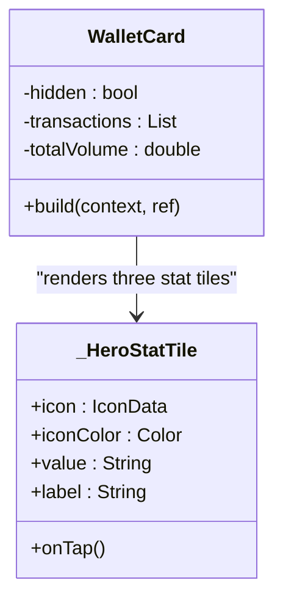
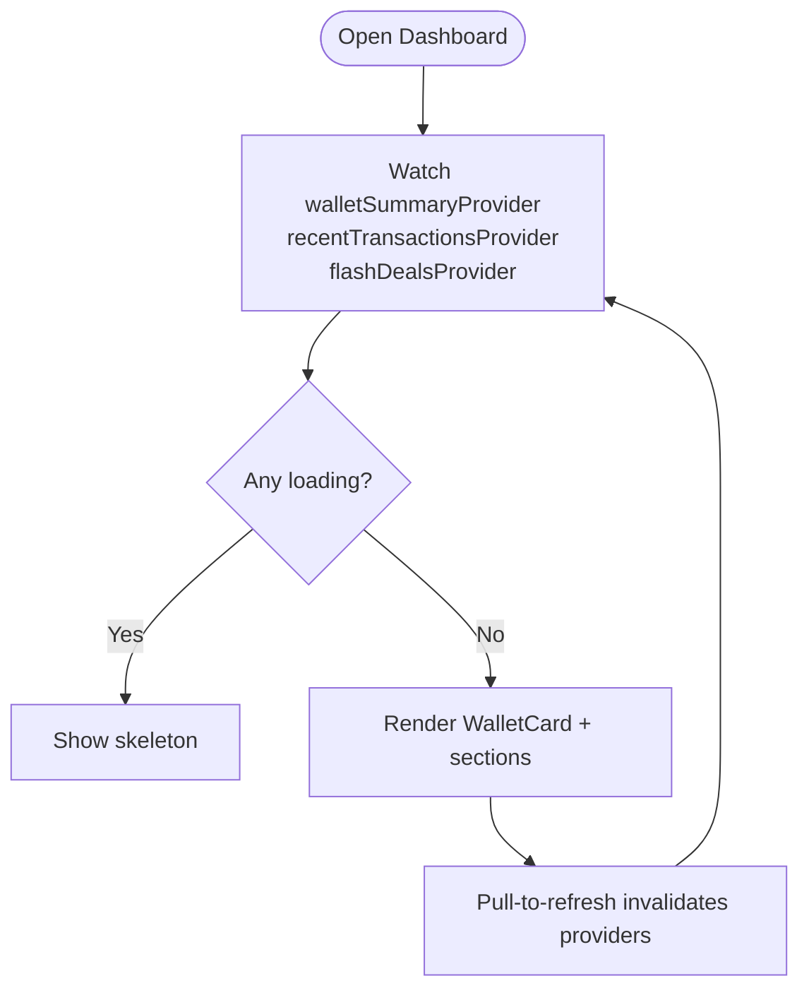
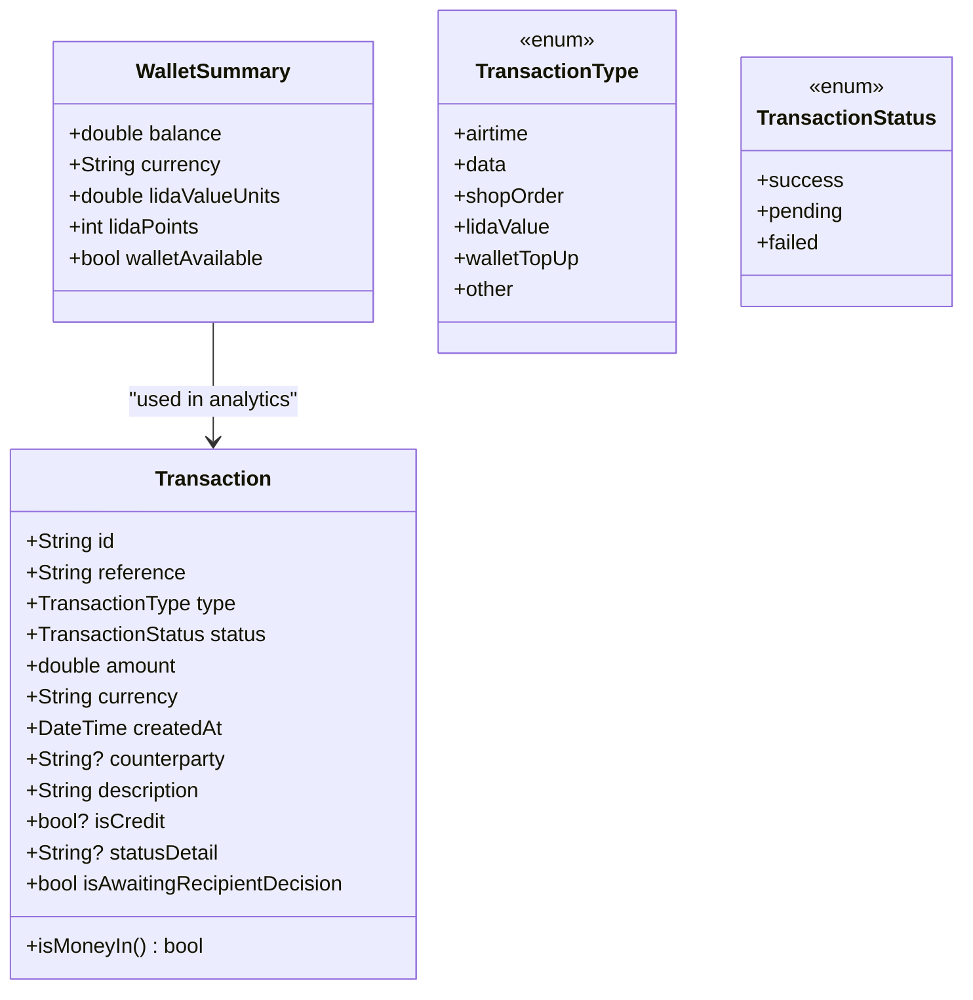
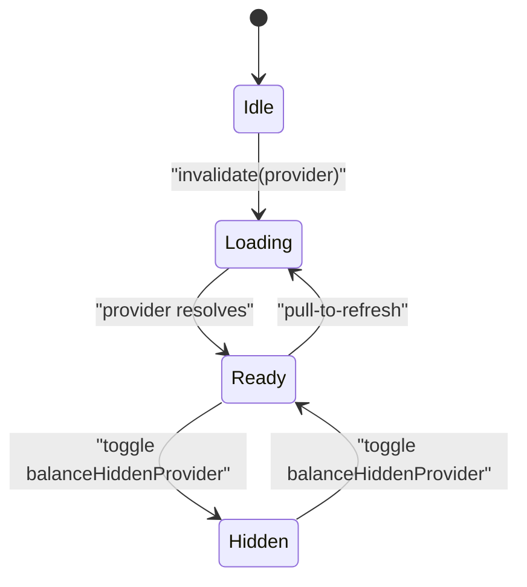
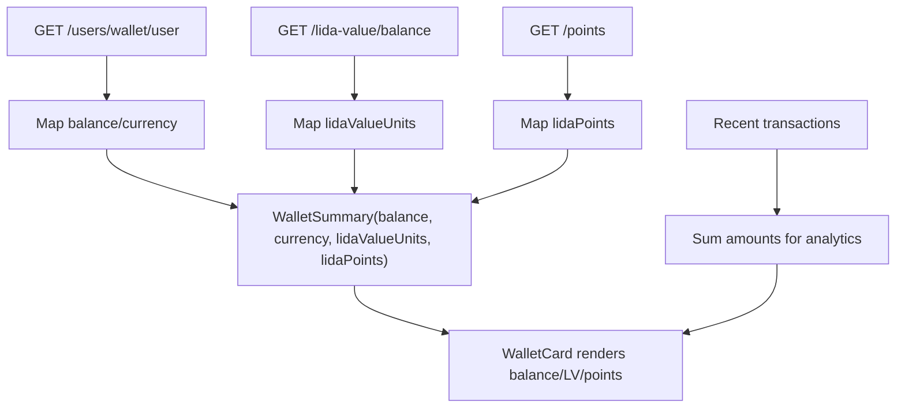
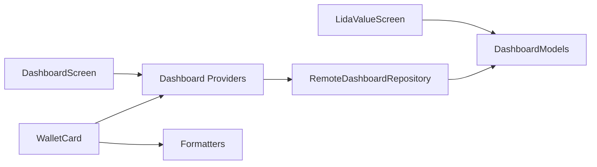

# Wallet Overview & Balance Display

<cite>
**Referenced Files in This Document**
- [wallet_card.dart](file://lib/features/dashboard/widgets/wallet_card.dart)
- [dashboard_screen.dart](file://lib/features/dashboard/screens/dashboard_screen.dart)
- [dashboard_models.dart](file://lib/features/dashboard/data/dashboard_models.dart)
- [remote_dashboard_repository.dart](file://lib/features/dashboard/data/remote_dashboard_repository.dart)
- [providers.dart](file://lib/features/dashboard/providers.dart)
- [lida_value_screen.dart](file://lib/features/lida_value/screens/lida_value_screen.dart)
- [formatters.dart](file://lib/core/utils/formatters.dart)
</cite>

## Table of Contents
1. [Introduction](#introduction)
2. [Project Structure](#project-structure)
3. [Core Components](#core-components)
4. [Architecture Overview](#architecture-overview)
5. [Detailed Component Analysis](#detailed-component-analysis)
6. [Dependency Analysis](#dependency-analysis)
7. [Performance Considerations](#performance-considerations)
8. [Troubleshooting Guide](#troubleshooting-guide)
9. [Conclusion](#conclusion)

## Introduction
This document explains the wallet overview and balance display functionality in the application. It focuses on:
- The wallet card widget used on the dashboard
- How balances are calculated and fetched from backend endpoints
- Real-time updates for Lida Value, points, and recent transactions
- Data models for wallets, transactions, and related entities
- State management using Riverpod providers
- Currency formatting, responsive design patterns, security considerations, and performance guidance

The goal is to help developers understand how the wallet UI works end-to-end and how to extend or customize it safely.

## Project Structure
The wallet overview lives under the dashboard feature and integrates with Lida Value screens and shared formatters.

**Diagram sources**
- [dashboard_screen.dart:29-133](file://lib/features/dashboard/screens/dashboard_screen.dart#L29-L133)
- [wallet_card.dart:13-218](file://lib/features/dashboard/widgets/wallet_card.dart#L13-L218)
- [providers.dart:16-34](file://lib/features/dashboard/providers.dart#L16-L34)
- [remote_dashboard_repository.dart:20-44](file://lib/features/dashboard/data/remote_dashboard_repository.dart#L20-L44)
- [dashboard_models.dart:7-36](file://lib/features/dashboard/data/dashboard_models.dart#L7-L36)
- [formatters.dart:3-37](file://lib/core/utils/formatters.dart#L3-L37)
- [lida_value_screen.dart:52-247](file://lib/features/lida_value/screens/lida_value_screen.dart#L52-L247)

**Section sources**
- [dashboard_screen.dart:29-133](file://lib/features/dashboard/screens/dashboard_screen.dart#L29-L133)
- [wallet_card.dart:13-218](file://lib/features/dashboard/widgets/wallet_card.dart#L13-L218)
- [providers.dart:16-34](file://lib/features/dashboard/providers.dart#L16-L34)
- [remote_dashboard_repository.dart:20-44](file://lib/features/dashboard/data/remote_dashboard_repository.dart#L20-L44)
- [dashboard_models.dart:7-36](file://lib/features/dashboard/data/dashboard_models.dart#L7-L36)
- [formatters.dart:3-37](file://lib/core/utils/formatters.dart#L3-L37)
- [lida_value_screen.dart:52-247](file://lib/features/lida_value/screens/lida_value_screen.dart#L52-L247)

## Core Components
- WalletCard: A hero-style card showing Lida Value units, points, transaction count, and analytics volume. It supports hiding/showing sensitive balances.
- DashboardScreen: Composes WalletCard into the main dashboard layout and wires refresh behavior.
- RemoteDashboardRepository: Aggregates data from multiple endpoints (wallet, Lida Value, points) and maps them to WalletSummary.
- DashboardModels: Defines WalletSummary, Transaction, enums, and parsing helpers.
- Dashboard Providers: Manages FutureProviders for wallet summary and recent transactions, plus a state provider for balance visibility.
- LidaValueScreen: Dedicated screen for Lida Value balance and actions; uses the same data model shape.
- Formatters: Centralized currency, compact numbers, points, and friendly failure messages.

**Section sources**
- [wallet_card.dart:13-218](file://lib/features/dashboard/widgets/wallet_card.dart#L13-L218)
- [dashboard_screen.dart:29-133](file://lib/features/dashboard/screens/dashboard_screen.dart#L29-L133)
- [remote_dashboard_repository.dart:20-44](file://lib/features/dashboard/data/remote_dashboard_repository.dart#L20-L44)
- [dashboard_models.dart:7-36](file://lib/features/dashboard/data/dashboard_models.dart#L7-L36)
- [providers.dart:16-34](file://lib/features/dashboard/providers.dart#L16-L34)
- [lida_value_screen.dart:52-247](file://lib/features/lida_value/screens/lida_value_screen.dart#L52-L247)
- [formatters.dart:3-37](file://lib/core/utils/formatters.dart#L3-L37)

## Architecture Overview
The wallet overview follows a layered architecture:
- UI layer: WalletCard and DashboardScreen render the wallet overview and compose other sections.
- State layer: Riverpod providers expose wallet summary and recent transactions as asynchronous streams.
- Data layer: RemoteDashboardRepository calls API endpoints and maps responses to domain models.
- Presentation utilities: Formatters standardize currency and number presentation.

**Diagram sources**
- [dashboard_screen.dart:51-133](file://lib/features/dashboard/screens/dashboard_screen.dart#L51-L133)
- [providers.dart:21-27](file://lib/features/dashboard/providers.dart#L21-L27)
- [remote_dashboard_repository.dart:20-44](file://lib/features/dashboard/data/remote_dashboard_repository.dart#L20-L44)
- [wallet_card.dart:19-29](file://lib/features/dashboard/widgets/wallet_card.dart#L19-L29)

## Detailed Component Analysis

### WalletCard Widget
Responsibilities:
- Displays Lida Value units and allows toggling visibility for privacy.
- Shows points, transaction count, and analytics volume.
- Routes to Lida Value, history, and analytics screens.
- Computes total volume from recent transactions for analytics tile.

Key behaviors:
- Balance visibility controlled by balanceHiddenProvider.
- Recent transactions consumed via recentTransactionsProvider.
- Uses Formatters.compact for analytics volume.
- Responsive layout with gradient background, glow effects, and stat tiles.

**Diagram sources**
- [wallet_card.dart:13-218](file://lib/features/dashboard/widgets/wallet_card.dart#L13-L218)
- [wallet_card.dart:240-303](file://lib/features/dashboard/widgets/wallet_card.dart#L240-L303)

**Section sources**
- [wallet_card.dart:13-218](file://lib/features/dashboard/widgets/wallet_card.dart#L13-L218)
- [wallet_card.dart:240-303](file://lib/features/dashboard/widgets/wallet_card.dart#L240-L303)

### DashboardScreen Integration
Responsibilities:
- Wires WalletCard into the dashboard layout.
- Triggers refresh of wallet summary, recent transactions, flash deals, and notifications.
- Handles loading and error states for critical wallet data.

Real-time update pattern:
- Pull-to-refresh invalidates providers to re-fetch data.
- Pending recipient decisions banner and pending topups card are composed alongside the wallet card.

**Diagram sources**
- [dashboard_screen.dart:32-48](file://lib/features/dashboard/screens/dashboard_screen.dart#L32-L48)
- [dashboard_screen.dart:51-133](file://lib/features/dashboard/screens/dashboard_screen.dart#L51-L133)

**Section sources**
- [dashboard_screen.dart:32-48](file://lib/features/dashboard/screens/dashboard_screen.dart#L32-L48)
- [dashboard_screen.dart:51-133](file://lib/features/dashboard/screens/dashboard_screen.dart#L51-L133)

### Data Models
WalletSummary:
- Fields include balance, currency, lidaValueUnits, lidaPoints, and walletAvailable flag.
- Used across WalletCard and LidaValueScreen to present balances.

Transaction:
- Represents ledger entries with type, status, amount, currency, timestamps, and optional metadata like counterparty and status detail.
- Includes robust parsing from various API shapes.

**Diagram sources**
- [dashboard_models.dart:7-36](file://lib/features/dashboard/data/dashboard_models.dart#L7-L36)
- [dashboard_models.dart:92-326](file://lib/features/dashboard/data/dashboard_models.dart#L92-L326)

**Section sources**
- [dashboard_models.dart:7-36](file://lib/features/dashboard/data/dashboard_models.dart#L7-L36)
- [dashboard_models.dart:92-326](file://lib/features/dashboard/data/dashboard_models.dart#L92-L326)

### State Management and Real-Time Updates
Providers:
- walletSummaryProvider: FutureProvider that fetches WalletSummary via RemoteDashboardRepository.
- recentTransactionsProvider: FutureProvider that fetches recent transactions.
- balanceHiddenProvider: StateProvider<bool> controlling whether balances are hidden.

Real-time behavior:
- DashboardScreen invalidates providers on pull-to-refresh.
- LidaValueScreen invalidates its own provider on refresh.
- Pending top-ups polling stream updates when settlements occur, eventually triggering a refresh of recent transactions.

**Diagram sources**
- [providers.dart:21-34](file://lib/features/dashboard/providers.dart#L21-L34)
- [dashboard_screen.dart:32-48](file://lib/features/dashboard/screens/dashboard_screen.dart#L32-L48)
- [lida_value_screen.dart:75-79](file://lib/features/lida_value/screens/lida_value_screen.dart#L75-L79)

**Section sources**
- [providers.dart:21-34](file://lib/features/dashboard/providers.dart#L21-L34)
- [dashboard_screen.dart:32-48](file://lib/features/dashboard/screens/dashboard_screen.dart#L32-L48)
- [lida_value_screen.dart:75-79](file://lib/features/lida_value/screens/lida_value_screen.dart#L75-L79)

### Balance Calculation Logic
WalletSummary construction:
- balance is extracted from wallet endpoint response fields with fallbacks.
- currency defaults to GHS if missing.
- lidaValueUnits comes from Lida Value balance endpoint with multiple key fallbacks.
- lidaPoints comes from points endpoint with flexible parsing.

Recent transactions aggregation:
- Total volume displayed in analytics tile is computed by summing transaction amounts locally in WalletCard.

**Diagram sources**
- [remote_dashboard_repository.dart:20-44](file://lib/features/dashboard/data/remote_dashboard_repository.dart#L20-L44)
- [remote_dashboard_repository.dart:73-119](file://lib/features/dashboard/data/remote_dashboard_repository.dart#L73-L119)
- [wallet_card.dart:21-29](file://lib/features/dashboard/widgets/wallet_card.dart#L21-L29)

**Section sources**
- [remote_dashboard_repository.dart:20-44](file://lib/features/dashboard/data/remote_dashboard_repository.dart#L20-L44)
- [remote_dashboard_repository.dart:73-119](file://lib/features/dashboard/data/remote_dashboard_repository.dart#L73-L119)
- [wallet_card.dart:21-29](file://lib/features/dashboard/widgets/wallet_card.dart#L21-L29)

### Currency Formatting and Responsive Design
Currency formatting:
- Formatters.currency formats Ghana cedi with symbol and two decimals.
- Formatters.money differentiates fiat currency vs reward units (e.g., LV).
- Formatters.compact provides human-readable large numbers for analytics.

Responsive design patterns:
- WalletCard uses full-width container, rounded corners, and glow effects.
- Stat tiles use FittedBox to scale content within constrained space.
- LidaValueScreen adapts to dark/light themes and uses sticky headers and scrollable lists.

Examples:
- Use Formatters.currency for fiat amounts.
- Use Formatters.money(amount, 'LV') for Lida Value units.
- Use Formatters.compact(totalVolume.round()) for analytics tile.

**Section sources**
- [formatters.dart:3-37](file://lib/core/utils/formatters.dart#L3-L37)
- [wallet_card.dart:31-218](file://lib/features/dashboard/widgets/wallet_card.dart#L31-L218)
- [lida_value_screen.dart:52-247](file://lib/features/lida_value/screens/lida_value_screen.dart#L52-L247)

### Security Measures for Sensitive Financial Data
- Balance visibility toggle: Users can hide balances on the wallet card via balanceHiddenProvider.
- Masked values: When hidden, the card displays masked placeholders instead of actual amounts.
- Privacy semantics: The eye button includes accessibility labels indicating show/hide action.

Best practices:
- Always respect the balanceHiddenProvider state before rendering sensitive values.
- Avoid logging or displaying raw balances in debug outputs.
- Ensure network requests are authenticated and over HTTPS.

**Section sources**
- [wallet_card.dart:95-145](file://lib/features/dashboard/widgets/wallet_card.dart#L95-L145)
- [providers.dart:33-34](file://lib/features/dashboard/providers.dart#L33-L34)

## Dependency Analysis
The wallet overview depends on several modules:
- UI components depend on providers for data.
- Providers depend on repositories for API calls.
- Repositories depend on API endpoints and map responses to models.
- Widgets use formatters for consistent presentation.

**Diagram sources**
- [wallet_card.dart:1-9](file://lib/features/dashboard/widgets/wallet_card.dart#L1-L9)
- [dashboard_screen.dart:1-27](file://lib/features/dashboard/screens/dashboard_screen.dart#L1-L27)
- [providers.dart:1-11](file://lib/features/dashboard/providers.dart#L1-L11)
- [remote_dashboard_repository.dart:1-6](file://lib/features/dashboard/data/remote_dashboard_repository.dart#L1-L6)
- [dashboard_models.dart:1-3](file://lib/features/dashboard/data/dashboard_models.dart#L1-L3)
- [formatters.dart:1-3](file://lib/core/utils/formatters.dart#L1-L3)

**Section sources**
- [wallet_card.dart:1-9](file://lib/features/dashboard/widgets/wallet_card.dart#L1-L9)
- [dashboard_screen.dart:1-27](file://lib/features/dashboard/screens/dashboard_screen.dart#L1-L27)
- [providers.dart:1-11](file://lib/features/dashboard/providers.dart#L1-L11)
- [remote_dashboard_repository.dart:1-6](file://lib/features/dashboard/data/remote_dashboard_repository.dart#L1-L6)
- [dashboard_models.dart:1-3](file://lib/features/dashboard/data/dashboard_models.dart#L1-L3)
- [formatters.dart:1-3](file://lib/core/utils/formatters.dart#L1-L3)

## Performance Considerations
- Large balance values:
  - Use Formatters.compact for analytics totals to avoid overly long strings.
  - Avoid unnecessary recomputation by caching totals where appropriate.
- Network efficiency:
  - RemoteDashboardRepository aggregates multiple endpoints concurrently using Future.wait.
  - Fallback endpoints ensure graceful degradation when primary endpoints fail.
- UI responsiveness:
  - WalletCard computes totalVolume only from recent transactions list size, which is bounded.
  - LidaValueScreen uses RefreshIndicator to invalidate providers without blocking UI.

Recommendations:
- Prefer lazy loading for large transaction lists.
- Debounce frequent refreshes if needed.
- Use skeleton loaders during initial load to improve perceived performance.

[No sources needed since this section provides general guidance]

## Troubleshooting Guide
Common issues and resolutions:
- Wallet card shows zero balance:
  - Check if wallet endpoint returns 500 for users without a wallet document; repository falls back to account endpoint.
  - Verify authentication token validity; 401 errors are rethrown.
- Lida Value units not updating:
  - Ensure Lida Value balance endpoint is reachable; repository tries multiple keys and fallback paths.
- Points not displayed:
  - Points endpoint may return bare number or object; repository handles both shapes.
- Recent transactions empty:
  - Requires valid user id; if missing, repository returns empty list until auth state lands.

Debugging steps:
- Inspect provider states in DevTools to see loading/error/data phases.
- Validate API responses against expected shapes in RemoteDashboardRepository.
- Confirm balanceHiddenProvider state is not unintentionally set to true.

**Section sources**
- [remote_dashboard_repository.dart:46-71](file://lib/features/dashboard/data/remote_dashboard_repository.dart#L46-L71)
- [remote_dashboard_repository.dart:73-119](file://lib/features/dashboard/data/remote_dashboard_repository.dart#L73-L119)
- [remote_dashboard_repository.dart:121-134](file://lib/features/dashboard/data/remote_dashboard_repository.dart#L121-L134)

## Conclusion
The wallet overview and balance display functionality is built around a clear separation of concerns:
- WalletCard presents balances and statistics with privacy controls.
- DashboardScreen composes the wallet card and manages refresh behavior.
- RemoteDashboardRepository aggregates data from multiple endpoints and maps them to WalletSummary.
- Providers manage asynchronous state and visibility toggles.
- Formatters ensure consistent and secure presentation of financial data.

By following the patterns described here, you can extend the wallet card, add new metrics, or customize the presentation while maintaining performance, security, and responsiveness.