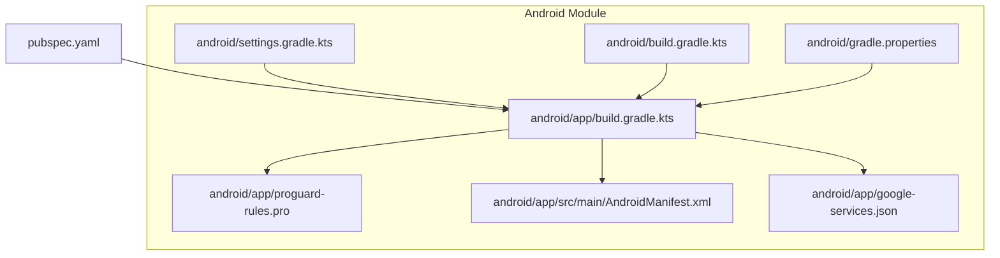
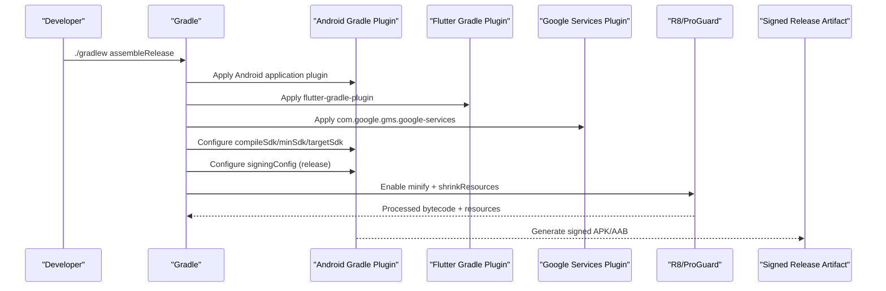
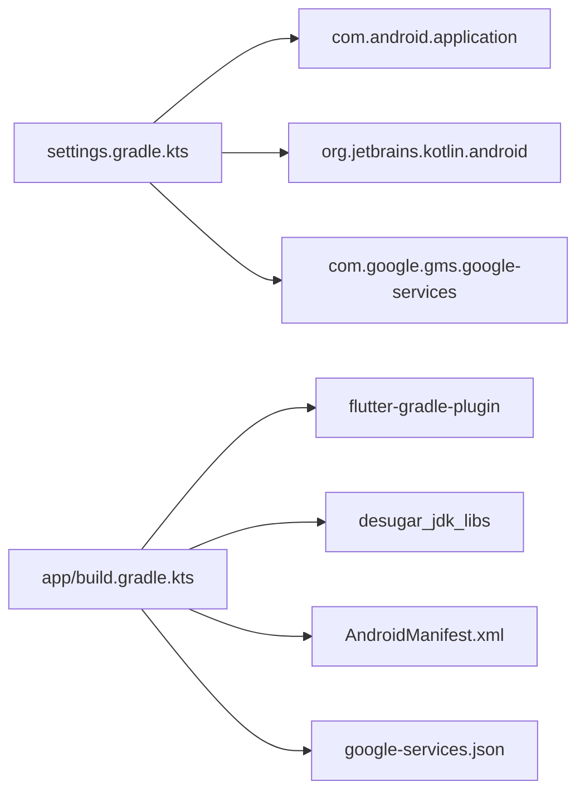
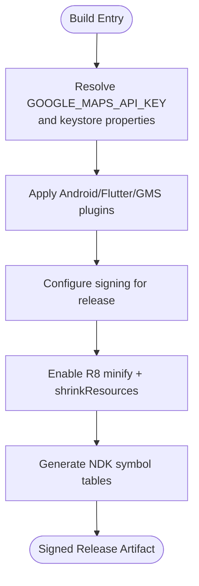

# Android Build & Deployment

<cite>
**Referenced Files in This Document**
- [android/build.gradle.kts](file://android/build.gradle.kts)
- [android/settings.gradle.kts](file://android/settings.gradle.kts)
- [android/gradle.properties](file://android/gradle.properties)
- [android/app/build.gradle.kts](file://android/app/build.gradle.kts)
- [android/app/proguard-rules.pro](file://android/app/proguard-rules.pro)
- [android/app/src/main/AndroidManifest.xml](file://android/app/src/main/AndroidManifest.xml)
- [android/app/google-services.json](file://android/app/google-services.json)
- [pubspec.yaml](file://pubspec.yaml)
</cite>

## Table of Contents
1. [Introduction](#introduction)
2. [Project Structure](#project-structure)
3. [Core Components](#core-components)
4. [Architecture Overview](#architecture-overview)
5. [Detailed Component Analysis](#detailed-component-analysis)
6. [Dependency Analysis](#dependency-analysis)
7. [Performance Considerations](#performance-considerations)
8. [Troubleshooting Guide](#troubleshooting-guide)
9. [Conclusion](#conclusion)
10. [Appendices](#appendices)

## Introduction
This document provides comprehensive Android build and deployment guidance for the Flutter-based LidaPay application. It covers Gradle configuration, signing setup for release builds, Google Play Store submission workflow, environment variables and keystore management, ProGuard/R8 rules, build variants, performance tuning, Firebase integration, crash reporting, and production monitoring. The instructions are derived from the repository’s Android Gradle files, manifest, and Flutter configuration.

## Project Structure
The Android module is a standard Flutter Android app under android/app with shared Gradle configuration at the project root. Key artifacts:
- Root-level Gradle configuration defines repositories, build directories, and plugin versions.
- App-level Gradle configures SDKs, signing, minification, and dependencies.
- Manifest declares permissions, intent filters, and Google Maps API key injection via placeholders.
- Google services JSON wires Firebase to the Android package.
- Flutter pubspec defines app versioning and core dependencies including Firebase and Google Maps.

**Diagram sources**
- [android/build.gradle.kts:1-25](file://android/build.gradle.kts#L1-L25)
- [android/settings.gradle.kts:1-28](file://android/settings.gradle.kts#L1-L28)
- [android/gradle.properties:1-11](file://android/gradle.properties#L1-L11)
- [android/app/build.gradle.kts:1-99](file://android/app/build.gradle.kts#L1-L99)
- [android/app/proguard-rules.pro:1-29](file://android/app/proguard-rules.pro#L1-L29)
- [android/app/src/main/AndroidManifest.xml:1-101](file://android/app/src/main/AndroidManifest.xml#L1-L101)
- [android/app/google-services.json:1-48](file://android/app/google-services.json#L1-L48)
- [pubspec.yaml:1-151](file://pubspec.yaml#L1-L151)

**Section sources**
- [android/build.gradle.kts:1-25](file://android/build.gradle.kts#L1-L25)
- [android/settings.gradle.kts:1-28](file://android/settings.gradle.kts#L1-L28)
- [android/gradle.properties:1-11](file://android/gradle.properties#L1-L11)
- [android/app/build.gradle.kts:1-99](file://android/app/build.gradle.kts#L1-L99)
- [android/app/proguard-rules.pro:1-29](file://android/app/proguard-rules.pro#L1-L29)
- [android/app/src/main/AndroidManifest.xml:1-101](file://android/app/src/main/AndroidManifest.xml#L1-L101)
- [android/app/google-services.json:1-48](file://android/app/google-services.json#L1-L48)
- [pubspec.yaml:1-151](file://pubspec.yaml#L1-L151)

## Core Components
- Gradle root configuration: Centralizes repositories, sets a shared build directory, and registers a clean task.
- Settings and plugins: Declares plugin versions (Android Gradle Plugin, Kotlin, Google Services), includes the app module, and integrates Flutter tooling.
- App build script: Configures compile/target SDKs, Java/Kotlin targets, default config, signing, release build type with R8 shrinking and resource shrinking, and NDK symbol table generation.
- ProGuard/R8 rules: Keeps Flutter engine classes, notification and Firebase messaging classes, biometric/local auth plugins, and geolocation plugins.
- Manifest: Declares permissions, deep links, and injects Google Maps API key via placeholder.
- Google services JSON: Provides Firebase project metadata and client IDs for the Android package names.
- Flutter pubspec: Defines app versioning and dependencies such as Firebase Messaging, Local Notifications, Geolocator, and Google Maps.

**Section sources**
- [android/build.gradle.kts:1-25](file://android/build.gradle.kts#L1-L25)
- [android/settings.gradle.kts:1-28](file://android/settings.gradle.kts#L1-L28)
- [android/app/build.gradle.kts:1-99](file://android/app/build.gradle.kts#L1-L99)
- [android/app/proguard-rules.pro:1-29](file://android/app/proguard-rules.pro#L1-L29)
- [android/app/src/main/AndroidManifest.xml:1-101](file://android/app/src/main/AndroidManifest.xml#L1-L101)
- [android/app/google-services.json:1-48](file://android/app/google-services.json#L1-L48)
- [pubspec.yaml:1-151](file://pubspec.yaml#L1-L151)

## Architecture Overview
The Android build pipeline integrates Flutter, Android Gradle Plugin, Kotlin, and Google Services. The flow below shows how Gradle resolves plugins, applies configurations, and produces a signed release artifact with R8 optimization and symbol tables for crash deobfuscation.

**Diagram sources**
- [android/settings.gradle.kts:20-25](file://android/settings.gradle.kts#L20-L25)
- [android/app/build.gradle.kts:21-83](file://android/app/build.gradle.kts#L21-L83)

## Detailed Component Analysis

### Gradle Build Configuration
- Repositories: google() and mavenCentral() are declared at the root level.
- Build directory: Shared across modules under a common root build directory.
- Clean task: Deletes the root build directory.
- Settings: Includes Flutter tooling gradle, declares plugin versions for Android Gradle Plugin, Kotlin, and Google Services, and includes the :app module.

Key behaviors:
- Plugin versions are centralized in settings.gradle.kts.
- The app module applies Android application, Flutter, and Google Services plugins.
- Java and Kotlin targets are set to JVM 17.

**Section sources**
- [android/build.gradle.kts:1-25](file://android/build.gradle.kts#L1-L25)
- [android/settings.gradle.kts:1-28](file://android/settings.gradle.kts#L1-L28)
- [android/app/build.gradle.kts:21-37](file://android/app/build.gradle.kts#L21-L37)
- [android/app/build.gradle.kts:86-90](file://android/app/build.gradle.kts#L86-L90)

### Signing Setup for Release Builds
- Signing configuration is defined for the release build type.
- Keystore properties are loaded from a local key.properties file if present.
- When storeFile exists, the signing block uses keyAlias, keyPassword, storeFile, and storePassword.
- The release build type assigns this signing configuration.

Operational notes:
- Ensure key.properties is present on your machine or CI environment.
- Keep secrets out of version control; use secure secret stores in CI.

**Section sources**
- [android/app/build.gradle.kts:3-11](file://android/app/build.gradle.kts#L3-L11)
- [android/app/build.gradle.kts:55-64](file://android/app/build.gradle.kts#L55-L64)
- [android/app/build.gradle.kts:66-83](file://android/app/build.gradle.kts#L66-L83)

### Environment Variables and Secrets Management
- Google Maps API key resolution order:
  1) Gradle property GOOGLE_MAPS_API_KEY
  2) Environment variable GOOGLE_MAPS_API_KEY
  3) local.properties GOOGLE_MAPS_API_KEY
- The resolved value is injected into the manifest via manifestPlaceholders["GOOGLE_MAPS_API_KEY"].
- The manifest references the placeholder for com.google.android.geo.API_KEY.

Recommended practices:
- Use environment variables or CI secret managers for GOOGLE_MAPS_API_KEY.
- Restrict the Google Maps API key in Google Cloud Console before release.

**Section sources**
- [android/app/build.gradle.kts:13-19](file://android/app/build.gradle.kts#L13-L19)
- [android/app/build.gradle.kts:52-53](file://android/app/build.gradle.kts#L52-L53)
- [android/app/src/main/AndroidManifest.xml:63-70](file://android/app/src/main/AndroidManifest.xml#L63-L70)

### ProGuard/R8 Configuration
- Minification and resource shrinking are enabled for release builds.
- Default optimize rules plus app-specific proguard-rules.pro are applied.
- NDK debugSymbolLevel is set to SYMBOL_TABLE to enable Play Console deobfuscation without shipping full debug symbols.
- Rules keep Flutter embedding, notifications, Firebase messaging, biometric/local auth, and geolocation plugins.

Best practices:
- Validate that reflection-heavy libraries are kept appropriately.
- Test release builds thoroughly after adding new dependencies.

**Section sources**
- [android/app/build.gradle.kts:66-83](file://android/app/build.gradle.kts#L66-L83)
- [android/app/proguard-rules.pro:1-29](file://android/app/proguard-rules.pro#L1-L29)

### Build Variants and Versioning
- The app uses defaultConfig with Flutter-provided versionCode and versionName.
- Only debug/release build types are configured; no custom variants exist.
- Versioning is driven by Flutter pubspec version string.

Notes:
- Split APKs add ABI_VERSION offsets automatically; you can override behavior via a Gradle flag if needed.

**Section sources**
- [android/app/build.gradle.kts:39-53](file://android/app/build.gradle.kts#L39-L53)
- [pubspec.yaml:7-19](file://pubspec.yaml#L7-L19)

### Google Play Store Submission
- The app is configured as an Android application with a stable applicationId.
- Release builds are signed and optimized with R8.
- Symbol tables are generated for crash deobfuscation.

Submission steps:
1) Generate a signed release bundle (AAB) using the release build type.
2) Verify signing configuration and R8 rules.
3) Upload the AAB to Google Play Console.
4) Complete internal testing or rollout tracks as appropriate.

**Section sources**
- [android/app/build.gradle.kts:21-26](file://android/app/build.gradle.kts#L21-L26)
- [android/app/build.gradle.kts:66-83](file://android/app/build.gradle.kts#L66-L83)

### Firebase Integration
- Google Services plugin is applied, and google-services.json is included.
- Dependencies include firebase_core and firebase_messaging.
- The manifest does not declare additional Firebase components beyond what the plugin merges.

Setup verification:
- Ensure google-services.json matches the Android package name used in the app.
- Confirm Firebase project configuration aligns with the Android client ID.

**Section sources**
- [android/app/build.gradle.kts:21-26](file://android/app/build.gradle.kts#L21-L26)
- [android/app/google-services.json:1-48](file://android/app/google-services.json#L1-L48)
- [pubspec.yaml:64-66](file://pubspec.yaml#L64-L66)

### Crash Reporting and Production Monitoring
- Firebase Messaging dependency is present; crash reporting typically uses Firebase Crashlytics.
- The current configuration enables symbol table generation for deobfuscation, which is required for meaningful crash reports.
- For full Crashlytics integration, ensure the Crashlytics Gradle plugin and related dependencies are added and initialized in the app code.

Recommendations:
- Add Firebase Crashlytics plugin and dependencies.
- Initialize Crashlytics in the app startup path.
- Validate symbol upload to Play Console for deobfuscated stacks.

**Section sources**
- [android/app/build.gradle.kts:77-81](file://android/app/build.gradle.kts#L77-L81)
- [pubspec.yaml:64-66](file://pubspec.yaml#L64-L66)

## Dependency Analysis
The Android build depends on:
- Android Gradle Plugin and Kotlin plugin versions declared in settings.gradle.kts.
- Flutter Gradle plugin for building Flutter assets and native integration.
- Google Services plugin for Firebase configuration merging.
- Desugaring library for modern Java APIs on older Android versions.

**Diagram sources**
- [android/settings.gradle.kts:20-25](file://android/settings.gradle.kts#L20-L25)
- [android/app/build.gradle.kts:21-26](file://android/app/build.gradle.kts#L21-L26)
- [android/app/build.gradle.kts:96-98](file://android/app/build.gradle.kts#L96-L98)
- [android/app/src/main/AndroidManifest.xml:1-101](file://android/app/src/main/AndroidManifest.xml#L1-L101)
- [android/app/google-services.json:1-48](file://android/app/google-services.json#L1-L48)

**Section sources**
- [android/settings.gradle.kts:20-25](file://android/settings.gradle.kts#L20-L25)
- [android/app/build.gradle.kts:21-26](file://android/app/build.gradle.kts#L21-L26)
- [android/app/build.gradle.kts:96-98](file://android/app/build.gradle.kts#L96-L98)

## Performance Considerations
- Gradle JVM args: Increased heap size and metaspace to avoid OOM during large builds.
- Kotlin daemon JVM args: Constrained to prevent exceeding available memory.
- R8 minification and resource shrinking reduce artifact size and improve load times.
- NDK symbol tables enable efficient crash deobfuscation without shipping full debug info.

Optimization tips:
- Keep Gradle daemon running between builds.
- Use parallel tasks and configure worker threads appropriately.
- Avoid unnecessary dependencies and keep third-party libraries updated.

**Section sources**
- [android/gradle.properties:1-5](file://android/gradle.properties#L1-L5)
- [android/app/build.gradle.kts:66-83](file://android/app/build.gradle.kts#L66-L83)

## Troubleshooting Guide
Common issues and resolutions:
- Missing Google Maps API key:
  - Ensure GOOGLE_MAPS_API_KEY is provided via environment variable, Gradle property, or local.properties.
  - Verify the manifest placeholder is correctly injected.
- Keystore not found or invalid credentials:
  - Confirm key.properties exists and contains valid storeFile, storePassword, keyAlias, and keyPassword.
  - Check file paths and permissions.
- Firebase configuration mismatch:
  - Ensure google-services.json package_name matches the app’s applicationId.
- R8 crashes or runtime reflection errors:
  - Review proguard-rules.pro and add keep rules for newly introduced reflection-heavy libraries.
- Build OOM or slow builds:
  - Adjust Gradle JVM args and Kotlin daemon args based on machine capacity.
  - Clear caches and rebuild.

**Section sources**
- [android/app/build.gradle.kts:13-19](file://android/app/build.gradle.kts#L13-L19)
- [android/app/build.gradle.kts:55-64](file://android/app/build.gradle.kts#L55-L64)
- [android/app/proguard-rules.pro:1-29](file://android/app/proguard-rules.pro#L1-L29)
- [android/gradle.properties:1-5](file://android/gradle.properties#L1-L5)

## Conclusion
The Android build is configured for secure, optimized release artifacts with R8 shrinking, resource shrinking, and symbol table generation for crash deobfuscation. Secrets like the Google Maps API key and keystore credentials are managed through environment variables and local properties. Firebase is integrated via the Google Services plugin and relevant dependencies. Following the steps and recommendations in this document will help you produce reliable signed releases and streamline submission to Google Play.

## Appendices

### Step-by-Step: Generating Signed APK/AAB
1) Prepare secrets:
   - Set GOOGLE_MAPS_API_KEY in your environment or local.properties.
   - Create key.properties with keystore details on your machine or CI.
2) Build release artifact:
   - Run the release build command to generate a signed AAB/APK.
3) Validate outputs:
   - Verify signing and R8 rules are applied.
   - Confirm symbol tables are generated for crash deobfuscation.
4) Submit to Google Play:
   - Upload the AAB to Google Play Console and follow rollout procedures.

**Section sources**
- [android/app/build.gradle.kts:13-19](file://android/app/build.gradle.kts#L13-L19)
- [android/app/build.gradle.kts:55-64](file://android/app/build.gradle.kts#L55-L64)
- [android/app/build.gradle.kts:66-83](file://android/app/build.gradle.kts#L66-L83)

### Build Variant Flow

**Diagram sources**
- [android/app/build.gradle.kts:13-19](file://android/app/build.gradle.kts#L13-L19)
- [android/app/build.gradle.kts:55-64](file://android/app/build.gradle.kts#L55-L64)
- [android/app/build.gradle.kts:66-83](file://android/app/build.gradle.kts#L66-L83)