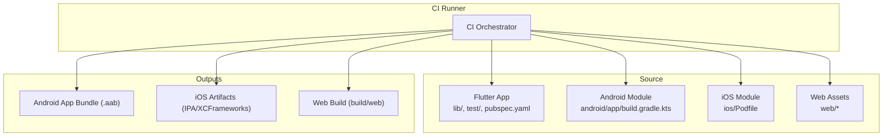
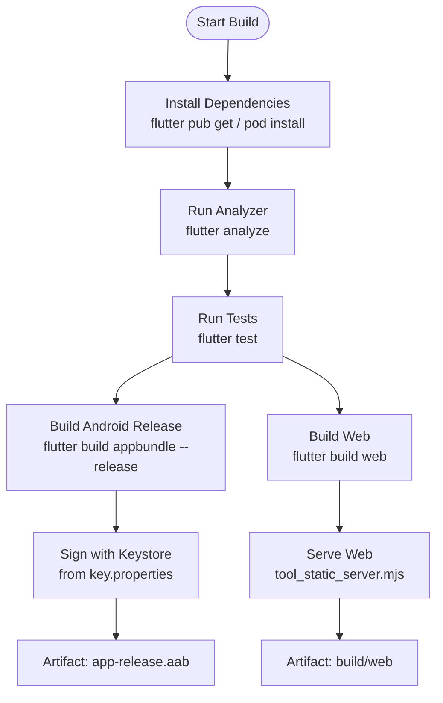
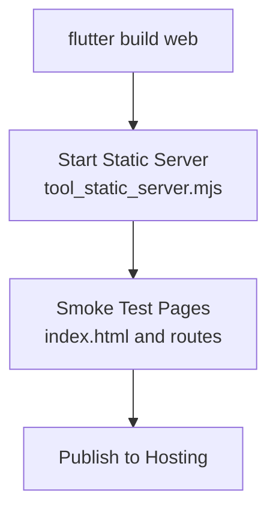
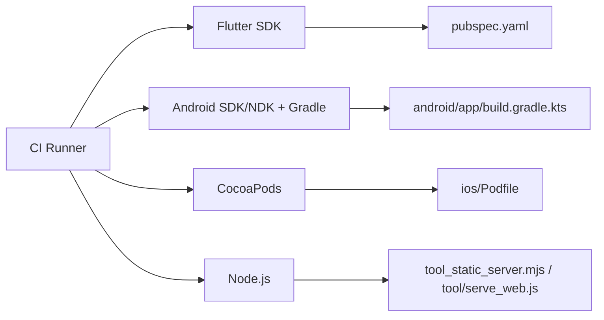

# CI/CD Pipeline Configuration

<cite>
**Referenced Files in This Document**
- [README.md](file://README.md)
- [pubspec.yaml](file://pubspec.yaml)
- [android/app/build.gradle.kts](file://android/app/build.gradle.kts)
- [ios/Podfile](file://ios/Podfile)
- [tool/serve_web.js](file://tool/serve_web.js)
- [tool_static_server.mjs](file://tool_static_server.mjs)
</cite>

## Table of Contents
1. [Introduction](#introduction)
2. [Project Structure](#project-structure)
3. [Core Components](#core-components)
4. [Architecture Overview](#architecture-overview)
5. [Detailed Component Analysis](#detailed-component-analysis)
6. [Dependency Analysis](#dependency-analysis)
7. [Performance Considerations](#performance-considerations)
8. [Troubleshooting Guide](#troubleshooting-guide)
9. [Conclusion](#conclusion)

## Introduction
This document defines the CI/CD pipeline for LidaPay, a Flutter mobile application with web assets and Android/iOS targets. It covers automated builds, testing, artifact generation, environment-specific configuration, secret management, parallel testing strategies, build optimizations, and deployment automation for both static web content and mobile app distribution.

The repository provides:
- Flutter project metadata and dependencies
- Android Gradle build configuration with signing and optimization
- iOS CocoaPods setup
- Static web server utilities for local and CI verification
- Documentation for Play Store release steps

## Project Structure
At a high level, the CI/CD pipeline interacts with these areas:
- Flutter tooling and tests (Dart/Flutter)
- Android build and signing via Gradle
- iOS dependency resolution via CocoaPods
- Web asset serving for preview and validation



**Diagram sources**
- [pubspec.yaml:1-152](file://pubspec.yaml#L1-L152)
- [android/app/build.gradle.kts:1-99](file://android/app/build.gradle.kts#L1-L99)
- [ios/Podfile:1-44](file://ios/Podfile#L1-L44)

**Section sources**
- [pubspec.yaml:1-152](file://pubspec.yaml#L1-L152)
- [android/app/build.gradle.kts:1-99](file://android/app/build.gradle.kts#L1-L99)
- [ios/Podfile:1-44](file://ios/Podfile#L1-L44)

## Core Components
- Flutter analysis and tests: The README documents running `flutter analyze` and `flutter test`. These should be executed in CI to enforce code quality and validate behavior.
- Android release build: The README documents generating a signed Android App Bundle using `flutter build appbundle --release`, which reads signing from `android/key.properties` and produces an `.aab` artifact.
- iOS dependency resolution: CocoaPods is configured via `ios/Podfile`, including analytics disablement to reduce network overhead during builds.
- Web static server utilities: Two Node-based servers serve the built web output for local development and CI previews.

Key responsibilities:
- Validate Dart code and run unit/integration tests
- Build and sign Android artifacts
- Resolve iOS dependencies and prepare iOS artifacts
- Serve and verify web builds

**Section sources**
- [README.md:7-25](file://README.md#L7-L25)
- [android/app/build.gradle.kts:55-83](file://android/app/build.gradle.kts#L55-L83)
- [ios/Podfile:1-44](file://ios/Podfile#L1-L44)
- [tool/serve_web.js:1-51](file://tool/serve_web.js#L1-L51)
- [tool_static_server.mjs:1-31](file://tool_static_server.mjs#L1-L31)

## Architecture Overview
The recommended CI/CD architecture uses a GitHub Actions workflow (or equivalent) that:
- Checks out the repository
- Sets up Flutter and platform toolchains
- Installs dependencies
- Runs linting and tests in parallel
- Builds Android App Bundle and iOS artifacts
- Serves the web build for smoke tests
- Publishes artifacts and deploys static web pages

```mermaid
sequenceDiagram
participant GH as "GitHub Actions"
participant FL as "Flutter Toolchain"
participant AND as "Android Gradle"
participant IOS as "CocoaPods"
participant WEB as "Static Server"
GH->>FL : Setup Flutter SDK and cache
GH->>FL : flutter pub get
GH->>FL : flutter analyze
GH->>FL : flutter test (parallel jobs)
GH->>AND : flutter build appbundle --release
GH->>IOS : pod install (with analytics disabled)
GH->>WEB : flutter build web
GH->>WEB : node tool_static_server.mjs (preview)
GH-->>GH : Upload .aab and web artifacts
```

**Diagram sources**
- [README.md:7-25](file://README.md#L7-L25)
- [android/app/build.gradle.kts:1-99](file://android/app/build.gradle.kts#L1-L99)
- [ios/Podfile:1-44](file://ios/Podfile#L1-L44)
- [tool_static_server.mjs:1-31](file://tool_static_server.mjs#L1-L31)

## Detailed Component Analysis

### Automated Build Processes
- Android App Bundle:
  - Generated by `flutter build appbundle --release`.
  - Signing is configured through `android/app/build.gradle.kts`, which loads keystore properties from `key.properties` and applies minification, resource shrinking, ProGuard rules, and symbol table generation for crash reporting.
  - Google Maps API key injection is supported via Gradle property or environment variable.

- iOS:
  - CocoaPods is configured in `ios/Podfile`, disabling analytics to improve build latency.
  - The Podfile sets up Flutter integration and target configurations.

- Web:
  - Web build outputs are served locally via `tool_static_server.mjs` or `tool/serve_web.js` for quick validation in CI.



**Diagram sources**
- [README.md:7-25](file://README.md#L7-L25)
- [android/app/build.gradle.kts:55-83](file://android/app/build.gradle.kts#L55-L83)
- [ios/Podfile:1-44](file://ios/Podfile#L1-L44)
- [tool_static_server.mjs:1-31](file://tool_static_server.mjs#L1-L31)

**Section sources**
- [README.md:7-25](file://README.md#L7-L25)
- [android/app/build.gradle.kts:1-99](file://android/app/build.gradle.kts#L1-L99)
- [ios/Podfile:1-44](file://ios/Podfile#L1-L44)
- [tool_static_server.mjs:1-31](file://tool_static_server.mjs#L1-L31)

### Testing Workflows
- Unit and integration tests are executed via `flutter test`.
- Code quality is enforced via `flutter analyze`.
- Parallelization strategy:
  - Split tests across multiple CI jobs or shards to reduce total execution time.
  - Use test grouping by feature directories where applicable.

Best practices:
- Cache Flutter SDK and package dependencies between runs.
- Run analyzer before tests to fail fast on style issues.
- Isolate flaky tests and retry them selectively.

**Section sources**
- [README.md:7-13](file://README.md#L7-L13)
- [pubspec.yaml:77-83](file://pubspec.yaml#L77-L83)

### Artifact Generation
- Android:
  - Output path: `build/app/outputs/bundle/release/app-release.aab`.
  - Versioning is driven by `pubspec.yaml` version and build number.
- iOS:
  - Artifacts are produced by Xcode; ensure provisioning profiles and signing identities are available in CI secrets.
- Web:
  - Static files under `build/web`; served via Node static server for validation.

Versioning notes:
- `pubspec.yaml` defines the app version and build number used by Android and iOS.
- Increment the build number before each release per README guidance.

**Section sources**
- [README.md:15-25](file://README.md#L15-L25)
- [pubspec.yaml:7-19](file://pubspec.yaml#L7-L19)
- [android/app/build.gradle.kts:39-53](file://android/app/build.gradle.kts#L39-L53)

### Environment-Specific Deployments
- Android release signing:
  - Uses `android/key.properties` for keystore details. Keep this file private and never commit it.
  - CI must inject keystore data securely (e.g., encrypted secrets) and write `key.properties` at runtime.
- Google Maps API key:
  - Injected via Gradle property or environment variable into the manifest placeholder.
- Web deployment:
  - Static pages in `web/` must be published to stable HTTPS URLs referenced by store listings.

Secrets required in CI:
- Android keystore and `key.properties` values
- Google Maps API key
- iOS signing certificates and provisioning profiles
- Any backend tokens needed for integration tests

**Section sources**
- [android/app/build.gradle.kts:1-19](file://android/app/build.gradle.kts#L1-L19)
- [android/app/build.gradle.kts:55-83](file://android/app/build.gradle.kts#L55-L83)
- [README.md:27-47](file://README.md#L27-L47)

### Secret Management in CI Environments
Recommended approach:
- Store sensitive values (keystore, passwords, API keys, JWT secrets) in the CI provider’s secret store.
- Decrypt and write temporary files (e.g., `key.properties`) during the build step.
- Never log or echo secrets.
- Rotate secrets regularly and restrict access to authorized users and workflows.

Environment variables:
- `GOOGLE_MAPS_API_KEY` can be passed to Gradle or set as an environment variable.
- Other provider-specific secrets should be injected via CI mechanisms.

**Section sources**
- [android/app/build.gradle.kts:13-19](file://android/app/build.gradle.kts#L13-L19)
- [README.md:22-25](file://README.md#L22-L25)

### Parallel Testing Strategies
- Shard tests by directory or category to distribute workloads across runners.
- Use caching for Flutter SDK and packages to minimize cold starts.
- Run analyzer once and reuse results across jobs if possible.
- Fail fast on analyzer errors before executing tests.

[No sources needed since this section provides general guidance]

### Build Optimization Techniques
- Disable CocoaPods analytics to reduce network overhead (`ENV['COCOAPODS_DISABLE_STATS'] = 'true'`).
- Enable Android minification and resource shrinking in release builds.
- Generate symbol tables for crash deobfuscation without shipping full debug symbols.
- Cache dependencies and generated files in CI.

**Section sources**
- [ios/Podfile:4-5](file://ios/Podfile#L4-L5)
- [android/app/build.gradle.kts:66-83](file://android/app/build.gradle.kts#L66-L83)

### Web Deployment Using Static Server Tools
- Local preview:
  - Use `node tool_static_server.mjs` to serve `build/web` on a local port.
  - Alternatively, use `node tool/serve_web.js [root] [port]` for flexible root/port configuration.
- CI validation:
  - Build web assets and start the static server to perform basic smoke tests against the hosted bundle.
- Production hosting:
  - Publish `web/` or `build/web` to a static hosting service behind HTTPS.



**Diagram sources**
- [tool_static_server.mjs:1-31](file://tool_static_server.mjs#L1-L31)
- [tool/serve_web.js:1-51](file://tool/serve_web.js#L1-L51)

**Section sources**
- [tool_static_server.mjs:1-31](file://tool_static_server.mjs#L1-L31)
- [tool/serve_web.js:1-51](file://tool/serve_web.js#L1-L51)

### Mobile App Distribution Through Automated Pipelines
- Android:
  - Upload the generated `.aab` to Google Play Console.
  - Ensure Play App Signing enrollment and matching upload certificate.
  - Follow store listing requirements and privacy/account-deletion declarations documented in README.
- iOS:
  - Produce IPA or archive artifacts using Xcode in CI with proper provisioning profiles and signing identities.
  - Distribute via TestFlight or App Store Connect.

Release checklist highlights:
- Increment build number in `pubspec.yaml`.
- Complete Play Console Data safety and account-deletion declarations.
- Verify store listing assets and links.

**Section sources**
- [README.md:15-47](file://README.md#L15-L47)
- [pubspec.yaml:7-19](file://pubspec.yaml#L7-L19)

## Dependency Analysis
The CI/CD pipeline depends on:
- Flutter SDK and tools
- Android SDK/NDK and Gradle
- CocoaPods for iOS dependencies
- Node.js for static web server utilities



**Diagram sources**
- [pubspec.yaml:1-152](file://pubspec.yaml#L1-L152)
- [android/app/build.gradle.kts:1-99](file://android/app/build.gradle.kts#L1-L99)
- [ios/Podfile:1-44](file://ios/Podfile#L1-L44)
- [tool_static_server.mjs:1-31](file://tool_static_server.mjs#L1-L31)
- [tool/serve_web.js:1-51](file://tool/serve_web.js#L1-L51)

**Section sources**
- [pubspec.yaml:1-152](file://pubspec.yaml#L1-L152)
- [android/app/build.gradle.kts:1-99](file://android/app/build.gradle.kts#L1-L99)
- [ios/Podfile:1-44](file://ios/Podfile#L1-L44)
- [tool_static_server.mjs:1-31](file://tool_static_server.mjs#L1-L31)
- [tool/serve_web.js:1-51](file://tool/serve_web.js#L1-L51)

## Performance Considerations
- Cache Flutter SDK, packages, and generated files to reduce warm-up time.
- Disable CocoaPods analytics to avoid synchronous network calls during pod installs.
- Use Android minification and resource shrinking to produce smaller, faster-loading releases.
- Generate symbol tables for efficient crash report deobfuscation.
- Parallelize test execution and split large test suites across multiple runners.

**Section sources**
- [ios/Podfile:4-5](file://ios/Podfile#L4-L5)
- [android/app/build.gradle.kts:66-83](file://android/app/build.gradle.kts#L66-L83)

## Troubleshooting Guide
Common issues and resolutions:
- Missing keystore or invalid credentials:
  - Ensure `key.properties` is present at runtime and contains valid keystore paths and passwords.
  - Verify keystore fingerprint matches Play App Signing configuration.
- Google Maps API key not applied:
  - Pass `GOOGLE_MAPS_API_KEY` via Gradle property or environment variable.
- CocoaPods slow or failing:
  - Confirm analytics is disabled and network connectivity is stable.
- Web server not serving expected pages:
  - Verify `build/web` exists and the static server points to the correct root.

Operational checks:
- Run `flutter analyze` and `flutter test` locally before pushing changes.
- Validate Play Console store listing and privacy/account-deletion links.
- Test the signed Android bundle on an internal track prior to production rollout.

**Section sources**
- [android/app/build.gradle.kts:1-19](file://android/app/build.gradle.kts#L1-L19)
- [android/app/build.gradle.kts:55-83](file://android/app/build.gradle.kts#L55-L83)
- [README.md:27-47](file://README.md#L27-L47)

## Conclusion
This CI/CD configuration establishes a robust pipeline for LidaPay:
- Automated analysis and testing ensure code quality and stability.
- Android and iOS builds are optimized and signed securely.
- Web assets are validated using static server tools.
- Secrets are managed safely, and environment-specific values are injected at build time.
- Releases follow Play Store guidelines and include comprehensive checklists.

Adopting the recommendations above will streamline continuous integration, accelerate feedback loops, and support reliable deployments across platforms.