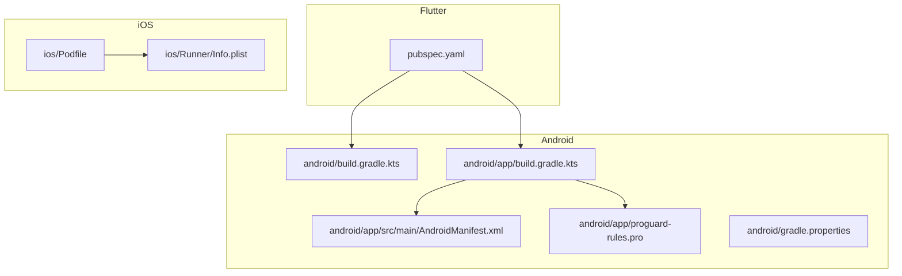
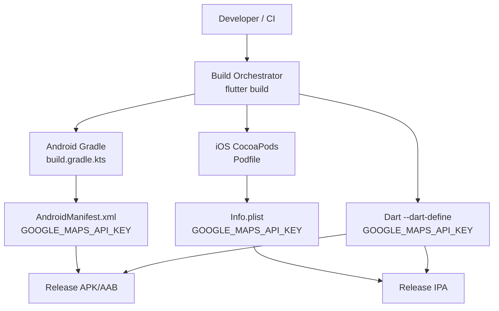
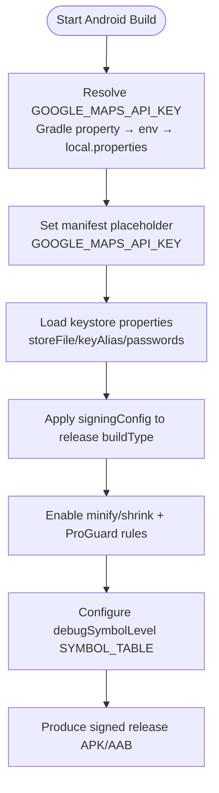
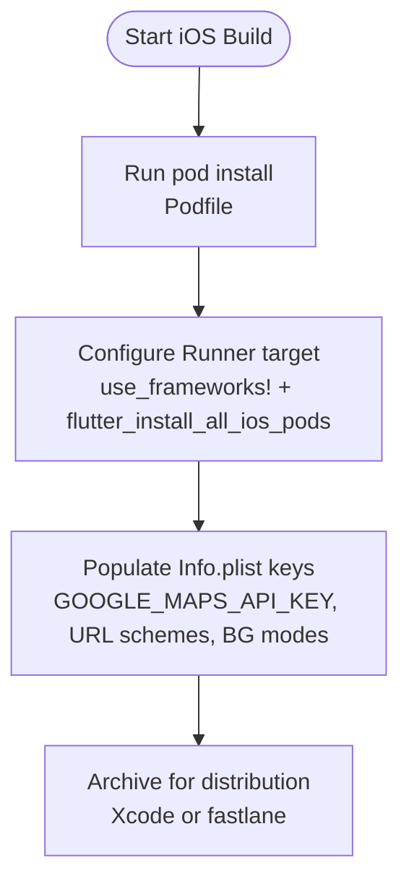
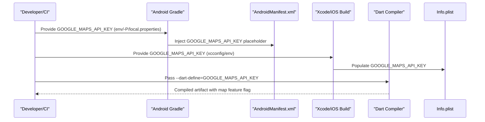
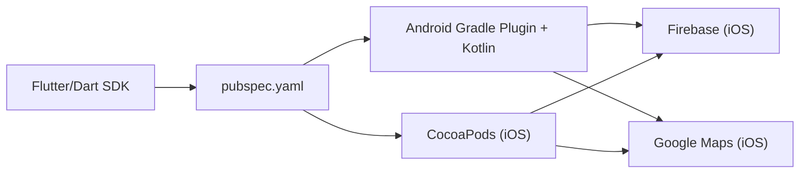

# Deployment & Build Process

<cite>
**Referenced Files in This Document**
- [pubspec.yaml](file://pubspec.yaml)
- [android/app/build.gradle.kts](file://android/app/build.gradle.kts)
- [android/build.gradle.kts](file://android/build.gradle.kts)
- [android/gradle.properties](file://android/gradle.properties)
- [android/app/proguard-rules.pro](file://android/app/proguard-rules.pro)
- [android/app/src/main/AndroidManifest.xml](file://android/app/src/main/AndroidManifest.xml)
- [ios/Podfile](file://ios/Podfile)
- [ios/Runner/Info.plist](file://ios/Runner/Info.plist)
- [docs/GOOGLE_MAPS_SETUP.md](file://docs/GOOGLE_MAPS_SETUP.md)
</cite>

## Table of Contents
1. [Introduction](#introduction)
2. [Project Structure](#project-structure)
3. [Core Components](#core-components)
4. [Architecture Overview](#architecture-overview)
5. [Detailed Component Analysis](#detailed-component-analysis)
6. [Dependency Analysis](#dependency-analysis)
7. [Performance Considerations](#performance-considerations)
8. [Troubleshooting Guide](#troubleshooting-guide)
9. [Conclusion](#conclusion)
10. [Appendices](#appendices)

## Introduction
This document describes the end-to-end deployment and build process for the LidaPay Flutter application across Android and iOS. It covers:
- Android build configuration, signing, and release optimization
- iOS deployment setup, CocoaPods integration, and Info.plist variables
- Environment configuration and secret management (Google Maps API key)
- Concrete examples for building release artifacts
- Guidance for Google Play Store and App Store submission
- CI/CD pipeline recommendations, automated testing, and release management
- Troubleshooting common build issues, performance tuning, and rollback procedures

## Project Structure
The repository is a Flutter project with native Android and iOS modules:
- Root-level Dart configuration and dependencies are defined in pubspec.yaml
- Android module uses Gradle Kotlin DSL with R8 shrinking and ProGuard rules
- iOS module uses CocoaPods and Xcode build settings via Podfile and Info.plist
- Documentation includes Google Maps setup guidance for both platforms

**Diagram sources**
- [pubspec.yaml:1-151](file://pubspec.yaml#L1-L151)
- [android/build.gradle.kts:1-25](file://android/build.gradle.kts#L1-L25)
- [android/app/build.gradle.kts:1-99](file://android/app/build.gradle.kts#L1-L99)
- [android/app/src/main/AndroidManifest.xml:1-101](file://android/app/src/main/AndroidManifest.xml#L1-L101)
- [android/app/proguard-rules.pro:1-29](file://android/app/proguard-rules.pro#L1-L29)
- [android/gradle.properties:1-11](file://android/gradle.properties#L1-L11)
- [ios/Podfile:1-44](file://ios/Podfile#L1-L44)
- [ios/Runner/Info.plist:1-95](file://ios/Runner/Info.plist#L1-L95)

**Section sources**
- [pubspec.yaml:1-151](file://pubspec.yaml#L1-L151)
- [android/build.gradle.kts:1-25](file://android/build.gradle.kts#L1-L25)
- [android/app/build.gradle.kts:1-99](file://android/app/build.gradle.kts#L1-L99)
- [android/app/src/main/AndroidManifest.xml:1-101](file://android/app/src/main/AndroidManifest.xml#L1-L101)
- [android/app/proguard-rules.pro:1-29](file://android/app/proguard-rules.pro#L1-L29)
- [android/gradle.properties:1-11](file://android/gradle.properties#L1-L11)
- [ios/Podfile:1-44](file://ios/Podfile#L1-L44)
- [ios/Runner/Info.plist:1-95](file://ios/Runner/Info.plist#L1-L95)

## Core Components
- Versioning and assets:
  - Application version and build number are defined in pubspec.yaml and consumed by Android and iOS builds.
  - Assets and fonts are declared for inclusion in the app bundle.
- Android build:
  - Gradle Kotlin DSL configures compile SDK, Java/Kotlin targets, min/target SDKs, and version mapping from pubspec.yaml.
  - Signing configuration reads keystore properties from a local file to sign release builds.
  - Release build enables code shrinking and resource shrinking with ProGuard/R8 rules.
  - Manifest declares permissions, deep links, and injects Google Maps API key via manifest placeholder.
- iOS build:
  - CocoaPods integrates Flutter plugins and sets up build targets.
  - Info.plist defines display name, URL schemes, background modes, and maps API key variable.
- Secrets and environment:
  - Google Maps API key is injected into Android via manifest placeholder and into iOS via Info.plist variable.
  - Dart-side feature flags use compile-time defines for runtime behavior.

**Section sources**
- [pubspec.yaml:1-151](file://pubspec.yaml#L1-L151)
- [android/app/build.gradle.kts:1-99](file://android/app/build.gradle.kts#L1-L99)
- [android/app/src/main/AndroidManifest.xml:1-101](file://android/app/src/main/AndroidManifest.xml#L1-L101)
- [ios/Podfile:1-44](file://ios/Podfile#L1-L44)
- [ios/Runner/Info.plist:1-95](file://ios/Runner/Info.plist#L1-L95)

## Architecture Overview
The build system composes Flutter, Android Gradle, and CocoaPods to produce platform-specific artifacts. The Google Maps API key flows through multiple layers:
- Android: Gradle resolves the key from property/env/local.properties and injects it into the manifest.
- iOS: Info.plist reads the key from an environment variable or xcconfig.
- Dart: Compile-time define controls whether map features render.

**Diagram sources**
- [android/app/build.gradle.kts:13-20](file://android/app/build.gradle.kts#L13-L20)
- [android/app/build.gradle.kts:55-63](file://android/app/build.gradle.kts#L55-L63)
- [android/app/src/main/AndroidManifest.xml:63-70](file://android/app/src/main/AndroidManifest.xml#L63-L70)
- [ios/Runner/Info.plist:9-10](file://ios/Runner/Info.plist#L9-L10)
- [docs/GOOGLE_MAPS_SETUP.md:87-95](file://docs/GOOGLE_MAPS_SETUP.md#L87-L95)

## Detailed Component Analysis

### Android Build Configuration
Key responsibilities:
- Resolve Google Maps API key from multiple sources with a clear precedence order.
- Map Flutter-provided versionName/versionCode to Android package metadata.
- Configure signing for release builds using external keystore properties.
- Enable R8 shrinking and ProGuard rules to optimize release artifacts.
- Inject Google Maps API key into the manifest.

**Diagram sources**
- [android/app/build.gradle.kts:13-20](file://android/app/build.gradle.kts#L13-L20)
- [android/app/build.gradle.kts:39-53](file://android/app/build.gradle.kts#L39-L53)
- [android/app/build.gradle.kts:55-63](file://android/app/build.gradle.kts#L55-L63)
- [android/app/build.gradle.kts:66-83](file://android/app/build.gradle.kts#L66-L83)
- [android/app/src/main/AndroidManifest.xml:63-70](file://android/app/src/main/AndroidManifest.xml#L63-L70)

**Section sources**
- [android/app/build.gradle.kts:1-99](file://android/app/build.gradle.kts#L1-L99)
- [android/app/src/main/AndroidManifest.xml:1-101](file://android/app/src/main/AndroidManifest.xml#L1-L101)
- [android/app/proguard-rules.pro:1-29](file://android/app/proguard-rules.pro#L1-L29)

### iOS Deployment Setup
Key responsibilities:
- Define minimum iOS platform and disable CocoaPods analytics during builds.
- Integrate Flutter plugins via CocoaPods and configure Runner target.
- Provide Info.plist keys for Google Maps API key, URL schemes, and background modes.

**Diagram sources**
- [ios/Podfile:1-44](file://ios/Podfile#L1-L44)
- [ios/Runner/Info.plist:1-95](file://ios/Runner/Info.plist#L1-L95)

**Section sources**
- [ios/Podfile:1-44](file://ios/Podfile#L1-L44)
- [ios/Runner/Info.plist:1-95](file://ios/Runner/Info.plist#L1-L95)

### Secret Management and Environment Configuration
Secrets and environment variables:
- Google Maps API key:
  - Android: resolved by Gradle from property, environment, or local.properties; injected into manifest.
  - iOS: provided via Info.plist variable (typically set by xcconfig or CI).
  - Dart: passed as compile-time define to enable map rendering.
- Keystore properties:
  - Android release signing reads keystore details from a local properties file.

**Diagram sources**
- [android/app/build.gradle.kts:13-20](file://android/app/build.gradle.kts#L13-L20)
- [android/app/src/main/AndroidManifest.xml:63-70](file://android/app/src/main/AndroidManifest.xml#L63-L70)
- [ios/Runner/Info.plist:9-10](file://ios/Runner/Info.plist#L9-L10)
- [docs/GOOGLE_MAPS_SETUP.md:87-95](file://docs/GOOGLE_MAPS_SETUP.md#L87-L95)

**Section sources**
- [android/app/build.gradle.kts:13-20](file://android/app/build.gradle.kts#L13-L20)
- [android/app/src/main/AndroidManifest.xml:63-70](file://android/app/src/main/AndroidManifest.xml#L63-L70)
- [ios/Runner/Info.plist:9-10](file://ios/Runner/Info.plist#L9-L10)
- [docs/GOOGLE_MAPS_SETUP.md:1-95](file://docs/GOOGLE_MAPS_SETUP.md#L1-L95)

### Signing Certificates and App Store Submission Processes
- Android:
  - Create a keystore and store credentials in a local properties file referenced by the Gradle build.
  - Ensure release build type applies the signing configuration and that ProGuard/R8 rules are applied.
  - Generate signed release artifacts (APK/AAB) for upload to Google Play Console.
- iOS:
  - Configure provisioning profiles and signing certificates in Xcode or via CI tooling.
  - Archive the app and distribute via TestFlight or App Store Connect.

Note: Specific certificate files and passwords must be managed securely and not committed to source control.

**Section sources**
- [android/app/build.gradle.kts:55-63](file://android/app/build.gradle.kts#L55-L63)
- [android/app/build.gradle.kts:66-83](file://android/app/build.gradle.kts#L66-L83)

### CI/CD Pipeline Configuration, Automated Testing, and Release Management
Recommended pipeline stages:
- Checkout and dependency resolution:
  - Install Flutter/Dart SDKs, run pub get, and install CocoaPods.
- Automated testing:
  - Run unit and widget tests using Flutter test runner.
- Build and sign:
  - Android: build release APK/AAB with signing and shrinkers enabled.
  - iOS: archive and sign IPA with appropriate provisioning profile.
- Artifact publishing:
  - Upload Android artifacts to Google Play internal/closed tracks.
  - Upload iOS artifacts to App Store Connect or TestFlight.
- Post-release verification:
  - Smoke tests on staging devices and monitor crash reports.

Environment and secrets:
- Store Google Maps API key and signing credentials in CI secret stores.
- Inject secrets into build steps per platform requirements.

**Section sources**
- [docs/GOOGLE_MAPS_SETUP.md:87-95](file://docs/GOOGLE_MAPS_SETUP.md#L87-L95)

### Concrete Examples: Building Release Versions and Generating Signed Bundles
- Android release build:
  - Ensure keystore properties exist and Google Maps API key is available.
  - Build signed release APK/AAB with shrinkers enabled.
- iOS release build:
  - Ensure Info.plist GOOGLE_MAPS_API_KEY is set and provisioning profile is configured.
  - Archive and export IPA for distribution.

These commands should be executed in a clean environment with all required secrets injected.

**Section sources**
- [android/app/build.gradle.kts:55-83](file://android/app/build.gradle.kts#L55-L83)
- [ios/Runner/Info.plist:9-10](file://ios/Runner/Info.plist#L9-L10)

### Production Monitoring Setup
- Firebase integration:
  - The app depends on Firebase core and messaging packages, enabling crash reporting and remote notifications.
- Platform-specific considerations:
  - Android: ensure Google Services configuration is present and correct.
  - iOS: ensure Firebase configuration matches the bundle identifier and provisioning profile.

**Section sources**
- [pubspec.yaml:64-66](file://pubspec.yaml#L64-L66)

## Dependency Analysis
The build pipeline has the following dependencies:
- Flutter SDK and Dart SDK versions pinned in pubspec.yaml
- Android Gradle plugin and Kotlin compiler targeting specific JVM versions
- CocoaPods for iOS plugin integration
- Firebase and Google Maps SDKs requiring proper configuration

**Diagram sources**
- [pubspec.yaml:21-22](file://pubspec.yaml#L21-L22)
- [pubspec.yaml:64-66](file://pubspec.yaml#L64-L66)
- [android/app/build.gradle.kts:86-90](file://android/app/build.gradle.kts#L86-L90)
- [ios/Podfile:1-44](file://ios/Podfile#L1-L44)

**Section sources**
- [pubspec.yaml:21-22](file://pubspec.yaml#L21-L22)
- [pubspec.yaml:64-66](file://pubspec.yaml#L64-L66)
- [android/app/build.gradle.kts:86-90](file://android/app/build.gradle.kts#L86-L90)
- [ios/Podfile:1-44](file://ios/Podfile#L1-L44)

## Performance Considerations
- Android release optimizations:
  - Code shrinking and resource shrinking are enabled for smaller, faster-loading releases.
  - ProGuard/R8 rules preserve reflection-sensitive classes used by plugins and services.
  - Native symbol tables are configured to aid deobfuscation of crash reports without shipping full debug info.
- Gradle memory tuning:
  - JVM arguments and Kotlin daemon heap sizes are configured to avoid OOM during large builds.

Recommendations:
- Keep ProGuard/R8 rules updated when adding new plugins or reflective code paths.
- Monitor APK/IPA size growth and adjust rules if necessary.
- Use incremental builds and caching in CI to reduce build times.

**Section sources**
- [android/app/build.gradle.kts:66-83](file://android/app/build.gradle.kts#L66-L83)
- [android/app/proguard-rules.pro:1-29](file://android/app/proguard-rules.pro#L1-L29)
- [android/gradle.properties:1-11](file://android/gradle.properties#L1-L11)

## Troubleshooting Guide
Common issues and resolutions:
- Google Maps not rendering:
  - Verify GOOGLE_MAPS_API_KEY is present in Android manifest placeholder, iOS Info.plist, and Dart compile-time define.
  - Confirm billing is enabled and API restrictions match the app identifiers.
- Android build fails due to missing keystore:
  - Ensure keystore properties file exists and contains valid storeFile, keyAlias, and passwords.
- iOS build fails due to missing pods:
  - Run pod install after flutter pub get to regenerate Generated.xcconfig and install dependencies.
- Crash reports are obfuscated:
  - Ensure Android NDK debug symbol level is set to generate symbol tables for deobfuscation.

Operational checks:
- Validate permissions and features in AndroidManifest.xml.
- Confirm URL schemes and background modes in iOS Info.plist.

**Section sources**
- [docs/GOOGLE_MAPS_SETUP.md:1-95](file://docs/GOOGLE_MAPS_SETUP.md#L1-L95)
- [android/app/build.gradle.kts:55-83](file://android/app/build.gradle.kts#L55-L83)
- [ios/Podfile:13-24](file://ios/Podfile#L13-L24)
- [android/app/src/main/AndroidManifest.xml:1-101](file://android/app/src/main/AndroidManifest.xml#L1-L101)
- [ios/Runner/Info.plist:1-95](file://ios/Runner/Info.plist#L1-L95)

## Conclusion
This document outlined the complete build and deployment workflow for LidaPay across Android and iOS. By correctly configuring environment variables, secrets, signing, and optimization settings, teams can reliably produce production-ready artifacts and submit them to Google Play and the App Store. The recommended CI/CD practices, testing strategies, and troubleshooting guidance help maintain a smooth release process and quick recovery from issues.

## Appendices

### Appendix A: Build Commands Reference
- Android:
  - Build signed release APK/AAB with shrinkers enabled and Google Maps API key injected.
- iOS:
  - Archive and export IPA with Google Maps API key and provisioning profile configured.

Use these commands within your CI environment where secrets are injected appropriately.

**Section sources**
- [android/app/build.gradle.kts:55-83](file://android/app/build.gradle.kts#L55-L83)
- [ios/Runner/Info.plist:9-10](file://ios/Runner/Info.plist#L9-L10)

### Appendix B: Rollback Procedures
- Android:
  - In Google Play Console, roll back to a previous internal/closed track release or publish a hotfix with incremented version code.
- iOS:
  - In App Store Connect, promote a previously approved build or submit a new version with an incremented build number.

Ensure versioning aligns with pubspec.yaml and platform-specific constraints.

**Section sources**
- [pubspec.yaml:7-19](file://pubspec.yaml#L7-L19)