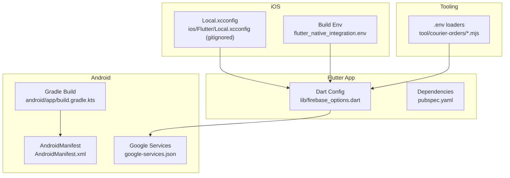
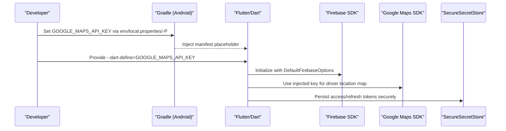
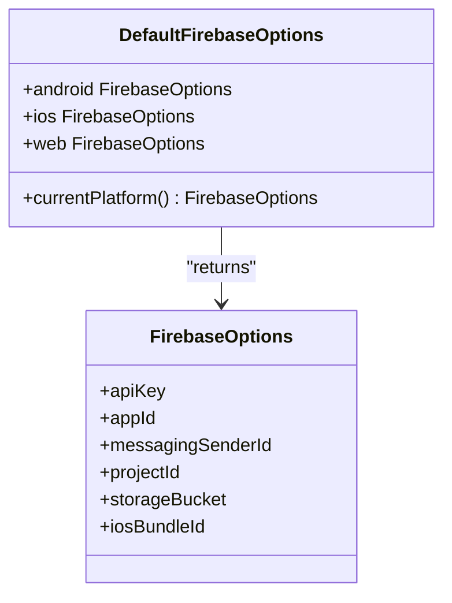
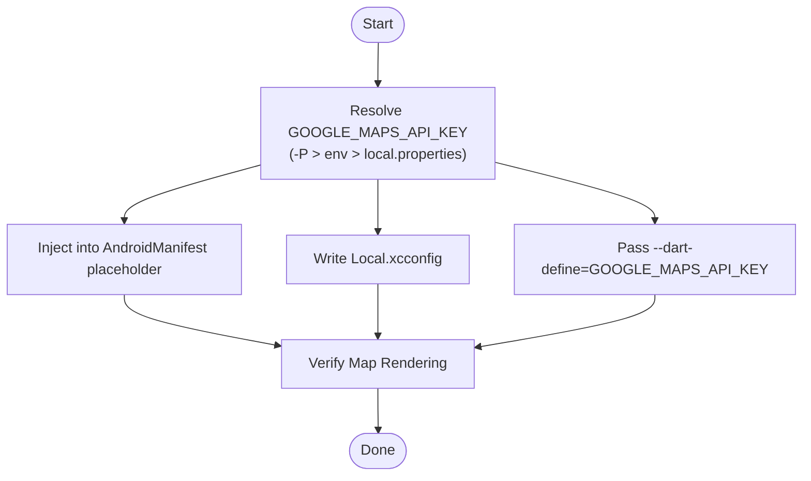
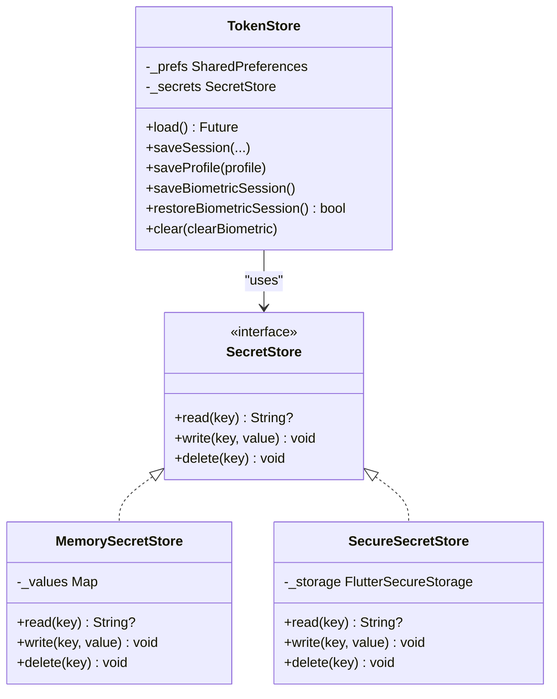
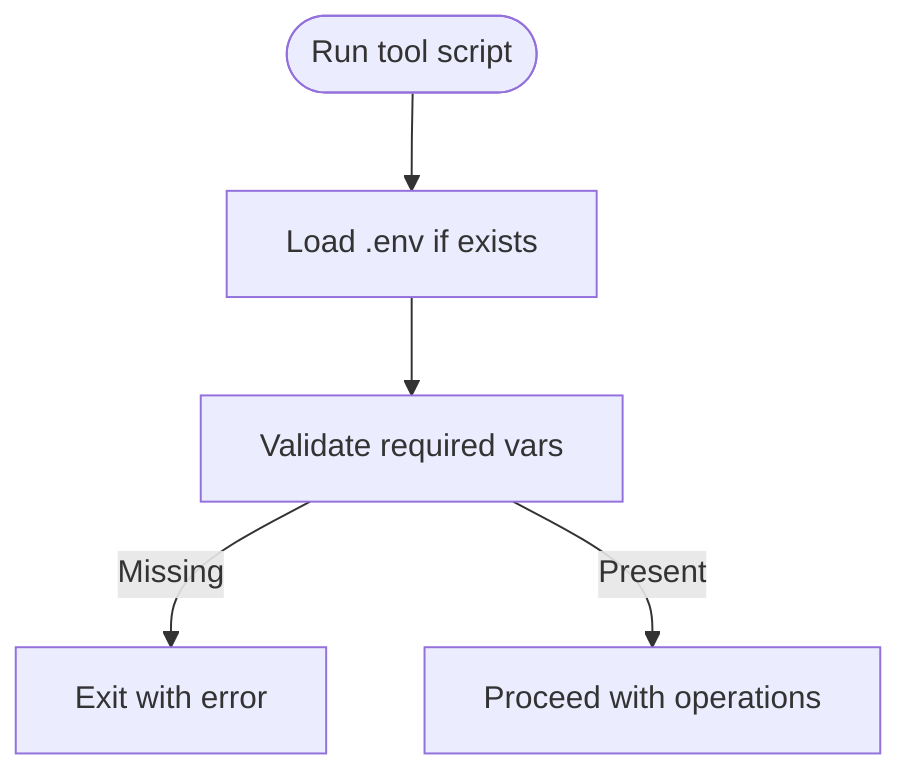
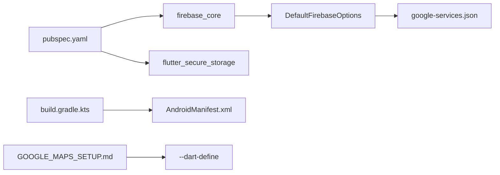

# Environment Configuration & Secrets Management

<cite>
**Referenced Files in This Document**
- [README.md](file://README.md)
- [.gitignore](file://.gitignore)
- [pubspec.yaml](file://pubspec.yaml)
- [lib/firebase_options.dart](file://lib/firebase_options.dart)
- [android/app/google-services.json](file://android/app/google-services.json)
- [android/app/build.gradle.kts](file://android/app/build.gradle.kts)
- [android/app/src/main/AndroidManifest.xml](file://android/app/src/main/AndroidManifest.xml)
- [ios/Flutter/ephemeral/flutter_native_integration.env](file://ios/Flutter/ephemeral/flutter_native_integration.env)
- [docs/GOOGLE_MAPS_SETUP.md](file://docs/GOOGLE_MAPS_SETUP.md)
- [tool/courier-orders/setup-fulfillment.mjs](file://tool/courier-orders/setup-fulfillment.mjs)
- [tool/courier-orders/create-paid-orders.mjs](file://tool/courier-orders/create-paid-orders.mjs)
- [lib/core/network/token_store.dart](file://lib/core/network/token_store.dart)
</cite>

## Table of Contents
1. Introduction
2. Project Structure
3. Core Components
4. Architecture Overview
5. Detailed Component Analysis
6. Dependency Analysis
7. Performance Considerations
8. Troubleshooting Guide
9. Conclusion

## Introduction
This document explains how the project configures environments and manages secrets across Android, iOS, Flutter/Dart, and backend tooling. It covers:
- Where configuration lives (Firebase, Google Maps, signing, environment variables).
- How to set up development, staging, and production configurations.
- Secure storage practices for API keys, tokens, and credentials.
- Key rotation procedures and compliance considerations for user data and payments.

The repository uses a mix of platform-specific configuration files, Gradle properties, Dart compile-time defines, and local secret files that are intentionally excluded from version control.

## Project Structure
Configuration and secrets are spread across several layers:
- Firebase configuration is provided via generated Dart options and an Android client file.
- Google Maps integration requires a restricted key injected through Gradle, Android manifest placeholders, iOS xcconfig, and Dart compile-time defines.
- Signing and build metadata use gitignored property files.
- Backend tooling reads .env files for server-side secrets.
- The app stores sensitive runtime values (tokens) in secure device storage.

**Diagram sources**
- [lib/firebase_options.dart:1-46](file://lib/firebase_options.dart#L1-L46)
- [android/app/google-services.json:1-48](file://android/app/google-services.json#L1-L48)
- [android/app/build.gradle.kts:13-53](file://android/app/build.gradle.kts#L13-L53)
- [android/app/src/main/AndroidManifest.xml:63-70](file://android/app/src/main/AndroidManifest.xml#L63-L70)
- [ios/Flutter/ephemeral/flutter_native_integration.env:1-13](file://ios/Flutter/ephemeral/flutter_native_integration.env#L1-L13)
- [tool/courier-orders/setup-fulfillment.mjs:25-55](file://tool/courier-orders/setup-fulfillment.mjs#L25-L55)

**Section sources**
- [README.md:15-25](file://README.md#L15-L25)
- [.gitignore:51-60](file://.gitignore#L51-L60)
- [pubspec.yaml:62-75](file://pubspec.yaml#L62-L75)
- [lib/firebase_options.dart:1-46](file://lib/firebase_options.dart#L1-L46)
- [android/app/google-services.json:1-48](file://android/app/google-services.json#L1-L48)
- [android/app/build.gradle.kts:13-53](file://android/app/build.gradle.kts#L13-L53)
- [android/app/src/main/AndroidManifest.xml:63-70](file://android/app/src/main/AndroidManifest.xml#L63-L70)
- [ios/Flutter/ephemeral/flutter_native_integration.env:1-13](file://ios/Flutter/ephemeral/flutter_native_integration.env#L1-L13)
- [docs/GOOGLE_MAPS_SETUP.md:35-75](file://docs/GOOGLE_MAPS_SETUP.md#L35-L75)
- [tool/courier-orders/setup-fulfillment.mjs:25-55](file://tool/courier-orders/setup-fulfillment.mjs#L25-L55)

## Core Components
- Firebase configuration:
  - Dart options class selects platform-specific settings at runtime.
  - Android google-services.json provides client metadata and API keys.
- Google Maps integration:
  - Android: resolved via Gradle with fallbacks to environment or local.properties; injected into the manifest as a placeholder.
  - iOS: configured via Local.xcconfig (gitignored).
  - Dart: requires a compile-time define to enable map rendering.
- Secret storage:
  - Runtime secrets (tokens, profiles) are stored using a secure store backed by Android Keystore/iOS Keychain.
  - A memory-only store is used in tests and previews.
- Build and signing:
  - Release signing uses android/key.properties (gitignored).
  - CI must inject secrets without committing them.

**Section sources**
- [lib/firebase_options.dart:1-46](file://lib/firebase_options.dart#L1-L46)
- [android/app/google-services.json:1-48](file://android/app/google-services.json#L1-L48)
- [android/app/build.gradle.kts:13-53](file://android/app/build.gradle.kts#L13-L53)
- [android/app/src/main/AndroidManifest.xml:63-70](file://android/app/src/main/AndroidManifest.xml#L63-L70)
- [docs/GOOGLE_MAPS_SETUP.md:35-75](file://docs/GOOGLE_MAPS_SETUP.md#L35-L75)
- [lib/core/network/token_store.dart:46-69](file://lib/core/network/token_store.dart#L46-L69)
- [README.md:15-25](file://README.md#L15-L25)
- [.gitignore:51-60](file://.gitignore#L51-L60)

## Architecture Overview
Environment configuration flows from platform-native configuration into the Flutter app and backend tools:

**Diagram sources**
- [android/app/build.gradle.kts:13-53](file://android/app/build.gradle.kts#L13-L53)
- [android/app/src/main/AndroidManifest.xml:63-70](file://android/app/src/main/AndroidManifest.xml#L63-L70)
- [docs/GOOGLE_MAPS_SETUP.md:63-75](file://docs/GOOGLE_MAPS_SETUP.md#L63-L75)
- [lib/firebase_options.dart:1-46](file://lib/firebase_options.dart#L1-L46)
- [lib/core/network/token_store.dart:46-69](file://lib/core/network/token_store.dart#L46-L69)

## Detailed Component Analysis

### Firebase Configuration
- Dart options:
  - Platform selection returns per-platform FirebaseOptions.
  - Values include apiKey, appId, messagingSenderId, projectId, storageBucket, and iosBundleId where applicable.
- Android client file:
  - Provides project metadata, client IDs, and api_key entries for both release and debug package names.

**Diagram sources**
- [lib/firebase_options.dart:1-46](file://lib/firebase_options.dart#L1-L46)

**Section sources**
- [lib/firebase_options.dart:1-46](file://lib/firebase_options.dart#L1-L46)
- [android/app/google-services.json:1-48](file://android/app/google-services.json#L1-L48)

### Google Maps Integration
- Resolution order on Android:
  - Gradle property (-P), then environment variable, then android/local.properties.
- Injection points:
  - Android manifest placeholder com.google.android.geo.API_KEY.
  - iOS Local.xcconfig (gitignored).
  - Dart compile-time define required for the map widget to render.

**Diagram sources**
- [android/app/build.gradle.kts:13-53](file://android/app/build.gradle.kts#L13-L53)
- [android/app/src/main/AndroidManifest.xml:63-70](file://android/app/src/main/AndroidManifest.xml#L63-L70)
- [docs/GOOGLE_MAPS_SETUP.md:35-75](file://docs/GOOGLE_MAPS_SETUP.md#L35-L75)

**Section sources**
- [android/app/build.gradle.kts:13-53](file://android/app/build.gradle.kts#L13-L53)
- [android/app/src/main/AndroidManifest.xml:63-70](file://android/app/src/main/AndroidManifest.xml#L63-L70)
- [docs/GOOGLE_MAPS_SETUP.md:35-75](file://docs/GOOGLE_MAPS_SETUP.md#L35-L75)

### Secret Storage in the App
- SecureSecretStore:
  - Uses FlutterSecureStorage with iOS Keychain accessibility set to first unlock this device.
  - Prevents iCloud sync and restores to new devices.
- TokenStore:
  - Migrates legacy plaintext tokens to secure storage.
  - Maintains an in-memory mirror for performance.
  - Supports biometric session snapshots when refresh tokens exist.

**Diagram sources**
- [lib/core/network/token_store.dart:25-69](file://lib/core/network/token_store.dart#L25-L69)
- [lib/core/network/token_store.dart:71-238](file://lib/core/network/token_store.dart#L71-L238)

**Section sources**
- [lib/core/network/token_store.dart:25-69](file://lib/core/network/token_store.dart#L25-L69)
- [lib/core/network/token_store.dart:71-238](file://lib/core/network/token_store.dart#L71-L238)

### Backend Tooling Environment Variables
- Tool scripts load .env files from their directory if present.
- Required variables include database connection strings, JWT secrets, API base URLs, and identifiers.
- Missing required variables cause immediate failure with clear error messages.

**Diagram sources**
- [tool/courier-orders/setup-fulfillment.mjs:25-55](file://tool/courier-orders/setup-fulfillment.mjs#L25-L55)
- [tool/courier-orders/create-paid-orders.mjs:27-55](file://tool/courier-orders/create-paid-orders.mjs#L27-L55)

**Section sources**
- [tool/courier-orders/setup-fulfillment.mjs:25-55](file://tool/courier-orders/setup-fulfillment.mjs#L25-L55)
- [tool/courier-orders/create-paid-orders.mjs:27-55](file://tool/courier-orders/create-paid-orders.mjs#L27-L55)

### Environment Setup Examples

#### Development Environment
- Install dependencies and validate:
  - flutter pub get, flutter analyze, flutter test.
- Configure Google Maps:
  - Add GOOGLE_MAPS_API_KEY to android/local.properties.
  - Copy ios/Flutter/Local.xcconfig.example to ios/Flutter/Local.xcconfig and set the key.
  - Run with --dart-define=GOOGLE_MAPS_API_KEY=...
- Firebase:
  - Ensure lib/firebase_options.dart and android/app/google-services.json are present and correct for the active project.

**Section sources**
- [README.md:7-13](file://README.md#L7-L13)
- [docs/GOOGLE_MAPS_SETUP.md:35-75](file://docs/GOOGLE_MAPS_SETUP.md#L35-L75)
- [lib/firebase_options.dart:1-46](file://lib/firebase_options.dart#L1-L46)
- [android/app/google-services.json:1-48](file://android/app/google-services.json#L1-L48)

#### Staging and Production Environments
- Separate Firebase projects:
  - Generate platform-specific FirebaseOptions and google-services.json for each environment.
- Google Maps:
  - Create separate restricted keys per environment and bundle them accordingly.
- Backend tooling:
  - Maintain environment-specific .env files in CI, never commit secrets.

[No sources needed since this section provides general guidance]

### Managing Sensitive Data
- Git ignore rules exclude:
  - ios/Flutter/Local.xcconfig
  - tool/**/.env
  - android/local.properties
  - android/key.properties
  - android/upload_cert.pem
- Signing:
  - Release builds read keystore info from android/key.properties (gitignored).
- Runtime secrets:
  - Tokens and profiles are persisted via SecureSecretStore (Keystore/Keychain-backed).

**Section sources**
- [.gitignore:51-60](file://.gitignore#L51-L60)
- [README.md:15-25](file://README.md#L15-L25)
- [lib/core/network/token_store.dart:46-69](file://lib/core/network/token_store.dart#L46-L69)

### Switching Between Environments
- Firebase:
  - Replace lib/firebase_options.dart and android/app/google-services.json with environment-specific values.
- Google Maps:
  - Update Local.xcconfig and android/local.properties per environment; pass appropriate --dart-define flags.
- Backend tooling:
  - Swap .env files per environment in CI or local dev setups.

**Section sources**
- [lib/firebase_options.dart:1-46](file://lib/firebase_options.dart#L1-L46)
- [android/app/google-services.json:1-48](file://android/app/google-services.json#L1-L48)
- [docs/GOOGLE_MAPS_SETUP.md:35-75](file://docs/GOOGLE_MAPS_SETUP.md#L35-L75)
- [tool/courier-orders/setup-fulfillment.mjs:25-55](file://tool/courier-orders/setup-fulfillment.mjs#L25-L55)

## Dependency Analysis
Configuration dependencies across components:

**Diagram sources**
- [pubspec.yaml:62-75](file://pubspec.yaml#L62-L75)
- [lib/firebase_options.dart:1-46](file://lib/firebase_options.dart#L1-L46)
- [android/app/google-services.json:1-48](file://android/app/google-services.json#L1-L48)
- [android/app/build.gradle.kts:13-53](file://android/app/build.gradle.kts#L13-L53)
- [android/app/src/main/AndroidManifest.xml:63-70](file://android/app/src/main/AndroidManifest.xml#L63-L70)
- [docs/GOOGLE_MAPS_SETUP.md:63-75](file://docs/GOOGLE_MAPS_SETUP.md#L63-L75)

**Section sources**
- [pubspec.yaml:62-75](file://pubspec.yaml#L62-L75)
- [lib/firebase_options.dart:1-46](file://lib/firebase_options.dart#L1-L46)
- [android/app/google-services.json:1-48](file://android/app/google-services.json#L1-L48)
- [android/app/build.gradle.kts:13-53](file://android/app/build.gradle.kts#L13-L53)
- [android/app/src/main/AndroidManifest.xml:63-70](file://android/app/src/main/AndroidManifest.xml#L63-L70)
- [docs/GOOGLE_MAPS_SETUP.md:63-75](file://docs/GOOGLE_MAPS_SETUP.md#L63-L75)

## Performance Considerations
- Avoid disk I/O in hot paths:
  - TokenStore keeps an in-memory mirror of secrets to prevent interceptors from awaiting storage calls.
- Prefer secure storage only for sensitive material:
  - Use SecureSecretStore for tokens and profiles; avoid storing non-sensitive configuration there.
- Minimize configuration size:
  - Keep FirebaseOptions minimal and platform-specific.

**Section sources**
- [lib/core/network/token_store.dart:71-100](file://lib/core/network/token_store.dart#L71-L100)

## Troubleshooting Guide
- Google Maps not rendering:
  - Ensure all three injection points are configured: Android manifest placeholder, iOS Local.xcconfig, and Dart --dart-define.
  - Verify billing is enabled and keys are restricted appropriately.
- Firebase initialization errors:
  - Confirm firebase_options.dart and google-services.json match the intended project and platform.
- Missing backend tooling variables:
  - Check .env presence and required variables; scripts exit with explicit errors when missing.
- Signing failures:
  - Ensure android/key.properties exists locally and matches Play Console upload certificate.

**Section sources**
- [docs/GOOGLE_MAPS_SETUP.md:77-95](file://docs/GOOGLE_MAPS_SETUP.md#L77-L95)
- [lib/firebase_options.dart:1-46](file://lib/firebase_options.dart#L1-L46)
- [android/app/google-services.json:1-48](file://android/app/google-services.json#L1-L48)
- [tool/courier-orders/setup-fulfillment.mjs:39-55](file://tool/courier-orders/setup-fulfillment.mjs#L39-L55)
- [README.md:15-25](file://README.md#L15-L25)

## Conclusion
This project employs a layered approach to environment configuration and secrets management:
- Platform-specific configuration files for Firebase and Google Maps.
- Gitignored local secrets for keys, signing, and environment variables.
- Secure device storage for runtime secrets.
To maintain security and compliance:
- Restrict API keys per platform and environment.
- Rotate keys regularly and audit usage.
- Never commit secrets; rely on CI secret injection and local-only files.
- Follow payment and privacy requirements by minimizing sensitive data exposure and leveraging secure storage mechanisms.