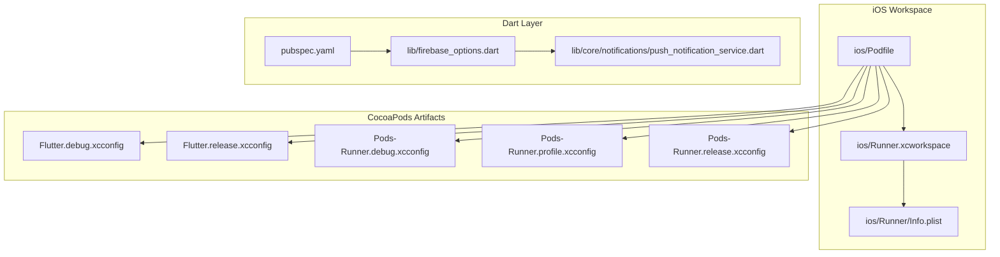
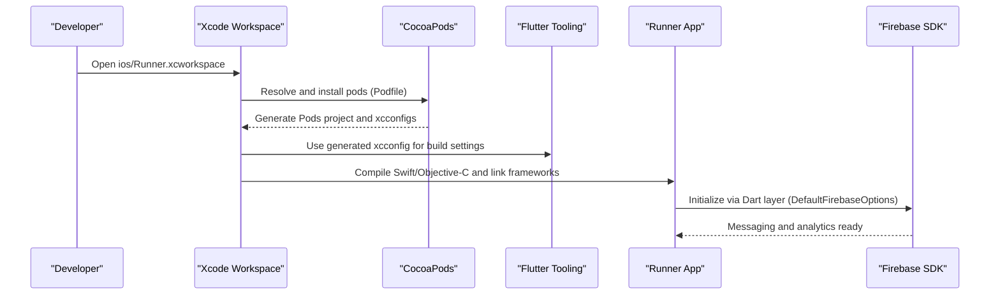
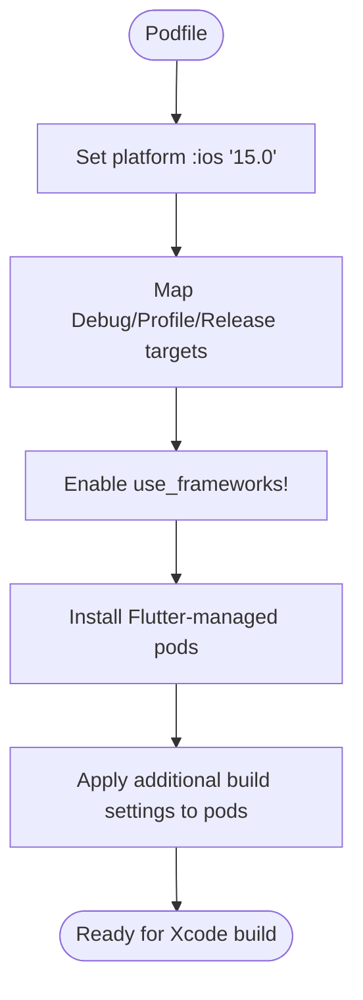
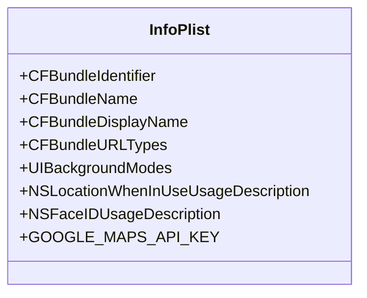
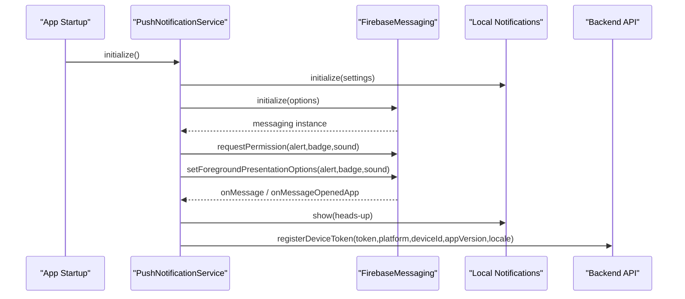
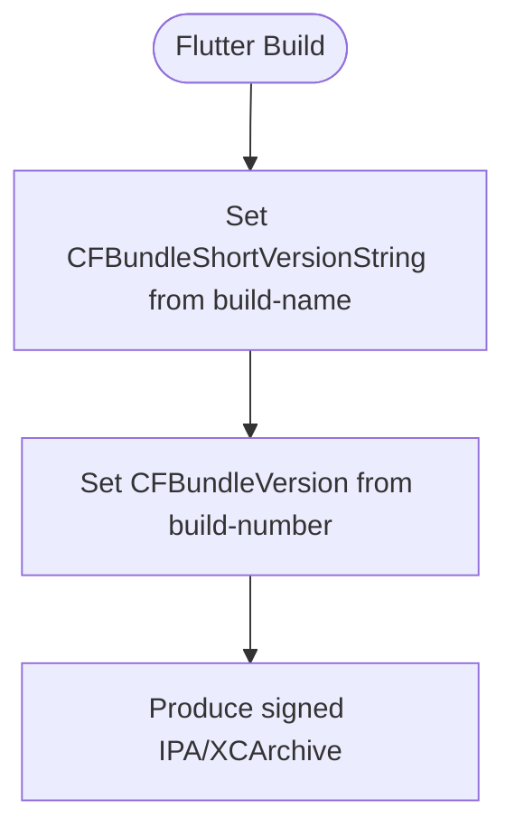
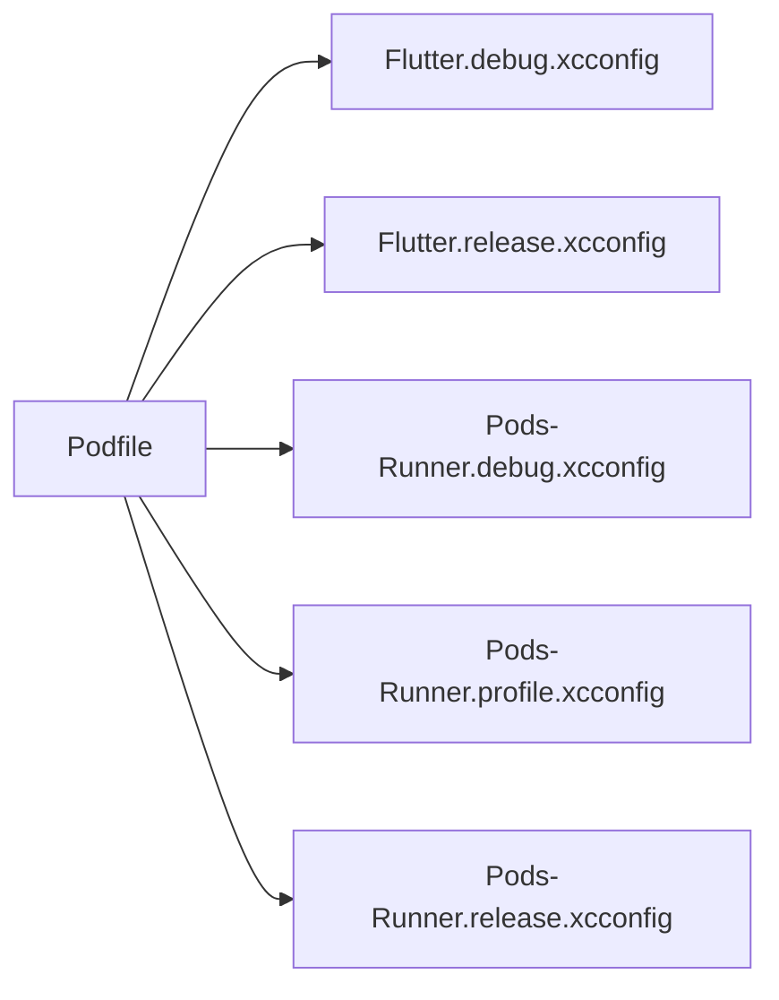

# iOS Build & Deployment

<cite>
**Referenced Files in This Document**
- [Podfile](file://ios/Podfile)
- [Info.plist](file://ios/Runner/Info.plist)
- [push_notification_service.dart](file://lib/core/notifications/push_notification_service.dart)
- [firebase_options.dart](file://lib/firebase_options.dart)
- [pubspec.yaml](file://pubspec.yaml)
- [Flutter.debug.xcconfig](file://ios/Pods/Target Support Files/Flutter/Flutter.debug.xcconfig)
- [Flutter.release.xcconfig](file://ios/Pods/Target Support Files/Flutter/Flutter.release.xcconfig)
- [Pods-Runner.debug.xcconfig](file://ios/Pods/Target Support Files/Pods-Runner/Pods-Runner.debug.xcconfig)
- [Pods-Runner.profile.xcconfig](file://ios/Pods/Target Support Files/Pods-Runner/Pods-Runner.profile.xcconfig)
- [Pods-Runner.release.xcconfig](file://ios/Pods/Target Support Files/Pods-Runner/Pods-Runner.release.xcconfig)
</cite>

## Table of Contents
1. [Introduction](#introduction)
2. [Project Structure](#project-structure)
3. [Core Components](#core-components)
4. [Architecture Overview](#architecture-overview)
5. [Detailed Component Analysis](#detailed-component-analysis)
6. [Dependency Analysis](#dependency-analysis)
7. [Performance Considerations](#performance-considerations)
8. [Troubleshooting Guide](#troubleshooting-guide)
9. [Conclusion](#conclusion)
10. [Appendices](#appendices)

## Introduction
This document provides comprehensive iOS build and deployment guidance for the project, including Xcode project configuration, CocoaPods setup, App Store Connect integration, code signing, release builds, archiving, and submission. It also covers Firebase setup for iOS, crash reporting configuration, and production monitoring integration. The content is grounded in the repository’s iOS configuration files and Flutter/Dart sources that drive iOS behavior.

## Project Structure
The iOS workspace is a standard Flutter + CocoaPods setup:
- ios/Podfile defines platform version, target mapping, and CocoaPods integration with Flutter.
- ios/Runner/Info.plist contains app metadata, URL schemes, background modes, and runtime keys.
- lib/firebase_options.dart provides per-platform Firebase options used by the Dart layer.
- lib/core/notifications/push_notification_service.dart initializes Firebase Messaging and local notifications at runtime.
- pubspec.yaml declares dependencies including Firebase and Google Maps plugins.
- Generated xcconfig files under Pods/Target Support Files configure build settings for debug/profile/release.

**Diagram sources**
- [Podfile:1-44](file://ios/Podfile#L1-L44)
- [Info.plist:1-95](file://ios/Runner/Info.plist#L1-L95)
- [firebase_options.dart:1-47](file://lib/firebase_options.dart#L1-L47)
- [push_notification_service.dart:1-339](file://lib/core/notifications/push_notification_service.dart#L1-L339)
- [pubspec.yaml:1-152](file://pubspec.yaml#L1-L152)
- [Flutter.debug.xcconfig:1-12](file://ios/Pods/Target Support Files/Flutter/Flutter.debug.xcconfig#L1-L12)
- [Flutter.release.xcconfig:1-12](file://ios/Pods/Target Support Files/Flutter/Flutter.release.xcconfig#L1-L12)
- [Pods-Runner.debug.xcconfig:10-16](file://ios/Pods/Target Support Files/Pods-Runner/Pods-Runner.debug.xcconfig#L10-L16)
- [Pods-Runner.profile.xcconfig:10-16](file://ios/Pods/Target Support Files/Pods-Runner/Pods-Runner.profile.xcconfig#L10-L16)
- [Pods-Runner.release.xcconfig:10-16](file://ios/Pods/Target Support Files/Pods-Runner/Pods-Runner.release.xcconfig#L10-L16)

**Section sources**
- [Podfile:1-44](file://ios/Podfile#L1-L44)
- [Info.plist:1-95](file://ios/Runner/Info.plist#L1-L95)
- [firebase_options.dart:1-47](file://lib/firebase_options.dart#L1-L47)
- [push_notification_service.dart:1-339](file://lib/core/notifications/push_notification_service.dart#L1-L339)
- [pubspec.yaml:1-152](file://pubspec.yaml#L1-L152)

## Core Components
- CocoaPods and Flutter integration:
  - Platform is set to iOS 15.0.
  - Target mapping includes Debug, Profile, and Release configurations.
  - use_frameworks! enables framework mode for pods.
  - flutter_install_all_ios_pods integrates Flutter-managed pods.
  - post_install applies additional Flutter build settings to all pod targets.

- App metadata and capabilities:
  - Bundle identifier is driven by PRODUCT_BUNDLE_IDENTIFIER.
  - Display name and bundle name are defined.
  - URL scheme is configured for payment callbacks.
  - Background modes include fetch and remote-notification.
  - Location permission description is present.
  - Face ID usage description is present.

- Firebase and messaging:
  - DefaultFirebaseOptions.currentPlatform selects iOS options with iosBundleId.
  - PushNotificationService initializes FirebaseMessaging and local notifications.
  - Foreground and background message handling are implemented.
  - Token registration and sync with backend are handled.

- Versioning:
  - Flutter build-name maps to CFBundleShortVersionString.
  - Flutter build-number maps to CFBundleVersion.

**Section sources**
- [Podfile:1-44](file://ios/Podfile#L1-L44)
- [Info.plist:1-95](file://ios/Runner/Info.plist#L1-L95)
- [firebase_options.dart:1-47](file://lib/firebase_options.dart#L1-L47)
- [push_notification_service.dart:1-339](file://lib/core/notifications/push_notification_service.dart#L1-L339)
- [pubspec.yaml:1-152](file://pubspec.yaml#L1-L152)

## Architecture Overview
The iOS build pipeline integrates Flutter tooling, CocoaPods, and native app configuration:

**Diagram sources**
- [Podfile:1-44](file://ios/Podfile#L1-L44)
- [Flutter.debug.xcconfig:1-12](file://ios/Pods/Target Support Files/Flutter/Flutter.debug.xcconfig#L1-L12)
- [Flutter.release.xcconfig:1-12](file://ios/Pods/Target Support Files/Flutter/Flutter.release.xcconfig#L1-L12)
- [Pods-Runner.debug.xcconfig:10-16](file://ios/Pods/Target Support Files/Pods-Runner/Pods-Runner.debug.xcconfig#L10-L16)
- [Pods-Runner.profile.xcconfig:10-16](file://ios/Pods/Target Support Files/Pods-Runner/Pods-Runner.profile.xcconfig#L10-L16)
- [Pods-Runner.release.xcconfig:10-16](file://ios/Pods/Target Support Files/Pods-Runner/Pods-Runner.release.xcconfig#L10-L16)
- [firebase_options.dart:1-47](file://lib/firebase_options.dart#L1-L47)

## Detailed Component Analysis

### CocoaPods Configuration
- Platform and target mapping:
  - iOS minimum version is 15.0.
  - Targets map Debug to debug, Profile and Release to release.
- Framework mode:
  - use_frameworks! ensures pods are built as frameworks.
- Flutter integration:
  - flutter_install_all_ios_pods installs Flutter-managed pods.
  - post_install runs flutter_additional_ios_build_settings on each pod target.

**Diagram sources**
- [Podfile:1-44](file://ios/Podfile#L1-L44)

**Section sources**
- [Podfile:1-44](file://ios/Podfile#L1-L44)

### App Metadata and Capabilities (Info.plist)
- Bundle identifiers and names:
  - CFBundleIdentifier uses PRODUCT_BUNDLE_IDENTIFIER.
  - CFBundleName and CFBundleDisplayName are set.
- URL schemes:
  - A custom URL scheme is registered for payment callbacks.
- Background modes:
  - Background fetch and remote notification are enabled.
- Permissions:
  - Location when-in-use usage description is provided.
  - Face ID usage description is provided.
- Runtime keys:
  - GOOGLE_MAPS_API_KEY is injected via environment variable.

**Diagram sources**
- [Info.plist:1-95](file://ios/Runner/Info.plist#L1-L95)

**Section sources**
- [Info.plist:1-95](file://ios/Runner/Info.plist#L1-L95)

### Firebase Setup and Messaging Flow
- Dart-side initialization:
  - DefaultFirebaseOptions.currentPlatform returns iOS-specific options including iosBundleId.
  - PushNotificationService initializes FirebaseMessaging and requests permissions.
  - Local notifications are initialized and channels created.
  - Foreground messages show heads-up notifications; background messages initialize Firebase if needed.
  - Device token is synced with the backend.

**Diagram sources**
- [firebase_options.dart:1-47](file://lib/firebase_options.dart#L1-L47)
- [push_notification_service.dart:1-339](file://lib/core/notifications/push_notification_service.dart#L1-L339)

**Section sources**
- [firebase_options.dart:1-47](file://lib/firebase_options.dart#L1-L47)
- [push_notification_service.dart:1-339](file://lib/core/notifications/push_notification_service.dart#L1-L339)

### Versioning and Build Names
- Flutter versioning:
  - build-name maps to CFBundleShortVersionString.
  - build-number maps to CFBundleVersion.
- Current package version:
  - Defined in pubspec.yaml as version string.

**Diagram sources**
- [pubspec.yaml:1-152](file://pubspec.yaml#L1-L152)
- [Info.plist:1-95](file://ios/Runner/Info.plist#L1-L95)

**Section sources**
- [pubspec.yaml:1-152](file://pubspec.yaml#L1-L152)
- [Info.plist:1-95](file://ios/Runner/Info.plist#L1-L95)

## Dependency Analysis
The iOS build depends on Flutter tooling and CocoaPods artifacts:
- Flutter-generated xcconfigs define build directories, flags, and product identifiers for the Flutter module.
- Pods-Runner xcconfigs define COCOAPODS flag and paths for pod targets.
- Podfile orchestrates installation and post-install steps.

**Diagram sources**
- [Podfile:1-44](file://ios/Podfile#L1-L44)
- [Flutter.debug.xcconfig:1-12](file://ios/Pods/Target Support Files/Flutter/Flutter.debug.xcconfig#L1-L12)
- [Flutter.release.xcconfig:1-12](file://ios/Pods/Target Support Files/Flutter/Flutter.release.xcconfig#L1-L12)
- [Pods-Runner.debug.xcconfig:10-16](file://ios/Pods/Target Support Files/Pods-Runner/Pods-Runner.debug.xcconfig#L10-L16)
- [Pods-Runner.profile.xcconfig:10-16](file://ios/Pods/Target Support Files/Pods-Runner/Pods-Runner.profile.xcconfig#L10-L16)
- [Pods-Runner.release.xcconfig:10-16](file://ios/Pods/Target Support Files/Pods-Runner/Pods-Runner.release.xcconfig#L10-L16)

**Section sources**
- [Podfile:1-44](file://ios/Podfile#L1-L44)
- [Flutter.debug.xcconfig:1-12](file://ios/Pods/Target Support Files/Flutter/Flutter.debug.xcconfig#L1-L12)
- [Flutter.release.xcconfig:1-12](file://ios/Pods/Target Support Files/Flutter/Flutter.release.xcconfig#L1-L12)
- [Pods-Runner.debug.xcconfig:10-16](file://ios/Pods/Target Support Files/Pods-Runner/Pods-Runner.debug.xcconfig#L10-L16)
- [Pods-Runner.profile.xcconfig:10-16](file://ios/Pods/Target Support Files/Pods-Runner/Pods-Runner.profile.xcconfig#L10-L16)
- [Pods-Runner.release.xcconfig:10-16](file://ios/Pods/Target Support Files/Pods-Runner/Pods-Runner.release.xcconfig#L10-L16)

## Performance Considerations
- CocoaPods analytics:
  - Disabled in Podfile to reduce synchronous network calls during Flutter builds.
- Framework mode:
  - Using use_frameworks! can improve compatibility with modern pods but may increase build times; ensure only necessary pods are included.
- Firebase initialization:
  - Delayed or conditional initialization in background handlers avoids unnecessary overhead during cold starts.

[No sources needed since this section provides general guidance]

## Troubleshooting Guide
Common iOS-specific issues and resolutions:

- Bitcode configuration:
  - Modern Xcode and Apple App Store submissions typically require disabling bitcode. Ensure ENABLE_BITCODE is disabled in Xcode build settings for both Debug and Release configurations. If using CocoaPods, verify that pod targets do not enable bitcode.

- Framework linking:
  - If pods fail to link due to missing modules, confirm use_frameworks! is enabled and run pod install. Check that flutter_install_all_ios_pods is invoked and post_install applies Flutter additional build settings.

- Platform version compatibility:
  - Minimum iOS version must match your deployment target. The Podfile sets iOS 15.0; ensure Xcode project deployment target aligns with this setting.

- Code signing and provisioning:
  - Ensure the correct Bundle Identifier matches the one used in Firebase options (iosBundleId).
  - Configure Signing & Capabilities in Xcode for each target and configuration.
  - Use appropriate provisioning profiles for Development, Ad Hoc, and App Store distributions.

- Firebase configuration:
  - Verify DefaultFirebaseOptions.currentPlatform returns valid iOS options and that iosBundleId matches the app’s Bundle Identifier.
  - Confirm Info.plist does not conflict with Firebase configuration and that GOOGLE_MAPS_API_KEY is provided via environment variables or Xcode build settings.

- Background modes and permissions:
  - Ensure UIBackgroundModes includes remote-notification for push delivery.
  - Request notification permissions at runtime and handle user denials gracefully.

- Crash reporting and monitoring:
  - Integrate a crash reporting solution (e.g., Firebase Crashlytics) and follow its iOS setup instructions to capture crashes in production.
  - Enable logging levels appropriately for production and avoid verbose logs in release builds.

**Section sources**
- [Podfile:1-44](file://ios/Podfile#L1-L44)
- [Info.plist:1-95](file://ios/Runner/Info.plist#L1-L95)
- [firebase_options.dart:1-47](file://lib/firebase_options.dart#L1-L47)
- [push_notification_service.dart:1-339](file://lib/core/notifications/push_notification_service.dart#L1-L339)

## Conclusion
This guide consolidates the iOS build and deployment workflow for the project, covering CocoaPods integration, Xcode configuration, Firebase setup, and production considerations. By aligning platform versions, enabling framework mode, configuring code signing, and integrating crash reporting, teams can reliably produce, archive, and submit apps to the App Store while maintaining robust monitoring and diagnostics.

[No sources needed since this section summarizes without analyzing specific files]

## Appendices

### Step-by-Step: Building Release Versions and Archiving
- Prepare environment:
  - Install CocoaPods and ensure Pods are installed.
  - Verify iOS deployment target matches Podfile platform (iOS 15.0).
- Configure signing:
  - Select team and provisioning profile in Xcode for Release configuration.
  - Ensure Bundle Identifier matches Firebase iosBundleId.
- Build and archive:
  - In Xcode, select Product > Archive.
  - Validate and distribute via Organizer.

[No sources needed since this section provides general guidance]

### Step-by-Step: App Store Connect Integration
- Create an app record in App Store Connect matching the Bundle Identifier.
- Upload the archived build using Xcode Organizer or Transporter.
- Fill out app metadata, screenshots, and privacy labels.
- Submit for review and monitor status.

[No sources needed since this section provides general guidance]

### Firebase Crash Reporting and Production Monitoring
- Add Firebase Crashlytics to the iOS app following official setup steps.
- Initialize Crashlytics alongside Firebase core.
- Test crash collection in development and verify data in Firebase console.
- Adjust log levels and disable debug logs in production builds.

[No sources needed since this section provides general guidance]