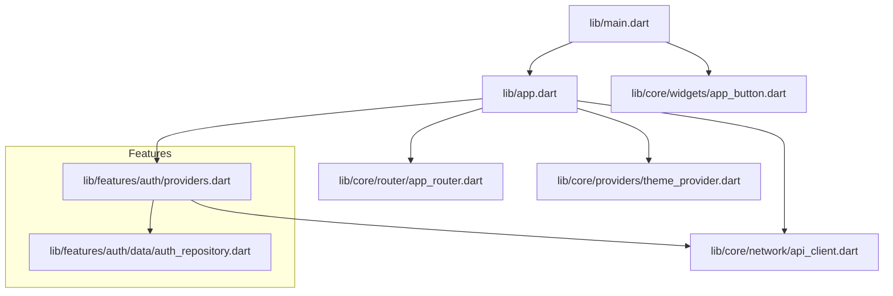
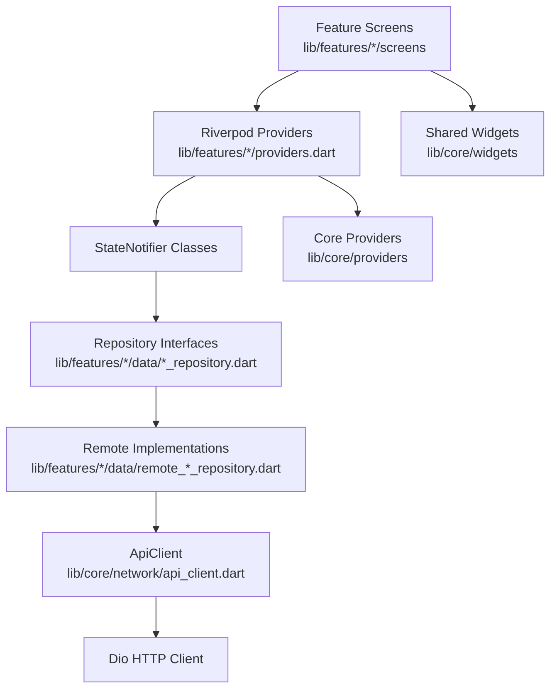
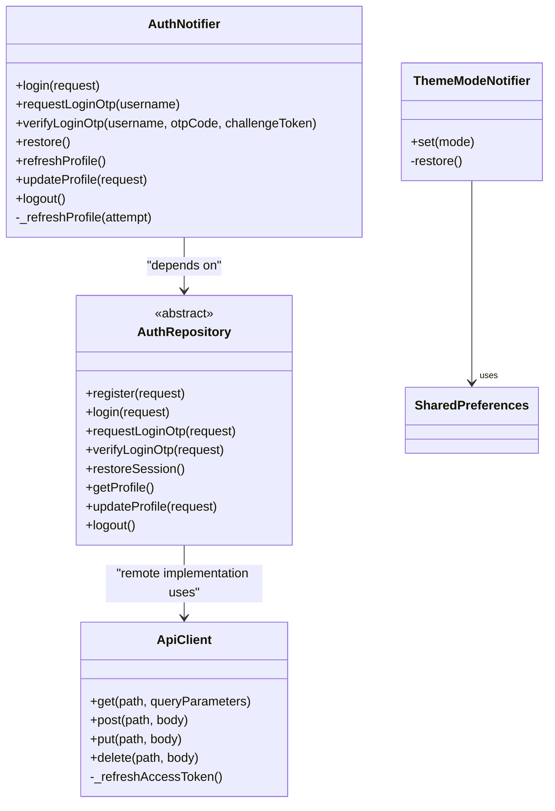
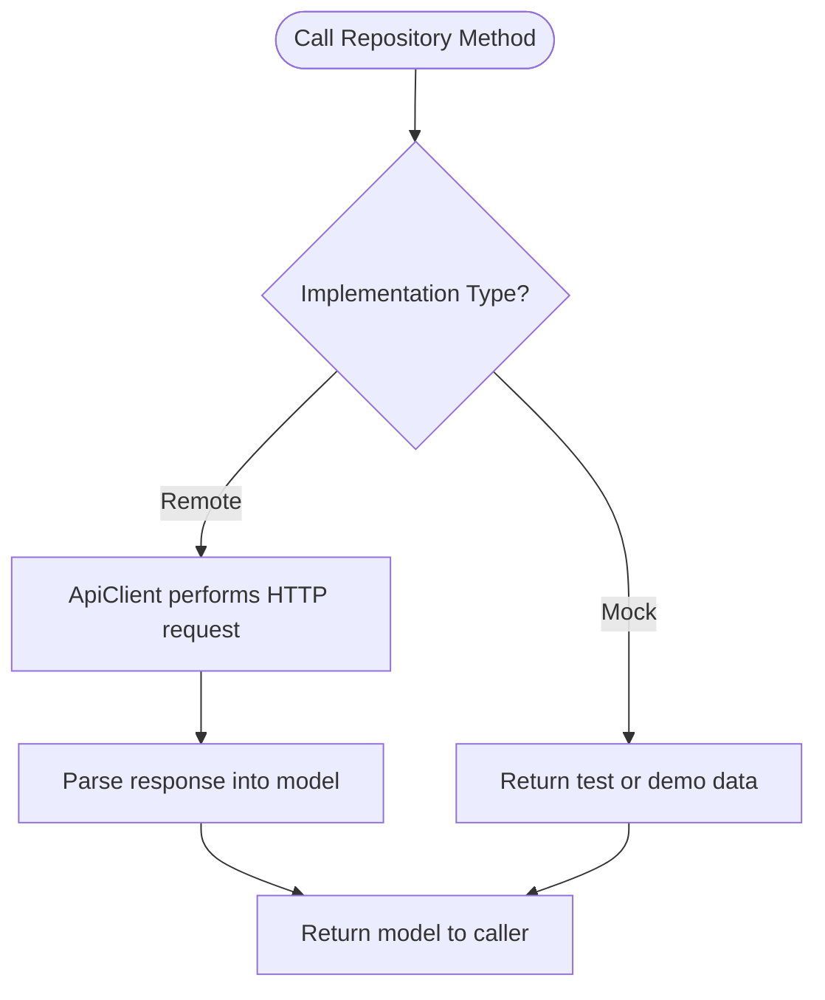
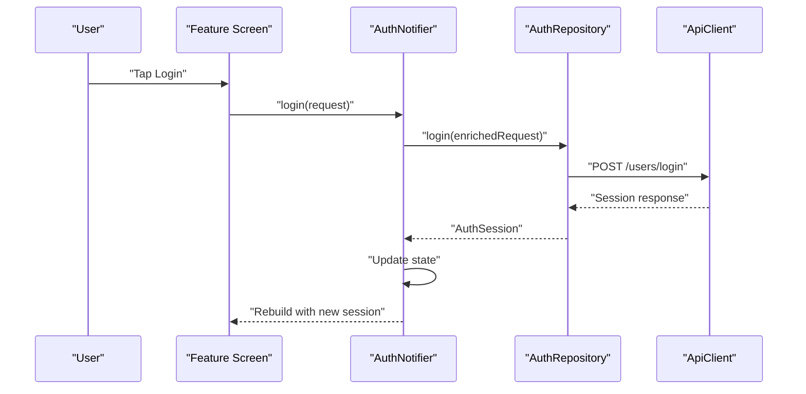
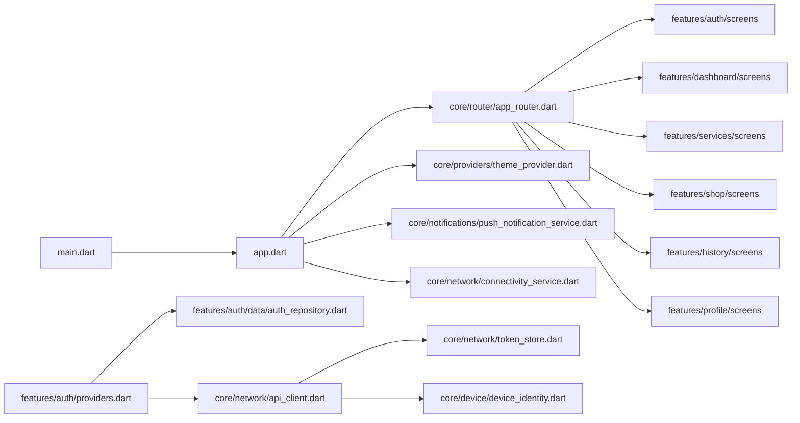

# Code Style & Conventions

<cite>
**Referenced Files in This Document**
- [analysis_options.yaml](file://analysis_options.yaml)
- [pubspec.yaml](file://pubspec.yaml)
- [main.dart](file://lib/main.dart)
- [app.dart](file://lib/app.dart)
- [app_router.dart](file://lib/core/router/app_router.dart)
- [api_client.dart](file://lib/core/network/api_client.dart)
- [theme_provider.dart](file://lib/core/providers/theme_provider.dart)
- [auth_repository.dart](file://lib/features/auth/data/auth_repository.dart)
- [providers.dart](file://lib/features/auth/providers.dart)
- [app_button.dart](file://lib/core/widgets/app_button.dart)
</cite>

## Table of Contents
1. [Introduction](#introduction)
2. [Project Structure](#project-structure)
3. [Core Components](#core-components)
4. [Architecture Overview](#architecture-overview)
5. [Detailed Component Analysis](#detailed-component-analysis)
6. [Dependency Analysis](#dependency-analysis)
7. [Performance Considerations](#performance-considerations)
8. [Troubleshooting Guide](#troubleshooting-guide)
9. [Conclusion](#conclusion)

## Introduction
This document defines the code style, naming conventions, and architectural patterns used by the LidaPay Flutter project. It explains how features are organized, how Riverpod is used for state management, how repositories abstract API calls, and how MVVM-style screens compose widgets around providers. It also documents linting rules and IDE configuration guidance so that all contributors produce consistent, readable Dart code.

## Project Structure
The application follows a feature-based layout under `lib/`:
- `lib/core` contains shared infrastructure: network layer, routing, theme, utilities, global widgets, device identity, notifications, and core providers.
- `lib/features` groups domain areas such as authentication, dashboard, history, payments, services, shop, profile, legal, notifications, recipient choice, onboarding, splash, shell, and support.
- Each feature typically includes:
  - `data/` — models, repository interfaces, mock implementations, and remote implementations.
  - `screens/` — UI screens.
  - `widgets/` — feature-specific reusable widgets.
  - `providers.dart` — Riverpod providers for that feature.

**Diagram sources**
- [main.dart:17-149](file://lib/main.dart#L17-L149)
- [app.dart:55-255](file://lib/app.dart#L55-L255)
- [app_router.dart:40-424](file://lib/core/router/app_router.dart#L40-L424)
- [api_client.dart:16-276](file://lib/core/network/api_client.dart#L16-L276)
- [theme_provider.dart:6-39](file://lib/core/providers/theme_provider.dart#L6-L39)
- [auth_repository.dart:1-79](file://lib/features/auth/data/auth_repository.dart#L1-L79)
- [providers.dart:1-352](file://lib/features/auth/providers.dart#L1-L352)
- [app_button.dart:6-124](file://lib/core/widgets/app_button.dart#L6-L124)

**Section sources**
- [pubspec.yaml:30-75](file://pubspec.yaml#L30-L75)
- [main.dart:17-149](file://lib/main.dart#L17-L149)
- [app.dart:55-255](file://lib/app.dart#L55-L255)

## Core Components
This section summarizes the key building blocks and their responsibilities.

- Application bootstrap and error boundaries:
  - `lib/main.dart` initializes platform settings, disables diagnostics in release builds, installs global Flutter and platform error handlers, sets up Riverpod’s `ProviderContainer`, hydrates secure token storage, restores auth session with timeouts, and mounts the app.
  - `lib/app.dart` configures scroll behavior, deep links, push notifications, theme mode, connectivity-aware offline banner, and integrates GoRouter.

- Routing:
  - `lib/core/router/app_router.dart` centralizes route constants, navigation guards based on session state, deep link handling for payment callbacks and password reset links, and a shell-based structure for main app sections.

- Network layer:
  - `lib/core/network/api_client.dart` wraps Dio, injects bearer tokens, redacts sensitive logs, handles 401 single-flight token refresh, and exposes typed HTTP helpers.

- State management:
  - `lib/core/providers/theme_provider.dart` demonstrates a persisted `StateNotifierProvider`.
  - Feature providers (for example, authentication) use `StateNotifierProvider` to manage sessions, OTP flows, profile synchronization, and side effects like push notification registration.

- Repository pattern:
  - `lib/features/auth/data/auth_repository.dart` defines an abstract contract for authentication operations. Mock and remote implementations can be swapped via Riverpod.

- Shared UI:
  - `lib/core/widgets/app_button.dart` shows a reusable, themed, accessible button widget with loading state and haptic feedback.

**Section sources**
- [main.dart:17-149](file://lib/main.dart#L17-L149)
- [app.dart:22-255](file://lib/app.dart#L22-L255)
- [app_router.dart:40-424](file://lib/core/router/app_router.dart#L40-L424)
- [api_client.dart:16-276](file://lib/core/network/api_client.dart#L16-L276)
- [theme_provider.dart:6-39](file://lib/core/providers/theme_provider.dart#L6-L39)
- [auth_repository.dart:1-79](file://lib/features/auth/data/auth_repository.dart#L1-L79)
- [providers.dart:1-352](file://lib/features/auth/providers.dart#L1-L352)
- [app_button.dart:6-124](file://lib/core/widgets/app_button.dart#L6-L124)

## Architecture Overview
LidaPay uses a layered, feature-based architecture with clear separation between UI, state, data, and networking:

- Presentation layer:
  - Screens live under `lib/features/<feature>/screens/`.
  - Widgets live under `lib/core/widgets/` for shared components and `lib/features/<feature>/widgets/` for feature-specific components.
  - Screens consume state through Riverpod providers using `ConsumerWidget`, `ConsumerStatefulWidget`, or `ref.watch`/`ref.read`.

- State layer:
  - Providers live under `lib/features/<feature>/providers.dart` and `lib/core/providers/`.
  - Business logic and side effects are implemented in `StateNotifier` classes.
  - Session, theme, connectivity, and other cross-cutting concerns are centralized in core providers.

- Data layer:
  - Repository interfaces define contracts under `lib/features/<feature>/data/`.
  - Remote implementations call `ApiClient`; mock implementations support tests and demos.
  - Models represent parsed API payloads.

- Networking layer:
  - `ApiClient` encapsulates Dio, interceptors, token injection, request logging/redaction, and automatic token refresh.

**Diagram sources**
- [providers.dart:1-352](file://lib/features/auth/providers.dart#L1-L352)
- [auth_repository.dart:1-79](file://lib/features/auth/data/auth_repository.dart#L1-L79)
- [api_client.dart:16-276](file://lib/core/network/api_client.dart#L16-L276)

## Detailed Component Analysis

### Dart Coding Standards and Naming Conventions
- Files:
  - Use lowercase with underscores for file names, for example `app_button.dart`, `auth_repository.dart`, `app_router.dart`.
  - Group related files by feature under `lib/features/<feature>/`.
  - Place shared infrastructure under `lib/core/`.

- Classes:
  - Use PascalCase for class names, for example `ApiClient`, `AuthRepository`, `AppButton`, `ThemeModeNotifier`.
  - Keep classes focused: one responsibility per class.
  - Prefer immutable data classes where possible; use constructors with named parameters.

- Methods and functions:
  - Use camelCase for methods and functions, for example `login`, `refreshProfile`, `markOnboardingSeen`.
  - Keep method names action-oriented and descriptive.

- Variables and fields:
  - Use camelCase for variables and fields, for example `_dio`, `_refreshDio`, `_pendingOtpChallenge`.
  - Private fields start with an underscore.
  - Constants use `const` and `camelCase` when they are not top-level enums, for example `_key`, `_emailVerificationCooldown`.

- Providers:
  - Define Riverpod providers at the top level using `final <name>Provider = ...`.
  - Name providers after the value they provide, for example `authSessionProvider`, `themeModeProvider`, `routerProvider`, `apiClientProvider`.

- Enums and types:
  - Use PascalCase for enum types and values.
  - Model classes should clearly represent API payloads and business entities.

- Error handling:
  - Throw domain-specific exceptions where appropriate, for example `ApiException`.
  - Avoid swallowing errors silently; log only in debug builds and handle gracefully in production.

- Accessibility:
  - Wrap interactive widgets with semantic labels where needed, for example accessibility labels for buttons.

**Section sources**
- [app_button.dart:6-124](file://lib/core/widgets/app_button.dart#L6-L124)
- [api_client.dart:16-276](file://lib/core/network/api_client.dart#L16-L276)
- [theme_provider.dart:6-39](file://lib/core/providers/theme_provider.dart#L6-L39)
- [providers.dart:1-352](file://lib/features/auth/providers.dart#L1-L352)
- [app_router.dart:40-424](file://lib/core/router/app_router.dart#L40-L424)

### Architectural Patterns

#### Feature-Based Organization
- Each feature owns its screens, widgets, models, repositories, and providers.
- Example feature directories include `auth`, `dashboard`, `history`, `payments`, `services`, `shop`, `profile`, `legal`, `notifications`, `recipient_choice`, `onboarding`, `splash`, `shell`, and `support`.
- This keeps related code together and reduces cross-feature coupling.

**Section sources**
- [app_router.dart:1-39](file://lib/core/router/app_router.dart#L1-L39)

#### Provider Usage with Riverpod
- Global providers:
  - `routerProvider` provides the GoRouter instance.
  - `apiClientProvider` provides the HTTP client.
  - `themeModeProvider` provides the persisted theme mode.
  - `sharedPrefsProvider`, `tokenStoreProvider`, `secretStoreProvider`, and `deviceIdentityProvider` are injected during bootstrap.

- Feature providers:
  - `authSessionProvider` manages the authenticated session.
  - `hasSessionProvider` derives a boolean from the session.
  - `profileSyncProvider` triggers profile synchronization.

- Provider composition:
  - Providers depend on other providers through `ref.watch` or `ref.read`.
  - Side effects are performed inside `StateNotifier` methods.

**Diagram sources**
- [theme_provider.dart:6-39](file://lib/core/providers/theme_provider.dart#L6-L39)
- [providers.dart:23-352](file://lib/features/auth/providers.dart#L23-L352)
- [auth_repository.dart:1-79](file://lib/features/auth/data/auth_repository.dart#L1-L79)
- [api_client.dart:16-276](file://lib/core/network/api_client.dart#L16-L276)

**Section sources**
- [theme_provider.dart:6-39](file://lib/core/providers/theme_provider.dart#L6-L39)
- [providers.dart:1-352](file://lib/features/auth/providers.dart#L1-L352)

#### Repository Pattern Implementation
- The repository interface defines the contract for data operations without exposing HTTP details.
- The remote repository implementation uses `ApiClient` to call backend endpoints.
- A mock repository can replace the remote implementation for testing or demo purposes.
- This separation allows swapping data sources while keeping screens and providers unchanged.

**Diagram sources**
- [auth_repository.dart:1-79](file://lib/features/auth/data/auth_repository.dart#L1-L79)
- [api_client.dart:16-276](file://lib/core/network/api_client.dart#L16-L276)

**Section sources**
- [auth_repository.dart:1-79](file://lib/features/auth/data/auth_repository.dart#L1-L79)

#### MVVM Structure
- View:
  - Screens under `lib/features/*/screens/` render UI and react to provider state.
  - They avoid heavy business logic and delegate actions to providers.

- ViewModel:
  - `StateNotifier` classes in provider files act as view models.
  - They coordinate user actions, call repositories, update state, and trigger side effects.

- Model:
  - Data classes under `lib/features/*/data/` represent API responses and local state.

**Diagram sources**
- [providers.dart:88-105](file://lib/features/auth/providers.dart#L88-L105)
- [auth_repository.dart:13-21](file://lib/features/auth/data/auth_repository.dart#L13-L21)
- [api_client.dart:154-155](file://lib/core/network/api_client.dart#L154-L155)

**Section sources**
- [providers.dart:51-352](file://lib/features/auth/providers.dart#L51-L352)
- [auth_repository.dart:1-79](file://lib/features/auth/data/auth_repository.dart#L1-L79)

### File Organization Principles

#### lib/core
- `constants/` — application-wide constants.
- `device/` — device identity and platform information.
- `location/` — location-related services.
- `network/` — HTTP client, endpoints, exceptions, payload helpers, connectivity service, and token store.
- `notifications/` — push notification service.
- `providers/` — global Riverpod providers such as theme mode.
- `router/` — GoRouter configuration and route constants.
- `state/` — shared async UI state helpers.
- `theme/` — theme definitions.
- `utils/` — formatters, validators, URL guards, and utility helpers.
- `widgets/` — shared UI components such as buttons, cards, skeletons, and headers.

#### lib/features
- Each feature directory follows the same internal structure:
  - `data/` — models, repository interface, mock implementation, remote implementation.
  - `screens/` — feature screens.
  - `widgets/` — feature-specific widgets.
  - `providers.dart` — Riverpod providers for the feature.

This consistency makes it easy to locate code, understand dependencies, and add new features.

**Section sources**
- [app_router.dart:1-39](file://lib/core/router/app_router.dart#L1-L39)
- [providers.dart:1-352](file://lib/features/auth/providers.dart#L1-L352)

### Concrete Examples of Proper Class Structure, Widget Composition, and State Management

#### Proper Class Structure
- Use a focused class with a clear constructor and documented responsibilities.
- Example reference: `ApiClient` encapsulates HTTP requests, token injection, logging, and token refresh.
- Example reference: `AuthRepository` defines a clean interface for authentication operations.

**Section sources**
- [api_client.dart:16-276](file://lib/core/network/api_client.dart#L16-L276)
- [auth_repository.dart:1-79](file://lib/features/auth/data/auth_repository.dart#L1-L79)

#### Widget Composition
- Shared widgets should be reusable, themed, and accessible.
- Example reference: `AppButton` composes Material primitives, applies theme colors, supports loading state, and adds haptic feedback.

**Section sources**
- [app_button.dart:6-124](file://lib/core/widgets/app_button.dart#L6-L124)

#### State Management Patterns
- Use `StateNotifierProvider` for mutable state with side effects.
- Derive simple booleans with regular `Provider` and selectors.
- Example reference: `themeModeProvider` persists theme selection.
- Example reference: `authSessionProvider` manages login, OTP verification, profile refresh, and logout.

**Section sources**
- [theme_provider.dart:6-39](file://lib/core/providers/theme_provider.dart#L6-L39)
- [providers.dart:23-352](file://lib/features/auth/providers.dart#L23-L352)

#### API Integration Following Conventions
- Use `ApiClient` for all network calls.
- Wrap API calls behind repository methods.
- Handle errors through `ApiException`.
- Inject dependencies through Riverpod providers.

**Section sources**
- [api_client.dart:16-276](file://lib/core/network/api_client.dart#L16-L276)
- [auth_repository.dart:1-79](file://lib/features/auth/data/auth_repository.dart#L1-L79)

## Dependency Analysis
The following diagram shows high-level runtime dependencies among core modules.

**Diagram sources**
- [main.dart:17-149](file://lib/main.dart#L17-L149)
- [app.dart:8-20](file://lib/app.dart#L8-L20)
- [app_router.dart:1-39](file://lib/core/router/app_router.dart#L1-L39)
- [providers.dart:1-352](file://lib/features/auth/providers.dart#L1-L352)
- [api_client.dart:16-276](file://lib/core/network/api_client.dart#L16-L276)

**Section sources**
- [main.dart:17-149](file://lib/main.dart#L17-L149)
- [app.dart:8-20](file://lib/app.dart#L8-L20)
- [app_router.dart:1-39](file://lib/core/router/app_router.dart#L1-L39)
- [providers.dart:1-352](file://lib/features/auth/providers.dart#L1-L352)
- [api_client.dart:16-276](file://lib/core/network/api_client.dart#L16-L276)

## Performance Considerations
- Avoid rebuilding the entire router when session state changes. The router uses a `refreshListenable` so only redirect logic re-evaluates instead of recreating navigators.
- Use timeouts for startup operations such as pending payment hydration and session restoration to prevent splash freezes.
- Prefer best-effort background operations for non-critical tasks like profile refresh and push notification sync.
- Redact sensitive data in logs to avoid leaking secrets while still enabling debugging.
- Reuse shared widgets and providers to minimize redundant work.

[No sources needed since this section provides general guidance]

## Troubleshooting Guide
- Global error handling:
  - `main.dart` installs both a Flutter error handler and a platform dispatcher error handler to catch rendering and platform errors.
  - An `ErrorWidget.builder` prevents the red screen of death by showing a friendly recovery UI with a refresh action.

- Release diagnostics:
  - In release builds, `debugPrint` is disabled to avoid leaking URLs and identifiers.

- Token and session issues:
  - `ApiClient` clears tokens and forces re-authentication on invalid refresh tokens.
  - `AuthNotifier` listens to token store clearing events and resets the session accordingly.

- Offline awareness:
  - `app.dart` displays a non-blocking offline banner when connectivity is lost.

**Section sources**
- [main.dart:24-40](file://lib/main.dart#L24-L40)
- [main.dart:42-96](file://lib/main.dart#L42-L96)
- [api_client.dart:204-265](file://lib/core/network/api_client.dart#L204-L265)
- [providers.dart:60-63](file://lib/features/auth/providers.dart#L60-L63)
- [app.dart:210-249](file://lib/app.dart#L210-L249)

## Conclusion
LidaPay follows a disciplined, feature-based architecture with clear separation of concerns. Dart code adheres to consistent naming conventions, focused classes, and explicit dependency injection through Riverpod. The repository pattern isolates API integration, while MVVM-style screens compose UI around providers. Linting rules and IDE configuration ensure consistent formatting and quality across the team. By following these conventions, contributors can extend features safely, maintain predictable behavior, and keep the codebase readable and testable.

[No sources needed since this section summarizes without analyzing specific files]