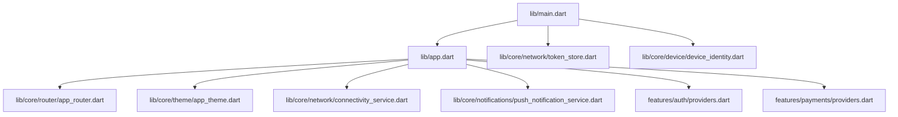
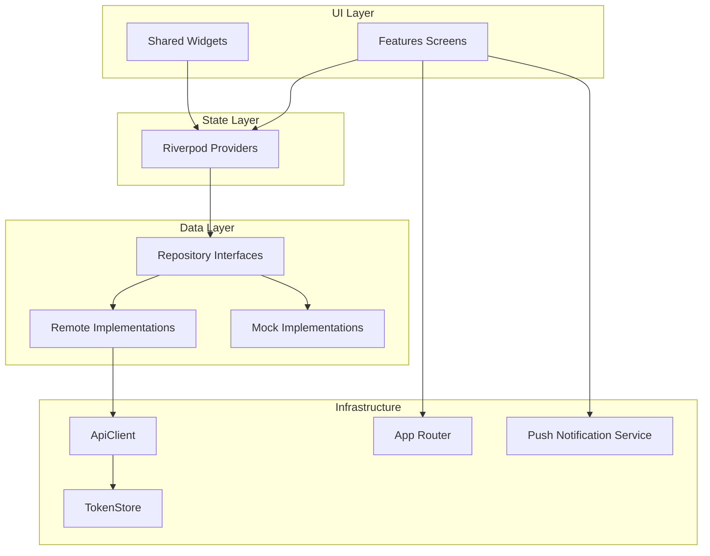
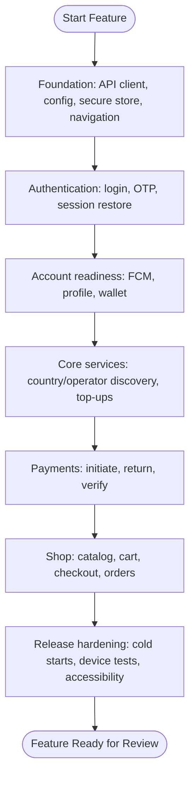
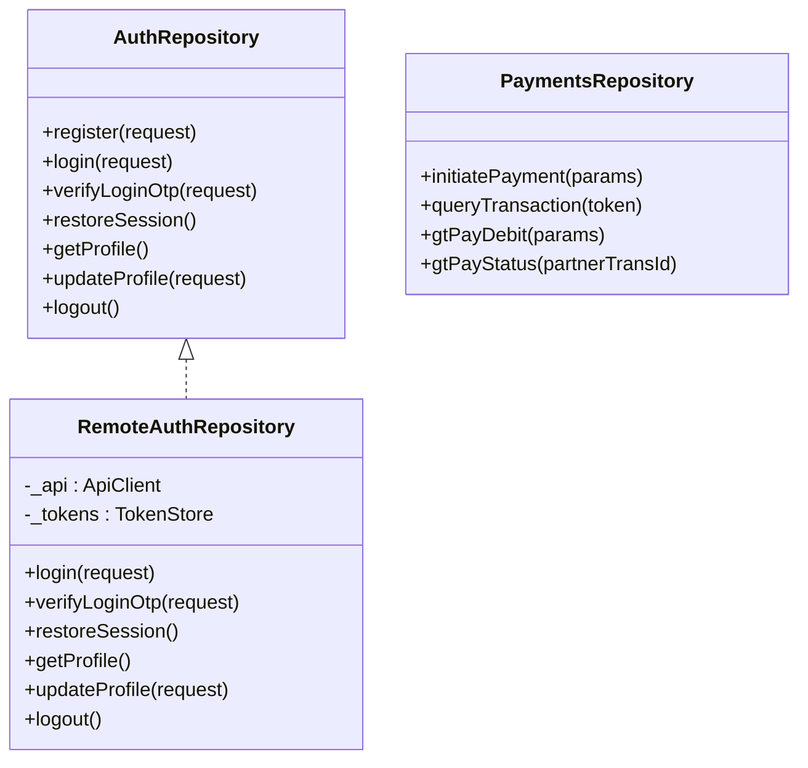
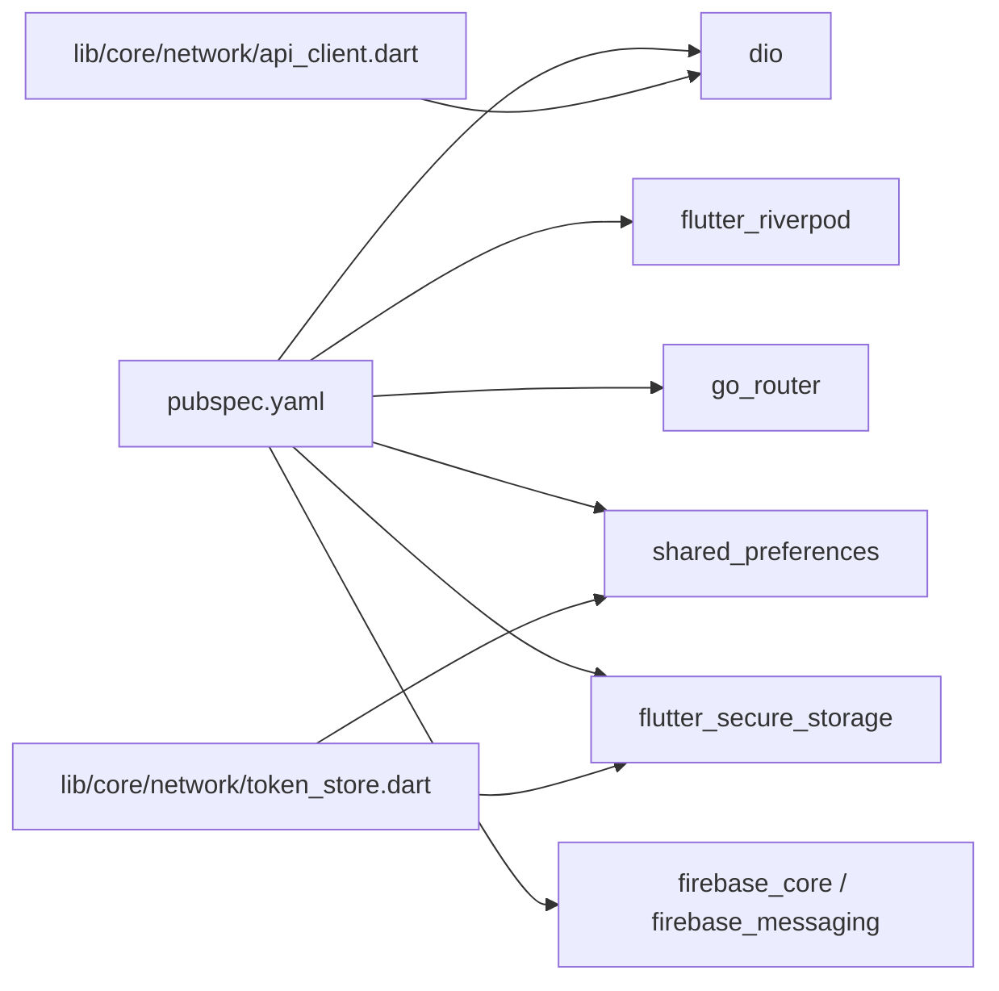
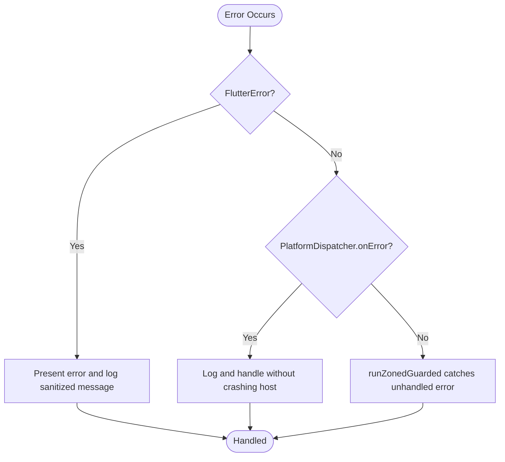

# Development Guidelines

<cite>
**Referenced Files in This Document**
- [README.md](file://README.md)
- [pubspec.yaml](file://pubspec.yaml)
- [analysis_options.yaml](file://analysis_options.yaml)
- [lib/main.dart](file://lib/main.dart)
- [lib/app.dart](file://lib/app.dart)
- [lib/core/network/api_client.dart](file://lib/core/network/api_client.dart)
- [lib/core/network/token_store.dart](file://lib/core/network/token_store.dart)
- [lib/features/auth/data/auth_repository.dart](file://lib/features/auth/data/auth_repository.dart)
- [lib/features/auth/data/remote_auth_repository.dart](file://lib/features/auth/data/remote_auth_repository.dart)
- [lib/features/payments/data/payments_repository.dart](file://lib/features/payments/data/payments_repository.dart)
- [lib/features/services/data/remote_services_repository.dart](file://lib/features/services/data/remote_services_repository.dart)
- [docs/MOBILE_APP_REBUILD_HANDOFF.md](file://docs/MOBILE_APP_REBUILD_HANDOFF.md)
</cite>

## Table of Contents
1. [Introduction](#introduction)
2. [Project Structure](#project-structure)
3. [Core Components](#core-components)
4. [Architecture Overview](#architecture-overview)
5. [Detailed Component Analysis](#detailed-component-analysis)
6. [Dependency Analysis](#dependency-analysis)
7. [Performance Considerations](#performance-considerations)
8. [Troubleshooting Guide](#troubleshooting-guide)
9. [Conclusion](#conclusion)
10. [Appendices](#appendices)

## Introduction
This document defines the development guidelines for contributing to LidaPay, a Flutter mobile application. It covers code style conventions, naming patterns, file organization principles, feature development workflow, linting rules, code review expectations, quality assurance standards, Git and pull request processes, performance optimization guidance, memory management best practices, and debugging techniques. The guidance is grounded in the current repository structure, configuration files, and core implementation modules.

## Project Structure
LidaPay follows a layered Flutter project layout:
- `lib/main.dart` initializes the app, configures global error handling, secure storage, token loading, session restoration, and dependency injection via Riverpod.
- `lib/app.dart` wires up navigation, theme, connectivity awareness, deep links, push notifications, and lifecycle-aware refresh behavior.
- `lib/core` contains cross-cutting infrastructure: API client, endpoints, exceptions, payload helpers, connectivity service, device identity, notifications, providers, router, state helpers, theme, utilities, and shared widgets.
- `lib/features` groups domain features such as authentication, dashboard, history, legal, Lida Value, notifications, onboarding, payments, profile, recipient choice, services, shell, shop, splash, and support. Each feature typically includes data (models, repositories, mocks), screens, widgets, and provider wiring.
- `android`, `ios`, `web`, `assets`, `tool`, `test`, and `docs` provide platform-specific setup, assets, tooling scripts, tests, and handoff documentation.

**Diagram sources**
- [lib/main.dart:17-149](file://lib/main.dart#L17-L149)
- [lib/app.dart:55-255](file://lib/app.dart#L55-L255)

**Section sources**
- [README.md:1-47](file://README.md#L1-L47)
- [pubspec.yaml:1-151](file://pubspec.yaml#L1-L151)
- [lib/main.dart:17-149](file://lib/main.dart#L17-L149)
- [lib/app.dart:55-255](file://lib/app.dart#L55-L255)

## Core Components
The following components are central to LidaPay’s runtime behavior and must be understood before implementing new features:

- Application bootstrap and global error handling:
  - Initializes Flutter bindings, edge-to-edge UI, debug logging suppression in release builds, framework and platform error handlers, Riverpod container overrides, secure secret store, token store hydration, pending payment hydration, and session restore with bounded timeouts.
- App shell and lifecycle:
  - Configures scroll behavior, theme mode, system overlay styling, offline banner, deep link handling, push notification initialization, and lifecycle-driven profile refresh and device token sync.
- Network layer:
  - Centralized Dio client with bearer token injection, request ID generation, sensitive payload redaction, timeout configuration, automatic single-flight access token refresh on 401, and exception mapping.
- Secure session storage:
  - Encrypted secret store abstraction with in-memory fallback and secure Keystore/Keychain backend; token migration from plaintext preferences; biometric session snapshot; session clear stream for reactive cleanup.
- Repository contracts and implementations:
  - Feature-scoped repositories define contracts (e.g., auth, payments) with remote implementations using ApiClient and local mock implementations for testing.

**Section sources**
- [lib/main.dart:17-149](file://lib/main.dart#L17-L149)
- [lib/app.dart:55-255](file://lib/app.dart#L55-L255)
- [lib/core/network/api_client.dart:13-276](file://lib/core/network/api_client.dart#L13-L276)
- [lib/core/network/token_store.dart:8-238](file://lib/core/network/token_store.dart#L8-L238)
- [lib/features/auth/data/auth_repository.dart:1-79](file://lib/features/auth/data/auth_repository.dart#L1-L79)
- [lib/features/auth/data/remote_auth_repository.dart:10-275](file://lib/features/auth/data/remote_auth_repository.dart#L10-L275)
- [lib/features/payments/data/payments_repository.dart:1-46](file://lib/features/payments/data/payments_repository.dart#L1-L46)

## Architecture Overview
LidaPay uses a clean separation between UI, state, and data layers:
- UI layer: Screens and widgets under `lib/features/*/screens` and `widgets`.
- State layer: Riverpod providers per feature (`providers.dart`) that orchestrate repository calls and UI state.
- Data layer: Repository interfaces and implementations under `data/`, including remote and mock variants.
- Infrastructure: Core network, security, routing, notifications, and utilities under `lib/core`.

[No sources needed since this diagram shows conceptual architecture, not specific code mappings]

## Detailed Component Analysis

### Code Style and Naming Conventions
- Dart and Flutter lints:
  - Use `flutter analyze` to enforce recommended lints defined by `analysis_options.yaml`.
  - The project excludes generated/platform directories and legacy folders from analysis.
  - Some lints are relaxed intentionally; contributors should avoid introducing new violations without justification.
- File and folder organization:
  - Feature-based organization under `lib/features/<feature>/` with `data/`, `screens/`, `widgets/`, and `providers.dart`.
  - Cross-cutting concerns under `lib/core/` grouped by responsibility (network, device, location, notifications, providers, router, state, theme, utils, widgets).
- Naming patterns:
  - Classes use PascalCase; methods and variables use camelCase; constants use UPPER_SNAKE_CASE where appropriate.
  - Repository interfaces describe capabilities (e.g., `AuthRepository`, `PaymentsRepository`); implementations are prefixed with `Remote` or `Mock`.
  - Provider files expose Riverpod providers per feature.

**Section sources**
- [analysis_options.yaml:1-28](file://analysis_options.yaml#L1-L28)
- [pubspec.yaml:76-81](file://pubspec.yaml#L76-L81)
- [lib/features/auth/data/auth_repository.dart:1-79](file://lib/features/auth/data/auth_repository.dart#L1-L79)
- [lib/features/payments/data/payments_repository.dart:1-46](file://lib/features/payments/data/payments_repository.dart#L1-L46)

### Feature Development Workflow
Follow the documented milestones to ensure safe, incremental delivery:
- Start with foundation: API client, environment configuration, secure session store, navigation.
- Implement authentication: password/email login, OTP flows, session restore, logout.
- Account readiness: FCM registration, profile/wallet load.
- Existing core services: country/operator discovery, airtime/data, Lida Value.
- Payments: provider initiation, checkout return, authoritative backend verification.
- Shopping: catalog, cart, shipping, checkout, orders.
- Release hardening: cold start reliability, device testing, accessibility, localization.

**Diagram sources**
- [docs/MOBILE_APP_REBUILD_HANDOFF.md:10-48](file://docs/MOBILE_APP_REBUILD_HANDOFF.md#L10-L48)

**Section sources**
- [docs/MOBILE_APP_REBUILD_HANDOFF.md:10-48](file://docs/MOBILE_APP_REBUILD_HANDOFF.md#L10-L48)

### Linting Rules and Quality Assurance Standards
- Static analysis:
  - Run `flutter analyze` locally and in CI.
  - Respect exclusions for generated/platform directories and legacy code.
  - Avoid adding new lint violations; if relaxing rules, document rationale.
- Testing:
  - Unit and widget tests live under `test/`.
  - Prefer mocking repositories and providers; use mock repositories where available.
- Build validation:
  - Run `flutter pub get`, `flutter analyze`, and `flutter test` before submitting changes.
  - For Play releases, build signed bundles and increment version/build numbers as required.

**Section sources**
- [analysis_options.yaml:1-28](file://analysis_options.yaml#L1-L28)
- [README.md:5-25](file://README.md#L5-L25)

### Code Review Processes
Reviewers should validate:
- Correctness:
  - Repository contracts match backend endpoints and payloads.
  - Error handling is robust and user-friendly.
  - Sensitive data is never logged or persisted insecurely.
- Security:
  - Tokens and secrets use encrypted storage.
  - Session restoration and biometric sessions are handled safely.
- Performance:
  - No unnecessary rebuilds; providers are scoped appropriately.
  - Network requests have sensible timeouts and retries.
- UX:
  - Offline states are visible but non-blocking.
  - Deep links and notifications route correctly.
- Maintainability:
  - Follows feature-based organization and naming conventions.
  - Tests cover critical paths and failure modes.

[No sources needed since this section provides general guidance]

### Repository Patterns and Provider Usage
- Repository pattern:
  - Define an interface describing business operations (e.g., `AuthRepository`, `PaymentsRepository`).
  - Provide a remote implementation using `ApiClient` and endpoint constants.
  - Provide a mock implementation for tests and offline scenarios.
- Provider usage:
  - Feature providers orchestrate repository calls and expose UI state.
  - Global providers (e.g., `tokenStoreProvider`, `apiClientProvider`) are injected at startup.

**Diagram sources**
- [lib/features/auth/data/auth_repository.dart:1-79](file://lib/features/auth/data/auth_repository.dart#L1-L79)
- [lib/features/auth/data/remote_auth_repository.dart:10-275](file://lib/features/auth/data/remote_auth_repository.dart#L10-L275)
- [lib/features/payments/data/payments_repository.dart:1-46](file://lib/features/payments/data/payments_repository.dart#L1-L46)

**Section sources**
- [lib/features/auth/data/auth_repository.dart:1-79](file://lib/features/auth/data/auth_repository.dart#L1-L79)
- [lib/features/auth/data/remote_auth_repository.dart:10-275](file://lib/features/auth/data/remote_auth_repository.dart#L10-L275)
- [lib/features/payments/data/payments_repository.dart:1-46](file://lib/features/payments/data/payments_repository.dart#L1-L46)

### Concrete Examples of Proper Implementation

#### Example: Adding a New Authentication Endpoint
- Define the contract method in `AuthRepository`.
- Implement it in `RemoteAuthRepository` using `ApiClient.post` with the correct endpoint.
- Persist tokens/profile via `TokenStore.saveSession` when successful.
- Add tests using `MockAuthRepository`.

**Section sources**
- [lib/features/auth/data/auth_repository.dart:1-79](file://lib/features/auth/data/auth_repository.dart#L1-L79)
- [lib/features/auth/data/remote_auth_repository.dart:19-80](file://lib/features/auth/data/remote_auth_repository.dart#L19-L80)
- [lib/core/network/token_store.dart:148-175](file://lib/core/network/token_store.dart#L148-L175)

#### Example: Using the Payments Provider Flow
- Initiate payment through `PaymentsRepository.initiatePayment`.
- Handle provider redirect/deep link and query transaction status via `PaymentsRepository.queryTransaction`.
- Ensure backend verification settles receipts even if provider callbacks are delayed.

**Section sources**
- [lib/features/payments/data/payments_repository.dart:1-46](file://lib/features/payments/data/payments_repository.dart#L1-L46)
- [docs/MOBILE_APP_REBUILD_HANDOFF.md:36-48](file://docs/MOBILE_APP_REBUILD_HANDOFF.md#L36-L48)

#### Example: Validating Lida Value Conversion Destination
- Validate destination format before calling backend.
- Throw typed `ApiException` for invalid input.
- Map backend response to a receipt model.

**Section sources**
- [lib/features/services/data/remote_services_repository.dart:1446-1482](file://lib/features/services/data/remote_services_repository.dart#L1446-L1482)

## Dependency Analysis
Key dependencies and their roles:
- `dio`: HTTP client used by `ApiClient`.
- `flutter_riverpod`: Dependency injection and reactive state.
- `shared_preferences`: Non-secret persistent storage.
- `flutter_secure_storage`: Encrypted secret storage for tokens and sensitive payloads.
- `go_router`: Declarative routing.
- Firebase and notification packages: Push notifications and messaging.

**Diagram sources**
- [pubspec.yaml:30-75](file://pubspec.yaml#L30-L75)
- [lib/core/network/api_client.dart:1-12](file://lib/core/network/api_client.dart#L1-L12)
- [lib/core/network/token_store.dart:1-10](file://lib/core/network/token_store.dart#L1-L10)

**Section sources**
- [pubspec.yaml:30-75](file://pubspec.yaml#L30-L75)
- [lib/core/network/api_client.dart:1-12](file://lib/core/network/api_client.dart#L1-L12)
- [lib/core/network/token_store.dart:1-10](file://lib/core/network/token_store.dart#L1-L10)

## Performance Considerations
- Startup time:
  - Hydration and session restore are bounded with timeouts to prevent splash freeze.
  - Debug logging is disabled in release builds to reduce overhead.
- Network efficiency:
  - Single-flight token refresh avoids redundant refresh attempts.
  - Request IDs improve tracing without impacting performance.
  - Timeouts are tuned for mobile conditions; long-running provider round-trips are allowed.
- UI responsiveness:
  - Scroll behavior and overscroll indicators are optimized for native feel.
  - Offline banner is non-blocking and lightweight.
- Memory management:
  - Secrets are stored in encrypted storage; in-memory mirrors avoid disk I/O during hot paths.
  - Pending payments and session state are hydrated once at startup.

**Section sources**
- [lib/main.dart:24-40](file://lib/main.dart#L24-L40)
- [lib/main.dart:122-141](file://lib/main.dart#L122-L141)
- [lib/core/network/api_client.dart:125-135](file://lib/core/network/api_client.dart#L125-L135)
- [lib/core/network/api_client.dart:204-265](file://lib/core/network/api_client.dart#L204-L265)
- [lib/core/network/token_store.dart:71-100](file://lib/core/network/token_store.dart#L71-L100)
- [lib/app.dart:192-250](file://lib/app.dart#L192-L250)

## Troubleshooting Guide
Common issues and resolutions:
- Unexpected display errors:
  - A custom error widget prevents red-screen-of-death and offers a refresh action.
- Platform errors:
  - Root error handler logs and suppresses crashes in production.
- Token store failures:
  - Load degrades gracefully; broken keystore clears session instead of crashing.
- Network errors:
  - `ApiClient` maps Dio exceptions to `ApiException`; sensitive fields are redacted in logs.
- Offline mode:
  - Connectivity banner informs users without blocking UI.

**Diagram sources**
- [lib/main.dart:30-40](file://lib/main.dart#L30-L40)
- [lib/main.dart:44-96](file://lib/main.dart#L44-L96)
- [lib/main.dart:146-149](file://lib/main.dart#L146-L149)

**Section sources**
- [lib/main.dart:30-40](file://lib/main.dart#L30-L40)
- [lib/main.dart:44-96](file://lib/main.dart#L44-L96)
- [lib/main.dart:146-149](file://lib/main.dart#L146-L149)
- [lib/core/network/api_client.dart:86-113](file://lib/core/network/api_client.dart#L86-L113)
- [lib/core/network/token_store.dart:120-146](file://lib/core/network/token_store.dart#L120-L146)
- [lib/app.dart:211-250](file://lib/app.dart#L211-L250)

## Conclusion
Contributors should follow the established feature-based organization, repository patterns, and Riverpod provider structure. Enforce linting, write tests, and respect security boundaries around tokens and secrets. Use the milestone-driven workflow to deliver reliable features, especially around authentication, payments, and shopping. Prioritize performance and resilience by leveraging the existing network and session infrastructure, and rely on the provided error handling and offline awareness mechanisms.

[No sources needed since this section summarizes without analyzing specific files]

## Appendices

### Git Workflow and Branching Strategy
- Create feature branches named after the feature or fix (e.g., `feature/auth-otp-flow`, `fix/payment-deep-link`).
- Keep commits small and focused; include meaningful commit messages.
- Rebase or merge into `main` after passing checks and reviews.

[No sources needed since this section provides general guidance]

### Commit Message Conventions
- Use imperative mood and concise summaries.
- Include context for why the change was made.
- Reference related issues or milestones when applicable.

[No sources needed since this section provides general guidance]

### Pull Request Process
- Ensure all checks pass: `flutter pub get`, `flutter analyze`, `flutter test`.
- Include screenshots or short videos for UI changes.
- Describe risk areas, especially around authentication, payments, and deep links.
- Request reviews from maintainers familiar with the affected feature area.

**Section sources**
- [README.md:5-25](file://README.md#L5-L25)

### Debugging Techniques
- Enable verbose API logs in debug builds; sensitive data is redacted automatically.
- Use the custom error widget to recover from unexpected UI errors.
- Inspect token store state and session restoration behavior during startup.
- Verify deep link routing and notification handling on app resume.

**Section sources**
- [lib/core/network/api_client.dart:25-83](file://lib/core/network/api_client.dart#L25-L83)
- [lib/main.dart:44-96](file://lib/main.dart#L44-L96)
- [lib/app.dart:115-124](file://lib/app.dart#L115-L124)