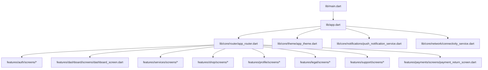
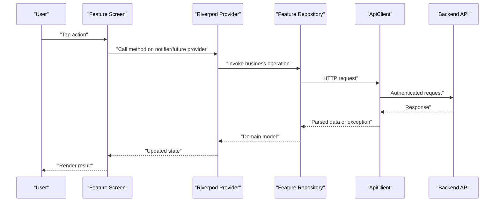
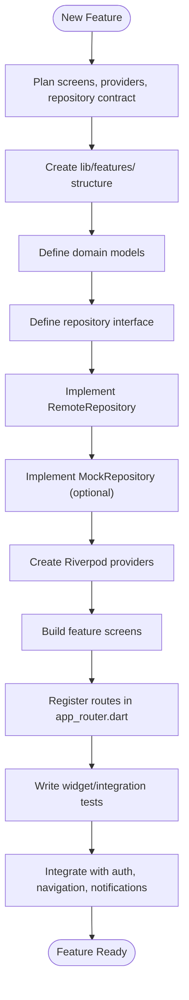
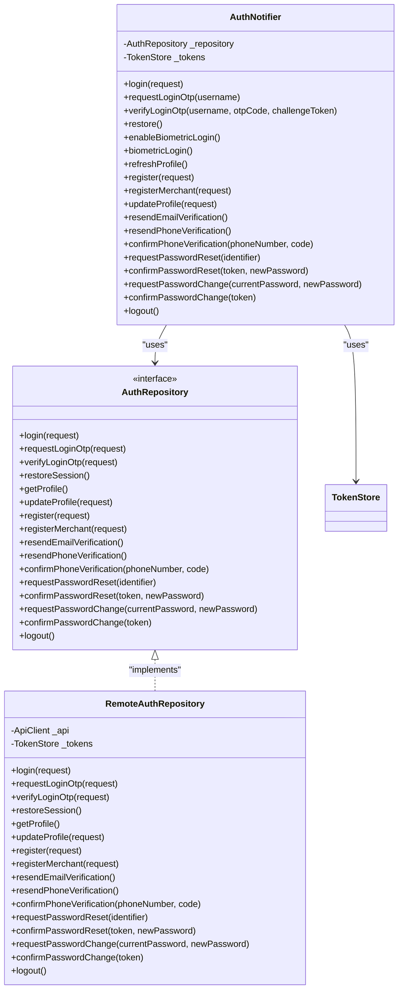
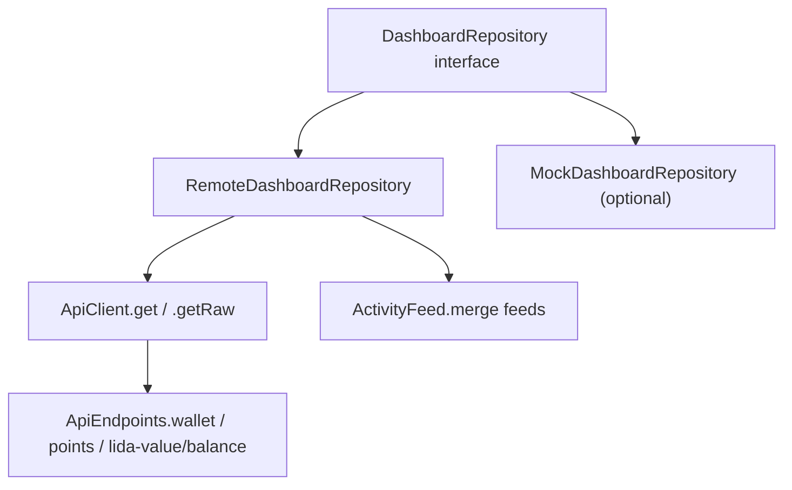
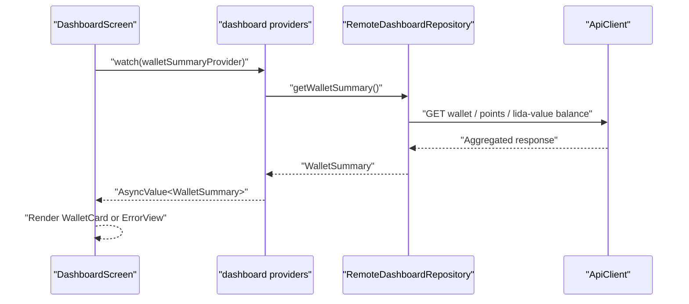
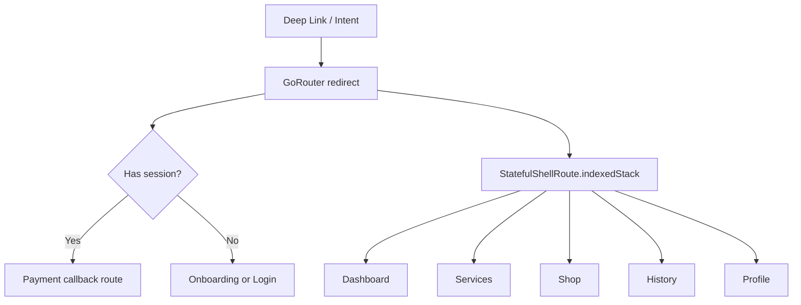
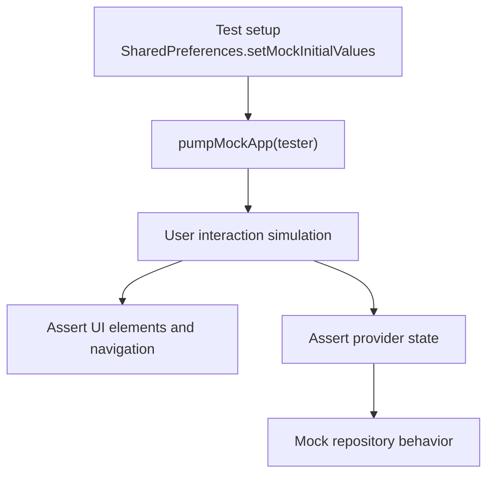
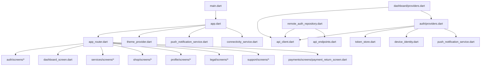

# Feature Development Workflow

<cite>
**Referenced Files in This Document**
- [main.dart](file://lib/main.dart)
- [app.dart](file://lib/app.dart)
- [app_router.dart](file://lib/core/router/app_router.dart)
- [api_client.dart](file://lib/core/network/api_client.dart)
- [api_endpoints.dart](file://lib/core/network/api_endpoints.dart)
- [providers.dart](file://lib/features/auth/providers.dart)
- [remote_auth_repository.dart](file://lib/features/auth/data/remote_auth_repository.dart)
- [mock_auth_repository.dart](file://lib/features/auth/data/mock_auth_repository.dart)
- [login_screen.dart](file://lib/features/auth/screens/login_screen.dart)
- [providers.dart](file://lib/features/dashboard/providers.dart)
- [remote_dashboard_repository.dart](file://lib/features/dashboard/data/remote_dashboard_repository.dart)
- [dashboard_screen.dart](file://lib/features/dashboard/screens/dashboard_screen.dart)
- [feature_placeholder.dart](file://lib/core/widgets/feature_placeholder.dart)
- [auth_flow_test.dart](file://test/auth_flow_test.dart)
</cite>

## Table of Contents
1. [Introduction](#introduction)
2. [Project Structure](#project-structure)
3. [Core Components](#core-components)
4. [Architecture Overview](#architecture-overview)
5. [Detailed Component Analysis](#detailed-component-analysis)
6. [Dependency Analysis](#dependency-analysis)
7. [Performance Considerations](#performance-considerations)
8. [Troubleshooting Guide](#troubleshooting-guide)
9. [Conclusion](#conclusion)
10. [Appendices](#appendices)

## Introduction
This document defines the standard workflow for implementing new features in LidaPay. It explains how to plan, structure, implement, test, and integrate a feature module following the established patterns used by authentication, dashboard, services, shop, and other existing features. The guide covers directory layout, provider creation, screen development, data layer implementation, authentication integration, API calls, state management with Riverpod, navigation routing, testing strategies, and mock implementations.

## Project Structure
LidaPay follows a feature-based architecture layered over shared core infrastructure:

- `lib/core`: Shared infrastructure such as network client, router, theme, utilities, widgets, deep links, device identity, notifications, and connectivity.
- `lib/features/<feature>`: Each feature owns its screens, providers, data models, repositories (interface + remote + optional mock), and reusable widgets.
- `lib/main.dart` and `lib/app.dart`: Application bootstrap, global error handling, provider container setup, and app shell configuration.
- `test`: Widget and integration tests using Flutter test utilities and mock providers.

**Diagram sources**
- [main.dart:17-149](file://lib/main.dart#L17-L149)
- [app.dart:55-255](file://lib/app.dart#L55-L255)
- [app_router.dart:40-411](file://lib/core/router/app_router.dart#L40-L411)

**Section sources**
- [main.dart:17-149](file://lib/main.dart#L17-L149)
- [app.dart:55-255](file://lib/app.dart#L55-L255)
- [app_router.dart:40-411](file://lib/core/router/app_router.dart#L40-L411)

## Core Components
The following components are central to every feature:

- **Provider Container and Global State**: Initialized in `main.dart`, injecting shared preferences, token store, secret store, device identity, and pending payment hydration before running the app.
- **App Shell and Routing**: `app.dart` configures Material app, scroll behavior, push notification initialization, deep link handling, and offline banner. `app_router.dart` defines route constants, guards, and nested shell branches.
- **Network Layer**: `ApiClient` wraps Dio, injects bearer tokens, redacts logs, handles 401 refresh flows, and exposes typed HTTP methods.
- **Feature Providers**: Each feature exposes repository providers that swap between remote and mock implementations, plus Riverpod providers for UI state and data fetching.
- **Repositories**: Interfaces define contracts; `Remote*Repository` implements live API calls; optional `Mock*Repository` supports tests and stubbed flows.
- **Screens**: Consumer widgets or ConsumerStatefulWidget instances that read providers, handle user actions, and navigate via GoRouter.

**Section sources**
- [main.dart:98-149](file://lib/main.dart#L98-L149)
- [app.dart:69-101](file://lib/app.dart#L69-L101)
- [app.dart:136-255](file://lib/app.dart#L136-L255)
- [app_router.dart:94-164](file://lib/core/router/app_router.dart#L94-L164)
- [api_client.dart:16-84](file://lib/core/network/api_client.dart#L16-L84)
- [api_client.dart:137-202](file://lib/core/network/api_client.dart#L137-L202)
- [api_client.dart:204-265](file://lib/core/network/api_client.dart#L204-L265)

## Architecture Overview
A typical feature flow integrates these layers:

**Diagram sources**
- [api_client.dart:16-84](file://lib/core/network/api_client.dart#L16-L84)
- [providers.dart:15-37](file://lib/features/auth/providers.dart#L15-L37)
- [remote_auth_repository.dart:20-52](file://lib/features/auth/data/remote_auth_repository.dart#L20-L52)

## Detailed Component Analysis

### Standard Feature Template
When adding a new feature, follow this template:

- Directory structure under `lib/features/<feature_name>`:
  - `data/models.dart`: Domain models.
  - `data/repository.dart`: Interface definition.
  - `data/remote_repository.dart`: Live API implementation.
  - `data/mock_repository.dart`: Optional mock for tests.
  - `providers.dart`: Riverpod providers exposing repository and UI state.
  - `screens/`: One or more screens implementing the feature UI.
  - `widgets/`: Reusable UI components specific to the feature.
- Register routes in `app_router.dart` under an appropriate shell branch or root-level route if needed.
- Wire repository provider to `Remote*Repository` in `providers.dart`; swap to `Mock*Repository` in tests.
- Use `ApiClient` through the repository; never call Dio directly from screens.
- Manage state with Riverpod `StateNotifierProvider`, `FutureProvider`, or `StreamProvider`.
- Navigate using `GoRouter` constants defined in `AppRoutes`.

[No sources needed since this diagram shows conceptual workflow, not actual code structure]

### Authentication Integration Pattern
Authentication is implemented through a repository abstraction, a Riverpod notifier, and secure token storage:

- `AuthRepository` defines login, OTP, profile, registration, password reset/change, and logout operations.
- `RemoteAuthRepository` persists sessions via `TokenStore`, enriches payloads with device identity, and maps backend responses to domain models.
- `AuthNotifier` manages session lifecycle, biometric login, OTP challenges, profile refresh, and side effects like syncing device tokens.
- Screens interact with `authSessionProvider` and related providers rather than calling repositories directly.

**Diagram sources**
- [remote_auth_repository.dart:13-274](file://lib/features/auth/data/remote_auth_repository.dart#L13-L274)
- [providers.dart:51-351](file://lib/features/auth/providers.dart#L51-L351)

**Section sources**
- [providers.dart:15-37](file://lib/features/auth/providers.dart#L15-L37)
- [providers.dart:51-351](file://lib/features/auth/providers.dart#L51-L351)
- [remote_auth_repository.dart:20-52](file://lib/features/auth/data/remote_auth_repository.dart#L20-L52)
- [remote_auth_repository.dart:83-103](file://lib/features/auth/data/remote_auth_repository.dart#L83-L103)
- [remote_auth_repository.dart:170-196](file://lib/features/auth/data/remote_auth_repository.dart#L170-L196)

### Data Layer Implementation Pattern
Data access follows a consistent pattern:

- Define a repository interface in `data/repository.dart`.
- Implement `Remote*Repository` using `ApiClient` and `ApiEndpoints`.
- Provide a `Mock*Repository` for deterministic tests.
- Expose a single provider that wires the repository into Riverpod, often watching the authenticated user so data refreshes when the session changes.

Example references:

- Dashboard repository provider watches `authSessionProvider` to bind requests to the current user.
- Remote dashboard repository aggregates wallet, Lida Value units, points, and recent transactions with graceful degradation.

**Diagram sources**
- [providers.dart:16-19](file://lib/features/dashboard/providers.dart#L16-L19)
- [remote_dashboard_repository.dart:11-44](file://lib/features/dashboard/data/remote_dashboard_repository.dart#L11-L44)
- [remote_dashboard_repository.dart:121-134](file://lib/features/dashboard/data/remote_dashboard_repository.dart#L121-L134)
- [api_endpoints.dart:16-18](file://lib/core/network/api_endpoints.dart#L16-L18)
- [api_endpoints.dart:42-50](file://lib/core/network/api_endpoints.dart#L42-L50)

**Section sources**
- [providers.dart:16-19](file://lib/features/dashboard/providers.dart#L16-L19)
- [remote_dashboard_repository.dart:11-44](file://lib/features/dashboard/data/remote_dashboard_repository.dart#L11-L44)
- [remote_dashboard_repository.dart:121-134](file://lib/features/dashboard/data/remote_dashboard_repository.dart#L121-L134)

### Screen Development Pattern
Screens should be lightweight consumers of providers:

- Use `ConsumerWidget` or `ConsumerStatefulWidget`.
- Read data via `ref.watch` and mutate state via `ref.read(...notifier).state = ...` or `ref.invalidate(...)`.
- Handle loading, error, and empty states explicitly.
- Navigate using `context.go` or `context.push` with `AppRoutes` constants.
- Avoid direct API calls; delegate to providers and repositories.

Examples:

- Login screen orchestrates OTP/password flows, biometrics, validation, and navigation.
- Dashboard screen composes wallet summary, recent activity, flash deals, and service rail while listening to pending recipient decisions.

**Diagram sources**
- [dashboard_screen.dart:51-89](file://lib/features/dashboard/screens/dashboard_screen.dart#L51-L89)
- [providers.dart:21-31](file://lib/features/dashboard/providers.dart#L21-L31)
- [remote_dashboard_repository.dart:20-44](file://lib/features/dashboard/data/remote_dashboard_repository.dart#L20-L44)

**Section sources**
- [login_screen.dart:25-55](file://lib/features/auth/screens/login_screen.dart#L25-L55)
- [dashboard_screen.dart:51-89](file://lib/features/dashboard/screens/dashboard_screen.dart#L51-L89)

### Navigation and Routing Integration
Routing is centralized in `app_router.dart`:

- Route constants are defined in `AppRoutes`.
- Root navigator key ensures full-screen pages cover the shell dock.
- Redirect logic enforces session requirements and handles deep links.
- Shell branches organize main tabs: Home/Dashboard, Services, Shop, History, Profile.
- Payment callback and recipient decision routes are root-level to support external flows.

**Diagram sources**
- [app_router.dart:94-164](file://lib/core/router/app_router.dart#L94-L164)
- [app_router.dart:238-408](file://lib/core/router/app_router.dart#L238-L408)

**Section sources**
- [app_router.dart:40-86](file://lib/core/router/app_router.dart#L40-L86)
- [app_router.dart:94-164](file://lib/core/router/app_router.dart#L94-L164)
- [app_router.dart:238-408](file://lib/core/router/app_router.dart#L238-L408)

### Testing Requirements and Mock Implementations
Testing strategy includes:

- Widget tests for screens validating user interactions and navigation.
- Provider tests for state transitions and error handling.
- Repository tests for mapping API responses and exceptions.
- Use `Mock*Repository` implementations to simulate latency, success, and failure scenarios.
- Initialize shared preferences and mock providers where necessary.

References:

- `auth_flow_test.dart` exercises cold start, onboarding, login, OTP verification, and dashboard rendering.
- `MockAuthRepository` simulates login, OTP, profile updates, and error conditions.

**Diagram sources**
- [auth_flow_test.dart:40-53](file://test/auth_flow_test.dart#L40-L53)
- [auth_flow_test.dart:55-101](file://test/auth_flow_test.dart#L55-L101)
- [mock_auth_repository.dart:36-65](file://lib/features/auth/data/mock_auth_repository.dart#L36-L65)

**Section sources**
- [auth_flow_test.dart:40-53](file://test/auth_flow_test.dart#L40-L53)
- [auth_flow_test.dart:55-101](file://test/auth_flow_test.dart#L55-L101)
- [mock_auth_repository.dart:7-218](file://lib/features/auth/data/mock_auth_repository.dart#L7-L218)

### Example: Creating a Complete Feature Module
Follow these steps to create a complete feature module:

1. Plan the feature:
   - Identify screens, required data, and user flows.
   - Decide whether it belongs under an existing shell branch or needs a root-level route.
2. Create directory structure:
   - `lib/features/my_feature/data/models.dart`
   - `lib/features/my_feature/data/repository.dart`
   - `lib/features/my_feature/data/remote_repository.dart`
   - `lib/features/my_feature/data/mock_repository.dart`
   - `lib/features/my_feature/providers.dart`
   - `lib/features/my_feature/screens/my_feature_screen.dart`
   - `lib/features/my_feature/widgets/...`
3. Implement data layer:
   - Define repository interface.
   - Implement `RemoteMyFeatureRepository` using `ApiClient` and `ApiEndpoints`.
   - Add `MockMyFeatureRepository` for tests.
4. Implement providers:
   - Expose `myFeatureRepositoryProvider` swapping remote/mock.
   - Create `FutureProvider` or `StateNotifierProvider` for UI state.
5. Build screens:
   - Consume providers, handle loading/error states, navigate via `AppRoutes`.
6. Register routes:
   - Add route constants in `AppRoutes`.
   - Add route definitions in `app_router.dart` under the correct shell branch or root level.
7. Write tests:
   - Widget tests for screens.
   - Provider tests for state transitions.
   - Use mocks to validate error paths.
8. Integrate with core services:
   - Ensure authentication checks are respected.
   - Sync with notifications or deep links if applicable.
   - Respect connectivity and offline states.

[No sources needed since this section provides general guidance]

## Dependency Analysis
Key dependencies across the application:

- `main.dart` initializes shared providers and runs `LidapayApp`.
- `app.dart` depends on router, theme, notifications, connectivity, and feature providers.
- `app_router.dart` imports feature screens and defines navigation rules.
- `ApiClient` depends on `TokenStore`, `DeviceIdentity`, and `PushNotificationService`.
- Feature providers depend on `ApiClient` and `AuthSession`.
- Repositories depend on `ApiClient` and `ApiEndpoints`.

**Diagram sources**
- [main.dart:17-149](file://lib/main.dart#L17-L149)
- [app.dart:55-255](file://lib/app.dart#L55-L255)
- [app_router.dart:40-411](file://lib/core/router/app_router.dart#L40-L411)
- [providers.dart:15-37](file://lib/features/auth/providers.dart#L15-L37)
- [providers.dart:16-19](file://lib/features/dashboard/providers.dart#L16-L19)
- [remote_auth_repository.dart:13-22](file://lib/features/auth/data/remote_auth_repository.dart#L13-L22)
- [api_endpoints.dart:1-155](file://lib/core/network/api_endpoints.dart#L1-L155)

**Section sources**
- [main.dart:17-149](file://lib/main.dart#L17-L149)
- [app.dart:55-255](file://lib/app.dart#L55-L255)
- [app_router.dart:40-411](file://lib/core/router/app_router.dart#L40-L411)
- [providers.dart:15-37](file://lib/features/auth/providers.dart#L15-L37)
- [providers.dart:16-19](file://lib/features/dashboard/providers.dart#L16-L19)
- [remote_auth_repository.dart:13-22](file://lib/features/auth/data/remote_auth_repository.dart#L13-L22)
- [api_endpoints.dart:1-155](file://lib/core/network/api_endpoints.dart#L1-L155)

## Performance Considerations
- Prefer `FutureProvider` and `StreamProvider` for background data fetching to avoid blocking UI rebuilds.
- Use selective watchers (`select`) to minimize unnecessary rebuilds.
- Debounce or throttle frequent state updates; use `StateProvider` for transient UI flags.
- Leverage `ApiClient` retry and refresh mechanisms instead of manual retries in screens.
- Keep repository logic focused on data transformation and error mapping; keep screens thin.
- Use skeleton loaders and partial success patterns to improve perceived performance.

[No sources needed since this section provides general guidance]

## Troubleshooting Guide
Common issues and resolutions:

- **Unexpected display errors**: The global error handler in `main.dart` prevents red screens and offers a refresh action. Check debug logs and ensure error boundaries are in place.
- **Navigation loops or double mounts**: Avoid rebuilding `GoRouter` on auth changes; use `refreshListenable` and read session inside `redirect`.
- **Offline banners**: `app.dart` displays an offline banner based on connectivity; ensure features handle offline gracefully.
- **API 401 failures**: `ApiClient` attempts token refresh once; repeated failures clear tokens and log out users.
- **Deep link routing**: Payment callbacks and password reset links are handled specially; ensure they do not bounce to splash unnecessarily.

**Section sources**
- [main.dart:30-40](file://lib/main.dart#L30-L40)
- [main.dart:44-96](file://lib/main.dart#L44-L96)
- [app_router.dart:108-164](file://lib/core/router/app_router.dart#L108-L164)
- [app.dart:211-249](file://lib/app.dart#L211-L249)
- [api_client.dart:50-84](file://lib/core/network/api_client.dart#L50-L84)
- [api_client.dart:204-265](file://lib/core/network/api_client.dart#L204-L265)

## Conclusion
LidaPay’s feature development workflow emphasizes separation of concerns, robust state management, and consistent integration points. By following the standard template—defining repositories, providers, screens, and routes—you can add new capabilities predictably and safely. Authentication, networking, routing, and testing patterns are well-established and reusable across features. Adhering to these practices ensures maintainability, testability, and a smooth user experience.

[No sources needed since this section summarizes without analyzing specific files]

## Appendices

### Quick Checklist for New Features
- [ ] Define domain models and repository interface.
- [ ] Implement remote repository using `ApiClient` and `ApiEndpoints`.
- [ ] Add mock repository for tests.
- [ ] Create Riverpod providers for data and UI state.
- [ ] Build screens consuming providers and navigating via `AppRoutes`.
- [ ] Register routes in `app_router.dart`.
- [ ] Write widget and provider tests with mocks.
- [ ] Integrate with authentication, notifications, and deep links as needed.
- [ ] Handle loading, error, and offline states consistently.

[No sources needed since this section provides general guidance]