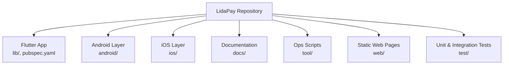
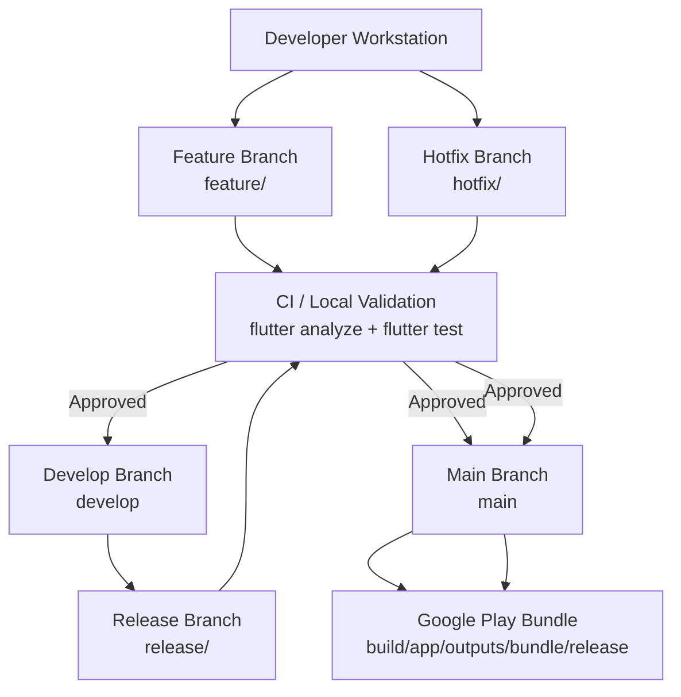
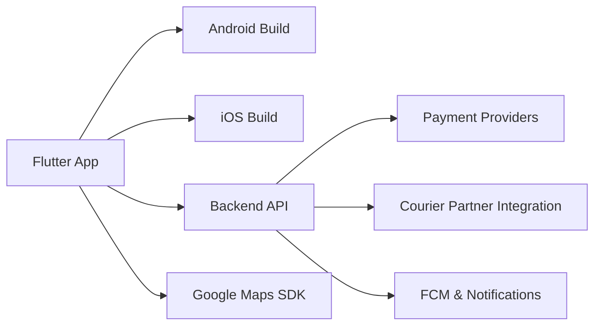

# Git Workflow & Branching Strategy

<cite>
**Referenced Files in This Document**   
- [README.md](file://README.md)
- [.gitignore](file://.gitignore)
- [pubspec.yaml](file://pubspec.yaml)
- [MOBILE_APP_REBUILD_HANDOFF.md](file://docs/MOBILE_APP_REBUILD_HANDOFF.md)
- [SHOP_API_MOBILE_HANDOFF.md](file://docs/SHOP_API_MOBILE_HANDOFF.md)
- [COURIER_API_PARTNER_HANDOFF_FRANK.md](file://docs/COURIER_API_PARTNER_HANDOFF_FRANK.md)
- [GOOGLE_MAPS_SETUP.md](file://docs/GOOGLE_MAPS_SETUP.md)
- [BACKEND_NOTIFICATION_TRIGGERS_HANDOFF.md](file://docs/BACKEND_NOTIFICATION_TRIGGERS_HANDOFF.md)
- [swagger-api-documentation.md](file://docs/swagger-api-documentation.md)
</cite>

## Table of Contents
1. [Introduction](#introduction)
2. [Project Structure](#project-structure)
3. [Core Components](#core-components)
4. [Architecture Overview](#architecture-overview)
5. [Detailed Component Analysis](#detailed-component-analysis)
6. [Dependency Analysis](#dependency-analysis)
7. [Performance Considerations](#performance-considerations)
8. [Troubleshooting Guide](#troubleshooting-guide)
9. [Conclusion](#conclusion)
10. [Appendices](#appendices)

## Introduction
This document defines the Git workflow and branching strategy for LidaPay, a Flutter mobile application with backend integrations for authentication, payments, shop checkout, courier tracking, and notifications. It establishes how branches are created and merged, how commits and pull requests should be structured, how releases and hotfixes are managed, and what version control best practices apply to this repository.

The project is primarily a Flutter app that depends on a production API at `https://api.advansistechnologies.com`. Versioning is controlled through `pubspec.yaml`, and release artifacts are built for Google Play. The repository also contains documentation describing backend handoffs, courier integration, and API contracts that influence how changes should be reviewed and released.

## Project Structure
LidaPay is a Flutter application with:
- Android and iOS native layers
- A Dart/Flutter codebase under `lib/`
- Tests under `test/`
- Documentation under `docs/`
- Tooling scripts under `tool/`
- Web static pages under `web/`



**Diagram sources**
- [pubspec.yaml:1-19](file://pubspec.yaml#L1-L19)
- [README.md:1-47](file://README.md#L1-L47)

**Section sources**
- [pubspec.yaml:1-19](file://pubspec.yaml#L1-L19)
- [README.md:1-47](file://README.md#L1-L47)

## Core Components
For Git workflow purposes, treat these as the main change surfaces:

| Area | Responsibility | Git impact |
|---|---|---|
| Flutter application (`lib/`) | UI, navigation, networking, state, deep links, FCM handling | Feature branches; PRs must include tests where applicable |
| Android (`android/`) | Build configuration, signing, manifest, native entry point | Release branches; sensitive files must remain gitignored |
| iOS (`ios/`) | Xcode workspace, pods, native entry point | Release branches; local secrets must remain gitignored |
| Documentation (`docs/`) | Backend handoff, courier integration, API contract references | Can be merged independently when no code changes are required |
| Tools (`tool/`) | Courier test scripts, live-check helpers, icon generation | Treat as ops tooling; keep `.env` and secrets out of source control |
| Static web pages (`web/`) | Privacy policy, terms, payment/refunds, account deletion | Must be published before Play Console submission |
| Tests (`test/`) | Unit and integration tests referenced by README build steps | Required for feature and bug-fix PRs where behavior changes |

**Section sources**
- [README.md:5-47](file://README.md#L5-L47)
- [pubspec.yaml:1-19](file://pubspec.yaml#L1-L19)
- [.gitignore:1-61](file://.gitignore#L1-L61)

## Architecture Overview
LidaPay’s development lifecycle is driven by the Flutter app and its backend integrations. The following diagram shows how branches flow into stable releases and deployments.



**Diagram sources**
- [README.md:5-25](file://README.md#L5-L25)
- [pubspec.yaml:7-19](file://pubspec.yaml#L7-L19)

## Detailed Component Analysis

### Branching Model
Use a linear, release-oriented model centered on `main` and `develop`:

| Branch | Purpose | Creation Rule | Merge Target | Deletion Rule |
|---|---|---|---|---|
| `main` | Stable, deployable code | Only from approved release or hotfix merges | Never merge directly from feature branches | Permanent |
| `develop` | Integration branch for upcoming features | Created once; rebased periodically | Merges into `release/*` and sometimes `main` for pre-release validation | Permanent |
| `feature/<short-description>` | Single feature or well-scoped change | From `develop` | `develop` | Delete after merge |
| `release/<version>` | Stabilization, QA, Play Store preparation | From `develop` | `main` and back-merge to `develop` | Delete after promotion |
| `hotfix/<issue-or-scope>` | Urgent fix for production | From `main` | `main` and back-merge to `develop` | Delete after merge |

Examples:
- `feature/shop-tracking-map`
- `feature/auth-email-code-flow`
- `release/1.1.3`
- `hotfix/courier-gps-stale-location`

Rules:
- Keep branches short-lived.
- Rebase `develop` locally before opening or updating PRs.
- Do not force-push shared branches unless coordinating with reviewers.
- Protect `main` and `develop` with required reviews and passing checks.

**Section sources**
- [pubspec.yaml:7-19](file://pubspec.yaml#L7-L19)
- [README.md:5-25](file://README.md#L5-L25)

### Commit Message Conventions
Adopt conventional-style commit messages to make history readable and automation-friendly.

Format:
```
type(scope): summary

body (optional)
footer (optional)
```

Types:
- `feat`: new feature
- `fix`: bug fix
- `docs`: documentation-only change
- `style`: formatting, linting, non-functional style change
- `refactor`: code change that neither fixes a bug nor adds a feature
- `test`: adding or updating tests
- `chore`: build, tooling, dependency updates
- `revert`: revert a previous commit

Scopes should reflect the affected area:
- `auth`
- `shop`
- `payments`
- `courier`
- `notifications`
- `android`
- `ios`
- `flutter-app`
- `tools`

Examples:
- `feat(auth): add email-code login and OTP verification flow`
- `fix(courier): stop polling tracking screen when order is delivered`
- `docs(shopping): clarify server-computed pricing contract`
- `chore(deps): update flutter_lints and dio versions`
- `test(payment): verify GTPay pending status polling behavior`

Commit rules:
- Keep summaries under 72 characters.
- Use imperative mood: “add”, not “added”.
- Reference issues or tickets in footers when available.
- Avoid committing secrets, tokens, or generated build outputs.

**Section sources**
- [README.md:5-25](file://README.md#L5-L25)
- [pubspec.yaml:1-19](file://pubspec.yaml#L1-L19)

### Pull Request Process
Every change should go through a pull request:

1. Create a branch from the correct base branch.
2. Implement one logical change per PR.
3. Update tests if behavior changes.
4. Run `flutter analyze` and `flutter test` locally.
5. Open a PR with:
   - Clear title matching the commit convention.
   - Description explaining why the change exists.
   - Steps to reproduce for bugs.
   - Screenshots or logs when relevant.
   - Links to related docs or backend endpoints.
6. Request reviews from appropriate owners:
   - Mobile developer for Flutter/UI changes.
   - Backend-aware reviewer for API contract changes.
   - Ops or release engineer for release-related changes.
7. Address review feedback in focused follow-up commits.
8. Squash or rebase into clean history only when requested.
9. Merge after approvals and CI pass.

PR templates should include:
- What changed
- Why it changed
- How to test
- Affected areas
- Risk level
- Backward compatibility notes
- Deployment notes

**Section sources**
- [README.md:5-25](file://README.md#L5-L25)
- [MOBILE_APP_REBUILD_HANDOFF.md:1-48](file://docs/MOBILE_APP_REBUILD_HANDOFF.md#L1-L48)

### Code Review Requirements
Reviewers should validate:
- Correctness against backend contracts
- Security boundaries (tokens, secrets, deep links)
- Error handling and retry behavior
- User-facing UX and accessibility
- Test coverage for critical flows
- Performance implications for network calls and map polling
- Compliance with versioning and release procedures

Review checklist:
- Does the PR solve the stated problem?
- Are secrets or sensitive data exposed?
- Are API responses parsed defensively?
- Is token refresh handled safely?
- Are deep links validated before navigation?
- Are payment states reconciled with the backend?
- Are notification triggers scoped correctly?
- Are release artifacts reproducible?

**Section sources**
- [MOBILE_APP_REBUILD_HANDOFF.md:50-78](file://docs/MOBILE_APP_REBUILD_HANDOFF.md#L50-L78)
- [BACKEND_NOTIFICATION_TRIGGERS_HANDOFF.md:12-53](file://docs/BACKEND_NOTIFICATION_TRIGGERS_HANDOFF.md#L12-L53)

### Merge Strategies
Recommended strategies:
- Feature branches merge into `develop` via squash or rebase-and-merge to keep history clean.
- Release branches merge into `main` using fast-forward or merge commit depending on team preference.
- Hotfix branches merge into `main` first, then back-merge into `develop`.
- Never merge unreviewed or failing PRs into protected branches.
- Tag releases on `main` after successful deployment.

Merge rules:
- Require at least two approvals for release and hotfix merges.
- Require all checks to pass.
- Prevent direct pushes to `main` and `develop`.
- Keep merge commits meaningful.

**Section sources**
- [README.md:5-25](file://README.md#L5-L25)
- [pubspec.yaml:7-19](file://pubspec.yaml#L7-L19)

### Version Control Best Practices
- Never commit secrets, keys, or credentials.
- Use `.gitignore` to exclude local config and build artifacts.
- Keep generated files out of source control.
- Pin dependencies where stability matters.
- Use environment variables or secret managers for runtime configuration.
- Keep changelogs or release notes aligned with `pubspec.yaml` version bumps.
- Validate builds locally before pushing.

Sensitive items in this repository must remain outside version control:
- Android keystore and upload certificate
- `android/key.properties`
- `android/local.properties`
- `ios/Flutter/Local.xcconfig`
- Tool `.env` files

**Section sources**
- [.gitignore:1-61](file://.gitignore#L1-L61)
- [README.md:15-25](file://README.md#L15-L25)
- [GOOGLE_MAPS_SETUP.md:35-58](file://docs/GOOGLE_MAPS_SETUP.md#L35-L58)

### Conflict Resolution Procedures
When conflicts arise:
1. Stop and communicate with collaborators.
2. Pull the latest target branch.
3. Resolve conflicts in small, logical hunks.
4. Run `flutter analyze` and `flutter test` after resolution.
5. Verify backend contract compatibility if API payloads changed.
6. Add or update tests for conflicting logic.
7. Ask reviewers to focus on conflict-resolution areas.
8. Avoid merging unrelated changes while resolving conflicts.

Common conflict areas:
- `pubspec.yaml` dependency updates
- Android/iOS build configuration
- Deep link routing
- Payment initiation and status reconciliation
- Notification payload parsing
- Courier tracking polling logic

**Section sources**
- [MOBILE_APP_REBUILD_HANDOFF.md:595-688](file://docs/MOBILE_APP_REBUILD_HANDOFF.md#L595-L688)
- [SHOP_API_MOBILE_HANDOFF.md:320-428](file://docs/SHOP_API_MOBILE_HANDOFF.md#L320-L428)

### Collaboration Guidelines
- One feature per branch.
- Small, frequent PRs.
- Clear PR descriptions.
- Prompt review response.
- Document breaking changes.
- Coordinate backend and frontend changes together.
- Use issue references consistently.
- Keep documentation updated when contracts change.
- Respect release windows and freeze periods.

**Section sources**
- [README.md:5-47](file://README.md#L5-L47)
- [swagger-api-documentation.md:1-8](file://docs/swagger-api-documentation.md#L1-L8)

## Dependency Analysis
Git workflow dependencies between components:



**Diagram sources**
- [pubspec.yaml:30-75](file://pubspec.yaml#L30-L75)
- [README.md:5-25](file://README.md#L5-L25)
- [COURIER_API_PARTNER_HANDOFF_FRANK.md:12-41](file://docs/COURIER_API_PARTNER_HANDOFF_FRANK.md#L12-L41)
- [GOOGLE_MAPS_SETUP.md:1-22](file://docs/GOOGLE_MAPS_SETUP.md#L1-L22)

**Section sources**
- [pubspec.yaml:30-75](file://pubspec.yaml#L30-L75)
- [README.md:5-25](file://README.md#L5-L25)

## Performance Considerations
From a version control perspective:
- Avoid large binary assets in commits.
- Split large feature PRs into smaller, reviewable units.
- Keep dependency updates isolated and tested.
- Avoid mixing unrelated refactors with feature work.
- Prefer targeted commits over monolithic changes.
- Use CI to catch analysis and test failures early.

Operational performance considerations tied to Git workflows:
- Frequent merges reduce long-running branches and conflict risk.
- Clean commit history improves debugging and rollback decisions.
- Proper scoping helps identify which changes affect payments, tracking, or auth.

[No sources needed since this section provides general guidance]

## Troubleshooting Guide
Common Git and workflow issues:

| Issue | Likely Cause | Resolution |
|---|---|---|
| Secrets committed accidentally | Local config or key file included | Remove from history, rotate secrets, enforce `.gitignore` |
| Build fails locally but passes CI | Missing local secrets or platform-specific setup | Configure Android/iOS keys and Dart defines as documented |
| Payment state inconsistent | Client trusting redirect instead of backend status | Align PR with backend reconciliation requirements |
| Tracking map not rendering | Missing Google Maps key configuration | Follow maps setup and ensure CI injects keys securely |
| Notification spam | Backend triggering alerts on metadata writes | Coordinate backend fix and app-side parsing validation |
| Conflicts in deep-link routing | Multiple PRs modifying navigation | Scope changes and resolve carefully with tests |

Secrets and sensitive configuration must never be committed:
- Android keystore and upload certificate
- `android/key.properties`
- `android/local.properties`
- `ios/Flutter/Local.xcconfig`
- Tool `.env` files

**Section sources**
- [.gitignore:1-61](file://.gitignore#L1-L61)
- [GOOGLE_MAPS_SETUP.md:35-95](file://docs/GOOGLE_MAPS_SETUP.md#L35-L95)
- [MOBILE_APP_REBUILD_HANDOFF.md:50-78](file://docs/MOBILE_APP_REBUILD_HANDOFF.md#L50-L78)
- [BACKEND_NOTIFICATION_TRIGGERS_HANDOFF.md:119-162](file://docs/BACKEND_NOTIFICATION_TRIGGERS_HANDOFF.md#L119-L162)

## Conclusion
LidaPay’s Git workflow should prioritize safety, clarity, and reproducibility. Use `main` for stable releases, `develop` for integration, feature branches for scoped work, release branches for stabilization, and hotfix branches for urgent production fixes. Enforce commit conventions, pull request reviews, and automated checks. Protect secrets, align frontend and backend changes, and keep versioning consistent with `pubspec.yaml`. This approach reduces risk, improves collaboration, and supports reliable Play Store releases.

[No sources needed since this section summarizes without analyzing specific files]

## Appendices

### Appendix A: Branch Naming Examples
- `feature/add-shop-order-tracking-map`
- `feature/implement-email-code-login`
- `feature/handle-payment-deep-links`
- `fix/courier-gps-out-of-order`
- `release/1.1.3`
- `hotfix/otp-refresh-token-payload`

### Appendix B: Release Checklist
- Increment version in `pubspec.yaml`.
- Run `flutter analyze`.
- Run `flutter test`.
- Build signed Android App Bundle.
- Verify store listing and static web pages.
- Complete Play Console declarations.
- Test internal track before production.
- Tag release on `main`.

**Section sources**
- [README.md:5-47](file://README.md#L5-L47)
- [pubspec.yaml:7-19](file://pubspec.yaml#L7-L19)

### Appendix C: Hotfix Procedure
1. Create `hotfix/<scope-or-issue>` from `main`.
2. Apply minimal fix.
3. Add or update tests.
4. Open PR with high-risk labeling.
5. Approve quickly with focused review.
6. Merge into `main`.
7. Back-merge into `develop`.
8. Prepare immediate release if needed.

### Appendix D: API Contract Change Workflow
When changing backend contracts:
1. Update documentation first.
2. Align Flutter app changes with the new contract.
3. Include request/response examples in PR description.
4. Verify error paths and idempotency.
5. Confirm payment, tracking, and notification flows still work.
6. Get backend-aware approval.

**Section sources**
- [SHOP_API_MOBILE_HANDOFF.md:1-21](file://docs/SHOP_API_MOBILE_HANDOFF.md#L1-L21)
- [swagger-api-documentation.md:1-8](file://docs/swagger-api-documentation.md#L1-L8)