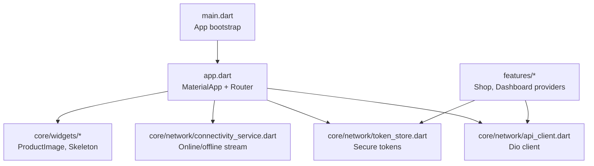
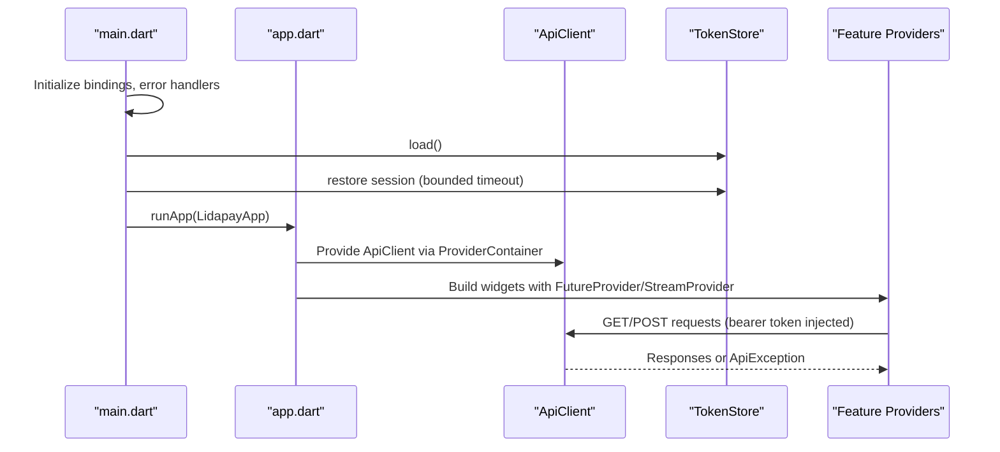
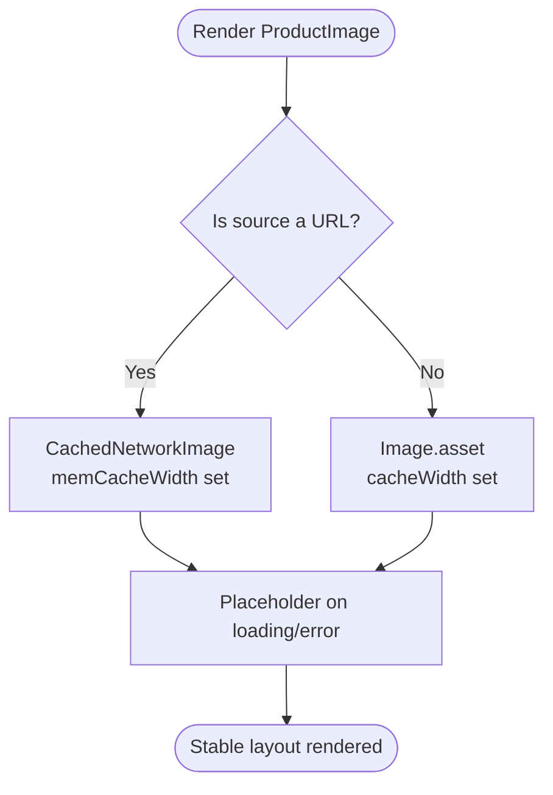
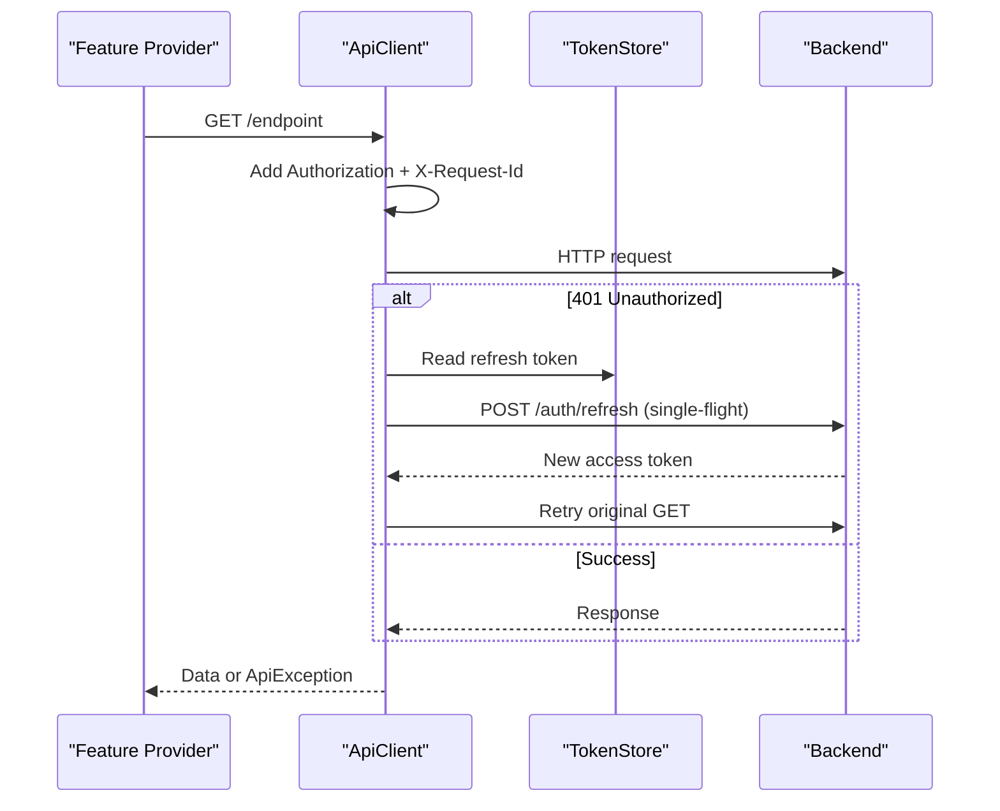
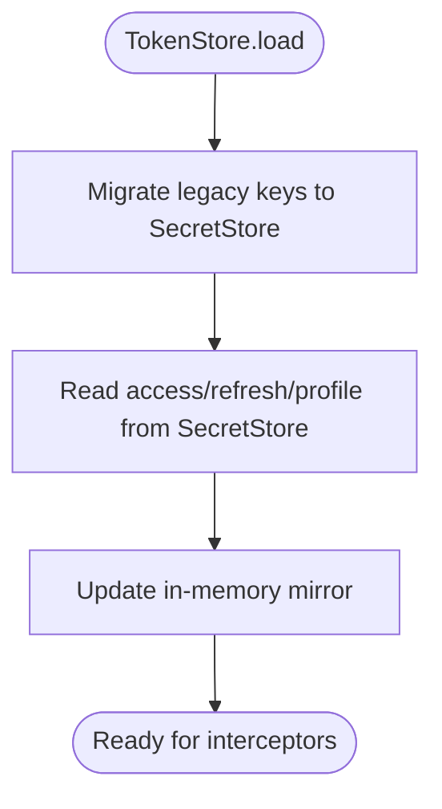
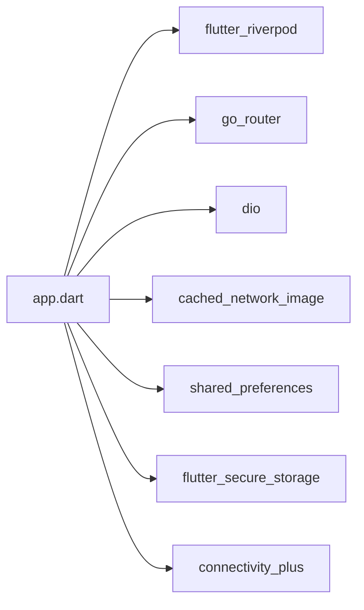

# Performance Optimization Guidelines

<cite>
**Referenced Files in This Document**
- [pubspec.yaml](file://pubspec.yaml)
- [main.dart](file://lib/main.dart)
- [app.dart](file://lib/app.dart)
- [api_client.dart](file://lib/core/network/api_client.dart)
- [connectivity_service.dart](file://lib/core/network/connectivity_service.dart)
- [token_store.dart](file://lib/core/network/token_store.dart)
- [product_image.dart](file://lib/core/widgets/product_image.dart)
- [skeleton.dart](file://lib/core/widgets/skeleton.dart)
- [providers.dart](file://lib/features/shop/providers.dart)
- [providers.dart](file://lib/features/dashboard/providers.dart)
</cite>

## Table of Contents
1. [Introduction](#introduction)
2. [Project Structure](#project-structure)
3. [Core Components](#core-components)
4. [Architecture Overview](#architecture-overview)
5. [Detailed Component Analysis](#detailed-component-analysis)
6. [Dependency Analysis](#dependency-analysis)
7. [Performance Considerations](#performance-considerations)
8. [Troubleshooting Guide](#troubleshooting-guide)
9. [Conclusion](#conclusion)

## Introduction
This document provides performance optimization guidelines for the LidaPay Flutter application. It focuses on memory management, widget optimization, efficient state management, image caching, network request efficiency, database and local storage patterns, bundle size reduction, lazy loading, resource cleanup, profiling with Flutter DevTools, and production monitoring. The guidance is grounded in the current codebase structure and implementation choices.

## Project Structure
LidaPay is a Flutter application using Riverpod for state management, Dio for networking, cached_network_image for image caching, and shared_preferences plus flutter_secure_storage for local persistence. The app bootstraps global error handling, secure token storage, session restoration, and deep link/notification services before rendering the UI tree.

**Diagram sources**
- [main.dart:17-149](file://lib/main.dart#L17-L149)
- [app.dart:56-260](file://lib/app.dart#L56-L260)
- [api_client.dart:16-275](file://lib/core/network/api_client.dart#L16-L275)
- [connectivity_service.dart:16-45](file://lib/core/network/connectivity_service.dart#L16-L45)
- [token_store.dart:74-237](file://lib/core/network/token_store.dart#L74-L237)
- [product_image.dart:7-89](file://lib/core/widgets/product_image.dart#L7-L89)
- [skeleton.dart:5-70](file://lib/core/widgets/skeleton.dart#L5-L70)

**Section sources**
- [pubspec.yaml:30-75](file://pubspec.yaml#L30-L75)
- [main.dart:17-149](file://lib/main.dart#L17-L149)
- [app.dart:56-260](file://lib/app.dart#L56-L260)

## Core Components
- Application bootstrap and error boundaries: Global error handlers, safe splash behavior, bounded startup operations, and an anti-red-screen error widget.
- Networking layer: Centralized Dio client with bearer token injection, single-flight token refresh, request ID logging, timeouts, and redacted debug logs.
- Connectivity awareness: Stream-based online/offline state used to overlay offline banners and gate background work.
- Secure token store: Encrypted secret storage with in-memory mirror, migration from plaintext preferences, biometric session support, and clear/restore flows.
- Image widget: Cached remote images with memCacheWidth downsampling, fallback placeholders, and asset path normalization.
- Skeleton UI: Shimmer-based placeholders for fast perceived performance during data loading.
- Feature providers: Shop cart/orders controllers, dashboard polling, and auto-disposed streams for background tasks.

**Section sources**
- [main.dart:17-149](file://lib/main.dart#L17-L149)
- [app.dart:56-260](file://lib/app.dart#L56-L260)
- [api_client.dart:16-275](file://lib/core/network/api_client.dart#L16-L275)
- [connectivity_service.dart:16-45](file://lib/core/network/connectivity_service.dart#L16-L45)
- [token_store.dart:74-237](file://lib/core/network/token_store.dart#L74-L237)
- [product_image.dart:7-89](file://lib/core/widgets/product_image.dart#L7-L89)
- [skeleton.dart:5-70](file://lib/core/widgets/skeleton.dart#L5-L70)

## Architecture Overview
The runtime flow starts in main, initializes secure storage and tokens, hydrates pending payments, restores auth session with timeouts, then renders the app. The app sets up push notifications, deep links, and connectivity-aware overlays. Feature screens consume repositories through Riverpod providers that call the centralized API client.

**Diagram sources**
- [main.dart:17-149](file://lib/main.dart#L17-L149)
- [app.dart:56-260](file://lib/app.dart#L56-L260)
- [api_client.dart:16-275](file://lib/core/network/api_client.dart#L16-L275)
- [token_store.dart:74-237](file://lib/core/network/token_store.dart#L74-L237)

## Detailed Component Analysis

### Memory Management Best Practices
- Use autoDispose providers for long-running streams and timers to prevent leaks when screens are disposed.
- Avoid holding large objects in StateNotifier unless necessary; prefer immutable updates and small payloads.
- Reuse widgets and avoid rebuilding heavy subtrees by scoping ref.watch calls narrowly.
- Dispose platform resources explicitly (e.g., map controllers, timers).
- Keep sensitive data out of plain SharedPreferences; use encrypted SecretStore.

Implementation anchors:
- Auto-disposed polling streams for order tracking and pending top-ups.
- Explicit controller disposal in map-related widgets.
- TokenStore uses encrypted storage with in-memory mirror to reduce disk I/O on hot paths.

**Section sources**
- [providers.dart:189-221](file://lib/features/shop/providers.dart#L189-L221)
- [providers.dart:141-249](file://lib/features/dashboard/providers.dart#L141-L249)
- [driver_location_map.dart:31-60](file://lib/features/shop/widgets/driver_location_map.dart#L31-L60)
- [token_store.dart:74-237](file://lib/core/network/token_store.dart#L74-L237)

### Widget Optimization Techniques
- Prefer const constructors where possible.
- Split lists into smaller widgets and use ListView.builder for virtualization.
- Use skeleton loaders instead of blocking UI during initial loads.
- Downscale images with memCacheWidth to reduce decode cost.
- Avoid unnecessary rebuilds by placing ref.watch at the smallest scope.

Implementation anchors:
- ProductImage uses CachedNetworkImage with memCacheWidth and stable placeholder.
- Skeleton widgets provide lightweight shimmer placeholders.
- App-level scroll behavior avoids extra overscroll indicators.

**Section sources**
- [product_image.dart:7-89](file://lib/core/widgets/product_image.dart#L7-L89)
- [skeleton.dart:5-70](file://lib/core/widgets/skeleton.dart#L5-L70)
- [app.dart:23-54](file://lib/app.dart#L23-L54)

### Efficient State Management Patterns
- Use FutureProvider.autoDispose for one-shot data fetches.
- Use StreamProvider.autoDispose for periodic polling; cancel automatically on dispose.
- Use StateNotifier for complex mutations while preserving previous AsyncValue to avoid skeleton flashes.
- Scope provider dependencies to user/session context to avoid cross-user state leakage.

Implementation anchors:
- OrdersController preserves previous state during mutations.
- Order tracking and pending top-up polling use autoDispose streams with backoff.
- LovedProductsNotifier persists per-user selection keyed by userId.

**Section sources**
- [providers.dart:118-180](file://lib/features/shop/providers.dart#L118-L180)
- [providers.dart:223-338](file://lib/features/shop/providers.dart#L223-L338)
- [providers.dart:189-221](file://lib/features/shop/providers.dart#L189-L221)
- [providers.dart:141-249](file://lib/features/dashboard/providers.dart#L141-L249)
- [providers.dart:54-85](file://lib/features/shop/providers.dart#L54-L85)

### Image Caching Strategies
- Remote images go through CachedNetworkImage with memCacheWidth to downscale decoding.
- Asset images use cacheWidth to limit memory footprint.
- Placeholders ensure layout stability even on 404 or upload-in-progress images.
- HTTP URLs are normalized to HTTPS for security and reliability.

**Diagram sources**
- [product_image.dart:46-75](file://lib/core/widgets/product_image.dart#L46-L75)

**Section sources**
- [product_image.dart:7-89](file://lib/core/widgets/product_image.dart#L7-L89)

### Network Request Optimization
- Centralized Dio client injects Authorization headers and X-Request-Id.
- Single-flight token refresh prevents concurrent refresh storms.
- Timeouts configured for connect/send/receive to fail fast on dead links while allowing slow provider round-trips.
- Redacted debug logs protect sensitive fields.
- Offline banner shown based on connectivity stream.

**Diagram sources**
- [api_client.dart:25-83](file://lib/core/network/api_client.dart#L25-L83)
- [api_client.dart:204-265](file://lib/core/network/api_client.dart#L204-L265)

**Section sources**
- [api_client.dart:16-275](file://lib/core/network/api_client.dart#L16-L275)
- [connectivity_service.dart:16-45](file://lib/core/network/connectivity_service.dart#L16-L45)
- [app.dart:197-257](file://lib/app.dart#L197-L257)

### Database Query Efficiency
- No embedded database is present; local persistence uses SharedPreferences and flutter_secure_storage.
- TokenStore keeps an in-memory mirror of secrets to avoid repeated disk reads on hot paths.
- Legacy plaintext keys are migrated once to encrypted storage and removed from SharedPreferences.
- Biometric sessions are persisted separately and synchronized with token refreshes.

**Diagram sources**
- [token_store.dart:120-146](file://lib/core/network/token_store.dart#L120-L146)

**Section sources**
- [token_store.dart:74-237](file://lib/core/network/token_store.dart#L74-L237)

### Bundle Size Optimization
- Only required assets and fonts are included in pubspec.
- Avoid including unused packages; review dependencies regularly.
- Use release builds with debugPrint disabled to reduce log overhead.
- Minimize large font files and only include needed weights/styles.

**Section sources**
- [pubspec.yaml:88-118](file://pubspec.yaml#L88-L118)
- [main.dart:24-28](file://lib/main.dart#L24-L28)

### Lazy Loading Patterns
- Use FutureProvider.autoDispose for data fetched on demand.
- Paginate lists and request one extra item to detect hasMore.
- Defer heavy computations until they are visible.
- Use skeleton UI to improve perceived performance without blocking.

**Section sources**
- [providers.dart:94-116](file://lib/features/shop/providers.dart#L94-L116)
- [providers.dart:118-180](file://lib/features/shop/providers.dart#L118-L180)
- [skeleton.dart:5-70](file://lib/core/widgets/skeleton.dart#L5-L70)

### Resource Management
- Cancel timers and subscriptions in autoDispose providers.
- Dispose platform controllers (e.g., map camera controllers).
- Clear tokens and biometric sessions on logout or failed refresh.
- Avoid retaining large objects in global state.

**Section sources**
- [providers.dart:189-221](file://lib/features/shop/providers.dart#L189-L221)
- [providers.dart:141-249](file://lib/features/dashboard/providers.dart#L141-L249)
- [driver_location_map.dart:31-60](file://lib/features/shop/widgets/driver_location_map.dart#L31-L60)
- [token_store.dart:219-237](file://lib/core/network/token_store.dart#L219-L237)

## Dependency Analysis
Key runtime dependencies:
- Riverpod for state management and dependency injection.
- Dio for HTTP with interceptors.
- cached_network_image for image caching.
- shared_preferences and flutter_secure_storage for local storage.
- connectivity_plus for online/offline detection.

**Diagram sources**
- [pubspec.yaml:30-75](file://pubspec.yaml#L30-L75)

**Section sources**
- [pubspec.yaml:30-75](file://pubspec.yaml#L30-L75)

## Performance Considerations
- Startup time: Bounded timeouts around session restore and payment hydration prevent splash freezes.
- Rendering: Skeleton loaders and stable placeholders reduce jank and layout shifts.
- Networking: Single-flight refresh, redacted logs, and explicit timeouts improve reliability and safety.
- Memory: AutoDispose streams and explicit controller disposal prevent leaks.
- Images: Downscaled decoding and disk caching keep memory usage low and improve cold start.
- State: Preserve previous AsyncValue during mutations to avoid full rebuilds.

[No sources needed since this section provides general guidance]

## Troubleshooting Guide
- Red screen of death prevention: Custom ErrorWidget builder offers a recovery action to navigate home and reassemble the app.
- Platform errors: Root error handler catches unhandled exceptions and returns true to avoid host crashes.
- Network failures: ApiException surfaces structured errors; retry logic is available in feature controllers.
- Offline mode: Overlay banner indicates no internet; background polling adapts with backoff.

**Section sources**
- [main.dart:30-40](file://lib/main.dart#L30-L40)
- [main.dart:44-96](file://lib/main.dart#L44-L96)
- [api_client.dart:195-202](file://lib/core/network/api_client.dart#L195-L202)
- [app.dart:218-257](file://lib/app.dart#L218-L257)

## Conclusion
LidaPay’s architecture already incorporates several performance-oriented practices: bounded initialization, secure and mirrored token storage, centralized networking with single-flight refresh, auto-disposed streaming providers, and resilient image and skeleton UI. Following the guidelines above—narrowing provider scopes, leveraging autoDispose, downsizing images, paginating data, and disposing platform resources—will further improve responsiveness, memory usage, and reliability across devices and network conditions.

[No sources needed since this section summarizes without analyzing specific files]