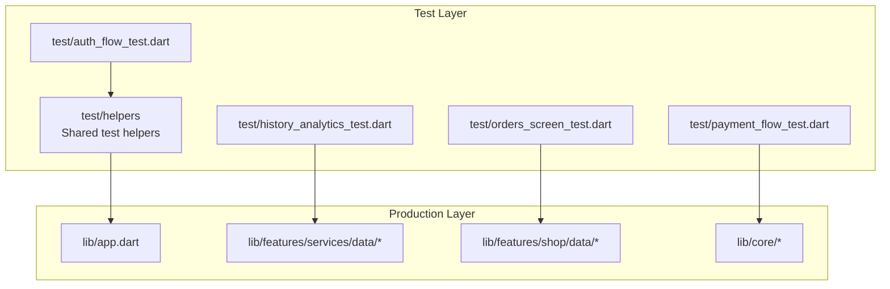
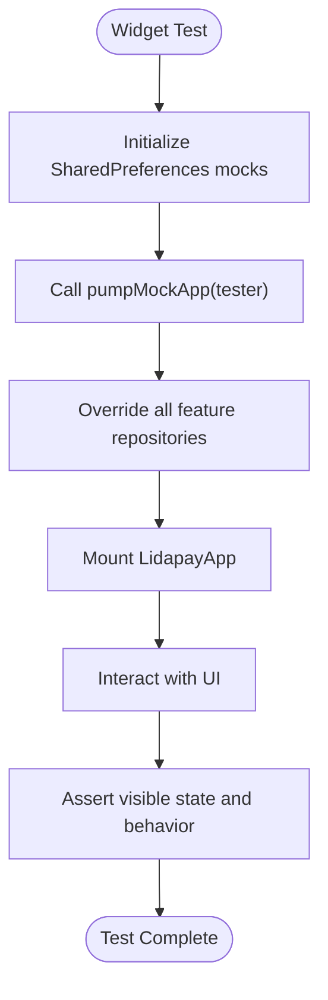
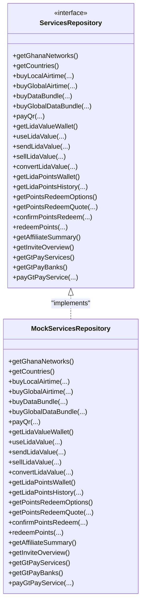
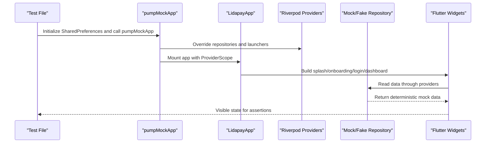
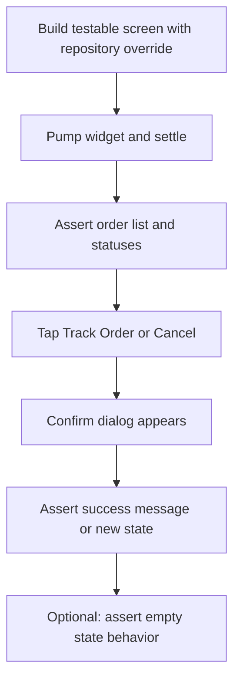
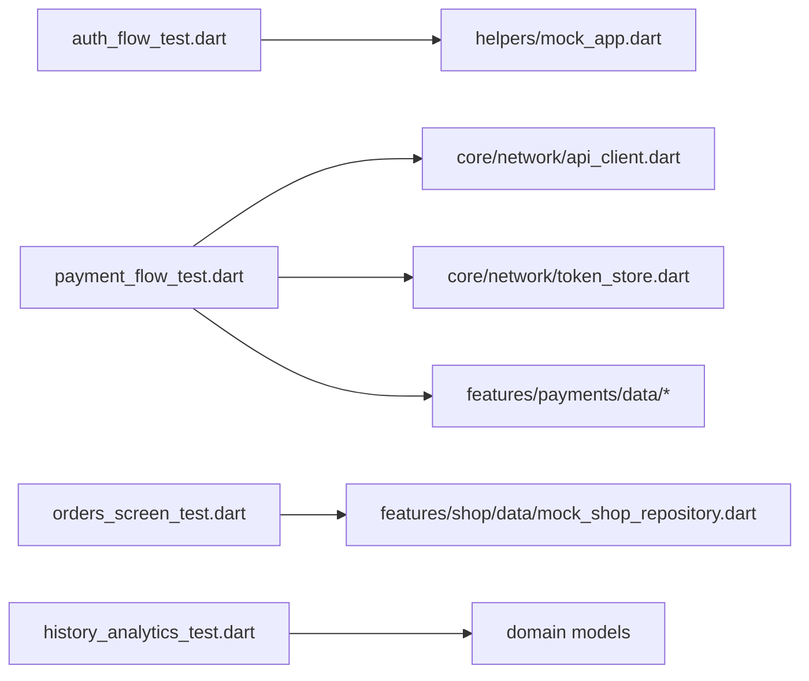

# Quality Assurance & Testing Standards

<cite>
**Referenced Files in This Document**   
- [pubspec.yaml](file://pubspec.yaml)
- [analysis_options.yaml](file://analysis_options.yaml)
- [.gitignore](file://.gitignore)
- [mock_app.dart](file://test/helpers/mock_app.dart)
- [auth_flow_test.dart](file://test/auth_flow_test.dart)
- [payment_flow_test.dart](file://test/payment_flow_test.dart)
- [orders_screen_test.dart](file://test/orders_screen_test.dart)
- [history_analytics_test.dart](file://test/history_analytics_test.dart)
- [mock_services_repository.dart](file://lib/features/services/data/mock_services_repository.dart)
- [mock_shop_repository.dart](file://lib/features/shop/data/mock_shop_repository.dart)
</cite>

## Table of Contents
1. [Introduction](#introduction)
2. [Project Structure](#project-structure)
3. [Core Components](#core-components)
4. [Architecture Overview](#architecture-overview)
5. [Detailed Component Analysis](#detailed-component-analysis)
6. [Dependency Analysis](#dependency-analysis)
7. [Performance Considerations](#performance-considerations)
8. [Troubleshooting Guide](#troubleshooting-guide)
9. [Conclusion](#conclusion)

## Introduction
This document establishes the quality assurance and testing standards for the LidaPay Flutter application. It defines unit, integration, and widget testing expectations; explains mock and fake patterns used to isolate external systems such as APIs, deep links, and payment providers; documents static analysis configuration; and outlines automated quality checks suitable for continuous integration.

The project uses:
- `flutter_test` for unit and widget tests.
- Riverpod provider overrides for dependency injection during tests.
- Mock repositories for services, shop data, authentication, notifications, history, and dashboard features.
- A shared test helper that pumps the full app with deterministic dependencies.
- Dart analyzer rules via `analysis_options.yaml`.
- Git-ignored coverage output to keep generated artifacts out of version control.

## Project Structure
Testing-related code is organized under `test/`, with a shared helper directory for reusable test infrastructure. Feature-specific mock implementations live alongside their production counterparts under `lib/features/*/data/`.

**Diagram sources**
- [mock_app.dart:1-165](file://test/helpers/mock_app.dart#L1-L165)
- [auth_flow_test.dart:1-408](file://test/auth_flow_test.dart#L1-L408)
- [payment_flow_test.dart:1-786](file://test/payment_flow_test.dart#L1-L786)
- [orders_screen_test.dart:1-106](file://test/orders_screen_test.dart#L1-L106)
- [history_analytics_test.dart:1-40](file://test/history_analytics_test.dart#L1-L40)

**Section sources**
- [pubspec.yaml:77-83](file://pubspec.yaml#L77-L83)
- [analysis_options.yaml:1-28](file://analysis_options.yaml#L1-L28)

## Core Components
This section summarizes the core testing components and how they are used across the suite.

### Test Framework and Dependencies
- The project declares `flutter_test` as a dev dependency, enabling both unit and widget tests.
- Riverpod is used throughout the app, so tests override providers rather than touching production wiring.
- `shared_preferences` is mocked through `SharedPreferences.setMockInitialValues` before pumping widgets.

**Section sources**
- [pubspec.yaml:77-83](file://pubspec.yaml#L77-L83)
- [auth_flow_test.dart:40-53](file://test/auth_flow_test.dart#L40-L53)

### Shared Widget Test Helper
The shared helper provides:
- A `pumpMockApp` function that mounts the full app inside a `ProviderScope`.
- Overrides for auth, dashboard, history, notifications, services, shop, payments, recipient choice, update gate, checkout launcher, and shared preferences.
- Deterministic payment behavior so payment flows can run without a browser or network.

**Diagram sources**
- [mock_app.dart:124-165](file://test/helpers/mock_app.dart#L124-L165)

**Section sources**
- [mock_app.dart:28-83](file://test/helpers/mock_app.dart#L28-L83)
- [mock_app.dart:124-165](file://test/helpers/mock_app.dart#L124-L165)

### Mock Repositories
The repository layer is central to isolating business logic from external services.

- **Services Repository Mock**: Provides deterministic service options, operator detection, wallet balances, receipts, points, affiliate data, and GTPay service listings. All methods simulate latency and return stable test data.
- **Shop Repository Mock**: Provides product catalog, categories, cart operations, checkout, order listing, order lookup by ID or number, tracking timeline, and cancellation.

These mocks allow tests to assert UI behavior and business outcomes without calling real APIs.

**Diagram sources**
- [mock_services_repository.dart:6-651](file://lib/features/services/data/mock_services_repository.dart#L6-L651)

**Section sources**
- [mock_services_repository.dart:6-651](file://lib/features/services/data/mock_services_repository.dart#L6-L651)
- [mock_shop_repository.dart:4-415](file://lib/features/shop/data/mock_shop_repository.dart#L4-L415)

## Architecture Overview
The testing architecture follows a layered approach:

1. **Unit Tests**: Validate parsing, validation, persistence, and business logic without rendering UI.
2. **Widget Tests**: Render screens and interact with them using `WidgetTester`, asserting visible text, navigation, and user actions.
3. **Integration-style Flows**: Use the shared helper to mount the full app and exercise multi-screen flows such as onboarding, login, registration, payment callbacks, and order tracking.

**Diagram sources**
- [mock_app.dart:124-165](file://test/helpers/mock_app.dart#L124-L165)
- [auth_flow_test.dart:40-101](file://test/auth_flow_test.dart#L40-L101)

## Detailed Component Analysis

### Unit Testing Requirements
Unit tests should focus on pure logic, parsing, validation, and state transitions. Examples in this project include:
- Parsing API payloads and mapping them to domain models.
- Validating mobile money numbers and phone formatting.
- Persisting and loading pending payments.
- Filtering and aggregating transaction history.

Recommended unit test structure:
- Group related behaviors using `group`.
- Use descriptive test names that explain the scenario.
- Arrange inputs and expected outputs clearly.
- Avoid UI interactions unless necessary.
- Prefer deterministic fakes over random values when stability matters.

Examples of well-structured unit tests:
- Payment initiation parsing and request body verification.
- Transaction outcome classification.
- Pending payment store round-trip persistence.
- History filter matching.

**Section sources**
- [payment_flow_test.dart:263-364](file://test/payment_flow_test.dart#L263-L364)
- [payment_flow_test.dart:366-415](file://test/payment_flow_test.dart#L366-L415)
- [payment_flow_test.dart:417-449](file://test/payment_flow_test.dart#L417-L449)
- [history_analytics_test.dart:34-40](file://test/history_analytics_test.dart#L34-L40)

### Integration Testing Approaches
Integration-style tests in this project use the shared helper to mount the full app while replacing all external dependencies with mocks. This allows verifying cross-feature flows such as:
- Splash screen to onboarding.
- Onboarding to login.
- Login to dashboard.
- Deep link handling for password reset completion.
- Payment callback routing to receipt screens.

Key integration patterns:
- Always initialize `SharedPreferences` mocks before mounting the app.
- Use `pumpAndSettle` after asynchronous animations and delays.
- Simulate deep links by emitting URIs or navigating through the router.
- Assert final UI states such as receipt screens or confirmation messages.

**Section sources**
- [auth_flow_test.dart:40-101](file://test/auth_flow_test.dart#L40-L101)
- [auth_flow_test.dart:313-351](file://test/auth_flow_test.dart#L313-L351)
- [auth_flow_test.dart:353-406](file://test/auth_flow_test.dart#L353-L406)

### Widget Testing Patterns
Widget tests verify UI rendering, user interaction, and navigation within isolated screens. The orders screen test demonstrates:
- Building a testable screen with a custom repository override.
- Asserting list content and status labels.
- Tapping buttons and confirming dialogs.
- Handling empty states.
- Opening an initial order detail automatically.

Recommended widget test patterns:
- Wrap the target widget in `ProviderScope` with required provider overrides.
- Use `tester.pumpWidget` and `tester.pumpAndSettle`.
- Find widgets by text, type, key, or semantic label.
- Tap, enter text, scroll, and drag as needed.
- Assert both presence and absence of elements where appropriate.

**Diagram sources**
- [orders_screen_test.dart:11-24](file://test/orders_screen_test.dart#L11-L24)
- [orders_screen_test.dart:26-105](file://test/orders_screen_test.dart#L26-L105)

**Section sources**
- [orders_screen_test.dart:11-24](file://test/orders_screen_test.dart#L11-L24)
- [orders_screen_test.dart:26-105](file://test/orders_screen_test.dart#L26-L105)

### Mock Implementations and Assertion Patterns
The project uses two main approaches for isolating dependencies:

1. **Fake repositories**: Provide deterministic responses for complex workflows, such as payment initiation, query results, and GT Pay debit/status flows. These are useful when the test must observe method calls, queued results, or request bodies.
2. **Mock repositories**: Extend existing mock classes to override specific methods for targeted scenarios, such as returning an empty order list.

Common assertion patterns:
- Assert UI text and widget types.
- Assert provider state changes.
- Assert repository method calls and recorded parameters.
- Assert navigation routes and deep link handling.
- Assert error messages and validation feedback.

**Section sources**
- [payment_flow_test.dart:20-60](file://test/payment_flow_test.dart#L20-L60)
- [payment_flow_test.dart:64-138](file://test/payment_flow_test.dart#L64-L138)
- [payment_flow_test.dart:140-213](file://test/payment_flow_test.dart#L140-L213)
- [orders_screen_test.dart:102-105](file://test/orders_screen_test.dart#L102-L105)

### Code Coverage Expectations
Coverage output is configured to be ignored by Git, indicating that coverage reports are generated locally or in CI but not committed. Recommended expectations:
- Run tests with coverage enabled in CI.
- Track overall coverage and per-feature coverage trends.
- Treat critical financial flows, payment parsing, and validation logic as high-priority coverage targets.
- Do not treat coverage alone as sufficient; combine it with meaningful assertions.

**Section sources**
- [.gitignore:34](file://.gitignore#L34)

### Static Analysis Tools
Static analysis is configured through `analysis_options.yaml`:
- Includes Flutter lint recommendations.
- Excludes generated and platform directories.
- Customizes selected linter rules.

Recommended practices:
- Run `flutter analyze` in CI.
- Fail the build on analyzer errors.
- Keep lint rules consistent across contributors.
- Address warnings proactively rather than suppressing them broadly.

**Section sources**
- [analysis_options.yaml:1-28](file://analysis_options.yaml#L1-L28)

### Automated Quality Checks
Automated quality checks should include:
- Dependency resolution and pub get.
- Static analysis.
- Unit and widget tests.
- Optional coverage reporting.
- Optional integration scripts for backend handoff verification.

Suggested CI steps:
1. Install dependencies.
2. Run `flutter analyze`.
3. Run `flutter test`.
4. Generate and upload coverage if available.
5. Archive logs and screenshots for failing widget tests.

[No sources needed since this section provides general guidance]

## Dependency Analysis
The test suite depends on production modules through provider interfaces and shared test helpers. The most important relationships are:

- Widget tests depend on `pumpMockApp` to inject mock repositories.
- Payment flow tests depend on API client setup, token store, pending payment store, and repository fakes.
- Orders screen tests depend on the shop repository mock.
- Analytics tests depend on domain models and filtering logic.

**Diagram sources**
- [auth_flow_test.dart:1-20](file://test/auth_flow_test.dart#L1-L20)
- [payment_flow_test.dart:1-18](file://test/payment_flow_test.dart#L1-L18)
- [orders_screen_test.dart:1-9](file://test/orders_screen_test.dart#L1-L9)
- [history_analytics_test.dart:1-5](file://test/history_analytics_test.dart#L1-L5)

**Section sources**
- [auth_flow_test.dart:1-20](file://test/auth_flow_test.dart#L1-L20)
- [payment_flow_test.dart:1-18](file://test/payment_flow_test.dart#L1-L18)
- [orders_screen_test.dart:1-9](file://test/orders_screen_test.dart#L1-L9)
- [history_analytics_test.dart:1-5](file://test/history_analytics_test.dart#L1-L5)

## Performance Considerations
Tests should remain fast and deterministic:
- Use short simulated latencies in mocks.
- Avoid unnecessary `pumpAndSettle` calls; settle only around animations or async work.
- Prefer focused widget tests over full-app tests when possible.
- Reuse shared helpers instead of duplicating provider overrides.
- Keep test data small and stable.

[No sources needed since this section provides general guidance]

## Troubleshooting Guide
Common issues and resolutions:

- **Tests touch the live API**: Ensure all repositories are overridden via `pumpMockApp` or explicit provider overrides. Production wiring must never be active in tests.
- **Deep links do not route correctly**: Simulate deep links by emitting URIs or navigating through the router, then assert the expected screen.
- **Payment flows stall**: Verify that the fake or mock payment repository returns predictable query results and that pending payment stores are initialized with mock preferences.
- **Widget tests fail due to missing data**: Confirm that the repository mock returns the expected data shape and that the screen is pumped and settled before assertions.
- **Lint failures block CI**: Review `analysis_options.yaml` and address analyzer warnings; avoid broad rule suppressions.

**Section sources**
- [mock_app.dart:124-165](file://test/helpers/mock_app.dart#L124-L165)
- [auth_flow_test.dart:313-351](file://test/auth_flow_test.dart#L313-L351)
- [payment_flow_test.dart:451-585](file://test/payment_flow_test.dart#L451-L585)
- [analysis_options.yaml:10-24](file://analysis_options.yaml#L10-L24)

## Conclusion
The LidaPay testing strategy combines unit tests for logic, widget tests for UI behavior, and integration-style flows for end-to-end user journeys. Mock and fake repositories isolate external systems, while the shared helper ensures consistent test setup. Static analysis and Git-ignored coverage output support maintainable code quality. For continuous integration, run dependency resolution, static analysis, and the full test suite, and consider adding coverage reporting and artifact archiving for reliable automated quality assurance.

[No sources needed since this section summarizes without analyzing specific files]