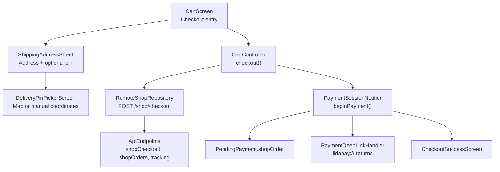
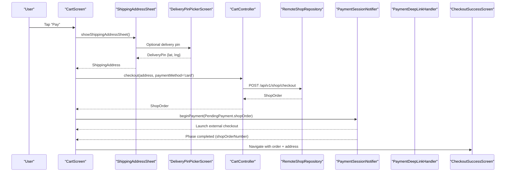
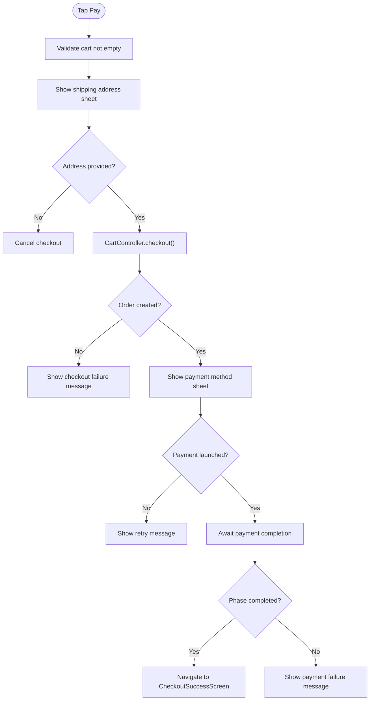
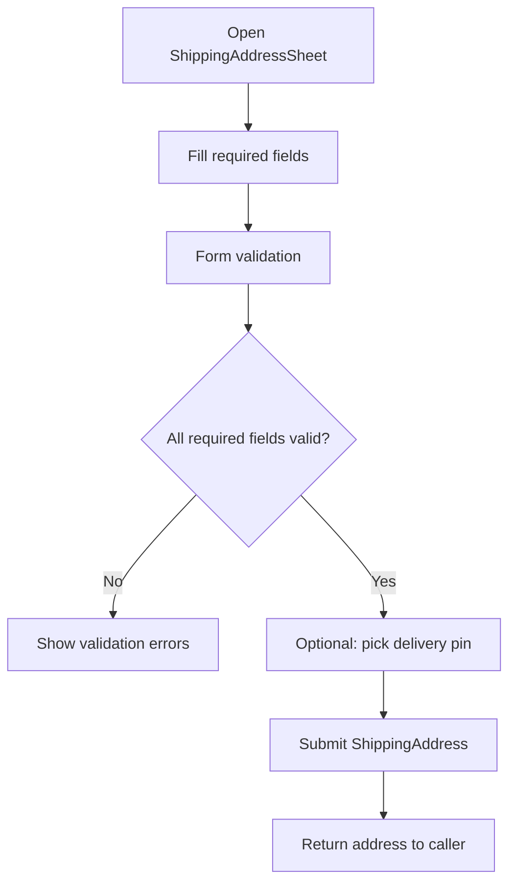
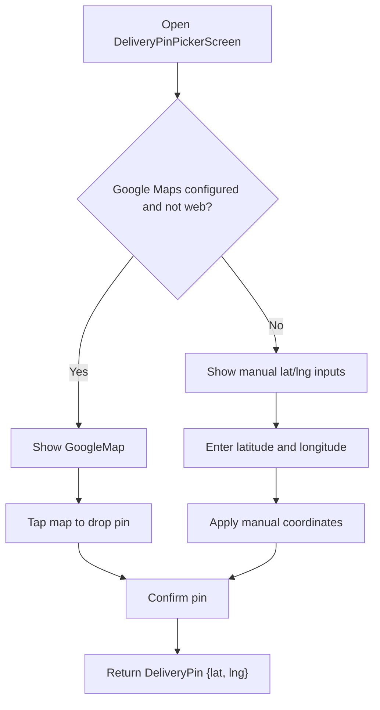
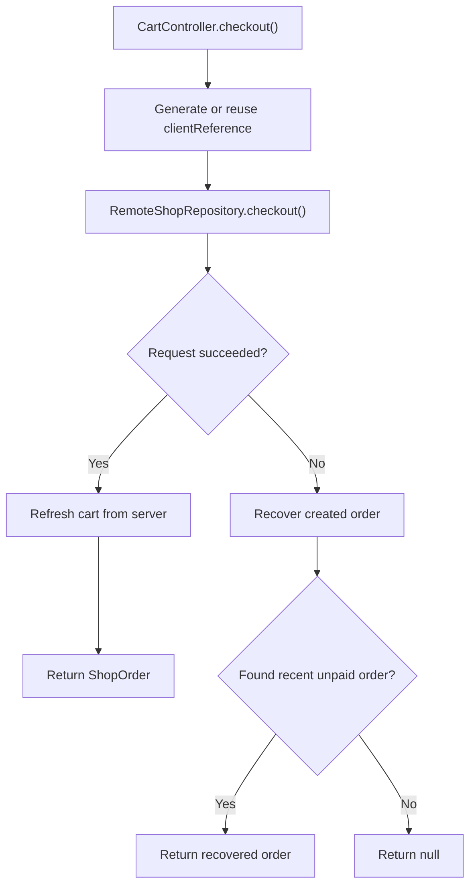
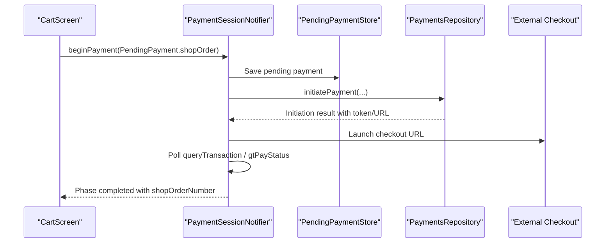
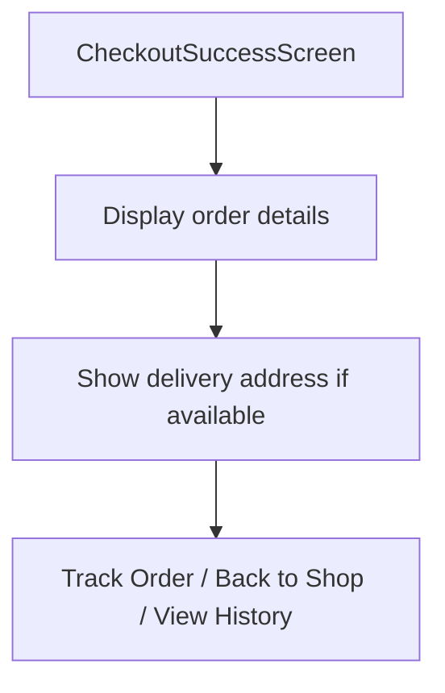
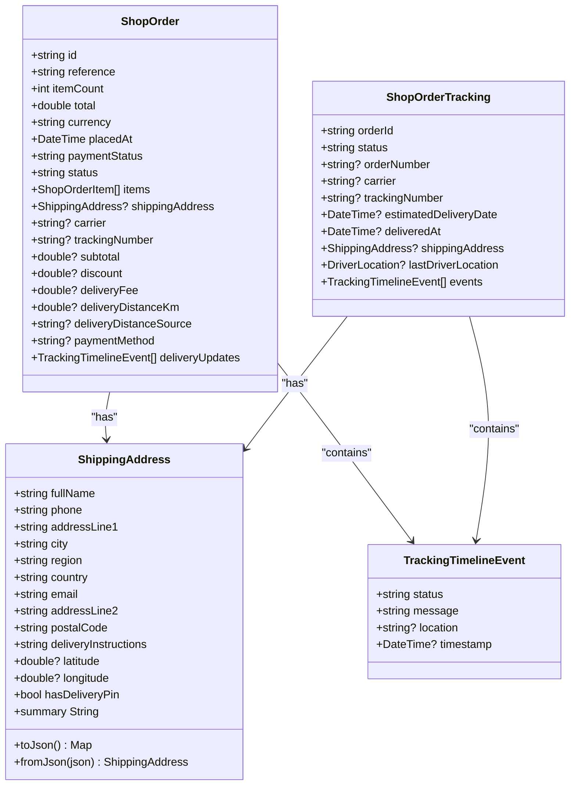
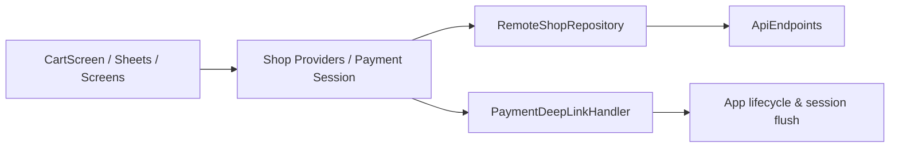

# Checkout Flow & Order Placement

<cite>
**Referenced Files in This Document**
- [cart_screen.dart](file://lib/features/shop/screens/cart_screen.dart)
- [checkout_success_screen.dart](file://lib/features/shop/screens/checkout_success_screen.dart)
- [shipping_address_sheet.dart](file://lib/features/shop/widgets/shipping_address_sheet.dart)
- [delivery_pin_screen.dart](file://lib/features/shop/widgets/delivery_pin_screen.dart)
- [shop_models.dart](file://lib/features/shop/data/shop_models.dart)
- [providers.dart](file://lib/features/shop/providers.dart)
- [remote_shop_repository.dart](file://lib/features/shop/data/remote_shop_repository.dart)
- [api_endpoints.dart](file://lib/core/network/api_endpoints.dart)
- [payments_providers.dart](file://lib/features/payments/providers.dart)
- [pending_payment.dart](file://lib/features/payments/data/pending_payment.dart)
- [deep_links.dart](file://lib/core/deep_links.dart)
- [app.dart](file://lib/app.dart)
</cite>

## Table of Contents
1. [Introduction](#introduction)
2. [Project Structure](#project-structure)
3. [Core Components](#core-components)
4. [Architecture Overview](#architecture-overview)
5. [Detailed Component Analysis](#detailed-component-analysis)
6. [Dependency Analysis](#dependency-analysis)
7. [Performance Considerations](#performance-considerations)
8. [Troubleshooting Guide](#troubleshooting-guide)
9. [Conclusion](#conclusion)

## Introduction
This document explains the checkout flow and order placement process for the shop feature. It covers how the cart is converted into an order, how shipping address selection and delivery pin configuration work, how payment processing integrates with order creation, and how order confirmation and tracking are presented to the user. It also documents error handling, validation rules, and success/failure scenarios across the client-side components that implement this workflow.

## Project Structure
The checkout implementation spans several layers:
- UI screens and sheets handle user input and navigation.
- Providers manage state, including cart mutations, order listing, and payment session orchestration.
- The repository layer calls backend endpoints and parses responses.
- Shared models define the shape of cart items, orders, addresses, and tracking data.
- Deep link handling routes payment returns back into the app.

**Diagram sources**
- [cart_screen.dart:61-144](file://lib/features/shop/screens/cart_screen.dart#L61-L144)
- [shipping_address_sheet.dart:16-27](file://lib/features/shop/widgets/shipping_address_sheet.dart#L16-L27)
- [delivery_pin_screen.dart:25-39](file://lib/features/shop/widgets/delivery_pin_screen.dart#L25-L39)
- [providers.dart:283-314](file://lib/features/shop/providers.dart#L283-L314)
- [remote_shop_repository.dart:107-135](file://lib/features/shop/data/remote_shop_repository.dart#L107-L135)
- [api_endpoints.dart:120-130](file://lib/core/network/api_endpoints.dart#L120-L130)
- [payments_providers.dart:182-277](file://lib/features/payments/providers.dart#L182-L277)
- [pending_payment.dart:238-256](file://lib/features/payments/data/pending_payment.dart#L238-L256)
- [deep_links.dart:66-75](file://lib/core/deep_links.dart#L66-L75)

**Section sources**
- [cart_screen.dart:61-144](file://lib/features/shop/screens/cart_screen.dart#L61-L144)
- [shipping_address_sheet.dart:16-27](file://lib/features/shop/widgets/shipping_address_sheet.dart#L16-L27)
- [delivery_pin_screen.dart:25-39](file://lib/features/shop/widgets/delivery_pin_screen.dart#L25-L39)
- [providers.dart:283-314](file://lib/features/shop/providers.dart#L283-L314)
- [remote_shop_repository.dart:107-135](file://lib/features/shop/data/remote_shop_repository.dart#L107-L135)
- [api_endpoints.dart:120-130](file://lib/core/network/api_endpoints.dart#L120-L130)
- [payments_providers.dart:182-277](file://lib/features/payments/providers.dart#L182-L277)
- [pending_payment.dart:238-256](file://lib/features/payments/data/pending_payment.dart#L238-L256)
- [deep_links.dart:66-75](file://lib/core/deep_links.dart#L66-L75)

## Core Components
- CartScreen: Entry point for checkout; collects shipping address, creates the order, selects a payment method, launches payment, and navigates to success on completion.
- ShippingAddressSheet: Collects required postal fields and optional delivery pin coordinates.
- DeliveryPinPickerScreen: Full-screen map picker with fallback to current location and manual coordinate entry.
- CartController: Mutates cart state, places orders with idempotency, reconciles failed checkouts, and refreshes cart after successful checkout.
- RemoteShopRepository: Calls shop API endpoints, parses order/address/tracking payloads, and sends checkout requests with shipping address, delivery distance, payment method, redirect URL, and idempotency key.
- PaymentSessionNotifier: Orchestrates payment initiation, verification, crediting, deep-link return handling, retry flows, and completion state.
- PendingPayment: Durable purchase record used to resume and reconcile payments after process death or browser return.
- CheckoutSuccessScreen: Displays confirmed order details, delivery address, and navigation to order tracking.

**Section sources**
- [cart_screen.dart:61-144](file://lib/features/shop/screens/cart_screen.dart#L61-L144)
- [shipping_address_sheet.dart:16-27](file://lib/features/shop/widgets/shipping_address_sheet.dart#L16-L27)
- [delivery_pin_screen.dart:25-39](file://lib/features/shop/widgets/delivery_pin_screen.dart#L25-L39)
- [providers.dart:283-314](file://lib/features/shop/providers.dart#L283-L314)
- [remote_shop_repository.dart:107-135](file://lib/features/shop/data/remote_shop_repository.dart#L107-L135)
- [payments_providers.dart:182-277](file://lib/features/payments/providers.dart#L182-L277)
- [pending_payment.dart:238-256](file://lib/features/payments/data/pending_payment.dart#L238-L256)
- [checkout_success_screen.dart:18-34](file://lib/features/shop/screens/checkout_success_screen.dart#L18-L34)

## Architecture Overview
The checkout flow connects cart state, address collection, order creation, payment processing, and post-payment confirmation.

**Diagram sources**
- [cart_screen.dart:61-144](file://lib/features/shop/screens/cart_screen.dart#L61-L144)
- [shipping_address_sheet.dart:114-145](file://lib/features/shop/widgets/shipping_address_sheet.dart#L114-L145)
- [delivery_pin_screen.dart:124-139](file://lib/features/shop/widgets/delivery_pin_screen.dart#L124-L139)
- [providers.dart:283-314](file://lib/features/shop/providers.dart#L283-L314)
- [remote_shop_repository.dart:107-135](file://lib/features/shop/data/remote_shop_repository.dart#L107-L135)
- [payments_providers.dart:182-277](file://lib/features/payments/providers.dart#L182-L277)
- [checkout_success_screen.dart:18-34](file://lib/features/shop/screens/checkout_success_screen.dart#L18-L34)

## Detailed Component Analysis

### Checkout Workflow
- The cart screen validates that the cart has items, then opens the shipping address sheet.
- After the address is submitted, it calls `CartController.checkout` with the selected payment method.
- On successful order creation, it shows a payment method summary and starts the payment session.
- When the payment session completes, it navigates to the success screen with the order and delivery address.

**Diagram sources**
- [cart_screen.dart:61-144](file://lib/features/shop/screens/cart_screen.dart#L61-L144)
- [providers.dart:283-314](file://lib/features/shop/providers.dart#L283-L314)
- [payments_providers.dart:182-277](file://lib/features/payments/providers.dart#L182-L277)

**Section sources**
- [cart_screen.dart:61-144](file://lib/features/shop/screens/cart_screen.dart#L61-L144)

### Shipping Address Selection and Validation
- The shipping address sheet collects recipient name, phone, street address, city, region, country, optional email, optional second line, optional postal code, and optional delivery instructions.
- Validation enforces required fields using shared validators and formats phone input to digits only.
- The delivery pin is optional; when both latitude and longitude are present, they are included in the checkout payload.

**Diagram sources**
- [shipping_address_sheet.dart:126-145](file://lib/features/shop/widgets/shipping_address_sheet.dart#L126-L145)
- [shipping_address_sheet.dart:252-349](file://lib/features/shop/widgets/shipping_address_sheet.dart#L252-L349)

**Section sources**
- [shipping_address_sheet.dart:16-27](file://lib/features/shop/widgets/shipping_address_sheet.dart#L16-L27)
- [shipping_address_sheet.dart:126-145](file://lib/features/shop/widgets/shipping_address_sheet.dart#L126-L145)
- [shipping_address_sheet.dart:252-349](file://lib/features/shop/widgets/shipping_address_sheet.dart#L252-L349)

### Delivery Pin Configuration
- The delivery pin picker supports tapping a Google Map to drop a pin, using the device’s current location, or entering manual coordinates.
- If Google Maps is unavailable or running on web, it falls back to manual coordinate entry and “use my location.”
- Coordinates are validated within geographic bounds before being accepted.

**Diagram sources**
- [delivery_pin_screen.dart:25-39](file://lib/features/shop/widgets/delivery_pin_screen.dart#L25-L39)
- [delivery_pin_screen.dart:65-77](file://lib/features/shop/widgets/delivery_pin_screen.dart#L65-L77)
- [delivery_pin_screen.dart:102-139](file://lib/features/shop/widgets/delivery_pin_screen.dart#L102-L139)
- [delivery_pin_screen.dart:142-160](file://lib/features/shop/widgets/delivery_pin_screen.dart#L142-L160)

**Section sources**
- [delivery_pin_screen.dart:25-39](file://lib/features/shop/widgets/delivery_pin_screen.dart#L25-L39)
- [delivery_pin_screen.dart:102-139](file://lib/features/shop/widgets/delivery_pin_screen.dart#L102-L139)

### Order Creation and Idempotency
- `CartController.checkout` generates or reuses an idempotency reference per attempt.
- The repository posts the shipping address, optional delivery distance, payment method, redirect URL, and idempotency key.
- On failure, it attempts to recover a previously created order by checking if the server cart is empty and finding a recent unpaid order.

**Diagram sources**
- [providers.dart:283-314](file://lib/features/shop/providers.dart#L283-L314)
- [remote_shop_repository.dart:107-135](file://lib/features/shop/data/remote_shop_repository.dart#L107-L135)

**Section sources**
- [providers.dart:283-314](file://lib/features/shop/providers.dart#L283-L314)
- [remote_shop_repository.dart:107-135](file://lib/features/shop/data/remote_shop_repository.dart#L107-L135)

### Payment Processing Integration
- The cart screen constructs a `PendingPayment.shopOrder` with the order ID, order number, total, and currency.
- `PaymentSessionNotifier.beginPayment` initiates the payment via the payment repository, persists pending state, and launches the external checkout page.
- For card payments, it verifies transaction status through polling; for mobile money, it debits and polls status until success, failure, or timeout.
- On success, it marks the session completed and provides the shop order number to the UI.

**Diagram sources**
- [cart_screen.dart:118-144](file://lib/features/shop/screens/cart_screen.dart#L118-L144)
- [payments_providers.dart:182-277](file://lib/features/payments/providers.dart#L182-L277)
- [pending_payment.dart:238-256](file://lib/features/payments/data/pending_payment.dart#L238-L256)

**Section sources**
- [cart_screen.dart:118-144](file://lib/features/shop/screens/cart_screen.dart#L118-L144)
- [payments_providers.dart:182-277](file://lib/features/payments/providers.dart#L182-L277)
- [pending_payment.dart:238-256](file://lib/features/payments/data/pending_payment.dart#L238-L256)

### Order Confirmation Screen
- The success screen displays the order reference, item count, date, discount, delivery fee, total paid, and delivery address.
- It guides the user to track the order in My Orders and offers navigation back to the shop or history.

**Diagram sources**
- [checkout_success_screen.dart:18-34](file://lib/features/shop/screens/checkout_success_screen.dart#L18-L34)
- [checkout_success_screen.dart:108-150](file://lib/features/shop/screens/checkout_success_screen.dart#L108-L150)
- [checkout_success_screen.dart:154-230](file://lib/features/shop/screens/checkout_success_screen.dart#L154-L230)
- [checkout_success_screen.dart:262-304](file://lib/features/shop/screens/checkout_success_screen.dart#L262-L304)

**Section sources**
- [checkout_success_screen.dart:18-34](file://lib/features/shop/screens/checkout_success_screen.dart#L18-L34)
- [checkout_success_screen.dart:108-150](file://lib/features/shop/screens/checkout_success_screen.dart#L108-L150)
- [checkout_success_screen.dart:154-230](file://lib/features/shop/screens/checkout_success_screen.dart#L154-L230)
- [checkout_success_screen.dart:262-304](file://lib/features/shop/screens/checkout_success_screen.dart#L262-L304)

### Data Models and Contracts
- `ShippingAddress`: Required fields include full name, phone, street address, city, region, and country; optional fields include email, second address line, postal code, delivery instructions, and delivery pin coordinates.
- `ShopOrder`: Includes identifiers, totals, currency, timestamps, payment and fulfillment statuses, items, shipping address, carrier, tracking number, and optional delivery metrics.
- `TrackingTimelineEvent` and `ShopOrderTracking`: Represent timeline events and live tracking information, including driver location freshness.

**Diagram sources**
- [shop_models.dart:152-250](file://lib/features/shop/data/shop_models.dart#L152-L250)
- [shop_models.dart:297-363](file://lib/features/shop/data/shop_models.dart#L297-L363)
- [shop_models.dart:365-380](file://lib/features/shop/data/shop_models.dart#L365-L380)
- [shop_models.dart:410-450](file://lib/features/shop/data/shop_models.dart#L410-L450)

**Section sources**
- [shop_models.dart:152-250](file://lib/features/shop/data/shop_models.dart#L152-L250)
- [shop_models.dart:297-363](file://lib/features/shop/data/shop_models.dart#L297-L363)
- [shop_models.dart:365-380](file://lib/features/shop/data/shop_models.dart#L365-L380)
- [shop_models.dart:410-450](file://lib/features/shop/data/shop_models.dart#L410-L450)

## Dependency Analysis
The checkout flow depends on:
- UI components for user input and presentation.
- Riverpod providers for state management and background polling.
- Repository layer for network calls and response parsing.
- Payment session orchestrator for initiating, verifying, and completing payments.
- Deep link handler for routing payment returns back into the app.

**Diagram sources**
- [cart_screen.dart:61-144](file://lib/features/shop/screens/cart_screen.dart#L61-L144)
- [providers.dart:283-314](file://lib/features/shop/providers.dart#L283-L314)
- [remote_shop_repository.dart:107-135](file://lib/features/shop/data/remote_shop_repository.dart#L107-L135)
- [api_endpoints.dart:120-130](file://lib/core/network/api_endpoints.dart#L120-L130)
- [deep_links.dart:66-75](file://lib/core/deep_links.dart#L66-L75)
- [app.dart:84-101](file://lib/app.dart#L84-L101)

**Section sources**
- [cart_screen.dart:61-144](file://lib/features/shop/screens/cart_screen.dart#L61-L144)
- [providers.dart:283-314](file://lib/features/shop/providers.dart#L283-L314)
- [remote_shop_repository.dart:107-135](file://lib/features/shop/data/remote_shop_repository.dart#L107-L135)
- [api_endpoints.dart:120-130](file://lib/core/network/api_endpoints.dart#L120-L130)
- [deep_links.dart:66-75](file://lib/core/deep_links.dart#L66-L75)
- [app.dart:84-101](file://lib/app.dart#L84-L101)

## Performance Considerations
- Cart mutations preserve previous state during loading to avoid UI flicker and disable controls while network calls run.
- Order tracking uses a stream provider with periodic polling and auto-disposal to keep courier updates fresh without unnecessary resource usage.
- Payment verification uses bounded retries and delays to balance responsiveness with reliability.
- Delivery pin fallback avoids heavy map initialization when unavailable.

[No sources needed since this section provides general guidance]

## Troubleshooting Guide
Common issues and their handling:
- Empty cart or missing address: Checkout aborts early; users can continue shopping or re-enter address.
- Order creation failure: A snackbar informs the user; the cart remains unchanged so they can retry.
- Payment launch failure: The session moves to failed state with a user-facing message; users can retry from orders.
- Payment completion vs delivery mismatch: For non-shop purchases, the session keeps pending state to allow retry without recharging; for shop orders, completion clears pending and navigates to success.
- Deep link mismatches: Returned order IDs are validated against saved records; mismatches are ignored to prevent cross-order confusion.
- Network timeouts during MoMo approval: The session enters awaiting callback with provider status and allows manual recheck or retry.

**Section sources**
- [cart_screen.dart:80-87](file://lib/features/shop/screens/cart_screen.dart#L80-L87)
- [cart_screen.dart:188-196](file://lib/features/shop/screens/cart_screen.dart#L188-L196)
- [payments_providers.dart:236-277](file://lib/features/payments/providers.dart#L236-L277)
- [payments_providers.dart:372-421](file://lib/features/payments/providers.dart#L372-L421)
- [payments_providers.dart:501-572](file://lib/features/payments/providers.dart#L501-L572)
- [payments_providers.dart:578-665](file://lib/features/payments/providers.dart#L578-L665)

## Conclusion
The checkout flow integrates cart state, address collection, order creation, and payment processing into a cohesive experience. Address validation ensures required fields are present, while optional delivery pins improve courier routing accuracy. Idempotency and recovery logic protect against duplicate orders and transient failures. Payment verification handles multiple rails and edge cases, and the success screen provides clear next steps for order tracking. Together, these components deliver a robust and user-friendly checkout and order placement process.