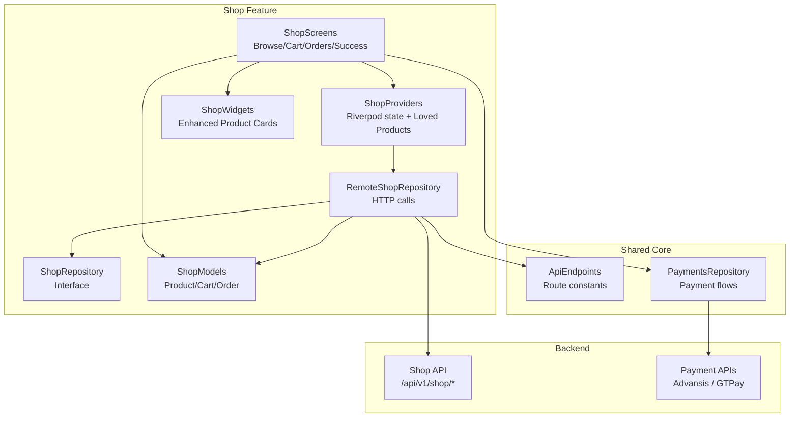
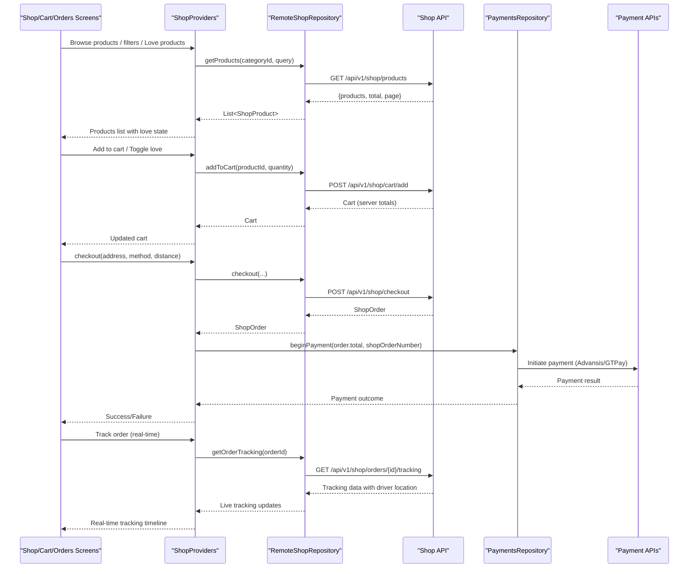
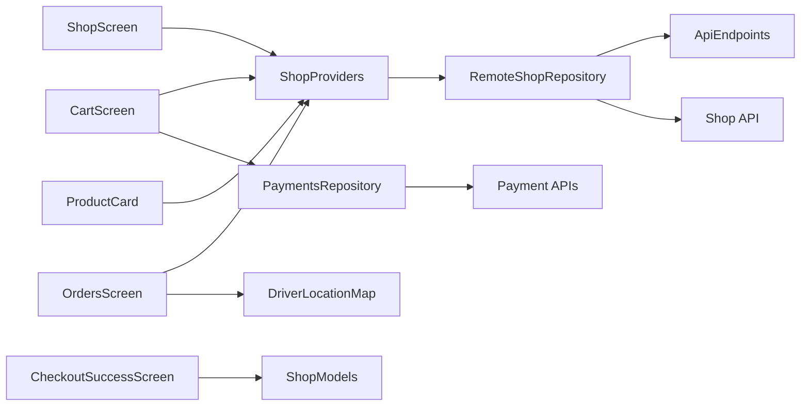

# E-commerce Platform

<cite>
**Referenced Files in This Document**
- [README.md](file://README.md)
- [api/ENDPOINTS.md](file://api/ENDPOINTS.md)
- [docs/SHOP_API_MOBILE_HANDOFF.md](file://docs/SHOP_API_MOBILE_HANDOFF.md)
- [lib/core/network/api_endpoints.dart](file://lib/core/network/api_endpoints.dart)
- [lib/features/shop/data/shop_repository.dart](file://lib/features/shop/data/shop_repository.dart)
- [lib/features/shop/data/remote_shop_repository.dart](file://lib/features/shop/data/remote_shop_repository.dart)
- [lib/features/shop/data/shop_models.dart](file://lib/features/shop/data/shop_models.dart)
- [lib/features/shop/providers.dart](file://lib/features/shop/providers.dart)
- [lib/features/shop/screens/shop_screen.dart](file://lib/features/shop/screens/shop_screen.dart)
- [lib/features/shop/screens/cart_screen.dart](file://lib/features/shop/screens/cart_screen.dart)
- [lib/features/shop/screens/orders_screen.dart](file://lib/features/shop/screens/orders_screen.dart)
- [lib/features/shop/screens/checkout_success_screen.dart](file://lib/features/shop/screens/checkout_success_screen.dart)
- [lib/features/shop/widgets/product_card.dart](file://lib/features/shop/widgets/product_card.dart)
- [lib/features/payments/data/payments_repository.dart](file://lib/features/payments/data/payments_repository.dart)
- [lib/features/payments/data/remote_payments_repository.dart](file://lib/features/payments/data/remote_payments_repository.dart)
- [tool/courier-orders/create-paid-orders.mjs](file://tool/courier-orders/create-paid-orders.mjs)
</cite>

## Update Summary
**Changes Made**
- Enhanced product card interactions with love/favorite functionality and haptic feedback
- Improved cart management with better UI/UX and enhanced order navigation
- Added comprehensive order history display with real-time tracking and cancellation capabilities
- Implemented loved products system with device-level persistence
- Enhanced order tracking with live driver location mapping and timeline events

## Table of Contents
1. [Introduction](#introduction)
2. [Project Structure](#project-structure)
3. [Core Components](#core-components)
4. [Architecture Overview](#architecture-overview)
5. [Detailed Component Analysis](#detailed-component-analysis)
6. [Dependency Analysis](#dependency-analysis)
7. [Performance Considerations](#performance-considerations)
8. [Troubleshooting Guide](#troubleshooting-guide)
9. [Conclusion](#conclusion)

## Introduction
This document explains the e-commerce platform implemented in the Flutter application, focusing on product catalog browsing, shopping cart management, checkout flow, order placement, search/filtering, and enhanced user experience features. It documents the shop repository pattern, cart state management, product data models, backend API integration, inventory handling, pricing rules, promotional discounts, delivery fee calculation, performance strategies for large catalogs and cart synchronization, and new interactive features like product favorites and advanced order tracking.

The app is a Flutter mobile application with a dedicated Shop feature under `lib/features/shop`. The shop integrates with a backend REST API documented in the project's API documentation and handoff notes, and now includes enhanced user interactions and comprehensive order management capabilities.

**Section sources**
- [README.md:1-47](file://README.md#L1-L47)

## Project Structure
The shop functionality is organized by feature with enhanced components:
- Data layer: repository interface, remote implementation, and domain models.
- State layer: Riverpod providers and controllers for products, categories, cart, orders, tracking, and loved products.
- UI layer: screens for browsing, cart, orders, checkout success, and order listing with enhanced interactions.
- Widget layer: reusable components including enhanced product cards with love functionality.
- Network layer: shared API endpoints and payment repositories used during checkout.

**Diagram sources**
- [lib/features/shop/data/shop_repository.dart:1-30](file://lib/features/shop/data/shop_repository.dart#L1-L30)
- [lib/features/shop/data/remote_shop_repository.dart:1-135](file://lib/features/shop/data/remote_shop_repository.dart#L1-L135)
- [lib/features/shop/data/shop_models.dart:1-451](file://lib/features/shop/data/shop_models.dart#L1-L451)
- [lib/features/shop/providers.dart:1-339](file://lib/features/shop/providers.dart#L1-L339)
- [lib/features/shop/screens/shop_screen.dart:1-800](file://lib/features/shop/screens/shop_screen.dart#L1-L800)
- [lib/features/shop/screens/cart_screen.dart:1-703](file://lib/features/shop/screens/cart_screen.dart#L1-L703)
- [lib/features/shop/screens/orders_screen.dart:1-1106](file://lib/features/shop/screens/orders_screen.dart#L1-L1106)
- [lib/features/shop/widgets/product_card.dart:1-248](file://lib/features/shop/widgets/product_card.dart#L1-L248)
- [lib/core/network/api_endpoints.dart:111-130](file://lib/core/network/api_endpoints.dart#L111-L130)
- [lib/features/payments/data/payments_repository.dart:1-45](file://lib/features/payments/data/payments_repository.dart#L1-L45)

**Section sources**
- [lib/features/shop/data/shop_repository.dart:1-30](file://lib/features/shop/data/shop_repository.dart#L1-L30)
- [lib/features/shop/data/remote_shop_repository.dart:1-135](file://lib/features/shop/data/remote_shop_repository.dart#L1-L135)
- [lib/features/shop/data/shop_models.dart:1-451](file://lib/features/shop/data/shop_models.dart#L1-L451)
- [lib/features/shop/providers.dart:1-339](file://lib/features/shop/providers.dart#L1-L339)
- [lib/features/shop/screens/shop_screen.dart:1-800](file://lib/features/shop/screens/shop_screen.dart#L1-L800)
- [lib/features/shop/screens/cart_screen.dart:1-703](file://lib/features/shop/screens/cart_screen.dart#L1-L703)
- [lib/features/shop/screens/orders_screen.dart:1-1106](file://lib/features/shop/screens/orders_screen.dart#L1-L1106)
- [lib/features/shop/widgets/product_card.dart:1-248](file://lib/features/shop/widgets/product_card.dart#L1-L248)
- [lib/core/network/api_endpoints.dart:111-130](file://lib/core/network/api_endpoints.dart#L111-L130)
- [lib/features/payments/data/payments_repository.dart:1-45](file://lib/features/payments/data/payments_repository.dart#L1-L45)

## Core Components
- Shop repository pattern: an abstract `ShopRepository` defines catalog, cart, and checkout operations; `RemoteShopRepository` implements HTTP calls using `ApiClient` and route constants.
- Product data models: `ShopCategory`, `ShopProduct`, `CartItem`, `Cart`, `ShippingAddress`, `ShopOrder`, `ShopOrderItem`, `TrackingTimelineEvent`, `DriverLocation`, and `ShopOrderTracking`.
- Enhanced cart state management: `CartController` wraps repository mutations, preserves previous state during loading, enforces idempotent checkout references, and reconciles failed checkouts.
- **New**: Loved products system: Device-level product favorites with persistent storage per user account.
- **New**: Advanced order tracking: Real-time delivery tracking with driver location mapping and comprehensive timeline events.
- UI screens: `ShopScreen` for browsing and filtering, `CartScreen` for cart review and checkout initiation, `OrdersScreen` for comprehensive order management, and `CheckoutSuccessScreen` for post-payment confirmation.
- **Enhanced**: Product cards with interactive love/favorite functionality and haptic feedback.
- Payment integration: `PaymentsRepository` and its remote implementation initiate and query payments via Advansis Pay or GTBank GTPay, linking payments to shop orders through `shopOrderNumber`.

Key responsibilities:
- Catalog browsing: fetch categories, featured products, and paginated product lists with optional category filter and search query.
- **Enhanced**: Interactive product exploration with love/favorite functionality and detailed product sheets.
- Cart operations: add, update quantity, remove, clear, and retrieve server-shaped cart totals.
- **Enhanced**: Checkout flow with improved UI/UX and better error handling.
- **New**: Comprehensive order management with real-time tracking, cancellation capabilities, and delivery monitoring.
- Order lifecycle: track order status, payment status, and courier events with live updates.

**Section sources**
- [lib/features/shop/data/shop_repository.dart:1-30](file://lib/features/shop/data/shop_repository.dart#L1-L30)
- [lib/features/shop/data/remote_shop_repository.dart:1-135](file://lib/features/shop/data/remote_shop_repository.dart#L1-L135)
- [lib/features/shop/data/shop_models.dart:1-451](file://lib/features/shop/data/shop_models.dart#L1-L451)
- [lib/features/shop/providers.dart:223-339](file://lib/features/shop/providers.dart#L223-L339)
- [lib/features/shop/providers.dart:50-85](file://lib/features/shop/providers.dart#L50-L85)
- [lib/features/shop/screens/shop_screen.dart:1-800](file://lib/features/shop/screens/shop_screen.dart#L1-L800)
- [lib/features/shop/screens/cart_screen.dart:1-703](file://lib/features/shop/screens/cart_screen.dart#L1-L703)
- [lib/features/shop/screens/orders_screen.dart:1-1106](file://lib/features/shop/screens/orders_screen.dart#L1-L1106)
- [lib/features/shop/screens/checkout_success_screen.dart:1-346](file://lib/features/shop/screens/checkout_success_screen.dart#L1-L346)
- [lib/features/shop/widgets/product_card.dart:1-248](file://lib/features/shop/widgets/product_card.dart#L1-L248)
- [lib/features/payments/data/payments_repository.dart:1-45](file://lib/features/payments/data/payments_repository.dart#L1-L45)

## Architecture Overview
The shop architecture follows a layered approach with enhanced interactive features:
- UI screens consume Riverpod providers.
- Providers depend on `ShopRepository`.
- `RemoteShopRepository` maps repository methods to backend endpoints.
- Pricing, promotions, and delivery fees are computed server-side; the app displays final values.
- Payments are initiated after checkout and reconciled via provider-specific queries.
- **New**: Device-level state management for loved products with per-user persistence.
- **New**: Real-time order tracking with automatic polling and terminal status detection.

**Diagram sources**
- [lib/features/shop/providers.dart:30-40](file://lib/features/shop/providers.dart#L30-L40)
- [lib/features/shop/providers.dart:223-339](file://lib/features/shop/providers.dart#L223-L339)
- [lib/features/shop/providers.dart:182-221](file://lib/features/shop/providers.dart#L182-L221)
- [lib/features/shop/data/remote_shop_repository.dart:43-135](file://lib/features/shop/data/remote_shop_repository.dart#L43-L135)
- [lib/core/network/api_endpoints.dart:111-130](file://lib/core/network/api_endpoints.dart#L111-L130)
- [lib/features/payments/data/payments_repository.dart:1-45](file://lib/features/payments/data/payments_repository.dart#L1-L45)

## Detailed Component Analysis

### Enhanced Product Catalog Browsing and Filtering
- Categories are fetched once and cached by the provider; users select a category chip to filter products.
- Search input debounces updates to avoid excessive network calls.
- Featured products are loaded separately and displayed as a carousel.
- Product grid renders items from the filtered list.
- **New**: Each product card includes interactive love/favorite functionality with haptic feedback and animated transitions.

Implementation highlights:
- Category selection updates `shopCategoryProvider`.
- Search text updates `shopSearchQueryProvider`.
- `shopProductsProvider` composes both filters into `getProducts`.
- `ShopScreen` handles deep-link opening of a specific product detail sheet.
- **New**: Loved products are managed through `lovedProductsProvider` with device-level persistence.

Concrete example paths:
- Category chips and selected category: [lib/features/shop/screens/shop_screen.dart:261-335](file://lib/features/shop/screens/shop_screen.dart#L261-L335)
- Debounced search: [lib/features/shop/screens/shop_screen.dart:56-61](file://lib/features/shop/screens/shop_screen.dart#L56-L61)
- Products provider composition: [lib/features/shop/providers.dart:30-36](file://lib/features/shop/providers.dart#L30-L36)
- Featured carousel: [lib/features/shop/screens/shop_screen.dart:367-443](file://lib/features/shop/screens/shop_screen.dart#L367-L443)
- **New**: Enhanced product card with love functionality: [lib/features/shop/widgets/product_card.dart:24-27](file://lib/features/shop/widgets/product_card.dart#L24-L27)
- **New**: Loved products provider: [lib/features/shop/providers.dart:50-85](file://lib/features/shop/providers.dart#L50-L85)

**Section sources**
- [lib/features/shop/screens/shop_screen.dart:56-61](file://lib/features/shop/screens/shop_screen.dart#L56-L61)
- [lib/features/shop/screens/shop_screen.dart:261-335](file://lib/features/shop/screens/shop_screen.dart#L261-L335)
- [lib/features/shop/screens/shop_screen.dart:367-443](file://lib/features/shop/screens/shop_screen.dart#L367-L443)
- [lib/features/shop/providers.dart:30-36](file://lib/features/shop/providers.dart#L30-L36)
- [lib/features/shop/widgets/product_card.dart:24-27](file://lib/features/shop/widgets/product_card.dart#L24-L27)
- [lib/features/shop/providers.dart:50-85](file://lib/features/shop/providers.dart#L50-L85)

### Enhanced Shopping Cart Management
- Cart state is managed by `CartController`, which wraps repository calls and preserves previous state during mutations.
- Server returns live totals (`subtotal`, `discount`, `total`) that the UI uses directly without local recomputation.
- Quantity changes map to repository update/remove calls; decrementing below one removes the item.
- Clearing the cart triggers a DELETE request and refreshes the state.
- **Enhanced**: Improved UI/UX with better visual feedback and navigation options.

Concrete example paths:
- Cart controller mutation wrapper and checkout: [lib/features/shop/providers.dart:249-314](file://lib/features/shop/providers.dart#L249-L314)
- **Enhanced** cart screen line items and quantity controls: [lib/features/shop/screens/cart_screen.dart:505-667](file://lib/features/shop/screens/cart_screen.dart#L505-L667)
- **Enhanced** cart summary and checkout button: [lib/features/shop/screens/cart_screen.dart:298-345](file://lib/features/shop/screens/cart_screen.dart#L298-L345)

Pricing and promotions:
- Effective price is `discountPrice > 0 ? discountPrice : price`; the app never applies additional discounts locally.
- Promotion discount is surfaced at the cart level via server-provided `discount`.

Inventory handling:
- Stock checks are enforced server-side; attempts to add more than available stock return errors.
- The UI disables increment when the current quantity equals product stock.

**Section sources**
- [lib/features/shop/providers.dart:249-314](file://lib/features/shop/providers.dart#L249-L314)
- [lib/features/shop/screens/cart_screen.dart:505-667](file://lib/features/shop/screens/cart_screen.dart#L505-L667)
- [lib/features/shop/screens/cart_screen.dart:298-345](file://lib/features/shop/screens/cart_screen.dart#L298-L345)
- [docs/SHOP_API_MOBILE_HANDOFF.md:24-54](file://docs/SHOP_API_MOBILE_HANDOFF.md#L24-L54)
- [docs/SHOP_API_MOBILE_HANDOFF.md:125-145](file://docs/SHOP_API_MOBILE_HANDOFF.md#L125-L145)

### Enhanced Checkout Flow Implementation
The checkout flow collects a shipping address, creates an order from the server cart, computes delivery fees server-side, and initiates payment with improved user experience.

Flow steps:
1. User taps "Pay" in the cart screen.
2. App shows a shipping address sheet and validates required fields.
3. `CartController.checkout` calls the repository with address, payment method, optional delivery distance, and an idempotency reference.
4. Backend clears the cart upon successful order creation.
5. App launches payment via `PaymentsRepository` using either Advansis Pay or GTPay, linking the payment to the order through `shopOrderNumber`.
6. On payment completion, the app navigates to the success screen and refreshes orders.

Concrete example paths:
- **Enhanced** checkout initiation and payment launch: [lib/features/shop/screens/cart_screen.dart:61-144](file://lib/features/shop/screens/cart_screen.dart#L61-L144)
- Repository checkout mapping and idempotency header: [lib/features/shop/data/remote_shop_repository.dart:106-135](file://lib/features/shop/data/remote_shop_repository.dart#L106-L135)
- Payment repository contract and debitwallet usage: [lib/features/payments/data/payments_repository.dart:1-45](file://lib/features/payments/data/payments_repository.dart#L1-L45)
- GTPay debit implementation: [lib/features/payments/data/remote_payments_repository.dart:65-94](file://lib/features/payments/data/remote_payments_repository.dart#L65-L94)

Delivery and pricing:
- Delivery fee is calculated server-side based on `deliveryDistanceKm` and a rate card; the client does not set the fee.
- Final order total includes subtotal, promotion discount, and delivery fee.

**Section sources**
- [lib/features/shop/screens/cart_screen.dart:61-144](file://lib/features/shop/screens/cart_screen.dart#L61-L144)
- [lib/features/shop/data/remote_shop_repository.dart:106-135](file://lib/features/shop/data/remote_shop_repository.dart#L106-L135)
- [lib/features/payments/data/payments_repository.dart:1-45](file://lib/features/payments/data/payments_repository.dart#L1-L45)
- [lib/features/payments/data/remote_payments_repository.dart:65-94](file://lib/features/payments/data/remote_payments_repository.dart#L65-L94)
- [docs/SHOP_API_MOBILE_HANDOFF.md:148-226](file://docs/SHOP_API_MOBILE_HANDOFF.md#L148-L226)
- [docs/SHOP_API_MOBILE_HANDOFF.md:421-450](file://docs/SHOP_API_MOBILE_HANDOFF.md#L421-L450)

### Enhanced Order Placement and Post-Payment Confirmation
After payment succeeds:
- The cart screen listens to payment session state transitions.
- On completion, it invalidates order providers and navigates to `CheckoutSuccessScreen`.
- The success screen displays order details, discount, delivery fee, and shipping address.

Concrete example paths:
- Payment session listener and navigation: [lib/features/shop/screens/cart_screen.dart:152-196](file://lib/features/shop/screens/cart_screen.dart#L152-L196)
- Success screen content and actions: [lib/features/shop/screens/checkout_success_screen.dart:32-311](file://lib/features/shop/screens/checkout_success_screen.dart#L32-L311)

**Section sources**
- [lib/features/shop/screens/cart_screen.dart:152-196](file://lib/features/shop/screens/cart_screen.dart#L152-L196)
- [lib/features/shop/screens/checkout_success_screen.dart:32-311](file://lib/features/shop/screens/checkout_success_screen.dart#L32-L311)

### Enhanced Order History Display and Management
**New**: Comprehensive order management system with real-time tracking and cancellation capabilities.

Key features:
- Paginated order listing with infinite scrolling
- Real-time order status updates with visual indicators
- Live driver location tracking with map integration
- Order cancellation functionality with confirmation dialogs
- Detailed order information including items, pricing breakdown, and shipping address
- Copy-to-clipboard functionality for tracking numbers
- Automatic polling for tracking updates with terminal status detection

Concrete example paths:
- **New** Orders screen with pagination and real-time updates: [lib/features/shop/screens/orders_screen.dart:26-179](file://lib/features/shop/screens/orders_screen.dart#L26-L179)
- **New** Order cards with status indicators and interaction: [lib/features/shop/screens/orders_screen.dart:343-529](file://lib/features/shop/screens/orders_screen.dart#L343-L529)
- **New** Order detail sheet with tracking timeline: [lib/features/shop/screens/orders_screen.dart:573-901](file://lib/features/shop/screens/orders_screen.dart#L573-L901)
- **New** Order cancellation functionality: [lib/features/shop/screens/orders_screen.dart:903-941](file://lib/features/shop/screens/orders_screen.dart#L903-L941)
- **New** Real-time tracking provider with auto-polling: [lib/features/shop/providers.dart:182-221](file://lib/features/shop/providers.dart#L182-L221)

**Section sources**
- [lib/features/shop/screens/orders_screen.dart:26-179](file://lib/features/shop/screens/orders_screen.dart#L26-L179)
- [lib/features/shop/screens/orders_screen.dart:343-529](file://lib/features/shop/screens/orders_screen.dart#L343-L529)
- [lib/features/shop/screens/orders_screen.dart:573-901](file://lib/features/shop/screens/orders_screen.dart#L573-L901)
- [lib/features/shop/screens/orders_screen.dart:903-941](file://lib/features/shop/screens/orders_screen.dart#L903-L941)
- [lib/features/shop/providers.dart:182-221](file://lib/features/shop/providers.dart#L182-L221)

### Product Data Models
The model layer defines strongly typed entities for the shop domain:
- `ShopCategory`: id, name, icon key.
- `ShopProduct`: id, name, categoryId, effective price, currency, images, description, stock, rating, sold, brand, partner info, SKU, attributes, weight.
- `CartItem` and `Cart`: line items with server-provided totals and discount.
- `ShippingAddress`: required fields plus optional email, postal code, instructions, and delivery pin coordinates.
- `ShopOrder` and `ShopOrderItem`: order-level totals, delivery metadata, timeline events, and payment method.
- Tracking models: `TrackingTimelineEvent`, `DriverLocation`, `ShopOrderTracking`.

Complexity considerations:
- Model parsing tolerates multiple field names for resilience against backend variations.
- Derived properties simplify UI logic (e.g., `inStock`, `displaySku`, `discountPercent`).

Concrete example paths:
- Product and cart models: [lib/features/shop/data/shop_models.dart:23-150](file://lib/features/shop/data/shop_models.dart#L23-L150)
- Shipping address JSON serialization and parsing: [lib/features/shop/data/shop_models.dart:152-250](file://lib/features/shop/data/shop_models.dart#L152-L250)
- Order and tracking models: [lib/features/shop/data/shop_models.dart:252-451](file://lib/features/shop/data/shop_models.dart#L252-L451)

**Section sources**
- [lib/features/shop/data/shop_models.dart:23-150](file://lib/features/shop/data/shop_models.dart#L23-L150)
- [lib/features/shop/data/shop_models.dart:152-250](file://lib/features/shop/data/shop_models.dart#L152-L250)
- [lib/features/shop/data/shop_models.dart:252-451](file://lib/features/shop/data/shop_models.dart#L252-L451)

### Repository Patterns and API Integration
- `ShopRepository` abstracts catalog, cart, and checkout operations.
- `RemoteShopRepository` maps each method to a backend endpoint using `ApiEndpoints`.
- Endpoint constants centralize route definitions for shop features.
- Payment repository abstracts payment initiation and status queries for two providers.

Concrete example paths:
- Repository interface: [lib/features/shop/data/shop_repository.dart:1-30](file://lib/features/shop/data/shop_repository.dart#L1-L30)
- Remote implementation: [lib/features/shop/data/remote_shop_repository.dart:1-135](file://lib/features/shop/data/remote_shop_repository.dart#L1-L135)
- Endpoint constants: [lib/core/network/api_endpoints.dart:111-130](file://lib/core/network/api_endpoints.dart#L111-L130)
- Payment repository interface: [lib/features/payments/data/payments_repository.dart:1-45](file://lib/features/payments/data/payments_repository.dart#L1-L45)

**Section sources**
- [lib/features/shop/data/shop_repository.dart:1-30](file://lib/features/shop/data/shop_repository.dart#L1-L30)
- [lib/features/shop/data/remote_shop_repository.dart:1-135](file://lib/features/shop/data/remote_shop_repository.dart#L1-L135)
- [lib/core/network/api_endpoints.dart:111-130](file://lib/core/network/api_endpoints.dart#L111-L130)
- [lib/features/payments/data/payments_repository.dart:1-45](file://lib/features/payments/data/payments_repository.dart#L1-L45)

### Promotional Systems and Pricing Rules
- Prices are final and server-computed; the app must not recompute or add commissions.
- Effective price is derived from `discountPrice` when present; otherwise use `price`.
- Cart-level promotion discount is provided by the server and displayed directly.

Concrete example paths:
- Pricing contract: [docs/SHOP_API_MOBILE_HANDOFF.md:24-54](file://docs/SHOP_API_MOBILE_HANDOFF.md#L24-L54)
- Cart totals usage in UI: [lib/features/shop/screens/cart_screen.dart:301-330](file://lib/features/shop/screens/cart_screen.dart#L301-L330)

**Section sources**
- [docs/SHOP_API_MOBILE_HANDOFF.md:24-54](file://docs/SHOP_API_MOBILE_HANDOFF.md#L24-L54)
- [lib/features/shop/screens/cart_screen.dart:301-330](file://lib/features/shop/screens/cart_screen.dart#L301-L330)

### Inventory Management
- Stock validation occurs server-side; insufficient stock results in error responses.
- The UI prevents increasing quantity beyond available stock.
- Checkout validates stock and decrements inventory before clearing the cart.

Concrete example paths:
- Cart endpoint error semantics: [docs/SHOP_API_MOBILE_HANDOFF.md:144-145](file://docs/SHOP_API_MOBILE_HANDOFF.md#L144-L145)
- Increment guard in cart UI: [lib/features/shop/screens/cart_screen.dart:623-631](file://lib/features/shop/screens/cart_screen.dart#L623-L631)
- Checkout stock validation note: [docs/SHOP_API_MOBILE_HANDOFF.md:219-226](file://docs/SHOP_API_MOBILE_HANDOFF.md#L219-L226)

**Section sources**
- [docs/SHOP_API_MOBILE_HANDOFF.md:144-145](file://docs/SHOP_API_MOBILE_HANDOFF.md#L144-L145)
- [lib/features/shop/screens/cart_screen.dart:623-631](file://lib/features/shop/screens/cart_screen.dart#L623-L631)
- [docs/SHOP_API_MOBILE_HANDOFF.md:219-226](file://docs/SHOP_API_MOBILE_HANDOFF.md#L219-L226)

### Delivery Fee Calculation and Distance Handling
- Delivery fee is computed server-side from a rate card using `deliveryDistanceKm`.
- The app may optionally send driving distance computed via Google Maps; otherwise, the backend calculates it if coordinates are provided.
- The client must not set the delivery fee itself.

Concrete example paths:
- Delivery distance and fee policy: [docs/SHOP_API_MOBILE_HANDOFF.md:174-199](file://docs/SHOP_API_MOBILE_HANDOFF.md#L174-L199)
- Client responsibility for distance capture: [docs/SHOP_API_MOBILE_HANDOFF.md:421-450](file://docs/SHOP_API_MOBILE_HANDOFF.md#L421-L450)

**Section sources**
- [docs/SHOP_API_MOBILE_HANDOFF.md:174-199](file://docs/SHOP_API_MOBILE_HANDOFF.md#L174-L199)
- [docs/SHOP_API_MOBILE_HANDOFF.md:421-450](file://docs/SHOP_API_MOBILE_HANDOFF.md#L421-L450)

### Cart Synchronization Strategies
- The server cart is the source of truth at checkout.
- The app may keep a local cart for UX but must reconcile with the backend before checkout.
- `CartController` preserves previous state during mutations and reconciles failed checkouts by checking for newly created unpaid orders.

Concrete example paths:
- Sync requirement: [docs/SHOP_API_MOBILE_HANDOFF.md:125-135](file://docs/SHOP_API_MOBILE_HANDOFF.md#L125-L135)
- Idempotent checkout reference and recovery: [lib/features/shop/providers.dart:237-339](file://lib/features/shop/providers.dart#L237-L339)

**Section sources**
- [docs/SHOP_API_MOBILE_HANDOFF.md:125-135](file://docs/SHOP_API_MOBILE_HANDOFF.md#L125-L135)
- [lib/features/shop/providers.dart:237-339](file://lib/features/shop/providers.dart#L237-L339)

## Dependency Analysis
The following diagram shows how components depend on each other and the backend with enhanced features:

**Diagram sources**
- [lib/features/shop/screens/shop_screen.dart:1-800](file://lib/features/shop/screens/shop_screen.dart#L1-L800)
- [lib/features/shop/screens/cart_screen.dart:1-703](file://lib/features/shop/screens/cart_screen.dart#L1-L703)
- [lib/features/shop/screens/orders_screen.dart:1-1106](file://lib/features/shop/screens/orders_screen.dart#L1-L1106)
- [lib/features/shop/screens/checkout_success_screen.dart:1-346](file://lib/features/shop/screens/checkout_success_screen.dart#L1-L346)
- [lib/features/shop/widgets/product_card.dart:1-248](file://lib/features/shop/widgets/product_card.dart#L1-L248)
- [lib/features/shop/providers.dart:1-339](file://lib/features/shop/providers.dart#L1-L339)
- [lib/features/shop/data/remote_shop_repository.dart:1-135](file://lib/features/shop/data/remote_shop_repository.dart#L1-L135)
- [lib/core/network/api_endpoints.dart:111-130](file://lib/core/network/api_endpoints.dart#L111-L130)
- [lib/features/payments/data/payments_repository.dart:1-45](file://lib/features/payments/data/payments_repository.dart#L1-L45)

**Section sources**
- [lib/features/shop/screens/shop_screen.dart:1-800](file://lib/features/shop/screens/shop_screen.dart#L1-L800)
- [lib/features/shop/screens/cart_screen.dart:1-703](file://lib/features/shop/screens/cart_screen.dart#L1-L703)
- [lib/features/shop/screens/orders_screen.dart:1-1106](file://lib/features/shop/screens/orders_screen.dart#L1-L1106)
- [lib/features/shop/screens/checkout_success_screen.dart:1-346](file://lib/features/shop/screens/checkout_success_screen.dart#L1-L346)
- [lib/features/shop/widgets/product_card.dart:1-248](file://lib/features/shop/widgets/product_card.dart#L1-L248)
- [lib/features/shop/providers.dart:1-339](file://lib/features/shop/providers.dart#L1-L339)
- [lib/features/shop/data/remote_shop_repository.dart:1-135](file://lib/features/shop/data/remote_shop_repository.dart#L1-L135)
- [lib/core/network/api_endpoints.dart:111-130](file://lib/core/network/api_endpoints.dart#L111-L130)
- [lib/features/payments/data/payments_repository.dart:1-45](file://lib/features/payments/data/payments_repository.dart#L1-L45)

## Performance Considerations
- Debounce search input to reduce network requests during typing.
- Use server-provided pagination and limits; do not load entire catalogs client-side.
- Preserve previous cart state during mutations to avoid UI flicker.
- Avoid local price recomputation; rely on server totals.
- For large catalogs, prefer category filtering and featured lists to limit payload size.
- Poll tracking endpoints only while the tracking screen is active and stop polling on terminal statuses.
- **New**: Loved products are stored locally to avoid unnecessary network calls.
- **New**: Orders screen uses efficient pagination with sentinel rows for smooth infinite scrolling.

Concrete example paths:
- Search debounce: [lib/features/shop/screens/shop_screen.dart:56-61](file://lib/features/shop/screens/shop_screen.dart#L56-L61)
- Cart mutation state preservation: [lib/features/shop/providers.dart:249-260](file://lib/features/shop/providers.dart#L249-L260)
- Tracking polling strategy: [lib/features/shop/providers.dart:182-221](file://lib/features/shop/providers.dart#L182-L221)
- **New**: Loved products local storage: [lib/features/shop/providers.dart:61-85](file://lib/features/shop/providers.dart#L61-L85)
- **New**: Orders pagination optimization: [lib/features/shop/providers.dart:98-175](file://lib/features/shop/providers.dart#L98-L175)

**Section sources**
- [lib/features/shop/screens/shop_screen.dart:56-61](file://lib/features/shop/screens/shop_screen.dart#L56-L61)
- [lib/features/shop/providers.dart:249-260](file://lib/features/shop/providers.dart#L249-L260)
- [lib/features/shop/providers.dart:182-221](file://lib/features/shop/providers.dart#L182-L221)
- [lib/features/shop/providers.dart:61-85](file://lib/features/shop/providers.dart#L61-L85)
- [lib/features/shop/providers.dart:98-175](file://lib/features/shop/providers.dart#L98-L175)

## Troubleshooting Guide
Common issues and resolutions:
- Checkout fails but order exists:
  - The app reconciles by checking for a fresh unpaid order when the cart becomes empty.
  - Reference: [lib/features/shop/providers.dart:316-339](file://lib/features/shop/providers.dart#L316-L339)
- Insufficient stock or inactive product:
  - Backend returns 400; surface user-friendly messages and disable problematic actions.
  - Reference: [docs/SHOP_API_MOBILE_HANDOFF.md:144-145](file://docs/SHOP_API_MOBILE_HANDOFF.md#L144-L145)
- Payment pending or unknown:
  - Query provider status endpoints with backoff; do not retry blindly.
  - Reference: [docs/SHOP_API_MOBILE_HANDOFF.md:298-312](file://docs/SHOP_API_MOBILE_HANDOFF.md#L298-L312)
- Delivery fee mismatch:
  - Ensure the client does not set delivery fee; rely on server computation.
  - Reference: [docs/SHOP_API_MOBILE_HANDOFF.md:448-450](file://docs/SHOP_API_MOBILE_HANDOFF.md#L448-L450)
- **New**: Order tracking not updating:
  - Check if the order has reached terminal status; polling stops automatically.
  - Verify network connectivity and authentication tokens.
  - Reference: [lib/features/shop/providers.dart:182-221](file://lib/features/shop/providers.dart#L182-L221)
- **New**: Loved products not persisting:
  - Ensure SharedPreferences is properly initialized.
  - Check user session changes don't affect persisted data.
  - Reference: [lib/features/shop/providers.dart:61-85](file://lib/features/shop/providers.dart#L61-L85)

Operational tooling:
- Test scripts can create paid test orders via admin endpoints for development verification.
- Reference: [tool/courier-orders/create-paid-orders.mjs:139-167](file://tool/courier-orders/create-paid-orders.mjs#L139-L167)

**Section sources**
- [lib/features/shop/providers.dart:316-339](file://lib/features/shop/providers.dart#L316-L339)
- [docs/SHOP_API_MOBILE_HANDOFF.md:144-145](file://docs/SHOP_API_MOBILE_HANDOFF.md#L144-L145)
- [docs/SHOP_API_MOBILE_HANDOFF.md:298-312](file://docs/SHOP_API_MOBILE_HANDOFF.md#L298-L312)
- [docs/SHOP_API_MOBILE_HANDOFF.md:448-450](file://docs/SHOP_API_MOBILE_HANDOFF.md#L448-L450)
- [lib/features/shop/providers.dart:182-221](file://lib/features/shop/providers.dart#L182-L221)
- [lib/features/shop/providers.dart:61-85](file://lib/features/shop/providers.dart#L61-L85)
- [tool/courier-orders/create-paid-orders.mjs:139-167](file://tool/courier-orders/create-paid-orders.mjs#L139-L167)

## Conclusion
The e-commerce platform implements a robust, server-driven shop experience with significant enhancements:
- Catalog browsing supports search and category filtering with debounced inputs and interactive product cards featuring love/favorite functionality.
- Cart state is synchronized with the backend, preserving UI stability and relying on server totals with improved user experience.
- Checkout creates orders with server-calculated prices, promotions, and delivery fees, then initiates payments through integrated providers.
- **New**: Comprehensive order management provides real-time tracking, cancellation capabilities, and detailed order information with live driver location mapping.
- **New**: Device-level loved products system offers persistent product favorites across sessions with per-user isolation.
- Order placement and post-payment confirmation provide clear user feedback and navigation to tracking.
- Repository patterns and well-defined models ensure maintainability and resilience against backend variations.
- Performance optimizations include debouncing, pagination, targeted polling for tracking, and efficient local storage for user preferences.
- Enhanced user interactions through haptic feedback, animated transitions, and intuitive interfaces improve overall user experience.