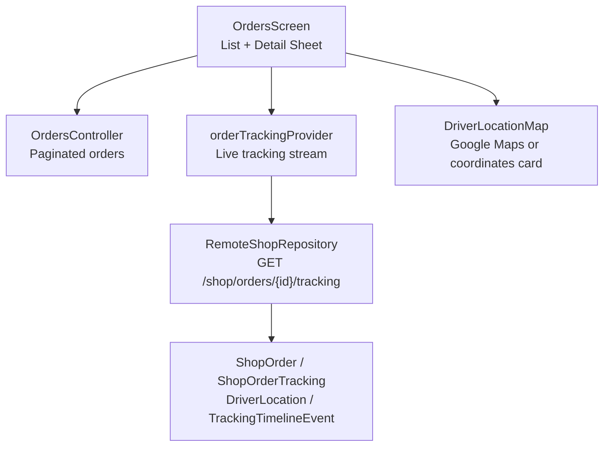
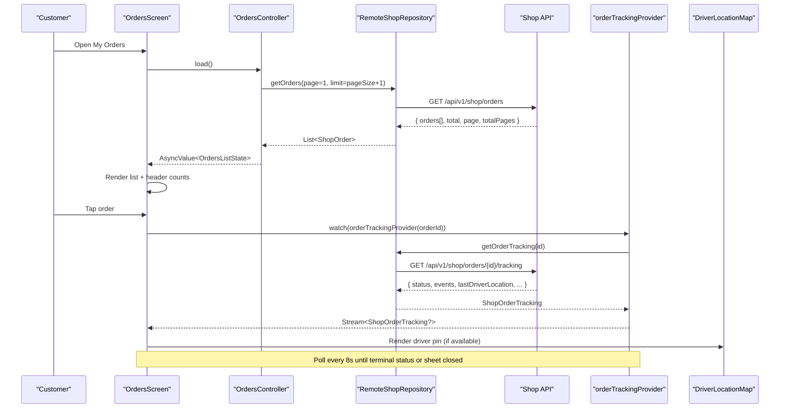
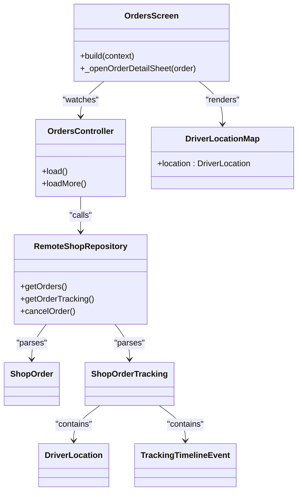

# Order Tracking & History

<cite>
**Referenced Files in This Document**
- [orders_screen.dart](file://lib/features/shop/screens/orders_screen.dart)
- [shop_models.dart](file://lib/features/shop/data/shop_models.dart)
- [remote_shop_repository.dart](file://lib/features/shop/data/remote_shop_repository.dart)
- [providers.dart](file://lib/features/shop/providers.dart)
- [driver_location_map.dart](file://lib/features/shop/widgets/driver_location_map.dart)
- [SHOP_API_MOBILE_HANDOFF.md](file://docs/SHOP_API_MOBILE_HANDOFF.md)
- [COURIER_API_PARTNER_HANDOFF_FRANK.md](file://docs/COURIER_API_PARTNER_HANDOFF_FRANK.md)
- [payments-refunds.html](file://web/payments-refunds.html)
- [legal_content.dart](file://lib/features/legal/legal_content.dart)
</cite>

## Table of Contents
1. [Introduction](#introduction)
2. [Project Structure](#project-structure)
3. [Core Components](#core-components)
4. [Architecture Overview](#architecture-overview)
5. [Detailed Component Analysis](#detailed-component-analysis)
6. [Dependency Analysis](#dependency-analysis)
7. [Performance Considerations](#performance-considerations)
8. [Troubleshooting Guide](#troubleshooting-guide)
9. [Conclusion](#conclusion)

## Introduction
This document explains the order tracking and history functionality implemented in the LidaPay Flutter app. It covers:
- Order listing with pagination and live refresh
- Order details view, including items, totals, shipping address, and cancellation
- Delivery tracking with a driver location map and delivery timeline
- Real-time polling for tracking updates while the screen is open
- Order status transitions, cancellation, refund policy, and customer support integration

The implementation uses Riverpod providers for state management, a shop repository for API calls, and Google Maps for courier driver visualization when available.

## Project Structure
Order tracking and history are primarily implemented under the shop feature:
- UI layer: orders list and detail sheet
- Data models: orders, tracking events, driver location, shipping address
- Repository: remote API calls for orders, tracking, and cancellation
- Providers: paginated orders controller and live tracking stream
- Map widget: driver location rendering with fallback

**Diagram sources**
- [orders_screen.dart:26-178](file://lib/features/shop/screens/orders_screen.dart#L26-L178)
- [providers.dart:118-180](file://lib/features/shop/providers.dart#L118-L180)
- [providers.dart:189-221](file://lib/features/shop/providers.dart#L189-L221)
- [remote_shop_repository.dart:175-223](file://lib/features/shop/data/remote_shop_repository.dart#L175-L223)
- [driver_location_map.dart:15-166](file://lib/features/shop/widgets/driver_location_map.dart#L15-L166)
- [shop_models.dart:300-450](file://lib/features/shop/data/shop_models.dart#L300-L450)

**Section sources**
- [orders_screen.dart:26-178](file://lib/features/shop/screens/orders_screen.dart#L26-L178)
- [providers.dart:118-180](file://lib/features/shop/providers.dart#L118-L180)
- [remote_shop_repository.dart:137-173](file://lib/features/shop/data/remote_shop_repository.dart#L137-L173)
- [shop_models.dart:300-450](file://lib/features/shop/data/shop_models.dart#L300-L450)

## Core Components
- Orders list and detail sheet: displays orders, counts, in-transit summary, and opens a bottom sheet for details and tracking.
- Paginated orders controller: loads initial page, supports load-more sentinel, and shows retry on load-more errors.
- Live tracking provider: polls tracking endpoint every 8 seconds while the detail sheet is open; stops on terminal statuses.
- Driver location map: renders a Google Map marker for the courier driver when configured; otherwise shows coordinates.
- Data models: represent orders, tracking events, driver locations, and shipping addresses with robust parsing.

Key responsibilities:
- Orders list: fetches orders, handles loading/error/empty states, and auto-opens an initial order if routed by ID.
- Order details: shows status pill, carrier/tracking number, delivery timeline, optional driver map, items, totals, shipping address, and cancellation action.
- Tracking: maps backend fields to UI-friendly labels and timelines, and exposes freshness indicators for driver location.

**Section sources**
- [orders_screen.dart:16-178](file://lib/features/shop/screens/orders_screen.dart#L16-L178)
- [orders_screen.dart:573-942](file://lib/features/shop/screens/orders_screen.dart#L573-L942)
- [providers.dart:118-180](file://lib/features/shop/providers.dart#L118-L180)
- [providers.dart:189-221](file://lib/features/shop/providers.dart#L189-L221)
- [driver_location_map.dart:15-166](file://lib/features/shop/widgets/driver_location_map.dart#L15-L166)
- [shop_models.dart:300-450](file://lib/features/shop/data/shop_models.dart#L300-L450)

## Architecture Overview
The order tracking flow connects UI components to providers and the remote repository, which call the shop API endpoints documented in the handoff guide.

**Diagram sources**
- [orders_screen.dart:62-178](file://lib/features/shop/screens/orders_screen.dart#L62-L178)
- [orders_screen.dart:573-782](file://lib/features/shop/screens/orders_screen.dart#L573-L782)
- [providers.dart:118-180](file://lib/features/shop/providers.dart#L118-L180)
- [providers.dart:189-221](file://lib/features/shop/providers.dart#L189-L221)
- [remote_shop_repository.dart:175-223](file://lib/features/shop/data/remote_shop_repository.dart#L175-L223)
- [driver_location_map.dart:56-134](file://lib/features/shop/widgets/driver_location_map.dart#L56-L134)
- [SHOP_API_MOBILE_HANDOFF.md:320-436](file://docs/SHOP_API_MOBILE_HANDOFF.md#L320-L436)

## Detailed Component Analysis

### Orders Screen Implementation
- Header: shows total orders and in-transit count, back button, and refresh.
- List: skeleton loading, error view with retry, empty state with “Explore Shop”, and paginated cards.
- Card: shows first item image/name, reference, placed date, status badge, item count, total, and a “Track order” affordance.
- Initial order routing: if opened with an order ID/reference, it auto-opens the detail sheet after data loads.

Status mapping in cards:
- delivered → Delivered
- shipped/out_for_delivery → In Transit
- processing/paid → Processing
- cancelled → Cancelled
- other → Pending

Cancellation:
- Available when order can be cancelled (pending/processing/created).
- Confirmation dialog warns about refunds for paid orders.
- Calls repository cancel, invalidates orders providers, and shows success feedback or error snackbar.

**Section sources**
- [orders_screen.dart:26-178](file://lib/features/shop/screens/orders_screen.dart#L26-L178)
- [orders_screen.dart:343-529](file://lib/features/shop/screens/orders_screen.dart#L343-L529)
- [orders_screen.dart:884-942](file://lib/features/shop/screens/orders_screen.dart#L884-L942)

### Order Details View
- Displays order reference, currency/total, status pill, carrier/tracking number (copyable), and delivery timeline.
- Shows estimated delivery or delivered timestamp when present.
- Renders items with SKU when available, subtotal/discount/delivery fee breakdown, and shipping address.
- Provides cancellation action when eligible.

Tracking section:
- Loads `ShopOrderTracking` via provider.
- If driver location exists and order is not terminal, renders `DriverLocationMap`.
- Timeline rows show latest event highlighted, connector lines, message, optional location, and formatted time.

**Section sources**
- [orders_screen.dart:573-942](file://lib/features/shop/screens/orders_screen.dart#L573-L942)
- [orders_screen.dart:978-1105](file://lib/features/shop/screens/orders_screen.dart#L978-L1105)

### Delivery Tracking with Driver Location Mapping
- The tracking provider polls the tracking endpoint every 8 seconds while the detail sheet is visible.
- When `lastDriverLocation` is present and the order is not terminal, the map widget shows a driver marker.
- If Google Maps is not configured or running on web, it falls back to a coordinates card showing latitude/longitude and a label.

Driver location freshness:
- Uses `recordedAt` to compute a human-readable freshness label (“Updated just now”, minutes/hours/days ago).

**Section sources**
- [providers.dart:189-221](file://lib/features/shop/providers.dart#L189-L221)
- [driver_location_map.dart:15-166](file://lib/features/shop/widgets/driver_location_map.dart#L15-L166)
- [shop_models.dart:382-408](file://lib/features/shop/data/shop_models.dart#L382-L408)

### Order Status Updates and Transitions
Backend-supported lifecycle:
- Order status: pending → paid → processing → shipped → delivered (also cancelled, refunded)
- Payment status: pending | success | failed | refunded
- Delivery timeline events include order_placed, payment_confirmed, payment_failed, courier_accepted, packed, picked_up, out_for_delivery, delivered, delivery_exception, failed_delivery, plus raw order-status values pushed by fulfilment/admin.

UI mapping:
- Status pill maps backend status to friendly labels and colors.
- Timeline renders chronological events with timestamps and optional locations.

**Section sources**
- [SHOP_API_MOBILE_HANDOFF.md:331-339](file://docs/SHOP_API_MOBILE_HANDOFF.md#L331-L339)
- [orders_screen.dart:978-1019](file://lib/features/shop/screens/orders_screen.dart#L978-L1019)
- [orders_screen.dart:1021-1105](file://lib/features/shop/screens/orders_screen.dart#L1021-L1105)

### Real-Time Location Tracking
- The tracking provider streams `ShopOrderTracking` and stops when terminal (`delivered`, `cancelled`, `refunded`) or when the provider is disposed.
- While active, it polls every 8 seconds and yields new tracking data.
- The UI reacts to changes to update the map and timeline without flicker.

Recommended polling cadence per documentation:
- Every 5–10 seconds while the tracking screen is visible and order is in transit.

**Section sources**
- [providers.dart:189-221](file://lib/features/shop/providers.dart#L189-L221)
- [SHOP_API_MOBILE_HANDOFF.md:396-416](file://docs/SHOP_API_MOBILE_HANDOFF.md#L396-L416)
- [COURIER_API_PARTNER_HANDOFF_FRANK.md:611-615](file://docs/COURIER_API_PARTNER_HANDOFF_FRANK.md#L611-L615)

### Order History Management
- Orders list uses a paginated controller that requests `pageSize + 1` rows to detect more pages.
- Load-more sentinel triggers background loading and shows a spinner at the end of the list.
- Errors during load-more surface a retry button; initial load errors show an error view with retry.
- Refresh pulls fresh data from the server.

Data model highlights:
- `ShopOrder` includes items, shipping address, carrier/tracking number, totals, and optional deliveryUpdates.
- `ShopOrderTracking` aggregates status, ETA/delivered time, shipping address, driver location, and events.

**Section sources**
- [providers.dart:93-180](file://lib/features/shop/providers.dart#L93-L180)
- [orders_screen.dart:98-178](file://lib/features/shop/screens/orders_screen.dart#L98-L178)
- [shop_models.dart:300-450](file://lib/features/shop/data/shop_models.dart#L300-L450)

### Order Cancellation and Refund Processes
- Cancellation is allowed when order status permits (pending/processing/created).
- Confirming cancellation calls the repository’s cancel endpoint and refreshes orders.
- Refund policy:
  - Approved refunds go through the original payment route where possible.
  - Timelines depend on the payment provider.
  - For failed deliveries or unauthorized transactions, customers should contact support with references.

Support integration:
- Legal content provides guidance for failed deliveries, shop order cancellations/returns, chargebacks, refund timelines, and disputes with contact information.

**Section sources**
- [orders_screen.dart:884-942](file://lib/features/shop/screens/orders_screen.dart#L884-L942)
- [remote_shop_repository.dart:216-223](file://lib/features/shop/data/remote_shop_repository.dart#L216-L223)
- [payments-refunds.html:26-33](file://web/payments-refunds.html#L26-L33)
- [legal_content.dart:328-367](file://lib/features/legal/legal_content.dart#L328-L367)

## Dependency Analysis

**Diagram sources**
- [orders_screen.dart:26-178](file://lib/features/shop/screens/orders_screen.dart#L26-L178)
- [providers.dart:118-180](file://lib/features/shop/providers.dart#L118-L180)
- [remote_shop_repository.dart:137-223](file://lib/features/shop/data/remote_shop_repository.dart#L137-L223)
- [driver_location_map.dart:15-166](file://lib/features/shop/widgets/driver_location_map.dart#L15-L166)
- [shop_models.dart:300-450](file://lib/features/shop/data/shop_models.dart#L300-L450)

**Section sources**
- [orders_screen.dart:26-178](file://lib/features/shop/screens/orders_screen.dart#L26-L178)
- [providers.dart:118-180](file://lib/features/shop/providers.dart#L118-L180)
- [remote_shop_repository.dart:137-223](file://lib/features/shop/data/remote_shop_repository.dart#L137-L223)
- [shop_models.dart:300-450](file://lib/features/shop/data/shop_models.dart#L300-L450)

## Performance Considerations
- Pagination: request one extra row to detect more pages; avoid phantom next pages.
- Debounced polling: track provider polls every 8 seconds; stop on terminal status or disposal.
- Map performance: animate camera only when coordinates change beyond a small threshold; disable unnecessary controls.
- Error resilience: keep last good payload for tracking; do not treat transient failures as empty data.
- UI responsiveness: skeletons and previous state preservation prevent flashing during mutations.

[No sources needed since this section provides general guidance]

## Troubleshooting Guide
Common issues and resolutions:
- Orders fail to load:
  - Use the error view retry button to reload.
  - Ensure authentication token is valid and network connectivity is available.
- Load-more fails:
  - A retry button appears at the end of the list; tap to retry fetching additional pages.
- Tracking unavailable:
  - The detail sheet shows a temporary error message; ensure the order has tracking data and the endpoint returns results.
- Driver map not shown:
  - On web or when Google Maps key is not configured, the widget falls back to a coordinates card.
- Cancellation fails:
  - Check order eligibility; confirm the order is still cancellable.
  - Review error snackbar for specific failure reasons.

**Section sources**
- [orders_screen.dart:98-178](file://lib/features/shop/screens/orders_screen.dart#L98-L178)
- [orders_screen.dart:703-717](file://lib/features/shop/screens/orders_screen.dart#L703-L717)
- [driver_location_map.dart:110-166](file://lib/features/shop/widgets/driver_location_map.dart#L110-L166)
- [orders_screen.dart:903-942](file://lib/features/shop/screens/orders_screen.dart#L903-L942)

## Conclusion
The order tracking and history system provides a complete customer experience:
- A responsive orders list with pagination and live refresh
- An informative order details view with status, timeline, and cancellation
- Real-time delivery tracking with driver location mapping and timeline updates
- Clear policies and flows for cancellation and refunds, with support integration

The implementation balances reliability (error handling, fallbacks), performance (pagination, controlled polling), and clarity (status mapping, timeline rendering) to deliver a smooth tracking journey.

[No sources needed since this section summarizes without analyzing specific files]