# Product Catalog & Browsing

<cite>
**Referenced Files in This Document**   
- [shop_screen.dart](file://lib/features/shop/screens/shop_screen.dart)
- [product_card.dart](file://lib/features/shop/widgets/product_card.dart)
- [product_detail_sheet.dart](file://lib/features/shop/widgets/product_detail_sheet.dart)
- [providers.dart](file://lib/features/shop/providers.dart)
- [remote_shop_repository.dart](file://lib/features/shop/data/remote_shop_repository.dart)
- [shop_models.dart](file://lib/features/shop/data/shop_models.dart)
- [api_endpoints.dart](file://lib/core/network/api_endpoints.dart)
- [product_image.dart](file://lib/core/widgets/product_image.dart)
- [ENDPOINTS.md](file://api/ENDPOINTS.md)
</cite>

## Table of Contents
1. [Introduction](#introduction)
2. [Project Structure](#project-structure)
3. [Core Components](#core-components)
4. [Architecture Overview](#architecture-overview)
5. [Detailed Component Analysis](#detailed-component-analysis)
6. [Dependency Analysis](#dependency-analysis)
7. [Performance Considerations](#performance-considerations)
8. [Troubleshooting Guide](#troubleshooting-guide)
9. [Conclusion](#conclusion)

## Introduction
This document explains the product catalog and browsing functionality in the Lidapay mobile app. It covers how products are listed, how product cards render product data, how search and category filtering work, how categories are organized, and how the shop screen composes these pieces. It also documents the product data models, the backend endpoints used to fetch catalog data, and performance strategies for large catalogs, image loading, and pagination.

The shop feature is implemented as a Flutter application using Riverpod for state management, Go Router for navigation, and a repository layer that calls REST endpoints defined by the backend API.

## Project Structure
The product catalog lives under the `features/shop` module:

- Data models define the shape of categories, products, cart items, orders, and tracking information.
- The repository layer translates raw API responses into typed models and handles error cases.
- Providers expose asynchronous data streams and user preferences such as loved products and selected filters.
- Screens compose the UI, including the main shop screen with search, category chips, featured carousel, and product grid.
- Widgets implement reusable components such as the product card and the product detail sheet.
- Shared widgets handle product image loading from bundled assets or remote URLs.

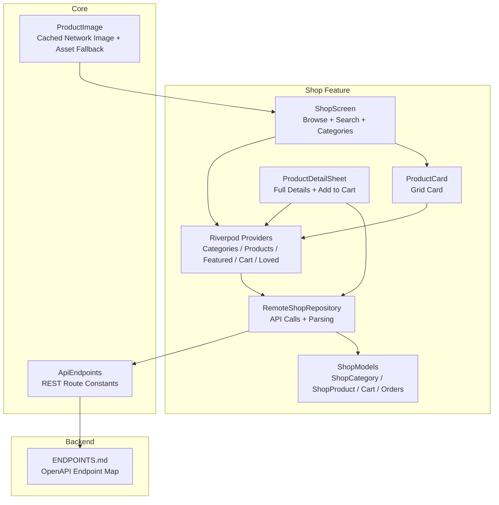

**Diagram sources**
- [shop_screen.dart:19-493](file://lib/features/shop/screens/shop_screen.dart#L19-L493)
- [product_card.dart:11-248](file://lib/features/shop/widgets/product_card.dart#L11-L248)
- [product_detail_sheet.dart:17-677](file://lib/features/shop/widgets/product_detail_sheet.dart#L17-L677)
- [providers.dart:15-48](file://lib/features/shop/providers.dart#L15-L48)
- [remote_shop_repository.dart:12-703](file://lib/features/shop/data/remote_shop_repository.dart#L12-L703)
- [shop_models.dart:6-93](file://lib/features/shop/data/shop_models.dart#L6-L93)
- [api_endpoints.dart:111-130](file://lib/core/network/api_endpoints.dart#L111-L130)
- [product_image.dart:7-89](file://lib/core/widgets/product_image.dart#L7-L89)
- [ENDPOINTS.md:159-184](file://api/ENDPOINTS.md#L159-L184)

**Section sources**
- [shop_screen.dart:19-493](file://lib/features/shop/screens/shop_screen.dart#L19-L493)
- [providers.dart:15-48](file://lib/features/shop/providers.dart#L15-L48)
- [remote_shop_repository.dart:12-703](file://lib/features/shop/data/remote_shop_repository.dart#L12-L703)
- [shop_models.dart:6-93](file://lib/features/shop/data/shop_models.dart#L6-L93)
- [api_endpoints.dart:111-130](file://lib/core/network/api_endpoints.dart#L111-L130)
- [product_image.dart:7-89](file://lib/core/widgets/product_image.dart#L7-L89)
- [ENDPOINTS.md:159-184](file://api/ENDPOINTS.md#L159-L184)

## Core Components
The catalog system is built around five core layers:

| Layer | Responsibility | Key Artifacts |
|---|---|---|
| UI Layer | Renders the shop screen, product cards, hero carousel, search bar, category chips, and product detail sheet. | `ShopScreen`, `ProductCard`, `ProductDetailSheet` |
| State Layer | Holds search query, selected category, categories, products, featured products, cart, and loved products. | `shopSearchQueryProvider`, `shopCategoryProvider`, `shopCategoriesProvider`, `shopProductsProvider`, `shopFeaturedProvider`, `cartProvider`, `lovedProductsProvider` |
| Repository Layer | Calls backend endpoints, parses flexible JSON payloads, and returns typed models. | `RemoteShopRepository` |
| Data Models | Define product, category, cart, order, shipping address, and tracking structures. | `ShopProduct`, `ShopCategory`, `Cart`, `ShopOrder`, `ShippingAddress` |
| Networking Layer | Provides route constants and shared HTTP client behavior. | `ApiEndpoints`, `ApiClient` (used by repository) |

**Section sources**
- [shop_screen.dart:19-493](file://lib/features/shop/screens/shop_screen.dart#L19-L493)
- [providers.dart:15-48](file://lib/features/shop/providers.dart#L15-L48)
- [remote_shop_repository.dart:12-703](file://lib/features/shop/data/remote_shop_repository.dart#L12-L703)
- [shop_models.dart:6-93](file://lib/features/shop/data/shop_models.dart#L6-L93)
- [api_endpoints.dart:111-130](file://lib/core/network/api_endpoints.dart#L111-L130)

## Architecture Overview
The shop screen reads state from Riverpod providers. When the user types in the search box, the provider updates the search query. When the user taps a category chip, the provider updates the selected category. Both changes trigger a new request through the repository to fetch filtered products.

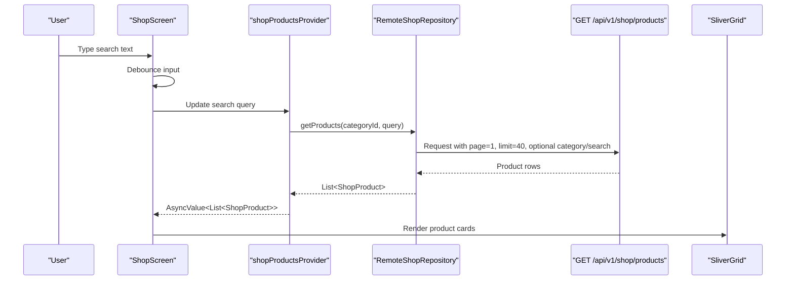

**Diagram sources**
- [shop_screen.dart:56-61](file://lib/features/shop/screens/shop_screen.dart#L56-L61)
- [providers.dart:30-36](file://lib/features/shop/providers.dart#L30-L36)
- [remote_shop_repository.dart:44-56](file://lib/features/shop/data/remote_shop_repository.dart#L44-L56)
- [api_endpoints.dart:112-113](file://lib/core/network/api_endpoints.dart#L112-L113)
- [ENDPOINTS.md:164-167](file://api/ENDPOINTS.md#L164-L167)

## Detailed Component Analysis

### Shop Screen Architecture
The shop screen is the central browsing surface. It composes:

- A sticky header with back navigation, orders navigation, and cart badge.
- A featured hero carousel showing promotional products.
- A sticky search bar with debounced input.
- Horizontal category chips for filtering.
- A two-column product grid.
- Error and empty states.
- Pull-to-refresh logic that reloads categories, products, and featured products.

Key behaviors:

- Deep-link support: if an initial product ID is provided, the screen opens the product detail sheet after the catalog loads.
- Pending product support: a global provider can hold a product to open immediately when the shop screen appears.
- Skeleton loading: while categories or products are loading, a skeleton view is shown.
- Error handling: network or parsing errors show an error view with retry.
- Category selection: selecting a category updates the selected category provider and re-fetches products.
- Search filtering: typing updates the search provider after a short debounce.

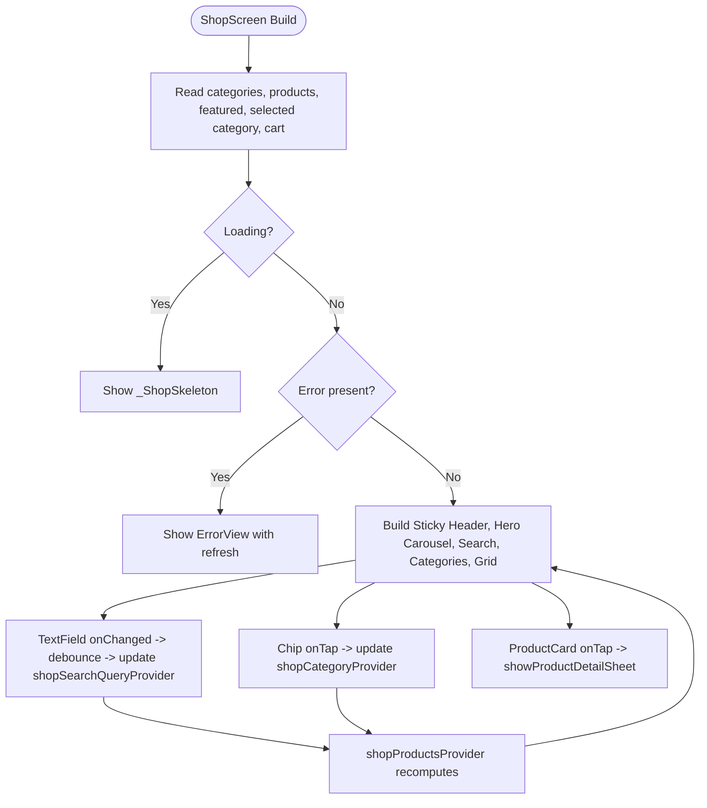

**Diagram sources**
- [shop_screen.dart:28-121](file://lib/features/shop/screens/shop_screen.dart#L28-L121)
- [shop_screen.dart:135-493](file://lib/features/shop/screens/shop_screen.dart#L135-L493)
- [providers.dart:20-40](file://lib/features/shop/providers.dart#L20-L40)

**Section sources**
- [shop_screen.dart:19-493](file://lib/features/shop/screens/shop_screen.dart#L19-L493)

### Product Listing Implementation
The product listing uses a sliver-based scroll view:

- Featured products are rendered as a horizontal list of product cards.
- All products are rendered as a two-column grid.
- Empty results show an empty view with guidance to try different search or category terms.
- While products are loading and already have partial data, a thin progress indicator is shown.
- The grid uses a fixed cross-axis count and child aspect ratio tuned for product cards.

Data flow:

1. `shopProductsProvider` watches the current search query and selected category.
2. The repository calls `GET /api/v1/shop/products` with `page=1`, `limit=40`, and optional `category` and `search` parameters.
3. The response is parsed into `ShopProduct` objects.
4. The shop screen renders the resulting list.

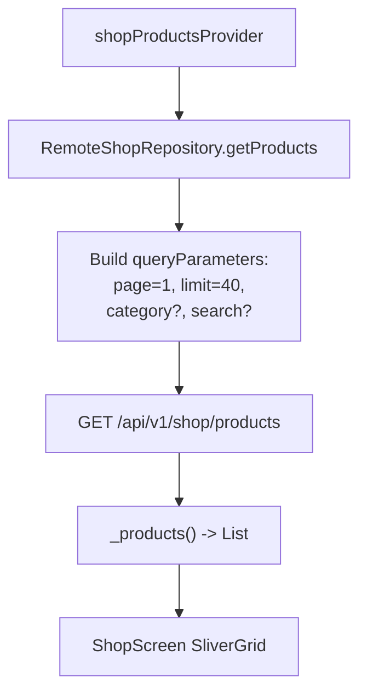

**Diagram sources**
- [providers.dart:30-36](file://lib/features/shop/providers.dart#L30-L36)
- [remote_shop_repository.dart:44-56](file://lib/features/shop/data/remote_shop_repository.dart#L44-L56)
- [shop_screen.dart:451-487](file://lib/features/shop/screens/shop_screen.dart#L451-L487)
- [api_endpoints.dart:112-113](file://lib/core/network/api_endpoints.dart#L112-L113)
- [ENDPOINTS.md:164-167](file://api/ENDPOINTS.md#L164-L167)

**Section sources**
- [shop_screen.dart:451-487](file://lib/features/shop/screens/shop_screen.dart#L451-L487)
- [providers.dart:30-36](file://lib/features/shop/providers.dart#L30-L36)
- [remote_shop_repository.dart:44-56](file://lib/features/shop/data/remote_shop_repository.dart#L44-L56)

### Product Card Widget
The product card is a consumer widget that displays:

- Primary product image through `ProductImage`.
- Discount badge when `discountPercent > 0`.
- Favorite toggle backed by `lovedProductsProvider`.
- Out-of-stock overlay when stock is zero.
- Brand label, rating, product name, current price, and optional old price.

Interactions:

- Tapping the card triggers the provided `onTap`, which opens the product detail sheet.
- Tapping the heart icon toggles the loved state and persists it locally per user.
- Haptic feedback is used on favorite toggles.

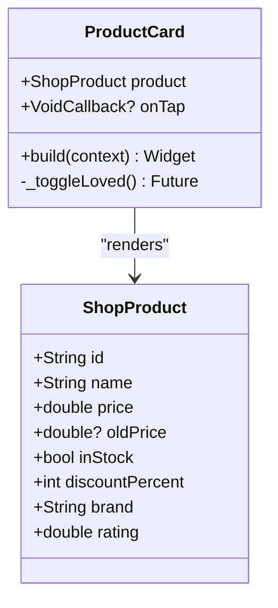

**Diagram sources**
- [product_card.dart:11-248](file://lib/features/shop/widgets/product_card.dart#L11-L248)
- [shop_models.dart:24-93](file://lib/features/shop/data/shop_models.dart#L24-L93)

**Section sources**
- [product_card.dart:11-248](file://lib/features/shop/widgets/product_card.dart#L11-L248)
- [shop_models.dart:24-93](file://lib/features/shop/data/shop_models.dart#L24-L93)

### Search and Filtering Capabilities
Search and filtering are implemented through two Riverpod state providers:

- `shopSearchQueryProvider`: holds the current search string.
- `shopCategoryProvider`: holds the selected category ID or null for all products.

When either changes, `shopProductsProvider` recomputes and calls the repository with updated parameters.

Search implementation details:

- Input is debounced for 350 milliseconds to avoid excessive requests.
- The repository trims the query before sending it.
- If the query is empty, no `search` parameter is sent.
- If a category is selected, the `category` parameter is included.
- The repository always requests page 1 with a limit of 40 products.

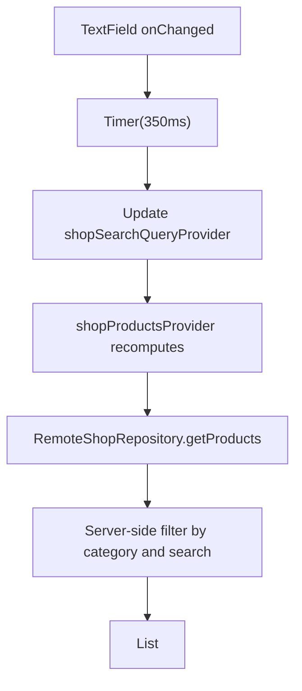

**Diagram sources**
- [shop_screen.dart:56-61](file://lib/features/shop/screens/shop_screen.dart#L56-L61)
- [providers.dart:20-36](file://lib/features/shop/providers.dart#L20-L36)
- [remote_shop_repository.dart:44-56](file://lib/features/shop/data/remote_shop_repository.dart#L44-L56)

**Section sources**
- [shop_screen.dart:56-61](file://lib/features/shop/screens/shop_screen.dart#L56-L61)
- [providers.dart:20-36](file://lib/features/shop/providers.dart#L20-L36)
- [remote_shop_repository.dart:44-56](file://lib/features/shop/data/remote_shop_repository.dart#L44-L56)

### Category Navigation
Categories are fetched once through `shopCategoriesProvider` and displayed as horizontal chips. The first chip represents “All” and corresponds to a null selected category.

Behavior:

- Selecting a chip updates `shopCategoryProvider`.
- Selecting “All” sets the selected category to null.
- Selecting a real category sends its ID to the repository.
- While categories load, skeleton chips are shown.

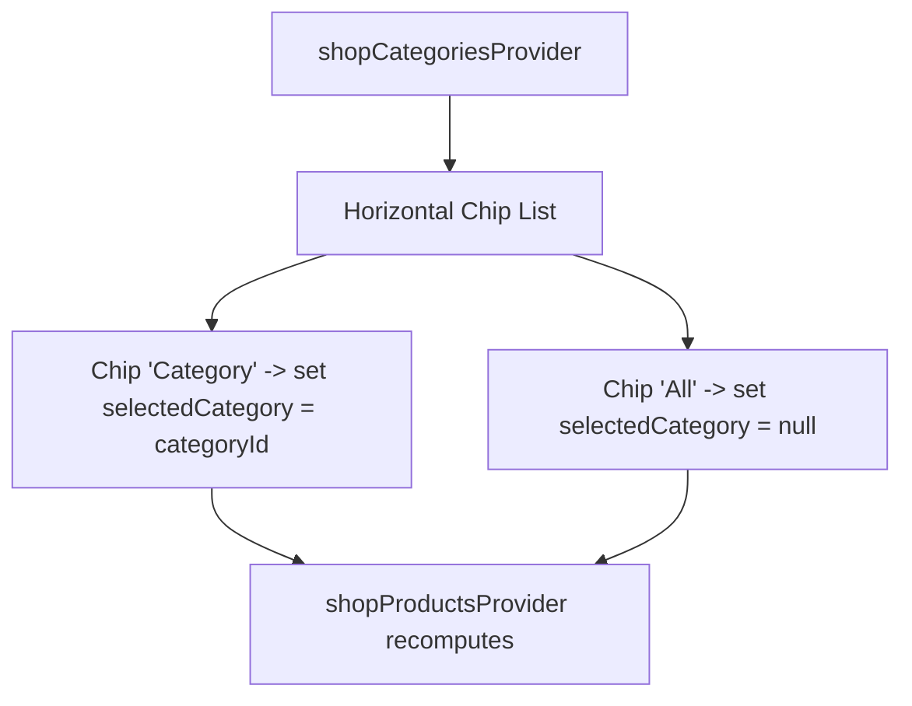

**Diagram sources**
- [providers.dart:26-36](file://lib/features/shop/providers.dart#L26-L36)
- [shop_screen.dart:261-352](file://lib/features/shop/screens/shop_screen.dart#L261-L352)

**Section sources**
- [shop_screen.dart:261-352](file://lib/features/shop/screens/shop_screen.dart#L261-L352)
- [providers.dart:26-36](file://lib/features/shop/providers.dart#L26-L36)

### Product Data Models
The primary model for catalog browsing is `ShopProduct`. It includes identifiers, pricing, images, stock, ratings, branding, partner information, SKU, attributes, and derived values such as availability and discount percentage.

Important fields:

| Field | Meaning |
|---|---|
| `id` | Product identifier used for cart mutations and detail hydration. |
| `name` | Display name. |
| `categoryId` | Category reference used for filtering. |
| `price` | Selling price; discounted price when available. |
| `oldPrice` | Pre-discount price when applicable. |
| `currency` | Currency code, defaulting to GHS. |
| `imageAsset` | Primary artwork source; can be a remote URL or asset path. |
| `images` | Full gallery list extracted from multiple possible API shapes. |
| `stock` | Inventory count; `inStock` is true when greater than zero. |
| `rating` | Average rating. |
| `sold` | Sales or review count used for social proof. |
| `isFeatured` | Whether the product appears in featured sections. |
| `brand` | Brand label. |
| `partnerName` | Seller shown on the detail page. |
| `sku` | Stock keeping unit; falls back to `id` for display. |
| `attributes` | Free-form key-value specs such as color or size. |
| `weightKg` | Optional weight for logistics. |

Derived properties:

- `inStock`: true when stock is positive.
- `displaySku`: prefers real SKU, otherwise product ID.
- `discountPercent`: computed from `oldPrice` and `price`.

**Section sources**
- [shop_models.dart:24-93](file://lib/features/shop/data/shop_models.dart#L24-L93)

### Backend Integration and Product Fetching
The repository maps OpenAPI-style endpoints to typed methods. For the catalog:

| Operation | Endpoint | Parameters | Response |
|---|---|---|---|
| Get categories | `GET /api/v1/shop/categories` | `activeOnly=true` | `List<ShopCategory>` |
| Browse products | `GET /api/v1/shop/products` | `page=1`, `limit=40`, optional `category`, optional `search` | `List<ShopProduct>` |
| Get featured products | `GET /api/v1/shop/products/featured` | None | `List<ShopProduct>` |
| Get single product | `GET /api/v1/shop/products/{id}` | Product ID | `ShopProduct?` |

Parsing strategy:

- The repository uses flexible field resolution so small backend schema variations do not break parsing.
- Images are collected from many possible keys and formats, including arrays, comma-separated strings, and nested objects.
- Pricing logic chooses between list price and discounted price according to spec conventions.
- Missing or malformed rows are skipped rather than crashing the UI.

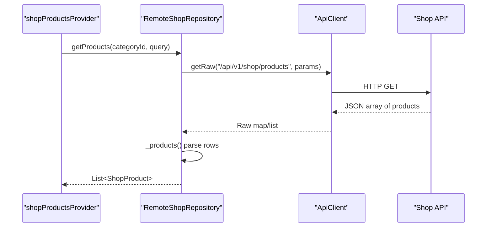

**Diagram sources**
- [providers.dart:30-36](file://lib/features/shop/providers.dart#L30-L36)
- [remote_shop_repository.dart:44-56](file://lib/features/shop/data/remote_shop_repository.dart#L44-L56)
- [remote_shop_repository.dart:427-547](file://lib/features/shop/data/remote_shop_repository.dart#L427-L547)
- [api_endpoints.dart:111-114](file://lib/core/network/api_endpoints.dart#L111-L114)
- [ENDPOINTS.md:159-167](file://api/ENDPOINTS.md#L159-L167)

**Section sources**
- [remote_shop_repository.dart:44-56](file://lib/features/shop/data/remote_shop_repository.dart#L44-L56)
- [remote_shop_repository.dart:427-547](file://lib/features/shop/data/remote_shop_repository.dart#L427-L547)
- [api_endpoints.dart:111-114](file://lib/core/network/api_endpoints.dart#L111-L114)
- [ENDPOINTS.md:159-167](file://api/ENDPOINTS.md#L159-L167)

### Product Display Components
Product display is split across three main components:

1. **ProductImage**: Handles both remote URLs and bundled assets. It sanitizes malformed inputs, upgrades insecure HTTP URLs to HTTPS, caches remote images, and shows a placeholder icon instead of an error widget.
2. **ProductCard**: Displays compact product information in the grid and carousel.
3. **ProductDetailSheet**: Shows full product details, gallery, description, specifications, related products, quantity selector, and add-to-cart action.

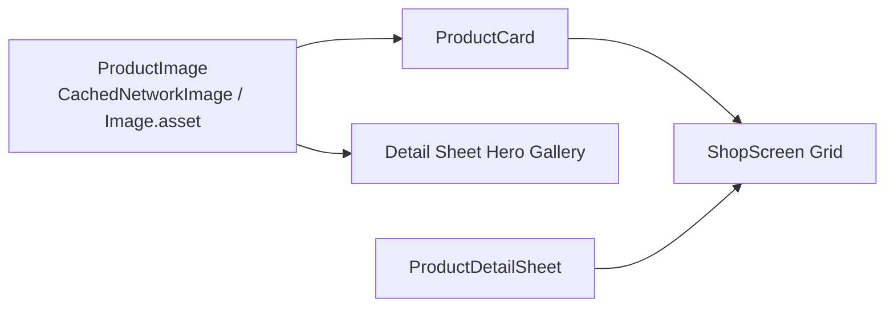

**Diagram sources**
- [product_image.dart:7-89](file://lib/core/widgets/product_image.dart#L7-L89)
- [product_card.dart:11-248](file://lib/features/shop/widgets/product_card.dart#L11-L248)
- [product_detail_sheet.dart:17-677](file://lib/features/shop/widgets/product_detail_sheet.dart#L17-L677)
- [shop_screen.dart:427-487](file://lib/features/shop/screens/shop_screen.dart#L427-L487)

**Section sources**
- [product_image.dart:7-89](file://lib/core/widgets/product_image.dart#L7-L89)
- [product_card.dart:11-248](file://lib/features/shop/widgets/product_card.dart#L11-L248)
- [product_detail_sheet.dart:17-677](file://lib/features/shop/widgets/product_detail_sheet.dart#L17-L677)

## Dependency Analysis
The following diagram shows how the shop feature depends on core networking, routing, and shared widgets.

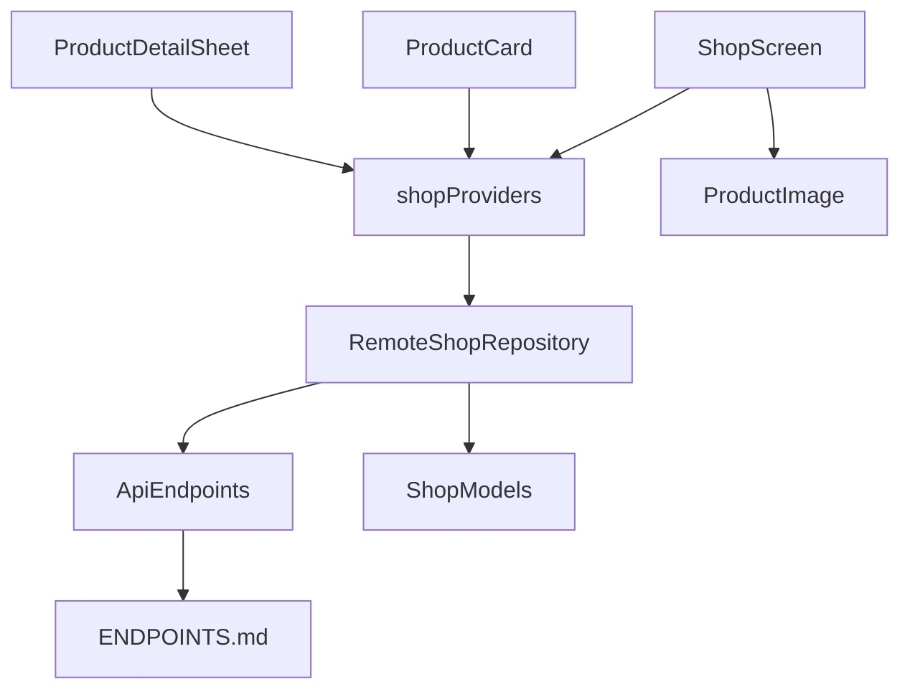

**Diagram sources**
- [shop_screen.dart:19-493](file://lib/features/shop/screens/shop_screen.dart#L19-L493)
- [product_card.dart:11-248](file://lib/features/shop/widgets/product_card.dart#L11-L248)
- [product_detail_sheet.dart:17-677](file://lib/features/shop/widgets/product_detail_sheet.dart#L17-L677)
- [providers.dart:15-48](file://lib/features/shop/providers.dart#L15-L48)
- [remote_shop_repository.dart:12-703](file://lib/features/shop/data/remote_shop_repository.dart#L12-L703)
- [api_endpoints.dart:111-130](file://lib/core/network/api_endpoints.dart#L111-L130)
- [ENDPOINTS.md:159-184](file://api/ENDPOINTS.md#L159-L184)

Coupling and cohesion observations:

- The UI layer depends on providers rather than directly on the repository, improving testability.
- The repository encapsulates all endpoint paths and parsing logic, keeping models clean.
- Product rendering is split between lightweight cards and a heavier detail sheet.
- Image loading is centralized in `ProductImage`, reducing duplication.
- Pagination exists for orders but not for the main product browse list; the product list uses a fixed page and limit.

**Section sources**
- [providers.dart:15-48](file://lib/features/shop/providers.dart#L15-L48)
- [remote_shop_repository.dart:12-703](file://lib/features/shop/data/remote_shop_repository.dart#L12-L703)
- [api_endpoints.dart:111-130](file://lib/core/network/api_endpoints.dart#L111-L130)

## Performance Considerations
The current implementation includes several performance-friendly patterns, but there are opportunities for improvement when scaling to large catalogs.

### Current Optimizations
- Debounced search reduces unnecessary network calls.
- Riverpod providers cache asynchronous results and rebuild only when dependencies change.
- Remote images use cached network image loading with placeholders.
- Product images can specify memory cache width to avoid decoding oversized images.
- The repository skips invalid product rows instead of failing the whole list.
- The detail sheet hydrates product data asynchronously without blocking the initial grid.

### Recommendations for Large Catalogs
| Area | Current Behavior | Recommended Improvement |
|---|---|---|
| Product pagination | Fixed `page=1`, `limit=40` for browse. | Implement infinite scrolling or explicit pagination with a next-page token. |
| Image loading | Cached network image with optional `memCacheWidth`. | Use responsive image sizes, lazy-load offscreen images, and consider thumbnail URLs. |
| Search | Client-side debounce; server-side filtering assumed. | Keep debounce, add cancellation tokens, and disable search while fetching. |
| Category filtering | Re-fetches entire product list. | Cache categories separately and reuse them during product refetch. |
| Featured section | Separate endpoint loaded independently. | Consider merging or caching featured data longer since it changes less often. |
| Memory usage | Grid builds all visible cards. | Ensure grid delegates use efficient builders and avoid heavy computations in build. |
| Offline support | Remote images cached; catalog data not explicitly cached. | Add local cache for categories and products with stale-while-revalidate semantics. |

### Image Loading Strategy
`ProductImage` supports:

- Remote URLs via cached network image.
- Bundled asset images via Flutter’s asset loader.
- Placeholder icons when images are missing or fail to load.
- Secure URL enforcement by upgrading HTTP to HTTPS.
- Optional memory cache width to reduce decode cost.

For large catalogs:

- Prefer thumbnails for grid cards.
- Use higher-resolution images only in the detail sheet.
- Avoid loading images for hidden or scrolled-off-screen items.
- Handle 404 and network errors gracefully with placeholders.

**Section sources**
- [product_image.dart:7-89](file://lib/core/widgets/product_image.dart#L7-L89)
- [shop_screen.dart:56-61](file://lib/features/shop/screens/shop_screen.dart#L56-L61)
- [remote_shop_repository.dart:44-56](file://lib/features/shop/data/remote_shop_repository.dart#L44-L56)

### Pagination Handling
The product browse list does not currently paginate beyond the initial request. The repository hardcodes page 1 and limit 40. In contrast, the orders feature implements pagination with a sentinel row to detect whether more pages exist.

For product pagination:

- Extend `shopProductsProvider` to accept a page number.
- Append new pages instead of replacing the list.
- Show a loading indicator while the next page loads.
- Stop requesting more pages when the server returns fewer than the requested limit.
- Preserve search and category filters across pagination.

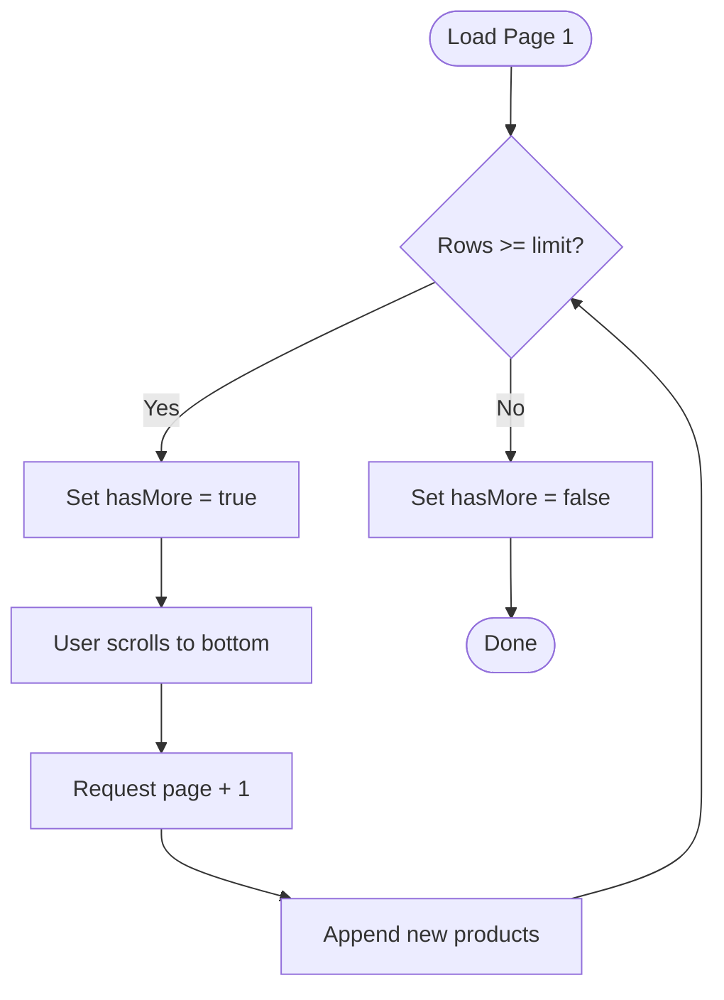

[No sources needed since this diagram shows conceptual workflow, not actual code structure]

## Troubleshooting Guide

### Common Issues and Resolutions
| Symptom | Likely Cause | Resolution |
|---|---|---|
| Search returns no results | Empty or trimmed query still sent, or backend filter mismatch. | Verify debounce output and ensure query is non-empty before sending. |
| Category filter does nothing | Selected category not propagated to repository. | Confirm `shopCategoryProvider` is updated and `getProducts` receives the category. |
| Product images show placeholder | Remote URL invalid, blocked, or malformed. | Check URL scheme, network connectivity, and image format. |
| Product detail sheet shows lean data | Initial list payload lacks full details. | Hydration call fetches full product by ID. |
| Cart count does not update | Cart provider not refreshed after mutation. | Ensure cart mutations go through `CartController`. |
| Loved products reset after login | Local storage keyed by user ID. | Verify session change resets notifier with correct user ID. |

### Debugging Steps
1. Inspect the current search query in `shopSearchQueryProvider`.
2. Inspect the selected category in `shopCategoryProvider`.
3. Check `shopProductsProvider` status: loading, data, or error.
4. Validate the repository request parameters against `ApiEndpoints.shopProducts`.
5. Confirm the backend endpoint responds with expected product rows.
6. Verify image source cleanliness in `ProductImage._cleanSource`.
7. For cart issues, inspect `cartProvider` and `CartController` mutation flow.

**Section sources**
- [shop_screen.dart:56-61](file://lib/features/shop/screens/shop_screen.dart#L56-L61)
- [providers.dart:20-48](file://lib/features/shop/providers.dart#L20-L48)
- [remote_shop_repository.dart:44-56](file://lib/features/shop/data/remote_shop_repository.dart#L44-L56)
- [product_image.dart:26-44](file://lib/core/widgets/product_image.dart#L26-L44)
- [product_detail_sheet.dart:77-90](file://lib/features/shop/widgets/product_detail_sheet.dart#L77-L90)

## Conclusion
The product catalog and browsing feature is structured around a clear separation of concerns: UI screens compose Riverpod providers, providers coordinate a repository layer, and the repository translates backend responses into typed models. The shop screen provides search, category filtering, featured promotions, and a product grid. Product cards and detail sheets render product data consistently, while image loading is centralized and resilient.

For production-scale catalogs, the most important improvements are pagination for the product list, optimized image loading strategies, and stronger caching for offline resilience. The existing architecture makes these enhancements straightforward because data fetching, state, and presentation are well separated.