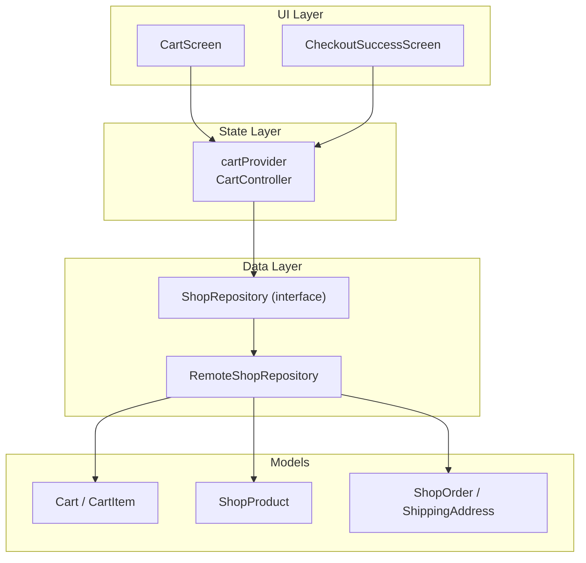
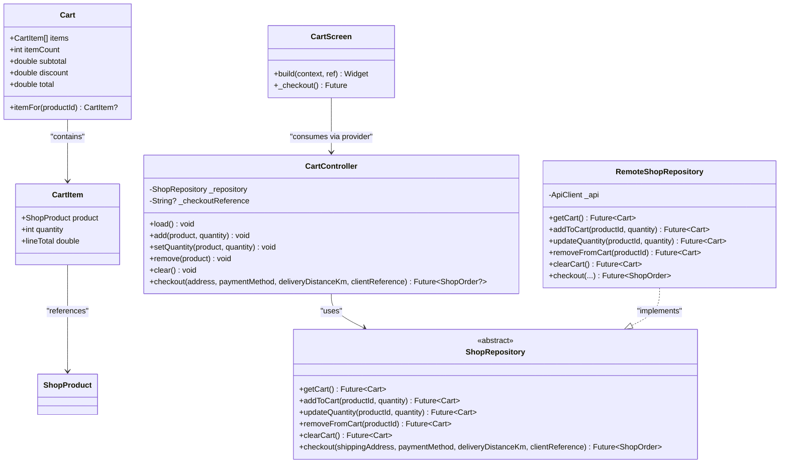
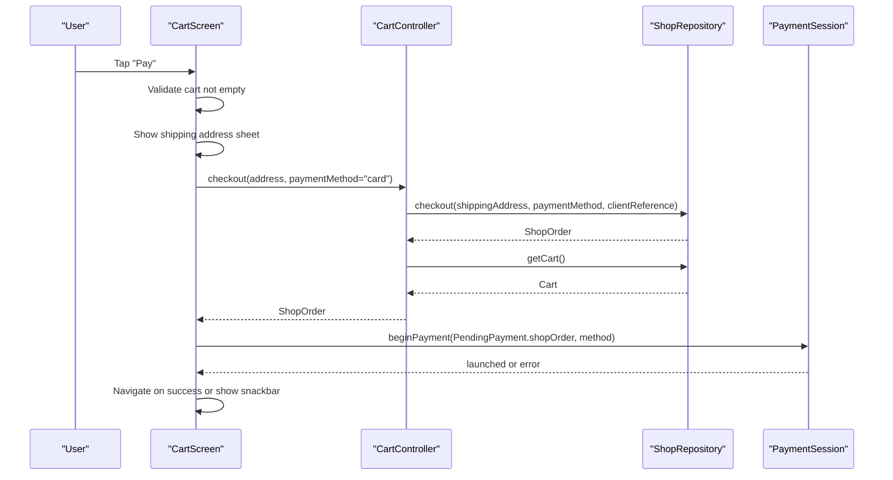
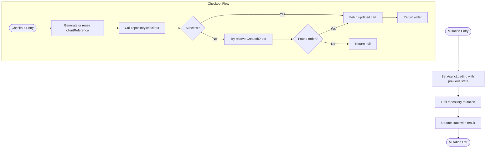
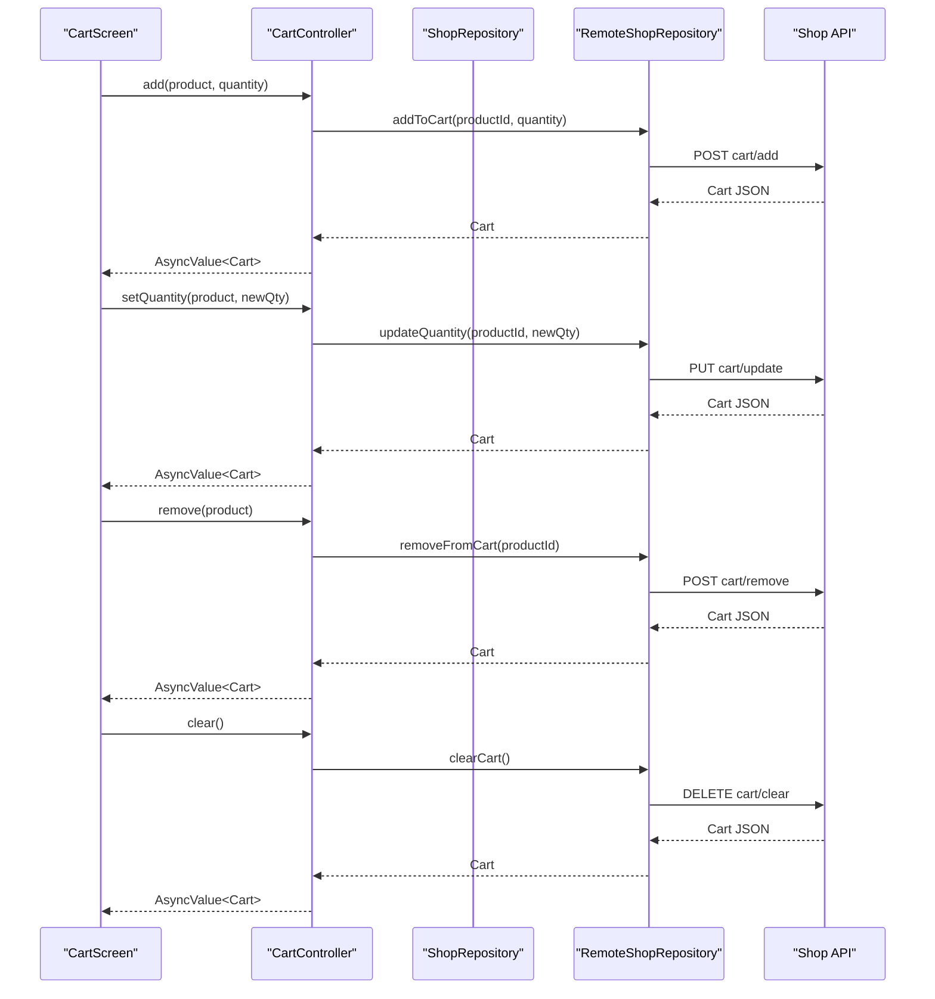
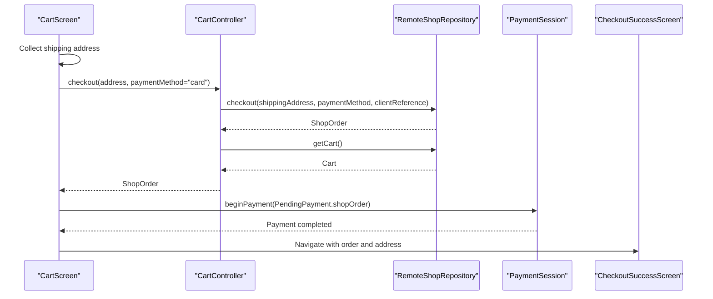
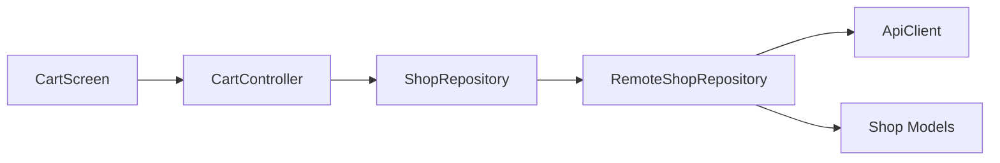

# Shopping Cart Management

<cite>
**Referenced Files in This Document**   
- [cart_screen.dart](file://lib/features/shop/screens/cart_screen.dart)
- [providers.dart](file://lib/features/shop/providers.dart)
- [shop_repository.dart](file://lib/features/shop/data/shop_repository.dart)
- [remote_shop_repository.dart](file://lib/features/shop/data/remote_shop_repository.dart)
- [shop_models.dart](file://lib/features/shop/data/shop_models.dart)
- [checkout_success_screen.dart](file://lib/features/shop/screens/checkout_success_screen.dart)
</cite>

## Table of Contents
1. [Introduction](#introduction)
2. [Project Structure](#project-structure)
3. [Core Components](#core-components)
4. [Architecture Overview](#architecture-overview)
5. [Detailed Component Analysis](#detailed-component-analysis)
6. [Dependency Analysis](#dependency-analysis)
7. [Performance Considerations](#performance-considerations)
8. [Troubleshooting Guide](#troubleshooting-guide)
9. [Conclusion](#conclusion)

## Introduction
This document explains the shopping cart management implementation in the shop feature. It covers cart state management, item addition and removal, quantity updates, cart persistence through server synchronization, the cart screen UI, Riverpod provider patterns, integration with the shop repository, checkout flow, validation, price calculations, promotional discount handling, and real-time updates across app sessions.

The cart is intentionally designed as a thin client: pricing, totals, discounts, and delivery fees are computed by the backend, and the mobile app displays authoritative values returned from the server.

## Project Structure
The cart functionality lives under the shop feature and follows a layered structure:

- Data models define product, cart, shipping address, order, and tracking types.
- The repository interface abstracts shop API endpoints.
- The remote repository implements HTTP calls and response parsing.
- Providers manage cart state using Riverpod and call the repository.
- Screens render the cart UI and trigger mutations through providers.



**Diagram sources**
- [cart_screen.dart:23-352](file://lib/features/shop/screens/cart_screen.dart#L23-L352)
- [providers.dart:42-48](file://lib/features/shop/providers.dart#L42-L48)
- [providers.dart:223-338](file://lib/features/shop/providers.dart#L223-L338)
- [shop_repository.dart:3-62](file://lib/features/shop/data/shop_repository.dart#L3-L62)
- [remote_shop_repository.dart:12-104](file://lib/features/shop/data/remote_shop_repository.dart#L12-L104)
- [shop_models.dart:96-150](file://lib/features/shop/data/shop_models.dart#L96-L150)

**Section sources**
- [cart_screen.dart:23-352](file://lib/features/shop/screens/cart_screen.dart#L23-L352)
- [providers.dart:42-48](file://lib/features/shop/providers.dart#L42-L48)
- [shop_repository.dart:3-62](file://lib/features/shop/data/shop_repository.dart#L3-L62)
- [remote_shop_repository.dart:12-104](file://lib/features/shop/data/remote_shop_repository.dart#L12-L104)
- [shop_models.dart:96-150](file://lib/features/shop/data/shop_models.dart#L96-L150)

## Core Components
- Cart data model: `Cart` and `CartItem` represent the server-shaped cart, including optional server-provided totals and promotion discounts.
- Repository interface: `ShopRepository` defines cart operations such as load, add, update quantity, remove, clear, and checkout.
- Remote repository: `RemoteShopRepository` maps these operations to HTTP endpoints and parses responses into typed models.
- Provider and controller: `cartProvider` exposes an `AsyncValue<Cart>`; `CartController` encapsulates mutation logic, idempotency for checkout, and recovery when network failures occur after the backend has already created an order.
- Cart screen: `CartScreen` renders items, quantities, summary totals, and triggers checkout.

Key responsibilities:
- State loading and refresh via `load`.
- Mutation wrapping via `_mutate`, which keeps previous cart data visible while requests run.
- Checkout with idempotency reference reuse and post-checkout cart reconciliation.
- UI-driven operations: add, set quantity, remove, clear, and checkout.

**Section sources**
- [shop_models.dart:96-150](file://lib/features/shop/data/shop_models.dart#L96-L150)
- [shop_repository.dart:17-45](file://lib/features/shop/data/shop_repository.dart#L17-L45)
- [remote_shop_repository.dart:75-104](file://lib/features/shop/data/remote_shop_repository.dart#L75-L104)
- [providers.dart:42-48](file://lib/features/shop/providers.dart#L42-L48)
- [providers.dart:223-338](file://lib/features/shop/providers.dart#L223-L338)
- [cart_screen.dart:23-352](file://lib/features/shop/screens/cart_screen.dart#L23-L352)

## Architecture Overview
The cart architecture uses Riverpod for reactive state and a repository abstraction for data access.



**Diagram sources**
- [shop_models.dart:96-150](file://lib/features/shop/data/shop_models.dart#L96-L150)
- [shop_repository.dart:3-62](file://lib/features/shop/data/shop_repository.dart#L3-L62)
- [remote_shop_repository.dart:12-104](file://lib/features/shop/data/remote_shop_repository.dart#L12-L104)
- [providers.dart:223-338](file://lib/features/shop/providers.dart#L223-L338)
- [cart_screen.dart:23-352](file://lib/features/shop/screens/cart_screen.dart#L23-L352)

## Detailed Component Analysis

### Cart Screen Implementation
`CartScreen` is a consumer widget that watches `cartProvider` and renders:
- A header with item count, navigation to orders, and clear action.
- An empty state when no items exist.
- A list of cart lines showing product image, name, unit price, quantity controls, and line total.
- A summary panel showing subtotal, discount, delivery fee placeholder, and total.
- A checkout button that launches the checkout flow.

Real-time updates:
- While a mutation is in progress, the controller sets a loading state that preserves the previous cart value, so the UI remains stable and steppers/buttons disable appropriately.
- Payment session changes are observed to navigate to success or show errors.

Validation and UX:
- Quantity increase is disabled when the requested quantity equals product stock.
- Remove actions are disabled during updates.
- Clearing the cart is disabled while a payment is active.



**Diagram sources**
- [cart_screen.dart:61-144](file://lib/features/shop/screens/cart_screen.dart#L61-L144)
- [providers.dart:283-314](file://lib/features/shop/providers.dart#L283-L314)
- [remote_shop_repository.dart:107-135](file://lib/features/shop/data/remote_shop_repository.dart#L107-L135)

**Section sources**
- [cart_screen.dart:23-352](file://lib/features/shop/screens/cart_screen.dart#L23-L352)

### Cart State Management and Provider Pattern
`cartProvider` is a `StateNotifierProvider` whose state is `AsyncValue<Cart>`. `CartController` encapsulates all cart mutations:

- `load`: Sets loading state and fetches the cart from the repository.
- `_mutate`: Wraps any mutation to keep the previous cart visible while the request runs, then updates state with the result.
- `add`, `setQuantity`, `remove`, `clear`: Delegate to repository methods.
- `checkout`: Creates an idempotent checkout attempt, reconciles the cart afterward, and recovers a potentially created order if the initial response fails.

Idempotency:
- A checkout attempt stores a `clientReference`; retries reuse it.
- Changing the cart clears the stored reference to avoid reusing an old checkout key.

Recovery:
- If checkout throws, the controller checks whether the backend already created an order by inspecting the now-empty cart and recent unpaid orders. If found, it returns the recovered order and refreshes the cart.



**Diagram sources**
- [providers.dart:242-260](file://lib/features/shop/providers.dart#L242-L260)
- [providers.dart:283-337](file://lib/features/shop/providers.dart#L283-L337)

**Section sources**
- [providers.dart:42-48](file://lib/features/shop/providers.dart#L42-L48)
- [providers.dart:223-338](file://lib/features/shop/providers.dart#L223-L338)

### Cart Data Models and Price Calculations
`Cart` and `CartItem` model the server response:

- `CartItem.lineTotal` is `product.price * quantity`.
- `Cart.itemCount`, `Cart.subtotal`, `Cart.discount`, and `Cart.total` prefer server-provided values when present; otherwise they fall back to local computation over items.
- Promotional discounts come from the server’s `discount` field.
- Delivery fees are not computed locally; they are calculated at checkout and shown later in order summaries.

This design ensures the UI never computes pricing independently, preventing inconsistencies between client and server.

```mermaid
erDiagram
CART {
List~CART_ITEM~ items
int itemCount
double subtotal
double discount
double total
}
CART_ITEM {
SHOP_PRODUCT product
int quantity
double lineTotal
}
SHOP_PRODUCT {
string id
string name
double price
double? oldPrice
int stock
}
CART ||--o{ CART_ITEM : "contains"
CART_ITEM }o--|| SHOP_PRODUCT : "references"
```

**Diagram sources**
- [shop_models.dart:96-150](file://lib/features/shop/data/shop_models.dart#L96-L150)
- [shop_models.dart:24-93](file://lib/features/shop/data/shop_models.dart#L24-L93)

**Section sources**
- [shop_models.dart:96-150](file://lib/features/shop/data/shop_models.dart#L96-L150)
- [remote_shop_repository.dart:604-647](file://lib/features/shop/data/remote_shop_repository.dart#L604-L647)

### Repository Integration and Persistence
`ShopRepository` defines the contract for cart operations. `RemoteShopRepository` implements them:

- `getCart`: Loads the cart from the server.
- `addToCart`: Adds a product with a given quantity.
- `updateQuantity`: Updates the quantity for a product.
- `removeFromCart`: Removes a product from the cart.
- `clearCart`: Clears the entire cart.
- `checkout`: Creates an order with shipping address, payment method, optional delivery distance, and idempotency key.

Persistence:
- The cart is persisted on the server; the mobile app does not maintain a separate local cart store.
- Every mutation reloads the authoritative cart from the server, ensuring consistency across app sessions.
- The checkout endpoint may clear the server cart even if the response is lost; recovery logic handles this case.



**Diagram sources**
- [providers.dart:262-273](file://lib/features/shop/providers.dart#L262-L273)
- [remote_shop_repository.dart:75-104](file://lib/features/shop/data/remote_shop_repository.dart#L75-L104)
- [shop_repository.dart:17-30](file://lib/features/shop/data/shop_repository.dart#L17-L30)

**Section sources**
- [shop_repository.dart:17-45](file://lib/features/shop/data/shop_repository.dart#L17-L45)
- [remote_shop_repository.dart:75-104](file://lib/features/shop/data/remote_shop_repository.dart#L75-L104)

### Checkout Flow and Order Success
The checkout flow collects a shipping address, creates an order, selects a payment method, and navigates to a success screen.

- The cart screen validates that the cart is not empty.
- It shows a shipping address sheet and calls `CartController.checkout`.
- On success, it starts payment via the payment session and navigates to `CheckoutSuccessScreen`.
- The success screen displays order details, discount, delivery fee, and total paid, along with the delivery address and links to track the order.



**Diagram sources**
- [cart_screen.dart:61-144](file://lib/features/shop/screens/cart_screen.dart#L61-L144)
- [providers.dart:283-314](file://lib/features/shop/providers.dart#L283-L314)
- [checkout_success_screen.dart:18-311](file://lib/features/shop/screens/checkout_success_screen.dart#L18-L311)

**Section sources**
- [cart_screen.dart:61-144](file://lib/features/shop/screens/cart_screen.dart#L61-L144)
- [checkout_success_screen.dart:18-311](file://lib/features/shop/screens/checkout_success_screen.dart#L18-L311)

### Cart Validation Rules
- Empty cart cannot proceed to checkout.
- Quantity must be at least 1; setting quantity below 1 removes the item.
- Quantity increase is disabled when the requested quantity equals product stock.
- Clearing the cart is disabled while a payment is active.
- Checkout requires a valid shipping address.

These rules are enforced in the cart screen interactions and the controller’s mutation helpers.

**Section sources**
- [cart_screen.dart:61-144](file://lib/features/shop/screens/cart_screen.dart#L61-L144)
- [cart_screen.dart:505-667](file://lib/features/shop/screens/cart_screen.dart#L505-L667)
- [providers.dart:262-273](file://lib/features/shop/providers.dart#L262-L273)

### Promotional Discounts and Totals
- The cart model includes a `discount` field representing promotion discounts applied by the server.
- `Cart.total` prefers the server-provided total; otherwise it computes `subtotal - discount`.
- The cart screen displays discount only when greater than zero.
- Delivery fees are not included in the cart total; they are calculated at checkout and shown in order summaries.

**Section sources**
- [shop_models.dart:111-150](file://lib/features/shop/data/shop_models.dart#L111-L150)
- [cart_screen.dart:301-343](file://lib/features/shop/screens/cart_screen.dart#L301-L343)
- [remote_shop_repository.dart:604-647](file://lib/features/shop/data/remote_shop_repository.dart#L604-L647)

## Dependency Analysis
The cart system has clear separation of concerns:

- UI depends on providers.
- Providers depend on the repository interface.
- Remote repository depends on the API client and parses responses into models.
- Models are immutable and equatable, enabling efficient diffing and state updates.



**Diagram sources**
- [cart_screen.dart:23-352](file://lib/features/shop/screens/cart_screen.dart#L23-L352)
- [providers.dart:223-338](file://lib/features/shop/providers.dart#L223-L338)
- [shop_repository.dart:3-62](file://lib/features/shop/data/shop_repository.dart#L3-L62)
- [remote_shop_repository.dart:12-104](file://lib/features/shop/data/remote_shop_repository.dart#L12-L104)

**Section sources**
- [cart_screen.dart:23-352](file://lib/features/shop/screens/cart_screen.dart#L23-L352)
- [providers.dart:223-338](file://lib/features/shop/providers.dart#L223-L338)
- [shop_repository.dart:3-62](file://lib/features/shop/data/shop_repository.dart#L3-L62)
- [remote_shop_repository.dart:12-104](file://lib/features/shop/data/remote_shop_repository.dart#L12-L104)

## Performance Considerations
- Server-authoritative totals prevent redundant client-side computations.
- `AsyncLoading.copyWithPrevious` avoids skeleton flashing during mutations, improving perceived performance.
- Idempotency keys prevent duplicate orders on retry.
- Recovery logic minimizes user friction when network failures occur after successful backend processing.

[No sources needed since this section provides general guidance]

## Troubleshooting Guide
Common issues and resolutions:

- Cart loads but shows stale totals:
  - Ensure the repository returns server-provided totals; verify parsing in the remote repository.
  - Check that mutations call `load` or reconcile the cart after checkout.

- Duplicate orders after retry:
  - Confirm that `clientReference` is reused within the same checkout attempt and cleared when the cart changes.

- Checkout appears failed but order exists:
  - Verify recovery logic finds recent unpaid orders and clears the cart before returning the recovered order.

- Quantity controls disabled unexpectedly:
  - Check loading state propagation from `_mutate` and stock limits in the UI.

**Section sources**
- [providers.dart:242-260](file://lib/features/shop/providers.dart#L242-L260)
- [providers.dart:283-337](file://lib/features/shop/providers.dart#L283-L337)
- [cart_screen.dart:505-667](file://lib/features/shop/screens/cart_screen.dart#L505-L667)

## Conclusion
The shopping cart management implementation centers on a server-authoritative cart model, a clean repository abstraction, and a Riverpod-based state controller. The cart screen provides intuitive interactions for adding, updating, and removing items, while the controller ensures consistent state transitions, idempotent checkouts, and robust recovery. Pricing and promotions are handled by the backend, and the UI reflects authoritative totals, ensuring reliability and simplicity across app sessions.

[No sources needed since this section summarizes without analyzing specific files]