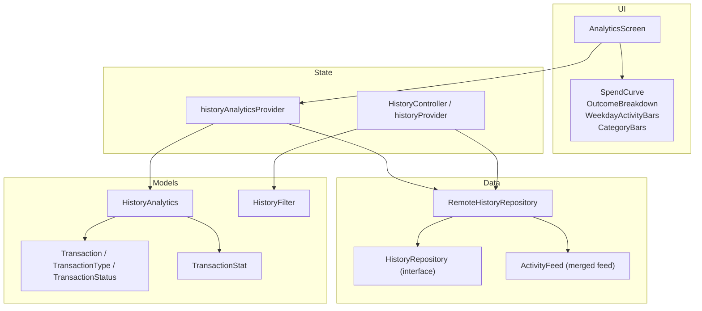
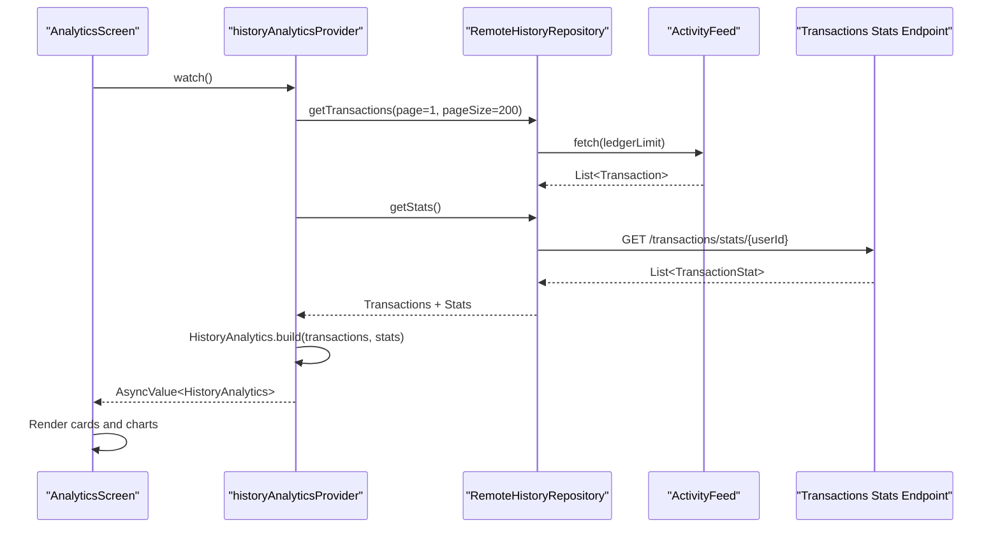
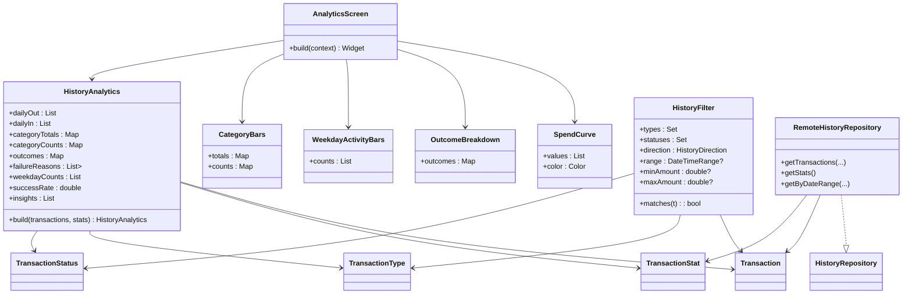
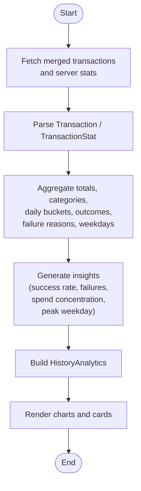

# Analytics Dashboard

<cite>
**Referenced Files in This Document**
- [analytics_screen.dart](file://lib/features/history/screens/analytics_screen.dart)
- [history_charts.dart](file://lib/features/history/widgets/history_charts.dart)
- [providers.dart](file://lib/features/history/providers.dart)
- [history_models.dart](file://lib/features/history/data/history_models.dart)
- [dashboard_models.dart](file://lib/features/dashboard/data/dashboard_models.dart)
- [history_repository.dart](file://lib/features/history/data/history_repository.dart)
- [remote_history_repository.dart](file://lib/features/history/data/remote_history_repository.dart)
- [history_filter_sheet.dart](file://lib/features/history/widgets/history_filter_sheet.dart)
- [history_analytics_test.dart](file://test/history_analytics_test.dart)
</cite>

## Table of Contents
1. [Introduction](#introduction)
2. [Project Structure](#project-structure)
3. [Core Components](#core-components)
4. [Architecture Overview](#architecture-overview)
5. [Detailed Component Analysis](#detailed-component-analysis)
6. [Dependency Analysis](#dependency-analysis)
7. [Performance Considerations](#performance-considerations)
8. [Troubleshooting Guide](#troubleshooting-guide)
9. [Conclusion](#conclusion)
10. [Appendices](#appendices)

## Introduction
This document explains the analytics dashboard component that presents spending analytics, chart visualizations, category breakdowns, delivery outcomes, failure reasons, weekday activity, server aggregates, and generated insights. It covers data aggregation logic, time-based filtering, trend analysis, provider architecture for state management, real-time updates, performance optimizations, privacy considerations, and customization options for charts and export workflows.

## Project Structure
The analytics feature is implemented as a Flutter feature module with:
- A screen orchestrating cards and charts
- Chart widgets built on fl_chart
- Riverpod providers wiring repository calls into UI state
- Data models for transactions, stats, filters, and analytics aggregations
- Repository abstractions over merged activity feeds and server endpoints

**Diagram sources**
- [analytics_screen.dart:17-108](file://lib/features/history/screens/analytics_screen.dart#L17-L108)
- [history_charts.dart:13-198](file://lib/features/history/widgets/history_charts.dart#L13-L198)
- [providers.dart:15-204](file://lib/features/history/providers.dart#L15-L204)
- [history_repository.dart:4-24](file://lib/features/history/data/history_repository.dart#L4-L24)
- [remote_history_repository.dart:16-113](file://lib/features/history/data/remote_history_repository.dart#L16-L113)
- [history_models.dart:179-331](file://lib/features/history/data/history_models.dart#L179-L331)
- [dashboard_models.dart:38-139](file://lib/features/dashboard/data/dashboard_models.dart#L38-L139)

**Section sources**
- [analytics_screen.dart:17-108](file://lib/features/history/screens/analytics_screen.dart#L17-L108)
- [providers.dart:15-204](file://lib/features/history/providers.dart#L15-L204)
- [history_repository.dart:4-24](file://lib/features/history/data/history_repository.dart#L4-L24)
- [remote_history_repository.dart:16-113](file://lib/features/history/data/remote_history_repository.dart#L16-L113)
- [history_models.dart:179-331](file://lib/features/history/data/history_models.dart#L179-L331)
- [dashboard_models.dart:38-139](file://lib/features/dashboard/data/dashboard_models.dart#L38-L139)

## Core Components
- AnalyticsScreen: Composes hero metrics, cash flow curve, delivery outcomes, failure reasons, category breakdown, weekday activity, server aggregates, and insights.
- Charts: SpendCurve (line), OutcomeBreakdown (donut), WeekdayActivityBars (bar), CategoryBars (pictograph).
- Providers: historyAnalyticsProvider builds HistoryAnalytics from merged transactions and server stats; historyProvider manages paginated ledger with filters and settle polling.
- Models: Transaction, TransactionType, TransactionStatus, TransactionStat, HistoryAnalytics, HistoryFilter.
- Repository: RemoteHistoryRepository fetches merged ActivityFeed and server stats/date-range endpoints.

Key responsibilities:
- Aggregation: HistoryAnalytics.build computes daily curves, category totals, outcomes, failure reasons, counterparties, success rate, weekday counts, and insights.
- Filtering: HistoryFilter supports type/status/direction/range/amount bounds applied client-side over the merged feed.
- Real-time: Pending settlement polling refreshes the ledger until terminal states.

**Section sources**
- [analytics_screen.dart:17-108](file://lib/features/history/screens/analytics_screen.dart#L17-L108)
- [history_charts.dart:13-198](file://lib/features/history/widgets/history_charts.dart#L13-L198)
- [providers.dart:58-204](file://lib/features/history/providers.dart#L58-L204)
- [history_models.dart:10-91](file://lib/features/history/data/history_models.dart#L10-L91)
- [history_models.dart:179-331](file://lib/features/history/data/history_models.dart#L179-L331)
- [remote_history_repository.dart:16-113](file://lib/features/history/data/remote_history_repository.dart#L16-L113)

## Architecture Overview
The analytics pipeline combines a wide merged transaction feed with optional server aggregates to produce chart-ready series and insights. The UI consumes these via Riverpod providers.

**Diagram sources**
- [providers.dart:194-204](file://lib/features/history/providers.dart#L194-L204)
- [remote_history_repository.dart:37-97](file://lib/features/history/data/remote_history_repository.dart#L37-L97)
- [history_models.dart:230-331](file://lib/features/history/data/history_models.dart#L230-L331)

## Detailed Component Analysis

### Analytics Screen and Cards
Responsibilities:
- Hero metrics: success rate, money in/out.
- Cash flow card: toggle between spending and received curves.
- Outcomes card: donut with interactive legend.
- Failure reasons: top reasons with proportional bars.
- Category breakdown: pictograph by spend amount.
- Weekday activity: bar chart highlighting peak day.
- Server aggregates: grouped by type and status.
- Insights: generated guidance based on aggregated signals.

Interaction model:
- Pull-to-refresh triggers ref.refresh(historyAnalyticsProvider.future).
- Curve tab toggles dailyOut vs dailyIn.

**Section sources**
- [analytics_screen.dart:17-108](file://lib/features/history/screens/analytics_screen.dart#L17-L108)
- [analytics_screen.dart:311-379](file://lib/features/history/screens/analytics_screen.dart#L311-L379)
- [analytics_screen.dart:381-499](file://lib/features/history/screens/analytics_screen.dart#L381-L499)
- [analytics_screen.dart:501-603](file://lib/features/history/screens/analytics_screen.dart#L501-L603)
- [analytics_screen.dart:605-690](file://lib/features/history/screens/analytics_screen.dart#L605-L690)

### Charts: SpendCurve, OutcomeBreakdown, WeekdayActivityBars, CategoryBars
- SpendCurve: Interactive line chart with crosshair, dot, and tooltip; gradient fill; axis labels derived from date offsets.
- OutcomeBreakdown: Donut with touch-driven slice expansion and center readout; legend rows double as touch targets.
- WeekdayActivityBars: Bar chart with peak-day highlight and tooltips.
- CategoryBars: Pictograph sorted by total spend with animated progress bars and per-category counts.

Chart configuration highlights:
- Time axes computed from current date and series length.
- Touch interactions configured via fl_chart’s LineTouchData, PieTouchData, and BarTouchData.
- Dark/light theme-aware colors and grid styling.

**Section sources**
- [history_charts.dart:13-198](file://lib/features/history/widgets/history_charts.dart#L13-L198)
- [history_charts.dart:200-396](file://lib/features/history/widgets/history_charts.dart#L200-L396)
- [history_charts.dart:398-508](file://lib/features/history/widgets/history_charts.dart#L398-L508)
- [history_charts.dart:510-648](file://lib/features/history/widgets/history_charts.dart#L510-L648)

### Provider Architecture and State Management
- historyRepositoryProvider wires RemoteHistoryRepository with ApiClient and userId.
- historyProvider (StateNotifier) manages paginated ledger, filter application, load-more sentinel, and pending-settle polling.
- transactionStatsProvider wraps server stats with best-effort empty list on API errors.
- historyAnalyticsProvider composes HistoryAnalytics from a wide merged feed and server stats.

Real-time behavior:
- Pending transactions trigger periodic re-fetch until settled or max attempts reached.

Error handling:
- ApiException caught gracefully; analytics degrades to available data.

**Section sources**
- [providers.dart:15-18](file://lib/features/history/providers.dart#L15-L18)
- [providers.dart:58-177](file://lib/features/history/providers.dart#L58-L177)
- [providers.dart:181-204](file://lib/features/history/providers.dart#L181-L204)

### Data Models and Aggregation Logic
- Transaction parsing tolerates multiple field names and nested shapes; resolves direction and status robustly.
- TransactionStat parses grouped server buckets with flexible key mapping.
- HistoryAnalytics.build performs:
  - Money-in/money-out totals (GHS only).
  - Category totals and counts.
  - Daily buckets aligned oldest→newest within a configurable window.
  - Outcome distribution and success rate.
  - Failure reason normalization using statusDetail or description tail.
  - Top counterparties frequency.
  - Weekday counts and insight generation.

Insight rules include:
- Success-rate tiers (good/info/warn).
- Dominant failure reason with actionable advice.
- Pending backlog notice.
- Dominant spend category share.
- Frequent counterparty alert.
- Peak weekday recommendation.

**Section sources**
- [dashboard_models.dart:38-139](file://lib/features/dashboard/data/dashboard_models.dart#L38-L139)
- [dashboard_models.dart:140-326](file://lib/features/dashboard/data/dashboard_models.dart#L140-L326)
- [history_models.dart:95-154](file://lib/features/history/data/history_models.dart#L95-L154)
- [history_models.dart:179-331](file://lib/features/history/data/history_models.dart#L179-L331)
- [history_models.dart:333-524](file://lib/features/history/data/history_models.dart#L333-L524)

### Time-Based Filtering and Trend Analysis
- HistoryFilter supports:
  - Type and status sets.
  - Direction (all/moneyIn/moneyOut).
  - Date range inclusive of end day.
  - Min/max amount bounds.
- Client-side matching over merged feed ensures Lida Value, points, and shop rows remain visible under filters.
- RemoteHistoryRepository expands fetched window when sparse matches occur under active filters.
- Trend analysis uses a fixed 30-day window for daily curves; bucket index aligns oldest→newest relative to today.

**Section sources**
- [history_models.dart:10-91](file://lib/features/history/data/history_models.dart#L10-L91)
- [remote_history_repository.dart:37-86](file://lib/features/history/data/remote_history_repository.dart#L37-L86)
- [history_models.dart:230-291](file://lib/features/history/data/history_models.dart#L230-L291)

### Interactive Elements and Customization
- SpendCurve: touch spot threshold, custom dot painter, gradient area below line, formatted currency labels.
- OutcomeBreakdown: pie touch callback, animated radius change, center percentage readout, legend selection.
- WeekdayActivityBars: peak-day highlight, background rod, tooltips.
- CategoryBars: per-type icon/color metadata, animated progress bars, transaction count labels.

Customization points:
- Colors and icons are centralized in widget metadata maps.
- Theme-aware styling adapts to dark/light modes.
- Animation durations and easing are tuned for responsiveness.

**Section sources**
- [history_charts.dart:13-198](file://lib/features/history/widgets/history_charts.dart#L13-L198)
- [history_charts.dart:200-396](file://lib/features/history/widgets/history_charts.dart#L200-L396)
- [history_charts.dart:398-508](file://lib/features/history/widgets/history_charts.dart#L398-L508)
- [history_charts.dart:510-648](file://lib/features/history/widgets/history_charts.dart#L510-L648)

### Export Functionality
No explicit export implementation is present in the analyzed files. To add export:
- Convert HistoryAnalytics fields to CSV/JSON (e.g., dailyIn/dailyOut, categoryTotals, outcomes, failureReasons, weekdayCounts).
- Provide an “Export” action in the Insights or Server Aggregates card.
- Use platform file sharing or clipboard utilities.

[No sources needed since this section provides general guidance]

## Dependency Analysis

**Diagram sources**
- [analytics_screen.dart:17-108](file://lib/features/history/screens/analytics_screen.dart#L17-L108)
- [history_charts.dart:13-198](file://lib/features/history/widgets/history_charts.dart#L13-L198)
- [history_models.dart:179-331](file://lib/features/history/data/history_models.dart#L179-L331)
- [history_models.dart:10-91](file://lib/features/history/data/history_models.dart#L10-L91)
- [history_repository.dart:4-24](file://lib/features/history/data/history_repository.dart#L4-L24)
- [remote_history_repository.dart:16-113](file://lib/features/history/data/remote_history_repository.dart#L16-L113)
- [dashboard_models.dart:38-139](file://lib/features/dashboard/data/dashboard_models.dart#L38-L139)

**Section sources**
- [analytics_screen.dart:17-108](file://lib/features/history/screens/analytics_screen.dart#L17-L108)
- [history_charts.dart:13-198](file://lib/features/history/widgets/history_charts.dart#L13-L198)
- [history_models.dart:10-91](file://lib/features/history/data/history_models.dart#L10-L91)
- [history_models.dart:179-331](file://lib/features/history/data/history_models.dart#L179-L331)
- [history_repository.dart:4-24](file://lib/features/history/data/history_repository.dart#L4-L24)
- [remote_history_repository.dart:16-113](file://lib/features/history/data/remote_history_repository.dart#L16-L113)
- [dashboard_models.dart:38-139](file://lib/features/dashboard/data/dashboard_models.dart#L38-L139)

## Performance Considerations
- Merged feed caching: RemoteHistoryRepository caches the ActivityFeed for up to 30 seconds and grows the limit incrementally when filters yield sparse results.
- Pagination sentinel: Fetching one extra row avoids false “more” signals on exact pages.
- Pending settlement polling: Periodic re-fetch with bounded attempts prevents infinite loops.
- Chart rendering: fl_chart animations use short durations; avoid excessive rebuilds by keeping data structures immutable and minimizing widget tree churn.
- Aggregation complexity: HistoryAnalytics.build is O(n) over transactions; keep the merged feed size reasonable (bounded by repository limits).

[No sources needed since this section provides general guidance]

## Troubleshooting Guide
Common issues and resolutions:
- Empty charts or zero values:
  - Ensure transactions are in GHS; non-GHS currencies are excluded from money totals and daily curves.
  - Verify currency normalization and that createdAt timestamps fall within the 30-day window.
- Incorrect success rate:
  - Only terminal statuses (success/failed) contribute to the denominator; pending does not reduce the rate.
- Missing failure reasons:
  - Check statusDetail first; otherwise, the parser extracts the text after the last dash in description.
- Filtered lists appear incomplete:
  - Active filters apply client-side; the repository may expand the fetched window to satisfy pagination.
- Stale pending items:
  - Settlement polling should resolve them; if not, verify network connectivity and retry.

**Section sources**
- [history_models.dart:249-291](file://lib/features/history/data/history_models.dart#L249-L291)
- [history_models.dart:333-347](file://lib/features/history/data/history_models.dart#L333-L347)
- [remote_history_repository.dart:37-86](file://lib/features/history/data/remote_history_repository.dart#L37-L86)
- [providers.dart:107-131](file://lib/features/history/providers.dart#L107-L131)

## Conclusion
The analytics dashboard integrates a robust merged transaction feed with server aggregates to deliver actionable insights. Its provider layer ensures resilient state management, while the chart widgets provide rich interactivity. The aggregation engine normalizes diverse payloads, computes meaningful metrics, and generates contextual guidance. With careful attention to performance, error handling, and privacy, the system remains responsive and compliant.

[No sources needed since this section summarizes without analyzing specific files]

## Appendices

### Data Privacy and Compliance Notes
- The analytics feature operates on user-specific transaction data retrieved through authenticated endpoints.
- No explicit anonymization is performed in the analyzed code; any export or external reporting should sanitize identifiers and avoid transmitting sensitive details unless required.
- When integrating third-party analytics or telemetry, ensure compliance with app store privacy manifests and minimize data collection to what is necessary.

[No sources needed since this section provides general guidance]

### Example: Chart Configuration Reference
- SpendCurve:
  - Series: List<double> values mapped to FlSpot coordinates.
  - Interactions: LineTouchData with custom dot and tooltip.
  - Styling: Gradient area below line, dashed grid lines, compact Y-axis labels.
- OutcomeBreakdown:
  - Slices: PieChartSectionData with animated radius on touch.
  - Legend: Tappable rows synchronized with pie selection.
- WeekdayActivityBars:
  - Bars: BarChartGroupData with background rods and peak highlight.
  - Tooltips: Per-bar transaction counts.
- CategoryBars:
  - Rows: Sorted by total spend; animated LinearProgressIndicator per category.

**Section sources**
- [history_charts.dart:13-198](file://lib/features/history/widgets/history_charts.dart#L13-L198)
- [history_charts.dart:200-396](file://lib/features/history/widgets/history_charts.dart#L200-L396)
- [history_charts.dart:398-508](file://lib/features/history/widgets/history_charts.dart#L398-L508)
- [history_charts.dart:510-648](file://lib/features/history/widgets/history_charts.dart#L510-L648)

### Example: Data Transformation Pipeline

**Diagram sources**
- [providers.dart:194-204](file://lib/features/history/providers.dart#L194-L204)
- [history_models.dart:230-331](file://lib/features/history/data/history_models.dart#L230-L331)

### Tests and Contracts
- HistoryFilter contract: empty filter matches all; type/status narrowing; direction respects resolved credit flag; inclusive date range; amount bounds.
- TransactionStat parsing: grouped and flat shapes; missing fields degrade safely.
- HistoryAnalytics.build: validates totals, outcomes, daily buckets, failure reasons, counterparties, and insight generation.

**Section sources**
- [history_analytics_test.dart:35-103](file://test/history_analytics_test.dart#L35-L103)
- [history_analytics_test.dart:105-133](file://test/history_analytics_test.dart#L105-L133)
- [history_analytics_test.dart:135-209](file://test/history_analytics_test.dart#L135-L209)