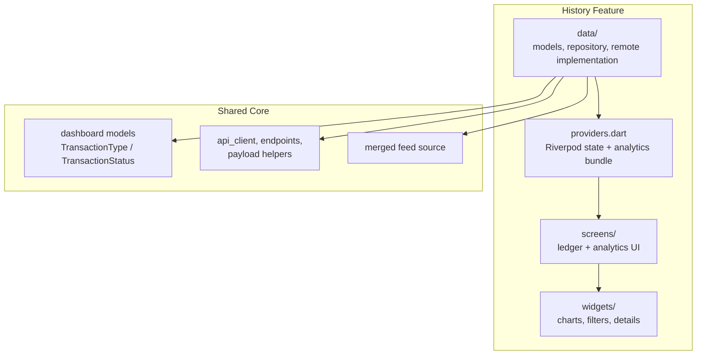
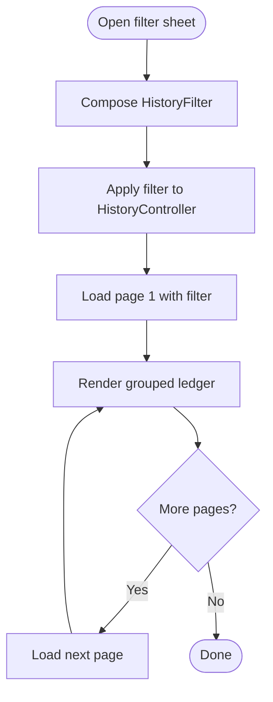
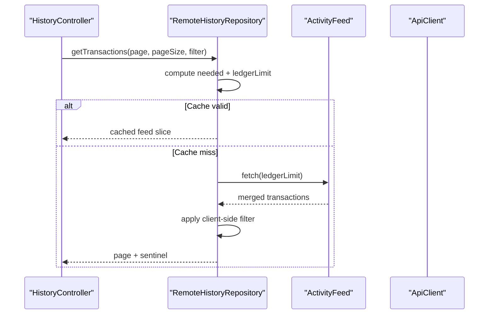
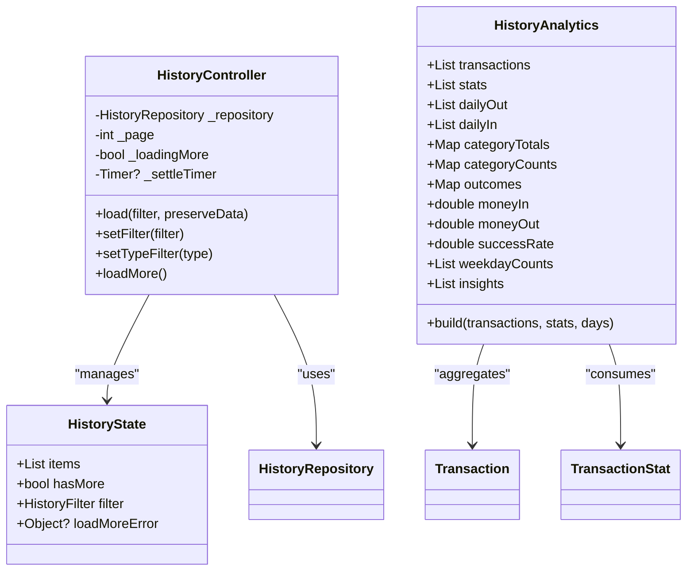
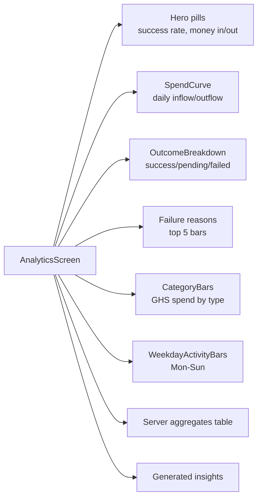
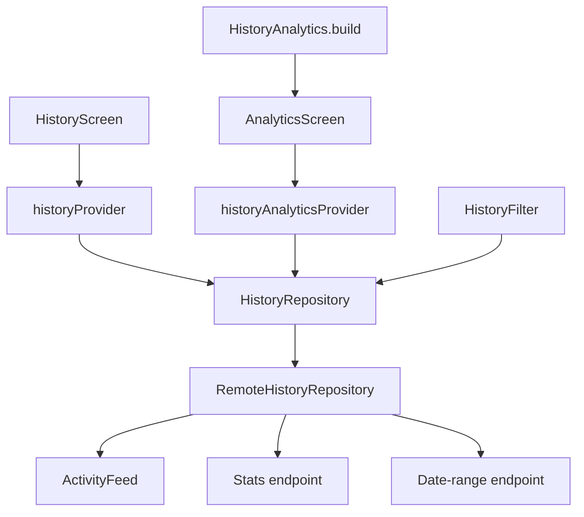
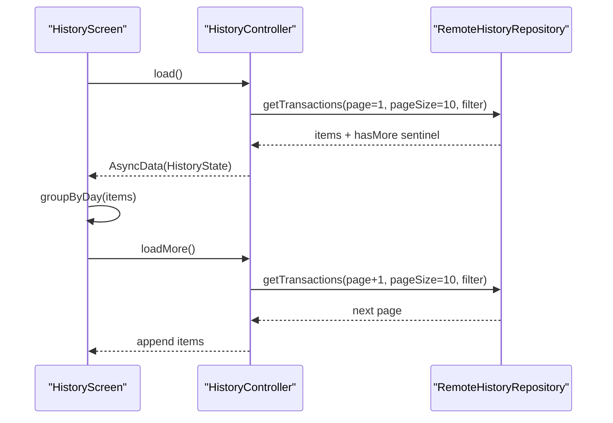
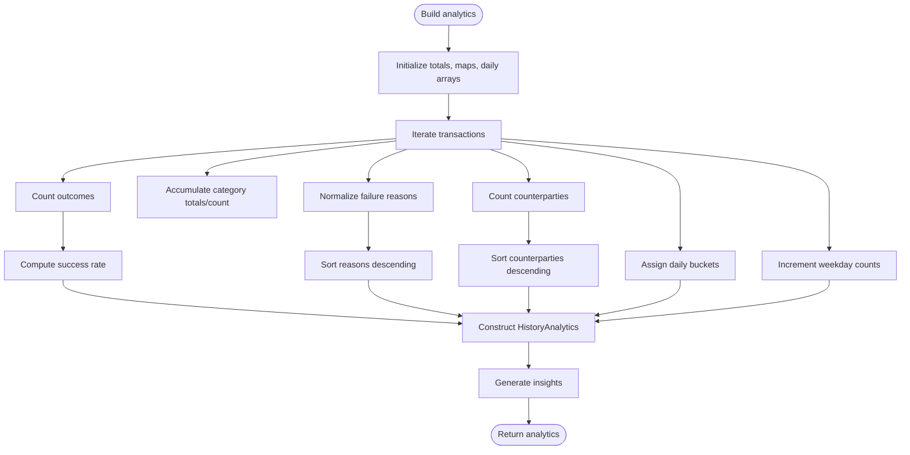
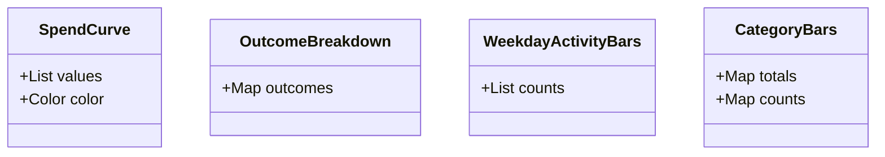
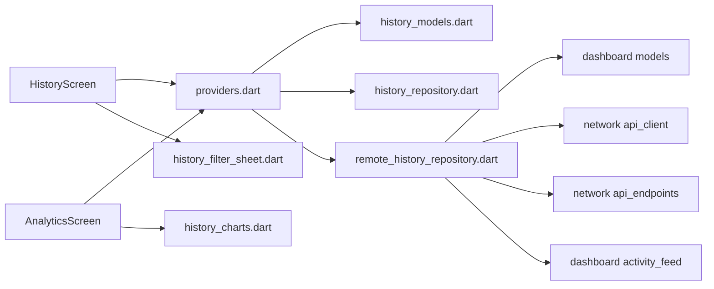

# History & Analytics

<cite>
**Referenced Files in This Document**
- [history_models.dart](file://lib/features/history/data/history_models.dart)
- [history_repository.dart](file://lib/features/history/data/history_repository.dart)
- [remote_history_repository.dart](file://lib/features/history/data/remote_history_repository.dart)
- [providers.dart](file://lib/features/history/providers.dart)
- [analytics_screen.dart](file://lib/features/history/screens/analytics_screen.dart)
- [history_screen.dart](file://lib/features/history/screens/history_screen.dart)
- [history_charts.dart](file://lib/features/history/widgets/history_charts.dart)
- [history_filter_sheet.dart](file://lib/features/history/widgets/history_filter_sheet.dart)
- [history_analytics_test.dart](file://test/history_analytics_test.dart)
</cite>

## Table of Contents
1. [Introduction](#introduction)
2. [Project Structure](#project-structure)
3. [Core Components](#core-components)
4. [Architecture Overview](#architecture-overview)
5. [Detailed Component Analysis](#detailed-component-analysis)
6. [Dependency Analysis](#dependency-analysis)
7. [Performance Considerations](#performance-considerations)
8. [Data Export, Privacy, and Compliance](#data-export-privacy-and-compliance)
9. [Troubleshooting Guide](#troubleshooting-guide)
10. [Conclusion](#conclusion)

## Introduction
The History & Analytics module provides two complementary experiences:

- **Activity ledger**: a paginated, filterable list of merged transactions including money transfers, Lida Value entries, shop orders, points, and wallet top-ups.
- **Analytics screen**: a server-backed plus client-side aggregation view that renders cash-flow curves, delivery outcomes, category breakdowns, weekday activity, failure reasons, counterparties, and generated insights.

The module is built on Riverpod state management, a repository abstraction over the API, and fl_chart-based visualizations. Filtering is primarily client-side over a merged feed, while analytics aggregates are computed from a wider window of recent transactions.

## Project Structure
The history feature lives under `lib/features/history` and is organized by responsibility:

**Diagram sources**
- [history_models.dart:1-12](file://lib/features/history/data/history_models.dart#L1-L12)
- [history_repository.dart:1-24](file://lib/features/history/data/history_repository.dart#L1-L24)
- [remote_history_repository.dart:1-15](file://lib/features/history/data/remote_history_repository.dart#L1-L15)
- [providers.dart:1-18](file://lib/features/history/providers.dart#L1-L18)
- [analytics_screen.dart:1-16](file://lib/features/history/screens/analytics_screen.dart#L1-L16)
- [history_screen.dart:1-20](file://lib/features/history/screens/history_screen.dart#L1-L20)
- [history_charts.dart:1-8](file://lib/features/history/widgets/history_charts.dart#L1-L8)
- [history_filter_sheet.dart:1-10](file://lib/features/history/widgets/history_filter_sheet.dart#L1-L10)

**Section sources**
- [history_models.dart:1-12](file://lib/features/history/data/history_models.dart#L1-L12)
- [history_repository.dart:1-24](file://lib/features/history/data/history_repository.dart#L1-L24)
- [remote_history_repository.dart:1-15](file://lib/features/history/data/remote_history_repository.dart#L1-L15)
- [providers.dart:1-18](file://lib/features/history/providers.dart#L1-L18)
- [analytics_screen.dart:1-16](file://lib/features/history/screens/analytics_screen.dart#L1-L16)
- [history_screen.dart:1-20](file://lib/features/history/screens/history_screen.dart#L1-L20)
- [history_charts.dart:1-8](file://lib/features/history/widgets/history_charts.dart#L1-L8)
- [history_filter_sheet.dart:1-10](file://lib/features/history/widgets/history_filter_sheet.dart#L1-L10)

## Core Components
This section documents the data models, filtering logic, repository contract, provider state, analytics aggregation, and chart components.

### History Data Models
- **HistoryFilter**: immutable filter with type, status, direction, date range, and amount bounds. It exposes an active flag and a per-transaction matcher.
- **TransactionStat**: parsed server bucket grouped by transaction type and status, including count, total, average, min, and max amounts.
- **HistoryAnalytics**: client-side aggregation bundle containing daily inflow/outflow buckets, category totals and counts, outcome distribution, failure reasons, top counterparties, success rate, weekday counts, and generated insights.

Key behaviors:
- Date-range matching uses day granularity so midnight-to-midnight pickers behave as inclusive ranges.
- Money totals only include GHS rows; non-GHS currencies such as Lida Value are excluded from spend metrics.
- Failure reason extraction prefers status detail, falls back to description tail after a dash, then to a neutral placeholder.
- Success rate is calculated over terminal transactions (success plus failed), defaulting to full success when there are no terminal rows.

**Section sources**
- [history_models.dart:7-91](file://lib/features/history/data/history_models.dart#L7-L91)
- [history_models.dart:95-154](file://lib/features/history/data/history_models.dart#L95-L154)
- [history_models.dart:176-331](file://lib/features/history/data/history_models.dart#L176-L331)
- [history_models.dart:333-528](file://lib/features/history/data/history_models.dart#L333-L528)

### Filtering and Search Capabilities
The advanced filter sheet composes a `HistoryFilter` from:
- Transaction types
- Transaction statuses
- Direction: all, money in, or money out
- Date presets: any time, last 7 days, last 30 days, last 90 days, or custom range
- Minimum and maximum amount bounds

The ledger applies this filter client-side over the merged feed. The controller also supports quick type chips that preserve other facets.

**Diagram sources**
- [history_filter_sheet.dart:128-137](file://lib/features/history/widgets/history_filter_sheet.dart#L128-L137)
- [history_screen.dart:53-60](file://lib/features/history/screens/history_screen.dart#L53-L60)
- [providers.dart:77-105](file://lib/features/history/providers.dart#L77-L105)
- [providers.dart:144-176](file://lib/features/history/providers.dart#L144-L176)

**Section sources**
- [history_filter_sheet.dart:8-137](file://lib/features/history/widgets/history_filter_sheet.dart#L8-L137)
- [history_screen.dart:53-60](file://lib/features/history/screens/history_screen.dart#L53-L60)
- [providers.dart:77-105](file://lib/features/history/providers.dart#L77-L105)
- [providers.dart:133-176](file://lib/features/history/providers.dart#L133-L176)

### Repository Contract and Remote Implementation
The repository defines three operations:
- Paginated transaction fetching with optional filter
- Server-side stats endpoint
- Raw date-range transaction query used for analytics trends

The remote implementation:
- Fetches a merged activity feed rather than a narrow ledger endpoint.
- Caches the merged feed for up to 30 seconds and grows the fetched limit when sparse matches require more rows.
- Uses one extra sentinel row to signal whether more data exists.
- Parses stats and date-range rows through shared payload helpers.

**Diagram sources**
- [remote_history_repository.dart:37-86](file://lib/features/history/data/remote_history_repository.dart#L37-L86)
- [providers.dart:77-105](file://lib/features/history/providers.dart#L77-L105)

**Section sources**
- [history_repository.dart:4-24](file://lib/features/history/data/history_repository.dart#L4-L24)
- [remote_history_repository.dart:12-112](file://lib/features/history/data/remote_history_repository.dart#L12-L112)

### Provider State and Analytics Bundle
The ledger state tracks items, pagination, active filter, and load-more errors. The controller:
- Loads the first page
- Schedules settle checks when pending transactions exist
- Supports set-filter, type-chip filter, and load-more with error recovery
- Exposes a separate provider for server stats

The analytics provider:
- Fetches a wider merged window (up to 200 rows)
- Attempts to fetch server stats and degrades gracefully if unavailable
- Builds `HistoryAnalytics` for charts and insights

**Diagram sources**
- [providers.dart:20-56](file://lib/features/history/providers.dart#L20-L56)
- [providers.dart:63-176](file://lib/features/history/providers.dart#L63-L176)
- [providers.dart:181-204](file://lib/features/history/providers.dart#L181-L204)
- [history_models.dart:176-331](file://lib/features/history/data/history_models.dart#L176-L331)

**Section sources**
- [providers.dart:20-56](file://lib/features/history/providers.dart#L20-L56)
- [providers.dart:63-176](file://lib/features/history/providers.dart#L63-L176)
- [providers.dart:181-204](file://lib/features/history/providers.dart#L181-L204)

### Spending Analytics and Charts
The analytics screen renders:
- A hero header with success rate, money out, and money in
- Cash-flow curve for spending and received amounts over the last 30 days
- Delivery outcomes donut with interactive legend
- Top failure reasons with proportional bars
- Category breakdown pictograph
- Weekday activity bars
- Optional server-aggregate table
- Generated insights based on success rate, failures, pending backlog, dominant category, frequent counterparty, and peak weekday

Chart components:
- `SpendCurve`: interactive line chart with crosshair, dot, and tooltip
- `OutcomeBreakdown`: donut with touch-driven selection and center readout
- `WeekdayActivityBars`: bar chart highlighting the peak day
- `CategoryBars`: sorted pictograph with animated progress bars

**Diagram sources**
- [analytics_screen.dart:31-108](file://lib/features/history/screens/analytics_screen.dart#L31-L108)
- [analytics_screen.dart:111-194](file://lib/features/history/screens/analytics_screen.dart#L111-L194)
- [analytics_screen.dart:311-379](file://lib/features/history/screens/analytics_screen.dart#L311-L379)
- [analytics_screen.dart:381-498](file://lib/features/history/screens/analytics_screen.dart#L381-L498)
- [analytics_screen.dart:501-603](file://lib/features/history/screens/analytics_screen.dart#L501-L603)
- [analytics_screen.dart:605-690](file://lib/features/history/screens/analytics_screen.dart#L605-L690)
- [history_charts.dart:13-198](file://lib/features/history/widgets/history_charts.dart#L13-L198)
- [history_charts.dart:200-396](file://lib/features/history/widgets/history_charts.dart#L200-L396)
- [history_charts.dart:400-508](file://lib/features/history/widgets/history_charts.dart#L400-L508)
- [history_charts.dart:510-648](file://lib/features/history/widgets/history_charts.dart#L510-L648)

**Section sources**
- [analytics_screen.dart:14-108](file://lib/features/history/screens/analytics_screen.dart#L14-L108)
- [analytics_screen.dart:111-690](file://lib/features/history/screens/analytics_screen.dart#L111-L690)
- [history_charts.dart:13-648](file://lib/features/history/widgets/history_charts.dart#L13-L648)

## Architecture Overview
The module follows a layered architecture:

- **UI layer**: screens render state and delegate actions to providers.
- **State layer**: Riverpod controllers manage loading, pagination, filters, and analytics bundles.
- **Domain layer**: models encapsize filtering, parsing, and aggregation logic.
- **Data layer**: repository abstracts network calls; remote implementation merges feeds and parses payloads.

**Diagram sources**
- [history_screen.dart:21-60](file://lib/features/history/screens/history_screen.dart#L21-L60)
- [analytics_screen.dart:17-33](file://lib/features/history/screens/analytics_screen.dart#L17-L33)
- [providers.dart:58-61](file://lib/features/history/providers.dart#L58-L61)
- [providers.dart:194-204](file://lib/features/history/providers.dart#L194-L204)
- [history_repository.dart:4-24](file://lib/features/history/data/history_repository.dart#L4-L24)
- [remote_history_repository.dart:37-112](file://lib/features/history/data/remote_history_repository.dart#L37-L112)
- [history_models.dart:7-91](file://lib/features/history/data/history_models.dart#L7-L91)
- [history_models.dart:176-331](file://lib/features/history/data/history_models.dart#L176-L331)

## Detailed Component Analysis

### Transaction Ledger Implementation
The ledger displays merged transactions grouped by day, with summary statistics and pagination.

Key responsibilities:
- Compute money-in, money-out, and pending count over visible items.
- Group transactions by localized day labels.
- Show quick-type filter chips and open the advanced filter sheet.
- Trigger load-more near the bottom and handle retry on load-more errors.
- Open transaction details for each card.

**Diagram sources**
- [history_screen.dart:62-309](file://lib/features/history/screens/history_screen.dart#L62-L309)
- [providers.dart:77-105](file://lib/features/history/providers.dart#L77-L105)
- [providers.dart:144-176](file://lib/features/history/providers.dart#L144-L176)
- [remote_history_repository.dart:37-86](file://lib/features/history/data/remote_history_repository.dart#L37-L86)

**Section sources**
- [history_screen.dart:62-309](file://lib/features/history/screens/history_screen.dart#L62-L309)
- [providers.dart:77-105](file://lib/features/history/providers.dart#L77-L105)
- [providers.dart:144-176](file://lib/features/history/providers.dart#L144-L176)

### Analytics Calculations
`HistoryAnalytics.build` performs a single pass over transactions to compute:
- Outcome counts
- Category totals and counts
- Failure reasons
- Counterparty frequency
- Daily inflow/outflow buckets aligned to the last N days
- Success rate
- Weekday counts
- Generated insights

**Diagram sources**
- [history_models.dart:230-331](file://lib/features/history/data/history_models.dart#L230-L331)
- [history_models.dart:333-528](file://lib/features/history/data/history_models.dart#L333-L528)

**Section sources**
- [history_models.dart:230-331](file://lib/features/history/data/history_models.dart#L230-L331)
- [history_models.dart:333-528](file://lib/features/history/data/history_models.dart#L333-L528)

### Chart Rendering Components
Charts use fl_chart and are designed for performance and accessibility:
- SpendCurve computes axis scales, labels, touch indicators, and tooltips.
- OutcomeBreakdown maps statuses to colors/icons and updates selected slice state.
- WeekdayActivityBars highlights the peak day and shows per-day tooltips.
- CategoryBars sorts categories by spend and animates proportional bars.

**Diagram sources**
- [history_charts.dart:13-198](file://lib/features/history/widgets/history_charts.dart#L13-L198)
- [history_charts.dart:200-396](file://lib/features/history/widgets/history_charts.dart#L200-L396)
- [history_charts.dart:400-508](file://lib/features/history/widgets/history_charts.dart#L400-L508)
- [history_charts.dart:510-648](file://lib/features/history/widgets/history_charts.dart#L510-L648)

**Section sources**
- [history_charts.dart:13-648](file://lib/features/history/widgets/history_charts.dart#L13-L648)

### Concrete Examples of Querying, Aggregation, and Visualization
- **Querying**: The ledger requests a small page size and grows the merged feed when filters produce sparse results. Analytics requests a larger window to build trend series.
- **Aggregation**: Client-side aggregation builds daily buckets, category totals, outcome distributions, failure reasons, and insights.
- **Visualization**: The analytics screen wires aggregated data into SpendCurve, OutcomeBreakdown, CategoryBars, and WeekdayActivityBars.

These patterns are validated by unit tests covering filter matching, stat parsing, aggregation correctness, and insight generation.

**Section sources**
- [remote_history_repository.dart:37-86](file://lib/features/history/data/remote_history_repository.dart#L37-L86)
- [providers.dart:194-204](file://lib/features/history/providers.dart#L194-L204)
- [history_models.dart:230-331](file://lib/features/history/data/history_models.dart#L230-L331)
- [analytics_screen.dart:31-108](file://lib/features/history/screens/analytics_screen.dart#L31-L108)
- [history_analytics_test.dart:35-103](file://test/history_analytics_test.dart#L35-L103)
- [history_analytics_test.dart:105-133](file://test/history_analytics_test.dart#L105-L133)
- [history_analytics_test.dart:135-209](file://test/history_analytics_test.dart#L135-L209)

## Dependency Analysis
The main dependency relationships are:

**Diagram sources**
- [history_screen.dart:1-17](file://lib/features/history/screens/history_screen.dart#L1-L17)
- [analytics_screen.dart:1-12](file://lib/features/history/screens/analytics_screen.dart#L1-L12)
- [providers.dart:1-18](file://lib/features/history/providers.dart#L1-L18)
- [history_models.dart:1-5](file://lib/features/history/data/history_models.dart#L1-L5)
- [history_repository.dart:1-3](file://lib/features/history/data/history_repository.dart#L1-L3)
- [remote_history_repository.dart:1-10](file://lib/features/history/data/remote_history_repository.dart#L1-L10)
- [history_charts.dart:1-8](file://lib/features/history/widgets/history_charts.dart#L1-L8)
- [history_filter_sheet.dart:1-6](file://lib/features/history/widgets/history_filter_sheet.dart#L1-L6)

**Section sources**
- [history_screen.dart:1-17](file://lib/features/history/screens/history_screen.dart#L1-L17)
- [analytics_screen.dart:1-12](file://lib/features/history/screens/analytics_screen.dart#L1-L12)
- [providers.dart:1-18](file://lib/features/history/providers.dart#L1-L18)
- [history_models.dart:1-5](file://lib/features/history/data/history_models.dart#L1-L5)
- [history_repository.dart:1-3](file://lib/features/history/data/history_repository.dart#L1-L3)
- [remote_history_repository.dart:1-10](file://lib/features/history/data/remote_history_repository.dart#L1-L10)
- [history_charts.dart:1-8](file://lib/features/history/widgets/history_charts.dart#L1-L8)
- [history_filter_sheet.dart:1-6](file://lib/features/history/widgets/history_filter_sheet.dart#L1-L6)

## Performance Considerations
- **Pagination**: The ledger uses a small page size and appends additional pages incrementally.
- **Sentinel row**: One extra row signals whether more data exists, avoiding false positives on exact final pages.
- **Merged-feed cache**: The remote repository caches the merged feed for up to 30 seconds and grows the limit in steps when filters reduce match density.
- **Settle polling**: Pending transactions trigger periodic refreshes until they resolve or reach a maximum attempt count.
- **Analytics window**: Analytics fetches a wider window but still caps at a reasonable size to avoid heavy rendering.
- **Chart efficiency**: Charts compute minimal state, reuse static metadata, and animate transitions for smooth UX.

Recommendations:
- Keep filter combinations focused; broad filters may cause repeated feed growth.
- Avoid refreshing analytics too frequently; rely on pull-to-refresh and automatic settle checks.
- Monitor large datasets where many non-GHS rows could inflate aggregation work.

[No sources needed since this section provides general guidance]

## Data Export, Privacy, and Compliance
Current implementation does not expose a direct export button. However, the module already provides the building blocks for safe export and reporting:

- **Raw data access**: The repository exposes a date-range endpoint returning raw transaction rows suitable for export pipelines.
- **Aggregated data**: `HistoryAnalytics` contains derived metrics such as totals, success rate, category breakdowns, failure reasons, and weekday activity.
- **Anonymization patterns**:
  - Counterparty identifiers can be hashed or truncated before export.
  - Status details and descriptions should be reviewed for personal information.
  - Non-GHS currencies like Lida Value are separated from monetary totals to avoid mixing units.
- **Compliance considerations**:
  - Limit exported windows to user-requested ranges.
  - Redact sensitive fields unless explicitly required.
  - Log anonymized audit events for export actions.
  - Ensure retention policies align with privacy requirements.

Recommended export flow:
1. User selects a date range and export format.
2. Application calls the date-range endpoint.
3. Client or backend applies anonymization rules.
4. Aggregated summaries are generated from `HistoryAnalytics`.
5. Export is delivered securely with audit logging.

**Section sources**
- [history_repository.dart:18-24](file://lib/features/history/data/history_repository.dart#L18-L24)
- [remote_history_repository.dart:99-112](file://lib/features/history/data/remote_history_repository.dart#L99-L112)
- [history_models.dart:204-228](file://lib/features/history/data/history_models.dart#L204-L228)
- [history_models.dart:230-331](file://lib/features/history/data/history_models.dart#L230-L331)

## Troubleshooting Guide
Common issues and resolutions:

- **Empty ledger under filters**:
  - Verify filter facets; broad filters may return no matches.
  - Clear filters and refresh.
  - Check that the merged feed includes the expected transaction types.

- **Load-more fails**:
  - The controller stores `loadMoreError` and offers a retry action.
  - Retry triggers another page request without resetting existing data.

- **Pending transactions remain visible**:
  - The controller schedules periodic refreshes until transactions settle or attempts exceed the limit.
  - If settlement stops, manually refresh the ledger.

- **Analytics shows zero spend**:
  - Only GHS rows contribute to money totals.
  - Confirm currency normalization and that transactions fall within the 30-day window.

- **Failure reasons missing**:
  - Reason extraction prefers status detail, then description tail after a dash.
  - If neither is present, a neutral placeholder is used.

**Section sources**
- [providers.dart:77-105](file://lib/features/history/providers.dart#L77-L105)
- [providers.dart:144-176](file://lib/features/history/providers.dart#L144-L176)
- [history_models.dart:333-347](file://lib/features/history/data/history_models.dart#L333-L347)
- [history_screen.dart:223-262](file://lib/features/history/screens/history_screen.dart#L223-L262)

## Conclusion
The History & Analytics module delivers a robust, filterable transaction ledger and a rich analytics experience. Its design separates concerns cleanly across UI, state, domain models, and data layers. Filtering is flexible and client-side, while analytics combines server stats with client aggregation to render meaningful charts and insights. With careful attention to pagination, caching, settle polling, and data boundaries, the module remains performant and resilient. For export and compliance, the existing repository and aggregation structures provide a solid foundation for secure, anonymized reporting.

[No sources needed since this section summarizes without analyzing specific files]