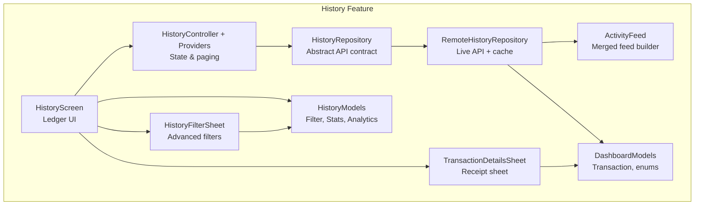
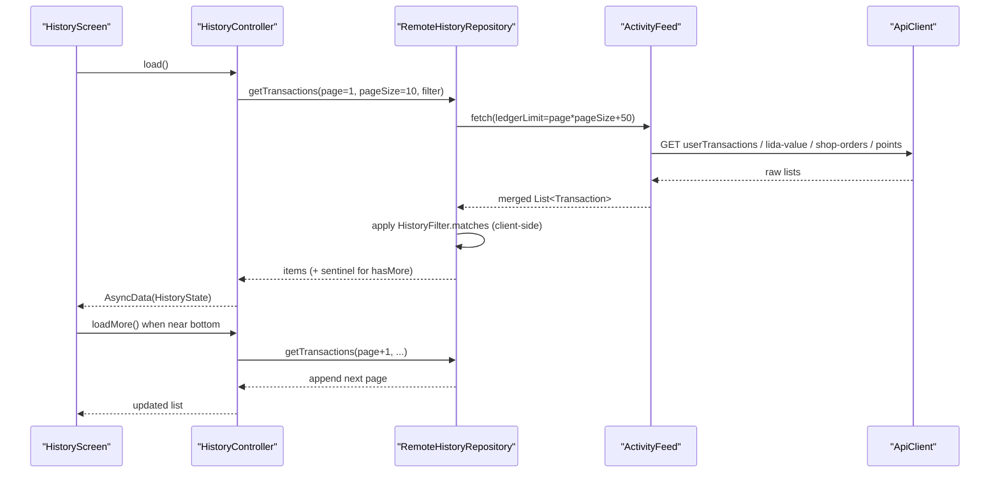
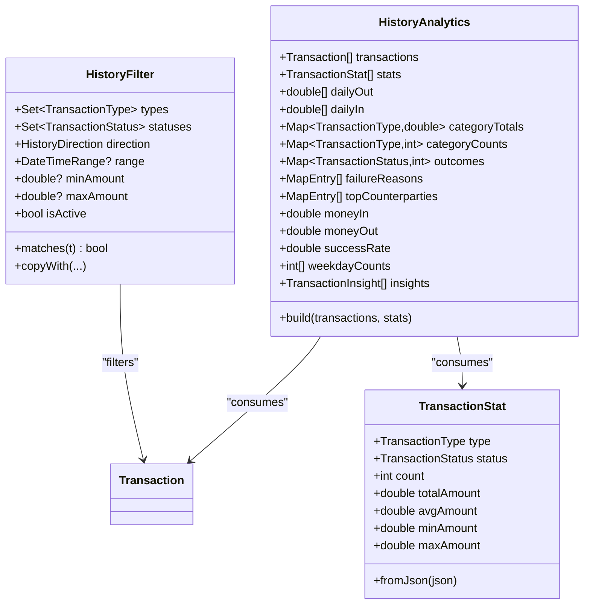
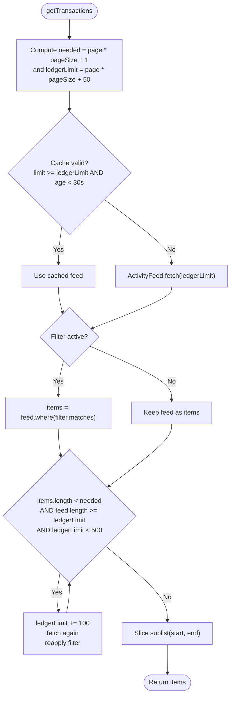
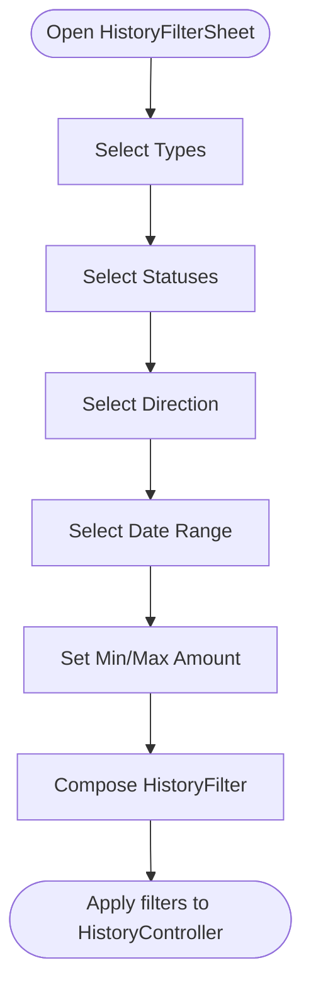
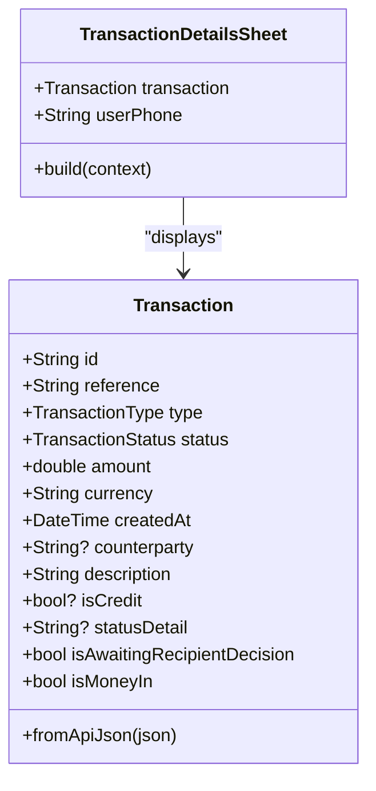
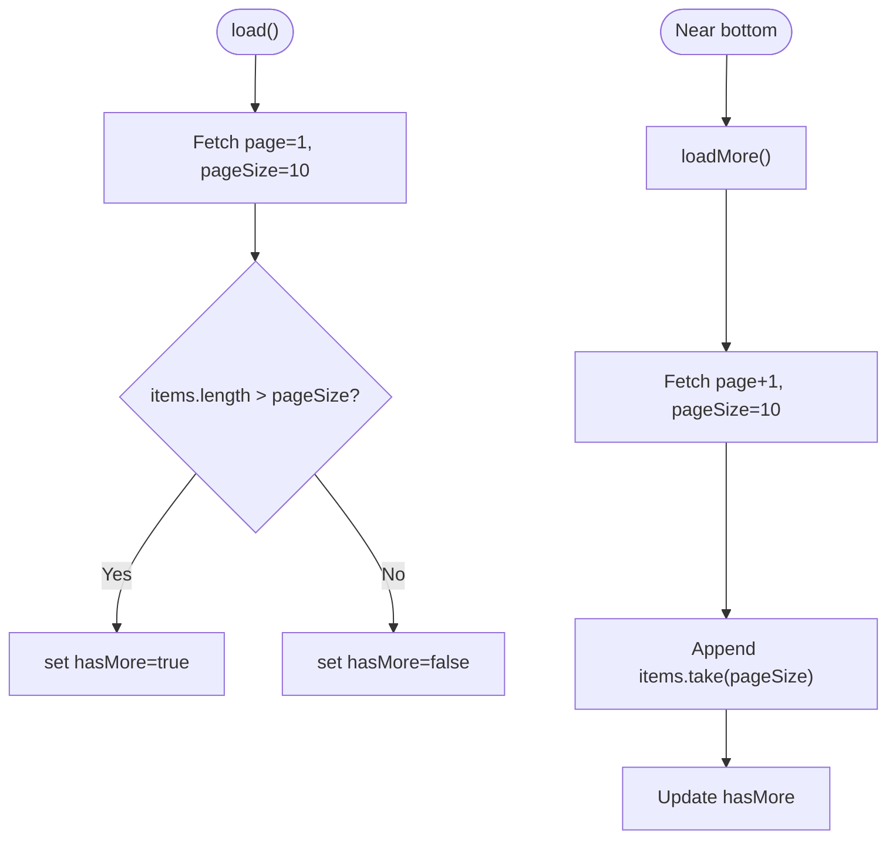
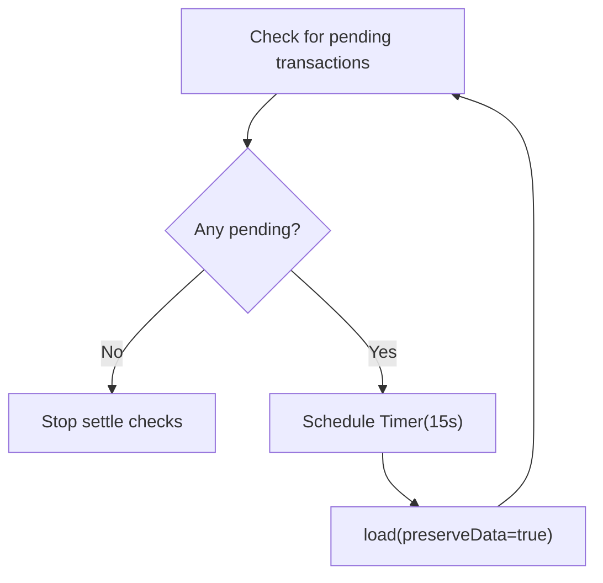
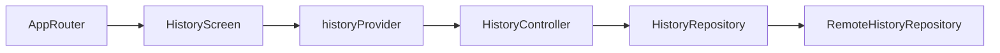
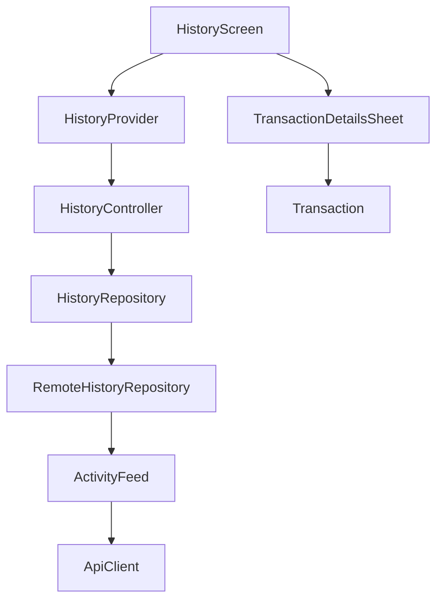

# Transaction History

<cite>
**Referenced Files in This Document**
- [history_models.dart](file://lib/features/history/data/history_models.dart)
- [history_repository.dart](file://lib/features/history/data/history_repository.dart)
- [remote_history_repository.dart](file://lib/features/history/data/remote_history_repository.dart)
- [providers.dart](file://lib/features/history/providers.dart)
- [history_screen.dart](file://lib/features/history/screens/history_screen.dart)
- [transaction_details_sheet.dart](file://lib/features/history/widgets/transaction_details_sheet.dart)
- [history_filter_sheet.dart](file://lib/features/history/widgets/history_filter_sheet.dart)
- [activity_feed.dart](file://lib/features/dashboard/data/activity_feed.dart)
- [dashboard_models.dart](file://lib/features/dashboard/data/dashboard_models.dart)
</cite>

## Table of Contents
1. [Introduction](#introduction)
2. [Project Structure](#project-structure)
3. [Core Components](#core-components)
4. [Architecture Overview](#architecture-overview)
5. [Detailed Component Analysis](#detailed-component-analysis)
6. [Dependency Analysis](#dependency-analysis)
7. [Performance Considerations](#performance-considerations)
8. [Troubleshooting Guide](#troubleshooting-guide)
9. [Conclusion](#conclusion)

## Introduction
This document explains the transaction history feature, focusing on the transaction ledger implementation, data models, repository pattern, screen components, filtering and search capabilities, categorization, detail view, pagination, real-time updates, performance optimization, caching, memory management, and integration with navigation and state management.

The feature provides a full activity ledger that merges multiple sources (main transactions, Lida Value, shop orders, points), supports advanced client-side filtering, paginated loading, analytics aggregation, and a detailed receipt-style bottom sheet for each transaction.

## Project Structure
The transaction history feature is organized under `lib/features/history` with clear separation between data, presentation, and providers:



**Diagram sources**
- [history_screen.dart:19-30](file://lib/features/history/screens/history_screen.dart#L19-L30)
- [providers.dart:14-61](file://lib/features/history/providers.dart#L14-L61)
- [remote_history_repository.dart:12-24](file://lib/features/history/data/remote_history_repository.dart#L12-L24)
- [history_models.dart:7-91](file://lib/features/history/data/history_models.dart#L7-L91)
- [activity_feed.dart:7-38](file://lib/features/dashboard/data/activity_feed.dart#L7-L38)
- [dashboard_models.dart:38-90](file://lib/features/dashboard/data/dashboard_models.dart#L38-L90)

**Section sources**
- [history_screen.dart:19-30](file://lib/features/history/screens/history_screen.dart#L19-L30)
- [providers.dart:14-61](file://lib/features/history/providers.dart#L14-L61)
- [remote_history_repository.dart:12-24](file://lib/features/history/data/remote_history_repository.dart#L12-L24)
- [history_models.dart:7-91](file://lib/features/history/data/history_models.dart#L7-L91)
- [activity_feed.dart:7-38](file://lib/features/dashboard/data/activity_feed.dart#L7-L38)
- [dashboard_models.dart:38-90](file://lib/features/dashboard/data/dashboard_models.dart#L38-L90)

## Core Components
- Data models:
  - `HistoryFilter`: Client-side filter over merged feed supporting type, status, direction, date range, and amount bounds.
  - `TransactionStat`: Server-side aggregated stats grouped by type and status.
  - `HistoryAnalytics`: Computed analytics bundle including daily curves, category totals, outcomes, failure reasons, counterparties, success rate, weekday counts, and generated insights.
- Repository:
  - `HistoryRepository`: Abstract interface defining paginated transactions, server stats, and date-range queries.
  - `RemoteHistoryRepository`: Live implementation using `ActivityFeed`, with short-lived cache and adaptive fetch growth for filtered pages.
- State and providers:
  - `HistoryController`: Riverpod state managing load, set filter, type filter, pagination, error handling, and pending settlement polling.
  - `historyProvider`, `transactionStatsProvider`, `historyAnalyticsProvider`: Riverpod providers wiring repository and analytics.
- Screens and widgets:
  - `HistoryScreen`: Full ledger UI with sticky header, hero stats, quick-type chips, day grouping, pull-to-refresh, empty states, and infinite scroll.
  - `HistoryFilterSheet`: Bottom sheet for advanced filtering.
  - `TransactionDetailsSheet`: Full-height receipt-style details with status indicators, share action, and journey visualization.

**Section sources**
- [history_models.dart:7-529](file://lib/features/history/data/history_models.dart#L7-L529)
- [history_repository.dart:1-25](file://lib/features/history/data/history_repository.dart#L1-L25)
- [remote_history_repository.dart:12-114](file://lib/features/history/data/remote_history_repository.dart#L12-L114)
- [providers.dart:14-205](file://lib/features/history/providers.dart#L14-L205)
- [history_screen.dart:19-333](file://lib/features/history/screens/history_screen.dart#L19-L333)
- [history_filter_sheet.dart:8-451](file://lib/features/history/widgets/history_filter_sheet.dart#L8-L451)
- [transaction_details_sheet.dart:9-493](file://lib/features/history/widgets/transaction_details_sheet.dart#L9-L493)

## Architecture Overview
The architecture follows a layered approach:
- Presentation layer (`HistoryScreen`, `HistoryFilterSheet`, `TransactionDetailsSheet`) interacts with Riverpod state.
- State layer (`HistoryController`) orchestrates repository calls, pagination, and settlement polling.
- Data layer (`RemoteHistoryRepository`) aggregates multiple endpoints via `ActivityFeed`, applies client-side filters, and caches results briefly.
- Domain models (`Transaction`, enums, `HistoryFilter`, `TransactionStat`, `HistoryAnalytics`) define contracts and computations.



**Diagram sources**
- [providers.dart:77-105](file://lib/features/history/providers.dart#L77-L105)
- [providers.dart:144-176](file://lib/features/history/providers.dart#L144-L176)
- [remote_history_repository.dart:36-86](file://lib/features/history/data/remote_history_repository.dart#L36-L86)
- [activity_feed.dart:18-38](file://lib/features/dashboard/data/activity_feed.dart#L18-L38)

## Detailed Component Analysis

### Data Models and Filtering
- `HistoryFilter`:
  - Supports multi-select types and statuses, direction (all/money-in/money-out), date range (presets and custom), and min/max amount bounds.
  - `matches(Transaction)` performs efficient client-side filtering over the merged feed.
  - `copyWith` enables incremental updates while preserving other facets.
- `TransactionStat`:
  - Parses server-aggregated buckets grouped by `{transType, status}` with count and monetary metrics.
- `HistoryAnalytics`:
  - Builds comprehensive analytics from merged transactions and optional server stats:
    - Daily inflow/outflow series for N days.
    - Category totals and counts.
    - Outcome distribution and success rate.
    - Failure reason normalization and ranking.
    - Top counterparties.
    - Weekday activity counts.
    - Generated insights with tone and actionable advice.



**Diagram sources**
- [history_models.dart:7-91](file://lib/features/history/data/history_models.dart#L7-L91)
- [history_models.dart:95-154](file://lib/features/history/data/history_models.dart#L95-L154)
- [history_models.dart:176-529](file://lib/features/history/data/history_models.dart#L176-L529)

**Section sources**
- [history_models.dart:7-529](file://lib/features/history/data/history_models.dart#L7-L529)

### Repository Pattern and Data Fetching
- `HistoryRepository`:
  - Defines `getTransactions(page, pageSize, filter)`, `getStats()`, and `getByDateRange(start, end)`.
- `RemoteHistoryRepository`:
  - Uses `ActivityFeed.fetch(ledgerLimit)` to aggregate multiple sources into one merged list.
  - Applies client-side filtering; if sparse matches occur, it grows the fetched window up to a cap (500).
  - Implements a short-lived cache keyed by limit and timestamp to avoid redundant network calls within 30 seconds.
  - Returns an extra sentinel row to signal `hasMore` accurately even on exact-full pages.
  - Provides stats and date-range endpoints for analytics.



**Diagram sources**
- [remote_history_repository.dart:36-86](file://lib/features/history/data/remote_history_repository.dart#L36-L86)
- [activity_feed.dart:18-38](file://lib/features/dashboard/data/activity_feed.dart#L18-L38)

**Section sources**
- [history_repository.dart:1-25](file://lib/features/history/data/history_repository.dart#L1-L25)
- [remote_history_repository.dart:12-114](file://lib/features/history/data/remote_history_repository.dart#L12-L114)
- [activity_feed.dart:7-38](file://lib/features/dashboard/data/activity_feed.dart#L7-L38)

### Screen Components and Navigation
- `HistoryScreen`:
  - Displays sticky header with back, analytics, and filter actions.
  - Shows hero stats (money in/out, pending count).
  - Quick-type chips for common filters.
  - Groups transactions by day labels ("Today", "Yesterday", weekday names, or formatted dates).
  - Handles empty states with options to clear filters or refresh.
  - Integrates with Riverpod provider for state and pagination.
  - Opens `TransactionDetailsSheet` on card tap.
  - Navigates to analytics screen via router.

```mermaid
sequenceDiagram
participant User as "User"
participant Screen as "HistoryScreen"
participant Provider as "HistoryController"
participant Details as "TransactionDetailsSheet"
User->>Screen : Tap transaction card
Screen->>Details : showTransactionDetails(transaction, userPhone)
Details-->>User : Full receipt with status, amount, reference, share
User->>Screen : Tap filter icon
Screen->>Provider : setFilter(HistoryFilter)
Provider-->>Screen : AsyncData(updated items)
User->>Screen : Pull to refresh
Screen->>Provider : load()
Provider-->>Screen : AsyncData(refreshed items)
```

**Diagram sources**
- [history_screen.dart:50-60](file://lib/features/history/screens/history_screen.dart#L50-L60)
- [history_screen.dart:122-305](file://lib/features/history/screens/history_screen.dart#L122-L305)
- [transaction_details_sheet.dart:11-29](file://lib/features/history/widgets/transaction_details_sheet.dart#L11-L29)

**Section sources**
- [history_screen.dart:19-333](file://lib/features/history/screens/history_screen.dart#L19-L333)
- [transaction_details_sheet.dart:9-493](file://lib/features/history/widgets/transaction_details_sheet.dart#L9-L493)

### Filtering and Search Capabilities
- Advanced filter sheet supports:
  - Type multi-select (Airtime, Data, MoMo, Shop, Lida Value, Other).
  - Status multi-select (Delivered, Pending, Failed).
  - Direction (All, Money in, Money out).
  - Date presets (Any time, 7/30/90 days) and custom range picker.
  - Amount bounds (min/max GHS).
- Filters are applied client-side over the merged feed, ensuring Lida Value, points, and shop rows remain visible across all filter combinations.



**Diagram sources**
- [history_filter_sheet.dart:128-137](file://lib/features/history/widgets/history_filter_sheet.dart#L128-L137)
- [history_filter_sheet.dart:194-339](file://lib/features/history/widgets/history_filter_sheet.dart#L194-L339)
- [history_models.dart:30-56](file://lib/features/history/data/history_models.dart#L30-L56)

**Section sources**
- [history_filter_sheet.dart:8-451](file://lib/features/history/widgets/history_filter_sheet.dart#L8-L451)
- [history_models.dart:7-91](file://lib/features/history/data/history_models.dart#L7-L91)

### Transaction Categorization and Detail View
- Categorization:
  - `TransactionType` maps API strings to categories like Airtime, Data, Shop Order, Lida Value, Wallet Top-up, and Other.
  - `TransactionStatus` normalizes API states to Success, Pending, or Failed.
- Detail view:
  - `TransactionDetailsSheet` shows transfer journey, recipient, type label, date/time, amount, status badge, and share action.
  - Status indicators use color-coded badges and icons per status.



**Diagram sources**
- [dashboard_models.dart:92-139](file://lib/features/dashboard/data/dashboard_models.dart#L92-L139)
- [transaction_details_sheet.dart:31-493](file://lib/features/history/widgets/transaction_details_sheet.dart#L31-L493)

**Section sources**
- [dashboard_models.dart:38-139](file://lib/features/dashboard/data/dashboard_models.dart#L38-L139)
- [transaction_details_sheet.dart:9-493](file://lib/features/history/widgets/transaction_details_sheet.dart#L9-L493)

### Pagination Handling
- Initial load fetches page 1 with size 10 plus a sentinel row to determine `hasMore`.
- Infinite scroll triggers `loadMore()` when near the end of the list.
- The controller maintains `_page`, `_loadingMore`, and `loadMoreError` to handle retry UX.
- Repository adapts fetch limits based on current page and applies filters; if filtered matches are sparse, it expands the fetched window up to 500 rows.



**Diagram sources**
- [providers.dart:77-105](file://lib/features/history/providers.dart#L77-L105)
- [providers.dart:144-176](file://lib/features/history/providers.dart#L144-L176)
- [remote_history_repository.dart:36-86](file://lib/features/history/data/remote_history_repository.dart#L36-L86)

**Section sources**
- [providers.dart:63-176](file://lib/features/history/providers.dart#L63-L176)
- [remote_history_repository.dart:36-86](file://lib/features/history/data/remote_history_repository.dart#L36-L86)

### Real-Time Updates and Settlement Polling
- The controller schedules periodic re-fetches when pending transactions exist, up to a maximum number of attempts.
- This ensures point/top-up rows transition from pending to settled without manual refresh.



**Diagram sources**
- [providers.dart:107-131](file://lib/features/history/providers.dart#L107-L131)

**Section sources**
- [providers.dart:107-131](file://lib/features/history/providers.dart#L107-L131)

### Integration with Navigation and State Management
- Navigation:
  - Back button navigates to home via app router.
  - Analytics button navigates to analytics screen.
  - Transaction details open a modal bottom sheet using `showModalBottomSheet`.
- State management:
  - Riverpod `historyProvider` exposes `AsyncValue<HistoryState>` with loading, data, and error states.
  - `HistoryController` encapsulates business logic for loading, filtering, pagination, and settlement polling.
  - `historyRepositoryProvider` wires live repository with authenticated user ID.



**Diagram sources**
- [history_screen.dart:145-148](file://lib/features/history/screens/history_screen.dart#L145-L148)
- [providers.dart:14-18](file://lib/features/history/providers.dart#L14-L18)
- [providers.dart:58-61](file://lib/features/history/providers.dart#L58-L61)

**Section sources**
- [history_screen.dart:145-148](file://lib/features/history/screens/history_screen.dart#L145-L148)
- [providers.dart:14-61](file://lib/features/history/providers.dart#L14-L61)

## Dependency Analysis
Key dependencies and relationships:
- `HistoryScreen` depends on `historyProvider` for state and uses `go_router` for navigation.
- `HistoryController` depends on `HistoryRepository` and manages pagination and settlement timers.
- `RemoteHistoryRepository` depends on `ActivityFeed` and `ApiClient` to aggregate multiple data sources.
- `ActivityFeed` depends on various API endpoints and normalizes responses into `Transaction`.
- `TransactionDetailsSheet` depends on `Transaction` and formatting utilities.



**Diagram sources**
- [history_screen.dart:1-18](file://lib/features/history/screens/history_screen.dart#L1-L18)
- [providers.dart:14-61](file://lib/features/history/providers.dart#L14-L61)
- [remote_history_repository.dart:1-11](file://lib/features/history/data/remote_history_repository.dart#L1-L11)
- [activity_feed.dart:1-5](file://lib/features/dashboard/data/activity_feed.dart#L1-L5)
- [transaction_details_sheet.dart:1-8](file://lib/features/history/widgets/transaction_details_sheet.dart#L1-L8)

**Section sources**
- [history_screen.dart:1-18](file://lib/features/history/screens/history_screen.dart#L1-L18)
- [providers.dart:14-61](file://lib/features/history/providers.dart#L14-L61)
- [remote_history_repository.dart:1-11](file://lib/features/history/data/remote_history_repository.dart#L1-L11)
- [activity_feed.dart:1-5](file://lib/features/dashboard/data/activity_feed.dart#L1-L5)
- [transaction_details_sheet.dart:1-8](file://lib/features/history/widgets/transaction_details_sheet.dart#L1-L8)

## Performance Considerations
- Caching strategy:
  - Short-lived cache in `RemoteHistoryRepository` avoids repeated network calls within 30 seconds for the same ledger limit.
  - Adaptive fetch growth prevents excessive requests while ensuring filtered pages can still be satisfied.
- Memory management:
  - Pagination keeps only a manageable number of transactions in memory at a time.
  - Settlement timer is canceled on dispose to prevent leaks.
- Rendering optimizations:
  - Sticky headers and slivers reduce layout overhead.
  - Day grouping minimizes repeated computations during build.
- Analytics computation:
  - `HistoryAnalytics.build` computes aggregates efficiently over the merged list, with bounded daily windows and sorted frequency lists.

Recommendations:
- Consider debouncing rapid filter changes to reduce rebuilds.
- Introduce memoization for expensive computations if datasets grow significantly.
- Monitor memory usage when large filtered sets are retained.

[No sources needed since this section provides general guidance]

## Troubleshooting Guide
Common issues and resolutions:
- Empty results after applying filters:
  - Verify filter criteria; consider clearing filters to confirm baseline data.
  - Check if the merged feed contains expected entries before filtering.
- Pagination errors:
  - Retry button appears when `loadMoreError` is set; tapping retries fetching the next page.
- Pending transactions not settling:
  - Ensure settlement polling is active; check timer scheduling and maximum attempts.
- Network failures:
  - Review API endpoint availability and authentication; ensure user ID is present.

**Section sources**
- [history_screen.dart:228-262](file://lib/features/history/screens/history_screen.dart#L228-L262)
- [providers.dart:144-176](file://lib/features/history/providers.dart#L144-L176)
- [providers.dart:107-131](file://lib/features/history/providers.dart#L107-L131)
- [remote_history_repository.dart:25-34](file://lib/features/history/data/remote_history_repository.dart#L25-L34)

## Conclusion
The transaction history feature delivers a robust, scalable ledger experience by merging multiple data sources, applying flexible client-side filters, and providing rich analytics and detail views. Its architecture separates concerns cleanly across presentation, state, and data layers, with careful attention to performance through caching, pagination, and memory management. The integration with navigation and state management ensures a smooth user experience, while real-time settlement polling keeps transaction statuses accurate.

[No sources needed since this section summarizes without analyzing specific files]