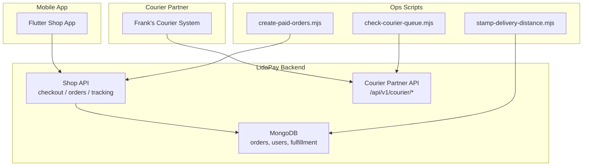
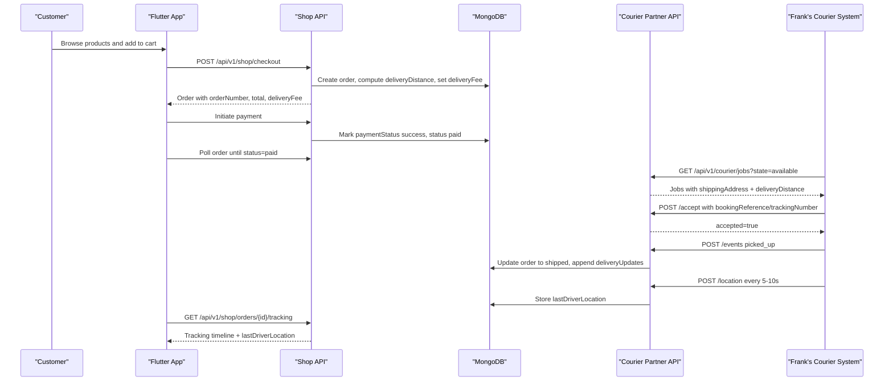
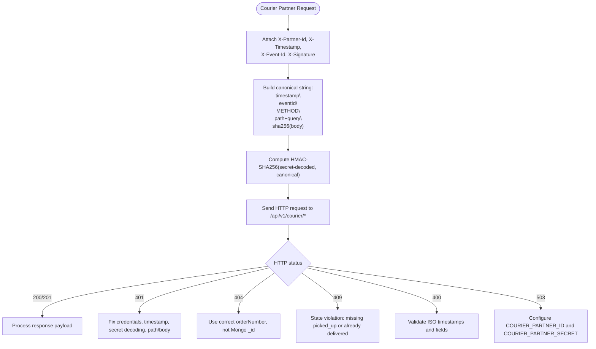
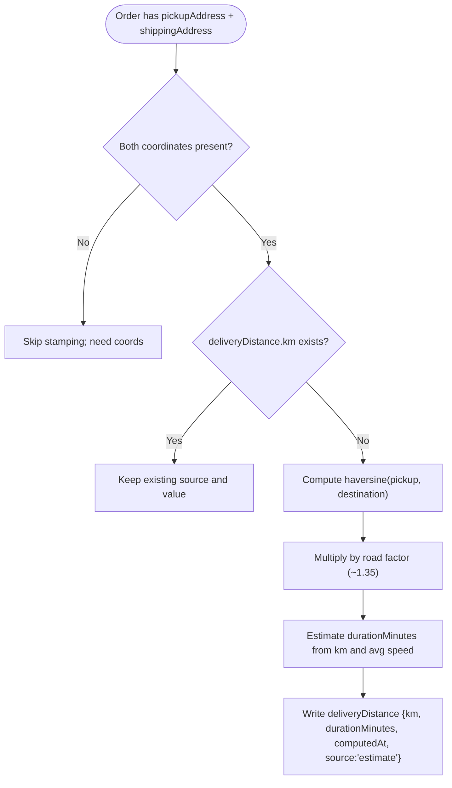
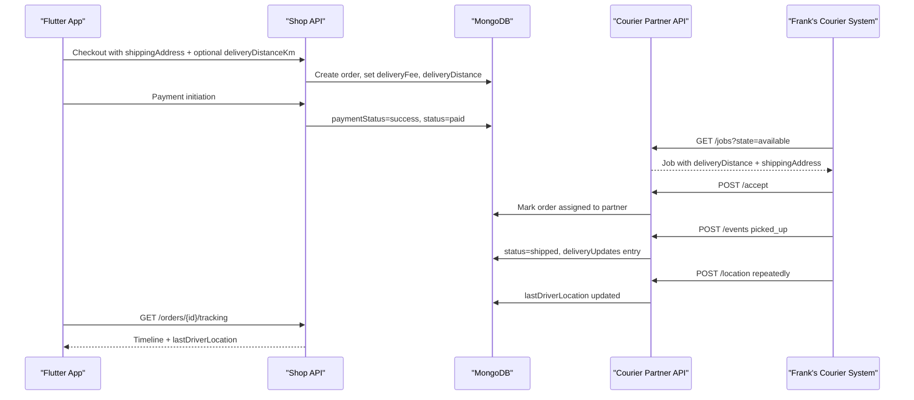
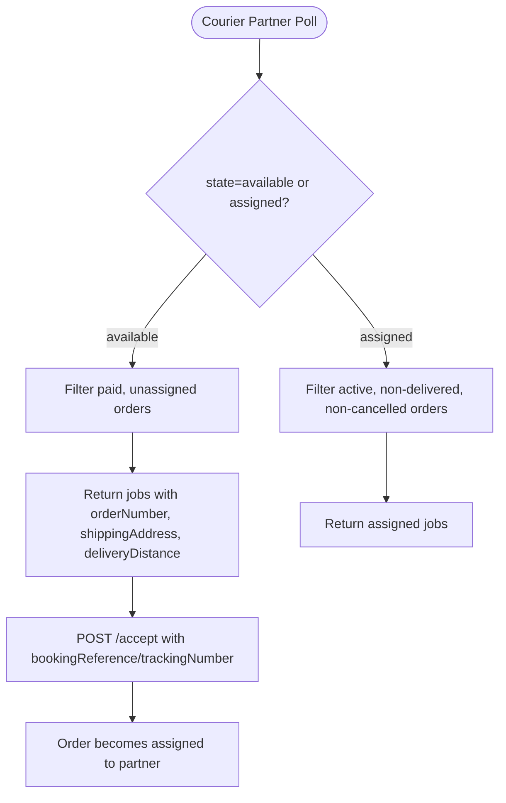
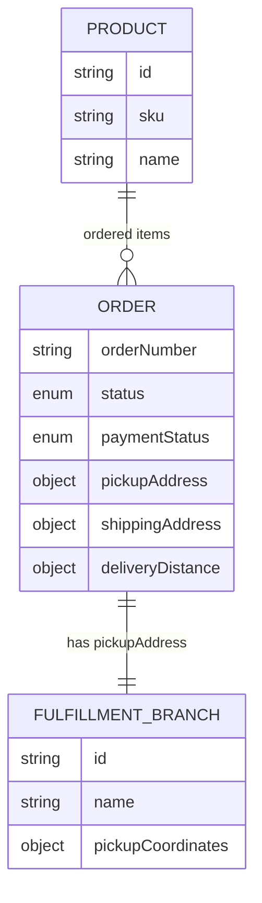
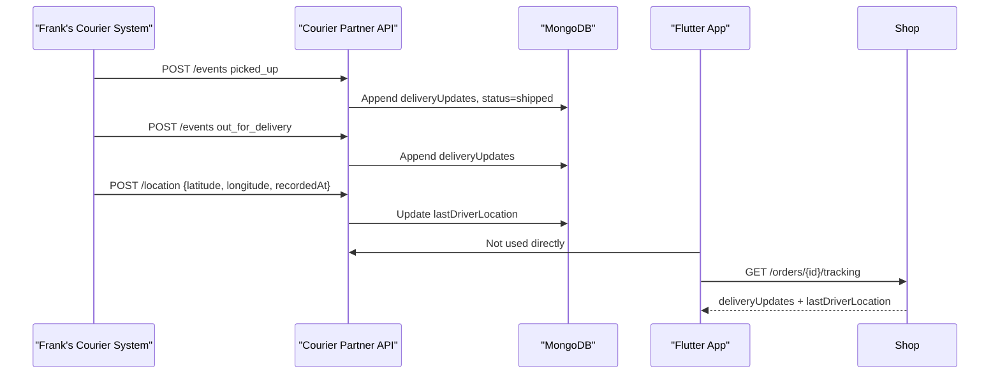
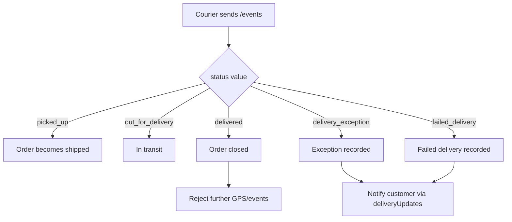
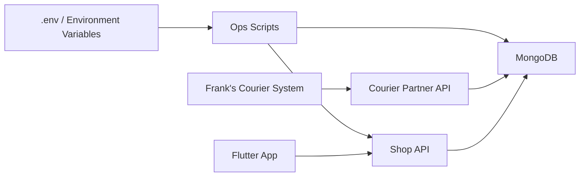

# Delivery & Courier Integration

<cite>
**Referenced Files in This Document**   
- [COURIER_API_PARTNER_HANDOFF_FRANK.md](file://docs/COURIER_API_PARTNER_HANDOFF_FRANK.md)
- [SHOP_API_MOBILE_HANDOFF.md](file://docs/SHOP_API_MOBILE_HANDOFF.md)
- [BACKEND_NOTIFICATION_TRIGGERS_HANDOFF.md](file://docs/BACKEND_NOTIFICATION_TRIGGERS_HANDOFF.md)
- [README.md](file://tool/courier-orders/README.md)
- [check-courier-queue.mjs](file://tool/courier-orders/check-courier-queue.mjs)
- [create-paid-orders.mjs](file://tool/courier-orders/create-paid-orders.mjs)
- [stamp-delivery-distance.mjs](file://tool/courier-orders/stamp-delivery-distance.mjs)
</cite>

## Table of Contents
1. [Introduction](#introduction)
2. [Project Structure](#project-structure)
3. [Core Components](#core-components)
4. [Architecture Overview](#architecture-overview)
5. [Detailed Component Analysis](#detailed-component-analysis)
6. [Dependency Analysis](#dependency-analysis)
7. [Performance Considerations](#performance-considerations)
8. [Troubleshooting Guide](#troubleshooting-guide)
9. [Conclusion](#conclusion)

## Introduction
This document explains the delivery and courier integration system used by LidaPay for shop orders fulfilled through a courier partner. It covers:
- The courier API integration pattern with HMAC-signed requests, job polling, acceptance, status events, and live driver GPS streaming.
- Delivery distance calculation and how it affects checkout pricing and courier job data.
- Fulfillment workflows from checkout to payment confirmation, courier handoff, tracking, and exception handling.
- Concrete examples of courier API calls, customer tracking responses, webhook-style event updates, and error handling.
- Delivery zone management via fulfillment branches, courier availability checks, and performance guidance for large-scale operations.

The documentation is based on the repository’s courier partner handoff guide, shop API mobile handoff, backend notification handoff, and the courier test scripts under `tool/courier-orders`.

## Project Structure
The delivery and courier integration spans three main areas:
- Documentation contracts describing the courier API, shop checkout/tracking, and backend notifications.
- Operational Node.js scripts that simulate or inspect the courier flow against production-like APIs and MongoDB.
- Mobile app responsibilities for capturing delivery coordinates, computing optional delivery distance, and rendering live tracking.

**Diagram sources**
- [COURIER_API_PARTNER_HANDOFF_FRANK.md:12-41](file://docs/COURIER_API_PARTNER_HANDOFF_FRANK.md#L12-L41)
- [SHOP_API_MOBILE_HANDOFF.md:148-226](file://docs/SHOP_API_MOBILE_HANDOFF.md#L148-L226)
- [README.md:23-69](file://tool/courier-orders/README.md#L23-L69)

**Section sources**
- [COURIER_API_PARTNER_HANDOFF_FRANK.md:12-41](file://docs/COURIER_API_PARTNER_HANDOFF_FRANK.md#L12-L41)
- [SHOP_API_MOBILE_HANDOFF.md:148-226](file://docs/SHOP_API_MOBILE_HANDOFF.md#L148-L226)
- [README.md:23-69](file://tool/courier-orders/README.md#L23-L69)

## Core Components
- **Courier Partner API contract**: Defines signed HTTP endpoints for polling available jobs, accepting jobs, reporting delivery events, and streaming driver location.
- **Shop checkout and tracking**: Defines how customers place orders, how delivery distance is captured/computed, and how customers view order tracking including courier events and live driver location.
- **Fulfillment branch and pickup address**: Orders include a pickup snapshot (branch) and destination coordinates; these drive delivery distance and courier job payloads.
- **Ops scripts**: Provide a repeatable way to create paid test orders, check the courier queue, and stamp estimated delivery distances when server-side routing is unavailable.

Key responsibilities:
- LidaPay backend computes or stores delivery distance and charges a delivery fee at checkout.
- Frank’s courier system polls available jobs, accepts them atomically, reports lifecycle events, and streams GPS while an order is shipped.
- The mobile app reads customer tracking data and renders a timeline and live driver pin using LidaPay’s own Google Maps key.

**Section sources**
- [COURIER_API_PARTNER_HANDOFF_FRANK.md:12-41](file://docs/COURIER_API_PARTNER_HANDOFF_FRANK.md#L12-L41)
- [SHOP_API_MOBILE_HANDOFF.md:174-226](file://docs/SHOP_API_MOBILE_HANDOFF.md#L174-L226)
- [README.md:34-69](file://tool/courier-orders/README.md#L34-L69)

## Architecture Overview
The integration follows a four-step partner workflow plus a customer-facing tracking path.

**Diagram sources**
- [SHOP_API_MOBILE_HANDOFF.md:148-226](file://docs/SHOP_API_MOBILE_HANDOFF.md#L148-L226)
- [COURIER_API_PARTNER_HANDOFF_FRANK.md:12-41](file://docs/COURIER_API_PARTNER_HANDOFF_FRANK.md#L12-L41)
- [COURIER_API_PARTNER_HANDOFF_FRANK.md:327-398](file://docs/COURIER_API_PARTNER_HANDOFF_FRANK.md#L327-L398)

## Detailed Component Analysis

### Courier Partner API Integration Pattern
The courier partner integrates with LidaPay through a small set of authenticated endpoints under `/api/v1/courier`. Every request must include:
- `X-Partner-Id`: Provisioned partner identifier.
- `X-Timestamp`: Current Unix time in seconds, within a short tolerance of server time.
- `X-Event-Id`: Unique per request, reused only for idempotent retries.
- `X-Signature`: HMAC-SHA256 signature over a canonical string built from timestamp, event ID, method, path+query, and body hash.

Supported endpoints:
- `GET /api/v1/courier/jobs?state=available` — poll paid, unassigned orders.
- `GET /api/v1/courier/jobs?state=assigned` — list active orders assigned to the partner.
- `POST /api/v1/courier/jobs/{orderNumber}/accept` — claim an order atomically with internal booking reference and tracking number.
- `POST /api/v1/courier/jobs/{orderNumber}/events` — report lifecycle milestones such as `picked_up`, `out_for_delivery`, `delivered`, `delivery_exception`, or `failed_delivery`.
- `POST /api/v1/courier/jobs/{orderNumber}/location` — stream driver latitude/longitude while the order is shipped.

**Diagram sources**
- [COURIER_API_PARTNER_HANDOFF_FRANK.md:45-103](file://docs/COURIER_API_PARTNER_HANDOFF_FRANK.md#L45-L103)
- [COURIER_API_PARTNER_HANDOFF_FRANK.md:418-427](file://docs/COURIER_API_PARTNER_HANDOFF_FRANK.md#L418-L427)

**Section sources**
- [COURIER_API_PARTNER_HANDOFF_FRANK.md:45-103](file://docs/COURIER_API_PARTNER_HANDOFF_FRANK.md#L45-L103)
- [COURIER_API_PARTNER_HANDOFF_FRANK.md:232-398](file://docs/COURIER_API_PARTNER_HANDOFF_FRANK.md#L232-L398)
- [COURIER_API_PARTNER_HANDOFF_FRANK.md:418-427](file://docs/COURIER_API_PARTNER_HANDOFF_FRANK.md#L418-L427)

### Delivery Distance Calculation Algorithms
Delivery distance is central to checkout pricing and courier job visibility:
- The mobile app may optionally send `deliveryDistanceKm` computed via Google Maps driving directions.
- If omitted but destination coordinates are present, the backend computes distance server-side.
- The stored `deliveryDistance.source` indicates whether it was computed by client or server.
- When server-side Google Routes billing is unavailable, ops scripts can stamp an estimate using haversine distance multiplied by a road factor and average speed assumptions.

Algorithm highlights:
- Haversine formula calculates straight-line distance between pickup and destination coordinates.
- A road factor approximates real driving distance; the script uses a fixed multiplier.
- Duration minutes are derived from distance divided by an assumed average speed.

**Diagram sources**
- [stamp-delivery-distance.mjs:50-61](file://tool/courier-orders/stamp-delivery-distance.mjs#L50-L61)
- [stamp-delivery-distance.mjs:134-147](file://tool/courier-orders/stamp-delivery-distance.mjs#L134-L147)

**Section sources**
- [SHOP_API_MOBILE_HANDOFF.md:174-199](file://docs/SHOP_API_MOBILE_HANDOFF.md#L174-L199)
- [stamp-delivery-distance.mjs:50-61](file://tool/courier-orders/stamp-delivery-distance.mjs#L50-L61)
- [stamp-delivery-distance.mjs:134-147](file://tool/courier-orders/stamp-delivery-distance.mjs#L134-L147)

### Fulfillment Workflows and Courier Handoff
The fulfillment workflow connects checkout, payment, courier assignment, and tracking:
1. Customer completes checkout with shipping address and optional destination coordinates.
2. Backend creates an order, computes or stores delivery distance, and sets delivery fee.
3. Payment is initiated and reconciled; order becomes `status=paid`.
4. Courier partner polls available jobs and accepts one atomically.
5. Courier reports `picked_up` first, then `out_for_delivery`, then `delivered` or exceptions.
6. While shipped, courier streams driver GPS; the mobile app displays a live map marker and timeline.

**Diagram sources**
- [SHOP_API_MOBILE_HANDOFF.md:148-226](file://docs/SHOP_API_MOBILE_HANDOFF.md#L148-L226)
- [COURIER_API_PARTNER_HANDOFF_FRANK.md:232-398](file://docs/COURIER_API_PARTNER_HANDOFF_FRANK.md#L232-L398)

**Section sources**
- [SHOP_API_MOBILE_HANDOFF.md:148-226](file://docs/SHOP_API_MOBILE_HANDOFF.md#L148-L226)
- [COURIER_API_PARTNER_HANDOFF_FRANK.md:232-398](file://docs/COURIER_API_PARTNER_HANDOFF_FRANK.md#L232-L398)

### Delivery Assignment Logic and Availability Checks
Assignment logic is driven by state filtering and atomic acceptance:
- Available jobs are those paid and unassigned.
- Assigned jobs are active non-delivered/non-cancelled orders claimed by the partner.
- Acceptance is atomic so another courier cannot claim the same order.

Operational checks:
- The `check-courier-queue.mjs` script signs requests exactly like the partner backend and lists jobs by state.
- The `create-paid-orders.mjs` script seeds paid orders into the available queue by creating a cart, checking out, and marking payment success via admin API.

**Diagram sources**
- [COURIER_API_PARTNER_HANDOFF_FRANK.md:232-300](file://docs/COURIER_API_PARTNER_HANDOFF_FRANK.md#L232-L300)
- [check-courier-queue.mjs:47-63](file://tool/courier-orders/check-courier-queue.mjs#L47-L63)
- [create-paid-orders.mjs:102-158](file://tool/courier-orders/create-paid-orders.mjs#L102-L158)

**Section sources**
- [COURIER_API_PARTNER_HANDOFF_FRANK.md:232-300](file://docs/COURIER_API_PARTNER_HANDOFF_FRANK.md#L232-L300)
- [check-courier-queue.mjs:47-63](file://tool/courier-orders/check-courier-queue.mjs#L47-L63)
- [create-paid-orders.mjs:102-158](file://tool/courier-orders/create-paid-orders.mjs#L102-L158)

### Route Optimization Strategies
Within this repository, explicit route optimization algorithms are not implemented in the courier scripts. Instead:
- Delivery distance estimation uses haversine distance with a road factor and average speed assumption.
- Real driving routes and accurate ETA would rely on Google Maps Routes on the backend when billing is enabled.
- For testing without billing, the ops script stamps estimates marked as `source: 'estimate'`.

Practical implications:
- Courier partners should treat stamped estimates as approximate values suitable for testing.
- Production systems should prefer server-side Google Routes for accurate distance and duration when available.

**Section sources**
- [stamp-delivery-distance.mjs:50-61](file://tool/courier-orders/stamp-delivery-distance.mjs#L50-L61)
- [stamp-delivery-distance.mjs:134-147](file://tool/courier-orders/stamp-delivery-distance.mjs#L134-L147)
- [README.md:56-69](file://tool/courier-orders/README.md#L56-L69)

### Delivery Zone Management and Fulfillment Branches
Delivery zones are managed through fulfillment branches and pickup addresses:
- The ops scripts provision a shop and fulfillment branch, assigning products to a branch with `fulfillmentBranchId`.
- Checkout requires a resolvable pickup; without a branch, checkout fails.
- Orders include a `pickupAddress` snapshot and destination coordinates, enabling delivery distance computation and courier job payloads.

**Diagram sources**
- [README.md:34-41](file://tool/courier-orders/README.md#L34-L41)
- [create-paid-orders.mjs:115-137](file://tool/courier-orders/create-paid-orders.mjs#L115-L137)
- [stamp-delivery-distance.mjs:111-124](file://tool/courier-orders/stamp-delivery-distance.mjs#L111-L124)

**Section sources**
- [README.md:34-41](file://tool/courier-orders/README.md#L34-L41)
- [create-paid-orders.mjs:115-137](file://tool/courier-orders/create-paid-orders.mjs#L115-L137)
- [stamp-delivery-distance.mjs:111-124](file://tool/courier-orders/stamp-delivery-distance.mjs#L111-L124)

### Delivery Status Webhooks and Event Streaming
The courier partner does not receive webhooks; instead, it pushes status events and GPS updates to LidaPay. The mobile app consumes these updates via a read-only tracking endpoint.

Key event types:
- `packed`, `picked_up`, `out_for_delivery`, `delivered`, `delivery_exception`, `failed_delivery`.
- `picked_up` is required before other delivery milestones and moves the order to `shipped`.
- Live driver GPS is streamed while the order is shipped.

Customer tracking response includes:
- Order metadata, carrier, tracking number, estimated delivery date, delivery updates timeline, and last driver location.

**Diagram sources**
- [COURIER_API_PARTNER_HANDOFF_FRANK.md:327-398](file://docs/COURIER_API_PARTNER_HANDOFF_FRANK.md#L327-L398)
- [SHOP_API_MOBILE_HANDOFF.md:320-420](file://docs/SHOP_API_MOBILE_HANDOFF.md#L320-L420)

**Section sources**
- [COURIER_API_PARTNER_HANDOFF_FRANK.md:327-398](file://docs/COURIER_API_PARTNER_HANDOFF_FRANK.md#L327-L398)
- [SHOP_API_MOBILE_HANDOFF.md:320-420](file://docs/SHOP_API_MOBILE_HANDOFF.md#L320-L420)

### Exception Handling for Failed Deliveries
Exception handling is defined through specific event statuses and HTTP error codes:
- Delivery exceptions use `delivery_exception` or `failed_delivery` events.
- Once an order is marked `delivered`, no further GPS or event updates are allowed.
- HTTP errors include authentication failures, not found, conflicts, validation errors, and service unavailable due to missing partner credentials.

**Diagram sources**
- [COURIER_API_PARTNER_HANDOFF_FRANK.md:327-414](file://docs/COURIER_API_PARTNER_HANDOFF_FRANK.md#L327-L414)
- [COURIER_API_PARTNER_HANDOFF_FRANK.md:418-427](file://docs/COURIER_API_PARTNER_HANDOFF_FRANK.md#L418-L427)

**Section sources**
- [COURIER_API_PARTNER_HANDOFF_FRANK.md:327-414](file://docs/COURIER_API_PARTNER_HANDOFF_FRANK.md#L327-L414)
- [COURIER_API_PARTNER_HANDOFF_FRANK.md:418-427](file://docs/COURIER_API_PARTNER_HANDOFF_FRANK.md#L418-L427)

## Dependency Analysis
The courier integration depends on several components:
- Courier partner credentials (`COURIER_PARTNER_ID`, `COURIER_PARTNER_SECRET`) configured on the API environment.
- MongoDB for orders, users, and fulfillment data.
- Shop API for checkout, payment reconciliation, and customer tracking.
- Google Maps for optional client-side distance computation and live map rendering.

**Diagram sources**
- [README.md:13-21](file://tool/courier-orders/README.md#L13-L21)
- [check-courier-queue.mjs:37-63](file://tool/courier-orders/check-courier-queue.mjs#L37-L63)
- [create-paid-orders.mjs:50-100](file://tool/courier-orders/create-paid-orders.mjs#L50-L100)

**Section sources**
- [README.md:13-21](file://tool/courier-orders/README.md#L13-L21)
- [check-courier-queue.mjs:37-63](file://tool/courier-orders/check-courier-queue.mjs#L37-L63)
- [create-paid-orders.mjs:50-100](file://tool/courier-orders/create-paid-orders.mjs#L50-L100)

## Performance Considerations
For large-scale delivery operations:
- Use measured backoff and bounded retry policies when polling available jobs.
- Avoid excessive GPS streaming frequency; the documented interval is every 5–10 seconds during active deliveries.
- Ensure idempotent retries by reusing `X-Event-Id` for timed-out status events; the API deduplicates by event ID.
- Prefer server-side delivery distance computation via Google Routes when billing is enabled to reduce client-side variability.
- Keep polling windows reasonable and avoid scanning entire order histories; filter by `state=available` or `state=assigned`.

[No sources needed since this section provides general guidance]

## Troubleshooting Guide
Common issues and resolutions:
- Authentication failures: verify partner ID, timestamp format, secret decoding, canonical path/query, and exact JSON body hashing.
- Not found: ensure you use `orderNumber`, not Mongo `_id`, and that the order has been accepted.
- Conflicts: ensure `picked_up` is sent before other delivery milestones and that the order is not already delivered or cancelled.
- Validation errors: validate ISO timestamps and coordinate ranges.
- Service unavailable: configure partner credentials on the API environment.

Backend notification anomalies:
- Profile update alerts firing on device metadata writes should be scoped to actual profile changes.
- Transaction notifications should emit structured records rather than raw entity dumps.

**Section sources**
- [COURIER_API_PARTNER_HANDOFF_FRANK.md:418-427](file://docs/COURIER_API_PARTNER_HANDOFF_FRANK.md#L418-L427)
- [BACKEND_NOTIFICATION_TRIGGERS_HANDOFF.md:12-58](file://docs/BACKEND_NOTIFICATION_TRIGGERS_HANDOFF.md#L12-L58)
- [BACKEND_NOTIFICATION_TRIGGERS_HANDOFF.md:60-128](file://docs/BACKEND_NOTIFICATION_TRIGGERS_HANDOFF.md#L60-L128)

## Conclusion
The LidaPay delivery and courier integration combines a secure, signed courier API, robust checkout and tracking flows, and operational scripts for testing and maintenance. The courier partner polls available jobs, accepts them atomically, reports lifecycle events, and streams driver GPS while orders are shipped. Delivery distance drives checkout pricing and appears in courier job payloads, with estimates supported for testing when server-side routing is unavailable. Proper credential handling, idempotent retries, and clear exception statuses ensure reliable fulfillment at scale.

[No sources needed since this section summarizes without analyzing specific files]