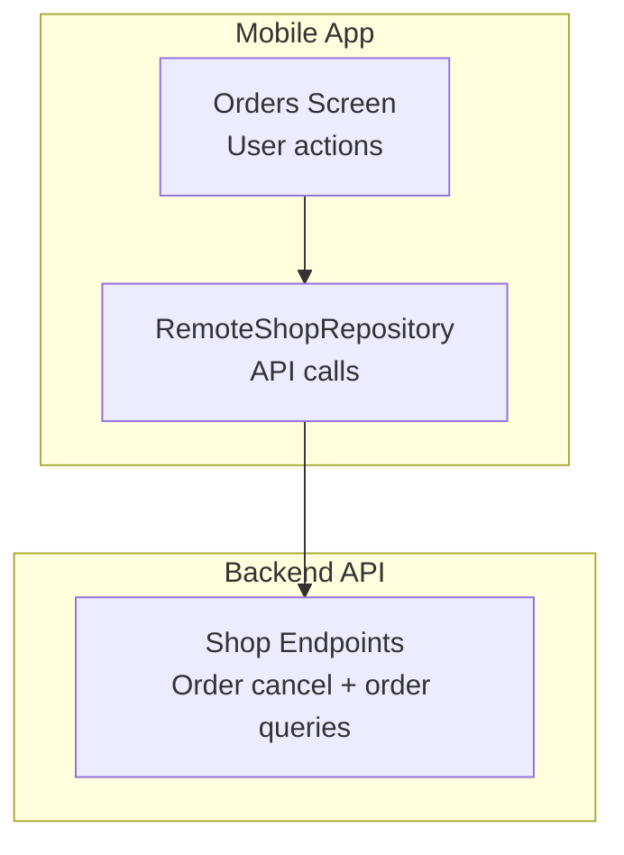
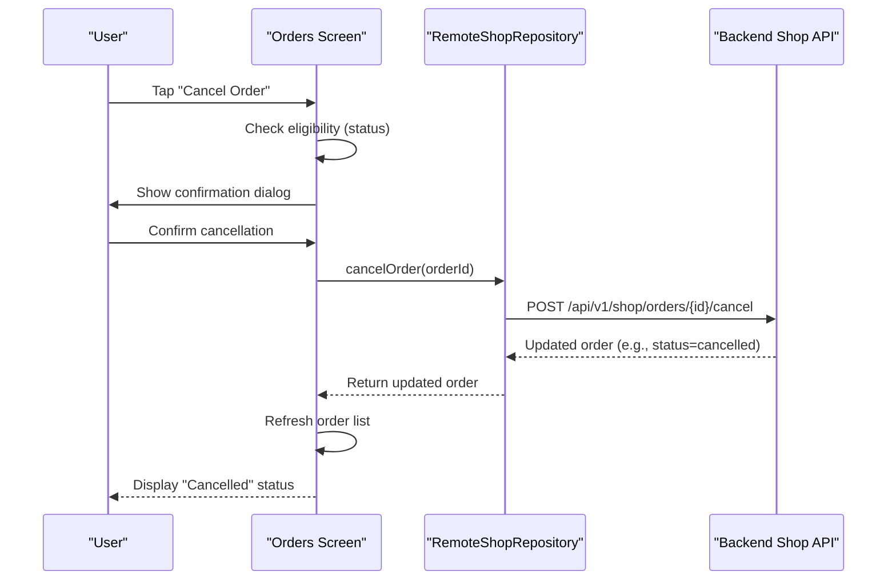
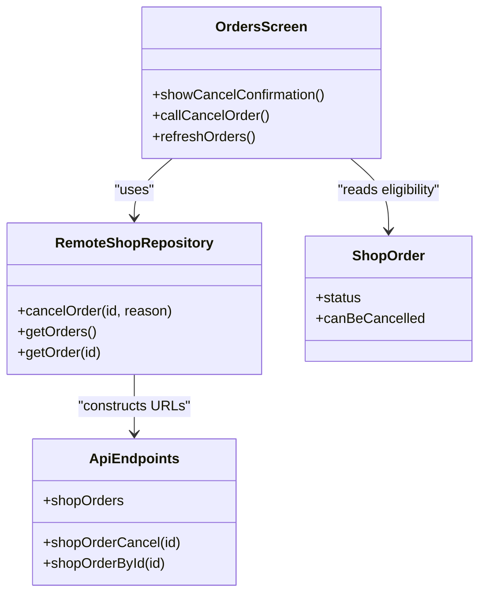

# Order Cancellation & Refund Processing

<cite>
**Referenced Files in This Document**
- [ENDPOINTS.md](file://api/ENDPOINTS.md)
- [api_endpoints.dart](file://lib/core/network/api_endpoints.dart)
- [remote_shop_repository.dart](file://lib/features/shop/data/remote_shop_repository.dart)
- [shop_models.dart](file://lib/features/shop/data/shop_models.dart)
- [orders_screen.dart](file://lib/features/shop/screens/orders_screen.dart)
- [payments-refunds.html](file://web/payments-refunds.html)
</cite>

## Table of Contents
1. [Introduction](#introduction)
2. [Project Structure](#project-structure)
3. [Core Components](#core-components)
4. [Architecture Overview](#architecture-overview)
5. [Detailed Component Analysis](#detailed-component-analysis)
6. [Dependency Analysis](#dependency-analysis)
7. [Performance Considerations](#performance-considerations)
8. [Troubleshooting Guide](#troubleshooting-guide)
9. [Conclusion](#conclusion)

## Introduction
This document explains the order cancellation and refund processing workflows as implemented by the LidaPay mobile application and its backend API surface. It covers:
- Cancellation eligibility rules and timing constraints
- Full vs partial cancellation behavior
- Refund initiation, payment gateway integration, and status tracking
- Example cancellation API calls
- Reconciliation processes for cancelled orders
- Notification workflows for cancelled orders
- Inventory restoration, credit reversal mechanisms, and compliance requirements

The goal is to provide both technical and non-technical readers with a clear understanding of how cancellations and refunds are handled end-to-end.

## Project Structure
Cancellation and refund handling spans three main layers:
- UI layer: The Orders screen exposes cancellation actions and displays lifecycle statuses such as “Cancelled” and “Refunded”.
- Repository layer: The shop repository invokes the backend cancel endpoint and maps responses into domain models.
- API contract: The backend defines the shop order cancel endpoint and related order endpoints.

**Diagram sources**
- [orders_screen.dart:884-941](file://lib/features/shop/screens/orders_screen.dart#L884-L941)
- [remote_shop_repository.dart:217-223](file://lib/features/shop/data/remote_shop_repository.dart#L217-L223)
- [ENDPOINTS.md:175-183](file://api/ENDPOINTS.md#L175-L183)

**Section sources**
- [orders_screen.dart:884-941](file://lib/features/shop/screens/orders_screen.dart#L884-L941)
- [remote_shop_repository.dart:217-223](file://lib/features/shop/data/remote_shop_repository.dart#L217-L223)
- [ENDPOINTS.md:175-183](file://api/ENDPOINTS.md#L175-L183)

## Core Components
- Shop order model: Defines order lifecycle states and cancellation eligibility.
- Remote shop repository: Encapsulates network calls for checkout, order retrieval, and cancellation.
- Orders screen: Presents order details, cancellation eligibility, and triggers cancellation.
- API endpoints: Define the server-side routes for shop operations including order cancellation.

Key responsibilities:
- Eligibility check: The order model exposes whether an order can be cancelled based on its status.
- Cancellation call: The repository posts to the cancel endpoint and returns the updated order.
- UI flow: The screen shows a confirmation dialog and refreshes the order list after cancellation.

**Section sources**
- [shop_models.dart:297-363](file://lib/features/shop/data/shop_models.dart#L297-L363)
- [remote_shop_repository.dart:217-223](file://lib/features/shop/data/remote_shop_repository.dart#L217-L223)
- [orders_screen.dart:884-941](file://lib/features/shop/screens/orders_screen.dart#L884-L941)
- [api_endpoints.dart:120-130](file://lib/core/network/api_endpoints.dart#L120-L130)

## Architecture Overview
The cancellation workflow follows a straightforward client-server sequence:
1. User taps “Cancel Order” in the Orders screen.
2. The app validates eligibility using the order’s status.
3. A confirmation dialog is shown; upon confirmation, the app calls the repository.
4. The repository POSTs to the backend cancel endpoint.
5. The backend updates the order state (e.g., to “cancelled”) and may initiate a refund if payment was successful.
6. The app refreshes the order list and reflects the new status.

**Diagram sources**
- [orders_screen.dart:884-941](file://lib/features/shop/screens/orders_screen.dart#L884-L941)
- [remote_shop_repository.dart:217-223](file://lib/features/shop/data/remote_shop_repository.dart#L217-L223)
- [ENDPOINTS.md:179-183](file://api/ENDPOINTS.md#L179-L183)

## Detailed Component Analysis

### Cancellation Eligibility Rules and Timing Constraints
- Eligibility rule: An order can be cancelled when its status is one of the allowed pre-fulfillment states. The order model exposes a helper that determines this.
- Status mapping: The UI maps backend statuses to customer-facing labels, including “Pending”, “Paid”, “Processing”, “Shipped”, “Delivered”, “Cancelled”, and “Refunded”.
- Terminal states: Tracking considers “delivered”, “cancelled”, and “refunded” as terminal states.

Implications:
- If an order has progressed beyond eligible states (for example, shipped or delivered), cancellation is not permitted via the UI.
- The backend enforces valid transitions for admin status updates, ensuring consistency across channels.

**Section sources**
- [shop_models.dart:351-353](file://lib/features/shop/data/shop_models.dart#L351-L353)
- [orders_screen.dart:978-1018](file://lib/features/shop/screens/orders_screen.dart#L978-L1018)
- [shop_models.dart:438-440](file://lib/features/shop/data/shop_models.dart#L438-L440)
- [ENDPOINTS.md:179-183](file://api/ENDPOINTS.md#L179-L183)

### Partial vs Full Cancellation Scenarios
- The current repository method sends an optional reason but does not include line-item selection. This indicates full-order cancellation at the UI level.
- The order model includes per-line item data (quantity, price, SKU), which suggests the backend could support partial cancellations if extended. However, the existing client path performs a full cancellation.

Recommendation:
- To support partial cancellations, extend the cancel request body to include selected line items and quantities, and update the UI to allow item selection before confirming cancellation.

**Section sources**
- [remote_shop_repository.dart:217-223](file://lib/features/shop/data/remote_shop_repository.dart#L217-L223)
- [shop_models.dart:252-295](file://lib/features/shop/data/shop_models.dart#L252-L295)

### Refund Initiation Process and Payment Gateway Integration
- The app informs users that approved refunds are processed to the original payment method.
- The policy page clarifies that refund timing depends on the payment provider and that approved refunds follow the original route where possible.
- Payment outcomes are normalized across providers (e.g., GTBank, Advansis), enabling consistent handling of success/failure/pending states.

Operational notes:
- Refund initiation is primarily a backend responsibility triggered by successful cancellation of paid orders.
- The app surfaces cancellation eligibility and confirms that refunds will be processed to the original payment method.

**Section sources**
- [orders_screen.dart:903-941](file://lib/features/shop/screens/orders_screen.dart#L903-L941)
- [payments-refunds.html:32-36](file://web/payments-refunds.html#L32-L36)
- [payment_models.dart:165-214](file://lib/features/payments/data/payment_models.dart#L165-L214)

### Refund Status Tracking
- The order lifecycle includes “cancelled” and “refunded” statuses.
- The tracking view treats “cancelled” and “refunded” as terminal states, indicating no further delivery events.
- Users can monitor order status through the order detail and tracking views.

Best practice:
- Ensure the backend emits a “refunded” status after successful refund completion so the UI can reflect it consistently.

**Section sources**
- [orders_screen.dart:978-1018](file://lib/features/shop/screens/orders_screen.dart#L978-L1018)
- [shop_models.dart:438-440](file://lib/features/shop/data/shop_models.dart#L438-L440)

### Example Cancellation API Calls
- Endpoint: POST /api/v1/shop/orders/{id}/cancel
- Purpose: Cancel an order (customer). Only pending or processing orders can be cancelled.
- Request body: Optional reason field.
- Response: Updated order object reflecting the new status.

Example usage patterns:
- From the app: The repository constructs the URL using the order ID and posts an optional reason.
- From automation scripts: Use the same endpoint with appropriate authentication and payload.

Notes:
- The endpoint is documented in the API map and referenced in the app’s endpoint constants.

**Section sources**
- [ENDPOINTS.md:179-183](file://api/ENDPOINTS.md#L179-L183)
- [api_endpoints.dart:130-130](file://lib/core/network/api_endpoints.dart#L130-L130)
- [remote_shop_repository.dart:217-223](file://lib/features/shop/data/remote_shop_repository.dart#L217-L223)

### Reconciliation Processes for Cancelled Orders
Reconciliation should ensure:
- Order state consistency: The order status reflects “cancelled” (and later “refunded” if applicable).
- Payment reconciliation: Match the cancellation event with the corresponding payment transaction and verify refund initiation.
- Audit trail: Record cancellation reason, timestamps, and any provider references.

Recommended reconciliation steps:
1. Identify orders with status “cancelled”.
2. Verify payment status and confirm refund initiation for paid orders.
3. Cross-check provider logs for refund transactions.
4. Update internal records to reflect final refund status once confirmed.

[No sources needed since this section provides general guidance]

### Notification Workflows for Cancelled Orders
- The app displays “Cancelled” status in the order detail and tracking views.
- Notifications infrastructure exists in the app (device token management and notification endpoints), suggesting push notifications can be used to inform users about cancellation and refund status changes.

Implementation guidance:
- Emit a cancellation notification when the backend sets the order to “cancelled”.
- Emit a refund notification when the backend sets the order to “refunded” or when the provider confirms refund completion.

**Section sources**
- [orders_screen.dart:978-1018](file://lib/features/shop/screens/orders_screen.dart#L978-L1018)
- [ENDPOINTS.md:72-80](file://api/ENDPOINTS.md#L72-L80)

### Inventory Restoration
- When an order is cancelled, inventory previously reserved for the order should be restored to available stock.
- For partial cancellations (future extension), only the quantities of cancelled line items should be restored.

Operational considerations:
- Ensure idempotency: Avoid double-restoration if multiple cancellation attempts occur.
- Maintain audit logs for inventory adjustments tied to order IDs.

[No sources needed since this section provides general guidance]

### Credit Reversal Mechanisms
- Refunds reverse charges to the original funding source (mobile money, card, wallet) where supported by the payment provider.
- The app communicates that refunds go back to the original payment method and that timing varies by provider.

Compliance note:
- Follow provider-specific rules for reversals and chargebacks.
- Preserve transaction references for dispute resolution.

**Section sources**
- [payments-refunds.html:32-36](file://web/payments-refunds.html#L32-L36)

### Compliance Requirements for Financial Transactions
- The payments and refunds policy outlines user rights, investigation procedures, and provider terms.
- The app links to legal pages covering privacy, terms, payments & refunds, account deletion, and verification.

Key requirements:
- Provide clear information about cancellation eligibility and refund timelines.
- Support user requests for investigations with transaction references.
- Honor consumer law protections and avoid limiting statutory rights.

**Section sources**
- [payments-refunds.html:21-39](file://web/payments-refunds.html#L21-L39)

## Dependency Analysis
The following diagram shows key dependencies among components involved in cancellation and refund processing.

**Diagram sources**
- [orders_screen.dart:884-941](file://lib/features/shop/screens/orders_screen.dart#L884-L941)
- [remote_shop_repository.dart:217-223](file://lib/features/shop/data/remote_shop_repository.dart#L217-L223)
- [api_endpoints.dart:120-130](file://lib/core/network/api_endpoints.dart#L120-L130)
- [shop_models.dart:297-363](file://lib/features/shop/data/shop_models.dart#L297-L363)

**Section sources**
- [orders_screen.dart:884-941](file://lib/features/shop/screens/orders_screen.dart#L884-L941)
- [remote_shop_repository.dart:217-223](file://lib/features/shop/data/remote_shop_repository.dart#L217-L223)
- [api_endpoints.dart:120-130](file://lib/core/network/api_endpoints.dart#L120-L130)
- [shop_models.dart:297-363](file://lib/features/shop/data/shop_models.dart#L297-L363)

## Performance Considerations
- Minimize redundant API calls: Cache order lists and invalidate only after successful cancellation.
- Debounce repeated cancellation attempts: Prevent duplicate requests by disabling the cancel button during processing.
- Optimize order list rendering: Use pagination and skeleton loaders to improve perceived performance.

[No sources needed since this section provides general guidance]

## Troubleshooting Guide
Common issues and resolutions:
- Cancellation fails due to ineligible status:
  - Verify order status; only eligible states permit cancellation.
  - Check backend error messages for invalid transitions.
- Network errors during cancellation:
  - Retry logic should be implemented at the repository layer.
  - Inform users with clear error messages and offer retry options.
- Refund not reflected immediately:
  - Explain provider-dependent timing.
  - Monitor backend refund status and notify users when completed.

**Section sources**
- [orders_screen.dart:903-941](file://lib/features/shop/screens/orders_screen.dart#L903-L941)
- [ENDPOINTS.md:179-183](file://api/ENDPOINTS.md#L179-L183)

## Conclusion
The LidaPay app implements a clear cancellation workflow driven by order eligibility and backed by a well-defined API. While the current UI supports full-order cancellation, the data model allows for future partial cancellation enhancements. Refunds are initiated by the backend and communicated to users through status updates and policy disclosures. Robust reconciliation, notifications, inventory restoration, and compliance practices ensure a reliable and transparent experience for customers and operators alike.