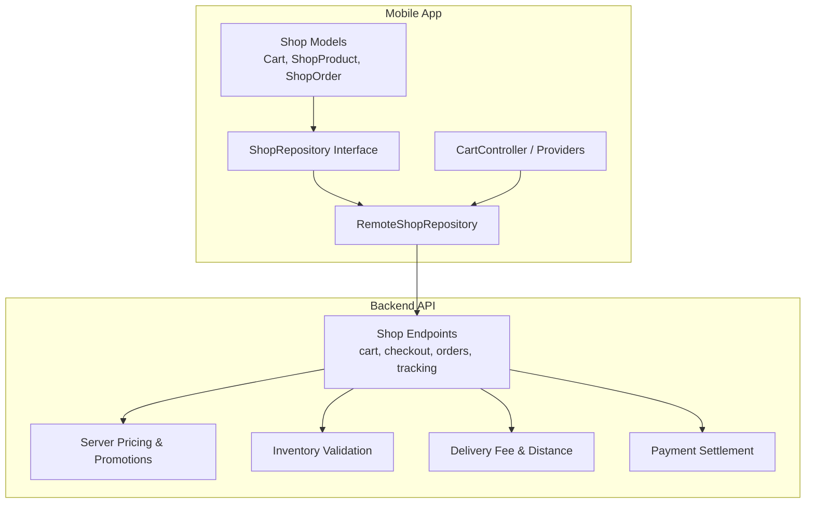
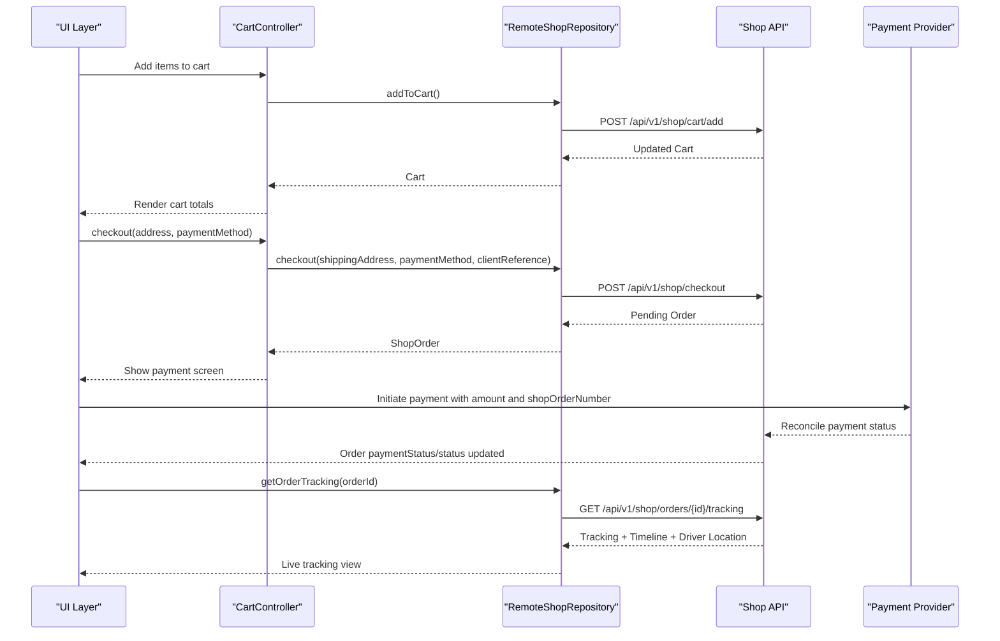
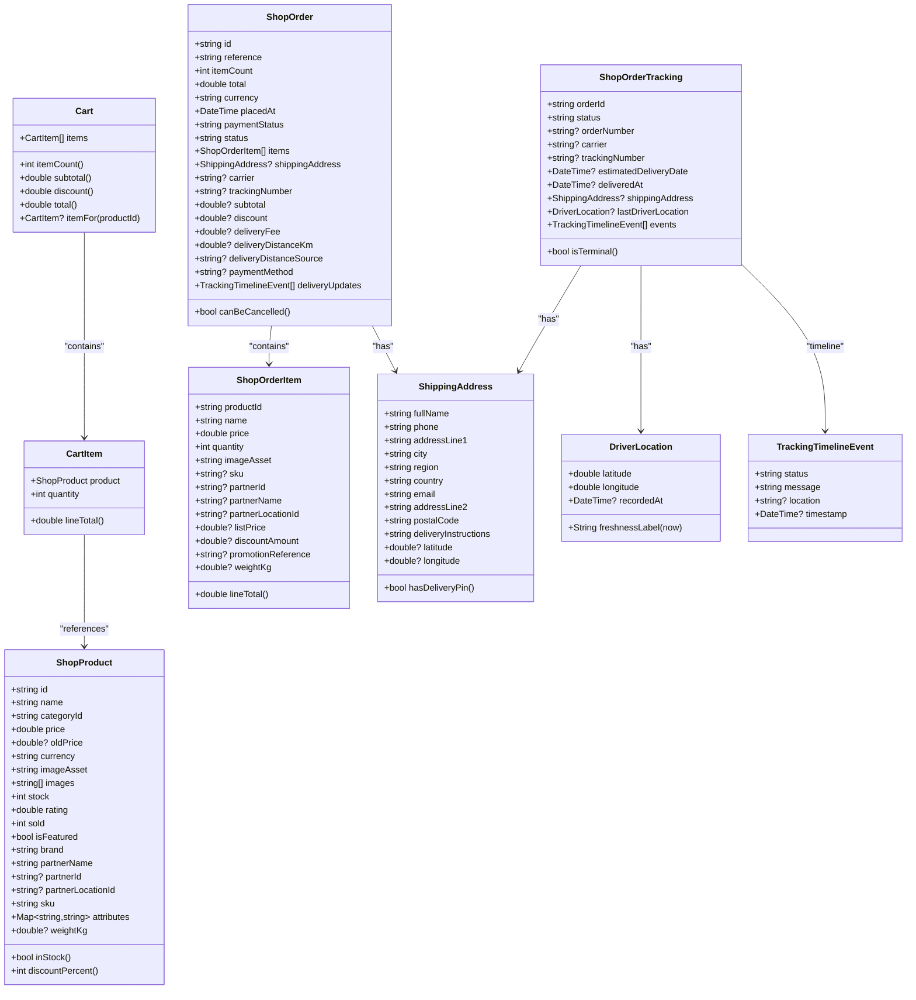
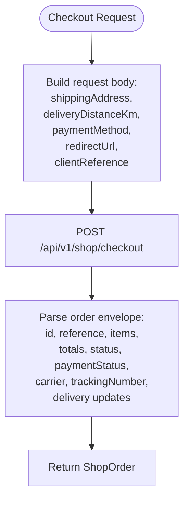
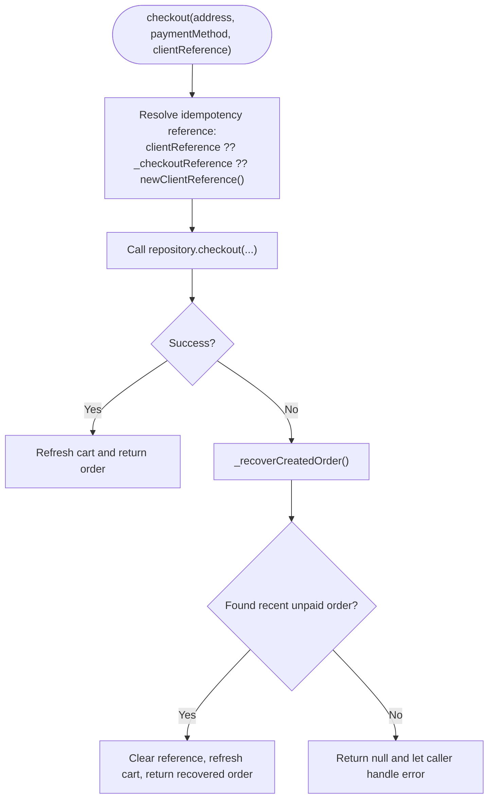
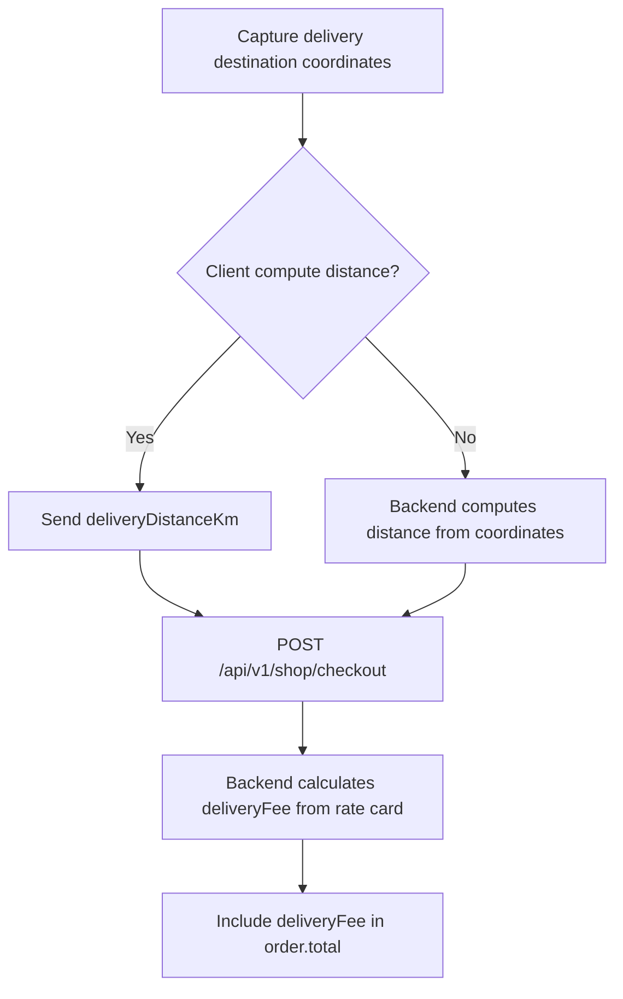
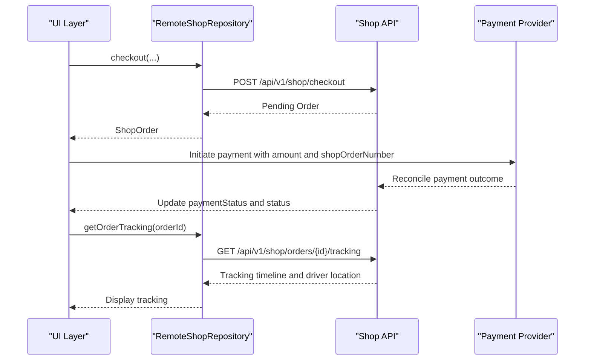
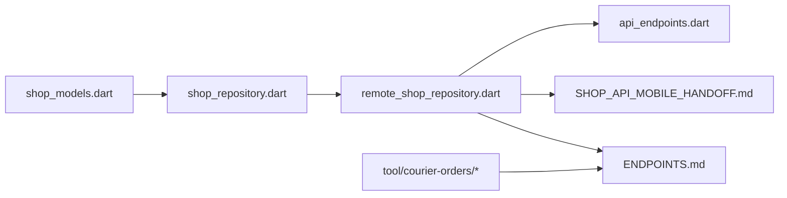

# Order Creation & Processing

<cite>
**Referenced Files in This Document**
- [shop_models.dart](file://lib/features/shop/data/shop_models.dart)
- [remote_shop_repository.dart](file://lib/features/shop/data/remote_shop_repository.dart)
- [shop_repository.dart](file://lib/features/shop/data/shop_repository.dart)
- [providers.dart](file://lib/features/shop/providers.dart)
- [api_endpoints.dart](file://lib/core/network/api_endpoints.dart)
- [ENDPOINTS.md](file://api/ENDPOINTS.md)
- [SHOP_API_MOBILE_HANDOFF.md](file://docs/SHOP_API_MOBILE_HANDOFF.md)
- [create-paid-orders.mjs](file://tool/courier-orders/create-paid-orders.mjs)
- [setup-fulfillment.mjs](file://tool/courier-orders/setup-fulfillment.mjs)
- [README.md](file://tool/courier-orders/README.md)
</cite>

## Table of Contents
1. [Introduction](#introduction)
2. [Project Structure](#project-structure)
3. [Core Components](#core-components)
4. [Architecture Overview](#architecture-overview)
5. [Detailed Component Analysis](#detailed-component-analysis)
6. [Dependency Analysis](#dependency-analysis)
7. [Performance Considerations](#performance-considerations)
8. [Troubleshooting Guide](#troubleshooting-guide)
9. [Conclusion](#conclusion)

## Introduction
This document explains the complete order creation and processing workflow for the LidaPay shop feature, from cart validation through order confirmation, payment settlement, and delivery tracking. It focuses on:

- The mobile-side data models for products, cart, shipping address, orders, and tracking.
- The repository layer that calls the backend shop API.
- The provider/controller logic that manages state, retries, and idempotency.
- The backend contract documented in the API endpoint map and mobile handoff guide.
- Inventory and pricing rules enforced by the server.
- Shipping cost determination and courier integration considerations.
- Error handling patterns and retry mechanisms.

The mobile app is a client; authoritative pricing, stock checks, tax-like adjustments (promotions), and delivery fees are computed on the server.

## Project Structure
The order lifecycle spans several layers:

- Data models define the shape of catalog items, cart entries, shipping addresses, orders, and tracking events.
- A repository interface abstracts the shop API.
- A remote implementation calls the real endpoints.
- Providers manage UI state, cart mutations, checkout attempts, and recovery after network failures.
- API endpoints are centralized constants and documented in the API spec.
- Tooling scripts demonstrate end-to-end order creation for courier partner testing.

**Diagram sources**
- [shop_models.dart:23-93](file://lib/features/shop/data/shop_models.dart#L23-L93)
- [shop_models.dart:108-150](file://lib/features/shop/data/shop_models.dart#L108-L150)
- [shop_models.dart:152-250](file://lib/features/shop/data/shop_models.dart#L152-L250)
- [shop_models.dart:297-363](file://lib/features/shop/data/shop_models.dart#L297-L363)
- [remote_shop_repository.dart:107-135](file://lib/features/shop/data/remote_shop_repository.dart#L107-L135)
- [api_endpoints.dart:111-130](file://lib/core/network/api_endpoints.dart#L111-L130)
- [ENDPOINTS.md:159-184](file://api/ENDPOINTS.md#L159-L184)

**Section sources**
- [shop_models.dart:23-93](file://lib/features/shop/data/shop_models.dart#L23-L93)
- [shop_models.dart:108-150](file://lib/features/shop/data/shop_models.dart#L108-L150)
- [shop_models.dart:152-250](file://lib/features/shop/data/shop_models.dart#L152-L250)
- [shop_models.dart:297-363](file://lib/features/shop/data/shop_models.dart#L297-L363)
- [remote_shop_repository.dart:107-135](file://lib/features/shop/data/remote_shop_repository.dart#L107-L135)
- [api_endpoints.dart:111-130](file://lib/core/network/api_endpoints.dart#L111-L130)
- [ENDPOINTS.md:159-184](file://api/ENDPOINTS.md#L159-L184)

## Core Components
- ShopProduct: product catalog entry with price, discount behavior, stock, images, attributes, partner information, SKU, and weight.
- Cart and CartItem: server-backed cart with live totals and item snapshots.
- ShippingAddress: required checkout payload including optional delivery pin coordinates.
- ShopOrder and ShopOrderItem: order envelope with line-item snapshots, totals, status fields, carrier/tracking metadata, and delivery updates.
- TrackingTimelineEvent, DriverLocation, ShopOrderTracking: delivery timeline and driver location model.

Key responsibilities:
- Server computes effective prices and cart totals; the app displays them without recomputation.
- Checkout creates a pending order, validates inventory, clears the cart, and returns an order envelope.
- Payment providers link to the order via `shopOrderNumber`.
- Tracking reads delivery events and optional driver GPS.

**Section sources**
- [shop_models.dart:23-93](file://lib/features/shop/data/shop_models.dart#L23-L93)
- [shop_models.dart:95-150](file://lib/features/shop/data/shop_models.dart#L95-L150)
- [shop_models.dart:152-250](file://lib/features/shop/data/shop_models.dart#L152-L250)
- [shop_models.dart:252-363](file://lib/features/shop/data/shop_models.dart#L252-L363)
- [shop_models.dart:365-450](file://lib/features/shop/data/shop_models.dart#L365-L450)

## Architecture Overview
The order lifecycle flows through these stages:

1. Browse and add items to the server cart.
2. Validate cart contents and compute live totals.
3. Collect shipping address and optional delivery pin.
4. Call checkout to create a pending order.
5. Initiate payment using a provider linked by `shopOrderNumber`.
6. Poll or receive callbacks to reconcile payment status.
7. Track delivery through the order tracking endpoint.

**Diagram sources**
- [providers.dart:275-314](file://lib/features/shop/providers.dart#L275-L314)
- [remote_shop_repository.dart:107-135](file://lib/features/shop/data/remote_shop_repository.dart#L107-L135)
- [api_endpoints.dart:115-130](file://lib/core/network/api_endpoints.dart#L115-L130)
- [ENDPOINTS.md:170-184](file://api/ENDPOINTS.md#L170-L184)
- [SHOP_API_MOBILE_HANDOFF.md:229-317](file://docs/SHOP_API_MOBILE_HANDOFF.md#L229-L317)

## Detailed Component Analysis

### Data Models and Business Rules
- Product pricing:
  - `price` is the base partner price plus commission.
  - `discountPrice` is the final selling price when present and lower than list price.
  - Effective price is `discountPrice > 0 ? discountPrice : price`.
- Stock:
  - Products expose `stock`; cart operations may reject insufficient stock.
- Cart totals:
  - Server returns `itemCount`, `subtotal`, `discount`, and `total`; the app uses these values rather than local summation.
- Shipping address:
  - Required at checkout; includes optional delivery pin coordinates (`latitude`, `longitude`) used for courier distance calculation.
- Order lifecycle:
  - Status transitions: `pending → paid → processing → shipped → delivered`, with terminal states such as `cancelled` and `refunded`.
  - Payment status transitions: `pending`, `success`, `failed`, `refunded`.
- Tracking:
  - Timeline events include order placement, payment confirmation, courier acceptance, pickup, delivery, exceptions, and raw order-status updates.
  - Driver location is separate from timeline locations and appears as `lastDriverLocation`.

**Diagram sources**
- [shop_models.dart:23-93](file://lib/features/shop/data/shop_models.dart#L23-L93)
- [shop_models.dart:95-150](file://lib/features/shop/data/shop_models.dart#L95-L150)
- [shop_models.dart:152-250](file://lib/features/shop/data/shop_models.dart#L152-L250)
- [shop_models.dart:252-363](file://lib/features/shop/data/shop_models.dart#L252-L363)
- [shop_models.dart:365-450](file://lib/features/shop/data/shop_models.dart#L365-L450)

**Section sources**
- [SHOP_API_MOBILE_HANDOFF.md:24-54](file://docs/SHOP_API_MOBILE_HANDOFF.md#L24-L54)
- [SHOP_API_MOBILE_HANDOFF.md:125-145](file://docs/SHOP_API_MOBILE_HANDOFF.md#L125-L145)
- [SHOP_API_MOBILE_HANDOFF.md:148-226](file://docs/SHOP_API_MOBILE_HANDOFF.md#L148-L226)
- [SHOP_API_MOBILE_HANDOFF.md:320-339](file://docs/SHOP_API_MOBILE_HANDOFF.md#L320-L339)
- [shop_models.dart:23-93](file://lib/features/shop/data/shop_models.dart#L23-L93)
- [shop_models.dart:95-150](file://lib/features/shop/data/shop_models.dart#L95-L150)
- [shop_models.dart:152-250](file://lib/features/shop/data/shop_models.dart#L152-L250)
- [shop_models.dart:252-363](file://lib/features/shop/data/shop_models.dart#L252-L363)
- [shop_models.dart:365-450](file://lib/features/shop/data/shop_models.dart#L365-L450)

### Repository Layer and API Contract
- Repository interface defines methods for categories, products, cart, checkout, orders, and tracking.
- Remote implementation maps JSON responses to models with flexible field resolution.
- Checkout sends:
  - `shippingAddress`
  - Optional `deliveryDistanceKm`
  - `paymentMethod`
  - `redirectUrl`
  - Optional `clientReference` and `X-Idempotency-Key` header
- Orders and tracking endpoints return enriched envelopes with fallback field names.

**Diagram sources**
- [remote_shop_repository.dart:107-135](file://lib/features/shop/data/remote_shop_repository.dart#L107-L135)
- [remote_shop_repository.dart:225-425](file://lib/features/shop/data/remote_shop_repository.dart#L225-L425)
- [api_endpoints.dart:115-130](file://lib/core/network/api_endpoints.dart#L115-L130)
- [ENDPOINTS.md:170-184](file://api/ENDPOINTS.md#L170-L184)

**Section sources**
- [shop_repository.dart:3-62](file://lib/features/shop/data/shop_repository.dart#L3-L62)
- [remote_shop_repository.dart:107-135](file://lib/features/shop/data/remote_shop_repository.dart#L107-L135)
- [remote_shop_repository.dart:225-425](file://lib/features/shop/data/remote_shop_repository.dart#L225-L425)
- [api_endpoints.dart:115-130](file://lib/core/network/api_endpoints.dart#L115-L130)
- [ENDPOINTS.md:170-184](file://api/ENDPOINTS.md#L170-L184)

### Provider Logic, Idempotency, and Retry
- `CartController.checkout`:
  - Generates or reuses an idempotency reference for the current attempt.
  - Calls repository checkout with the same reference.
  - On success, refreshes the cart and returns the order.
  - On failure, attempts to recover a created order by checking if the cart is empty and finding a recent unpaid order.
- Recovery strategy:
  - If the cart is empty and there is a recent unpaid order, assume the backend created it despite the failed response.
  - Clear the checkout reference and return the recovered order.

**Diagram sources**
- [providers.dart:275-314](file://lib/features/shop/providers.dart#L275-L314)
- [providers.dart:316-337](file://lib/features/shop/providers.dart#L316-L337)

**Section sources**
- [providers.dart:237-240](file://lib/features/shop/providers.dart#L237-L240)
- [providers.dart:275-314](file://lib/features/shop/providers.dart#L275-L314)
- [providers.dart:316-337](file://lib/features/shop/providers.dart#L316-L337)

### Inventory Management and Stock Reservation
- Inventory validation occurs on the server during cart mutations and checkout.
- Insufficient stock or inactive products result in errors.
- Successful checkout decrements stock and clears the cart.
- Cancellation restores stock for eligible statuses.

Operational implications:
- Do not rely on client-side stock checks alone; always trust server responses.
- Treat cart totals and product prices as authoritative.
- For concurrent access, rely on server-side locking/validation; the mobile client should avoid duplicate checkout attempts by using idempotency keys.

**Section sources**
- [SHOP_API_MOBILE_HANDOFF.md:125-145](file://docs/SHOP_API_MOBILE_HANDOFF.md#L125-L145)
- [SHOP_API_MOBILE_HANDOFF.md:219-226](file://docs/SHOP_API_MOBILE_HANDOFF.md#L219-L226)
- [SHOP_API_MOBILE_HANDOFF.md:320-339](file://docs/SHOP_API_MOBILE_HANDOFF.md#L320-L339)

### Pricing Calculations, Taxes, and Promotions
- Pricing is server-computed:
  - Base price includes commission.
  - Discounted price takes precedence when valid.
  - Cart totals include promotions applied by the server.
- Tax computation is not exposed as a separate field in the mobile models; any tax-like adjustments are embedded in server totals.
- The app must never recompute or adjust pricing locally.

**Section sources**
- [SHOP_API_MOBILE_HANDOFF.md:24-54](file://docs/SHOP_API_MOBILE_HANDOFF.md#L24-L54)
- [SHOP_API_MOBILE_HANDOFF.md:125-145](file://docs/SHOP_API_MOBILE_HANDOFF.md#L125-L145)
- [remote_shop_repository.dart:604-647](file://lib/features/shop/data/remote_shop_repository.dart#L604-L647)

### Shipping Cost Determination and Courier Integration
- Delivery fee is calculated by the backend based on a rate card and `deliveryDistance.km`.
- The app may send:
  - `shippingAddress.latitude` and `shippingAddress.longitude`
  - Optional `deliveryDistanceKm`
- If coordinates are provided but distance is omitted, the backend computes distance server-side and records the source.
- Courier partner integration:
  - Fulfillment setup assigns products to branches.
  - Test scripts create paid orders and interact with the courier queue.

**Diagram sources**
- [SHOP_API_MOBILE_HANDOFF.md:174-198](file://docs/SHOP_API_MOBILE_HANDOFF.md#L174-L198)
- [SHOP_API_MOBILE_HANDOFF.md:421-428](file://docs/SHOP_API_MOBILE_HANDOFF.md#L421-L428)
- [remote_shop_repository.dart:107-135](file://lib/features/shop/data/remote_shop_repository.dart#L107-L135)
- [create-paid-orders.mjs:115-137](file://tool/courier-orders/create-paid-orders.mjs#L115-L137)

**Section sources**
- [SHOP_API_MOBILE_HANDOFF.md:174-198](file://docs/SHOP_API_MOBILE_HANDOFF.md#L174-L198)
- [SHOP_API_MOBILE_HANDOFF.md:421-428](file://docs/SHOP_API_MOBILE_HANDOFF.md#L421-L428)
- [create-paid-orders.mjs:115-137](file://tool/courier-orders/create-paid-orders.mjs#L115-L137)
- [setup-fulfillment.mjs:156-178](file://tool/courier-orders/setup-fulfillment.mjs#L156-L178)

### Order Confirmation and Payment Flow
- After checkout, initiate payment with the exact `order.total` and link it to the order via `shopOrderNumber`.
- Supported providers:
  - Advansis Pay / ExpressPay
  - Mobile Money / GTBank GTPay
- Payment reconciliation updates `paymentStatus` and advances `status` automatically when the order number is included.
- The app should poll or use callbacks to confirm completion; do not treat initiation as proof of payment.

**Diagram sources**
- [SHOP_API_MOBILE_HANDOFF.md:229-317](file://docs/SHOP_API_MOBILE_HANDOFF.md#L229-L317)
- [SHOP_API_MOBILE_HANDOFF.md:429-436](file://docs/SHOP_API_MOBILE_HANDOFF.md#L429-L436)
- [remote_shop_repository.dart:175-214](file://lib/features/shop/data/remote_shop_repository.dart#L175-L214)

**Section sources**
- [SHOP_API_MOBILE_HANDOFF.md:229-317](file://docs/SHOP_API_MOBILE_HANDOFF.md#L229-L317)
- [SHOP_API_MOBILE_HANDOFF.md:429-436](file://docs/SHOP_API_MOBILE_HANDOFF.md#L429-L436)

### Concrete Examples of Order Creation API Calls
- Add to cart:
  - Method: `POST`
  - Endpoint: `/api/v1/shop/cart/add`
  - Body: `{ "productId": "<ObjectId>", "quantity": 2 }`
- Update cart item:
  - Method: `PUT`
  - Endpoint: `/api/v1/shop/cart/update`
  - Body: `{ "productId": "<ObjectId>", "quantity": 3 }`
- Remove from cart:
  - Method: `POST`
  - Endpoint: `/api/v1/shop/cart/remove`
  - Body: `{ "productId": "<ObjectId>" }`
- Clear cart:
  - Method: `DELETE`
  - Endpoint: `/api/v1/shop/cart/clear`
- Checkout:
  - Method: `POST`
  - Endpoint: `/api/v1/shop/checkout`
  - Body includes `shippingAddress`, optional `deliveryDistanceKm`, `paymentMethod`, and `redirectUrl`.
- List orders:
  - Method: `GET`
  - Endpoint: `/api/v1/shop/orders?page=1&limit=20`
- Get order by ID:
  - Method: `GET`
  - Endpoint: `/api/v1/shop/orders/{id}`
- Public lookup by order number:
  - Method: `GET`
  - Endpoint: `/api/v1/shop/orders/number/{orderNumber}`
- Tracking:
  - Method: `GET`
  - Endpoint: `/api/v1/shop/orders/{id}/tracking`
- Cancel order:
  - Method: `POST`
  - Endpoint: `/api/v1/shop/orders/{id}/cancel`
  - Body: `{ "reason": "..." }`

These examples align with the API endpoint map and mobile handoff documentation.

**Section sources**
- [ENDPOINTS.md:159-184](file://api/ENDPOINTS.md#L159-L184)
- [SHOP_API_MOBILE_HANDOFF.md:125-145](file://docs/SHOP_API_MOBILE_HANDOFF.md#L125-L145)
- [SHOP_API_MOBILE_HANDOFF.md:148-226](file://docs/SHOP_API_MOBILE_HANDOFF.md#L148-L226)
- [SHOP_API_MOBILE_HANDOFF.md:320-339](file://docs/SHOP_API_MOBILE_HANDOFF.md#L320-L339)

### Error Handling Patterns
- Missing order:
  - Repository treats HTTP 404 as a valid “not found” answer and returns null.
- Network failures during checkout:
  - Provider attempts to recover a created order by checking for an empty cart and a recent unpaid order.
- Cart mutations:
  - Backend rejects invalid quantities and missing items; the controller converts decrementing below one into removal.
- Tracking fetch failures:
  - Transient failures keep the last good payload instead of flickering the timeline.

**Section sources**
- [remote_shop_repository.dart:148-173](file://lib/features/shop/data/remote_shop_repository.dart#L148-L173)
- [providers.dart:262-273](file://lib/features/shop/providers.dart#L262-L273)
- [providers.dart:304-314](file://lib/features/shop/providers.dart#L304-L314)
- [providers.dart:316-337](file://lib/features/shop/providers.dart#L316-L337)

### Retry Mechanisms and Idempotency
- Idempotency key:
  - `clientReference` is sent both as a body field and as the `X-Idempotency-Key` header.
  - The same reference is reused across retries for the same checkout attempt.
- Recovery:
  - If checkout fails, the provider reconciles whether the order was already created.
- Operational scripts:
  - Courier test scripts clear the cart per iteration and call checkout with a shipping address and payment method.

**Section sources**
- [remote_shop_repository.dart:107-135](file://lib/features/shop/data/remote_shop_repository.dart#L107-L135)
- [providers.dart:275-314](file://lib/features/shop/providers.dart#L275-L314)
- [create-paid-orders.mjs:102-137](file://tool/courier-orders/create-paid-orders.mjs#L102-L137)

### Concurrent Order Processing Considerations
- Server-side guarantees:
  - Prices are re-verified against the database.
  - Stock is validated and decremented atomically.
  - Cart is cleared upon successful order creation.
- Client-side safeguards:
  - Use idempotency keys to prevent duplicate orders on retries.
  - Avoid sending client-computed delivery fees.
  - Preserve previous cart state on failure so users can retry safely.

**Section sources**
- [SHOP_API_MOBILE_HANDOFF.md:219-226](file://docs/SHOP_API_MOBILE_HANDOFF.md#L219-L226)
- [SHOP_API_MOBILE_HANDOFF.md:448-450](file://docs/SHOP_API_MOBILE_HANDOFF.md#L448-L450)
- [providers.dart:275-314](file://lib/features/shop/providers.dart#L275-L314)

## Dependency Analysis
The shop feature depends on:

- Data models for domain entities.
- Repository interface for abstraction.
- Remote repository for HTTP calls.
- API endpoints constants.
- Documentation for backend contracts.
- Tooling scripts for operational testing.

**Diagram sources**
- [shop_models.dart:23-93](file://lib/features/shop/data/shop_models.dart#L23-L93)
- [shop_repository.dart:3-62](file://lib/features/shop/data/shop_repository.dart#L3-L62)
- [remote_shop_repository.dart:1-15](file://lib/features/shop/data/remote_shop_repository.dart#L1-L15)
- [api_endpoints.dart:111-130](file://lib/core/network/api_endpoints.dart#L111-L130)
- [ENDPOINTS.md:159-184](file://api/ENDPOINTS.md#L159-L184)
- [SHOP_API_MOBILE_HANDOFF.md:125-145](file://docs/SHOP_API_MOBILE_HANDOFF.md#L125-L145)
- [create-paid-orders.mjs:102-137](file://tool/courier-orders/create-paid-orders.mjs#L102-L137)

**Section sources**
- [shop_models.dart:23-93](file://lib/features/shop/data/shop_models.dart#L23-L93)
- [shop_repository.dart:3-62](file://lib/features/shop/data/shop_repository.dart#L3-L62)
- [remote_shop_repository.dart:1-15](file://lib/features/shop/data/remote_shop_repository.dart#L1-L15)
- [api_endpoints.dart:111-130](file://lib/core/network/api_endpoints.dart#L111-L130)
- [ENDPOINTS.md:159-184](file://api/ENDPOINTS.md#L159-L184)
- [SHOP_API_MOBILE_HANDOFF.md:125-145](file://docs/SHOP_API_MOBILE_HANDOFF.md#L125-L145)
- [create-paid-orders.mjs:102-137](file://tool/courier-orders/create-paid-orders.mjs#L102-L137)

## Performance Considerations
- Prefer server-provided cart totals to avoid unnecessary recomputation.
- Use pagination for orders and limit extra rows to detect “has more”.
- Poll tracking only while the tracking screen is active and stop on terminal statuses.
- Avoid redundant network calls by preserving previous cart state during mutations.

[No sources needed since this section provides general guidance]

## Troubleshooting Guide
Common issues and resolutions:

- Checkout returns no order:
  - Check whether the cart is empty and whether a recent unpaid order exists; the provider will recover it.
- Payment initiated but order not marked paid:
  - Confirm you passed `shopOrderNumber` and polled or received the final status.
- Delivery fee mismatch:
  - Ensure you did not send a client-computed delivery fee; the backend calculates it from distance and rate card.
- Tracking shows stale driver location:
  - Verify polling interval and that the tracking screen remains active; check `recordedAt` freshness label.

**Section sources**
- [providers.dart:304-337](file://lib/features/shop/providers.dart#L304-L337)
- [SHOP_API_MOBILE_HANDOFF.md:421-428](file://docs/SHOP_API_MOBILE_HANDOFF.md#L421-L428)
- [SHOP_API_MOBILE_HANDOFF.md:448-450](file://docs/SHOP_API_MOBILE_HANDOFF.md#L448-L450)

## Conclusion
The order creation and processing workflow relies on a strict separation between client presentation and server authority. The mobile app displays and submits data, while the backend enforces pricing, promotions, inventory, delivery fees, and order lifecycle transitions. Robustness comes from idempotency keys, recovery logic, and careful handling of network failures. Courier integration is supported through fulfillment setup and operational scripts, and tracking provides a rich timeline with optional live driver location.

[No sources needed since this section summarizes without analyzing specific files]