# Order Management

<cite>
**Referenced Files in This Document**   
- [SHOP_API_MOBILE_HANDOFF.md](file://docs/SHOP_API_MOBILE_HANDOFF.md)
- [COURIER_API_PARTNER_HANDOFF_FRANK.md](file://docs/COURIER_API_PARTNER_HANDOFF_FRANK.md)
- [shop_models.dart](file://lib/features/shop/data/shop_models.dart)
- [remote_shop_repository.dart](file://lib/features/shop/data/remote_shop_repository.dart)
- [providers.dart](file://lib/features/shop/providers.dart)
- [orders_screen.dart](file://lib/features/shop/screens/orders_screen.dart)
- [delivery_pin_screen.dart](file://lib/features/shop/widgets/delivery_pin_screen.dart)
- [mock_shop_repository.dart](file://lib/features/shop/data/mock_shop_repository.dart)
- [stamp-delivery-distance.mjs](file://tool/courier-orders/stamp-delivery-distance.mjs)
</cite>

## Table of Contents
1. [Introduction](#introduction)
2. [Project Structure](#project-structure)
3. [Core Components](#core-components)
4. [Architecture Overview](#architecture-overview)
5. [Detailed Component Analysis](#detailed-component-analysis)
6. [Dependency Analysis](#dependency-analysis)
7. [Performance Considerations](#performance-considerations)
8. [Troubleshooting Guide](#troubleshooting-guide)
9. [Conclusion](#conclusion)

## Introduction
This document explains the order management system for the LidaPay shop experience. It covers order creation, payment reconciliation, delivery tracking, courier integration, cancellation and refund handling, data models, status transitions, real-time updates, distance calculation, fulfillment workflows, state consistency, conflict resolution, and user notification strategies. The goal is to make the end-to-end lifecycle clear for both developers and non-technical readers.

## Project Structure
The order management flow spans mobile UI, local state providers, repository abstractions, backend API contracts, courier partner documentation, and tooling used during testing or staging.

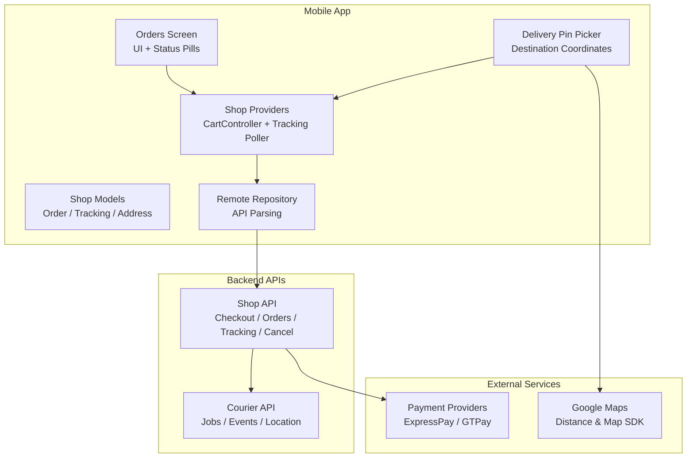

**Diagram sources**
- [orders_screen.dart:26-178](file://lib/features/shop/screens/orders_screen.dart#L26-L178)
- [delivery_pin_screen.dart:12-39](file://lib/features/shop/widgets/delivery_pin_screen.dart#L12-L39)
- [providers.dart:18-18](file://lib/features/shop/providers.dart#L18-L18)
- [providers.dart:182-221](file://lib/features/shop/providers.dart#L182-L221)
- [shop_models.dart:300-450](file://lib/features/shop/data/shop_models.dart#L300-L450)
- [remote_shop_repository.dart:383-425](file://lib/features/shop/data/remote_shop_repository.dart#L383-L425)
- [SHOP_API_MOBILE_HANDOFF.md:148-226](file://docs/SHOP_API_MOBILE_HANDOFF.md#L148-L226)
- [COURIER_API_PARTNER_HANDOFF_FRANK.md:12-41](file://docs/COURIER_API_PARTNER_HANDOFF_FRANK.md#L12-L41)

**Section sources**
- [orders_screen.dart:26-178](file://lib/features/shop/screens/orders_screen.dart#L26-L178)
- [delivery_pin_screen.dart:12-39](file://lib/features/shop/widgets/delivery_pin_screen.dart#L12-L39)
- [providers.dart:18-18](file://lib/features/shop/providers.dart#L18-L18)
- [providers.dart:182-221](file://lib/features/shop/providers.dart#L182-L221)
- [shop_models.dart:300-450](file://lib/features/shop/data/shop_models.dart#L300-L450)
- [remote_shop_repository.dart:383-425](file://lib/features/shop/data/remote_shop_repository.dart#L383-L425)
- [SHOP_API_MOBILE_HANDOFF.md:148-226](file://docs/SHOP_API_MOBILE_HANDOFF.md#L148-L226)
- [COURIER_API_PARTNER_HANDOFF_FRANK.md:12-41](file://docs/COURIER_API_PARTNER_HANDOFF_FRANK.md#L12-L41)

## Core Components
- Shop order model: represents a created order with totals, items, shipping address, carrier/tracking metadata, delivery timeline events, and optional delivery distance fields.
- Tracking model: represents live tracking information including driver location, estimated delivery date, delivered timestamp, shipping address, and event timeline.
- Shipping address model: required checkout input; supports optional destination coordinates for courier distance computation.
- Cart controller: manages cart mutations, idempotent checkout attempts, recovery of partially failed orders, and refreshes cart state after successful placement.
- Tracking provider: polls the tracking endpoint while the order detail sheet is open, stops on terminal statuses, and preserves last known data on transient errors.
- Orders screen: lists orders, shows summary cards, opens an order detail sheet, and renders delivery tracking and timeline events.
- Delivery pin picker: captures customer destination coordinates and optionally assists with manual coordinate entry when map view is unavailable.
- Remote repository parsing: maps flexible backend field names into strongly typed models, including delivery distance and timeline events.

**Section sources**
- [shop_models.dart:152-250](file://lib/features/shop/data/shop_models.dart#L152-L250)
- [shop_models.dart:252-363](file://lib/features/shop/data/shop_models.dart#L252-L363)
- [shop_models.dart:365-450](file://lib/features/shop/data/shop_models.dart#L365-L450)
- [providers.dart:223-338](file://lib/features/shop/providers.dart#L223-L338)
- [providers.dart:182-221](file://lib/features/shop/providers.dart#L182-L221)
- [orders_screen.dart:573-782](file://lib/features/shop/screens/orders_screen.dart#L573-L782)
- [delivery_pin_screen.dart:12-39](file://lib/features/shop/widgets/delivery_pin_screen.dart#L12-L39)
- [remote_shop_repository.dart:383-425](file://lib/features/shop/data/remote_shop_repository.dart#L383-L425)

## Architecture Overview
The order lifecycle connects three main layers:
- Mobile UI and state: orders list, order detail sheet, delivery pin picker, cart controller, and tracking poller.
- Backend shop API: creates orders, reconciles payments, exposes order history, public order lookup by number, tracking, and cancellation.
- Courier partner API: allows courier systems to poll jobs, accept orders, report milestones, and stream driver GPS.

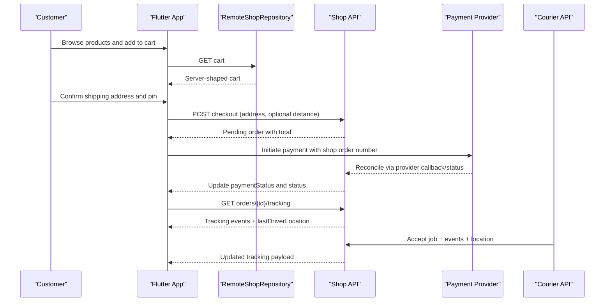

**Diagram sources**
- [SHOP_API_MOBILE_HANDOFF.md:148-226](file://docs/SHOP_API_MOBILE_HANDOFF.md#L148-L226)
- [SHOP_API_MOBILE_HANDOFF.md:229-316](file://docs/SHOP_API_MOBILE_HANDOFF.md#L229-L316)
- [SHOP_API_MOBILE_HANDOFF.md:320-339](file://docs/SHOP_API_MOBILE_HANDOFF.md#L320-L339)
- [COURIER_API_PARTNER_HANDOFF_FRANK.md:12-41](file://docs/COURIER_API_PARTNER_HANDOFF_FRANK.md#L12-L41)
- [providers.dart:182-221](file://lib/features/shop/providers.dart#L182-L221)

## Detailed Component Analysis

### Order Data Models
The app models orders, line items, shipping addresses, tracking timelines, driver locations, and tracking summaries. These types are used across screens, providers, and repositories.

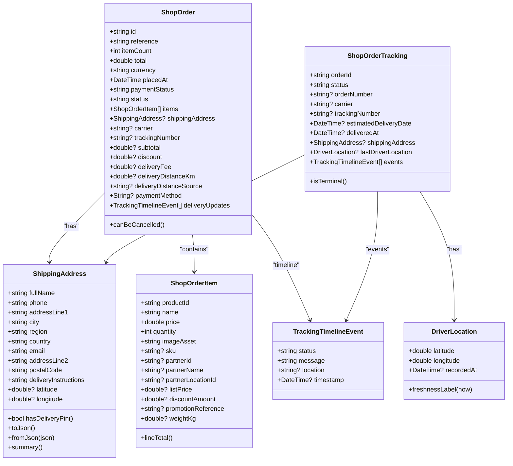

**Diagram sources**
- [shop_models.dart:152-250](file://lib/features/shop/data/shop_models.dart#L152-L250)
- [shop_models.dart:252-363](file://lib/features/shop/data/shop_models.dart#L252-L363)
- [shop_models.dart:365-450](file://lib/features/shop/data/shop_models.dart#L365-L450)

**Section sources**
- [shop_models.dart:152-250](file://lib/features/shop/data/shop_models.dart#L152-L250)
- [shop_models.dart:252-363](file://lib/features/shop/data/shop_models.dart#L252-L363)
- [shop_models.dart:365-450](file://lib/features/shop/data/shop_models.dart#L365-L450)

### Order Creation and Checkout Flow
Checkout creates an order from the server cart, validates prices and stock, clears the cart, and returns a pending order. The app then initiates payment through ExpressPay or GTPay using the shop order number so the backend can reconcile payment outcomes and update order status.

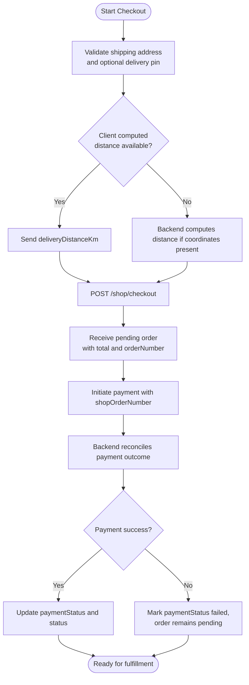

**Diagram sources**
- [SHOP_API_MOBILE_HANDOFF.md:148-226](file://docs/SHOP_API_MOBILE_HANDOFF.md#L148-L226)
- [SHOP_API_MOBILE_HANDOFF.md:229-316](file://docs/SHOP_API_MOBILE_HANDOFF.md#L229-L316)
- [providers.dart:275-338](file://lib/features/shop/providers.dart#L275-L338)

**Section sources**
- [SHOP_API_MOBILE_HANDOFF.md:148-226](file://docs/SHOP_API_MOBILE_HANDOFF.md#L148-L226)
- [SHOP_API_MOBILE_HANDOFF.md:229-316](file://docs/SHOP_API_MOBILE_HANDOFF.md#L229-L316)
- [providers.dart:275-338](file://lib/features/shop/providers.dart#L275-L338)

### Order Tracking and Real-Time Updates
The tracking screen reads live tracking data, displays the driver marker when available, and renders a timeline of delivery events. The provider polls every eight seconds while the order detail sheet is open and stops polling once the order reaches a terminal status.

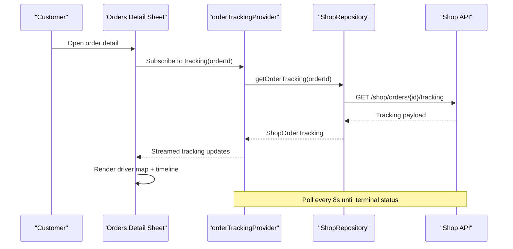

**Diagram sources**
- [providers.dart:182-221](file://lib/features/shop/providers.dart#L182-L221)
- [orders_screen.dart:573-782](file://lib/features/shop/screens/orders_screen.dart#L573-L782)
- [SHOP_API_MOBILE_HANDOFF.md:320-339](file://docs/SHOP_API_MOBILE_HANDOFF.md#L320-L339)

**Section sources**
- [providers.dart:182-221](file://lib/features/shop/providers.dart#L182-L221)
- [orders_screen.dart:573-782](file://lib/features/shop/screens/orders_screen.dart#L573-L782)
- [SHOP_API_MOBILE_HANDOFF.md:320-339](file://docs/SHOP_API_MOBILE_HANDOFF.md#L320-L339)

### Delivery Distance Calculation and Destination Pin
The delivery pin picker captures the customer’s drop-off coordinates. If Google Maps is configured, users can tap to place a pin; otherwise, they can enter coordinates manually. The app may send `deliveryDistanceKm` at checkout; if omitted but coordinates are present, the backend calculates it and records the source.

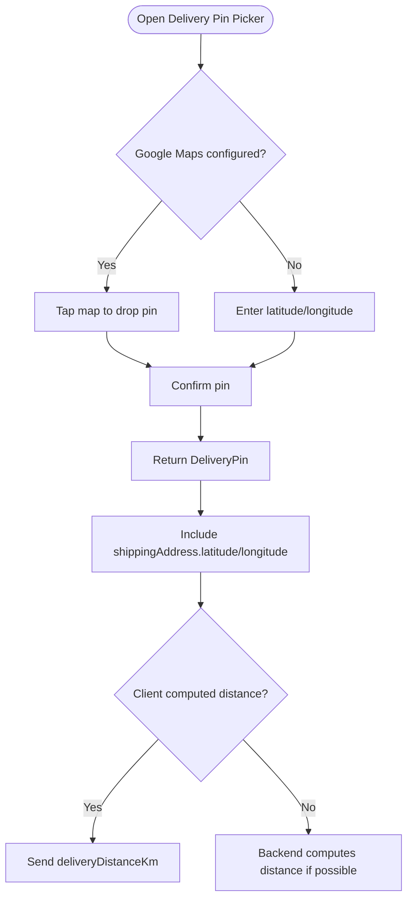

**Diagram sources**
- [delivery_pin_screen.dart:12-39](file://lib/features/shop/widgets/delivery_pin_screen.dart#L12-L39)
- [delivery_pin_screen.dart:142-161](file://lib/features/shop/widgets/delivery_pin_screen.dart#L142-L161)
- [delivery_pin_screen.dart:231-305](file://lib/features/shop/widgets/delivery_pin_screen.dart#L231-L305)
- [SHOP_API_MOBILE_HANDOFF.md:174-198](file://docs/SHOP_API_MOBILE_HANDOFF.md#L174-L198)

**Section sources**
- [delivery_pin_screen.dart:12-39](file://lib/features/shop/widgets/delivery_pin_screen.dart#L12-L39)
- [delivery_pin_screen.dart:142-161](file://lib/features/shop/widgets/delivery_pin_screen.dart#L142-L161)
- [delivery_pin_screen.dart:231-305](file://lib/features/shop/widgets/delivery_pin_screen.dart#L231-L305)
- [SHOP_API_MOBILE_HANDOFF.md:174-198](file://docs/SHOP_API_MOBILE_HANDOFF.md#L174-L198)

### Courier Integration and Fulfillment Workflow
Frank’s courier system integrates via signed HTTP requests. The workflow includes polling available jobs, accepting a job atomically, reporting pickup first, sending out-for-delivery, streaming driver GPS, and marking delivered. The mobile app never calls courier endpoints directly; it only reads customer tracking data.

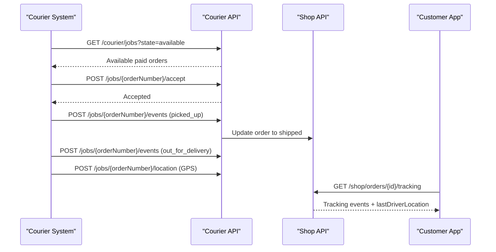

**Diagram sources**
- [COURIER_API_PARTNER_HANDOFF_FRANK.md:12-41](file://docs/COURIER_API_PARTNER_HANDOFF_FRANK.md#L12-L41)
- [COURIER_API_PARTNER_HANDOFF_FRANK.md:232-289](file://docs/COURIER_API_PARTNER_HANDOFF_FRANK.md#L232-L289)
- [COURIER_API_PARTNER_HANDOFF_FRANK.md:302-398](file://docs/COURIER_API_PARTNER_HANDOFF_FRANK.md#L302-L398)
- [SHOP_API_MOBILE_HANDOFF.md:320-339](file://docs/SHOP_API_MOBILE_HANDOFF.md#L320-L339)

**Section sources**
- [COURIER_API_PARTNER_HANDOFF_FRANK.md:12-41](file://docs/COURIER_API_PARTNER_HANDOFF_FRANK.md#L12-L41)
- [COURIER_API_PARTNER_HANDOFF_FRANK.md:232-289](file://docs/COURIER_API_PARTNER_HANDOFF_FRANK.md#L232-L289)
- [COURIER_API_PARTNER_HANDOFF_FRANK.md:302-398](file://docs/COURIER_API_PARTNER_HANDOFF_FRANK.md#L302-L398)
- [SHOP_API_MOBILE_HANDOFF.md:320-339](file://docs/SHOP_API_MOBILE_HANDOFF.md#L320-L339)

### Order Cancellation and Refund Handling
Orders can be cancelled when their status permits cancellation. The backend cancels the order and restores stock. Refunds are represented by order and payment states such as refunded.

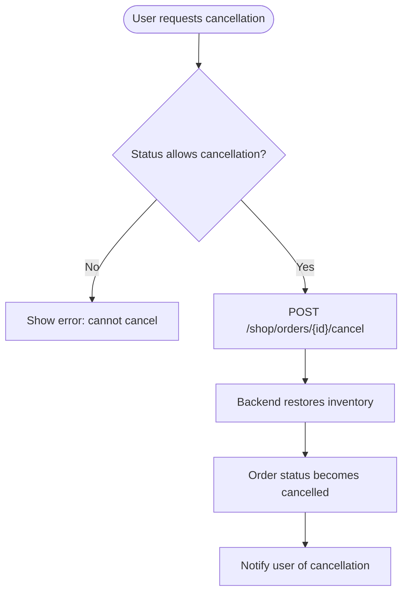

**Diagram sources**
- [SHOP_API_MOBILE_HANDOFF.md:320-339](file://docs/SHOP_API_MOBILE_HANDOFF.md#L320-L339)
- [shop_models.dart:351-352](file://lib/features/shop/data/shop_models.dart#L351-L352)

**Section sources**
- [SHOP_API_MOBILE_HANDOFF.md:320-339](file://docs/SHOP_API_MOBILE_HANDOFF.md#L320-L339)
- [shop_models.dart:351-352](file://lib/features/shop/data/shop_models.dart#L351-L352)

### Order State Consistency and Conflict Resolution
- Idempotent checkout: the cart controller keeps a client reference per attempt so retries do not create duplicate orders. On failure, it reconciles by checking whether the cart was cleared and finding a recent unpaid order.
- Terminal tracking: the tracking provider stops polling when the order reaches terminal statuses like delivered, cancelled, or refunded.
- Courier conflicts: the courier API enforces state ordering (pickup before other events), rejects duplicates by event ID, and handles stale GPS points gracefully.

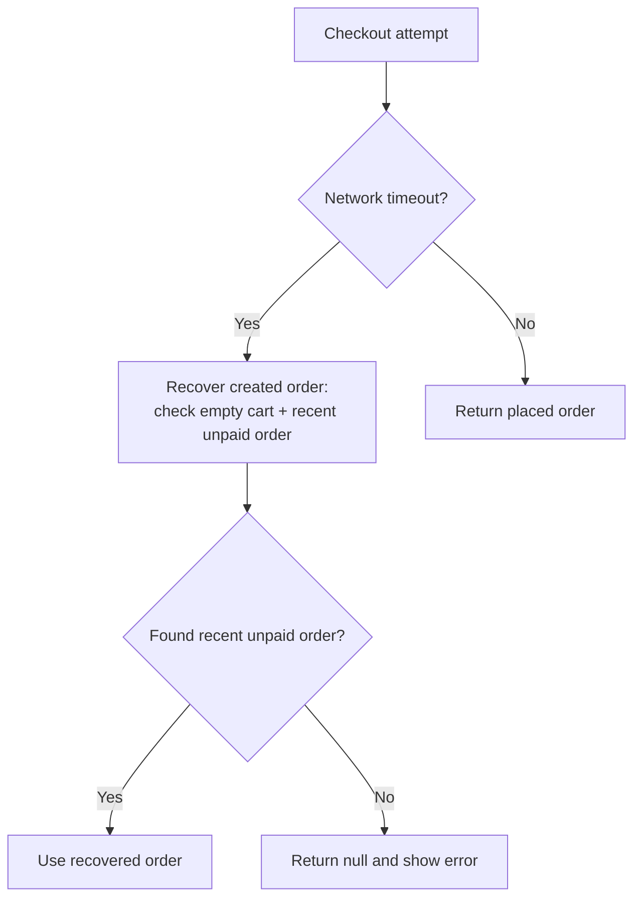

**Diagram sources**
- [providers.dart:275-338](file://lib/features/shop/providers.dart#L275-L338)
- [providers.dart:182-221](file://lib/features/shop/providers.dart#L182-L221)
- [COURIER_API_PARTNER_HANDOFF_FRANK.md:559-560](file://docs/COURIER_API_PARTNER_HANDOFF_FRANK.md#L559-L560)

**Section sources**
- [providers.dart:275-338](file://lib/features/shop/providers.dart#L275-L338)
- [providers.dart:182-221](file://lib/features/shop/providers.dart#L182-L221)
- [COURIER_API_PARTNER_HANDOFF_FRANK.md:559-560](file://docs/COURIER_API_PARTNER_HANDOFF_FRANK.md#L559-L560)

### User Notification Strategies
- In-app notifications: the app maintains a notification model supporting channels like push, email, SMS, and in-app, with read state overlaid locally.
- Push notifications: the app initializes Firebase messaging and local notifications, and provides a service for displaying alerts.
- Order tracking updates: the app renders delivery timeline events and driver location staleness labels to keep customers informed without relying solely on push notifications.

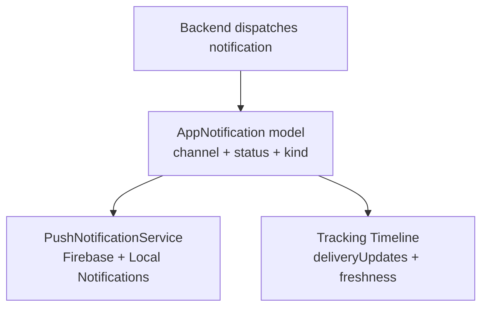

**Diagram sources**
- [notification_models.dart:1-40](file://lib/features/notifications/data/notification_models.dart#L1-L40)
- [push_notification_service.dart:1-42](file://lib/core/notifications/push_notification_service.dart#L1-L42)
- [orders_screen.dart:718-782](file://lib/features/shop/screens/orders_screen.dart#L718-L782)

**Section sources**
- [notification_models.dart:1-40](file://lib/features/notifications/data/notification_models.dart#L1-L40)
- [push_notification_service.dart:1-42](file://lib/core/notifications/push_notification_service.dart#L1-L42)
- [orders_screen.dart:718-782](file://lib/features/shop/screens/orders_screen.dart#L718-L782)

## Dependency Analysis
The order management components depend on each other in a layered way:
- UI depends on providers for state and polling.
- Providers depend on repositories for API access.
- Repositories parse backend payloads into domain models.
- Documentation defines contracts between the app, shop API, payment providers, and courier partners.

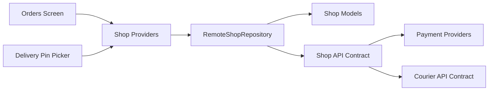

**Diagram sources**
- [orders_screen.dart:26-178](file://lib/features/shop/screens/orders_screen.dart#L26-L178)
- [delivery_pin_screen.dart:12-39](file://lib/features/shop/widgets/delivery_pin_screen.dart#L12-L39)
- [providers.dart:18-18](file://lib/features/shop/providers.dart#L18-L18)
- [remote_shop_repository.dart:383-425](file://lib/features/shop/data/remote_shop_repository.dart#L383-L425)
- [shop_models.dart:300-450](file://lib/features/shop/data/shop_models.dart#L300-L450)
- [SHOP_API_MOBILE_HANDOFF.md:148-226](file://docs/SHOP_API_MOBILE_HANDOFF.md#L148-L226)
- [COURIER_API_PARTNER_HANDOFF_FRANK.md:12-41](file://docs/COURIER_API_PARTNER_HANDOFF_FRANK.md#L12-L41)

**Section sources**
- [orders_screen.dart:26-178](file://lib/features/shop/screens/orders_screen.dart#L26-L178)
- [delivery_pin_screen.dart:12-39](file://lib/features/shop/widgets/delivery_pin_screen.dart#L12-L39)
- [providers.dart:18-18](file://lib/features/shop/providers.dart#L18-L18)
- [remote_shop_repository.dart:383-425](file://lib/features/shop/data/remote_shop_repository.dart#L383-L425)
- [shop_models.dart:300-450](file://lib/features/shop/data/shop_models.dart#L300-L450)
- [SHOP_API_MOBILE_HANDOFF.md:148-226](file://docs/SHOP_API_MOBILE_HANDOFF.md#L148-L226)
- [COURIER_API_PARTNER_HANDOFF_FRANK.md:12-41](file://docs/COURIER_API_PARTNER_HANDOFF_FRANK.md#L12-L41)

## Performance Considerations
- Tracking polling interval: eight seconds balances responsiveness with network load; stop polling on terminal statuses and when the detail sheet closes.
- Cart mutations: preserve previous state during mutations to avoid UI flicker and disable controls appropriately.
- Delivery pin fallback: provide manual coordinate entry when map view is unavailable to reduce friction.
- Mock repository latency: tests simulate latency to validate UI behavior under realistic conditions.

[No sources needed since this section provides general guidance]

## Troubleshooting Guide
Common issues and resolutions:
- Checkout timeout: recover a potentially created order by checking for an empty cart and a recent unpaid order.
- Tracking unavailable: the tracking provider yields null on the first poll if no data is returned, then continues polling; transient failures keep the last good payload.
- Courier signature errors: ensure headers include correct partner ID, timestamp within five minutes, unique event ID, and HMAC-SHA256 signature computed over the canonical request.
- Stale GPS: courier API accepts older GPS points with a stale flag and retains the newer location.
- Order cancellation restrictions: only allow cancellation for eligible statuses; otherwise show an error.

**Section sources**
- [providers.dart:275-338](file://lib/features/shop/providers.dart#L275-L338)
- [providers.dart:182-221](file://lib/features/shop/providers.dart#L182-L221)
- [COURIER_API_PARTNER_HANDOFF_FRANK.md:418-426](file://docs/COURIER_API_PARTNER_HANDOFF_FRANK.md#L418-L426)
- [COURIER_API_PARTNER_HANDOFF_FRANK.md:377-398](file://docs/COURIER_API_PARTNER_HANDOFF_FRANK.md#L377-L398)
- [shop_models.dart:351-352](file://lib/features/shop/data/shop_models.dart#L351-L352)

## Conclusion
The order management system combines robust mobile UI, resilient state management, strict API contracts, and a secure courier integration. Orders are created with server-computed pricing, reconciled through payment providers, tracked in real time, and fulfilled by couriers who report milestones and GPS updates. The app ensures consistency through idempotent checkout, terminal-status-aware polling, and graceful fallbacks for location and tracking. Users receive timely updates through in-app timelines, push notifications, and clear status indicators.