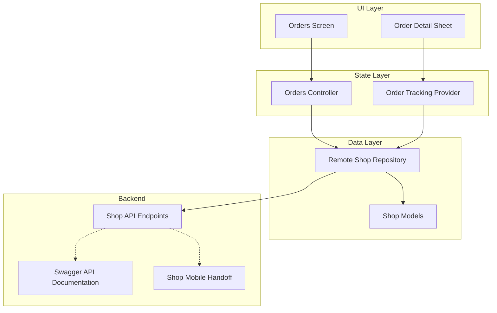
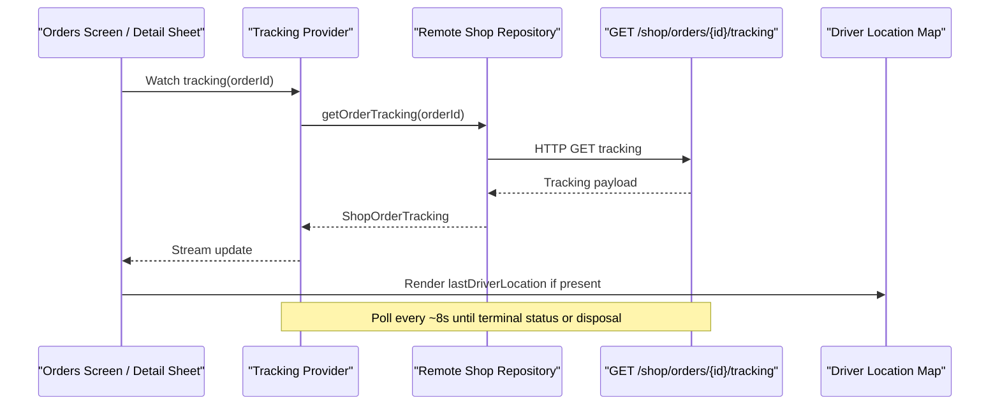
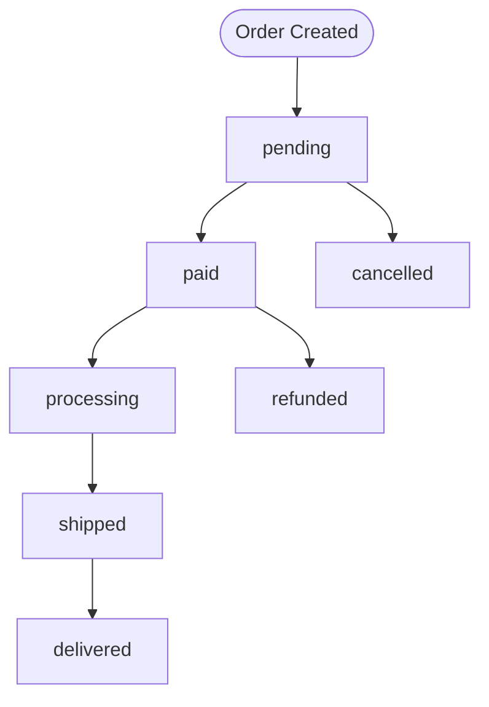
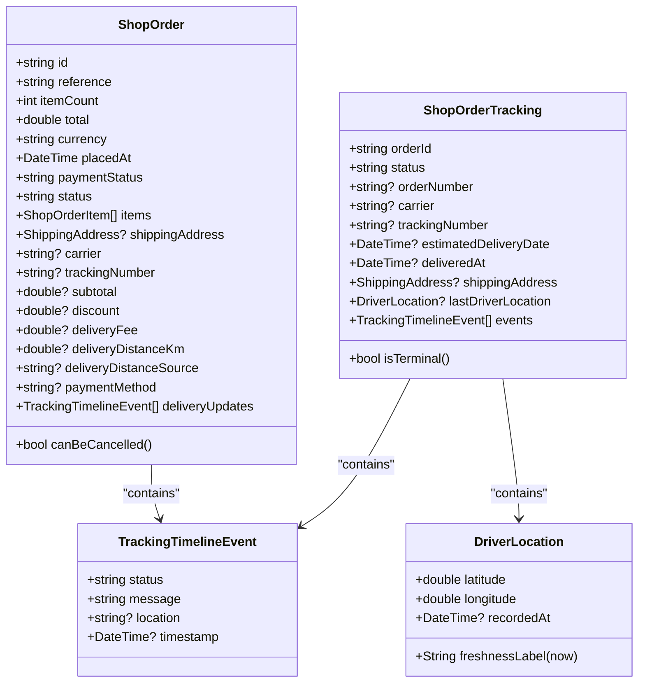
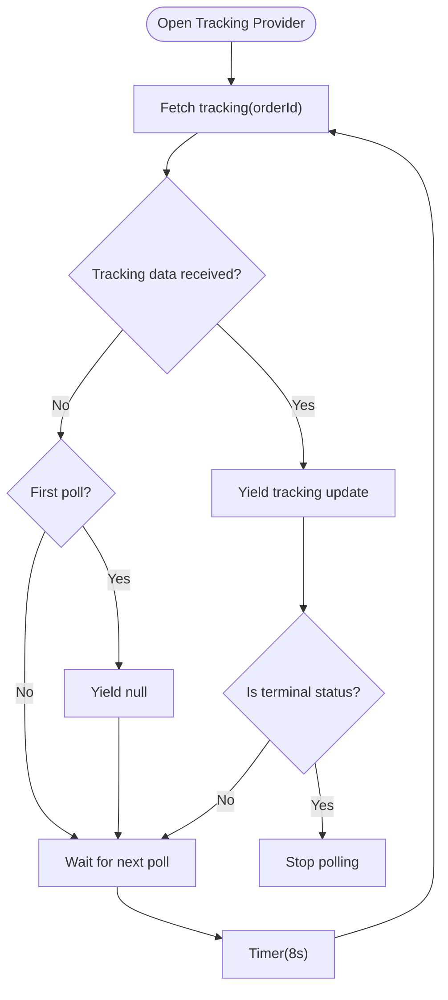
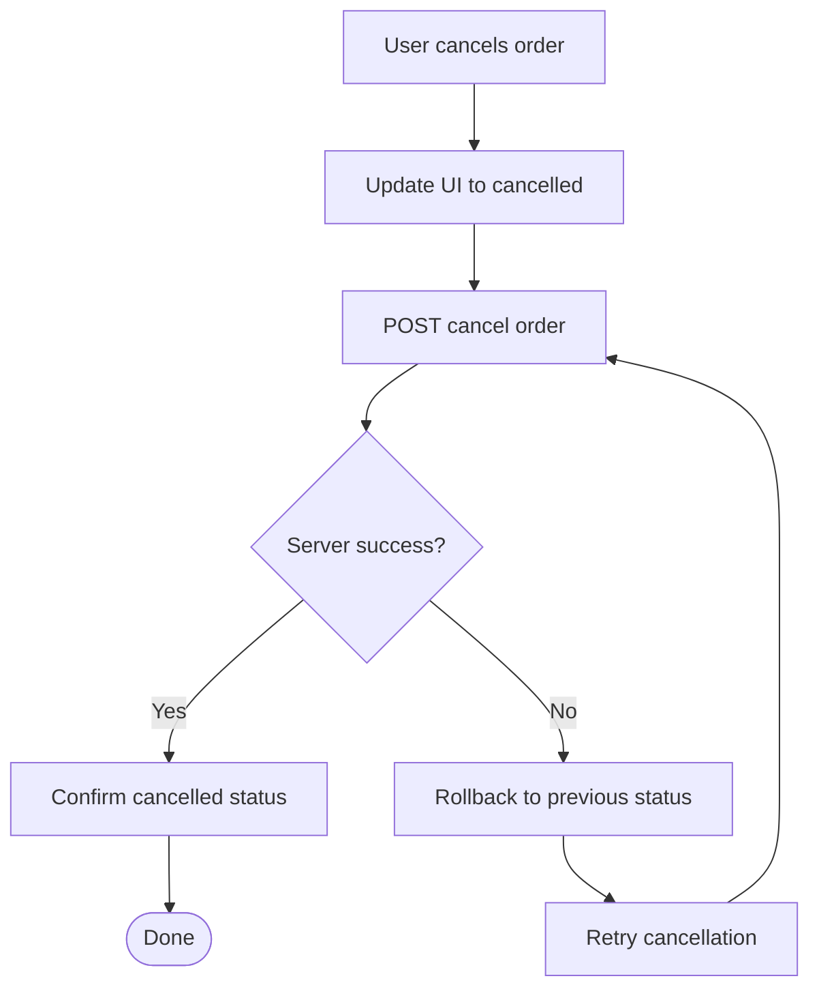
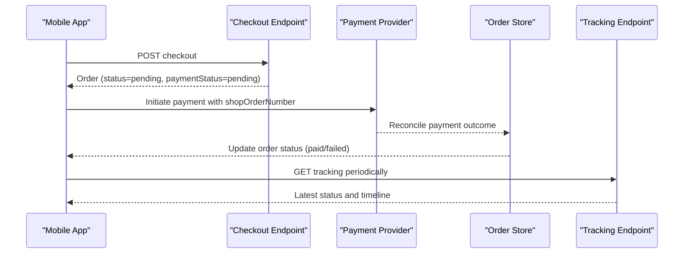
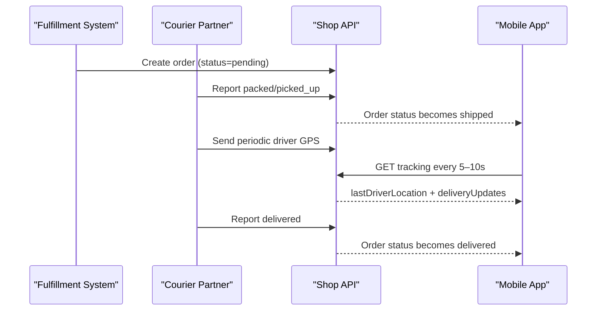
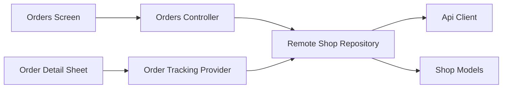

# Order Tracking & Status Management

<cite>
**Referenced Files in This Document**
- [ENDPOINTS.md](file://api/ENDPOINTS.md)
- [SHOP_API_MOBILE_HANDOFF.md](file://docs/SHOP_API_MOBILE_HANDOFF.md)
- [swagger-api-documentation.md](file://docs/swagger-api-documentation.md)
- [shop_models.dart](file://lib/features/shop/data/shop_models.dart)
- [remote_shop_repository.dart](file://lib/features/shop/data/remote_shop_repository.dart)
- [providers.dart](file://lib/features/shop/providers.dart)
- [orders_screen.dart](file://lib/features/shop/screens/orders_screen.dart)
- [connectivity_service.dart](file://lib/core/network/connectivity_service.dart)
</cite>

## Table of Contents
1. [Introduction](#introduction)
2. [Project Structure](#project-structure)
3. [Core Components](#core-components)
4. [Architecture Overview](#architecture-overview)
5. [Detailed Component Analysis](#detailed-component-analysis)
6. [Dependency Analysis](#dependency-analysis)
7. [Performance Considerations](#performance-considerations)
8. [Troubleshooting Guide](#troubleshooting-guide)
9. [Conclusion](#conclusion)

## Introduction
This document explains how order tracking and status management work in the LidaPay shop feature. It covers:
- Real-time order status updates through polling and provider-driven streams.
- Status transition workflows for orders and payment status.
- State synchronization between the mobile app and backend endpoints.
- The order status enum values, delivery timeline events, and business rules.
- Polling mechanisms, fallback strategies for offline or failed requests, and conflict handling when multiple updates arrive.

The implementation is Flutter-based and uses Riverpod providers to manage UI state, a repository layer for API calls, and explicit models for orders, tracking data, and driver location.

## Project Structure
Order tracking spans several layers:
- Models define order, tracking, timeline event, and driver location structures.
- A remote repository fetches and normalizes API responses.
- Providers implement polling, lifecycle-aware stream updates, and recovery logic.
- Screens render status pills, timelines, and optional live driver maps.
- Documentation files describe API contracts, status values, and polling requirements.

**Diagram sources**
- [orders_screen.dart](file://lib/features/shop/screens/orders_screen.dart)
- [providers.dart](file://lib/features/shop/providers.dart)
- [remote_shop_repository.dart](file://lib/features/shop/data/remote_shop_repository.dart)
- [shop_models.dart](file://lib/features/shop/data/shop_models.dart)
- [ENDPOINTS.md](file://api/ENDPOINTS.md)
- [swagger-api-documentation.md](file://docs/swagger-api-documentation.md)
- [SHOP_API_MOBILE_HANDOFF.md](file://docs/SHOP_API_MOBILE_HANDOFF.md)

**Section sources**
- [orders_screen.dart](file://lib/features/shop/screens/orders_screen.dart)
- [providers.dart](file://lib/features/shop/providers.dart)
- [remote_shop_repository.dart](file://lib/features/shop/data/remote_shop_repository.dart)
- [shop_models.dart](file://lib/features/shop/data/shop_models.dart)
- [ENDPOINTS.md](file://api/ENDPOINTS.md)
- [swagger-api-documentation.md](file://docs/swagger-api-documentation.md)
- [SHOP_API_MOBILE_HANDOFF.md](file://docs/SHOP_API_MOBILE_HANDOFF.md)

## Core Components
- Order model: Represents an order with `status`, `paymentStatus`, items, shipping address, carrier, tracking number, and delivery timeline.
- Tracking model: Represents live tracking info including order status, estimated delivery date, delivered timestamp, last driver location, and delivery update events.
- Timeline event: Represents each step in the delivery timeline, such as order placed, courier accepted, picked up, out for delivery, delivered, or exceptions.
- Driver location: Represents GPS coordinates and recorded timestamp for live map display.
- Remote repository: Normalizes API payloads into typed models and handles missing fields gracefully.
- Providers: Manage paginated orders and streaming tracking updates with polling.
- Connectivity service: Streams online/offline state for potential integration with polling behavior.

Key responsibilities:
- Parsing and mapping flexible API shapes into stable models.
- Polling tracking endpoint while the detail sheet is open.
- Stopping polling on terminal statuses or disposal.
- Preserving last known good tracking data during transient failures.

**Section sources**
- [shop_models.dart](file://lib/features/shop/data/shop_models.dart)
- [remote_shop_repository.dart](file://lib/features/shop/data/remote_shop_repository.dart)
- [providers.dart](file://lib/features/shop/providers.dart)
- [connectivity_service.dart](file://lib/core/network/connectivity_service.dart)

## Architecture Overview
The order tracking architecture follows a layered approach:
- UI components request order lists and per-order tracking.
- Providers orchestrate data fetching and polling.
- Repository translates raw API responses into domain models.
- Backend endpoints provide order details, tracking, and admin status updates.

**Diagram sources**
- [providers.dart](file://lib/features/shop/providers.dart)
- [remote_shop_repository.dart](file://lib/features/shop/data/remote_shop_repository.dart)
- [orders_screen.dart](file://lib/features/shop/screens/orders_screen.dart)

## Detailed Component Analysis

### Order Status Enum Values and Transition Rules
Order status values and transitions are defined by the backend contract and reflected in the app models and documentation:
- Order status progression: `pending` → `paid` → `processing` → `shipped` → `delivered`.
- Additional statuses: `cancelled`, `refunded`.
- Payment status values: `pending`, `success`, `failed`, `refunded`.
- Delivery timeline events include: `order_placed`, `payment_confirmed`, `payment_failed`, `courier_accepted`, courier events (`packed`, `picked_up`, `out_for_delivery`, `delivered`, `delivery_exception`, `failed_delivery`), and raw order-status values pushed by fulfillment/admin updates.

Business rules:
- Admin endpoints enforce valid status transitions when updating order status.
- Payment reconciliation automatically advances order status based on payment outcomes.
- Courier partner handoff requires reporting pickup before subsequent delivery events; this moves the order to `shipped`.

**Diagram sources**
- [SHOP_API_MOBILE_HANDOFF.md](file://docs/SHOP_API_MOBILE_HANDOFF.md)
- [ENDPOINTS.md](file://api/ENDPOINTS.md)
- [swagger-api-documentation.md](file://docs/swagger-api-documentation.md)

**Section sources**
- [SHOP_API_MOBILE_HANDOFF.md](file://docs/SHOP_API_MOBILE_HANDOFF.md)
- [ENDPOINTS.md](file://api/ENDPOINTS.md)
- [swagger-api-documentation.md](file://docs/swagger-api-documentation.md)

### Data Models and Mapping Logic
Models encapsulate order and tracking data:
- `ShopOrder`: Contains order identifiers, totals, currency, placement time, status, payment status, items, shipping address, carrier, tracking number, delivery fee/distance metadata, payment method, and delivery timeline events.
- `ShopOrderTracking`: Contains tracking-specific fields like order number, status, carrier, tracking number, estimated delivery date, delivered timestamp, shipping address, last driver location, and events.
- `TrackingTimelineEvent`: Encapsulates event status, message, optional location, and timestamp.
- `DriverLocation`: Encapsulates latitude, longitude, and recorded timestamp, plus freshness labeling.

Repository mapping:
- Flexible field resolution supports multiple API key variants.
- Missing fields fall back to safe defaults (e.g., default status `pending`).
- Timeline events are normalized and sorted newest-first.
- Driver location parsing tolerates alternate coordinate keys and timestamps.

**Diagram sources**
- [shop_models.dart](file://lib/features/shop/data/shop_models.dart)

**Section sources**
- [shop_models.dart](file://lib/features/shop/data/shop_models.dart)
- [remote_shop_repository.dart](file://lib/features/shop/data/remote_shop_repository.dart)

### Real-Time Updates and Polling Mechanism
The tracking provider implements a polling loop:
- Watches the repository for tracking data.
- Yields updates whenever new tracking data arrives.
- Stops polling when the order reaches a terminal status (`delivered`, `cancelled`, `refunded`) or when the provider is disposed.
- Retains the last successful payload to avoid flickering on transient network errors.
- Uses an 8-second interval between polls.

Recommended app behavior per documentation:
- While the tracking screen is visible and the order status is `processing` or `shipped`, poll every 5–10 seconds.
- Stop polling immediately when leaving the screen, backgrounding the app, or reaching terminal statuses.
- Display driver location on a map when available and not terminal.

**Diagram sources**
- [providers.dart](file://lib/features/shop/providers.dart)
- [SHOP_API_MOBILE_HANDOFF.md](file://docs/SHOP_API_MOBILE_HANDOFF.md)

**Section sources**
- [providers.dart](file://lib/features/shop/providers.dart)
- [SHOP_API_MOBILE_HANDOFF.md](file://docs/SHOP_API_MOBILE_HANDOFF.md)

### WebSocket Connections for Live Updates
The current implementation relies on HTTP polling rather than WebSocket connections. There is no WebSocket client code in the analyzed files. If real-time updates via WebSockets are introduced later, the provider should:
- Maintain a single connection per active tracking view.
- Reconnect with exponential backoff on failure.
- Merge incoming events with existing timeline events using timestamps.
- Respect terminal statuses to close connections promptly.

[No sources needed since this section provides conceptual guidance]

### Fallback Strategies for Offline Scenarios
Connectivity service:
- Streams online/offline state changes.
- Can be integrated to pause polling when offline and resume when online.

Repository fallbacks:
- Returns null on tracking fetch failures, allowing the provider to retain last known good data.
- Gracefully handles missing fields with safe defaults.

App-level recommendations:
- Pause polling when offline.
- Resume polling after connectivity restored.
- Show stale data indicators derived from `lastDriverLocation.recordedAt`.

**Section sources**
- [connectivity_service.dart](file://lib/core/network/connectivity_service.dart)
- [remote_shop_repository.dart](file://lib/features/shop/data/remote_shop_repository.dart)
- [shop_models.dart](file://lib/features/shop/data/shop_models.dart)

### Optimistic UI Updates and Conflict Resolution
Optimistic updates:
- For order cancellation, the UI may temporarily reflect a new status before server confirmation.
- The repository returns updated order objects upon successful mutation.

Conflict resolution:
- Timeline events are sorted by timestamp, newest first, ensuring consistent ordering even if events arrive out of order.
- Terminal statuses stop further polling, preventing conflicting updates after completion.
- Checkout recovery logic reconciles potentially created orders when network timeouts occur, avoiding duplicate orders.

**Diagram sources**
- [remote_shop_repository.dart](file://lib/features/shop/data/remote_shop_repository.dart)
- [providers.dart](file://lib/features/shop/providers.dart)

**Section sources**
- [remote_shop_repository.dart](file://lib/features/shop/data/remote_shop_repository.dart)
- [providers.dart](file://lib/features/shop/providers.dart)

### Status Caching Strategy
Current caching behavior:
- Tracking provider retains the last successful payload across transient failures.
- No explicit persistent cache for tracking data is implemented in the analyzed files.
- Orders list uses pagination with in-memory deduplication by order ID.

Recommendations:
- Cache recent tracking payloads keyed by order ID with TTL.
- Invalidate cache on terminal status or explicit refresh.
- Use connectivity state to decide whether to serve cached data or wait for fresh data.

**Section sources**
- [providers.dart](file://lib/features/shop/providers.dart)

### Example Workflows

#### Order Creation and Payment Reconciliation

**Diagram sources**
- [SHOP_API_MOBILE_HANDOFF.md](file://docs/SHOP_API_MOBILE_HANDOFF.md)
- [ENDPOINTS.md](file://api/ENDPOINTS.md)

**Section sources**
- [SHOP_API_MOBILE_HANDOFF.md](file://docs/SHOP_API_MOBILE_HANDOFF.md)
- [ENDPOINTS.md](file://api/ENDPOINTS.md)

#### Courier Partner Handoff and Status Progression

**Diagram sources**
- [COURIER_API_PARTNER_HANDOFF_FRANK.md](file://docs/COURIER_API_PARTNER_HANDOFF_FRANK.md)
- [SHOP_API_MOBILE_HANDOFF.md](file://docs/SHOP_API_MOBILE_HANDOFF.md)

**Section sources**
- [SHOP_API_MOBILE_HANDOFF.md](file://docs/SHOP_API_MOBILE_HANDOFF.md)

## Dependency Analysis
Component relationships:
- `OrdersScreen` depends on `OrdersController` for paginated orders.
- `DetailSheet` depends on `orderTrackingProvider` for live tracking.
- Both controllers depend on `RemoteShopRepository`.
- `RemoteShopRepository` depends on `ApiClient` and maps to `ShopModels`.
- Documentation files define API contracts that guide repository mapping and UI behavior.

**Diagram sources**
- [orders_screen.dart](file://lib/features/shop/screens/orders_screen.dart)
- [providers.dart](file://lib/features/shop/providers.dart)
- [remote_shop_repository.dart](file://lib/features/shop/data/remote_shop_repository.dart)
- [shop_models.dart](file://lib/features/shop/data/shop_models.dart)

**Section sources**
- [orders_screen.dart](file://lib/features/shop/screens/orders_screen.dart)
- [providers.dart](file://lib/features/shop/providers.dart)
- [remote_shop_repository.dart](file://lib/features/shop/data/remote_shop_repository.dart)
- [shop_models.dart](file://lib/features/shop/data/shop_models.dart)

## Performance Considerations
- Polling interval: 8 seconds in provider; documentation recommends 5–10 seconds while tracking screen is active.
- Stop polling on terminal statuses to reduce unnecessary requests.
- Avoid recomputing totals locally; rely on server-provided totals in cart and order models.
- Deduplicate orders by ID when loading more pages.
- Handle network failures gracefully to prevent UI flicker.

[No sources needed since this section provides general guidance]

## Troubleshooting Guide
Common issues and resolutions:
- Tracking unavailable: Repository returns null on failure; provider yields null only on first poll, then retains last known data.
- Stale driver location: Use `recordedAt` to show freshness; handle missing coordinates before pickup.
- Terminal status not stopping polling: Ensure terminal check uses `isTerminal` property.
- Duplicate orders on checkout retry: Idempotency key prevents duplicate creation; recovery logic reconciles created orders.

Operational checks:
- Verify connectivity state and pause/resume polling accordingly.
- Validate API responses against expected field names; repository mapping tolerates multiple variants.

**Section sources**
- [remote_shop_repository.dart](file://lib/features/shop/data/remote_shop_repository.dart)
- [providers.dart](file://lib/features/shop/providers.dart)
- [connectivity_service.dart](file://lib/core/network/connectivity_service.dart)
- [shop_models.dart](file://lib/features/shop/data/shop_models.dart)

## Conclusion
Order tracking and status management in the LidaPay shop feature combine robust models, flexible API mapping, and provider-driven polling to deliver real-time updates. The backend defines clear status transitions and delivery timeline events, while the app implements practical safeguards such as terminal status detection, last-known-good caching, and checkout recovery. Future enhancements could introduce WebSocket connections for live updates and more sophisticated caching strategies, but the current design provides a reliable foundation for order visibility and delivery tracking.