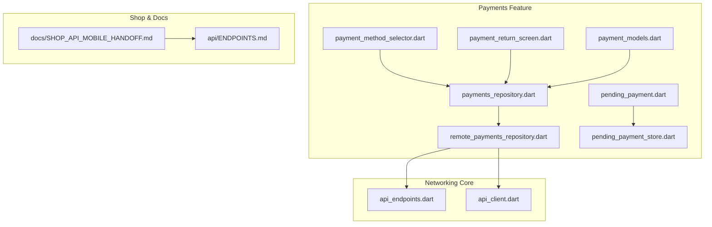
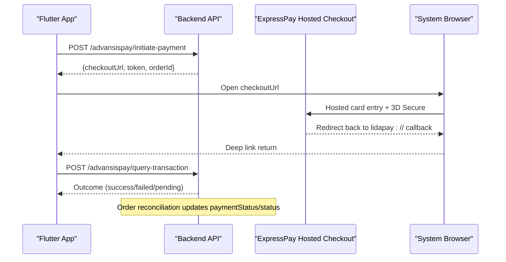
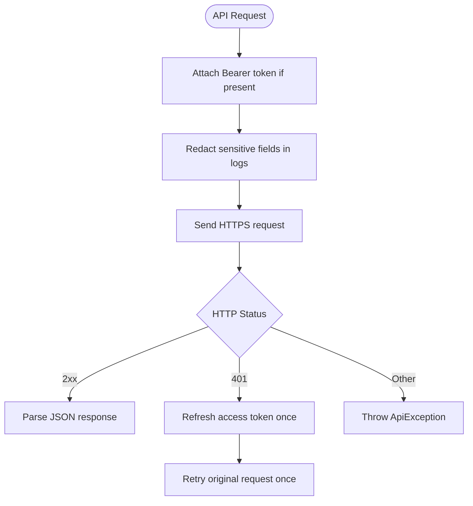
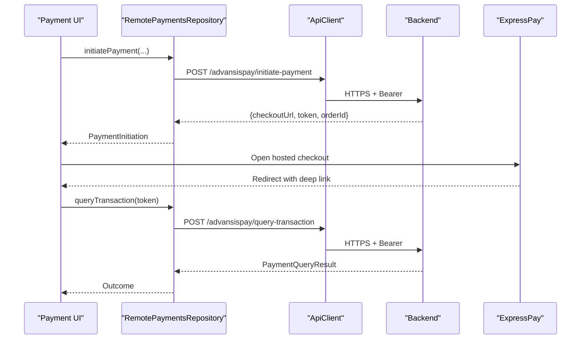
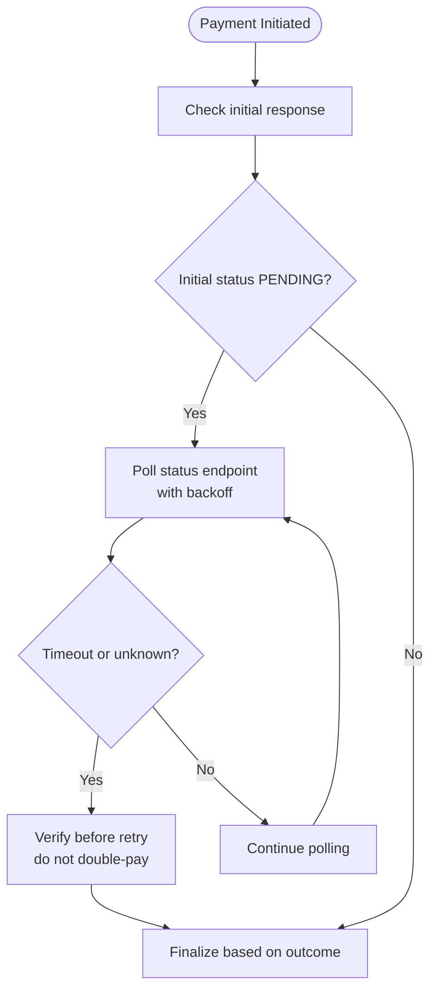
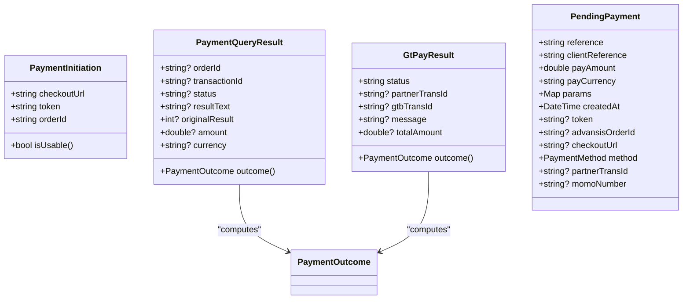
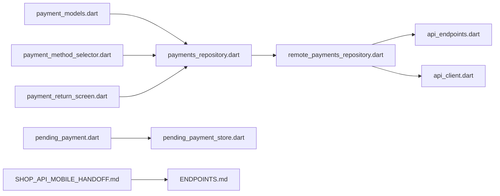

# Card Payment Processing

<cite>
**Referenced Files in This Document**
- [README.md](file://README.md)
- [ENDPOINTS.md](file://api/ENDPOINTS.md)
- [SHOP_API_MOBILE_HANDOFF.md](file://docs/SHOP_API_MOBILE_HANDOFF.md)
- [pubspec.yaml](file://pubspec.yaml)
- [payment_models.dart](file://lib/features/payments/data/payment_models.dart)
- [payments_repository.dart](file://lib/features/payments/data/payments_repository.dart)
- [remote_payments_repository.dart](file://lib/features/payments/data/remote_payments_repository.dart)
- [pending_payment.dart](file://lib/features/payments/data/pending_payment.dart)
- [pending_payment_store.dart](file://lib/features/payments/data/pending_payment_store.dart)
- [payment_method_selector.dart](file://lib/features/payments/widgets/payment_method_selector.dart)
- [payment_return_screen.dart](file://lib/features/payments/screens/payment_return_screen.dart)
- [api_endpoints.dart](file://lib/core/network/api_endpoints.dart)
- [api_client.dart](file://lib/core/network/api_client.dart)
</cite>

## Table of Contents
1. [Introduction](#introduction)
2. [Project Structure](#project-structure)
3. [Core Components](#core-components)
4. [Architecture Overview](#architecture-overview)
5. [Detailed Component Analysis](#detailed-component-analysis)
6. [Dependency Analysis](#dependency-analysis)
7. [Performance Considerations](#performance-considerations)
8. [Troubleshooting Guide](#troubleshooting-guide)
9. [Conclusion](#conclusion)

## Introduction
This document explains card payment processing through the ExpressPay (Advansis Pay) and GTPay gateways in the LidaPay Flutter application. It covers:
- How card payments are initiated, authenticated, and confirmed.
- Where card data is handled and how PCI compliance is achieved by offloading sensitive input to the hosted checkout.
- Secure transmission via HTTPS with bearer tokens and request redaction.
- The complete flow from card input to transaction confirmation, including 3D Secure authentication on the provider’s hosted page.
- Examples of validation, error handling for declined transactions, and retry logic.
- Guidance for chargebacks, refunds, and payment card industry standards as reflected by the app’s behavior and contracts.

The mobile app does not collect or store raw card numbers; it opens a secure hosted checkout provided by ExpressPay. For mobile money, GTPay debits a customer wallet using a backend-mediated service.

**Section sources**
- [README.md:1-47](file://README.md#L1-L47)
- [SHOP_API_MOBILE_HANDOFF.md:229-317](file://docs/SHOP_API_MOBILE_HANDOFF.md#L229-L317)

## Project Structure
Card payment functionality lives under `lib/features/payments` and integrates with shared networking and shop order flows:
- Data models define parsed responses from ExpressPay and GTPay.
- Repository interfaces abstract payment calls.
- Remote repository implements HTTP requests against backend endpoints.
- Pending payment persistence survives process restarts during checkout.
- UI components guide users through method selection and display return outcomes.
- Networking layer adds authorization headers, refreshes tokens, and redacts sensitive logs.

**Diagram sources**
- [payment_models.dart:1-215](file://lib/features/payments/data/payment_models.dart#L1-L215)
- [payments_repository.dart:1-46](file://lib/features/payments/data/payments_repository.dart#L1-L46)
- [remote_payments_repository.dart:1-111](file://lib/features/payments/data/remote_payments_repository.dart#L1-L111)
- [pending_payment.dart:1-335](file://lib/features/payments/data/pending_payment.dart#L1-L335)
- [pending_payment_store.dart:1-123](file://lib/features/payments/data/pending_payment_store.dart#L1-L123)
- [payment_method_selector.dart:1-800](file://lib/features/payments/widgets/payment_method_selector.dart#L1-L800)
- [payment_return_screen.dart:1-352](file://lib/features/payments/screens/payment_return_screen.dart#L1-L352)
- [api_endpoints.dart:102-109](file://lib/core/network/api_endpoints.dart#L102-L109)
- [api_client.dart:1-276](file://lib/core/network/api_client.dart#L1-L276)
- [ENDPOINTS.md:153-158](file://api/ENDPOINTS.md#L153-L158)
- [SHOP_API_MOBILE_HANDOFF.md:237-317](file://docs/SHOP_API_MOBILE_HANDOFF.md#L237-L317)

**Section sources**
- [payment_models.dart:1-215](file://lib/features/payments/data/payment_models.dart#L1-L215)
- [payments_repository.dart:1-46](file://lib/features/payments/data/payments_repository.dart#L1-L46)
- [remote_payments_repository.dart:1-111](file://lib/features/payments/data/remote_payments_repository.dart#L1-L111)
- [pending_payment.dart:1-335](file://lib/features/payments/data/pending_payment.dart#L1-L335)
- [pending_payment_store.dart:1-123](file://lib/features/payments/data/pending_payment_store.dart#L1-L123)
- [payment_method_selector.dart:1-800](file://lib/features/payments/widgets/payment_method_selector.dart#L1-L800)
- [payment_return_screen.dart:1-352](file://lib/features/payments/screens/payment_return_screen.dart#L1-L352)
- [api_endpoints.dart:102-109](file://lib/core/network/api_endpoints.dart#L102-L109)
- [api_client.dart:1-276](file://lib/core/network/api_client.dart#L1-L276)
- [ENDPOINTS.md:153-158](file://api/ENDPOINTS.md#L153-L158)
- [SHOP_API_MOBILE_HANDOFF.md:237-317](file://docs/SHOP_API_MOBILE_HANDOFF.md#L237-L317)

## Core Components
- Payment models parse provider payloads and normalize inconsistent status values into a common outcome classification.
- Repository interface defines initiation, query, debit, and status operations for both ExpressPay and GTPay.
- Remote repository performs HTTP calls, maps responses, and enforces timeouts for network resilience.
- Pending payment model and store persist an idempotent attempt reference and sensitive fields securely so verification can resume after app restarts.
- Payment method selector guides users to choose Mobile Money or Card, clarifying that card details are entered on ExpressPay and never stored locally.
- Payment return screen consumes deep-link returns, verifies outcomes, and renders receipts or failure states.

Key responsibilities:
- Offload card entry to ExpressPay hosted checkout to avoid storing PAN/CVV on device.
- Use backend token-based initiation and authoritative query endpoints.
- Persist per-attempt references to prevent duplicate charges.
- Normalize provider statuses to success/failed/pending across gateways.

**Section sources**
- [payment_models.dart:5-149](file://lib/features/payments/data/payment_models.dart#L5-L149)
- [payments_repository.dart:3-45](file://lib/features/payments/data/payments_repository.dart#L3-L45)
- [remote_payments_repository.dart:13-109](file://lib/features/payments/data/remote_payments_repository.dart#L13-L109)
- [pending_payment.dart:7-87](file://lib/features/payments/data/pending_payment.dart#L7-L87)
- [pending_payment_store.dart:8-16](file://lib/features/payments/data/pending_payment_store.dart#L8-L16)
- [payment_method_selector.dart:21-46](file://lib/features/payments/widgets/payment_method_selector.dart#L21-L46)
- [payment_method_selector.dart:452-538](file://lib/features/payments/widgets/payment_method_selector.dart#L452-L538)
- [payment_return_screen.dart:22-66](file://lib/features/payments/screens/payment_return_screen.dart#L22-L66)

## Architecture Overview
The card payment architecture uses a hosted checkout approach:
- The app initiates a payment session with the backend, which returns a checkout URL and a verification token.
- The user completes card entry and 3D Secure authentication on the ExpressPay-hosted page.
- The app receives a deep-link return and queries the backend for the authoritative result.
- On success, the backend reconciles the order and marks it paid; on failure, the order remains pending and can be retried.

**Diagram sources**
- [SHOP_API_MOBILE_HANDOFF.md:237-265](file://docs/SHOP_API_MOBILE_HANDOFF.md#L237-L265)
- [api_endpoints.dart:102-103](file://lib/core/network/api_endpoints.dart#L102-L103)
- [remote_payments_repository.dart:13-62](file://lib/features/payments/data/remote_payments_repository.dart#L13-L62)
- [payment_return_screen.dart:54-66](file://lib/features/payments/screens/payment_return_screen.dart#L54-L66)

## Detailed Component Analysis

### Card Tokenization and PCI Compliance
- The app does not tokenize cards locally. Instead, it opens the ExpressPay hosted checkout where the provider handles card data and authentication.
- The UI explicitly informs users that card details are entered on ExpressPay and never stored on the device.
- Sensitive fields such as the verification token and MoMo number are persisted in encrypted storage when available, with fallback behavior to keep the purchase verifiable.

Compliance implications:
- Avoiding local PAN/CVV capture reduces PCI scope.
- Using HTTPS and bearer tokens secures transmission.
- Redacting sensitive keys in debug logs prevents accidental exposure.

**Section sources**
- [payment_method_selector.dart:518-534](file://lib/features/payments/widgets/payment_method_selector.dart#L518-L534)
- [pending_payment_store.dart:8-16](file://lib/features/payments/data/pending_payment_store.dart#L8-L16)
- [api_client.dart:86-113](file://lib/core/network/api_client.dart#L86-L113)

### Secure Data Transmission Protocols
- All API calls use HTTPS with JSON content types.
- Authorization headers carry bearer tokens; tokens are refreshed automatically on 401 errors.
- Debug logging redacts sensitive keys like passwords, tokens, secrets, and PINs.

**Diagram sources**
- [api_client.dart:13-84](file://lib/core/network/api_client.dart#L13-L84)
- [api_client.dart:125-135](file://lib/core/network/api_client.dart#L125-L135)
- [api_client.dart:204-265](file://lib/core/network/api_client.dart#L204-L265)

**Section sources**
- [api_client.dart:13-84](file://lib/core/network/api_client.dart#L13-L84)
- [api_client.dart:125-135](file://lib/core/network/api_client.dart#L125-L135)
- [api_client.dart:204-265](file://lib/core/network/api_client.dart#L204-L265)

### Payment Flow: From Card Input to Confirmation
- Initiation: The app calls the backend to create an ExpressPay checkout session and receives a checkout URL and token.
- Authentication: The user enters card details and completes 3D Secure on the hosted page.
- Return: The browser redirects back to the app via a deep link.
- Verification: The app queries the backend with the token to obtain the authoritative outcome.
- Reconciliation: The backend updates order status and payment status based on the final outcome.

**Diagram sources**
- [remote_payments_repository.dart:13-62](file://lib/features/payments/data/remote_payments_repository.dart#L13-L62)
- [api_endpoints.dart:102-103](file://lib/core/network/api_endpoints.dart#L102-L103)
- [payment_return_screen.dart:54-66](file://lib/features/payments/screens/payment_return_screen.dart#L54-L66)

**Section sources**
- [SHOP_API_MOBILE_HANDOFF.md:237-265](file://docs/SHOP_API_MOBILE_HANDOFF.md#L237-L265)
- [remote_payments_repository.dart:13-62](file://lib/features/payments/data/remote_payments_repository.dart#L13-L62)
- [payment_return_screen.dart:54-66](file://lib/features/payments/screens/payment_return_screen.dart#L54-L66)

### 3D Secure Authentication
- The card UI indicates that 3D Secure verification occurs on the ExpressPay checkout.
- The hosted page manages the additional authentication challenge; the app only observes the redirect and verifies the result server-side.

**Section sources**
- [payment_method_selector.dart:518-527](file://lib/features/payments/widgets/payment_method_selector.dart#L518-L527)
- [SHOP_API_MOBILE_HANDOFF.md:237-265](file://docs/SHOP_API_MOBILE_HANDOFF.md#L237-L265)

### Card Validation and Error Handling
- Provider responses are normalized into a common outcome classification. Success includes explicit success statuses and positive text signals; failures include declined, failed, canceled, expired, reversed, and error signals.
- Declined transactions map to a failed outcome, allowing the UI to inform the user and enable retries.

Examples of validation rules:
- Success statuses include completed/approved/successful/paid variants.
- Failure statuses include failed/declined/canceled/reversed/error variants.
- Unknown or intermediate states remain pending until further polling or callbacks.

**Section sources**
- [payment_models.dart:105-149](file://lib/features/payments/data/payment_models.dart#L105-L149)

### Retry Logic for Failed Payments
- For GTPay, the backend may return a pending state while waiting for telco responses. The app should poll `/gtpay/status` with measured backoff and avoid initiating duplicate payments.
- For ExpressPay, the authoritative check is the query endpoint using the saved token. If the result is pending, continue polling or wait for the callback.
- The pending payment record persists the client reference and provider identifiers to ensure idempotency and safe retries.

**Diagram sources**
- [SHOP_API_MOBILE_HANDOFF.md:298-312](file://docs/SHOP_API_MOBILE_HANDOFF.md#L298-L312)
- [remote_payments_repository.dart:97-109](file://lib/features/payments/data/remote_payments_repository.dart#L97-L109)
- [pending_payment.dart:7-10](file://lib/features/payments/data/pending_payment.dart#L7-L10)

**Section sources**
- [SHOP_API_MOBILE_HANDOFF.md:298-312](file://docs/SHOP_API_MOBILE_HANDOFF.md#L298-L312)
- [remote_payments_repository.dart:97-109](file://lib/features/payments/data/remote_payments_repository.dart#L97-L109)
- [pending_payment.dart:7-10](file://lib/features/payments/data/pending_payment.dart#L7-L10)

### Chargeback Handling and Refund Processing
- The app’s order lifecycle supports refund-related statuses, indicating that orders can transition to refunded states.
- Refunds and chargebacks are typically managed server-side and reflected in order status and payment status. The mobile app reads these states rather than initiating refunds directly.
- The shop documentation enumerates order status transitions including refunded, and payment status values include refunded.

Operational guidance:
- Monitor order and payment status for refund events.
- Present refund outcomes to users via order detail screens.
- Do not implement refund initiation on the client; rely on backend reconciliation and admin workflows.

**Section sources**
- [SHOP_API_MOBILE_HANDOFF.md:331-335](file://docs/SHOP_API_MOBILE_HANDOFF.md#L331-L335)

### Data Models and Persistence
- `PaymentInitiation`, `PaymentQueryResult`, and `GtPayResult` parse provider payloads and compute normalized outcomes.
- `PendingPayment` stores per-attempt metadata, including provider tokens and references, enabling recovery after process death.
- `PendingPaymentStore` encrypts sensitive fields when possible and migrates legacy plaintext records safely.

**Diagram sources**
- [payment_models.dart:5-149](file://lib/features/payments/data/payment_models.dart#L5-L149)
- [payment_models.dart:165-214](file://lib/features/payments/data/payment_models.dart#L165-L214)
- [pending_payment.dart:28-87](file://lib/features/payments/data/pending_payment.dart#L28-L87)

**Section sources**
- [payment_models.dart:5-149](file://lib/features/payments/data/payment_models.dart#L5-L149)
- [payment_models.dart:165-214](file://lib/features/payments/data/payment_models.dart#L165-L214)
- [pending_payment.dart:28-87](file://lib/features/payments/data/pending_payment.dart#L28-L87)
- [pending_payment_store.dart:65-121](file://lib/features/payments/data/pending_payment_store.dart#L65-L121)

## Dependency Analysis
The payment feature depends on:
- Networking core for HTTP transport, token management, and error handling.
- API endpoints constants for routing to backend services.
- Shop handoff documentation for order linkage and provider-specific behaviors.
- Dependencies declared in the project manifest for HTTP, routing, and secure storage.

**Diagram sources**
- [payment_models.dart:1-215](file://lib/features/payments/data/payment_models.dart#L1-L215)
- [payments_repository.dart:1-46](file://lib/features/payments/data/payments_repository.dart#L1-L46)
- [remote_payments_repository.dart:1-111](file://lib/features/payments/data/remote_payments_repository.dart#L1-L111)
- [api_endpoints.dart:102-109](file://lib/core/network/api_endpoints.dart#L102-L109)
- [api_client.dart:1-276](file://lib/core/network/api_client.dart#L1-L276)
- [pending_payment.dart:1-335](file://lib/features/payments/data/pending_payment.dart#L1-L335)
- [pending_payment_store.dart:1-123](file://lib/features/payments/data/pending_payment_store.dart#L1-L123)
- [payment_method_selector.dart:1-800](file://lib/features/payments/widgets/payment_method_selector.dart#L1-L800)
- [payment_return_screen.dart:1-352](file://lib/features/payments/screens/payment_return_screen.dart#L1-L352)
- [SHOP_API_MOBILE_HANDOFF.md:229-317](file://docs/SHOP_API_MOBILE_HANDOFF.md#L229-L317)
- [ENDPOINTS.md:153-158](file://api/ENDPOINTS.md#L153-L158)

**Section sources**
- [pubspec.yaml:30-76](file://pubspec.yaml#L30-L76)
- [api_endpoints.dart:102-109](file://lib/core/network/api_endpoints.dart#L102-L109)
- [api_client.dart:1-276](file://lib/core/network/api_client.dart#L1-L276)
- [SHOP_API_MOBILE_HANDOFF.md:229-317](file://docs/SHOP_API_MOBILE_HANDOFF.md#L229-L317)
- [ENDPOINTS.md:153-158](file://api/ENDPOINTS.md#L153-L158)

## Performance Considerations
- Use measured backoff when polling GTPay status to avoid overwhelming the telco or backend.
- Limit polling frequency on the tracking and payment screens to conserve battery and bandwidth.
- Prefer server-computed prices and order totals to reduce client-side computation and potential inconsistencies.
- Leverage the backend’s automatic reconciliation to minimize redundant checks.

[No sources needed since this section provides general guidance]

## Troubleshooting Guide
Common issues and resolutions:
- Malformed initiation response: The repository throws a specific error when the gateway does not return a usable checkout page. Retry the initiation and verify backend configuration.
- Network timeout on GTPay status: A timeout exception is thrown after a fixed duration; instruct users to retry later and avoid duplicate payments.
- Auth token expiration: The API client refreshes tokens automatically once; repeated failures clear the session and require re-authentication.
- Declined card transactions: Normalized outcome maps declines to failed; prompt the user to try another card or payment method.
- Pending GTPay responses: Keep the order in a verifying state and continue polling; do not start a second payment while the telco response is outstanding.

Actionable steps:
- Validate that the initiation payload includes required fields and that the backend returns a valid checkout URL and token.
- Ensure the deep-link return is handled and the token is passed to the query endpoint.
- Display clear messages for failed outcomes and allow retry with the same order linkage.
- Log and monitor provider status codes and normalized outcomes for diagnostics.

**Section sources**
- [remote_payments_repository.dart:45-52](file://lib/features/payments/data/remote_payments_repository.dart#L45-L52)
- [remote_payments_repository.dart:97-109](file://lib/features/payments/data/remote_payments_repository.dart#L97-L109)
- [api_client.dart:204-265](file://lib/core/network/api_client.dart#L204-L265)
- [payment_models.dart:105-149](file://lib/features/payments/data/payment_models.dart#L105-L149)
- [SHOP_API_MOBILE_HANDOFF.md:298-312](file://docs/SHOP_API_MOBILE_HANDOFF.md#L298-L312)

## Conclusion
Card payments in LidaPay are processed securely by offloading card entry and 3D Secure authentication to the ExpressPay hosted checkout. The app initiates sessions via the backend, persists per-attempt references, and relies on authoritative query endpoints to determine final outcomes. GTPay complements the flow for mobile money with asynchronous status resolution. The design emphasizes PCI-safe practices, robust error handling, and resilient retry logic, while order reconciliation ensures consistent payment and fulfillment states.

[No sources needed since this section summarizes without analyzing specific files]