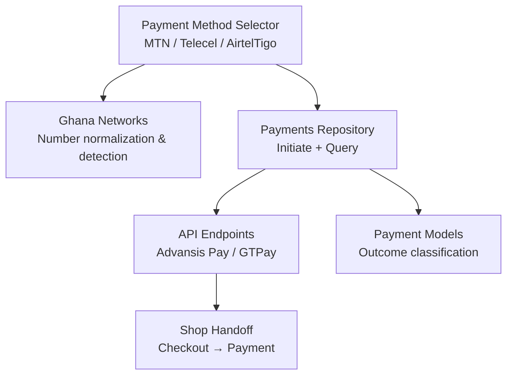
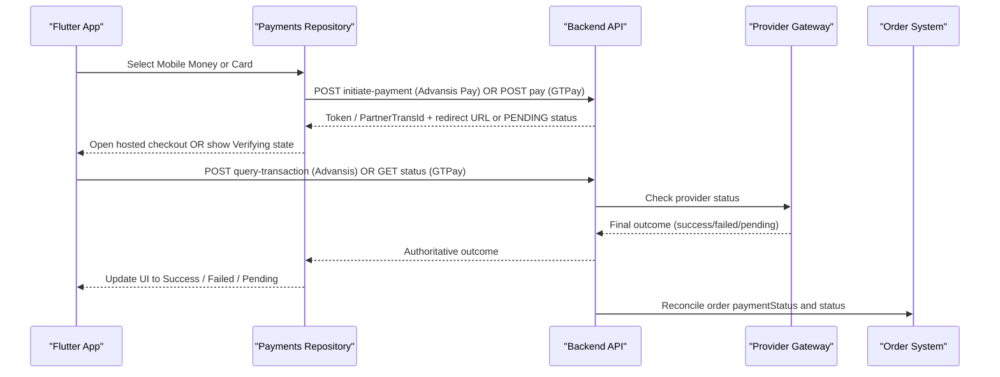
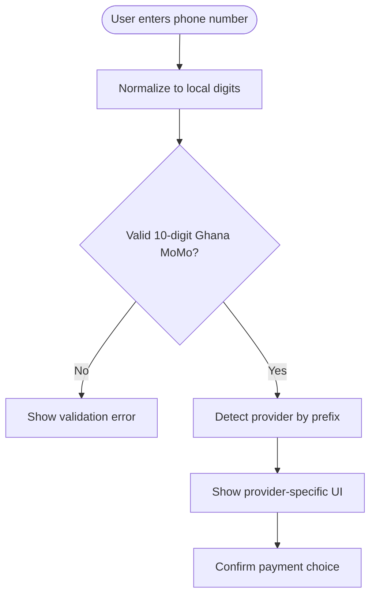
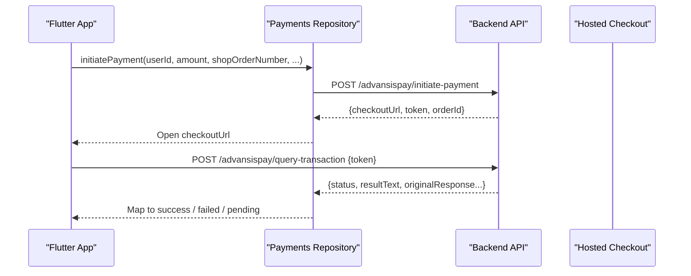
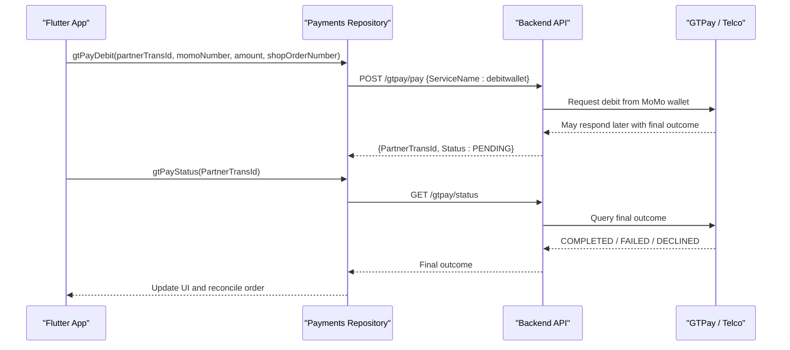
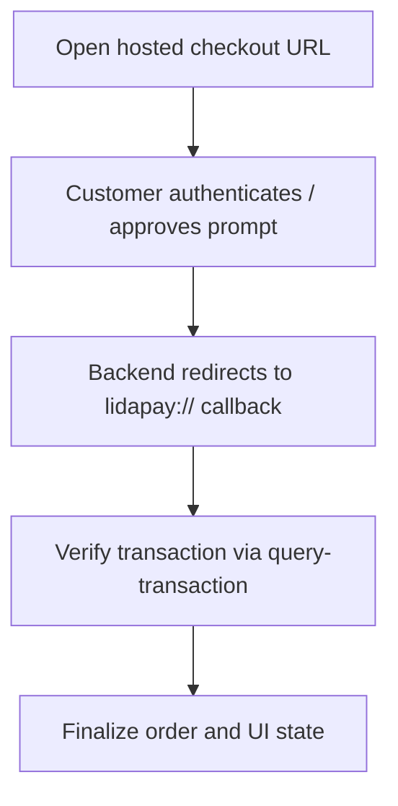
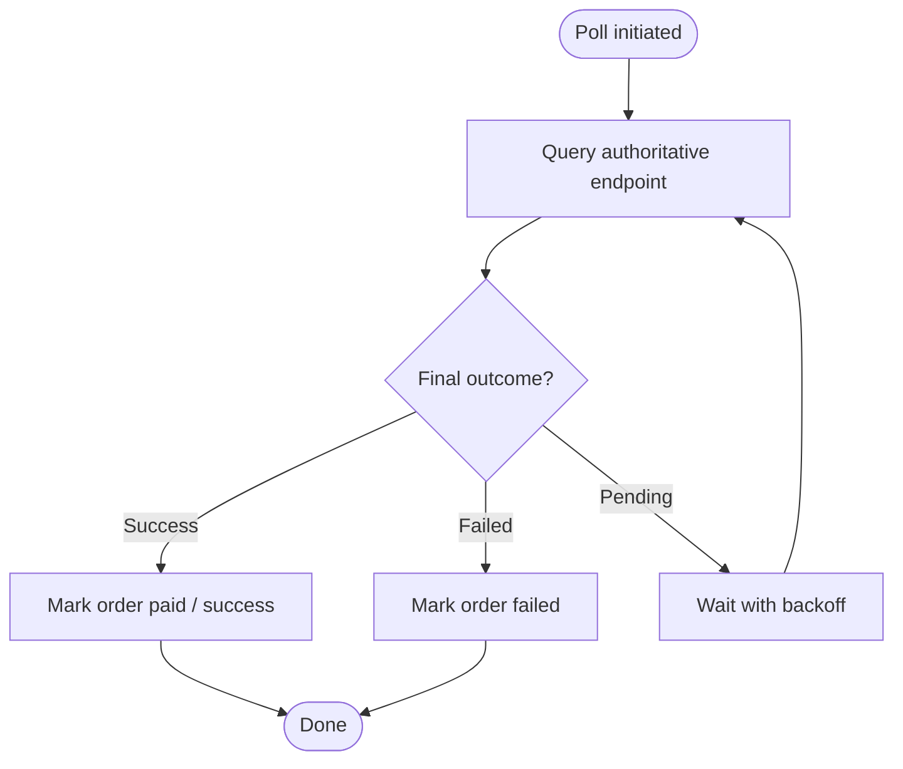
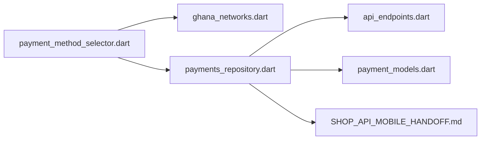

# Mobile Money Integration

<cite>
**Referenced Files in This Document**
- [ENDPOINTS.md](file://api/ENDPOINTS.md)
- [SHOP_API_MOBILE_HANDOFF.md](file://docs/SHOP_API_MOBILE_HANDOFF.md)
- [payment_method_selector.dart](file://lib/features/payments/widgets/payment_method_selector.dart)
- [ghana_networks.dart](file://lib/core/utils/ghana_networks.dart)
- [api_endpoints.dart](file://lib/core/network/api_endpoints.dart)
- [payment_models.dart](file://lib/features/payments/data/payment_models.dart)
- [payments_repository.dart](file://lib/features/payments/data/payments_repository.dart)
</cite>

## Table of Contents
1. [Introduction](#introduction)
2. [Project Structure](#project-structure)
3. [Core Components](#core-components)
4. [Architecture Overview](#architecture-overview)
5. [Detailed Component Analysis](#detailed-component-analysis)
6. [Dependency Analysis](#dependency-analysis)
7. [Performance Considerations](#performance-considerations)
8. [Troubleshooting Guide](#troubleshooting-guide)
9. [Conclusion](#conclusion)

## Introduction
This document explains how the mobile application integrates with Ghanaian mobile money providers for payment processing. It covers:
- Provider selection and number validation for MTN MoMo, Telecel Cash, and AirtelTigo Money.
- Payment initiation flows through two backend routes: Advansis Pay (ExpressPay) and GTPay debitwallet.
- Callback handling, status polling, and order reconciliation.
- Security considerations, PIN verification behavior, and error handling for network failures or provider outages.

The app does not directly call MTN, Telecel, or AirtelTigo APIs. Instead, it uses the LidaPay backend endpoints that abstract provider integrations. The shop documentation identifies Advansis Pay as the primary live route and GTPay as an alternative mobile-money debit path.

## Project Structure
Mobile money integration spans UI selection, provider utilities, API contracts, and repository abstractions:
- UI selects Mobile Money or Card and detects the provider from the phone number prefix.
- Utilities normalize and validate Ghanaian mobile money numbers.
- Repository methods define the backend calls for initiating payments and querying outcomes.
- Models parse provider responses and classify success, failure, or pending states.
- Shop handoff documents the checkout-to-payment contract and reconciliation rules.

**Diagram sources**
- [payment_method_selector.dart:48-94](file://lib/features/payments/widgets/payment_method_selector.dart#L48-L94)
- [ghana_networks.dart:10-31](file://lib/core/utils/ghana_networks.dart#L10-L31)
- [payments_repository.dart:3-45](file://lib/features/payments/data/payments_repository.dart#L3-L45)
- [api_endpoints.dart:102-108](file://lib/core/network/api_endpoints.dart#L102-L108)
- [payment_models.dart:5-49](file://lib/features/payments/data/payment_models.dart#L5-L49)
- [SHOP_API_MOBILE_HANDOFF.md:237-316](file://docs/SHOP_API_MOBILE_HANDOFF.md#L237-L316)

**Section sources**
- [payment_method_selector.dart:48-94](file://lib/features/payments/widgets/payment_method_selector.dart#L48-L94)
- [ghana_networks.dart:10-31](file://lib/core/utils/ghana_networks.dart#L10-L31)
- [api_endpoints.dart:102-108](file://lib/core/network/api_endpoints.dart#L102-L108)
- [payment_models.dart:5-49](file://lib/features/payments/data/payment_models.dart#L5-L49)
- [payments_repository.dart:3-45](file://lib/features/payments/data/payments_repository.dart#L3-L45)
- [SHOP_API_MOBILE_HANDOFF.md:237-316](file://docs/SHOP_API_MOBILE_HANDOFF.md#L237-L316)

## Core Components
- Provider selection and validation:
  - The payment sheet supports MTN MoMo, Telecel Cash, and AirtelTigo Money.
  - Provider is inferred from the first three digits of the normalized phone number.
  - The UI validates a 10-digit Ghana mobile money number before allowing confirmation.
- Backend integration points:
  - Advansis Pay (ExpressPay): initiate hosted checkout and query transaction status.
  - GTPay debitwallet: request a debit from the customer’s mobile money number; poll status until final outcome.
- Outcome classification:
  - Both provider response models map inconsistent provider statuses to a common outcome: success, failed, or pending.

Key responsibilities:
- Normalize and validate phone numbers consistently across the app.
- Initiate payments via the correct backend endpoint based on selected method.
- Persist tokens or partner transaction IDs to reconcile asynchronous provider responses.
- Poll authoritative status endpoints rather than trusting UI callbacks alone.

**Section sources**
- [payment_method_selector.dart:48-94](file://lib/features/payments/widgets/payment_method_selector.dart#L48-L94)
- [payment_method_selector.dart:174-189](file://lib/features/payments/widgets/payment_method_selector.dart#L174-L189)
- [ghana_networks.dart:46-72](file://lib/core/utils/ghana_networks.dart#L46-L72)
- [payments_repository.dart:3-45](file://lib/features/payments/data/payments_repository.dart#L3-L45)
- [payment_models.dart:51-149](file://lib/features/payments/data/payment_models.dart#L51-L149)
- [payment_models.dart:165-214](file://lib/features/payments/data/payment_models.dart#L165-L214)

## Architecture Overview
The mobile app initiates payments through the LidaPay backend, which interacts with provider gateways. For shop orders, the backend reconciles payment outcomes to the order automatically when the order number is included.

**Diagram sources**
- [payments_repository.dart:3-45](file://lib/features/payments/data/payments_repository.dart#L3-L45)
- [api_endpoints.dart:102-108](file://lib/core/network/api_endpoints.dart#L102-L108)
- [payment_models.dart:51-149](file://lib/features/payments/data/payment_models.dart#L51-L149)
- [payment_models.dart:165-214](file://lib/features/payments/data/payment_models.dart#L165-L214)
- [SHOP_API_MOBILE_HANDOFF.md:237-316](file://docs/SHOP_API_MOBILE_HANDOFF.md#L237-L316)

## Detailed Component Analysis

### Provider Selection and Number Validation
- Provider mapping:
  - MTN MoMo prefixes include 024, 025, 053, 054, 055, 059.
  - Telecel Cash prefixes include 020, 050.
  - AirtelTigo prefixes include 026, 027, 056, 057.
- Number normalization:
  - Removes non-digits, strips leading international codes where appropriate, and ensures local 10-digit format.
- Validation:
  - Requires a valid Ghana mobile money pattern starting with 0 followed by allowed operator ranges.

**Diagram sources**
- [payment_method_selector.dart:48-94](file://lib/features/payments/widgets/payment_method_selector.dart#L48-L94)
- [ghana_networks.dart:46-72](file://lib/core/utils/ghana_networks.dart#L46-L72)

**Section sources**
- [payment_method_selector.dart:48-94](file://lib/features/payments/widgets/payment_method_selector.dart#L48-L94)
- [ghana_networks.dart:46-72](file://lib/core/utils/ghana_networks.dart#L46-L72)

### Advansis Pay (ExpressPay) Flow
- Initiation:
  - Call the backend initiate-payment endpoint with user details, amount, description, and optional shop order number.
  - The response includes a hosted checkout URL and a token used for authoritative verification.
- Callback handling:
  - The backend builds a native deep link callback when no explicit return URL is provided.
  - The app should not rely solely on the callback’s status; it must verify using the query endpoint.
- Status polling:
  - Use the saved token to query transaction status until a final outcome is returned.
  - Classify the outcome using the model’s logic, which accounts for multiple provider status formats.

**Diagram sources**
- [payments_repository.dart:3-26](file://lib/features/payments/data/payments_repository.dart#L3-L26)
- [api_endpoints.dart:102-103](file://lib/core/network/api_endpoints.dart#L102-L103)
- [payment_models.dart:5-49](file://lib/features/payments/data/payment_models.dart#L5-L49)
- [payment_models.dart:51-149](file://lib/features/payments/data/payment_models.dart#L51-L149)
- [SHOP_API_MOBILE_HANDOFF.md:237-265](file://docs/SHOP_API_MOBILE_HANDOFF.md#L237-L265)

**Section sources**
- [payments_repository.dart:3-26](file://lib/features/payments/data/payments_repository.dart#L3-L26)
- [api_endpoints.dart:102-103](file://lib/core/network/api_endpoints.dart#L102-L103)
- [payment_models.dart:5-49](file://lib/features/payments/data/payment_models.dart#L5-L49)
- [payment_models.dart:51-149](file://lib/features/payments/data/payment_models.dart#L51-L149)
- [SHOP_API_MOBILE_HANDOFF.md:237-265](file://docs/SHOP_API_MOBILE_HANDOFF.md#L237-L265)

### GTPay Debitwallet Flow
- Initiation:
  - Call the backend pay endpoint with ServiceName set to debitwallet, including the customer’s mobile money number and exact order total.
  - The response may be PENDING while waiting for the telco/provider response.
- Status polling:
  - Use the returned PartnerTransId to poll the status endpoint until COMPLETED, FAILED, or another terminal state.
  - Avoid duplicate charges if the initial request times out; always check status before retrying.
- Order reconciliation:
  - Include the shop order number so the backend can reconcile the order automatically upon final outcome.

**Diagram sources**
- [payments_repository.dart:28-45](file://lib/features/payments/data/payments_repository.dart#L28-L45)
- [api_endpoints.dart:105-108](file://lib/core/network/api_endpoints.dart#L105-L108)
- [payment_models.dart:165-214](file://lib/features/payments/data/payment_models.dart#L165-L214)
- [SHOP_API_MOBILE_HANDOFF.md:267-316](file://docs/SHOP_API_MOBILE_HANDOFF.md#L267-L316)

**Section sources**
- [payments_repository.dart:28-45](file://lib/features/payments/data/payments_repository.dart#L28-L45)
- [api_endpoints.dart:105-108](file://lib/core/network/api_endpoints.dart#L105-L108)
- [payment_models.dart:165-214](file://lib/features/payments/data/payment_models.dart#L165-L214)
- [SHOP_API_MOBILE_HANDOFF.md:267-316](file://docs/SHOP_API_MOBILE_HANDOFF.md#L267-L316)

### Callback URL Handling and Deep Links
- Hosted checkout returns a URL that the app opens in a browser or web view.
- When no explicit returnUrl is sent, the backend constructs a native deep link callback.
- The app should navigate back into the app and then verify the transaction using the authoritative query endpoint.

**Diagram sources**
- [payments_repository.dart:3-26](file://lib/features/payments/data/payments_repository.dart#L3-L26)
- [SHOP_API_MOBILE_HANDOFF.md:237-265](file://docs/SHOP_API_MOBILE_HANDOFF.md#L237-L265)

**Section sources**
- [payments_repository.dart:3-26](file://lib/features/payments/data/payments_repository.dart#L3-L26)
- [SHOP_API_MOBILE_HANDOFF.md:237-265](file://docs/SHOP_API_MOBILE_HANDOFF.md#L237-L265)

### Status Polling Mechanisms
- Advansis Pay:
  - Poll query-transaction with the saved token until a final outcome is returned.
  - Treat ambiguous or temporary errors as pending and retry with measured backoff.
- GTPay:
  - Poll status with PartnerTransId until COMPLETED, FAILED, or other terminal state.
  - Do not start a second payment while a telco response is outstanding.

**Diagram sources**
- [payment_models.dart:51-149](file://lib/features/payments/data/payment_models.dart#L51-L149)
- [payment_models.dart:165-214](file://lib/features/payments/data/payment_models.dart#L165-L214)
- [SHOP_API_MOBILE_HANDOFF.md:254-316](file://docs/SHOP_API_MOBILE_HANDOFF.md#L254-L316)

**Section sources**
- [payment_models.dart:51-149](file://lib/features/payments/data/payment_models.dart#L51-L149)
- [payment_models.dart:165-214](file://lib/features/payments/data/payment_models.dart#L165-L214)
- [SHOP_API_MOBILE_HANDOFF.md:254-316](file://docs/SHOP_API_MOBILE_HANDOFF.md#L254-L316)

### Security Considerations
- PIN verification:
  - Mobile money PIN entry occurs on the customer’s device within their provider app or USSD prompt. The app never collects or stores PINs.
- Sensitive data handling:
  - Card details are entered on the hosted checkout and are not stored on the device.
- Authentication and authorization:
  - Use bearer tokens for authenticated endpoints and ensure tokens are refreshed securely.
- Callback integrity:
  - Always verify transactions via authoritative backend endpoints rather than trusting UI callbacks or deep-link parameters.

**Section sources**
- [payment_method_selector.dart:518-534](file://lib/features/payments/widgets/payment_method_selector.dart#L518-L534)
- [SHOP_API_MOBILE_HANDOFF.md:237-265](file://docs/SHOP_API_MOBILE_HANDOFF.md#L237-L265)

### Error Handling for Network Failures and Provider Outages
- Network errors:
  - If catalogue or operator lookups fail, fall back to cached data where available to avoid dead ends.
- Provider timeouts:
  - For GTPay, if the initial pay request times out or returns unknown status, check status before any retry to prevent duplicate charges.
- Ambiguous outcomes:
  - Keep orders in a pending/verifying state and continue polling with measured backoff.
- UI resilience:
  - Show “Verifying payment” state and offer refresh/retry without charging again.

**Section sources**
- [SHOP_API_MOBILE_HANDOFF.md:298-316](file://docs/SHOP_API_MOBILE_HANDOFF.md#L298-L316)

## Dependency Analysis
The following diagram shows how components depend on each other during mobile money payment processing.

**Diagram sources**
- [payment_method_selector.dart:48-94](file://lib/features/payments/widgets/payment_method_selector.dart#L48-L94)
- [ghana_networks.dart:10-31](file://lib/core/utils/ghana_networks.dart#L10-L31)
- [payments_repository.dart:3-45](file://lib/features/payments/data/payments_repository.dart#L3-L45)
- [api_endpoints.dart:102-108](file://lib/core/network/api_endpoints.dart#L102-L108)
- [payment_models.dart:5-49](file://lib/features/payments/data/payment_models.dart#L5-L49)
- [SHOP_API_MOBILE_HANDOFF.md:237-316](file://docs/SHOP_API_MOBILE_HANDOFF.md#L237-L316)

**Section sources**
- [payment_method_selector.dart:48-94](file://lib/features/payments/widgets/payment_method_selector.dart#L48-L94)
- [ghana_networks.dart:10-31](file://lib/core/utils/ghana_networks.dart#L10-L31)
- [payments_repository.dart:3-45](file://lib/features/payments/data/payments_repository.dart#L3-L45)
- [api_endpoints.dart:102-108](file://lib/core/network/api_endpoints.dart#L102-L108)
- [payment_models.dart:5-49](file://lib/features/payments/data/payment_models.dart#L5-L49)
- [SHOP_API_MOBILE_HANDOFF.md:237-316](file://docs/SHOP_API_MOBILE_HANDOFF.md#L237-L316)

## Performance Considerations
- Minimize unnecessary polling:
  - Use measured backoff and stop polling when the app backgrounds or the order reaches a terminal state.
- Cache stable data:
  - Operator catalogues and operator lists should be cached locally to reduce network calls and improve resilience during provider outages.
- Avoid duplicate charges:
  - Always reconcile with the authoritative status endpoint before retries.
- Optimize UI updates:
  - Debounce rapid status changes and update only when the outcome changes.

[No sources needed since this section provides general guidance]

## Troubleshooting Guide
Common issues and resolutions:
- Invalid mobile money number:
  - Ensure the number is normalized to a 10-digit Ghana format and matches allowed operator prefixes.
- Pending or unknown status:
  - Keep the order in a verifying state and poll the authoritative endpoint with backoff.
- Duplicate charge risk:
  - Before retrying a failed or timed-out request, check the current status using the saved token or PartnerTransId.
- Callback mismatch:
  - Do not trust deep-link status values; always verify via query-transaction or status endpoint.

**Section sources**
- [payment_method_selector.dart:174-189](file://lib/features/payments/widgets/payment_method_selector.dart#L174-L189)
- [payment_models.dart:51-149](file://lib/features/payments/data/payment_models.dart#L51-L149)
- [payment_models.dart:165-214](file://lib/features/payments/data/payment_models.dart#L165-L214)
- [SHOP_API_MOBILE_HANDOFF.md:298-316](file://docs/SHOP_API_MOBILE_HANDOFF.md#L298-L316)

## Conclusion
The mobile money integration relies on robust provider detection, secure initiation flows, and authoritative status reconciliation. MTN MoMo, Telecel Cash, and AirtelTigo Money are supported at the UI layer through number prefix detection, while actual payment processing is handled by the backend via Advansis Pay (ExpressPay) and GTPay debitwallet. Security best practices emphasize PIN handling on the provider side, avoiding sensitive data storage, and verifying all outcomes through backend endpoints. Proper error handling and measured polling ensure resilience against network failures and provider outages.

[No sources needed since this section summarizes without analyzing specific files]