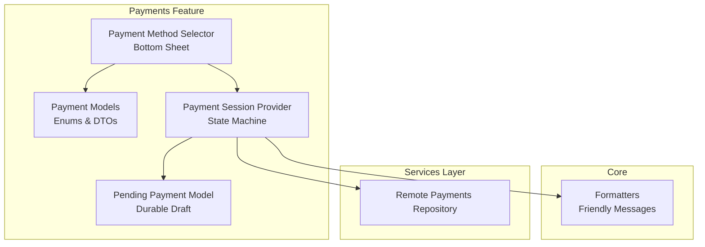
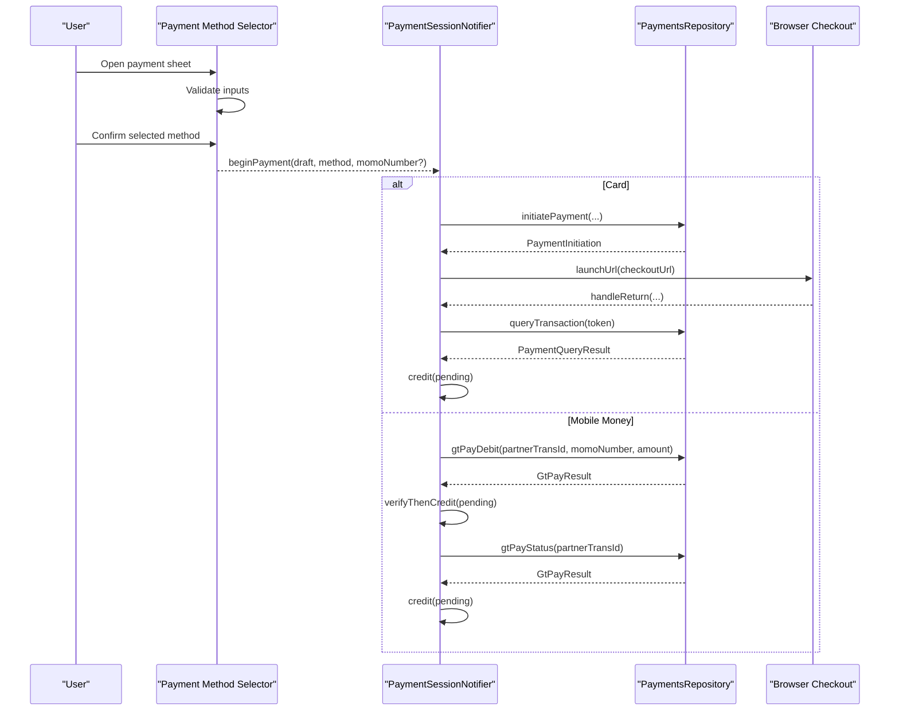
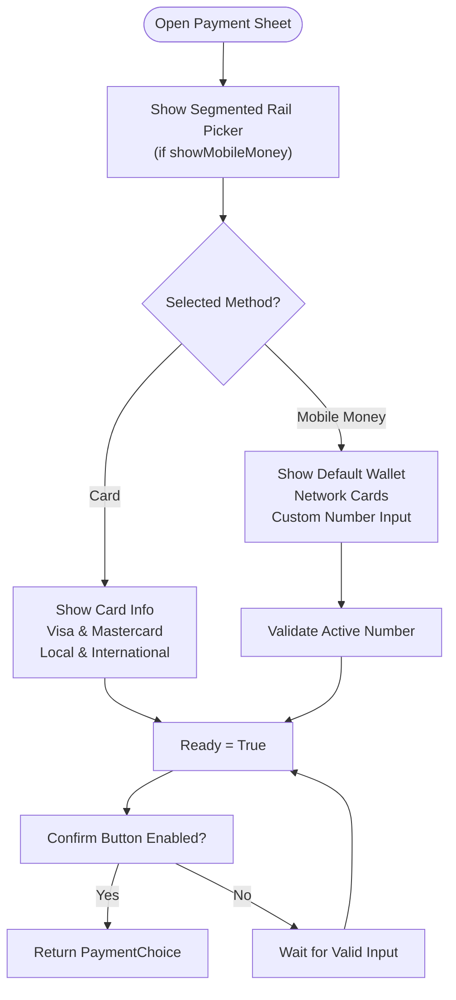
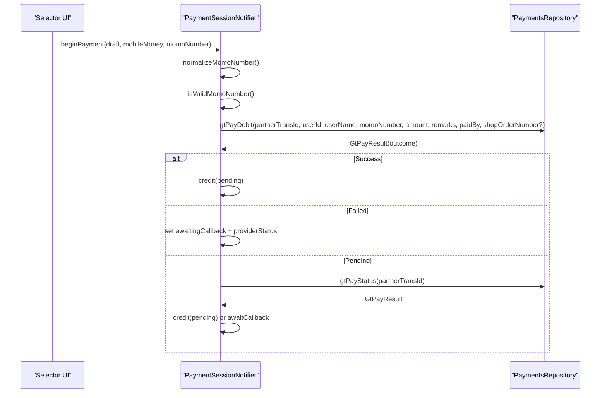
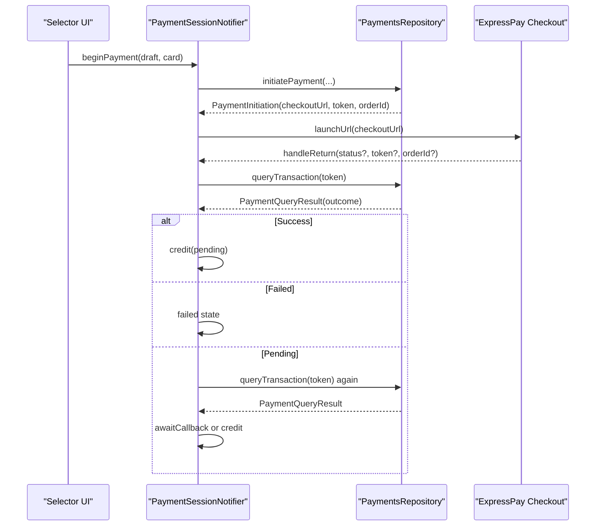
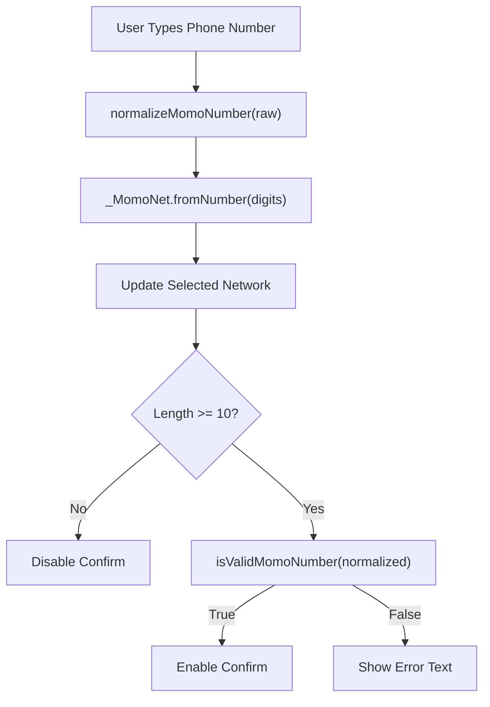
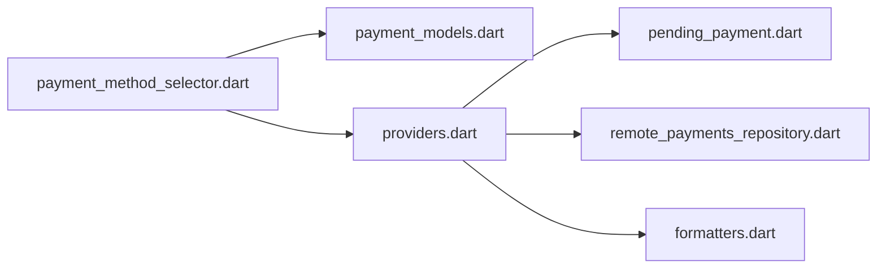

# Payment Method Selection

<cite>
**Referenced Files in This Document**
- [payment_method_selector.dart](file://lib/features/payments/widgets/payment_method_selector.dart)
- [payment_models.dart](file://lib/features/payments/data/payment_models.dart)
- [providers.dart](file://lib/features/payments/providers.dart)
- [pending_payment.dart](file://lib/features/payments/data/pending_payment.dart)
- [remote_payments_repository.dart](file://lib/features/services/data/remote_services_repository.dart)
- [formatters.dart](file://lib/core/utils/formatters.dart)
- [payment_method_selector_test.dart](file://test/payment_method_selector_test.dart)
</cite>

## Table of Contents
1. [Introduction](#introduction)
2. [Project Structure](#project-structure)
3. [Core Components](#core-components)
4. [Architecture Overview](#architecture-overview)
5. [Detailed Component Analysis](#detailed-component-analysis)
6. [Dependency Analysis](#dependency-analysis)
7. [Performance Considerations](#performance-considerations)
8. [Troubleshooting Guide](#troubleshooting-guide)
9. [Conclusion](#conclusion)

## Introduction
This document explains the payment method selection system used when a user confirms an order or service purchase. The system presents two primary payment rails:

- **Mobile Money**: A Ghana Mobile Money debit flow through GTPay that sends an authorization prompt to a phone number.
- **Debit / Credit Card**: An Advansis Pay / ExpressPay hosted checkout opened in the device browser, supporting local and international Visa and Mastercard cards.

The UI is a bottom sheet that lets users choose between these methods, validate their input, and confirm the selected rail. Backend integration determines how each rail is initiated, verified, and credited. There is no explicit wallet-balance payment option in this selector; wallet-based funding is handled elsewhere in the application.

## Project Structure
The payment method selection feature lives under the payments feature module and integrates with shared core utilities, authentication, services, and repository layers.

**Diagram sources**
- [payment_method_selector.dart:27-46](file://lib/features/payments/widgets/payment_method_selector.dart#L27-L46)
- [payment_models.dart:152-163](file://lib/features/payments/data/payment_models.dart#L152-L163)
- [providers.dart:120-129](file://lib/features/payments/providers.dart#L120-L129)
- [pending_payment.dart:24-46](file://lib/features/payments/data/pending_payment.dart#L24-L46)

**Section sources**
- [payment_method_selector.dart:1-46](file://lib/features/payments/widgets/payment_method_selector.dart#L1-L46)
- [payment_models.dart:1-163](file://lib/features/payments/data/payment_models.dart#L1-L163)
- [providers.dart:1-129](file://lib/features/payments/providers.dart#L1-L129)
- [pending_payment.dart:1-46](file://lib/features/payments/data/pending_payment.dart#L1-L46)

## Core Components
- **`PaymentChoice`**: Represents the user’s confirmed selection from the payment sheet, including the chosen method and optional mobile money details.
- **`showPaymentMethodSheet`**: Public entry point that opens the payment bottom sheet with amount, order summary, registered phone number, and whether mobile money should be shown.
- **`_PaymentSheet`**: Stateful widget managing method selection, mobile money network detection, default wallet handling, validation, and confirmation.
- **`PaymentMethod`**: Enum defining supported methods: `mobileMoney` and `card`.
- **`PaymentSessionNotifier`**: Riverpod state machine orchestrating initiation, verification, and crediting for both card and mobile money flows.
- **`PendingPayment`**: Durable draft persisted before checkout, carrying payment metadata, method, and provider-specific identifiers.

**Section sources**
- [payment_method_selector.dart:8-46](file://lib/features/payments/widgets/payment_method_selector.dart#L8-L46)
- [payment_models.dart:152-163](file://lib/features/payments/data/payment_models.dart#L152-L163)
- [providers.dart:131-178](file://lib/features/payments/providers.dart#L131-L178)
- [pending_payment.dart:24-87](file://lib/features/payments/data/pending_payment.dart#L24-L87)

## Architecture Overview
The selection UI is decoupled from backend logic. It collects user choices and delegates execution to the payment session provider.

**Diagram sources**
- [payment_method_selector.dart:180-190](file://lib/features/payments/widgets/payment_method_selector.dart#L180-L190)
- [providers.dart:182-277](file://lib/features/payments/providers.dart#L182-L277)
- [providers.dart:283-367](file://lib/features/payments/providers.dart#L283-L367)
- [providers.dart:372-421](file://lib/features/payments/providers.dart#L372-L421)
- [providers.dart:501-572](file://lib/features/payments/providers.dart#L501-L572)
- [providers.dart:578-665](file://lib/features/payments/providers.dart#L578-L665)

## Detailed Component Analysis

### Payment Method Selector UI
The selector exposes a single public function to open the payment sheet. It accepts:
- `amountLabel`: Displayed amount string.
- `orderSummary`: Short description of the purchase.
- `registeredNumber`: User’s registered phone number used as the default mobile money wallet.
- `showMobileMoney`: Controls whether the mobile money rail is visible. When false, only card payment is presented.

Inside the sheet:
- A segmented rail picker toggles between mobile money and card.
- For mobile money, the app detects the network (MTN MoMo, Telecel Cash, AirtelTigo) based on the first three digits of the entered number.
- If a valid registered number exists, it is offered as a default wallet card with a “Change” action.
- Users can switch to a custom wallet by selecting a network and typing a 10-digit Ghana mobile money number.
- Validation ensures the active number is a valid Ghana MoMo format before enabling confirmation.
- The bottom bar label and subtitle adapt to the selected method and readiness state.

**Diagram sources**
- [payment_method_selector.dart:27-46](file://lib/features/payments/widgets/payment_method_selector.dart#L27-L46)
- [payment_method_selector.dart:113-190](file://lib/features/payments/widgets/payment_method_selector.dart#L113-L190)
- [payment_method_selector.dart:277-450](file://lib/features/payments/widgets/payment_method_selector.dart#L277-L450)
- [payment_method_selector.dart:452-538](file://lib/features/payments/widgets/payment_method_selector.dart#L452-L538)

**Section sources**
- [payment_method_selector.dart:27-46](file://lib/features/payments/widgets/payment_method_selector.dart#L27-L46)
- [payment_method_selector.dart:113-190](file://lib/features/payments/widgets/payment_method_selector.dart#L113-L190)
- [payment_method_selector.dart:277-538](file://lib/features/payments/widgets/payment_method_selector.dart#L277-L538)
- [payment_method_selector.dart:647-757](file://lib/features/payments/widgets/payment_method_selector.dart#L647-L757)
- [payment_method_selector.dart:1067-1165](file://lib/features/payments/widgets/payment_method_selector.dart#L1067-L1165)

### Mobile Money Flow
Mobile money uses GTPay’s `debitwallet` flow. The UI normalizes and validates the phone number, detects the network, and returns a `PaymentChoice` with method and optional mobile money details. The provider then:
- Validates the normalized number.
- Persists a pending record with a generated partner transaction ID.
- Calls the backend to send a prompt.
- Handles outcomes: success triggers immediate crediting; failure may still allow reconciliation; pending enters polling.
- Polls `/gtpay/status` until success, timeout, or user retry/cancel.

**Diagram sources**
- [providers.dart:182-202](file://lib/features/payments/providers.dart#L182-L202)
- [providers.dart:283-367](file://lib/features/payments/providers.dart#L283-L367)
- [providers.dart:578-665](file://lib/features/payments/providers.dart#L578-L665)

**Section sources**
- [providers.dart:101-115](file://lib/features/payments/providers.dart#L101-L115)
- [providers.dart:283-367](file://lib/features/payments/providers.dart#L283-L367)
- [providers.dart:578-665](file://lib/features/payments/providers.dart#L578-L665)

### Card Flow
For card payments, the selector shows accepted brands and explains that verification happens on the hosted checkout. The provider:
- Initiates a payment via the backend, receiving a checkout URL and token.
- Launches the checkout URL in the browser.
- On return, verifies using the saved token.
- Polls the gateway until success, failure, or timeout.
- Credits the purchase once verified.

**Diagram sources**
- [providers.dart:182-277](file://lib/features/payments/providers.dart#L182-L277)
- [providers.dart:372-421](file://lib/features/payments/providers.dart#L372-L421)
- [providers.dart:501-572](file://lib/features/payments/providers.dart#L501-L572)

**Section sources**
- [payment_method_selector.dart:452-538](file://lib/features/payments/widgets/payment_method_selector.dart#L452-L538)
- [providers.dart:182-277](file://lib/features/payments/providers.dart#L182-L277)
- [providers.dart:501-572](file://lib/features/payments/providers.dart#L501-L572)

### Validation Logic
- **Mobile Money Number Normalization**: Strips non-digits, handles leading country code `233`, and pads to 10 digits starting with `0`.
- **Mobile Money Validation**: Requires a Ghana mobile money prefix pattern (`0[235]...`).
- **Active Number Readiness**: Confirmation is enabled only if the active number is valid when mobile money is selected; card selection is always ready.
- **Error Messaging**: Invalid numbers display inline error text; backend errors are mapped to friendly messages.

**Diagram sources**
- [providers.dart:101-115](file://lib/features/payments/providers.dart#L101-L115)
- [payment_method_selector.dart:141-146](file://lib/features/payments/widgets/payment_method_selector.dart#L141-L146)
- [payment_method_selector.dart:174-190](file://lib/features/payments/widgets/payment_method_selector.dart#L174-L190)
- [payment_method_selector.dart:392-431](file://lib/features/payments/widgets/payment_method_selector.dart#L392-L431)

**Section sources**
- [providers.dart:101-115](file://lib/features/payments/providers.dart#L101-L115)
- [payment_method_selector.dart:141-190](file://lib/features/payments/widgets/payment_method_selector.dart#L141-L190)
- [payment_method_selector.dart:392-431](file://lib/features/payments/widgets/payment_method_selector.dart#L392-L431)

### Method Availability and Conditional Rendering
- **Mobile Money Visibility**: Controlled by `showMobileMoney`. When false, the segmented rail picker is hidden and the sheet defaults to card.
- **Default Wallet Presentation**: If the registered number is valid, a default wallet card is shown with a “Use default” action and a “Change” button to enter another number.
- **Network Detection**: Based on the first three digits of the number, one of MTN MoMo, Telecel Cash, or AirtelTigo is selected.
- **Regional Restrictions**: The selector does not enforce regional restrictions directly; backend endpoints determine availability. The card section advertises local and international support, while mobile money is tailored to Ghana networks.

**Section sources**
- [payment_method_selector.dart:27-46](file://lib/features/payments/widgets/payment_method_selector.dart#L27-L46)
- [payment_method_selector.dart:225-236](file://lib/features/payments/widgets/payment_method_selector.dart#L225-L236)
- [payment_method_selector.dart:277-342](file://lib/features/payments/widgets/payment_method_selector.dart#L277-L342)
- [payment_method_selector.dart:452-538](file://lib/features/payments/widgets/payment_method_selector.dart#L452-L538)

### Error Handling for Unavailable Options
- **Invalid Mobile Money Number**: Inline error text instructs the user to enter a valid 10-digit Ghana MoMo number.
- **Backend API Errors**: The provider maps API exceptions to user-facing messages and sets the state to failed or awaiting callback depending on context.
- **Checkout Launch Failures**: If the checkout URL is invalid or cannot be launched, the state transitions to failed with a message prompting retry.
- **Timeouts and Network Issues**: For mobile money, timeouts stop active polling and present options to check status or retry; for cards, transient query failures keep polling until a final outcome or timeout.

**Section sources**
- [payment_method_selector.dart:392-431](file://lib/features/payments/widgets/payment_method_selector.dart#L392-L431)
- [providers.dart:235-276](file://lib/features/payments/providers.dart#L235-L276)
- [providers.dart:347-367](file://lib/features/payments/providers.dart#L347-L367)
- [providers.dart:541-572](file://lib/features/payments/providers.dart#L541-L572)
- [providers.dart:631-665](file://lib/features/payments/providers.dart#L631-L665)

### Integration with Backend Services
- **Card Initiation**: `initiatePayment` returns a checkout URL and token used later for verification.
- **Card Verification**: `queryTransaction` polls the gateway using the saved token.
- **Mobile Money Debit**: `gtPayDebit` debits the specified mobile money wallet and returns a result with status and message.
- **Mobile Money Status**: `gtPayStatus` polls the GTPay status endpoint using the partner transaction ID.
- **Crediting**: After successful verification, the provider credits the purchase via the services repository or clears pending records for shop orders.

**Section sources**
- [providers.dart:182-277](file://lib/features/payments/providers.dart#L182-L277)
- [providers.dart:283-367](file://lib/features/payments/providers.dart#L283-L367)
- [providers.dart:501-572](file://lib/features/payments/providers.dart#L501-L572)
- [providers.dart:578-665](file://lib/features/payments/providers.dart#L578-L665)
- [providers.dart:700-769](file://lib/features/payments/providers.dart#L700-L769)

## Dependency Analysis
The payment method selection system depends on several layers:

**Diagram sources**
- [payment_method_selector.dart:1-6](file://lib/features/payments/widgets/payment_method_selector.dart#L1-L6)
- [providers.dart:1-22](file://lib/features/payments/providers.dart#L1-L22)
- [pending_payment.dart:1-5](file://lib/features/payments/data/pending_payment.dart#L1-L5)
- [remote_payments_repository.dart:1706-1727](file://lib/features/services/data/remote_services_repository.dart#L1706-L1727)
- [formatters.dart:73-80](file://lib/core/utils/formatters.dart#L73-L80)

**Section sources**
- [payment_method_selector.dart:1-6](file://lib/features/payments/widgets/payment_method_selector.dart#L1-L6)
- [providers.dart:1-22](file://lib/features/payments/providers.dart#L1-L22)
- [pending_payment.dart:1-5](file://lib/features/payments/data/pending_payment.dart#L1-L5)
- [remote_payments_repository.dart:1706-1727](file://lib/features/services/data/remote_services_repository.dart#L1706-L1727)
- [formatters.dart:73-80](file://lib/core/utils/formatters.dart#L73-L80)

## Performance Considerations
- **Validation Efficiency**: Mobile money number normalization and validation are lightweight regex operations performed on input changes.
- **Polling Strategy**: Both card and mobile money flows use bounded polling with delays and generation guards to avoid duplicate work and stale updates.
- **UI Responsiveness**: Animated switches and haptic feedback improve perceived performance without blocking the main thread.
- **State Management**: Riverpod state notifier centralizes lifecycle management, reducing redundant computations and ensuring consistent UI state.

[No sources needed since this section provides general guidance]

## Troubleshooting Guide
- **Invalid Mobile Money Number**: Ensure the number is a 10-digit Ghana mobile money number starting with `0[235]`. The UI will show an error and disable confirmation.
- **Mobile Money Prompt Expired**: If the approval window closes, the provider stops active polling and presents options to check status or retry. Use “Check status” or “Send a new prompt.”
- **Card Checkout Not Opening**: Verify that the checkout URL is valid and launchable. If launching fails, the state reports a failure message and suggests retrying.
- **Backend API Errors**: API exceptions are mapped to friendly messages. For transient errors, the provider may continue polling or move to awaiting callback.
- **Unsuccessful Payment**: If verification ends in failure, the provider clears pending state and informs the user they can try again or use a different method.

**Section sources**
- [payment_method_selector.dart:392-431](file://lib/features/payments/widgets/payment_method_selector.dart#L392-L431)
- [providers.dart:235-276](file://lib/features/payments/providers.dart#L235-L276)
- [providers.dart:347-367](file://lib/features/payments/providers.dart#L347-L367)
- [providers.dart:541-572](file://lib/features/payments/providers.dart#L541-L572)
- [providers.dart:631-665](file://lib/features/payments/providers.dart#L631-L665)

## Conclusion
The payment method selection system provides a clear, validated interface for choosing between mobile money and card payments. Mobile money supports Ghana networks with real-time network detection and robust validation, while card payments delegate to a secure hosted checkout. Backend integration handles initiation, verification, and crediting with careful error handling and polling strategies. The UI adapts to user eligibility and backend responses, ensuring a smooth experience across different scenarios.

[No sources needed since this section summarizes without analyzing specific files]