# Payment Processing

<cite>
**Referenced Files in This Document**
- [providers.dart](file://lib/features/payments/providers.dart)
- [payment_models.dart](file://lib/features/payments/data/payment_models.dart)
- [pending_payment.dart](file://lib/features/payments/data/pending_payment.dart)
- [pending_payment_store.dart](file://lib/features/payments/data/pending_payment_store.dart)
- [remote_payments_repository.dart](file://lib/features/payments/data/remote_payments_repository.dart)
- [payments_repository.dart](file://lib/features/payments/data/payments_repository.dart)
- [payment_method_selector.dart](file://lib/features/payments/widgets/payment_method_selector.dart)
- [payment_awaiting_panel.dart](file://lib/features/payments/widgets/payment_awaiting_panel.dart)
- [payment_return_screen.dart](file://lib/features/payments/screens/payment_return_screen.dart)
- [deep_links.dart](file://lib/core/deep_links.dart)
- [app_constants.dart](file://lib/core/constants/app_constants.dart)
- [api_endpoints.md](file://api/ENDPOINTS.md)
- [lida_value_providers.dart](file://lib/features/lida_value/providers.dart)
- [lv_attempt_store.dart](file://lib/features/lida_value/data/lv_attempt_store.dart)
</cite>

## Update Summary
**Changes Made**
- Added comprehensive documentation for Lida Value transaction reliability enhancements
- Documented new persistent attempt tracking system with LvAttempt and LvAttemptStore
- Updated retry mechanisms and error handling for wallet-funded transactions
- Enhanced section on transaction state management to include Lida Value phases
- Added detailed coverage of idempotency protection and automatic recovery mechanisms

## Table of Contents
1. [Introduction](#introduction)
2. [Project Structure](#project-structure)
3. [Core Components](#core-components)
4. [Architecture Overview](#architecture-overview)
5. [Detailed Component Analysis](#detailed-component-analysis)
6. [Dependency Analysis](#dependency-analysis)
7. [Performance Considerations](#performance-considerations)
8. [Troubleshooting Guide](#troubleshooting-guide)
9. [Conclusion](#conclusion)

## Introduction
This document explains the payment processing system used by the application for service purchases and shop orders. It covers:

- Payment method selection between Mobile Money, card payments, and Lida Value wallet funding.
- Mobile Money integration through GTPay debitwallet.
- Card payment processing through ExpressPay via Advansis Pay.
- Lida Value wallet transactions with enhanced reliability, persistent attempt tracking, and automatic retry mechanisms.
- Transaction status monitoring, polling, and reconciliation.
- Payment history and receipt handling after successful delivery.
- Pending payment persistence and transaction state management.
- Error handling, retry logic, and user notification patterns.
- Security considerations and compliance implications.

The implementation is centered around a single payment session that coordinates initiation, verification, crediting, and completion while keeping sensitive data out of normal app storage. The system now includes robust Lida Value transaction handling that survives process death and prevents double-charging through persistent attempt tracking.

## Project Structure
Payment functionality lives under `lib/features/payments` with supporting core utilities and API endpoints documented separately. Lida Value functionality extends this with dedicated providers and persistent attempt storage.

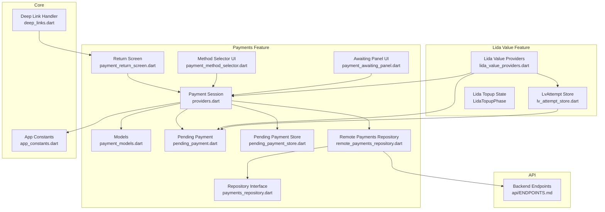

**Diagram sources**
- [providers.dart:120-178](file://lib/features/payments/providers.dart#L120-L178)
- [lida_value_providers.dart:79-91](file://lib/features/lida_value/providers.dart#L79-L91)
- [lv_attempt_store.dart:81-109](file://lib/features/lida_value/data/lv_attempt_store.dart#L81-L109)
- [payment_models.dart:5-49](file://lib/features/payments/data/payment_models.dart#L5-L49)
- [pending_payment.dart:16-87](file://lib/features/payments/data/pending_payment.dart#L16-L87)
- [pending_payment_store.dart:8-26](file://lib/features/payments/data/pending_payment_store.dart#L8-L26)
- [remote_payments_repository.dart:7-11](file://lib/features/payments/data/remote_payments_repository.dart#L7-L11)
- [payments_repository.dart:3-45](file://lib/features/payments/data/payments_repository.dart#L3-L45)
- [payment_method_selector.dart:21-46](file://lib/features/payments/widgets/payment_method_selector.dart#L21-L46)
- [payment_awaiting_panel.dart:9-30](file://lib/features/payments/widgets/payment_awaiting_panel.dart#L9-L30)
- [payment_return_screen.dart:22-25](file://lib/features/payments/screens/payment_return_screen.dart#L22-L25)
- [deep_links.dart:8-11](file://lib/core/deep_links.dart#L8-L11)
- [app_constants.dart:23-46](file://lib/core/constants/app_constants.dart#L23-L46)
- [api_endpoints.md:153-192](file://api/ENDPOINTS.md#L153-L192)

**Section sources**
- [providers.dart:120-178](file://lib/features/payments/providers.dart#L120-L178)
- [lida_value_providers.dart:79-91](file://lib/features/lida_value/providers.dart#L79-L91)
- [lv_attempt_store.dart:81-109](file://lib/features/lida_value/data/lv_attempt_store.dart#L81-L109)
- [payment_models.dart:5-49](file://lib/features/payments/data/payment_models.dart#L5-L49)
- [pending_payment.dart:16-87](file://lib/features/payments/data/pending_payment.dart#L16-L87)
- [pending_payment_store.dart:8-26](file://lib/features/payments/data/pending_payment_store.dart#L8-L26)
- [remote_payments_repository.dart:7-11](file://lib/features/payments/data/remote_payments_repository.dart#L7-L11)
- [payments_repository.dart:3-45](file://lib/features/payments/data/payments_repository.dart#L3-L45)
- [payment_method_selector.dart:21-46](file://lib/features/payments/widgets/payment_method_selector.dart#L21-L46)
- [payment_awaiting_panel.dart:9-30](file://lib/features/payments/widgets/payment_awaiting_panel.dart#L9-L30)
- [payment_return_screen.dart:22-25](file://lib/features/payments/screens/payment_return_screen.dart#L22-L25)
- [deep_links.dart:8-11](file://lib/core/deep_links.dart#L8-L11)
- [app_constants.dart:23-46](file://lib/core/constants/app_constants.dart#L23-L46)
- [api_endpoints.md:153-192](file://api/ENDPOINTS.md#L153-L192)

## Core Components
- Payment session orchestrator: manages phases, initiation, verification, crediting, retries, and cancellation.
- Lida Value topup orchestrator: handles wallet-funded transactions with persistent attempt tracking and automatic recovery.
- Payment models: parse gateway responses and classify outcomes as success, failed, or pending.
- Pending payment model: represents an in-flight purchase with kind-specific delivery parameters.
- Pending payment store: persists the purchase record and encrypts sensitive fields.
- LvAttempt store: persists Lida Value transaction attempts across process death for reliability.
- Remote payments repository: calls backend endpoints for Advansis Pay and GTPay.
- Repository interface: defines the contract for payment operations.
- UI components: method selector, awaiting panel, and return screen.
- Deep link handler: routes payment return URIs into the app.
- App constants: checkout host allowlist and shop redirect URL.

Key responsibilities:
- Selection: decide between Mobile Money, card, or Lida Value funding.
- Initiation: create checkout, MoMo prompt, or Lida Value debit.
- Verification: poll provider status until success, failure, or timeout.
- Crediting: deliver the service or mark the shop order paid.
- Persistence: survive process death and resume safely.
- User feedback: guide users through approval, recheck, retry, and cancellation.
- Idempotency: prevent double-charging through persistent client references.

**Section sources**
- [providers.dart:43-85](file://lib/features/payments/providers.dart#L43-L85)
- [lida_value_providers.dart:33-64](file://lib/features/lida_value/providers.dart#L33-L64)
- [payment_models.dart:51-163](file://lib/features/payments/data/payment_models.dart#L51-L163)
- [pending_payment.dart:16-87](file://lib/features/payments/data/pending_payment.dart#L16-L87)
- [pending_payment_store.dart:8-26](file://lib/features/payments/data/pending_payment_store.dart#L8-L26)
- [lv_attempt_store.dart:17-78](file://lib/features/lida_value/data/lv_attempt_store.dart#L17-L78)
- [remote_payments_repository.dart:12-109](file://lib/features/payments/data/remote_payments_repository.dart#L12-L109)
- [payments_repository.dart:3-45](file://lib/features/payments/data/payments_repository.dart#L3-L45)
- [payment_method_selector.dart:21-46](file://lib/features/payments/widgets/payment_method_selector.dart#L21-L46)
- [payment_awaiting_panel.dart:9-30](file://lib/features/payments/widgets/payment_awaiting_panel.dart#L9-L30)
- [payment_return_screen.dart:22-25](file://lib/features/payments/screens/payment_return_screen.dart#L22-L25)
- [deep_links.dart:8-11](file://lib/core/deep_links.dart#L8-L11)
- [app_constants.dart:23-46](file://lib/core/constants/app_constants.dart#L23-L46)

## Architecture Overview
The payment flow has three main rails:

- Card rail: initiate Advansis Pay checkout, open hosted page, verify via token query, then credit or complete.
- Mobile Money rail: call GTPay debitwallet, poll status using PartnerTransId, then credit or complete.
- Lida Value rail: debit from wallet ledger, persist attempt, deliver service, with automatic recovery on app restart.

Both traditional rails converge on a single verification-and-credit path to avoid duplicate delivery. The Lida Value rail adds persistent attempt tracking to ensure delivery completion even if the app crashes after wallet debit but before service delivery.

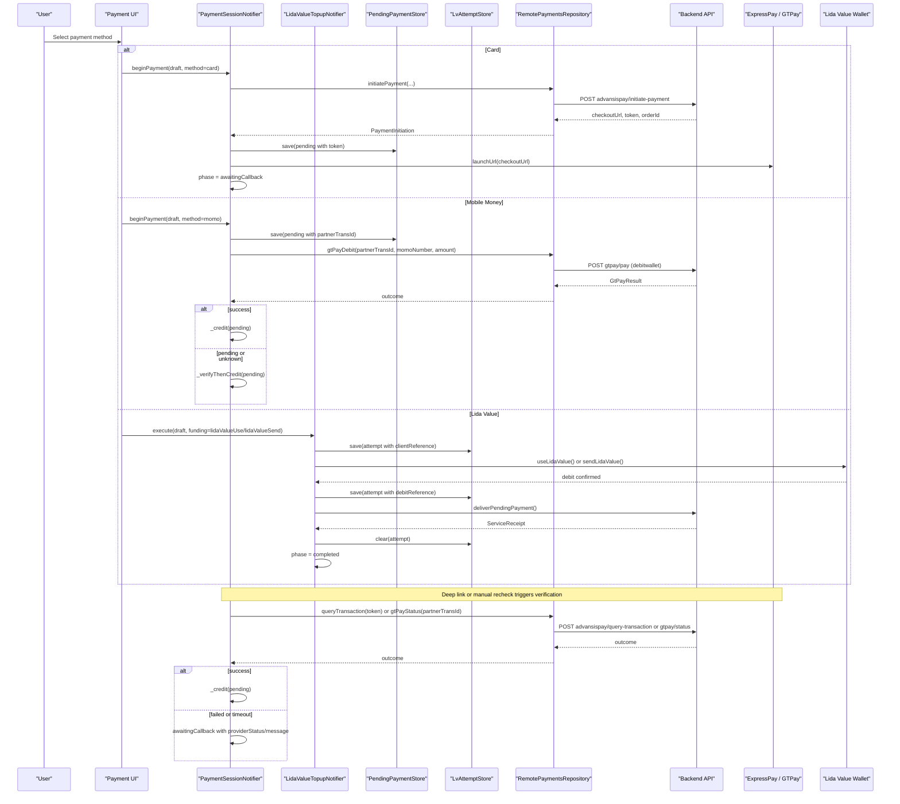

**Diagram sources**
- [providers.dart:182-277](file://lib/features/payments/providers.dart#L182-L277)
- [providers.dart:283-367](file://lib/features/payments/providers.dart#L283-L367)
- [providers.dart:474-572](file://lib/features/payments/providers.dart#L474-L572)
- [providers.dart:578-665](file://lib/features/payments/providers.dart#L578-L665)
- [lida_value_providers.dart:157-331](file://lib/features/lida_value/providers.dart#L157-L331)
- [remote_payments_repository.dart:12-109](file://lib/features/payments/data/remote_payments_repository.dart#L12-L109)
- [payment_return_screen.dart:54-66](file://lib/features/payments/screens/payment_return_screen.dart#L54-L66)
- [deep_links.dart:64-72](file://lib/core/deep_links.dart#L64-L72)
- [api_endpoints.md:153-192](file://api/ENDPOINTS.md#L153-L192)

## Detailed Component Analysis

### Payment Method Selection
The payment sheet lets users choose between Mobile Money, Debit/Credit Card, or Lida Value funding. For Mobile Money, it supports default registered wallets and custom wallet entry with network detection. For cards, it directs users to the ExpressPay hosted checkout. For Lida Value, it checks wallet balance and offers the option to switch to standard payment methods if insufficient funds are available.

Important behaviors:
- Mobile Money shows MTN, Telecel Cash, and AirtelTigo options.
- Default wallet can be selected or replaced by a custom number.
- Card option indicates 3-D Secure verification happens on ExpressPay.
- Lida Value option shows available balance and may offer fallback to standard payment methods.
- The sheet returns a structured choice including method, optional MoMo number, and network label.

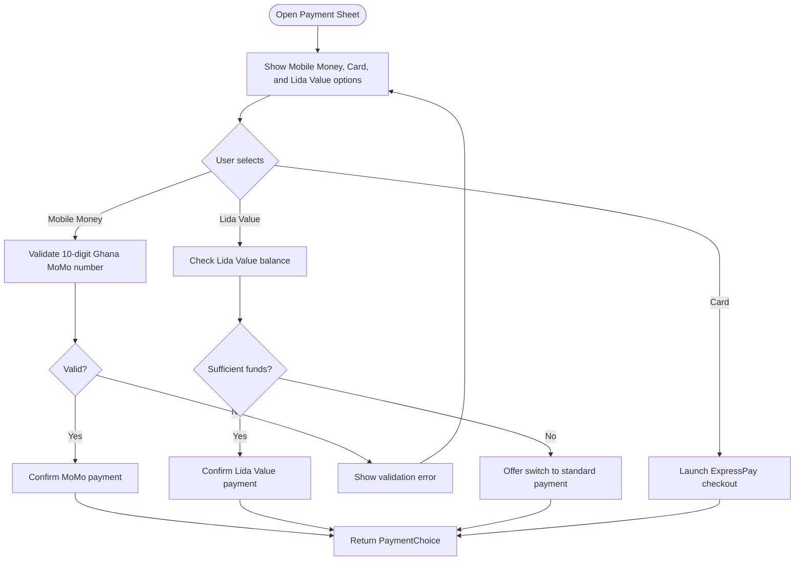

**Diagram sources**
- [payment_method_selector.dart:21-46](file://lib/features/payments/widgets/payment_method_selector.dart#L21-L46)
- [payment_method_selector.dart:48-94](file://lib/features/payments/widgets/payment_method_selector.dart#L48-L94)
- [payment_method_selector.dart:177-190](file://lib/features/payments/widgets/payment_method_selector.dart#L177-L190)
- [payment_method_selector.dart:452-538](file://lib/features/payments/widgets/payment_method_selector.dart#L452-L538)

**Section sources**
- [payment_method_selector.dart:21-46](file://lib/features/payments/widgets/payment_method_selector.dart#L21-L46)
- [payment_method_selector.dart:48-94](file://lib/features/payments/widgets/payment_method_selector.dart#L48-L94)
- [payment_method_selector.dart:177-190](file://lib/features/payments/widgets/payment_method_selector.dart#L177-L190)
- [payment_method_selector.dart:452-538](file://lib/features/payments/widgets/payment_method_selector.dart#L452-L538)

### Mobile Money Integration (GTPay)
Mobile Money uses GTPay's debitwallet service. The flow generates a unique PartnerTransId before calling pay, persists it, and reconciles any timeout or partial response through status polling.

Key points:
- Phone numbers are normalized to local 10-digit format.
- debitwallet request includes service details, amount, remarks, and payer identity.
- Outcome may be immediate success, pending, or failed; pending paths trigger verification.
- Status polling uses a bounded attempt count and delay, with special handling for timeouts.
- Retries send a fresh prompt with a new PartnerTransId only after a network-reported failure.

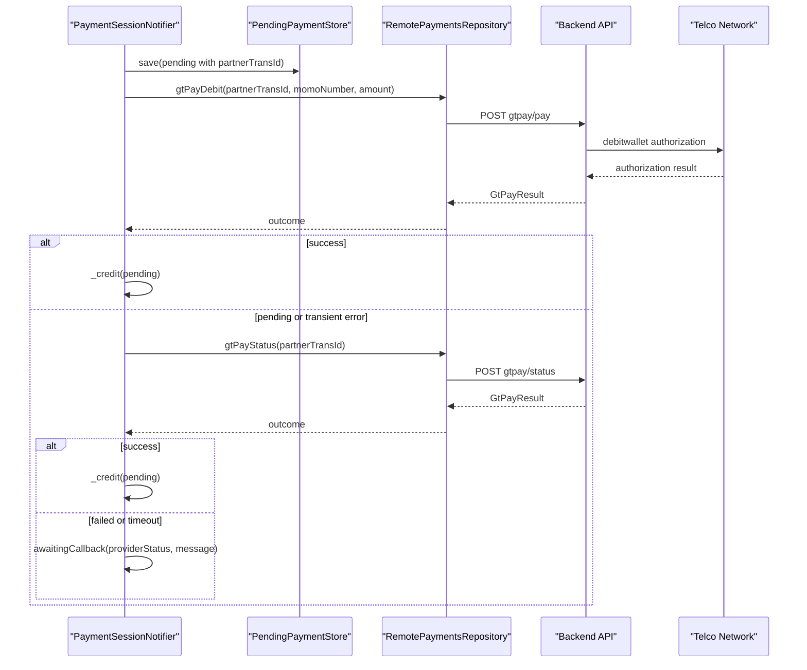

**Diagram sources**
- [providers.dart:283-367](file://lib/features/payments/providers.dart#L283-L367)
- [providers.dart:578-665](file://lib/features/payments/providers.dart#L578-L665)
- [remote_payments_repository.dart:64-109](file://lib/features/payments/data/remote_payments_repository.dart#L64-L109)
- [api_endpoints.md:185-192](file://api/ENDPOINTS.md#L185-L192)

**Section sources**
- [providers.dart:283-367](file://lib/features/payments/providers.dart#L283-L367)
- [providers.dart:578-665](file://lib/features/payments/providers.dart#L578-L665)
- [remote_payments_repository.dart:64-109](file://lib/features/payments/data/remote_payments_repository.dart#L64-L109)
- [api_endpoints.md:185-192](file://api/ENDPOINTS.md#L185-L192)

### Lida Value Transaction Reliability
Lida Value transactions now feature enhanced reliability through persistent attempt tracking and automatic retry mechanisms. The system ensures that wallet debits are never lost and services are delivered even if the app crashes during the process.

Key reliability features:
- **Persistent Attempt Tracking**: Each Lida Value transaction creates an `LvAttempt` record that survives process death.
- **Automatic Recovery**: On app startup, the system automatically resumes any incomplete deliveries.
- **Idempotency Protection**: Uses `clientReference` to prevent double-charging when retries occur.
- **Two-Phase Commit**: Separates wallet debit confirmation from service delivery, allowing independent retry.
- **Enhanced Error Handling**: Distinguishes between known failures and unknown outcomes where wallet charge status is uncertain.

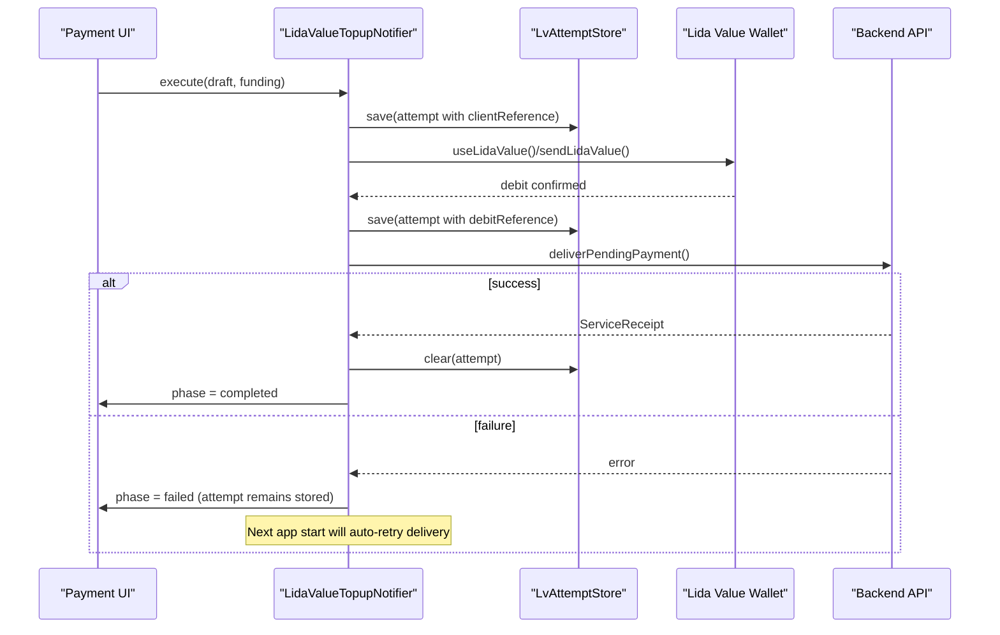

**Diagram sources**
- [lida_value_providers.dart:157-331](file://lib/features/lida_value/providers.dart#L157-L331)
- [lv_attempt_store.dart:17-78](file://lib/features/lida_value/data/lv_attempt_store.dart#L17-L78)

**Section sources**
- [lida_value_providers.dart:157-331](file://lib/features/lida_value/providers.dart#L157-L331)
- [lv_attempt_store.dart:17-78](file://lib/features/lida_value/data/lv_attempt_store.dart#L17-L78)

### Card Payment Processing (Advansis Pay / ExpressPay)
Card payments use Advansis Pay to obtain a hosted checkout URL. The app opens the URL externally, stores the token, and verifies the transaction later.

Key points:
- Initiation returns checkoutUrl, token, and orderId.
- Checkout URL is validated against allowed hosts.
- Deep link returns carry hints but verification uses the saved token.
- Query endpoint classifies ambiguous provider statuses into success, failed, or pending.
- Successful verification leads to crediting or marking the shop order paid.

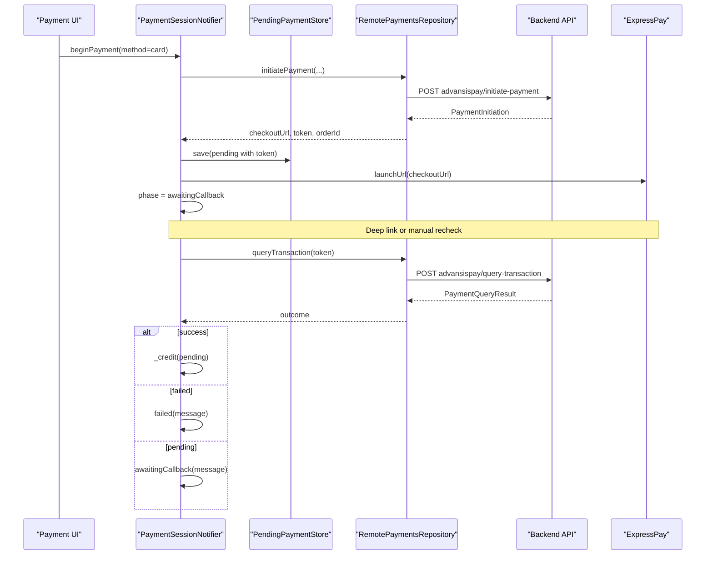

**Diagram sources**
- [providers.dart:182-277](file://lib/features/payments/providers.dart#L182-L277)
- [providers.dart:501-572](file://lib/features/payments/providers.dart#L501-L572)
- [remote_payments_repository.dart:12-62](file://lib/features/payments/data/remote_payments_repository.dart#L12-L62)
- [payment_models.dart:57-150](file://lib/features/payments/data/payment_models.dart#L57-L150)
- [api_endpoints.md:153-157](file://api/ENDPOINTS.md#L153-L157)

**Section sources**
- [providers.dart:182-277](file://lib/features/payments/providers.dart#L182-L277)
- [providers.dart:501-572](file://lib/features/payments/providers.dart#L501-L572)
- [remote_payments_repository.dart:12-62](file://lib/features/payments/data/remote_payments_repository.dart#L12-L62)
- [payment_models.dart:57-150](file://lib/features/payments/data/payment_models.dart#L57-L150)
- [api_endpoints.md:153-157](file://api/ENDPOINTS.md#L153-L157)

### Transaction Status Monitoring and Polling
Verification is centralized and idempotent per purchase reference. It prevents duplicate credits when deep links or app resumption occur multiple times.

Monitoring characteristics:
- Single-flight verification future per pending reference.
- Generation counter invalidates stale polls when the user cancels, resets, or retries.
- Card polling uses fixed attempts and delay.
- Mobile Money polling respects an approval window anchored to creation time.
- Timeouts and transient errors are treated cautiously to avoid false failures.

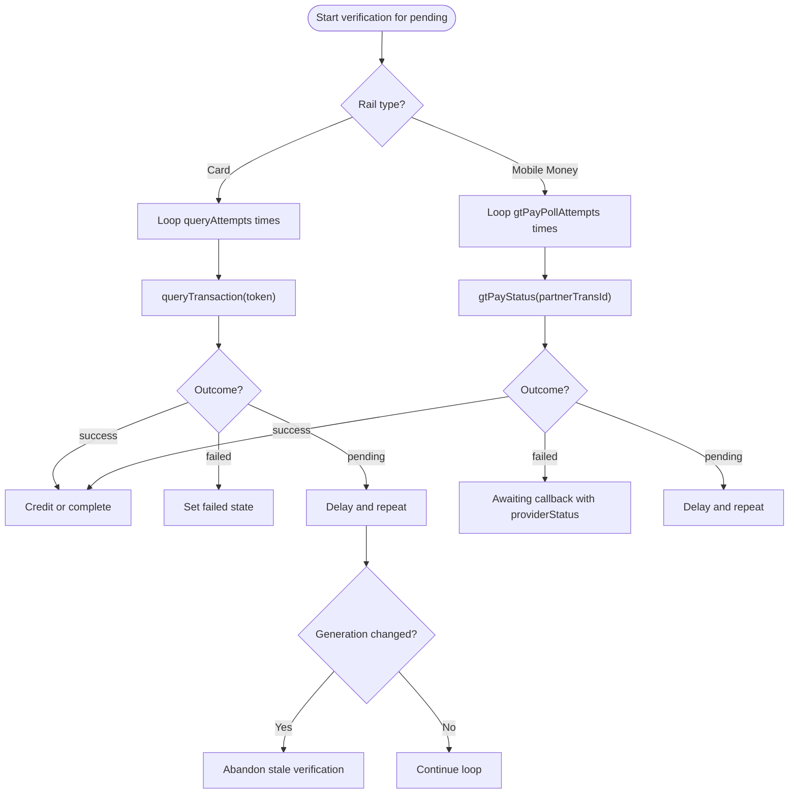

**Diagram sources**
- [providers.dart:474-572](file://lib/features/payments/providers.dart#L474-L572)
- [providers.dart:578-665](file://lib/features/payments/providers.dart#L578-L665)

**Section sources**
- [providers.dart:474-572](file://lib/features/payments/providers.dart#L474-L572)
- [providers.dart:578-665](file://lib/features/payments/providers.dart#L578-L665)

### Payment History Tracking and Receipt Handling
After successful delivery, the return screen refreshes relevant feeds and displays receipts or shop order success.

History-related behavior:
- On completion, history analytics, recent transactions, wallet summary, points, Lida Value, and orders are invalidated to reload from backend.
- Service purchases show a service receipt screen.
- Shop orders show checkout success and optionally fetch the latest order by ID or order number.
- Pending topups route to a dedicated pending topup screen.

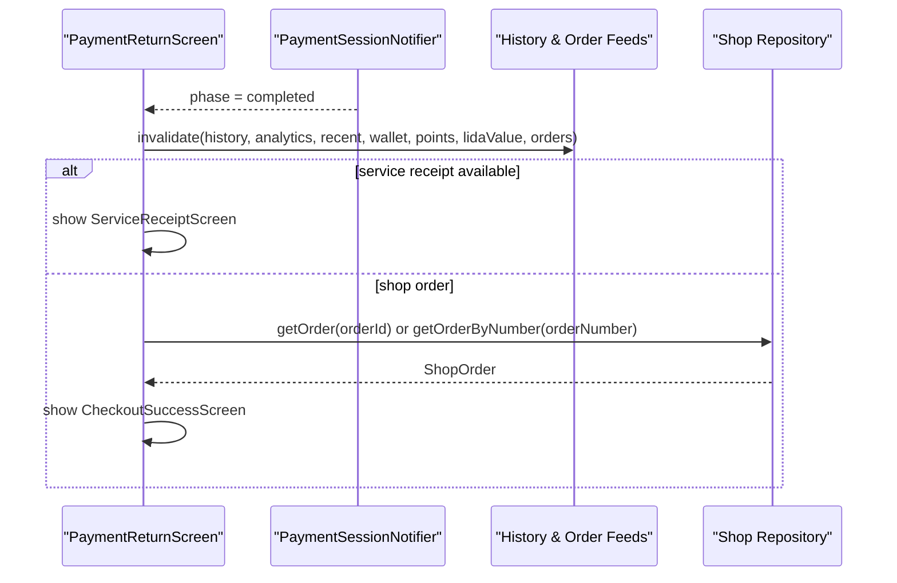

**Diagram sources**
- [payment_return_screen.dart:68-77](file://lib/features/payments/screens/payment_return_screen.dart#L68-L77)
- [payment_return_screen.dart:120-150](file://lib/features/payments/screens/payment_return_screen.dart#L120-L150)
- [payment_return_screen.dart:157-204](file://lib/features/payments/screens/payment_return_screen.dart#L157-L204)

**Section sources**
- [payment_return_screen.dart:68-77](file://lib/features/payments/screens/payment_return_screen.dart#L68-L77)
- [payment_return_screen.dart:120-150](file://lib/features/payments/screens/payment_return_screen.dart#L120-L150)
- [payment_return_screen.dart:157-204](file://lib/features/payments/screens/payment_return_screen.dart#L157-L204)

### Persistent Storage and Data Security
The system now includes two layers of persistent storage for maximum reliability:

**Traditional Payment Storage:**
- The pending payment store persists the in-flight purchase across process death and separates sensitive fields from general storage.
- Sensitive fields such as the payment token and MoMo number are stored in a secret store backed by platform keystore/keychain.
- The rest of the pending record is stored in shared preferences.
- Hydration loads secrets at startup so load can serve tokens synchronously.
- Legacy plaintext fields are migrated to encrypted storage when possible.
- Clear removes both persistent and secret fields.

**Lida Value Attempt Storage:**
- The LvAttempt store persists transaction attempts specifically for Lida Value funded purchases.
- Stores the complete draft, service type, debit reference (when available), and timestamp.
- Provides matching logic to identify retry attempts vs new transactions.
- Uses simple SharedPreferences for durability without encryption (no sensitive data).
- Automatically cleared upon successful completion or when no longer needed.

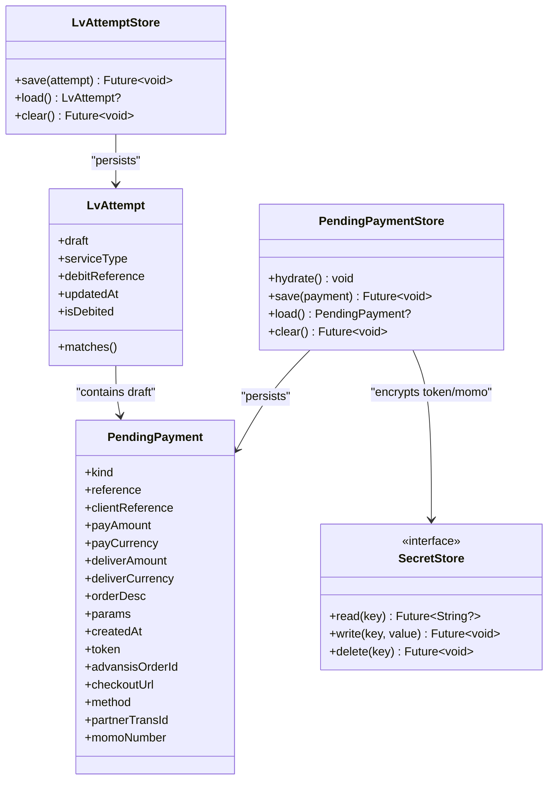

**Diagram sources**
- [pending_payment_store.dart:8-26](file://lib/features/payments/data/pending_payment_store.dart#L8-L26)
- [pending_payment_store.dart:31-63](file://lib/features/payments/data/pending_payment_store.dart#L31-L63)
- [pending_payment_store.dart:65-121](file://lib/features/payments/data/pending_payment_store.dart#L65-L121)
- [lv_attempt_store.dart:81-109](file://lib/features/lida_value/data/lv_attempt_store.dart#L81-L109)
- [lv_attempt_store.dart:17-78](file://lib/features/lida_value/data/lv_attempt_store.dart#L17-L78)
- [pending_payment.dart:24-87](file://lib/features/payments/data/pending_payment.dart#L24-L87)

**Section sources**
- [pending_payment_store.dart:8-26](file://lib/features/payments/data/pending_payment_store.dart#L8-L26)
- [pending_payment_store.dart:31-63](file://lib/features/payments/data/pending_payment_store.dart#L31-L63)
- [pending_payment_store.dart:65-121](file://lib/features/payments/data/pending_payment_store.dart#L65-L121)
- [lv_attempt_store.dart:81-109](file://lib/features/lida_value/data/lv_attempt_store.dart#L81-L109)
- [lv_attempt_store.dart:17-78](file://lib/features/lida_value/data/lv_attempt_store.dart#L17-L78)
- [pending_payment.dart:24-87](file://lib/features/payments/data/pending_payment.dart#L24-L87)

### Transaction State Management
The payment session tracks phases from idle through initiating, awaiting callback, verifying, crediting, completed, and failed. Lida Value transactions have their own state machine with additional phases for wallet operations.

**Traditional Payment States:**
- beginPayment sets initiating and saves pending.
- Card flow moves to awaitingCallback after launching checkout.
- Mobile Money flow may move directly to success or to verifying/awaitingCallback depending on outcome.
- _verifyThenCredit centralizes polling and avoids duplicate work.
- _credit delivers services or marks shop orders paid and clears pending state.
- cancelPending clears persisted pending and resets session.

**Lida Value States:**
- Idle → Debiting: When starting wallet-funded transaction.
- Debiting → Delivering: After successful wallet debit.
- Delivering → Completed: After successful service delivery.
- Any State → Failed: On errors, with attempt persistence for recovery.
- Automatic recovery on app startup for incomplete deliveries.

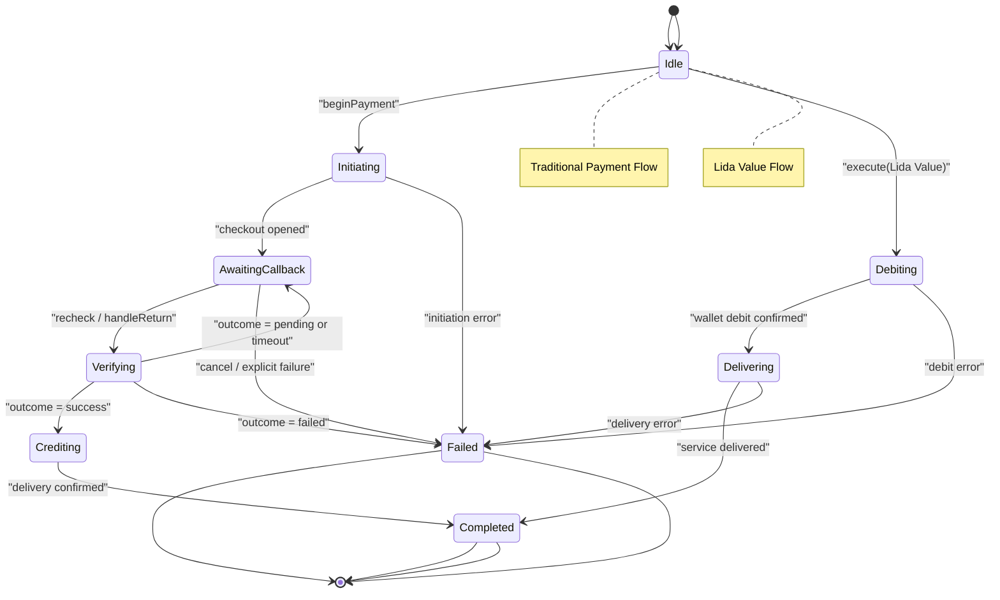

**Diagram sources**
- [providers.dart:43-85](file://lib/features/payments/providers.dart#L43-L85)
- [providers.dart:182-277](file://lib/features/payments/providers.dart#L182-L277)
- [providers.dart:372-468](file://lib/features/payments/providers.dart#L372-L468)
- [providers.dart:700-769](file://lib/features/payments/providers.dart#L700-L769)
- [lida_value_providers.dart:33-64](file://lib/features/lida_value/providers.dart#L33-L64)
- [lida_value_providers.dart:114-155](file://lib/features/lida_value/providers.dart#L114-L155)

**Section sources**
- [providers.dart:43-85](file://lib/features/payments/providers.dart#L43-L85)
- [providers.dart:182-277](file://lib/features/payments/providers.dart#L182-L277)
- [providers.dart:372-468](file://lib/features/payments/providers.dart#L372-L468)
- [providers.dart:700-769](file://lib/features/payments/providers.dart#L700-L769)
- [lida_value_providers.dart:33-64](file://lib/features/lida_value/providers.dart#L33-L64)
- [lida_value_providers.dart:114-155](file://lib/features/lida_value/providers.dart#L114-L155)

### Payment Failure Scenarios, Retry Logic, and User Notifications
Failure handling distinguishes provider-reported failures from transient network issues. Lida Value transactions add sophisticated retry logic with persistent state management.

**Traditional Payment Patterns:**
- Card query failures during polling are treated as unknown unless explicitly failed.
- Mobile Money status polling stops on timeout and leaves the user in awaitingCallback with provider status.
- When the network reports failure, users can check status again or send a new prompt.
- New prompts generate a fresh PartnerTransId to avoid double debits.
- Cancellation is only safe for unverified initiations; once verified, local cancellation does not reverse provider charges.
- UI panels provide clear guidance for checking approvals, dialing USSD menus, and choosing next actions.

**Lida Value Enhanced Patterns:**
- **Automatic Retry**: Failed deliveries are automatically retried on app startup.
- **Idempotency Protection**: Same clientReference prevents double-charging on retries.
- **Unknown Outcome Handling**: Distinguishes between confirmed failures and uncertain outcomes where wallet charge status is unknown.
- **Persistent Recovery**: Even if app crashes after wallet debit, delivery will be attempted on next startup.
- **Clear User Communication**: Messages indicate whether wallet was charged and what recovery steps are available.

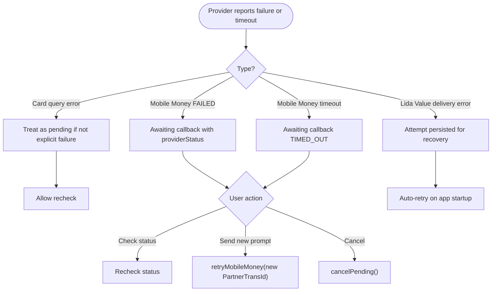

**Diagram sources**
- [providers.dart:325-367](file://lib/features/payments/providers.dart#L325-L367)
- [providers.dart:527-572](file://lib/features/payments/providers.dart#L527-L572)
- [providers.dart:602-665](file://lib/features/payments/providers.dart#L602-L665)
- [providers.dart:670-695](file://lib/features/payments/providers.dart#L670-L695)
- [lida_value_providers.dart:272-331](file://lib/features/lida_value/providers.dart#L272-L331)
- [payment_awaiting_panel.dart:82-103](file://lib/features/payments/widgets/payment_awaiting_panel.dart#L82-L103)
- [payment_awaiting_panel.dart:232-421](file://lib/features/payments/widgets/payment_awaiting_panel.dart#L232-L421)

**Section sources**
- [providers.dart:325-367](file://lib/features/payments/providers.dart#L325-L367)
- [providers.dart:527-572](file://lib/features/payments/providers.dart#L527-L572)
- [providers.dart:602-665](file://lib/features/payments/providers.dart#L602-L665)
- [providers.dart:670-695](file://lib/features/payments/providers.dart#L670-L695)
- [lida_value_providers.dart:272-331](file://lib/features/lida_value/providers.dart#L272-L331)
- [payment_awaiting_panel.dart:82-103](file://lib/features/payments/widgets/payment_awaiting_panel.dart#L82-L103)
- [payment_awaiting_panel.dart:232-421](file://lib/features/payments/widgets/payment_awaiting_panel.dart#L232-L421)

### Deep Link and Return Handling
Payment returns are routed through deep links into the return screen, which delegates verification to the payment session.

Behavior:
- Deep link handler recognizes payment return URIs.
- Return screen passes hint params to handleReturn.
- handleReturn validates orderId against saved values and ignores mismatches.
- Cancelled returns without token clear pending and show failure.
- Otherwise, verification proceeds and results are displayed.

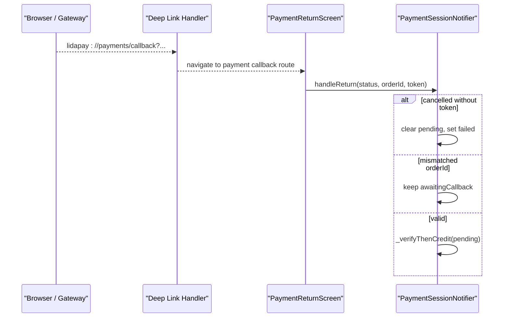

**Diagram sources**
- [deep_links.dart:64-72](file://lib/core/deep_links.dart#L64-L72)
- [payment_return_screen.dart:54-66](file://lib/features/payments/screens/payment_return_screen.dart#L54-L66)
- [providers.dart:372-421](file://lib/features/payments/providers.dart#L372-L421)

**Section sources**
- [deep_links.dart:64-72](file://lib/core/deep_links.dart#L64-L72)
- [payment_return_screen.dart:54-66](file://lib/features/payments/screens/payment_return_screen.dart#L54-L66)
- [providers.dart:372-421](file://lib/features/payments/providers.dart#L372-L421)

## Dependency Analysis
The payment subsystem depends on repositories, UI providers, deep linking, constants, and backend endpoints. Lida Value functionality adds dependencies on the services repository and persistent attempt storage.

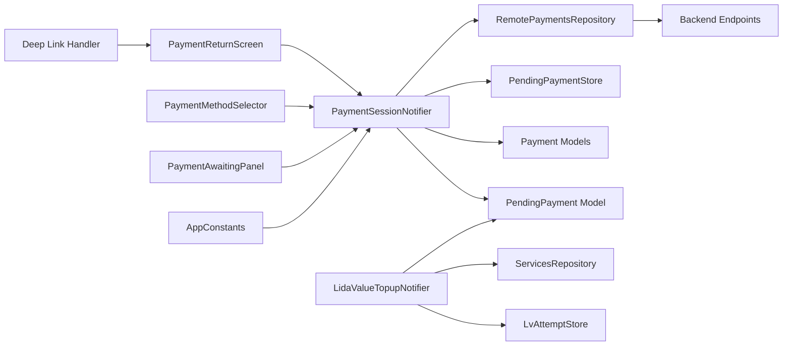

**Diagram sources**
- [providers.dart:120-178](file://lib/features/payments/providers.dart#L120-L178)
- [lida_value_providers.dart:79-91](file://lib/features/lida_value/providers.dart#L79-L91)
- [remote_payments_repository.dart:12-109](file://lib/features/payments/data/remote_payments_repository.dart#L12-L109)
- [payment_models.dart:5-49](file://lib/features/payments/data/payment_models.dart#L5-L49)
- [pending_payment.dart:16-87](file://lib/features/payments/data/pending_payment.dart#L16-L87)
- [payment_return_screen.dart:22-25](file://lib/features/payments/screens/payment_return_screen.dart#L22-L25)
- [payment_method_selector.dart:21-46](file://lib/features/payments/widgets/payment_method_selector.dart#L21-L46)
- [payment_awaiting_panel.dart:9-30](file://lib/features/payments/widgets/payment_awaiting_panel.dart#L9-L30)
- [deep_links.dart:64-72](file://lib/core/deep_links.dart#L64-L72)
- [app_constants.dart:23-46](file://lib/core/constants/app_constants.dart#L23-L46)

**Section sources**
- [providers.dart:120-178](file://lib/features/payments/providers.dart#L120-L178)
- [lida_value_providers.dart:79-91](file://lib/features/lida_value/providers.dart#L79-L91)
- [remote_payments_repository.dart:12-109](file://lib/features/payments/data/remote_payments_repository.dart#L12-L109)
- [payment_models.dart:5-49](file://lib/features/payments/data/payment_models.dart#L5-L49)
- [pending_payment.dart:16-87](file://lib/features/payments/data/pending_payment.dart#L16-L87)
- [payment_return_screen.dart:22-25](file://lib/features/payments/screens/payment_return_screen.dart#L22-L25)
- [payment_method_selector.dart:21-46](file://lib/features/payments/widgets/payment_method_selector.dart#L21-L46)
- [payment_awaiting_panel.dart:9-30](file://lib/features/payments/widgets/payment_awaiting_panel.dart#L9-L30)
- [deep_links.dart:64-72](file://lib/core/deep_links.dart#L64-L72)
- [app_constants.dart:23-46](file://lib/core/constants/app_constants.dart#L23-L46)

## Performance Considerations
- Polling limits prevent excessive network calls:
  - Card verification uses a fixed number of attempts with delays.
  - Mobile Money polling respects an expiration window anchored to creation time.
- Single-flight verification avoids duplicate queries when deep links or resume events occur.
- Timeout handling for mobile money status queries prevents long hangs.
- UI remains responsive by separating busy states from user-waiting states.
- Lida Value operations are lightweight since they primarily involve wallet ledger updates rather than external gateway interactions.

Recommendations:
- Keep polling attempts conservative to balance responsiveness and reliability.
- Prefer server-side callbacks where possible to reduce client polling.
- Monitor backend latency and adjust timeouts accordingly.
- Avoid unnecessary re-fetches by relying on feed invalidation only on completion.
- Leverage persistent storage to minimize redundant network calls for recovery scenarios.

[No sources needed since this section provides general guidance]

## Troubleshooting Guide
Common issues and resolutions:

**Traditional Payment Issues:**
- No pending payment found on return:
  - Indicates no active purchase or cleared state; show generic failure and guide user to history or support.
- Checkout URL invalid or not launchable:
  - Validate URLs against allowed hosts and show a friendly error.
- Deep link orderId mismatch:
  - Ignore mismatched hints and continue verification using saved token or PartnerTransId.
- Mobile Money prompt expired:
  - Set provider status to timed out; guide user to check approvals and offer check status or cancellation.
- Network timeout during status polling:
  - Stop polling and let user manually check status; do not declare failure prematurely.
- Delivery failure after payment confirmation:
  - Keep pending record so user can retry crediting without paying again.

**Lida Value Specific Issues:**
- **App crash after wallet debit**: System automatically resumes delivery on next startup.
- **Double charge prevention**: ClientReference ensures retries don't charge twice.
- **Unknown wallet charge status**: User should check balance and retry; system won't charge again for same reference.
- **Stuck in delivering state**: Check network connectivity and try again; system will auto-retry on app restart.

Operational tips:
- Use the awaiting panel to expose actionable steps: reopen checkout, check status, send new prompt, cancel.
- Log provider status and messages for diagnostics without exposing sensitive tokens.
- Ensure secret store hydration succeeds; otherwise degrade gracefully and ask user to recheck.
- Monitor LvAttemptStore for stuck attempts that need manual intervention.
- Test recovery scenarios by killing app mid-transaction to verify automatic retry works.

**Section sources**
- [providers.dart:235-277](file://lib/features/payments/providers.dart#L235-L277)
- [providers.dart:372-421](file://lib/features/payments/providers.dart#L372-L421)
- [providers.dart:602-665](file://lib/features/payments/providers.dart#L602-L665)
- [providers.dart:730-753](file://lib/features/payments/providers.dart#L730-L753)
- [lida_value_providers.dart:114-155](file://lib/features/lida_value/providers.dart#L114-L155)
- [lida_value_providers.dart:272-331](file://lib/features/lida_value/providers.dart#L272-L331)
- [payment_awaiting_panel.dart:82-103](file://lib/features/payments/widgets/payment_awaiting_panel.dart#L82-L103)
- [payment_awaiting_panel.dart:232-421](file://lib/features/payments/widgets/payment_awaiting_panel.dart#L232-L421)

## Conclusion
The payment processing system provides a robust, secure, and user-friendly flow for both Mobile Money, card, and Lida Value wallet payments. It centralizes verification, protects sensitive data, handles asynchronous provider behavior, and offers clear user guidance throughout the process. The enhanced Lida Value transaction reliability with persistent attempt tracking, automatic retry mechanisms, and improved error handling significantly improves the user experience by preventing lost transactions and ensuring services are delivered even in failure scenarios.

By combining careful state management, bounded polling, resilient error handling, and persistent recovery mechanisms, the system minimizes double charges and maximizes recovery from transient failures. The addition of Lida Value funding provides users with a convenient alternative payment method while maintaining the same high standards of reliability and security.

For production hardening:
- Pin checkout allowed hosts at build time.
- Monitor backend health and provider SLAs.
- Extend observability around provider status and polling outcomes.
- Continuously validate deep link routing and return semantics.
- Review security posture regularly, especially secret store usage and token handling.
- Monitor Lida Value attempt recovery rates and investigate any stuck attempts.
- Test edge cases involving app crashes during wallet operations to ensure recovery works correctly.

[No sources needed since this section summarizes without analyzing specific files]