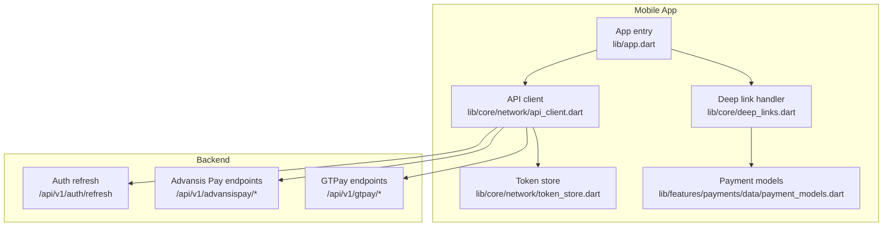
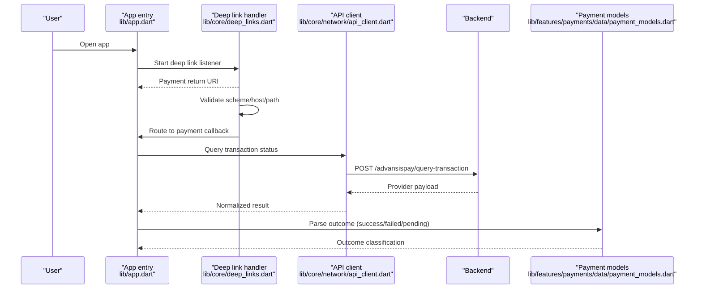
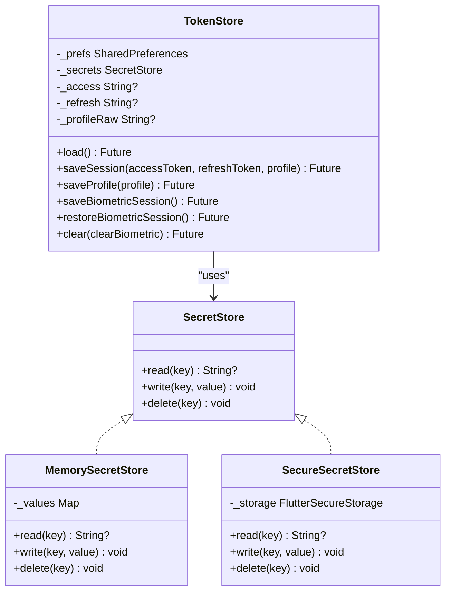
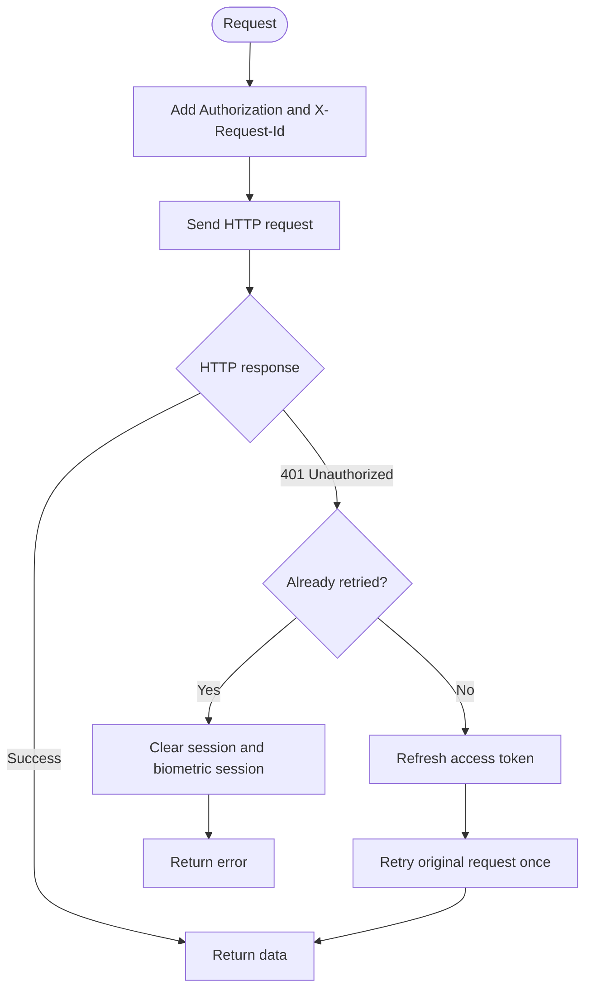
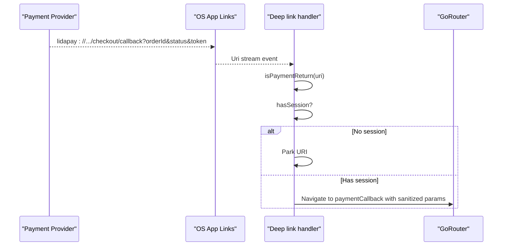
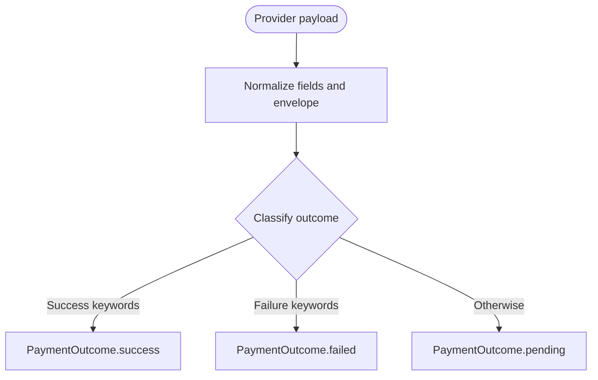
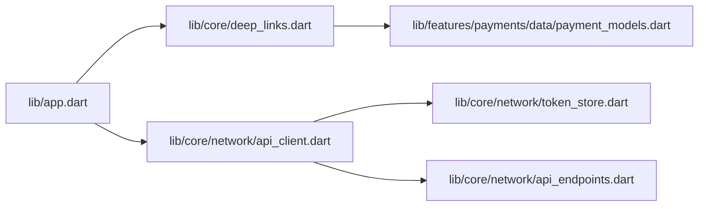

# Payment Security & Compliance

<cite>
**Referenced Files in This Document**
- [README.md](file://README.md)
- [app.dart](file://lib/app.dart)
- [deep_links.dart](file://lib/core/deep_links.dart)
- [api_client.dart](file://lib/core/network/api_client.dart)
- [api_endpoints.dart](file://lib/core/network/api_endpoints.dart)
- [token_store.dart](file://lib/core/network/token_store.dart)
- [payment_models.dart](file://lib/features/payments/data/payment_models.dart)
- [privacy-policy.html](file://web/privacy-policy.html)
- [payments-refunds.html](file://web/payments-refunds.html)
</cite>

## Table of Contents
1. [Introduction](#introduction)
2. [Project Structure](#project-structure)
3. [Core Components](#core-components)
4. [Architecture Overview](#architecture-overview)
5. [Detailed Component Analysis](#detailed-component-analysis)
6. [Dependency Analysis](#dependency-analysis)
7. [Performance Considerations](#performance-considerations)
8. [Troubleshooting Guide](#troubleshooting-guide)
9. [Conclusion](#conclusion)
10. [Appendices](#appendices)

## Introduction
This document explains the payment security measures and regulatory compliance posture implemented by the LidaPay mobile application. It focuses on data encryption strategies, secure storage of sensitive information, protection against common payment fraud techniques, PCI DSS considerations, GDPR-related privacy practices, and local financial regulations relevant to Ghana. It also provides examples of secure API communication, token management, deep-link callback handling, and audit logging for payment transactions. Finally, it outlines security best practices across development, testing, and production environments.

## Project Structure
The repository is a Flutter mobile application with:
- Core networking and authentication utilities under lib/core/network.
- Payment domain models and flows under lib/features/payments.
- Deep-link routing for payment returns under lib/core.
- Public legal pages under web/.
- Build and store submission guidance under README.md.

**Diagram sources**
- [app.dart:67-87](file://lib/app.dart#L67-L87)
- [deep_links.dart:8-18](file://lib/core/deep_links.dart#L8-L18)
- [api_client.dart:13-24](file://lib/core/network/api_client.dart#L13-L24)
- [api_endpoints.dart:6-108](file://lib/core/network/api_endpoints.dart#L6-L108)
- [token_store.dart:71-74](file://lib/core/network/token_store.dart#L71-L74)
- [payment_models.dart:5-49](file://lib/features/payments/data/payment_models.dart#L5-L49)

**Section sources**
- [README.md:1-47](file://README.md#L1-L47)

## Core Components
- Secure token storage: Tokens and profile data are persisted using an encrypted secret store backed by platform secure storage (Android Keystore or iOS Keychain). Legacy plaintext preferences are migrated and removed at startup.
- Secure API communication: The HTTP client adds bearer tokens, request IDs, redacts sensitive fields in debug logs, and transparently refreshes access tokens on 401 responses.
- Payment callbacks: Deep links from payment providers are recognized, validated, and routed to a payment callback screen without forwarding provider tokens into app state.
- Payment models: Models parse provider payloads and normalize outcomes (success, failed, pending), including both Advansis Pay and GTPay flows.

**Section sources**
- [token_store.dart:20-23](file://lib/core/network/token_store.dart#L20-L23)
- [token_store.dart:46-69](file://lib/core/network/token_store.dart#L46-L69)
- [token_store.dart:71-88](file://lib/core/network/token_store.dart#L71-L88)
- [api_client.dart:13-15](file://lib/core/network/api_client.dart#L13-L15)
- [api_client.dart:86-113](file://lib/core/network/api_client.dart#L86-L113)
- [deep_links.dart:63-75](file://lib/core/deep_links.dart#L63-L75)
- [payment_models.dart:5-49](file://lib/features/payments/data/payment_models.dart#L5-L49)

## Architecture Overview
The payment flow integrates three main layers:
- UI and routing layer: Starts deep-link listeners and routes payment return URIs to the callback screen.
- Networking layer: Centralizes authenticated requests, token refresh, and sensitive data redaction.
- Domain layer: Parses provider-specific payloads and normalizes payment outcomes.

**Diagram sources**
- [app.dart:67-87](file://lib/app.dart#L67-L87)
- [deep_links.dart:63-75](file://lib/core/deep_links.dart#L63-L75)
- [api_endpoints.dart:102-103](file://lib/core/network/api_endpoints.dart#L102-L103)
- [payment_models.dart:57-149](file://lib/features/payments/data/payment_models.dart#L57-L149)

## Detailed Component Analysis

### Secure Token Storage and Biometric Session Handling
Tokens and profile data are stored in an encrypted secret store. On startup, legacy plaintext values are migrated and wiped. A biometric session can be saved separately and restored only after device authentication.

Key behaviors:
- Encrypted persistence via platform secure storage; iCloud sync disabled for iOS.
- Migration from plaintext preferences to encrypted storage at startup.
- Biometric session requires a refreshable session; cleared explicitly when needed.

**Diagram sources**
- [token_store.dart:26-69](file://lib/core/network/token_store.dart#L26-L69)
- [token_store.dart:71-88](file://lib/core/network/token_store.dart#L71-L88)
- [token_store.dart:120-146](file://lib/core/network/token_store.dart#L120-L146)
- [token_store.dart:177-217](file://lib/core/network/token_store.dart#L177-L217)

**Section sources**
- [token_store.dart:20-23](file://lib/core/network/token_store.dart#L20-L23)
- [token_store.dart:46-69](file://lib/core/network/token_store.dart#L46-L69)
- [token_store.dart:71-88](file://lib/core/network/token_store.dart#L71-L88)
- [token_store.dart:120-146](file://lib/core/network/token_store.dart#L120-L146)
- [token_store.dart:177-217](file://lib/core/network/token_store.dart#L177-L217)

### Secure API Communication and Audit Logging
The API client:
- Adds Authorization headers with bearer tokens.
- Injects a unique X-Request-Id per request for traceability.
- Redacts sensitive fields in debug logs.
- Transparently refreshes access tokens on 401 errors with single-flight deduplication.

Sensitive keys redacted include password, token, refreshtoken, accesstoken, authorization, secret, otp, and pin.

**Diagram sources**
- [api_client.dart:25-83](file://lib/core/network/api_client.dart#L25-L83)
- [api_client.dart:86-113](file://lib/core/network/api_client.dart#L86-L113)
- [api_client.dart:204-265](file://lib/core/network/api_client.dart#L204-L265)

**Section sources**
- [api_client.dart:13-15](file://lib/core/network/api_client.dart#L13-L15)
- [api_client.dart:25-83](file://lib/core/network/api_client.dart#L25-L83)
- [api_client.dart:86-113](file://lib/core/network/api_client.dart#L86-L113)
- [api_client.dart:204-265](file://lib/core/network/api_client.dart#L204-L265)

### Payment Callback Deep Links and Token Handling
The deep link handler:
- Recognizes multiple payment return URI patterns.
- Parks callbacks until a session exists, then routes them once.
- Never forwards provider tokens into app state; only presence is noted.

**Diagram sources**
- [deep_links.dart:8-18](file://lib/core/deep_links.dart#L8-L18)
- [deep_links.dart:27-51](file://lib/core/deep_links.dart#L27-L51)
- [deep_links.dart:63-75](file://lib/core/deep_links.dart#L63-L75)
- [deep_links.dart:116-135](file://lib/core/deep_links.dart#L116-L135)

**Section sources**
- [deep_links.dart:8-18](file://lib/core/deep_links.dart#L8-L18)
- [deep_links.dart:27-51](file://lib/core/deep_links.dart#L27-L51)
- [deep_links.dart:63-75](file://lib/core/deep_links.dart#L63-L75)
- [deep_links.dart:116-135](file://lib/core/deep_links.dart#L116-L135)

### Payment Models and Fraud-Resistant Outcome Classification
Models parse provider payloads and classify outcomes robustly:
- Advansis Pay: Considers status, resultText, and originalResponse.result to determine success/failed/pending.
- GTPay: Uses provider’s Status field (PENDING/COMPLETED/FAILED) and maps to normalized outcomes.

**Diagram sources**
- [payment_models.dart:57-149](file://lib/features/payments/data/payment_models.dart#L57-L149)
- [payment_models.dart:165-214](file://lib/features/payments/data/payment_models.dart#L165-L214)

**Section sources**
- [payment_models.dart:5-49](file://lib/features/payments/data/payment_models.dart#L5-L49)
- [payment_models.dart:57-149](file://lib/features/payments/data/payment_models.dart#L57-L149)
- [payment_models.dart:165-214](file://lib/features/payments/data/payment_models.dart#L165-L214)

## Dependency Analysis
The following diagram shows how core components depend on each other and on backend endpoints.

**Diagram sources**
- [app.dart:67-87](file://lib/app.dart#L67-L87)
- [deep_links.dart:8-18](file://lib/core/deep_links.dart#L8-L18)
- [api_client.dart:13-24](file://lib/core/network/api_client.dart#L13-L24)
- [api_endpoints.dart:6-108](file://lib/core/network/api_endpoints.dart#L6-L108)
- [token_store.dart:71-88](file://lib/core/network/token_store.dart#L71-L88)
- [payment_models.dart:5-49](file://lib/features/payments/data/payment_models.dart#L5-L49)

**Section sources**
- [api_endpoints.dart:6-108](file://lib/core/network/api_endpoints.dart#L6-L108)

## Performance Considerations
- Token refresh is single-flighted to avoid concurrent refresh storms.
- Sensitive log redaction prevents accidental leakage while retaining useful debugging context.
- Deep link parking avoids blocking startup and ensures callbacks are delivered once.
- Platform secure storage minimizes disk I/O overhead by keeping an in-memory mirror for interceptors.

[No sources needed since this section provides general guidance]

## Troubleshooting Guide
Common issues and mitigations:
- 401 Unauthorized: The client attempts one token refresh; repeated failures clear the session and biometric session.
- Corrupted secret store: Startup degrades gracefully to signed-out instead of crashing.
- Duplicate callback navigation: The deep link handler avoids stacking duplicate payment callback screens.
- Missing deep link channels: Initialization failures do not block startup; payments simply lose the instant-return path.

Operational recommendations:
- Use X-Request-Id to correlate logs across network calls.
- Ensure sensitive fields are never sent to support; policies instruct users to omit PINs, passwords, and OTPs.
- For refund investigations, collect transaction references, amounts, dates, and descriptions without sharing secrets.

**Section sources**
- [api_client.dart:50-83](file://lib/core/network/api_client.dart#L50-L83)
- [api_client.dart:204-265](file://lib/core/network/api_client.dart#L204-L265)
- [token_store.dart:120-146](file://lib/core/network/token_store.dart#L120-L146)
- [deep_links.dart:27-51](file://lib/core/deep_links.dart#L27-L51)
- [deep_links.dart:146-155](file://lib/core/deep_links.dart#L146-L155)
- [payments-refunds.html:35-38](file://web/payments-refunds.html#L35-L38)

## Conclusion
LidaPay implements strong security controls for payment data: encrypted token storage, secure HTTPS communication, sensitive data redaction, robust token refresh, and careful handling of payment provider callbacks. The app’s models normalize provider outcomes to reduce ambiguity and improve fraud resilience. Legal pages document data handling, retention, and deletion practices. Together, these measures align with industry expectations for secure payment processing and provide a solid foundation for PCI DSS and GDPR compliance, as well as adherence to local financial regulations in Ghana.

[No sources needed since this section summarizes without analyzing specific files]

## Appendices

### Data Encryption and Secure Storage
- Secrets are written to platform secure storage (Android secure storage or iOS Keychain).
- iOS Keychain accessibility is restricted to first unlock on the current device.
- Legacy plaintext preferences are migrated and removed during startup.

**Section sources**
- [token_store.dart:46-69](file://lib/core/network/token_store.dart#L46-L69)
- [token_store.dart:120-146](file://lib/core/network/token_store.dart#L120-L146)

### PCI DSS Compliance Considerations
- Do not store cardholder PAN, CVV, or track data in the app or logs.
- Rely on hosted checkout and provider APIs for sensitive card data.
- Enforce TLS for all network traffic and validate server certificates.
- Implement least privilege and role-based access for backend services.
- Maintain audit trails for authentication and payment events.

[No sources needed since this section provides general guidance]

### GDPR Considerations for Payment Data
- Collect only necessary personal data and explain purposes clearly.
- Provide mechanisms for access, correction, and deletion.
- Limit retention to what is required for service delivery and legal obligations.
- Inform users about third-party processors (payment providers, messaging services).
- Honor user choices and permissions (location, notifications).

**Section sources**
- [privacy-policy.html:23-31](file://web/privacy-policy.html#L23-L31)
- [privacy-policy.html:40-49](file://web/privacy-policy.html#L40-L49)
- [privacy-policy.html:51-61](file://web/privacy-policy.html#L51-L61)

### Local Financial Regulations in Ghana
- Operate through licensed payment service providers and comply with their terms.
- Follow consumer protection rules for cancellations, returns, and refunds.
- Provide clear channels for reporting disputes and investigating transactions.
- Retain transaction records as required by applicable law while minimizing unnecessary data.

**Section sources**
- [payments-refunds.html:23-38](file://web/payments-refunds.html#L23-L38)

### Secure API Communication Examples
- Authentication: Requests include Authorization: Bearer <token>.
- Traceability: Each request includes X-Request-Id.
- Token refresh: Automatic on 401 with single-flight deduplication.
- Sensitive data redaction: Debug logs mask known sensitive keys.

**Section sources**
- [api_client.dart:25-83](file://lib/core/network/api_client.dart#L25-L83)
- [api_client.dart:86-113](file://lib/core/network/api_client.dart#L86-L113)
- [api_client.dart:204-265](file://lib/core/network/api_client.dart#L204-L265)

### Token Management Best Practices
- Store tokens in platform secure storage; never in plain preferences.
- Avoid storing credentials or passwords; use refresh tokens where supported.
- Clear sessions on logout and on rejected refresh attempts.
- Support optional biometric sign-in with separate, revocable session material.

**Section sources**
- [token_store.dart:71-88](file://lib/core/network/token_store.dart#L71-L88)
- [token_store.dart:177-217](file://lib/core/network/token_store.dart#L177-L217)

### Audit Logging for Payment Transactions
- Log request methods, endpoints, and sanitized bodies in debug mode.
- Include X-Request-Id for correlation across services.
- Avoid logging sensitive fields such as passwords, tokens, OTPs, and PINs.

**Section sources**
- [api_client.dart:25-83](file://lib/core/network/api_client.dart#L25-L83)
- [api_client.dart:86-113](file://lib/core/network/api_client.dart#L86-L113)

### Security Best Practices Across Environments
- Development: Enable verbose logging with redaction; use test doubles for secure storage.
- Testing: Mock secure storage and shared preferences; verify graceful degradation on corrupted stores.
- Production: Use release builds with hardened configurations; ensure Play signing and private keystore management.

**Section sources**
- [README.md:15-25](file://README.md#L15-L25)
- [token_store.dart:32-44](file://lib/core/network/token_store.dart#L32-L44)