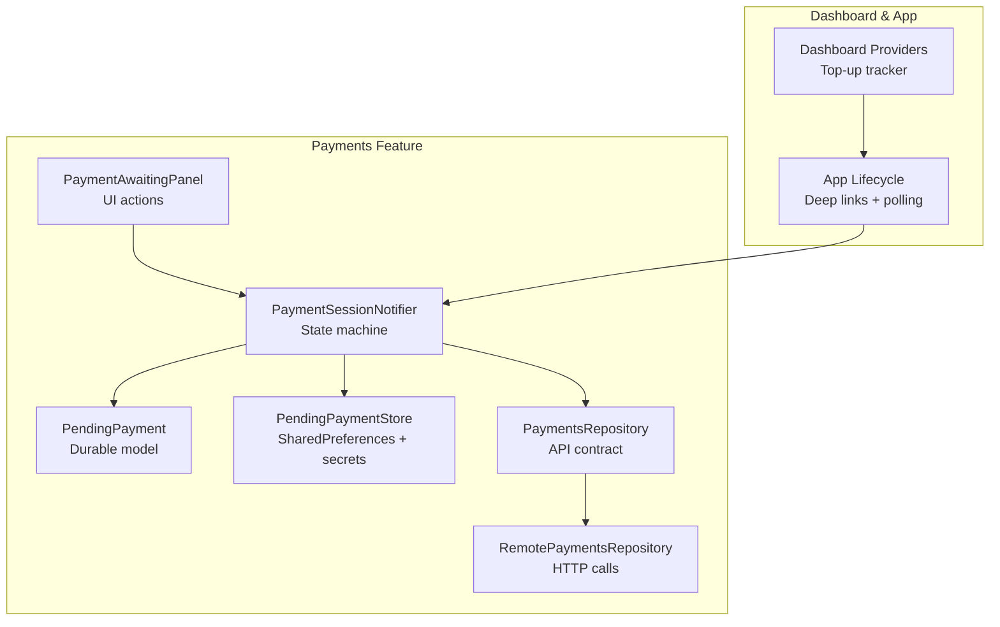
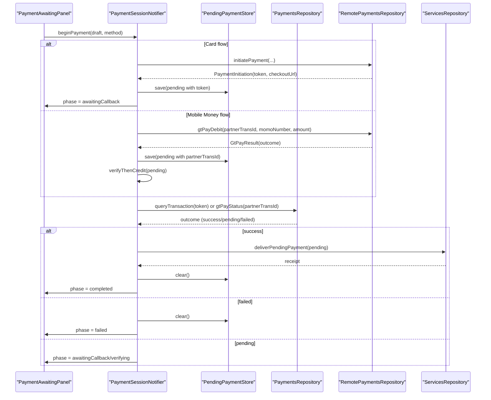
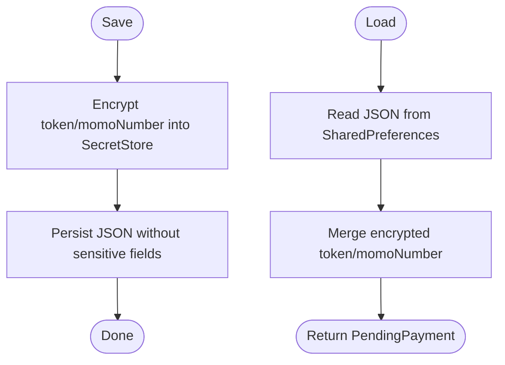
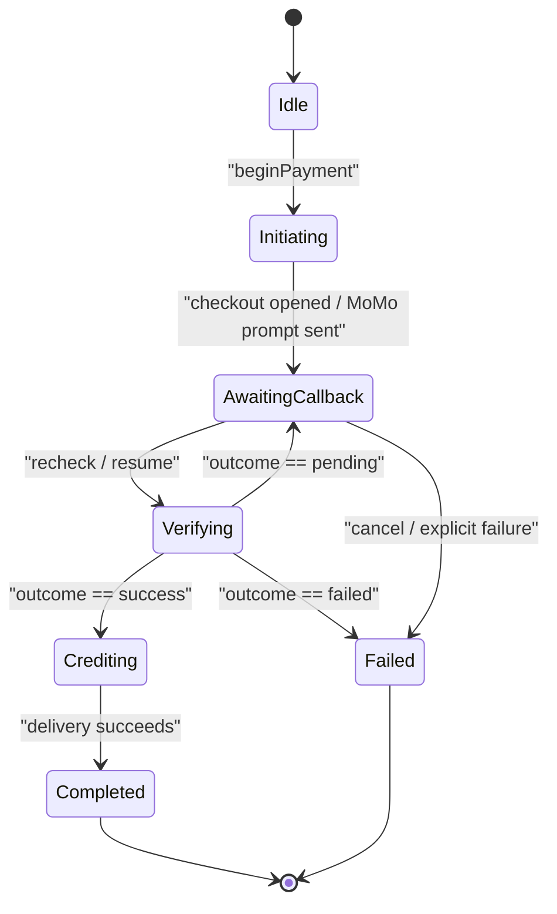
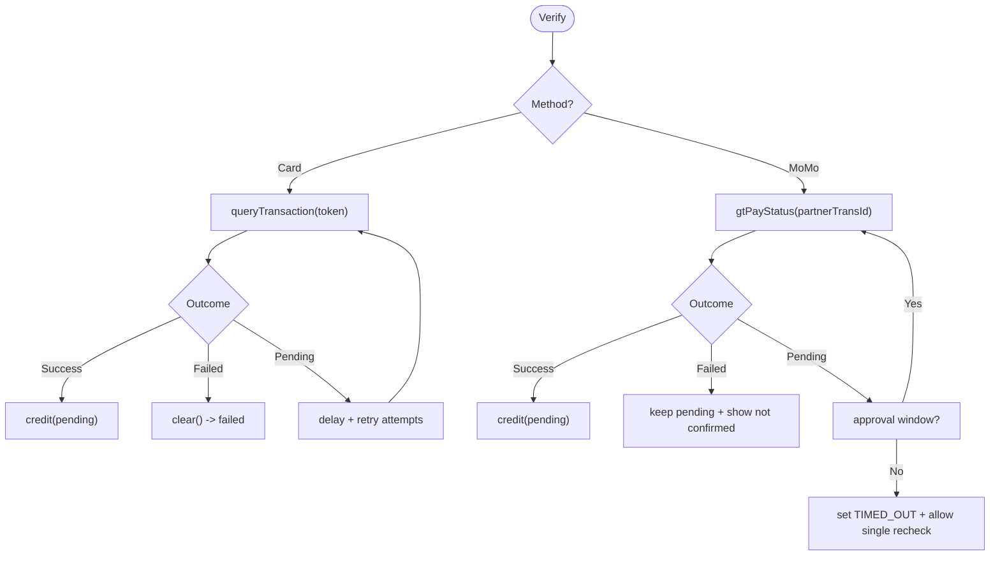
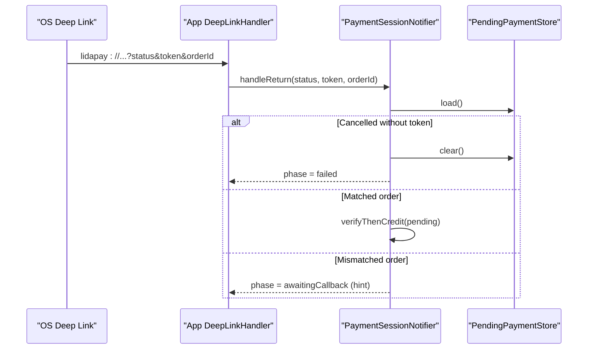
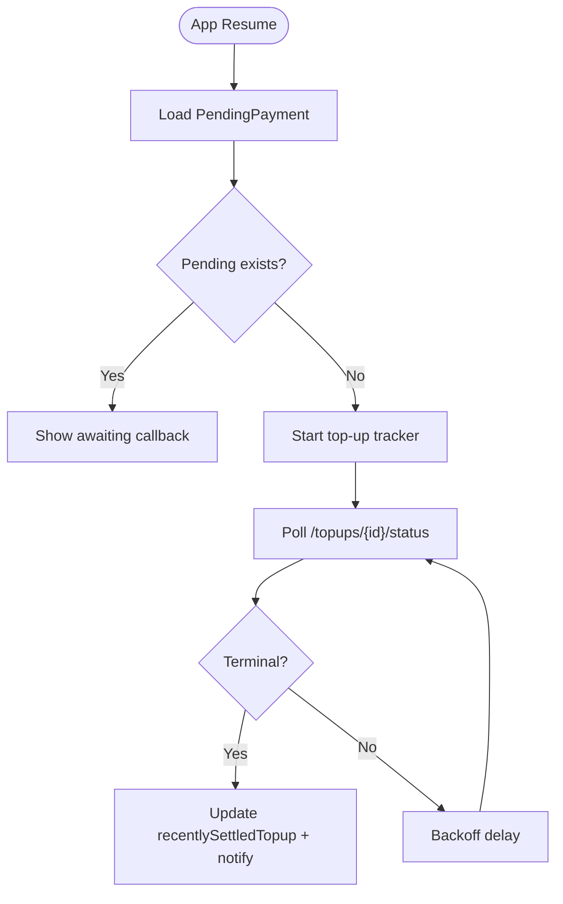
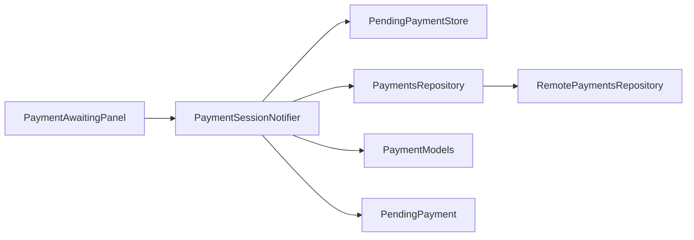

# Transaction Status Monitoring

<cite>
**Referenced Files in This Document**
- [providers.dart](file://lib/features/payments/providers.dart)
- [pending_payment.dart](file://lib/features/payments/data/pending_payment.dart)
- [pending_payment_store.dart](file://lib/features/payments/data/pending_payment_store.dart)
- [payment_models.dart](file://lib/features/payments/data/payment_models.dart)
- [payments_repository.dart](file://lib/features/payments/data/payments_repository.dart)
- [remote_payments_repository.dart](file://lib/features/payments/data/remote_payments_repository.dart)
- [payment_awaiting_panel.dart](file://lib/features/payments/widgets/payment_awaiting_panel.dart)
- [dashboard_providers.dart](file://lib/features/dashboard/providers.dart)
- [app.dart](file://lib/app.dart)
</cite>

## Table of Contents
1. [Introduction](#introduction)
2. [Project Structure](#project-structure)
3. [Core Components](#core-components)
4. [Architecture Overview](#architecture-overview)
5. [Detailed Component Analysis](#detailed-component-analysis)
6. [Dependency Analysis](#dependency-analysis)
7. [Performance Considerations](#performance-considerations)
8. [Troubleshooting Guide](#troubleshooting-guide)
9. [Conclusion](#conclusion)

## Introduction
This document explains how the app monitors transaction status and manages state across payment flows. It focuses on:
- The pending payment store architecture for durable, crash-safe state.
- Real-time status updates through polling and deep-link returns.
- State synchronization between the payment session, UI panels, dashboard trackers, and background services.
- Polling mechanisms for both Advansis Pay checkout verification and GTPay mobile money approvals.
- Web hook handling via native deep links and manual rechecks.
- Offline behavior, interrupted transaction recovery, and retry strategies.
- User notifications for settlement and status changes.

## Project Structure
The transaction monitoring logic is centered around the payments feature, with supporting components in dashboard tracking and application lifecycle management.

**Diagram sources**
- [providers.dart:43-129](file://lib/features/payments/providers.dart#L43-L129)
- [pending_payment.dart:24-88](file://lib/features/payments/data/pending_payment.dart#L24-L88)
- [pending_payment_store.dart:8-26](file://lib/features/payments/data/pending_payment_store.dart#L8-L26)
- [payments_repository.dart:3-45](file://lib/features/payments/data/payments_repository.dart#L3-L45)
- [remote_payments_repository.dart:7-10](file://lib/features/payments/data/remote_payments_repository.dart#L7-L10)
- [payment_awaiting_panel.dart:9-14](file://lib/features/payments/widgets/payment_awaiting_panel.dart#L9-L14)
- [dashboard_providers.dart:138-142](file://lib/features/dashboard/providers.dart#L138-L142)
- [app.dart:84-101](file://lib/app.dart#L84-L101)

**Section sources**
- [providers.dart:43-129](file://lib/features/payments/providers.dart#L43-L129)
- [pending_payment.dart:24-88](file://lib/features/payments/data/pending_payment.dart#L24-L88)
- [pending_payment_store.dart:8-26](file://lib/features/payments/data/pending_payment_store.dart#L8-L26)
- [payments_repository.dart:3-45](file://lib/features/payments/data/payments_repository.dart#L3-L45)
- [remote_payments_repository.dart:7-10](file://lib/features/payments/data/remote_payments_repository.dart#L7-L10)
- [payment_awaiting_panel.dart:9-14](file://lib/features/payments/widgets/payment_awaiting_panel.dart#L9-L14)
- [dashboard_providers.dart:138-142](file://lib/features/dashboard/providers.dart#L138-L142)
- [app.dart:84-101](file://lib/app.dart#L84-L101)

## Core Components
- Payment session state machine:
  - Phases include idle, initiating, awaitingCallback, verifying, crediting, completed, failed.
  - Tracks user-facing messages, provider status, receipts, and shop order numbers.
- Pending payment model:
  - Encapsulates kind-specific purchase parameters, client reference, token, partner transaction ID, and method.
  - Provides JSON serialization and copy helpers to survive process death.
- Pending payment store:
  - Persists non-sensitive fields in shared preferences.
  - Stores sensitive fields (token, MoMo number) in a secure secret store.
  - Migrates legacy plaintext fields into secure storage at startup.
- Payments repository:
  - Defines API contracts for Advansis Pay initiation/query and GTPay debit/status.
- Remote payments repository:
  - Implements HTTP calls, timeouts, and payload parsing.
- Payment awaiting panel:
  - Renders stage progress, user guidance, and action buttons (reopen, check status, retry prompt, cancel).
- Dashboard top-up tracker:
  - Polls top-up status until terminal, enriches missing recipient data, and notifies globally.

**Section sources**
- [providers.dart:43-85](file://lib/features/payments/providers.dart#L43-L85)
- [pending_payment.dart:24-88](file://lib/features/payments/data/pending_payment.dart#L24-L88)
- [pending_payment_store.dart:8-26](file://lib/features/payments/data/pending_payment_store.dart#L8-L26)
- [payments_repository.dart:3-45](file://lib/features/payments/data/payments_repository.dart#L3-L45)
- [remote_payments_repository.dart:7-10](file://lib/features/payments/data/remote_payments_repository.dart#L7-L10)
- [payment_awaiting_panel.dart:9-14](file://lib/features/payments/widgets/payment_awaiting_panel.dart#L9-L14)
- [dashboard_providers.dart:138-142](file://lib/features/dashboard/providers.dart#L138-L142)

## Architecture Overview
The system coordinates three main concerns:
- Payment orchestration: initiates checkout or MoMo debit, verifies outcomes, and delivers purchases.
- Durable state: persists in-flight purchases securely so they can be resumed after crashes or app restarts.
- Background reconciliation: polls top-ups and handles deep link returns to keep UI consistent.

**Diagram sources**
- [providers.dart:182-277](file://lib/features/payments/providers.dart#L182-L277)
- [providers.dart:283-367](file://lib/features/payments/providers.dart#L283-L367)
- [providers.dart:474-572](file://lib/features/payments/providers.dart#L474-L572)
- [providers.dart:578-665](file://lib/features/payments/providers.dart#L578-L665)
- [providers.dart:700-769](file://lib/features/payments/providers.dart#L700-L769)
- [remote_payments_repository.dart:13-53](file://lib/features/payments/data/remote_payments_repository.dart#L13-L53)
- [remote_payments_repository.dart:65-109](file://lib/features/payments/data/remote_payments_repository.dart#L65-L109)
- [pending_payment_store.dart:65-94](file://lib/features/payments/data/pending_payment_store.dart#L65-L94)

## Detailed Component Analysis

### Pending Payment Store Architecture
The store ensures that an in-flight purchase survives process death and provides safe access to sensitive fields:
- Non-sensitive fields are persisted in shared preferences.
- Sensitive fields (token, MoMo number) are stored in a secret store; if unavailable, the store falls back to previous behavior to avoid losing the purchase.
- Hydration runs once at startup to load encrypted fields synchronously.
- Clear removes all traces of the pending purchase.

**Diagram sources**
- [pending_payment_store.dart:31-63](file://lib/features/payments/data/pending_payment_store.dart#L31-L63)
- [pending_payment_store.dart:65-109](file://lib/features/payments/data/pending_payment_store.dart#L65-L109)

**Section sources**
- [pending_payment_store.dart:8-26](file://lib/features/payments/data/pending_payment_store.dart#L8-L26)
- [pending_payment_store.dart:31-63](file://lib/features/payments/data/pending_payment_store.dart#L31-L63)
- [pending_payment_store.dart:65-109](file://lib/features/payments/data/pending_payment_store.dart#L65-L109)

### Payment Session State Machine
The session orchestrates the full lifecycle:
- Initiates card checkout or MoMo debit.
- Verifies outcomes using polling or deep link return.
- Delivers the purchase and clears pending state.
- Handles failures gracefully, allowing retries where safe.

Key behaviors:
- Single-flight verification prevents duplicate credits.
- Generation counter invalidates stale polls when the user cancels or starts a new payment.
- For MoMo, approval window expiration limits active polling while still allowing one late reconciliation.

**Diagram sources**
- [providers.dart:43-85](file://lib/features/payments/providers.dart#L43-L85)
- [providers.dart:182-277](file://lib/features/payments/providers.dart#L182-L277)
- [providers.dart:283-367](file://lib/features/payments/providers.dart#L283-L367)
- [providers.dart:474-572](file://lib/features/payments/providers.dart#L474-L572)
- [providers.dart:578-665](file://lib/features/payments/providers.dart#L578-L665)
- [providers.dart:700-769](file://lib/features/payments/providers.dart#L700-L769)

**Section sources**
- [providers.dart:43-85](file://lib/features/payments/providers.dart#L43-L85)
- [providers.dart:182-277](file://lib/features/payments/providers.dart#L182-L277)
- [providers.dart:283-367](file://lib/features/payments/providers.dart#L283-L367)
- [providers.dart:474-572](file://lib/features/payments/providers.dart#L474-L572)
- [providers.dart:578-665](file://lib/features/payments/providers.dart#L578-L665)
- [providers.dart:700-769](file://lib/features/payments/providers.dart#L700-L769)

### Polling Mechanisms for Transaction Completion
Two distinct polling paths exist:

- Advansis Pay card flow:
  - Repeatedly queries `/advansispay/query-transaction` using the saved token.
  - Treats transient errors as unknown and continues polling up to a configured attempt limit.
  - On success, proceeds to credit; on failure, clears pending and marks failed.

- GTPay mobile money flow:
  - Debts the MoMo wallet using `partnerTransId`, then polls `/gtpay/status`.
  - Uses an approval window anchored to `PendingPayment.createdAt`; beyond this window, only a single status query is performed.
  - Stops polling on timeout (504) but keeps the record pending for manual recheck.

**Diagram sources**
- [providers.dart:501-572](file://lib/features/payments/providers.dart#L501-L572)
- [providers.dart:578-665](file://lib/features/payments/providers.dart#L578-L665)
- [remote_payments_repository.dart:56-62](file://lib/features/payments/data/remote_payments_repository.dart#L56-L62)
- [remote_payments_repository.dart:97-109](file://lib/features/payments/data/remote_payments_repository.dart#L97-L109)

**Section sources**
- [providers.dart:501-572](file://lib/features/payments/providers.dart#L501-L572)
- [providers.dart:578-665](file://lib/features/payments/providers.dart#L578-L665)
- [remote_payments_repository.dart:56-62](file://lib/features/payments/data/remote_payments_repository.dart#L56-L62)
- [remote_payments_repository.dart:97-109](file://lib/features/payments/data/remote_payments_repository.dart#L97-L109)

### Web Hook Handling for Payment Callbacks
Native deep links (`lidapay://`) route payment returns to the session:
- The handler loads the in-memory or persisted pending record.
- Validates returned `orderId` against the saved order ID or shop order number.
- Treats cancelled returns without a token as cancellations and clears pending state.
- Otherwise triggers verification and delivery.

**Diagram sources**
- [app.dart:84-101](file://lib/app.dart#L84-L101)
- [providers.dart:372-421](file://lib/features/payments/providers.dart#L372-L421)
- [pending_payment_store.dart:96-109](file://lib/features/payments/data/pending_payment_store.dart#L96-L109)

**Section sources**
- [app.dart:84-101](file://lib/app.dart#L84-L101)
- [providers.dart:372-421](file://lib/features/payments/providers.dart#L372-L421)
- [pending_payment_store.dart:96-109](file://lib/features/payments/data/pending_payment_store.dart#L96-L109)

### Offline Transaction Tracking and Recovery
- Pending payment persistence:
  - If the app dies during checkout, the next launch restores the pending state and prompts the user to finish or check status.
- Top-up settlement tracking:
  - Background stream merges ledger rows marked decision-pending with explicitly tracked transfers.
  - Polls top-up status with exponential backoff when network responses fail.
  - When a top-up reaches a terminal state, it updates global state and triggers notifications.

**Diagram sources**
- [providers.dart:149-159](file://lib/features/payments/providers.dart#L149-L159)
- [dashboard_providers.dart:141-249](file://lib/features/dashboard/providers.dart#L141-L249)
- [app.dart:145-148](file://lib/app.dart#L145-L148)

**Section sources**
- [providers.dart:149-159](file://lib/features/payments/providers.dart#L149-L159)
- [dashboard_providers.dart:141-249](file://lib/features/dashboard/providers.dart#L141-L249)
- [app.dart:145-148](file://lib/app.dart#L145-L148)

### Status Transition States and User Notifications
Status transitions and their meanings:
- Pending:
  - Advansis Pay: awaiting callback or verifying with pending outcome.
  - GTPay: waiting for MoMo approval or polling status within the approval window.
- Completed:
  - Delivery succeeded; pending cleared; receipt available.
- Failed:
  - Explicit failure or cancellation; pending cleared; user can retry or choose another method.
- Cancelled:
  - Returned without token; pending cleared; no charge made.

User notifications:
- In-app banners guide users through reopening checkout, checking status, sending a new MoMo prompt, or cancelling.
- Global snackbars and local alerts announce top-up settlement results, including failures and reasons.

**Section sources**
- [providers.dart:501-572](file://lib/features/payments/providers.dart#L501-L572)
- [providers.dart:578-665](file://lib/features/payments/providers.dart#L578-L665)
- [providers.dart:700-769](file://lib/features/payments/providers.dart#L700-L769)
- [payment_awaiting_panel.dart:76-102](file://lib/features/payments/widgets/payment_awaiting_panel.dart#L76-L102)
- [dashboard_providers.dart:87-129](file://lib/features/dashboard/providers.dart#L87-L129)
- [app.dart:150-177](file://lib/app.dart#L150-L177)

### Recovery Mechanisms for Interrupted Transactions
- Card checkout interruption:
  - Saved token enables re-verification even after process death.
  - Manual “I’ve paid” recheck uses the same verification path.
- MoMo interruption:
  - PartnerTransId ensures reconciliation without double-debit.
  - After timeout, only a single status query is allowed; fresh prompts require explicit retry.
- Delivery failure after payment confirmation:
  - Pending remains to allow retrying delivery without charging again.

**Section sources**
- [providers.dart:283-367](file://lib/features/payments/providers.dart#L283-L367)
- [providers.dart:474-572](file://lib/features/payments/providers.dart#L474-L572)
- [providers.dart:578-665](file://lib/features/payments/providers.dart#L578-L665)
- [providers.dart:700-769](file://lib/features/payments/providers.dart#L700-L769)

## Dependency Analysis
The payment subsystem depends on repositories for network operations and on the store for durable state. UI components depend on the session notifier for live state.

**Diagram sources**
- [payment_awaiting_panel.dart:9-14](file://lib/features/payments/widgets/payment_awaiting_panel.dart#L9-L14)
- [providers.dart:120-129](file://lib/features/payments/providers.dart#L120-L129)
- [pending_payment_store.dart:8-26](file://lib/features/payments/data/pending_payment_store.dart#L8-L26)
- [payments_repository.dart:3-45](file://lib/features/payments/data/payments_repository.dart#L3-L45)
- [remote_payments_repository.dart:7-10](file://lib/features/payments/data/remote_payments_repository.dart#L7-L10)
- [payment_models.dart:5-49](file://lib/features/payments/data/payment_models.dart#L5-L49)
- [pending_payment.dart:24-88](file://lib/features/payments/data/pending_payment.dart#L24-L88)

**Section sources**
- [payment_awaiting_panel.dart:9-14](file://lib/features/payments/widgets/payment_awaiting_panel.dart#L9-L14)
- [providers.dart:120-129](file://lib/features/payments/providers.dart#L120-L129)
- [pending_payment_store.dart:8-26](file://lib/features/payments/data/pending_payment_store.dart#L8-L26)
- [payments_repository.dart:3-45](file://lib/features/payments/data/payments_repository.dart#L3-L45)
- [remote_payments_repository.dart:7-10](file://lib/features/payments/data/remote_payments_repository.dart#L7-L10)
- [payment_models.dart:5-49](file://lib/features/payments/data/payment_models.dart#L5-L49)
- [pending_payment.dart:24-88](file://lib/features/payments/data/pending_payment.dart#L24-L88)

## Performance Considerations
- Polling cadence:
  - Advansis Pay uses fixed delays between query attempts.
  - GTPay uses short intervals during the approval window and stops after timeout.
- Backoff for top-up tracking:
  - Exponential backoff between 4 seconds and 60 seconds when network responses fail.
- Single-flight verification:
  - Prevents redundant API calls and duplicate credits by joining concurrent verification futures for the same reference.
- Secure storage fallback:
  - If secret storage is unavailable, the store degrades gracefully to preserve the pending purchase.

[No sources needed since this section provides general guidance]

## Troubleshooting Guide
Common issues and resolutions:
- Checkout page cannot open:
  - Invalid or unlaunchable URL; the session sets a failed state with a user message.
- No internet connection:
  - App shows offline banner; background polling continues when connectivity returns.
- MoMo prompt expired:
  - Provider status becomes TIMED_OUT; user can check status once or cancel and retry safely.
- Network reported failure but debit may still reconcile:
  - Session keeps pending and allows manual recheck; do not assume immediate failure.
- Delivery failed after payment confirmation:
  - Pending remains to allow retrying delivery without charging again.

**Section sources**
- [providers.dart:235-253](file://lib/features/payments/providers.dart#L235-L253)
- [providers.dart:347-367](file://lib/features/payments/providers.dart#L347-L367)
- [providers.dart:501-572](file://lib/features/payments/providers.dart#L501-L572)
- [providers.dart:578-665](file://lib/features/payments/providers.dart#L578-L665)
- [providers.dart:730-754](file://lib/features/payments/providers.dart#L730-L754)
- [app.dart:218-256](file://lib/app.dart#L218-L256)

## Conclusion
The transaction monitoring system combines durable state, robust polling, and careful error handling to ensure reliable payment flows. It supports both card and mobile money methods, recovers from interruptions, and keeps users informed through clear UI states and notifications. Background top-up tracking complements payment sessions to provide end-to-end settlement visibility.

[No sources needed since this section summarizes without analyzing specific files]