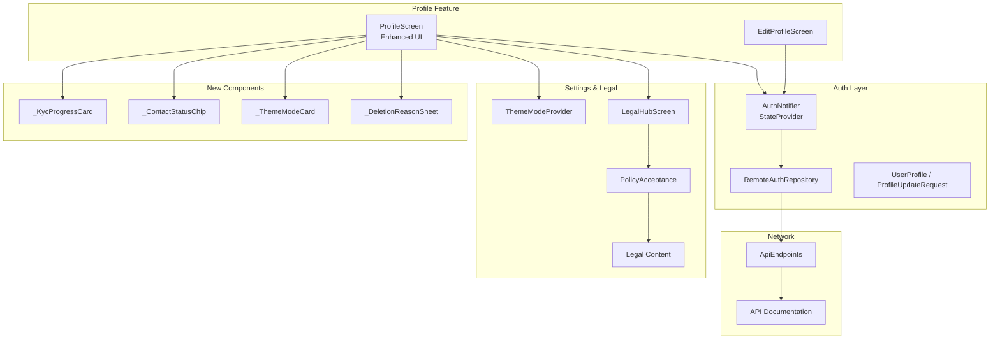
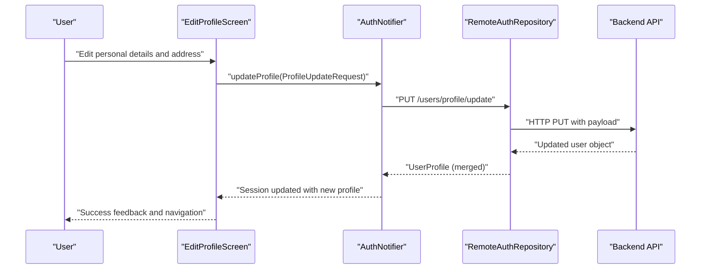
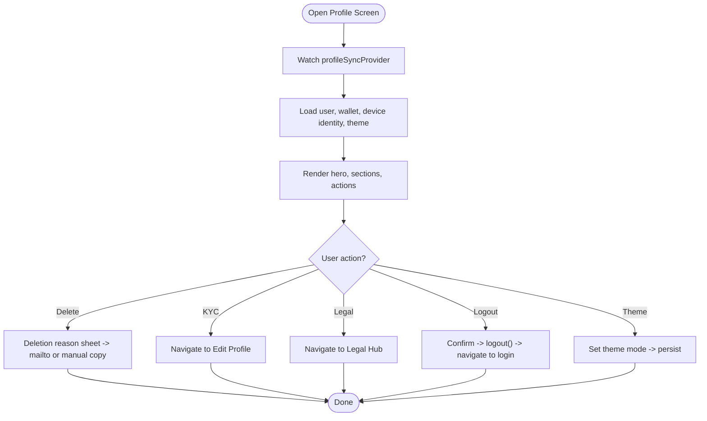
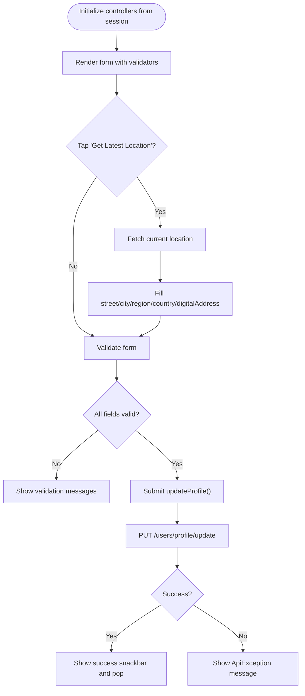
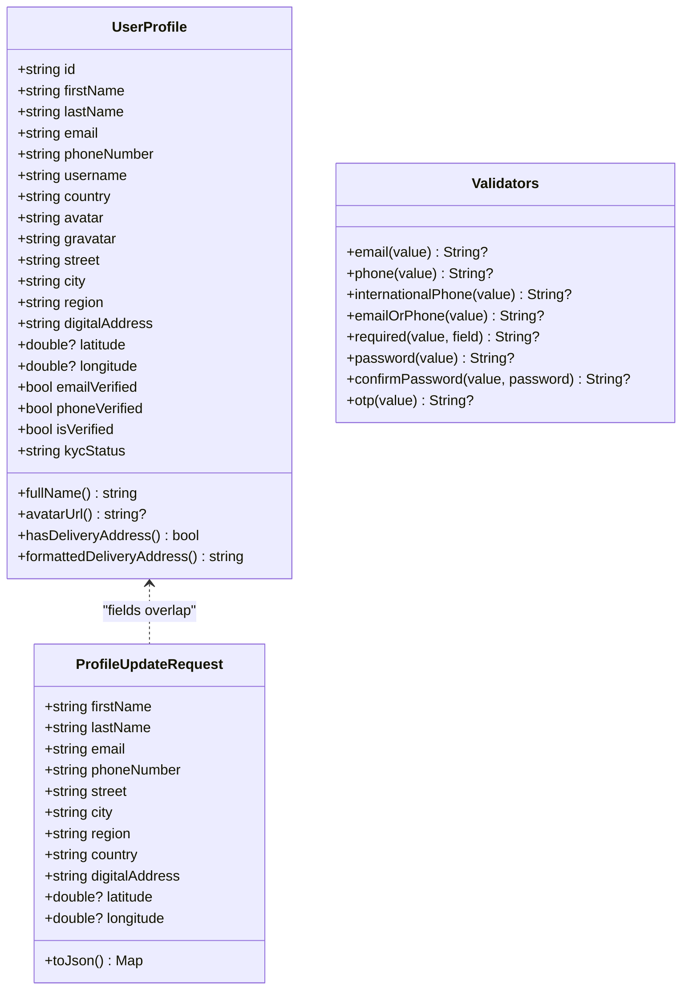
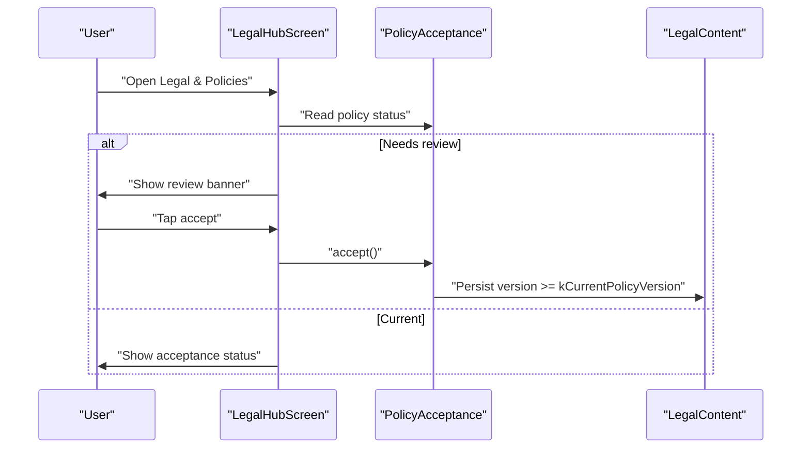
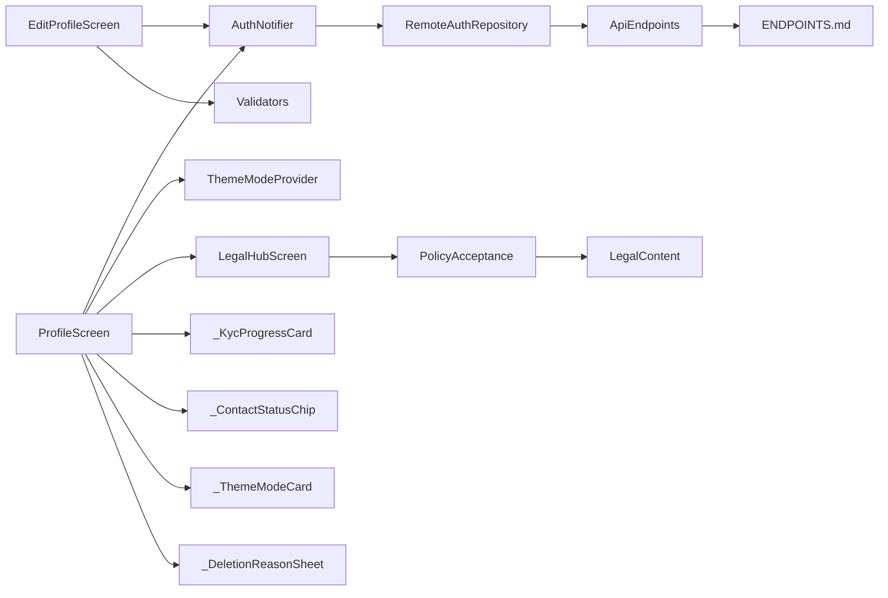

# Profile & Settings

<cite>
**Referenced Files in This Document**
- [profile_screen.dart](file://lib/features/profile/screens/profile_screen.dart)
- [edit_profile_screen.dart](file://lib/features/profile/screens/edit_profile_screen.dart)
- [auth_models.dart](file://lib/features/auth/data/auth_models.dart)
- [providers.dart](file://lib/features/auth/providers.dart)
- [remote_auth_repository.dart](file://lib/features/auth/data/remote_auth_repository.dart)
- [api_endpoints.dart](file://lib/core/network/api_endpoints.dart)
- [validators.dart](file://lib/core/utils/validators.dart)
- [theme_provider.dart](file://lib/core/providers/theme_provider.dart)
- [legal_hub_screen.dart](file://lib/features/legal/screens/legal_hub_screen.dart)
- [policy_acceptance.dart](file://lib/features/legal/policy_acceptance.dart)
- [legal_content.dart](file://lib/features/legal/legal_content.dart)
- [ENDPOINTS.md](file://api/ENDPOINTS.md)
</cite>

## Update Summary
**Changes Made**
- Updated Profile Screen architecture with enhanced UI components and improved responsiveness
- Added comprehensive KYC progress tracking and verification management
- Enhanced account deletion flow with reason-gated confirmation and improved error handling
- Improved wallet summary integration with real-time balance updates
- Enhanced contact verification system with inline email and phone verification
- Added advanced theme mode selection with animated transitions
- Improved navigation structure with sticky headers and better scroll performance

## Table of Contents
1. [Introduction](#introduction)
2. [Project Structure](#project-structure)
3. [Core Components](#core-components)
4. [Architecture Overview](#architecture-overview)
5. [Detailed Component Analysis](#detailed-component-analysis)
6. [Dependency Analysis](#dependency-analysis)
7. [Performance Considerations](#performance-considerations)
8. [Troubleshooting Guide](#troubleshooting-guide)
9. [Conclusion](#conclusion)

## Introduction
This document explains the profile and settings functionality in the application. It covers user profile management, account settings configuration, notification preferences, legal document access, data models, validation rules, update workflows, API integration, error handling, privacy considerations, profile image handling, and local settings persistence. The goal is to make these features understandable for both technical and non-technical readers while providing concrete implementation references.

## Project Structure
The profile and settings feature spans several modules:
- Profile screens for viewing and editing user information with enhanced UI components.
- Authentication providers and repositories for session and profile synchronization.
- Validation utilities for form inputs.
- Legal hub and policy acceptance for compliance and consent.
- Theme provider for appearance settings.
- API endpoint definitions and documentation.

**Diagram sources**
- [profile_screen.dart:22-480](file://lib/features/profile/screens/profile_screen.dart#L22-L480)
- [edit_profile_screen.dart:18-453](file://lib/features/profile/screens/edit_profile_screen.dart#L18-L453)
- [providers.dart:23-49](file://lib/features/auth/providers.dart#L23-L49)
- [remote_auth_repository.dart:170-196](file://lib/features/auth/data/remote_auth_repository.dart#L170-L196)
- [api_endpoints.dart:12-13](file://lib/core/network/api_endpoints.dart#L12-L13)
- [ENDPOINTS.md:17-18](file://api/ENDPOINTS.md#L17-L18)
- [theme_provider.dart:6-38](file://lib/core/providers/theme_provider.dart#L6-L38)
- [legal_hub_screen.dart:15-303](file://lib/features/legal/screens/legal_hub_screen.dart#L15-L303)
- [policy_acceptance.dart:11-52](file://lib/features/legal/policy_acceptance.dart#L11-L52)
- [legal_content.dart:30-58](file://lib/features/legal/legal_content.dart#L30-L58)

**Section sources**
- [profile_screen.dart:22-480](file://lib/features/profile/screens/profile_screen.dart#L22-L480)
- [edit_profile_screen.dart:18-453](file://lib/features/profile/screens/edit_profile_screen.dart#L18-L453)
- [providers.dart:23-49](file://lib/features/auth/providers.dart#L23-L49)
- [remote_auth_repository.dart:170-196](file://lib/features/auth/data/remote_auth_repository.dart#L170-L196)
- [api_endpoints.dart:12-13](file://lib/core/network/api_endpoints.dart#L12-L13)
- [ENDPOINTS.md:17-18](file://api/ENDPOINTS.md#L17-L18)
- [theme_provider.dart:6-38](file://lib/core/providers/theme_provider.dart#L6-L38)
- [legal_hub_screen.dart:15-303](file://lib/features/legal/screens/legal_hub_screen.dart#L15-L303)
- [policy_acceptance.dart:11-52](file://lib/features/legal/policy_acceptance.dart#L11-L52)
- [legal_content.dart:30-58](file://lib/features/legal/legal_content.dart#L30-L58)

## Core Components
- **Enhanced Profile Screen**: Displays user identity, verification status, wallet summary, and navigation to settings and legal documents with improved UI responsiveness and interactive components.
- **Edit Profile Screen**: Allows updating personal details, delivery address, location coordinates, and contact verification (email and phone).
- **KYC Progress Card**: Tracks verification progress with visual indicators and actionable items for incomplete steps.
- **Contact Status Chip**: Provides inline verification for email and phone contacts with real-time status updates.
- **Theme Mode Card**: Offers animated theme switching between system, light, and dark modes.
- **Account Deletion Flow**: Enhanced with reason-gated confirmation and improved error handling.
- Auth layer: Manages session state, profile refresh, profile updates, and verification endpoints.
- Data models: UserProfile and ProfileUpdateRequest define the shape of profile data and update payloads.
- Validators: Enforce email, phone, OTP, and password rules used across forms.
- Legal hub and policy acceptance: Present binding documents and track versioned acceptance locally.
- Theme provider: Persist user preference for light, dark, or system theme.

**Section sources**
- [profile_screen.dart:22-480](file://lib/features/profile/screens/profile_screen.dart#L22-L480)
- [edit_profile_screen.dart:18-453](file://lib/features/profile/screens/edit_profile_screen.dart#L18-L453)
- [auth_models.dart:375-672](file://lib/features/auth/data/auth_models.dart#L375-L672)
- [providers.dart:51-351](file://lib/features/auth/providers.dart#L51-L351)
- [validators.dart:1-103](file://lib/core/utils/validators.dart#L1-L103)
- [legal_hub_screen.dart:15-303](file://lib/features/legal/screens/legal_hub_screen.dart#L15-L303)
- [policy_acceptance.dart:11-52](file://lib/features/legal/policy_acceptance.dart#L11-L52)
- [theme_provider.dart:6-38](file://lib/core/providers/theme_provider.dart#L6-L38)

## Architecture Overview
The profile and settings architecture follows a layered approach with enhanced component separation:
- UI layer: Screens render user data and collect input with improved responsive design.
- State layer: Riverpod providers manage session, profile sync, and settings.
- Repository layer: Remote repository calls backend APIs and persists merged profile data.
- Network layer: Centralized endpoints and exception handling.
- Compliance layer: Legal content and policy acceptance ensure regulatory alignment.

**Diagram sources**
- [edit_profile_screen.dart:123-155](file://lib/features/profile/screens/edit_profile_screen.dart#L123-L155)
- [providers.dart:267-278](file://lib/features/auth/providers.dart#L267-L278)
- [remote_auth_repository.dart:179-196](file://lib/features/auth/data/remote_auth_repository.dart#L179-L196)
- [api_endpoints.dart:12-13](file://lib/core/network/api_endpoints.dart#L12-L13)
- [ENDPOINTS.md:17-18](file://api/ENDPOINTS.md#L17-L18)

## Detailed Component Analysis

### Enhanced Profile Screen
Responsibilities:
- Display current user info, verification badge, and wallet summary with improved UI responsiveness.
- Provide actions for KYC, password change, rewards, shop orders, support, legal, and account deletion.
- Refresh profile and wallet data on mount and pull-to-refresh with optimized data loading.
- Handle logout and account deletion via external mail intent or manual fallback with enhanced error handling.

Key behaviors:
- Profile sync provider triggers GET /users/profile once per mount to keep display fields fresh.
- Account deletion opens a pre-filled mailto request; if unavailable, shows a manual copy dialog.
- Theme mode card toggles appearance setting persisted by the theme provider.
- Wallet summary invalidates on build to ensure fresh balances.

**Diagram sources**
- [profile_screen.dart:33-51](file://lib/features/profile/screens/profile_screen.dart#L33-L51)
- [profile_screen.dart:83-139](file://lib/features/profile/screens/profile_screen.dart#L83-L139)
- [profile_screen.dart:211-480](file://lib/features/profile/screens/profile_screen.dart#L211-L480)
- [theme_provider.dart:6-38](file://lib/core/providers/theme_provider.dart#L6-L38)
- [legal_hub_screen.dart:15-303](file://lib/features/legal/screens/legal_hub_screen.dart#L15-L303)

**Section sources**
- [profile_screen.dart:33-51](file://lib/features/profile/screens/profile_screen.dart#L33-L51)
- [profile_screen.dart:83-139](file://lib/features/profile/screens/profile_screen.dart#L83-L139)
- [profile_screen.dart:211-480](file://lib/features/profile/screens/profile_screen.dart#L211-L480)
- [theme_provider.dart:6-38](file://lib/core/providers/theme_provider.dart#L6-L38)
- [legal_hub_screen.dart:15-303](file://lib/features/legal/screens/legal_hub_screen.dart#L15-L303)

### Enhanced KYC Progress Tracking
The profile screen now includes a comprehensive KYC progress card that provides:
- Visual progress indicator showing completion percentage
- Individual verification step tracking with status icons
- Actionable items for incomplete verification steps
- Real-time status updates for email and phone verification

Key features:
- Tracks account creation, country setting, email verification, phone verification, delivery address setup, and identity verification
- Provides direct actions for resending verification emails and navigating to address setup
- Shows completion percentage with color-coded progress bar

**Section sources**
- [profile_screen.dart:1497-1611](file://lib/features/profile/screens/profile_screen.dart#L1497-L1611)

### Enhanced Contact Verification System
The profile screen now includes inline contact verification through the `_ContactStatusChip` component:
- Email verification with resend functionality and cooldown protection
- Phone verification with SMS code entry and confirmation workflow
- Real-time status updates with visual feedback
- Error handling with user-friendly messages

Verification workflow:
- Users can tap verification chips to initiate verification processes
- Email verification sends confirmation emails with inbox/spam folder guidance
- Phone verification prompts for SMS code entry with validation
- Success/error states are displayed immediately

**Section sources**
- [profile_screen.dart:955-1137](file://lib/features/profile/screens/profile_screen.dart#L955-L1137)

### Enhanced Theme Mode Selection
The profile screen includes an advanced theme mode card (`_ThemeModeCard`) that provides:
- Animated transitions between theme modes
- Visual feedback for selected theme
- Support for system, light, and dark themes
- Immediate theme application without app restart

Features:
- Three-way theme selection with gradient backgrounds
- Animated container transitions for smooth theme switching
- Integration with theme provider for persistent storage
- Responsive design that adapts to different screen sizes

**Section sources**
- [profile_screen.dart:1206-1347](file://lib/features/profile/screens/profile_screen.dart#L1206-L1347)

### Enhanced Account Deletion Flow
The profile screen includes a sophisticated account deletion flow with:
- Reason-gated confirmation requiring user input before proceeding
- Suggested reasons with quick-select chips
- Manual fallback when email apps are unavailable
- Improved error handling and user feedback

Deletion workflow:
- Modal bottom sheet collects deletion reason with validation
- Suggested reasons include common scenarios like privacy concerns, duplicate accounts, etc.
- Attempts to launch email client with pre-filled subject and body
- Falls back to clipboard copying when no email app is available
- Provides clear success/error feedback throughout the process

**Section sources**
- [profile_screen.dart:83-208](file://lib/features/profile/screens/profile_screen.dart#L83-L208)
- [profile_screen.dart:1683-1855](file://lib/features/profile/screens/profile_screen.dart#L1683-L1855)

### Edit Profile Screen
Responsibilities:
- Collect and validate personal details, email, phone, and delivery address.
- Fetch GPS location and populate address fields when available.
- Resend email and phone verification codes; confirm SMS code for phone verification.
- Submit profile updates and handle API errors.

Validation rules:
- First name and last name are required.
- Email must be valid.
- Phone number accepts international format and validates length.
- OTP code must be exactly six digits.

Update workflow:
- Build ProfileUpdateRequest from form fields.
- Call AuthNotifier.updateProfile, which calls remote repository PUT /users/profile/update.
- On success, show confirmation and navigate back.

**Diagram sources**
- [edit_profile_screen.dart:46-82](file://lib/features/profile/screens/edit_profile_screen.dart#L46-L82)
- [edit_profile_screen.dart:84-121](file://lib/features/profile/screens/edit_profile_screen.dart#L84-L121)
- [edit_profile_screen.dart:123-155](file://lib/features/profile/screens/edit_profile_screen.dart#L123-L155)
- [edit_profile_screen.dart:157-198](file://lib/features/profile/screens/edit_profile_screen.dart#L157-L198)
- [edit_profile_screen.dart:552-582](file://lib/features/profile/screens/edit_profile_screen.dart#L552-L582)
- [validators.dart:4-71](file://lib/core/utils/validators.dart#L4-L71)
- [providers.dart:267-278](file://lib/features/auth/providers.dart#L267-L278)
- [remote_auth_repository.dart:179-196](file://lib/features/auth/data/remote_auth_repository.dart#L179-L196)
- [api_endpoints.dart:12-13](file://lib/core/network/api_endpoints.dart#L12-L13)

**Section sources**
- [edit_profile_screen.dart:46-82](file://lib/features/profile/screens/edit_profile_screen.dart#L46-L82)
- [edit_profile_screen.dart:84-121](file://lib/features/profile/screens/edit_profile_screen.dart#L84-L121)
- [edit_profile_screen.dart:123-155](file://lib/features/profile/screens/edit_profile_screen.dart#L123-L155)
- [edit_profile_screen.dart:157-198](file://lib/features/profile/screens/edit_profile_screen.dart#L157-L198)
- [edit_profile_screen.dart:552-582](file://lib/features/profile/screens/edit_profile_screen.dart#L552-L582)
- [validators.dart:4-71](file://lib/core/utils/validators.dart#L4-L71)
- [providers.dart:267-278](file://lib/features/auth/providers.dart#L267-L278)
- [remote_auth_repository.dart:179-196](file://lib/features/auth/data/remote_auth_repository.dart#L179-L196)
- [api_endpoints.dart:12-13](file://lib/core/network/api_endpoints.dart#L12-L13)

### Profile Data Models and Validation
- UserProfile represents the user object returned by the backend and includes identity, contact, address, verification flags, avatar/gravatar URLs, and derived helpers such as fullName, avatarUrl, hasDeliveryAddress, and formattedDeliveryAddress.
- ProfileUpdateRequest defines the subset of fields users can update, excluding server-managed flags.
- Validators provide reusable functions for email, Ghana phone, international phone, email-or-phone, required fields, password strength, confirmation, and OTP.

Complexity notes:
- Parsing UserProfile.fromJson handles multiple possible field names and defensive normalization of null-like strings.
- avatarUrl computes Gravatar URL from MD5 hash when explicit avatar/gravatar are missing.

**Diagram sources**
- [auth_models.dart:375-672](file://lib/features/auth/data/auth_models.dart#L375-L672)
- [validators.dart:1-103](file://lib/core/utils/validators.dart#L1-L103)

**Section sources**
- [auth_models.dart:375-672](file://lib/features/auth/data/auth_models.dart#L375-L672)
- [validators.dart:1-103](file://lib/core/utils/validators.dart#L1-L103)

### Settings and Preferences
Appearance settings:
- ThemeModeProvider persists user choice among light, dark, or system theme using SharedPreferences.
- Profile screen exposes a theme mode card that updates the provider immediately.

Notification preferences:
- The app integrates push notifications through Firebase Cloud Messaging. Device token registration and unregistration occur during authentication and logout.
- There is no dedicated in-app toggle for notification categories; the app relies on platform permissions and FCM integration.

Settings synchronization:
- Theme preference is stored locally and applied at runtime.
- Policy acceptance is stored locally and enforced offline.
- Profile data is synchronized with the backend via GET /users/profile and PUT /users/profile/update.

**Section sources**
- [theme_provider.dart:6-38](file://lib/core/providers/theme_provider.dart#L6-L38)
- [profile_screen.dart:271-282](file://lib/features/profile/screens/profile_screen.dart#L271-L282)
- [providers.dart:23-37](file://lib/features/auth/providers.dart#L23-L37)
- [policy_acceptance.dart:11-52](file://lib/features/legal/policy_acceptance.dart#L11-L52)

### Legal Documents Access
Legal hub:
- Lists all policy documents with icons and descriptions.
- Shows a review banner when the accepted policy version is outdated.
- Navigates to individual document routes.

Policy acceptance:
- Versioned record persisted locally with timestamp.
- Accepting updates the stored version and marks it as current.
- Synchronous helper allows gating logic without awaiting providers.

Account deletion:
- Generates a mailto URI with subject and body including registered email, phone, and optional reason.
- Provides a manual fallback dialog to copy request details when no email app is available.

**Diagram sources**
- [legal_hub_screen.dart:37-40](file://lib/features/legal/screens/legal_hub_screen.dart#L37-L40)
- [legal_hub_screen.dart:122-178](file://lib/features/legal/screens/legal_hub_screen.dart#L122-L178)
- [policy_acceptance.dart:20-52](file://lib/features/legal/policy_acceptance.dart#L20-L52)
- [legal_content.dart:30-58](file://lib/features/legal/legal_content.dart#L30-L58)

**Section sources**
- [legal_hub_screen.dart:37-40](file://lib/features/legal/screens/legal_hub_screen.dart#L37-L40)
- [legal_hub_screen.dart:122-178](file://lib/features/legal/screens/legal_hub_screen.dart#L122-L178)
- [policy_acceptance.dart:20-52](file://lib/features/legal/policy_acceptance.dart#L20-L52)
- [legal_content.dart:30-58](file://lib/features/legal/legal_content.dart#L30-L58)

### Profile Image Handling
- UserProfile.avatarUrl resolves the best profile image URL:
  - Prefers explicit avatar or gravatar URL from backend payload.
  - Skips invalid data URIs.
  - Falls back to Gravatar computed from MD5 of lowercase email with default avatar.
- Profile screen renders avatar network image with error fallback to initial letter badge.

Privacy note:
- Using Gravatar requires sending an email-derived hash to a third-party service. Users should be aware this may expose their email hash.

**Section sources**
- [auth_models.dart:426-446](file://lib/features/auth/data/auth_models.dart#L426-L446)
- [profile_screen.dart:654-664](file://lib/features/profile/screens/profile_screen.dart#L654-L664)

### Update Workflows and Error Handling
Profile update flow:
- EditProfileScreen builds ProfileUpdateRequest and calls AuthNotifier.updateProfile.
- RemoteAuthRepository performs PUT /users/profile/update and merges response with existing profile JSON before saving to TokenStore.
- AuthNotifier updates session with new UserProfile.

Error handling:
- ApiException caught in EditProfileScreen displays user-friendly messages.
- AuthNotifier.refreshProfile retries transient failures once after delay but does not retry auth failures.
- Account deletion uses PlatformException handling to present manual fallback.

Verification flows:
- Resend email verification enforces a cooldown window.
- Phone verification sends SMS code and prompts a bottom sheet for 6-digit confirmation.

**Section sources**
- [edit_profile_screen.dart:123-155](file://lib/features/profile/screens/edit_profile_screen.dart#L123-L155)
- [remote_auth_repository.dart:179-196](file://lib/features/auth/data/remote_auth_repository.dart#L179-L196)
- [providers.dart:204-239](file://lib/features/auth/providers.dart#L204-L239)
- [providers.dart:280-310](file://lib/features/auth/providers.dart#L280-L310)
- [profile_screen.dart:83-139](file://lib/features/profile/screens/profile_screen.dart#L83-L139)

## Dependency Analysis
The following diagram maps key dependencies between components involved in profile and settings:

**Diagram sources**
- [edit_profile_screen.dart:123-155](file://lib/features/profile/screens/edit_profile_screen.dart#L123-L155)
- [profile_screen.dart:211-480](file://lib/features/profile/screens/profile_screen.dart#L211-L480)
- [providers.dart:23-49](file://lib/features/auth/providers.dart#L23-L49)
- [remote_auth_repository.dart:170-196](file://lib/features/auth/data/remote_auth_repository.dart#L170-L196)
- [api_endpoints.dart:12-13](file://lib/core/network/api_endpoints.dart#L12-L13)
- [ENDPOINTS.md:17-18](file://api/ENDPOINTS.md#L17-L18)
- [theme_provider.dart:6-38](file://lib/core/providers/theme_provider.dart#L6-L38)
- [legal_hub_screen.dart:15-303](file://lib/features/legal/screens/legal_hub_screen.dart#L15-L303)
- [policy_acceptance.dart:11-52](file://lib/features/legal/policy_acceptance.dart#L11-L52)
- [legal_content.dart:30-58](file://lib/features/legal/legal_content.dart#L30-L58)
- [validators.dart:1-103](file://lib/core/utils/validators.dart#L1-L103)

**Section sources**
- [edit_profile_screen.dart:123-155](file://lib/features/profile/screens/edit_profile_screen.dart#L123-L155)
- [profile_screen.dart:211-480](file://lib/features/profile/screens/profile_screen.dart#L211-L480)
- [providers.dart:23-49](file://lib/features/auth/providers.dart#L23-L49)
- [remote_auth_repository.dart:170-196](file://lib/features/auth/data/remote_auth_repository.dart#L170-L196)
- [api_endpoints.dart:12-13](file://lib/core/network/api_endpoints.dart#L12-L13)
- [ENDPOINTS.md:17-18](file://api/ENDPOINTS.md#L17-L18)
- [theme_provider.dart:6-38](file://lib/core/providers/theme_provider.dart#L6-L38)
- [legal_hub_screen.dart:15-303](file://lib/features/legal/screens/legal_hub_screen.dart#L15-L303)
- [policy_acceptance.dart:11-52](file://lib/features/legal/policy_acceptance.dart#L11-L52)
- [legal_content.dart:30-58](file://lib/features/legal/legal_content.dart#L30-L58)
- [validators.dart:1-103](file://lib/core/utils/validators.dart#L1-L103)

## Performance Considerations
- Profile sync provider triggers a GET /users/profile once per mount to avoid stale display fields while minimizing redundant requests.
- Wallet summary is invalidated on profile screen build to ensure fresh balances.
- Theme preference reads/writes are lightweight and cached via SharedPreferences.
- Policy acceptance is read synchronously from SharedPreferences where needed to avoid blocking UI.
- Enhanced UI components use efficient widget composition with proper state management.
- Sticky headers and custom scroll views improve navigation performance.

Recommendations:
- Avoid repeated network calls for profile data within short intervals; rely on provider caching and invalidation strategies already implemented.
- Use skeleton widgets for loading states to improve perceived performance.
- Debounce location fetches if users repeatedly trigger "Get Latest Location".
- Leverage the new component architecture for better maintainability and performance.

[No sources needed since this section provides general guidance]

## Troubleshooting Guide
Common issues and resolutions:
- Profile update fails: Check form validation and ApiException messages. Ensure email and phone pass validators. Verify network connectivity and session validity.
- Phone verification fails: Confirm the SMS code is exactly six digits and matches the saved phone number. Resend code if expired.
- Theme not persisting: Ensure SharedPreferences is initialized and the user touched the theme setting before app restart.
- Legal policy not marked as accepted: Confirm policy version bump and call accept() to persist current version.
- Account deletion mailto fails: Use manual fallback dialog to copy request details and send via email client manually.
- KYC progress not updating: Verify that verification endpoints are responding correctly and check network connectivity.
- Contact verification chips not working: Ensure proper internet connection and verify that email/phone services are accessible.

Operational tips:
- For transient backend errors, refreshProfile retries once after a delay; persistent 401 clears tokens and logs out.
- When contacts change, backend resets verification flags; prompt users to verify again.
- Use the enhanced error handling in the new components for better user feedback.
- Monitor wallet summary invalidation to ensure fresh balance data.

**Section sources**
- [edit_profile_screen.dart:123-155](file://lib/features/profile/screens/edit_profile_screen.dart#L123-L155)
- [edit_profile_screen.dart:552-582](file://lib/features/profile/screens/edit_profile_screen.dart#L552-L582)
- [providers.dart:204-239](file://lib/features/auth/providers.dart#L204-L239)
- [profile_screen.dart:83-139](file://lib/features/profile/screens/profile_screen.dart#L83-L139)
- [theme_provider.dart:20-38](file://lib/core/providers/theme_provider.dart#L20-L38)
- [policy_acceptance.dart:41-52](file://lib/features/legal/policy_acceptance.dart#L41-L52)

## Conclusion
The profile and settings functionality provides a comprehensive experience for managing user identity, verification, appearance preferences, and legal compliance. With the recent refactoring, the system now includes enhanced UI components, improved account management features, and better user interface responsiveness. The modular design enables maintainability and extensibility for future enhancements such as granular notification preferences and advanced settings backup/restore mechanisms.

The significant improvements include:
- Enhanced KYC progress tracking with visual indicators
- Inline contact verification with real-time status updates
- Advanced theme mode selection with animated transitions
- Sophisticated account deletion flow with reason-gated confirmation
- Improved wallet summary integration with real-time balance updates
- Better error handling and user feedback throughout the interface

These enhancements provide a more robust and user-friendly experience while maintaining the existing architectural patterns and data flow.

[No sources needed since this section summarizes without analyzing specific files]