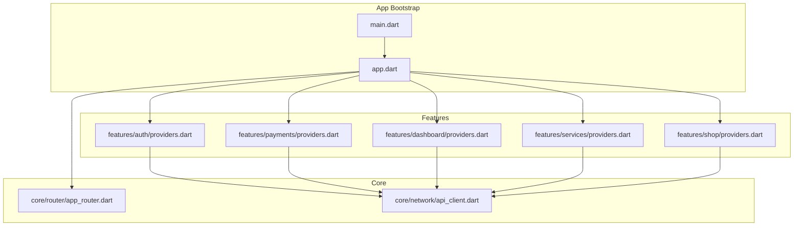
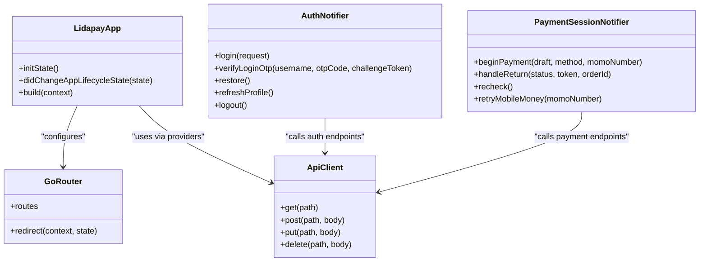
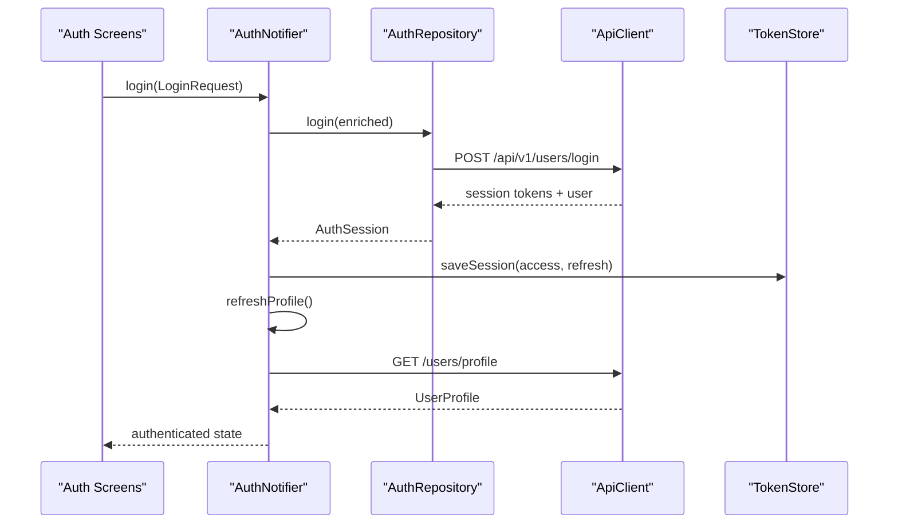
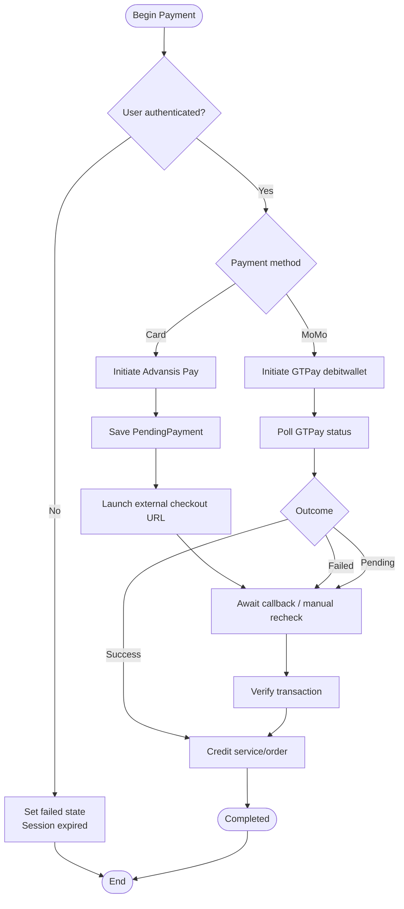
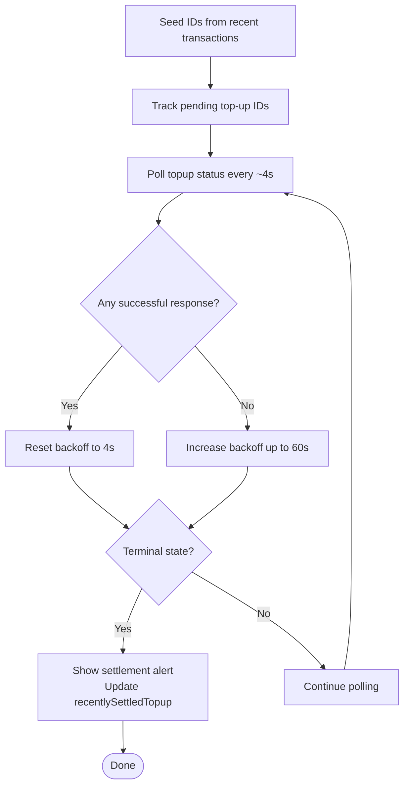
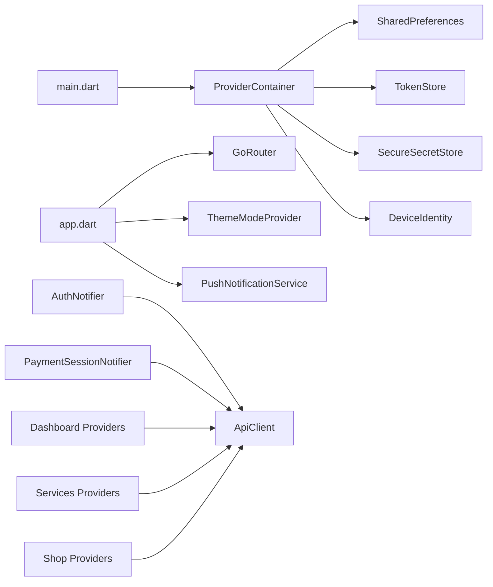

# Project Overview

<cite>
**Referenced Files in This Document**
- [README.md](file://README.md)
- [pubspec.yaml](file://pubspec.yaml)
- [lib/main.dart](file://lib/main.dart)
- [lib/app.dart](file://lib/app.dart)
- [lib/core/router/app_router.dart](file://lib/core/router/app_router.dart)
- [lib/core/network/api_client.dart](file://lib/core/network/api_client.dart)
- [lib/features/auth/providers.dart](file://lib/features/auth/providers.dart)
- [lib/features/payments/providers.dart](file://lib/features/payments/providers.dart)
- [lib/features/dashboard/providers.dart](file://lib/features/dashboard/providers.dart)
- [lib/features/services/providers.dart](file://lib/features/services/providers.dart)
- [lib/features/shop/providers.dart](file://lib/features/shop/providers.dart)
</cite>

## Table of Contents
1. [Introduction](#introduction)
2. [Project Structure](#project-structure)
3. [Core Components](#core-components)
4. [Architecture Overview](#architecture-overview)
5. [Detailed Component Analysis](#detailed-component-analysis)
6. [Dependency Analysis](#dependency-analysis)
7. [Performance Considerations](#performance-considerations)
8. [Troubleshooting Guide](#troubleshooting-guide)
9. [Conclusion](#conclusion)

## Introduction
LidaPay is a Flutter mobile financial services application that provides digital wallet management, mobile money services, e-commerce capabilities, and payment processing. The app supports user authentication, dashboard analytics, service purchases such as airtime and data, Lida Value conversions, shop browsing and checkout, order tracking, notifications, and deep-link handling for payment returns. It is designed to be secure, resilient to network failures, and responsive across Android and iOS platforms.

For beginners: think of LidaPay as your phone-based finance hub where you can manage balances, send or receive top-ups, buy services, shop for products, and track orders, all while staying connected to secure backend systems.

For experienced developers: the codebase uses feature-based organization with Riverpod state management, GoRouter navigation, Dio HTTP client integration, and platform-specific integrations for push notifications, biometrics, location, and secure storage.

**Section sources**
- [README.md:1-47](file://README.md#L1-L47)

## Project Structure
The project follows a standard Flutter layout with platform folders (`android`, `ios`, `web`) and a Dart source tree under `lib`. The core logic is split into:
- `lib/core`: shared infrastructure (networking, routing, theme, device identity, notifications, utilities).
- `lib/features`: domain-oriented modules (auth, dashboard, payments, services, shop, history, legal, notifications, etc.).
- `lib/main.dart` and `lib/app.dart`: application bootstrap and root widget configuration.

**Diagram sources**
- [lib/main.dart:17-149](file://lib/main.dart#L17-L149)
- [lib/app.dart:56-262](file://lib/app.dart#L56-L262)
- [lib/core/router/app_router.dart:40-424](file://lib/core/router/app_router.dart#L40-L424)
- [lib/core/network/api_client.dart:16-276](file://lib/core/network/api_client.dart#L16-L276)
- [lib/features/auth/providers.dart:15-352](file://lib/features/auth/providers.dart#L15-L352)
- [lib/features/payments/providers.dart:24-842](file://lib/features/payments/providers.dart#L24-L842)
- [lib/features/dashboard/providers.dart:16-250](file://lib/features/dashboard/providers.dart#L16-L250)
- [lib/features/services/providers.dart:12-188](file://lib/features/services/providers.dart#L12-L188)
- [lib/features/shop/providers.dart:16-339](file://lib/features/shop/providers.dart#L16-L339)

**Section sources**
- [pubspec.yaml:1-152](file://pubspec.yaml#L1-L152)
- [lib/main.dart:17-149](file://lib/main.dart#L17-L149)
- [lib/app.dart:56-262](file://lib/app.dart#L56-L262)

## Core Components
This section summarizes the primary building blocks and their responsibilities.

- Application bootstrap and global error handling
  - Initializes Flutter bindings, edge-to-edge UI, global error handlers, ProviderContainer overrides, token store hydration, session restoration, and runs the root app.
- Root app shell and navigation
  - Configures Material app, router, theme mode, scroll behavior, offline banner, deep links, push notifications, and lifecycle-aware profile refresh.
- Routing
  - Centralized route constants and GoRouter configuration with auth guards, deep link handling, and nested shell branches for Home, Services, Shop, History, Profile.
- Networking
  - Dio-based API client with bearer token injection, request ID generation, sensitive payload redaction, automatic token refresh on 401, and timeout configuration.
- Authentication
  - Session management, login/register flows, OTP verification, profile refresh, biometric login support, logout, and email/phone verification helpers.
- Payments
  - Payment session orchestration, checkout launching, GTPay mobile money flow, verification polling, receipt delivery, and idempotent retry/cancel semantics.
- Dashboard
  - Wallet summary, recent transactions, flash deals, pending top-up tracking, and settlement alerts.
- Services
  - Airtime/data purchases, Lida Value wallet, points redemption, affiliate/invite summaries, GT Pay options, and international operators.
- Shop
  - Product catalog, categories, cart management, checkout with idempotency, order listing, and live delivery tracking.

**Section sources**
- [lib/main.dart:17-149](file://lib/main.dart#L17-L149)
- [lib/app.dart:56-262](file://lib/app.dart#L56-L262)
- [lib/core/router/app_router.dart:40-424](file://lib/core/router/app_router.dart#L40-L424)
- [lib/core/network/api_client.dart:16-276](file://lib/core/network/api_client.dart#L16-L276)
- [lib/features/auth/providers.dart:15-352](file://lib/features/auth/providers.dart#L15-L352)
- [lib/features/payments/providers.dart:24-842](file://lib/features/payments/providers.dart#L24-L842)
- [lib/features/dashboard/providers.dart:16-250](file://lib/features/dashboard/providers.dart#L16-L250)
- [lib/features/services/providers.dart:12-188](file://lib/features/services/providers.dart#L12-L188)
- [lib/features/shop/providers.dart:16-339](file://lib/features/shop/providers.dart#L16-L339)

## Architecture Overview
LidaPay uses a layered architecture:
- Presentation layer: Flutter widgets and screens organized by feature.
- State layer: Riverpod providers/controllers managing UI state and async operations.
- Domain layer: Feature repositories abstracting business logic and data models.
- Infrastructure layer: API client, token store, device identity, notifications, and platform integrations.

**Diagram sources**
- [lib/app.dart:56-262](file://lib/app.dart#L56-L262)
- [lib/core/router/app_router.dart:94-424](file://lib/core/router/app_router.dart#L94-L424)
- [lib/core/network/api_client.dart:16-276](file://lib/core/network/api_client.dart#L16-L276)
- [lib/features/auth/providers.dart:51-352](file://lib/features/auth/providers.dart#L51-L352)
- [lib/features/payments/providers.dart:121-842](file://lib/features/payments/providers.dart#L121-L842)

## Detailed Component Analysis

### Technology Stack
- Framework: Flutter (Dart SDK ^3.13.4)
- State Management: flutter_riverpod
- Routing: go_router
- HTTP Client: dio
- Storage: shared_preferences, flutter_secure_storage
- Security & Biometrics: local_auth
- Notifications: firebase_core, firebase_messaging, flutter_local_notifications
- Location & Maps: geolocator, geocoding, google_maps_flutter
- Utilities: crypto, intl, equatable, url_launcher, share_plus, connectivity_plus, fl_chart, in_app_update, device_info_plus, package_info_plus, uuid, app_links

Installation and development setup:
- Install dependencies and validate:
  - flutter pub get
  - flutter analyze
  - flutter test
- Build release bundle for Google Play:
  - flutter build appbundle --release
- Release signing uses android/key.properties and configured upload keystore; keep credentials private. Increment build number in pubspec.yaml before each Play release.

Basic usage examples:
- Launch the app and navigate through tabs: Home (Dashboard), Services, Shop, History, Profile.
- Authenticate using login or OTP verification.
- Initiate a payment via card or mobile money (GTPay), then verify and complete the purchase.
- Browse shop products, add items to cart, checkout, and track orders.

**Section sources**
- [pubspec.yaml:1-152](file://pubspec.yaml#L1-L152)
- [README.md:5-47](file://README.md#L5-L47)

### Authentication Flow
Authentication manages sessions, OTP challenges, profile synchronization, and biometric login.

Key behaviors:
- Login enriches requests with device identity and FCM token.
- OTP verification stores challenge in memory and verifies against backend.
- Profile refresh is best-effort with retry for transient errors.
- Biometric login restores a stored session securely.

**Diagram sources**
- [lib/features/auth/providers.dart:88-163](file://lib/features/auth/providers.dart#L88-L163)
- [lib/core/network/api_client.dart:137-179](file://lib/core/network/api_client.dart#L137-L179)

**Section sources**
- [lib/features/auth/providers.dart:15-352](file://lib/features/auth/providers.dart#L15-L352)

### Payment Processing Flow
Payments orchestrate initiation, external checkout launch, verification polling, and credit delivery.

Important details:
- Card payments open an external browser checkout; MoMo uses GTPay debitwallet with PartnerTransId reconciliation.
- Verification is single-flight per purchase to avoid duplicate credits.
- Retry and cancel flows are safe and idempotent.

**Diagram sources**
- [lib/features/payments/providers.dart:182-277](file://lib/features/payments/providers.dart#L182-L277)
- [lib/features/payments/providers.dart:283-367](file://lib/features/payments/providers.dart#L283-L367)
- [lib/features/payments/providers.dart:372-421](file://lib/features/payments/providers.dart#L372-L421)
- [lib/features/payments/providers.dart:474-572](file://lib/features/payments/providers.dart#L474-L572)
- [lib/features/payments/providers.dart:578-665](file://lib/features/payments/providers.dart#L578-L665)
- [lib/features/payments/providers.dart:700-769](file://lib/features/payments/providers.dart#L700-L769)

**Section sources**
- [lib/features/payments/providers.dart:24-842](file://lib/features/payments/providers.dart#L24-L842)

### Dashboard and Top-up Tracking
Dashboard aggregates wallet summary, recent transactions, flash deals, and tracks pending top-ups requiring recipient decisions.

Highlights:
- Background polling with exponential backoff prevents server hammering.
- Settlement alerts surface across the app regardless of active screen.
- Dead references are blacklisted to avoid infinite loops.

**Diagram sources**
- [lib/features/dashboard/providers.dart:141-250](file://lib/features/dashboard/providers.dart#L141-L250)

**Section sources**
- [lib/features/dashboard/providers.dart:16-250](file://lib/features/dashboard/providers.dart#L16-L250)

### Services and Lida Value
Services provide airtime, data bundles, rewards, QR pay, GT Pay, invite/earn programs, and Lida Value conversion.

Key aspects:
- Repository abstraction over remote services endpoints.
- Providers expose networks, countries, operators, Lida Value wallet, points redemption, and GT Pay options.
- Lida Points history supports pagination with incremental loading.

**Section sources**
- [lib/features/services/providers.dart:12-188](file://lib/features/services/providers.dart#L12-L188)

### Shop and Orders
Shop features product browsing, category filtering, cart management, checkout with idempotency, order listing, and live delivery tracking.

Key aspects:
- CartController maintains AsyncValue<Cart> and preserves previous state during mutations.
- Checkout uses clientReference for idempotency and reconciles potential created orders on failure.
- Order tracking stream polls every 8 seconds until terminal status.

**Section sources**
- [lib/features/shop/providers.dart:16-339](file://lib/features/shop/providers.dart#L16-L339)

## Dependency Analysis
High-level dependency relationships:
- main.dart initializes ProviderContainer and injects shared preferences, token store, secret store, and device identity.
- app.dart configures router, theme, notifications, deep links, and lifecycle events.
- api_client.dart centralizes HTTP calls, token refresh, and error mapping.
- Feature providers depend on api_client_provider and auth_session_provider to perform authenticated operations.

**Diagram sources**
- [lib/main.dart:98-149](file://lib/main.dart#L98-L149)
- [lib/app.dart:70-128](file://lib/app.dart#L70-L128)
- [lib/core/network/api_client.dart:268-276](file://lib/core/network/api_client.dart#L268-L276)
- [lib/features/auth/providers.dart:15-37](file://lib/features/auth/providers.dart#L15-L37)
- [lib/features/payments/providers.dart:24-41](file://lib/features/payments/providers.dart#L24-L41)
- [lib/features/dashboard/providers.dart:16-31](file://lib/features/dashboard/providers.dart#L16-L31)
- [lib/features/services/providers.dart:12-30](file://lib/features/services/providers.dart#L12-L30)
- [lib/features/shop/providers.dart:16-48](file://lib/features/shop/providers.dart#L16-L48)

**Section sources**
- [lib/main.dart:98-149](file://lib/main.dart#L98-L149)
- [lib/app.dart:70-128](file://lib/app.dart#L70-L128)
- [lib/core/network/api_client.dart:268-276](file://lib/core/network/api_client.dart#L268-L276)

## Performance Considerations
- Fast boot with bounded timeouts for session restore and pending payment hydration to prevent splash freeze.
- Global error handlers and anti-red-screen-of-death error widget builder improve resilience.
- Edge-to-edge system UI mode ensures modern look and avoids layout issues on Samsung One UI and Android 10+.
- Network timeouts configured for connect/send/receive to balance responsiveness and provider round-trips.
- Background polling uses exponential backoff to reduce server load and battery drain.
- Idempotent checkout and payment flows prevent duplicate charges/orders.

[No sources needed since this section provides general guidance]

## Troubleshooting Guide
Common issues and resolutions:
- Unexpected display errors: The custom ErrorWidget displays a friendly message and offers a Refresh Screen action that navigates home and rebuilds the app.
- Session expiration: If token refresh fails or 401 occurs, the app clears tokens and redirects to login; ensure refresh token is valid and device info is current.
- Payment not completing: Use “I’ve paid” to recheck status; if GTPay times out, send a new prompt or check status manually.
- Offline mode: An offline banner indicates no internet connection; wait for network recovery.
- Deep link handling: Payment callbacks and password reset links are handled even without a session; ensure router redirect logic is intact.

**Section sources**
- [lib/main.dart:30-96](file://lib/main.dart#L30-L96)
- [lib/core/network/api_client.dart:204-265](file://lib/core/network/api_client.dart#L204-L265)
- [lib/features/payments/providers.dart:372-421](file://lib/features/payments/providers.dart#L372-L421)
- [lib/app.dart:218-257](file://lib/app.dart#L218-L257)

## Conclusion
LidaPay is a comprehensive Flutter financial services app combining digital wallets, mobile money, e-commerce, and robust payment processing. Its architecture leverages Riverpod for state management, GoRouter for navigation, and Dio for networking, with strong security and resilience patterns. The feature-based structure makes it maintainable and scalable, while the provided installation and usage instructions help both beginners and experienced developers get started quickly.

[No sources needed since this section summarizes without analyzing specific files]