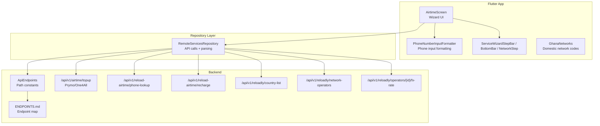
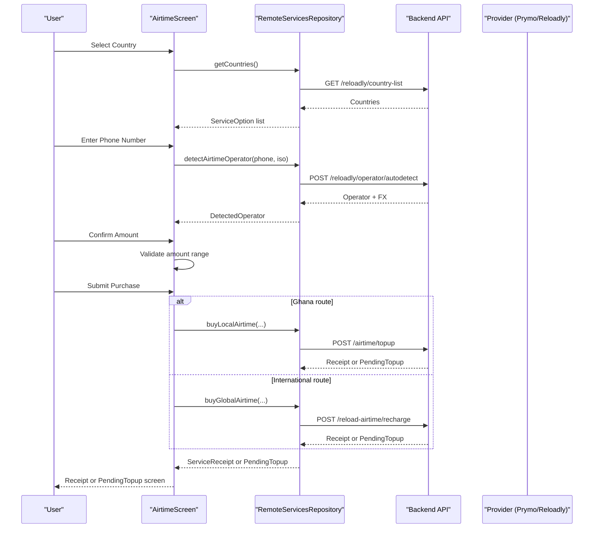
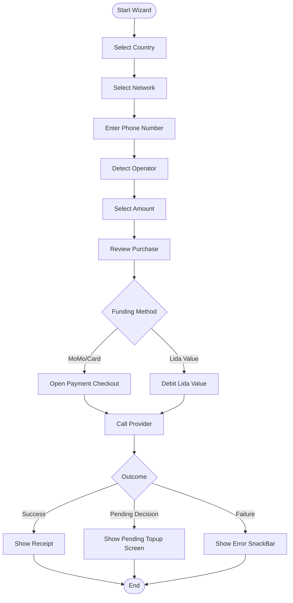
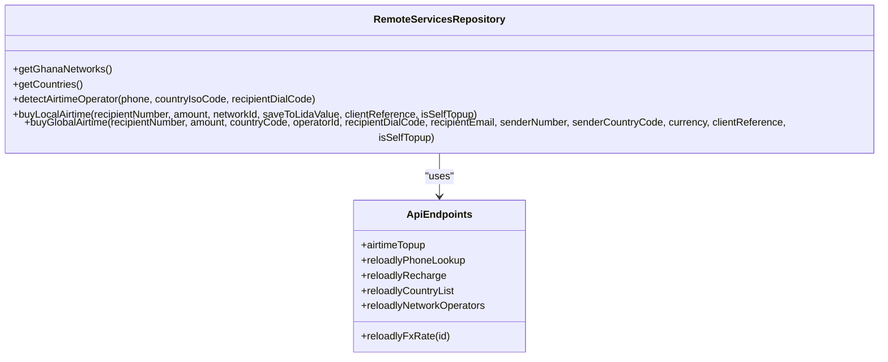
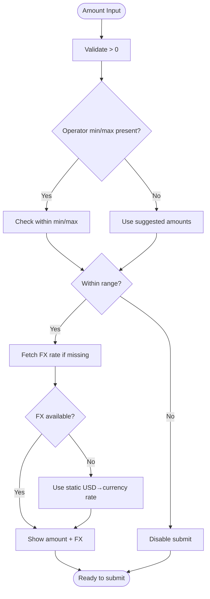
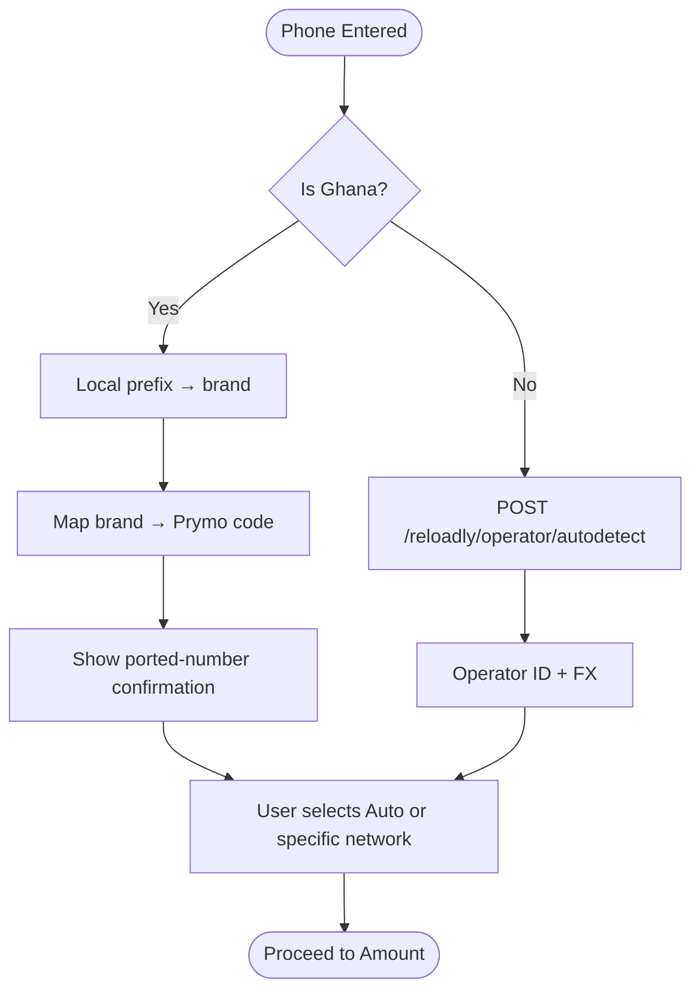
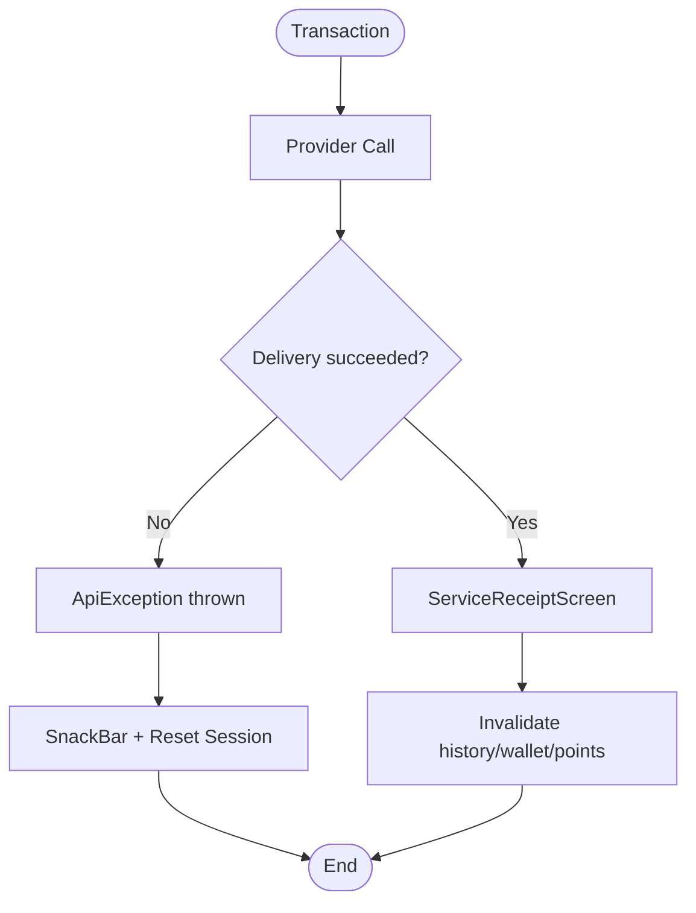
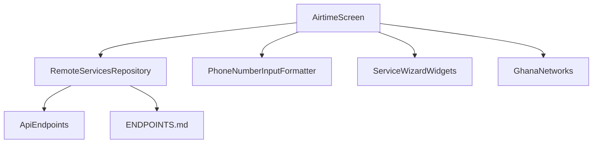

# Airtime Top-up Service

<cite>
**Referenced Files in This Document**
- [airtime_screen.dart](file://lib/features/services/screens/airtime_screen.dart)
- [remote_services_repository.dart](file://lib/features/services/data/remote_services_repository.dart)
- [api_endpoints.dart](file://lib/core/network/api_endpoints.dart)
- [ghana_networks.dart](file://lib/core/utils/ghana_networks.dart)
- [phone_number_formatter.dart](file://lib/features/services/widgets/phone_number_formatter.dart)
- [service_wizard_widgets.dart](file://lib/features/services/widgets/service_wizard_widgets.dart)
- [ENDPOINTS.md](file://api/ENDPOINTS.md)
- [BACKEND_NOTIFICATION_TRIGGERS_HANDOFF.md](file://docs/BACKEND_NOTIFICATION_TRIGGERS_HANDOFF.md)
</cite>

## Table of Contents
1. [Introduction](#introduction)
2. [Project Structure](#project-structure)
3. [Core Components](#core-components)
4. [Architecture Overview](#architecture-overview)
5. [Detailed Component Analysis](#detailed-component-analysis)
6. [Dependency Analysis](#dependency-analysis)
7. [Performance Considerations](#performance-considerations)
8. [Troubleshooting Guide](#troubleshooting-guide)
9. [Conclusion](#conclusion)

## Introduction
This document explains the airtime top-up service implemented in the LidaPay Flutter application. It covers the complete purchase workflow from country and phone number input to transaction completion, including:

- Wizard-based UI flow for selecting destination country, network operator, phone number, amount, and review.
- Provider integration with two routes:
  - Domestic Ghana route via Prymo/One4All (`POST /api/v1/airtime/topup`).
  - International Reloadly route via `/api/v1/reload-airtime/*` endpoints.
- Amount validation using detected operator min/max and suggested amounts.
- Network selection logic with auto-detection, ported-number confirmation for Ghana, and fallback catalogues.
- API call examples through endpoint references.
- Error handling for failed transactions, pending recipient decisions, and offline scenarios.
- User feedback mechanisms such as wizard steps, bottom sheets, snack bars, receipts, and pending-topup screens.
- Rate limiting, retry strategies, and offline handling approaches used by the repository and screen.

## Project Structure
The airtime feature is primarily implemented under `lib/features/services`, with shared networking and utilities under `lib/core`. The key files are:

- `lib/features/services/screens/airtime_screen.dart`: Main wizard UI, state management, submission orchestration, and user feedback.
- `lib/features/services/data/remote_services_repository.dart`: Repository that calls backend APIs, parses provider responses, handles FX rates, and normalizes payloads.
- `lib/core/network/api_endpoints.dart`: Centralized API path constants.
- `lib/core/utils/ghana_networks.dart`: Source of truth for Ghana domestic network codes and prefix detection.
- `lib/features/services/widgets/phone_number_formatter.dart`: Input formatter for phone numbers.
- `lib/features/services/widgets/service_wizard_widgets.dart`: Shared wizard step bar, bottom bar, and network step widgets.
- `api/ENDPOINTS.md`: Backend endpoint map including airtime and Reloadly endpoints.
- `docs/BACKEND_NOTIFICATION_TRIGGERS_HANDOFF.md`: Backend notification triggers for delivered/failed top-ups and recipient decision events.

**Diagram sources**
- [airtime_screen.dart:31-50](file://lib/features/services/screens/airtime_screen.dart#L31-L50)
- [remote_services_repository.dart:17-30](file://lib/features/services/data/remote_services_repository.dart#L17-L30)
- [api_endpoints.dart:69-100](file://lib/core/network/api_endpoints.dart#L69-L100)
- [ENDPOINTS.md:94-128](file://api/ENDPOINTS.md#L94-L128)

**Section sources**
- [airtime_screen.dart:31-50](file://lib/features/services/screens/airtime_screen.dart#L31-L50)
- [remote_services_repository.dart:17-30](file://lib/features/services/data/remote_services_repository.dart#L17-L30)
- [api_endpoints.dart:69-100](file://lib/core/network/api_endpoints.dart#L69-L100)
- [ENDPOINTS.md:94-128](file://api/ENDPOINTS.md#L94-L128)

## Core Components
- AirtimeScreen: Orchestrates the five-step wizard (Country → Network → Phone → Amount → Review), manages funding (MoMo/Card or Lida Value), detects operators, validates inputs, submits purchases, and displays receipts or pending-topup screens.
- RemoteServicesRepository: Calls backend endpoints for catalogue data, operator autodetect, local airtime top-up, global airtime top-up, FX rate lookup, and Lida Value operations. It caches catalogue data, parses flexible provider payloads, and enforces delivery success checks.
- ApiEndpoints: Defines all API paths used by the app, including airtime, reload-airtime, reloadly, and lida-value endpoints.
- GhanaNetworks: Provides deterministic mapping between Ghana phone prefixes and Prymo network codes, plus name-to-code and code-to-name helpers.
- PhoneNumberInputFormatter: Normalizes phone input, strips redundant dial codes, caps length, and notifies when an international paste is detected.
- ServiceWizardWidgets: Renders the shared step progress bar, bottom navigation, and network selection tiles.

**Section sources**
- [airtime_screen.dart:31-50](file://lib/features/services/screens/airtime_screen.dart#L31-L50)
- [remote_services_repository.dart:17-30](file://lib/features/services/data/remote_services_repository.dart#L17-L30)
- [api_endpoints.dart:69-100](file://lib/core/network/api_endpoints.dart#L69-L100)
- [ghana_networks.dart:1-116](file://lib/core/utils/ghana_networks.dart#L1-L116)
- [phone_number_formatter.dart:1-76](file://lib/features/services/widgets/phone_number_formatter.dart#L1-L76)
- [service_wizard_widgets.dart:7-14](file://lib/features/services/widgets/service_wizard_widgets.dart#L7-L14)

## Architecture Overview
The airtime purchase follows a layered architecture:

- Presentation layer (AirtimeScreen): Guides users through the wizard, collects inputs, shows loading/error states, and renders receipts or pending-topup screens.
- Domain/repository layer (RemoteServicesRepository): Encapsulates business rules for provider routing, payload normalization, FX conversion, and error handling.
- Infrastructure layer (ApiClient + ApiEndpoints): Sends HTTP requests to backend endpoints defined in ApiEndpoints and documented in ENDPOINTS.md.

**Diagram sources**
- [airtime_screen.dart:849-944](file://lib/features/services/screens/airtime_screen.dart#L849-L944)
- [remote_services_repository.dart:1040-1077](file://lib/features/services/data/remote_services_repository.dart#L1040-L1077)
- [remote_services_repository.dart:1212-1287](file://lib/features/services/data/remote_services_repository.dart#L1212-L1287)
- [api_endpoints.dart:69-89](file://lib/core/network/api_endpoints.dart#L69-L89)
- [ENDPOINTS.md:94-128](file://api/ENDPOINTS.md#L94-L128)

## Detailed Component Analysis

### AirtimeScreen Workflow
AirtimeScreen implements a five-step wizard:

1. **Country Selection**: Auto-selects the user’s profile country; merges static countries with live Reloadly catalogue entries.
2. **Network Selection**: For Ghana, lists fixed Prymo networks with “Auto Detect”; for international destinations, lists Reloadly operators with “Auto Detect”.
3. **Phone Number Entry**: Formats input, detects operator, and for Ghana, prompts a ported-number confirmation popup.
4. **Amount Selection**: Uses operator suggested amounts and min/max ranges; Ghana uses GHS presets, international uses USD or sender currency.
5. **Review and Submit**: Shows a review card with recipient, network, country, amount, and funding method; submits payment first (MoMo/Card) or debits Lida Value directly.

Key behaviors:
- Funding modes: MoMo/Card checkout via Advansis Pay, or Lida Value USE/SEND.
- Self vs send: Self top-ups bypass recipient-decision flow; send top-ups allow recipients to choose direct airtime or Lida Value.
- Payment lifecycle: A pending payment is persisted; after payment confirmation, the provider call runs. If the provider returns a pending decision, the app navigates to a pending-topup screen.
- User feedback: Step bar, bottom bar, snack bars for errors, bottom sheet for Ghana network confirmation, receipt screen for success, pending-topup screen for decisions.

**Diagram sources**
- [airtime_screen.dart:289-300](file://lib/features/services/screens/airtime_screen.dart#L289-L300)
- [airtime_screen.dart:546-605](file://lib/features/services/screens/airtime_screen.dart#L546-L605)
- [airtime_screen.dart:849-944](file://lib/features/services/screens/airtime_screen.dart#L849-L944)
- [airtime_screen.dart:976-1164](file://lib/features/services/screens/airtime_screen.dart#L976-L1164)

**Section sources**
- [airtime_screen.dart:289-300](file://lib/features/services/screens/airtime_screen.dart#L289-L300)
- [airtime_screen.dart:546-605](file://lib/features/services/screens/airtime_screen.dart#L546-L605)
- [airtime_screen.dart:849-944](file://lib/features/services/screens/airtime_screen.dart#L849-L944)
- [airtime_screen.dart:976-1164](file://lib/features/services/screens/airtime_screen.dart#L976-L1164)

### Provider Integration and Routing
- Domestic Ghana route:
  - Endpoint: `POST /api/v1/airtime/topup`.
  - Payload includes recipientNumber (local format), amount, network (Prymo code), saveToLidaValue, isSelfTopup, clientReference, userId/userName.
  - Response parsed into ServiceReceipt; if pending decision exists, PendingTopup is surfaced.
- International Reloadly route:
  - Operator detection via `POST /api/v1/reload-airtime/phone-lookup`.
  - Recharge via `POST /api/v1/reload-airtime/recharge`.
  - FX rate lookup via `GET /api/v1/reloadly/operators/{id}/fx-rate`.
  - Catalogue data via `GET /api/v1/reloadly/country-list` and `POST /api/v1/reloadly/network-operators`.

**Diagram sources**
- [remote_services_repository.dart:1040-1077](file://lib/features/services/data/remote_services_repository.dart#L1040-L1077)
- [remote_services_repository.dart:1212-1287](file://lib/features/services/data/remote_services_repository.dart#L1212-L1287)
- [api_endpoints.dart:69-89](file://lib/core/network/api_endpoints.dart#L69-L89)

**Section sources**
- [remote_services_repository.dart:1040-1077](file://lib/features/services/data/remote_services_repository.dart#L1040-L1077)
- [remote_services_repository.dart:1212-1287](file://lib/features/services/data/remote_services_repository.dart#L1212-L1287)
- [api_endpoints.dart:69-89](file://lib/core/network/api_endpoints.dart#L69-L89)
- [ENDPOINTS.md:94-128](file://api/ENDPOINTS.md#L94-L128)

### Amount Validation and FX Handling
- Ghana amounts are validated against static presets and operator min/max when available.
- International amounts use operator suggested amounts and min/max from autodetect; FX rate is fetched per operator if not included in autodetect response.
- Fallback FX table maps USD to destination currencies when Reloadly FX is unavailable.

**Diagram sources**
- [airtime_screen.dart:685-688](file://lib/features/services/screens/airtime_screen.dart#L685-L688)
- [remote_services_repository.dart:372-421](file://lib/features/services/data/remote_services_repository.dart#L372-L421)
- [remote_services_repository.dart:473-544](file://lib/features/services/data/remote_services_repository.dart#L473-L544)

**Section sources**
- [airtime_screen.dart:685-688](file://lib/features/services/screens/airtime_screen.dart#L685-L688)
- [remote_services_repository.dart:372-421](file://lib/features/services/data/remote_services_repository.dart#L372-L421)
- [remote_services_repository.dart:473-544](file://lib/features/services/data/remote_services_repository.dart#L473-L544)

### Network Selection Logic
- Ghana: Fixed Prymo network codes; auto-detect maps Reloadly operator IDs to Prymo codes; user confirms operating network due to ported numbers.
- International: Operator list from Reloadly; “Auto Detect” resolves operator from phone number on the next step.
- Offline fallback: Local prefix tables provide brand detection for Ghana and other countries when backend autodetect fails.

**Diagram sources**
- [airtime_screen.dart:546-605](file://lib/features/services/screens/airtime_screen.dart#L546-L605)
- [ghana_networks.dart:16-72](file://lib/core/utils/ghana_networks.dart#L16-L72)
- [remote_services_repository.dart:310-334](file://lib/features/services/data/remote_services_repository.dart#L310-L334)

**Section sources**
- [airtime_screen.dart:546-605](file://lib/features/services/screens/airtime_screen.dart#L546-L605)
- [ghana_networks.dart:16-72](file://lib/core/utils/ghana_networks.dart#L16-L72)
- [remote_services_repository.dart:310-334](file://lib/features/services/data/remote_services_repository.dart#L310-L334)

### Phone Number Formatting and Country-Specific Rules
- PhoneNumberInputFormatter strips non-digits, removes redundant dial codes, caps at E.164 length, and for Ghana ensures 9 subscriber digits without leading zero.
- AirtimeScreen computes `_digits` for submission:
  - Ghana: Converts international `233...` to local `0XXXXXXXXX`; ensures 10-digit local format.
  - International: Passes raw digits to repository, which expands via country dial code.
- Country-specific considerations:
  - Ghana uses Prymo network codes and local number format.
  - International uses Reloadly MSISDN expansion and operator autodetect.

**Section sources**
- [phone_number_formatter.dart:1-76](file://lib/features/services/widgets/phone_number_formatter.dart#L1-L76)
- [airtime_screen.dart:390-444](file://lib/features/services/screens/airtime_screen.dart#L390-L444)
- [remote_services_repository.dart:1124-1132](file://lib/features/services/data/remote_services_repository.dart#L1124-L1132)

### API Call Examples
- Domestic airtime top-up:
  - Endpoint: `POST /api/v1/airtime/topup`
  - Body fields: recipientNumber, amount, network, saveToLidaValue, isSelfTopup, clientReference, userId, userName.
- International airtime top-up:
  - Operator lookup: `POST /api/v1/reload-airtime/phone-lookup`
  - Recharge: `POST /api/v1/reload-airtime/recharge`
  - FX rate: `GET /api/v1/reloadly/operators/{operatorId}/fx-rate?amount=1&currencyCode=USD`
- Catalogue:
  - Countries: `GET /api/v1/reloadly/country-list`
  - Operators: `POST /api/v1/reloadly/network-operators`

**Section sources**
- [remote_services_repository.dart:1040-1077](file://lib/features/services/data/remote_services_repository.dart#L1040-L1077)
- [remote_services_repository.dart:1212-1287](file://lib/features/services/data/remote_services_repository.dart#L1212-L1287)
- [api_endpoints.dart:69-89](file://lib/core/network/api_endpoints.dart#L69-L89)
- [ENDPOINTS.md:94-128](file://api/ENDPOINTS.md#L94-L128)

### Error Handling and User Feedback
- Provider failures wrapped in HTTP 200/201 are explicitly rejected to avoid false success receipts.
- Failed payments show snack bars; completed payments show receipts; pending decisions show pending-topup screens.
- Backend notifications trigger `topup_delivered` and `topup_failed` events; recipient decision events include `recipient_topup_decision` and `recipient_topup_resolved`.

**Diagram sources**
- [remote_services_repository.dart:2000-2039](file://lib/features/services/data/remote_services_repository.dart#L2000-L2039)
- [airtime_screen.dart:976-1024](file://lib/features/services/screens/airtime_screen.dart#L976-L1024)
- [BACKEND_NOTIFICATION_TRIGGERS_HANDOFF.md:69-72](file://docs/BACKEND_NOTIFICATION_TRIGGERS_HANDOFF.md#L69-L72)

**Section sources**
- [remote_services_repository.dart:2000-2039](file://lib/features/services/data/remote_services_repository.dart#L2000-L2039)
- [airtime_screen.dart:976-1024](file://lib/features/services/screens/airtime_screen.dart#L976-L1024)
- [BACKEND_NOTIFICATION_TRIGGERS_HANDOFF.md:69-72](file://docs/BACKEND_NOTIFICATION_TRIGGERS_HANDOFF.md#L69-L72)

### Retry Mechanisms and Offline Handling
- Catalogue caching: Successful catalogue payloads are persisted; stale copies are served when live calls fail.
- Operator catalogue fallback: Multiple Reloadly routes are tried; if all fail, a fallback operator list is generated based on static prefix tables.
- FX fallback: Static USD-to-currency rate table used when Reloadly FX is unreachable.
- Offline operator resolution: Local prefix tables resolve brands for Ghana and other countries when backend autodetect is down.

**Section sources**
- [remote_services_repository.dart:46-69](file://lib/features/services/data/remote_services_repository.dart#L46-L69)
- [remote_services_repository.dart:244-307](file://lib/features/services/data/remote_services_repository.dart#L244-L307)
- [remote_services_repository.dart:427-468](file://lib/features/services/data/remote_services_repository.dart#L427-L468)
- [remote_services_repository.dart:473-544](file://lib/features/services/data/remote_services_repository.dart#L473-L544)

### Rate Limiting
- No explicit client-side rate limiting is implemented in the analyzed files. Debounce is used for operator detection to avoid excessive calls while typing.
- Backend rate limiting is not visible in the client code; it should be handled server-side.

**Section sources**
- [airtime_screen.dart:525-531](file://lib/features/services/screens/airtime_screen.dart#L525-L531)

## Dependency Analysis
The airtime feature depends on:

- AirtimeScreen depends on:
  - RemoteServicesRepository for API calls and parsing.
  - PhoneNumberInputFormatter for input normalization.
  - ServiceWizardWidgets for UI components.
  - GhanaNetworks for domestic network codes.
- RemoteServicesRepository depends on:
  - ApiEndpoints for path constants.
  - SharedPreferences for catalogue caching.
  - Backend endpoints documented in ENDPOINTS.md.

**Diagram sources**
- [airtime_screen.dart:31-50](file://lib/features/services/screens/airtime_screen.dart#L31-L50)
- [remote_services_repository.dart:17-30](file://lib/features/services/data/remote_services_repository.dart#L17-L30)
- [api_endpoints.dart:69-100](file://lib/core/network/api_endpoints.dart#L69-L100)
- [ENDPOINTS.md:94-128](file://api/ENDPOINTS.md#L94-L128)

**Section sources**
- [airtime_screen.dart:31-50](file://lib/features/services/screens/airtime_screen.dart#L31-L50)
- [remote_services_repository.dart:17-30](file://lib/features/services/data/remote_services_repository.dart#L17-L30)
- [api_endpoints.dart:69-100](file://lib/core/network/api_endpoints.dart#L69-L100)
- [ENDPOINTS.md:94-128](file://api/ENDPOINTS.md#L94-L128)

## Performance Considerations
- Debounced operator detection reduces unnecessary API calls during typing.
- Catalogue caching minimizes repeated network requests for rarely changing data.
- FX rate fetching is deferred until needed and falls back to static rates to avoid blocking the UI.
- Wizard steps are lazy-loaded where possible (e.g., international operator list only loaded when explicitly viewing Step 2).

[No sources needed since this section provides general guidance]

## Troubleshooting Guide
Common issues and resolutions:

- Operator detection fails:
  - Check phone number validity and country selection.
  - Use local prefix fallback for Ghana; verify backend autodetect availability.
- Amount validation disabled:
  - Ensure amount is greater than zero and within operator min/max.
  - For international destinations, verify FX rate availability.
- Payment cannot be started:
  - Check payment session state and device connectivity.
  - Review snack bar messages for specific errors.
- Delivery failure despite HTTP 200/201:
  - Backend may return application-level failure; check status fields like `success`, `ok`, or status tokens like `FAIL`, `ERROR`, `DECLIN`, `REJECT`, `CANCEL`, `UNSUCCESSFUL`, `INVALID`.
- Pending recipient decision:
  - Navigate to pending-topup screen; poll backend for decision resolution.
  - Monitor backend notifications for `recipient_topup_decision` and `recipient_topup_resolved`.

**Section sources**
- [airtime_screen.dart:546-605](file://lib/features/services/screens/airtime_screen.dart#L546-L605)
- [airtime_screen.dart:685-688](file://lib/features/services/screens/airtime_screen.dart#L685-L688)
- [airtime_screen.dart:976-1024](file://lib/features/services/screens/airtime_screen.dart#L976-L1024)
- [remote_services_repository.dart:2000-2039](file://lib/features/services/data/remote_services_repository.dart#L2000-L2039)
- [BACKEND_NOTIFICATION_TRIGGERS_HANDOFF.md:69-72](file://docs/BACKEND_NOTIFICATION_TRIGGERS_HANDOFF.md#L69-L72)

## Conclusion
The airtime top-up service integrates a robust wizard-based UI with resilient provider routing, comprehensive validation, and clear user feedback. It supports both domestic Ghana and international Reloadly routes, handles FX conversion, and provides offline fallbacks for critical operations. Error handling ensures users receive actionable feedback, while pending-topup flows accommodate asynchronous provider outcomes. The architecture balances usability with reliability, making it suitable for production environments with varying network conditions and provider stability.

[No sources needed since this section summarizes without analyzing specific files]