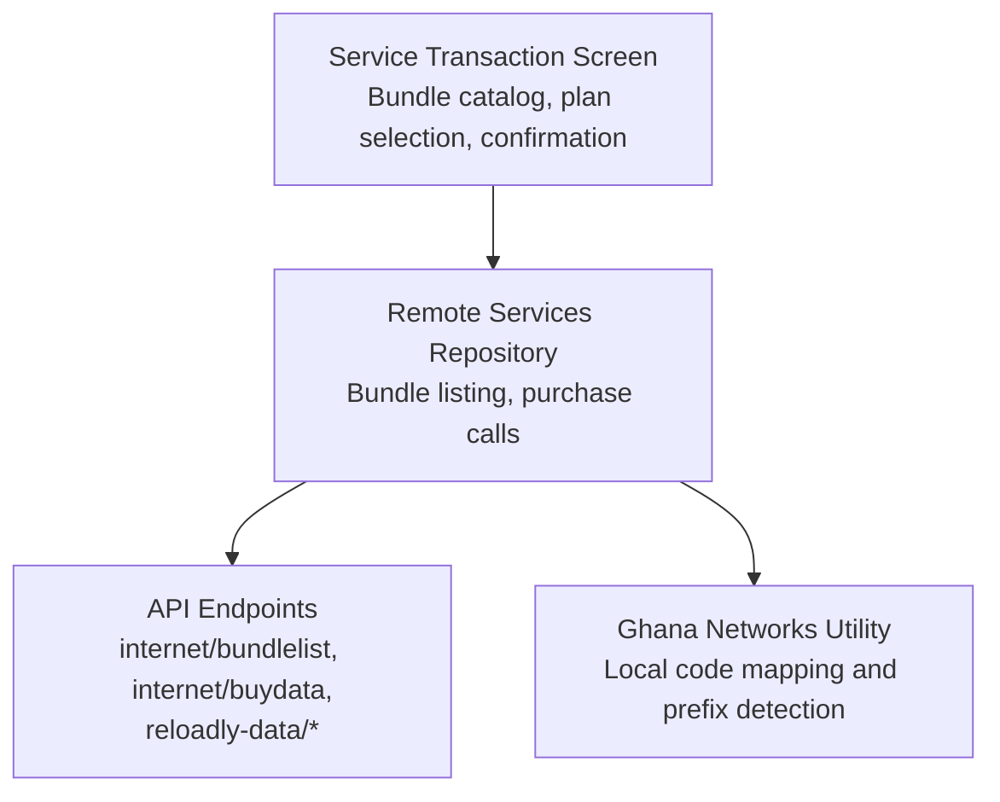
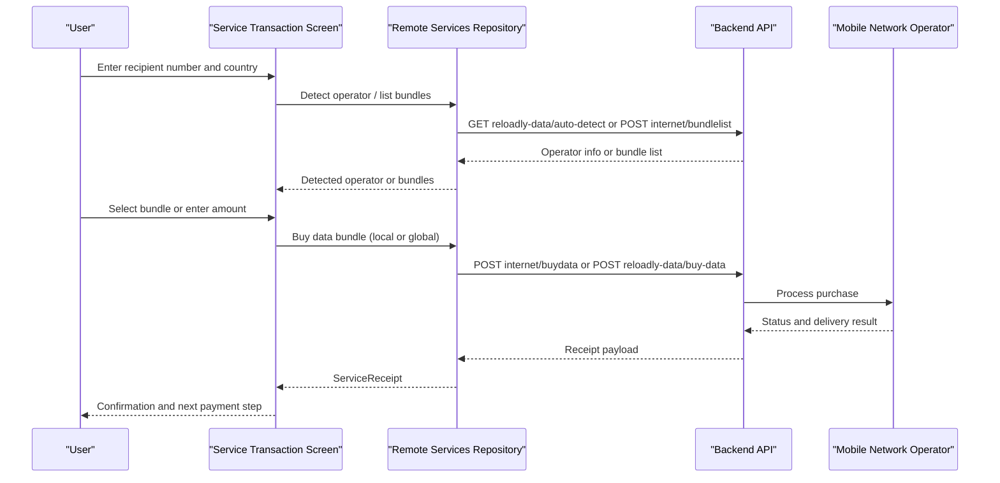
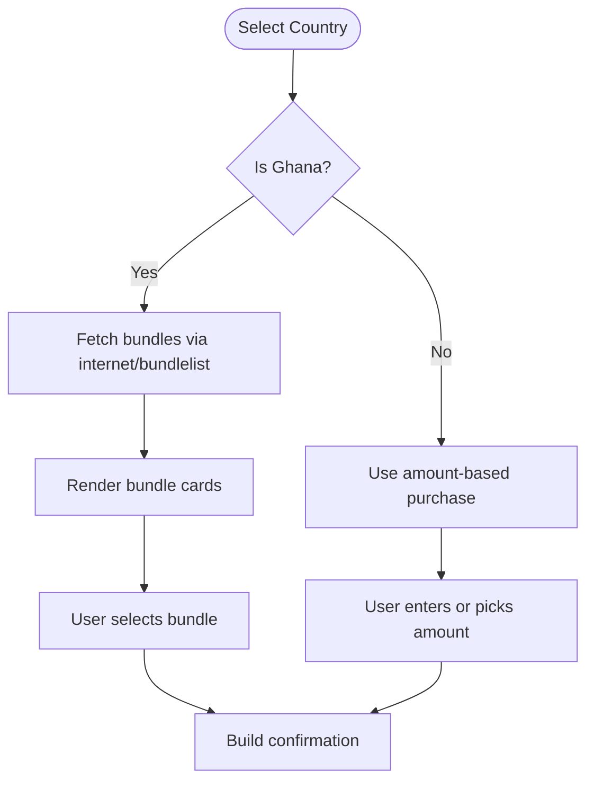
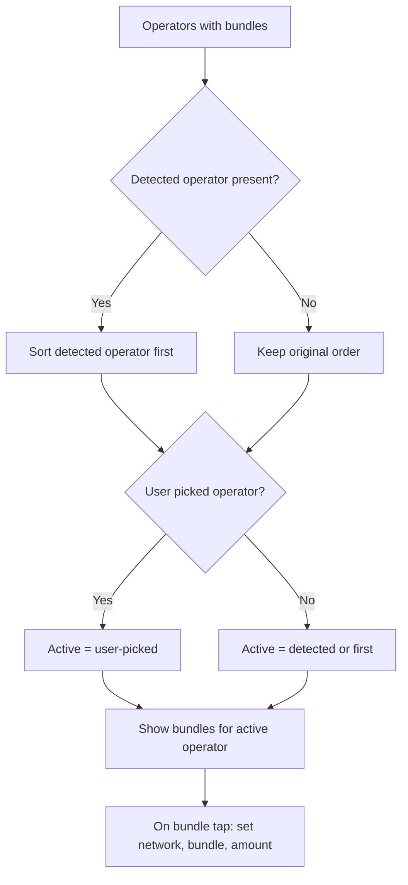
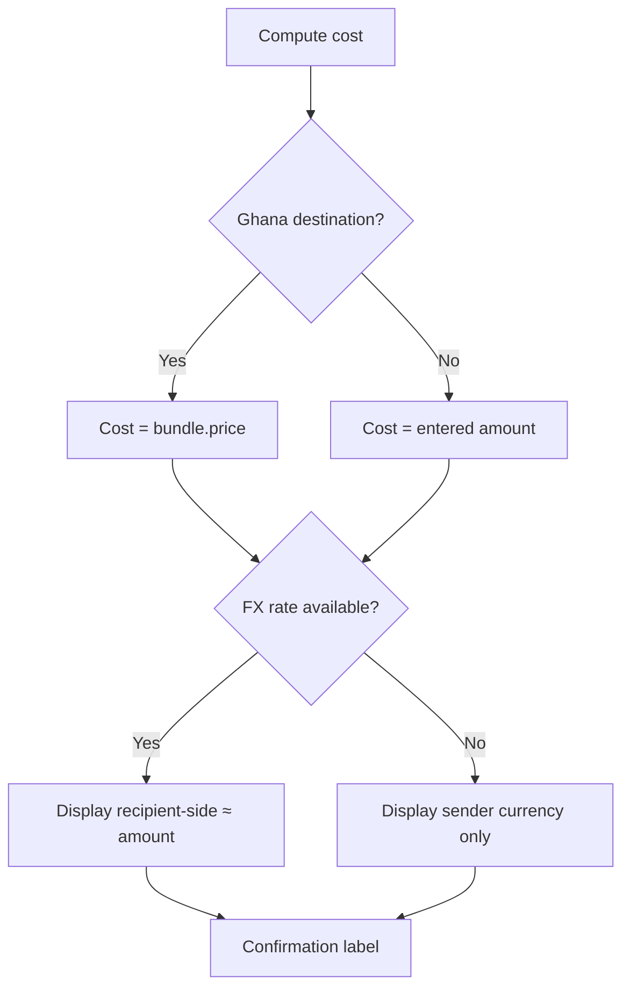
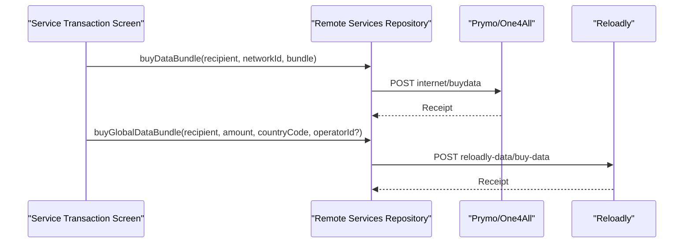
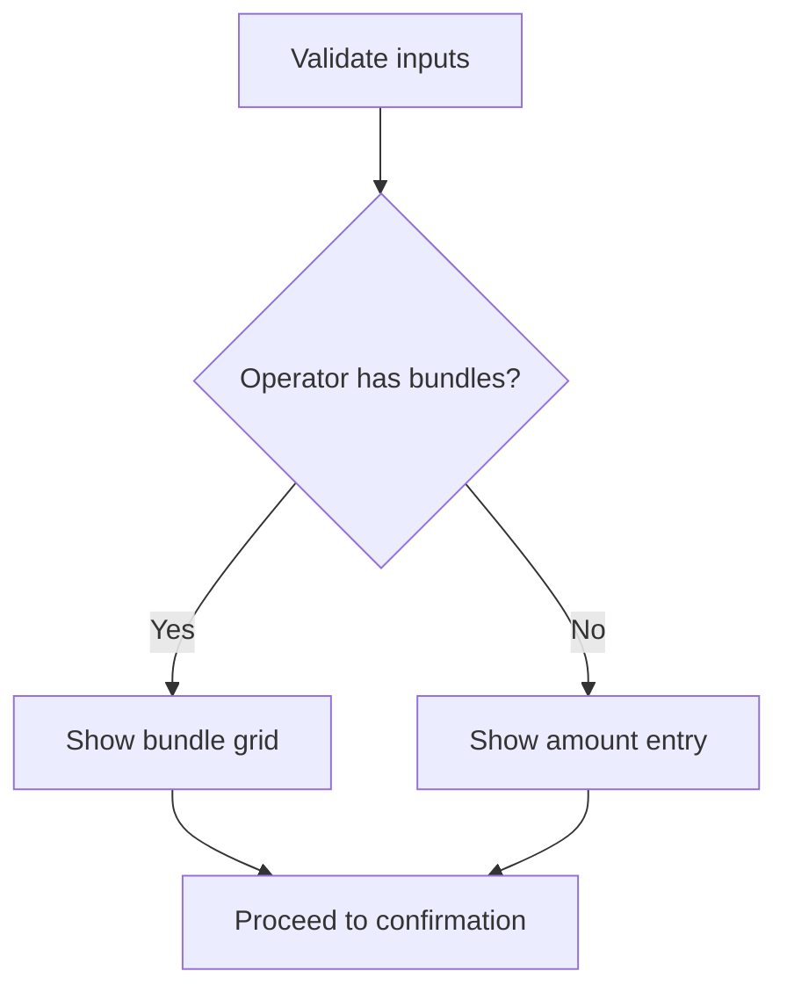
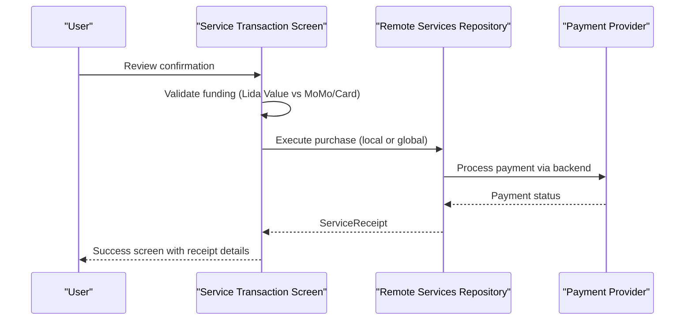
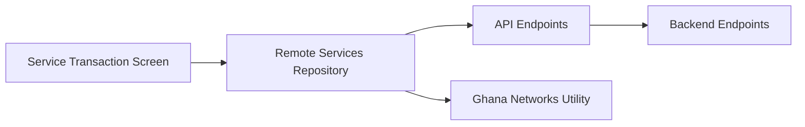

# Data Bundle Purchases

<cite>
**Referenced Files in This Document**
- [service_transaction_screen.dart](file://lib/features/services/screens/service_transaction_screen.dart)
- [remote_services_repository.dart](file://lib/features/services/data/remote_services_repository.dart)
- [api_endpoints.dart](file://lib/core/network/api_endpoints.dart)
- [ghana_networks.dart](file://lib/core/utils/ghana_networks.dart)
- [ENDPOINTS.md](file://api/ENDPOINTS.md)
</cite>

## Table of Contents
1. [Introduction](#introduction)
2. [Project Structure](#project-structure)
3. [Core Components](#core-components)
4. [Architecture Overview](#architecture-overview)
5. [Detailed Component Analysis](#detailed-component-analysis)
6. [Dependency Analysis](#dependency-analysis)
7. [Performance Considerations](#performance-considerations)
8. [Troubleshooting Guide](#troubleshooting-guide)
9. [Conclusion](#conclusion)

## Introduction
This document explains the data bundle purchasing functionality in the application. It covers how the app displays available bundles, how users select plans, how pricing is calculated and displayed, and how purchases are executed through mobile network operators. It also documents integration points with backend endpoints, operator detection, recipient eligibility, subscription-like behaviors such as expiration and renewal, and usage tracking considerations.

## Project Structure
The data bundle purchase flow spans three main layers:
- UI layer: The service transaction screen renders country selection, operator detection, bundle catalog, amount entry, confirmation, and payment routing.
- Repository layer: The services repository calls backend endpoints to list bundles, buy local or global data, detect operators, and handle Lida Value funding.
- Network layer: API endpoint constants define the backend routes used by the repository.

**Diagram sources**
- [service_transaction_screen.dart:2350-3100](file://lib/features/services/screens/service_transaction_screen.dart#L2350-L3100)
- [remote_services_repository.dart:961-1210](file://lib/features/services/data/remote_services_repository.dart#L961-L1210)
- [api_endpoints.dart:69-100](file://lib/core/network/api_endpoints.dart#L69-L100)
- [ghana_networks.dart:1-116](file://lib/core/utils/ghana_networks.dart#L1-L116)

**Section sources**
- [service_transaction_screen.dart:2350-3100](file://lib/features/services/screens/service_transaction_screen.dart#L2350-L3100)
- [remote_services_repository.dart:961-1210](file://lib/features/services/data/remote_services_repository.dart#L961-L1210)
- [api_endpoints.dart:69-100](file://lib/core/network/api_endpoints.dart#L69-L100)
- [ghana_networks.dart:1-116](file://lib/core/utils/ghana_networks.dart#L1-L116)

## Core Components
- Service transaction screen: Orchestrates user steps for data purchases, including detecting the operator, showing fixed bundle cards or an amount entry, building a confirmation review card, and switching between Lida Value and standard checkout.
- Remote services repository: Implements bundle listing and purchase methods for both local (Ghana) and global data, normalizes phone numbers, detects operators via Reloadly, and constructs receipts.
- API endpoints: Centralized route definitions for internet bundle listing, buying data, and Reloadly data operations.
- Ghana networks utility: Provides deterministic mapping from phone prefixes to local provider codes and brand names.

Key responsibilities:
- Catalog display: Fetches and renders bundle lists for selected networks; supports pagination and “show more” behavior.
- Plan selection logic: Chooses the detected operator’s plans first, allows manual override, and sets the selected bundle and price.
- Pricing calculations: Displays sender currency charges and recipient-side converted amounts using per-operator FX rates when available.
- Operator integration: Uses Prymo/One4All for Ghana and Reloadly for global destinations; auto-detects operators where possible.
- Subscription management: Expiration and renewal are not directly implemented here; they depend on backend responses and external operator systems.

**Section sources**
- [service_transaction_screen.dart:2393-2529](file://lib/features/services/screens/service_transaction_screen.dart#L2393-L2529)
- [service_transaction_screen.dart:2827-2946](file://lib/features/services/screens/service_transaction_screen.dart#L2827-L2946)
- [service_transaction_screen.dart:2948-3045](file://lib/features/services/screens/service_transaction_screen.dart#L2948-L3045)
- [remote_services_repository.dart:961-1038](file://lib/features/services/data/remote_services_repository.dart#L961-L1038)
- [remote_services_repository.dart:1080-1122](file://lib/features/services/data/remote_services_repository.dart#L1080-L1122)
- [remote_services_repository.dart:1135-1210](file://lib/features/services/data/remote_services_repository.dart#L1135-L1210)
- [api_endpoints.dart:69-100](file://lib/core/network/api_endpoints.dart#L69-L100)
- [ghana_networks.dart:1-116](file://lib/core/utils/ghana_networks.dart#L1-L116)

## Architecture Overview
The data bundle purchase architecture separates concerns across UI, repository, and network layers. The UI composes state and user interactions, while the repository encapsulates business rules and remote calls. Backend endpoints provide two primary paths:
- Local Ghana data via Prymo/One4All endpoints.
- Global data via Reloadly endpoints.

**Diagram sources**
- [service_transaction_screen.dart:2350-3100](file://lib/features/services/screens/service_transaction_screen.dart#L2350-L3100)
- [remote_services_repository.dart:961-1210](file://lib/features/services/data/remote_services_repository.dart#L961-L1210)
- [api_endpoints.dart:69-100](file://lib/core/network/api_endpoints.dart#L69-L100)

## Detailed Component Analysis

### Bundle Catalog Display
- For Ghana destinations, the repository fetches bundles using the internet bundle list endpoint and maps fields like plan identifiers, names, prices, and data sizes into a uniform model.
- The UI renders a grid of bundle cards, supports “show more” for large catalogs, and highlights the currently selected bundle.
- For global destinations without fixed plans, the UI falls back to an amount entry screen with quick amount chips and FX rate hints.

**Diagram sources**
- [remote_services_repository.dart:961-1038](file://lib/features/services/data/remote_services_repository.dart#L961-L1038)
- [service_transaction_screen.dart:2827-2946](file://lib/features/services/screens/service_transaction_screen.dart#L2827-L2946)
- [service_transaction_screen.dart:2531-2644](file://lib/features/services/screens/service_transaction_screen.dart#L2531-L2644)

**Section sources**
- [remote_services_repository.dart:961-1038](file://lib/features/services/data/remote_services_repository.dart#L961-L1038)
- [service_transaction_screen.dart:2827-2946](file://lib/features/services/screens/service_transaction_screen.dart#L2827-L2946)
- [service_transaction_screen.dart:2531-2644](file://lib/features/services/screens/service_transaction_screen.dart#L2531-L2644)

### Plan Selection Logic
- The UI prioritizes the detected operator’s plans so that the user’s own network appears first. If no bundles exist for the detected operator, it falls back to an amount entry.
- Manual network selection is supported; selecting another operator resets to that operator’s bundles.
- When a bundle is selected, the UI updates the selected network, selected bundle, and pre-fills the amount field with the bundle price.

**Diagram sources**
- [service_transaction_screen.dart:2393-2529](file://lib/features/services/screens/service_transaction_screen.dart#L2393-L2529)

**Section sources**
- [service_transaction_screen.dart:2393-2529](file://lib/features/services/screens/service_transaction_screen.dart#L2393-L2529)

### Pricing Calculations
- Ghana purchases charge in local currency; the confirmation shows the bundle name and size, with the price as the total.
- Global purchases charge in the sender currency (e.g., USD), and the UI optionally shows the recipient-side converted amount using per-operator FX rates.
- Quick amounts and custom amounts are validated against operator acceptance ranges when available.

**Diagram sources**
- [service_transaction_screen.dart:2948-3045](file://lib/features/services/screens/service_transaction_screen.dart#L2948-L3045)
- [service_transaction_screen.dart:2646-2654](file://lib/features/services/screens/service_transaction_screen.dart#L2646-L2654)

**Section sources**
- [service_transaction_screen.dart:2948-3045](file://lib/features/services/screens/service_transaction_screen.dart#L2948-L3045)
- [service_transaction_screen.dart:2646-2654](file://lib/features/services/screens/service_transaction_screen.dart#L2646-L2654)

### Integration with Mobile Network Operators
- Ghana: Uses Prymo/One4All endpoints for bundle listing and purchase. Phone normalization ensures local format compliance.
- Global: Uses Reloadly endpoints for operator auto-detection and data purchase. Recipient choice can be enabled unless it is a self top-up.

**Diagram sources**
- [remote_services_repository.dart:1080-1122](file://lib/features/services/data/remote_services_repository.dart#L1080-L1122)
- [remote_services_repository.dart:1135-1210](file://lib/features/services/data/remote_services_repository.dart#L1135-L1210)
- [api_endpoints.dart:69-100](file://lib/core/network/api_endpoints.dart#L69-L100)

**Section sources**
- [remote_services_repository.dart:1080-1122](file://lib/features/services/data/remote_services_repository.dart#L1080-L1122)
- [remote_services_repository.dart:1135-1210](file://lib/features/services/data/remote_services_repository.dart#L1135-L1210)
- [api_endpoints.dart:69-100](file://lib/core/network/api_endpoints.dart#L69-L100)

### Bundle Availability Checks
- Bundle availability depends on the selected network and whether the operator exposes fixed plans.
- If no bundles are available for the detected operator, the UI switches to an amount-based purchase flow.
- Operator auto-detection may fail; the UI surfaces errors and allows manual correction.

**Diagram sources**
- [service_transaction_screen.dart:2393-2529](file://lib/features/services/screens/service_transaction_screen.dart#L2393-L2529)
- [service_transaction_screen.dart:2531-2644](file://lib/features/services/screens/service_transaction_screen.dart#L2531-L2644)

**Section sources**
- [service_transaction_screen.dart:2393-2529](file://lib/features/services/screens/service_transaction_screen.dart#L2393-L2529)
- [service_transaction_screen.dart:2531-2644](file://lib/features/services/screens/service_transaction_screen.dart#L2531-L2644)

### Subscription Management, Expiration, and Renewal
- Expiration handling: The bundle listing parser recognizes validity fields but does not enforce expiration locally; this is primarily informational.
- Renewal options: No automatic renewal is implemented in the UI or repository shown here. Any recurring billing would need to be coordinated with backend subscription services outside this scope.
- Best practice: Treat data bundles as one-time purchases; if recurring needs arise, integrate with a backend subscription system and expose explicit opt-in flows.

[No sources needed since this section provides general guidance]

### Usage Tracking Integration
- The repository constructs receipts with metadata such as service type, recipient number, network name, and bundle details. These can be used by analytics or history modules to track usage.
- The app includes separate history and analytics features that can consume these receipts for reporting.

[No sources needed since this section provides general guidance]

### Confirmation Flow
- The confirmation screen summarizes the service type, hero value (bundle size or amount), network and country, recipient phone, and payment method.
- Funding options include Lida Value and standard checkout (mobile money or card). If Lida Value balance is insufficient, the UI prompts the user to switch to standard checkout.
- After confirmation, the repository executes the appropriate purchase call and returns a receipt for display.

**Diagram sources**
- [service_transaction_screen.dart:2948-3045](file://lib/features/services/screens/service_transaction_screen.dart#L2948-L3045)
- [remote_services_repository.dart:1080-1210](file://lib/features/services/data/remote_services_repository.dart#L1080-L1210)

**Section sources**
- [service_transaction_screen.dart:2948-3045](file://lib/features/services/screens/service_transaction_screen.dart#L2948-L3045)
- [remote_services_repository.dart:1080-1210](file://lib/features/services/data/remote_services_repository.dart#L1080-L1210)

## Dependency Analysis
The following diagram shows key dependencies among components involved in data bundle purchases.

**Diagram sources**
- [service_transaction_screen.dart:2350-3100](file://lib/features/services/screens/service_transaction_screen.dart#L2350-L3100)
- [remote_services_repository.dart:961-1210](file://lib/features/services/data/remote_services_repository.dart#L961-L1210)
- [api_endpoints.dart:69-100](file://lib/core/network/api_endpoints.dart#L69-L100)
- [ghana_networks.dart:1-116](file://lib/core/utils/ghana_networks.dart#L1-L116)

**Section sources**
- [service_transaction_screen.dart:2350-3100](file://lib/features/services/screens/service_transaction_screen.dart#L2350-L3100)
- [remote_services_repository.dart:961-1210](file://lib/features/services/data/remote_services_repository.dart#L961-L1210)
- [api_endpoints.dart:69-100](file://lib/core/network/api_endpoints.dart#L69-L100)
- [ghana_networks.dart:1-116](file://lib/core/utils/ghana_networks.dart#L1-L116)

## Performance Considerations
- Bundle listing uses a catalogue cache wrapper to reduce repeated network calls for the same network.
- The UI paginates bundle display with “show more” to avoid rendering large lists at once.
- Operator auto-detection is performed once per valid input change; results are cached in UI state to prevent redundant calls.
- FX rate computations are lightweight and derived from operator metadata; avoid recomputing on every frame by caching values in state.

[No sources needed since this section provides general guidance]

## Troubleshooting Guide
Common error scenarios and handling strategies:
- Insufficient Lida Value balance:
  - Symptom: Confirmation shows a warning and offers to switch to standard checkout.
  - Resolution: Prompt the user to confirm switching to mobile money or card payment.
- Network or backend errors during bundle listing:
  - Symptom: Error view with retry option.
  - Resolution: Allow the user to retry fetching bundles for the selected network.
- Operator detection failure:
  - Symptom: Banner indicates no operator found or detection error.
  - Resolution: Ask the user to verify country and phone number; allow manual operator selection.
- Invalid phone number format:
  - Symptom: Purchase fails due to malformed MSISDN or local number.
  - Resolution: Normalize phone numbers before sending requests; validate length and leading zeros.
- Ghana vs global route mismatch:
  - Symptom: Attempting to use global data route for Ghana numbers throws an error.
  - Resolution: Route Ghana purchases through the local Prymo/One4All path.

Operational references:
- Backend endpoints for data bundles and purchases are defined centrally and documented in the API endpoint map.

**Section sources**
- [service_transaction_screen.dart:2844-2847](file://lib/features/services/screens/service_transaction_screen.dart#L2844-L2847)
- [service_transaction_screen.dart:2948-3045](file://lib/features/services/screens/service_transaction_screen.dart#L2948-L3045)
- [remote_services_repository.dart:1149-1176](file://lib/features/services/data/remote_services_repository.dart#L1149-L1176)
- [api_endpoints.dart:69-100](file://lib/core/network/api_endpoints.dart#L69-L100)
- [ENDPOINTS.md:129-134](file://api/ENDPOINTS.md#L129-L134)

## Conclusion
The data bundle purchasing feature combines a responsive UI with robust repository logic to support both local Ghana and global data purchases. It handles bundle catalog display, plan selection, pricing calculations, operator detection, and confirmation flows. While expiration and renewal are not directly managed in this code, receipts and metadata enable usage tracking and future subscription integrations. Proper error handling and fallbacks ensure a resilient user experience even under network or operator constraints.