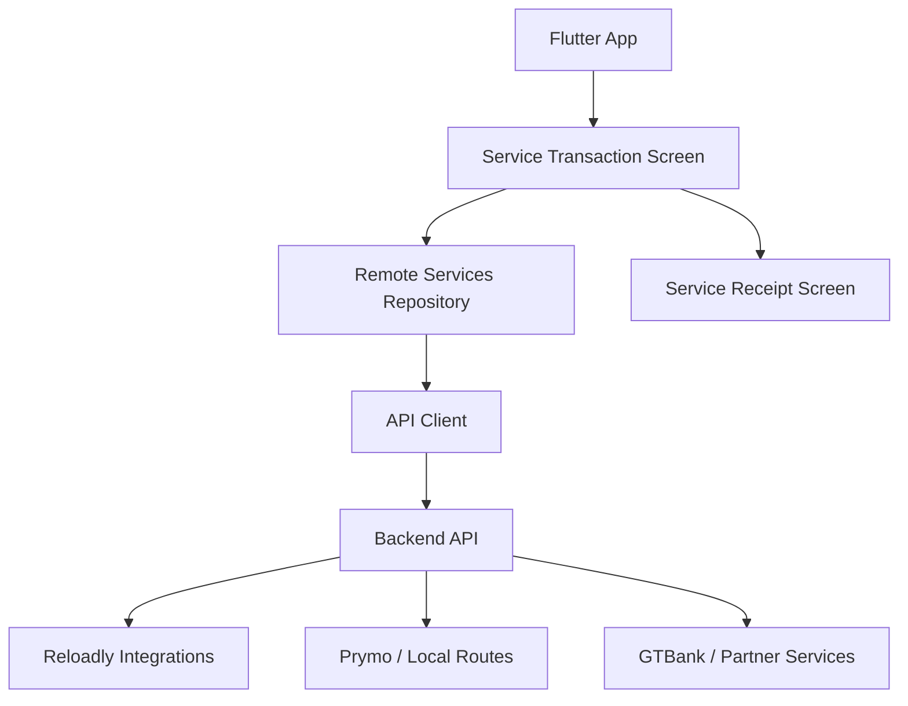
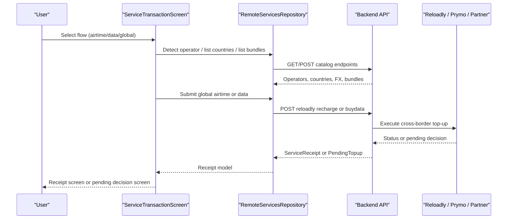
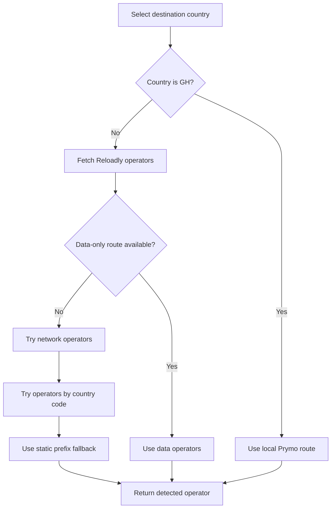
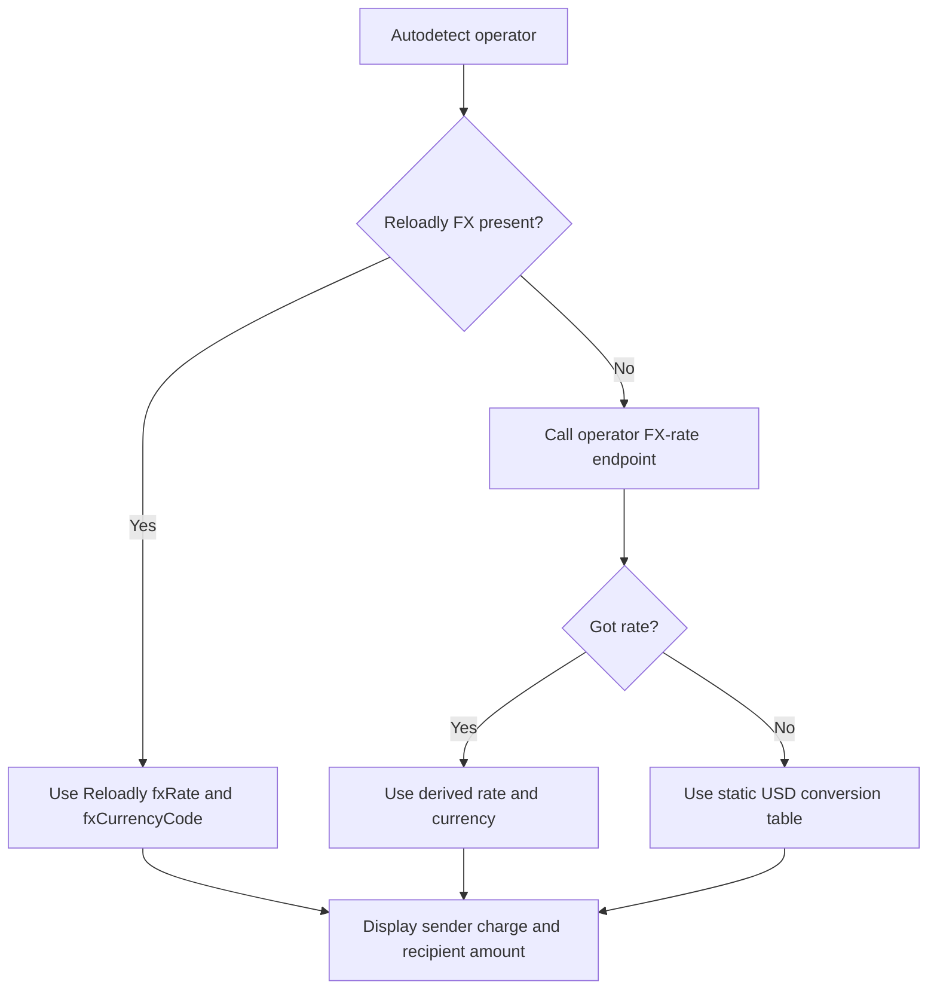
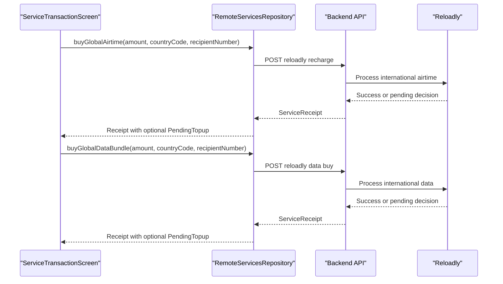
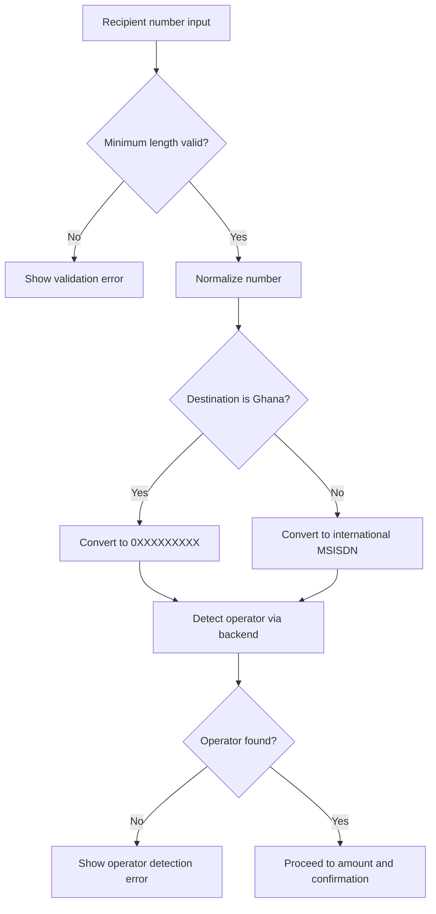
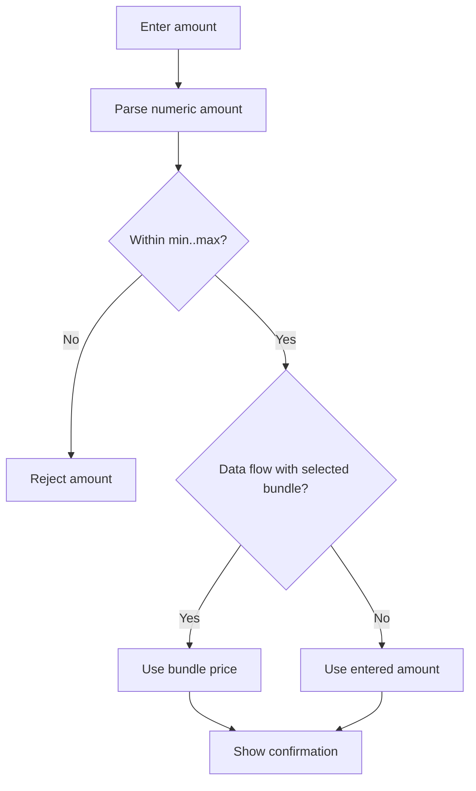
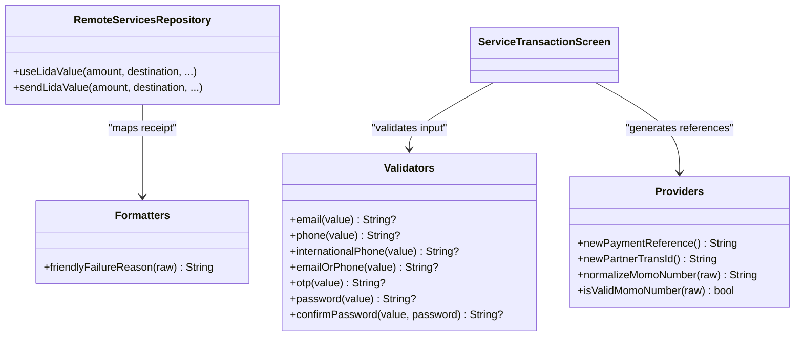
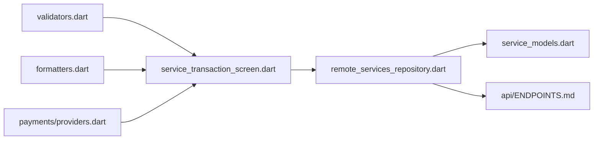

# International Mobile Money Transfers

<cite>
**Referenced Files in This Document**
- [README.md](file://README.md)
- [ENDPOINTS.md](file://api/ENDPOINTS.md)
- [remote_services_repository.dart](file://lib/features/services/data/remote_services_repository.dart)
- [service_models.dart](file://lib/features/services/data/service_models.dart)
- [service_transaction_screen.dart](file://lib/features/services/screens/service_transaction_screen.dart)
- [validators.dart](file://lib/core/utils/validators.dart)
- [formatters.dart](file://lib/core/utils/formatters.dart)
- [providers.dart](file://lib/features/payments/providers.dart)
</cite>

## Table of Contents
1. [Introduction](#introduction)
2. [Project Structure](#project-structure)
3. [Core Components](#core-components)
4. [Architecture Overview](#architecture-overview)
5. [Detailed Component Analysis](#detailed-component-analysis)
6. [Dependency Analysis](#dependency-analysis)
7. [Performance Considerations](#performance-considerations)
8. [Troubleshooting Guide](#troubleshooting-guide)
9. [Conclusion](#conclusion)

## Introduction
This document explains the international mobile money transfer functionality exposed by this Flutter application and its backend API surface. The app supports:

- Domestic top-ups in Ghana through a local provider.
- International airtime and data purchases through Reloadly, with country, operator, and currency handling.
- Recipient choice flows where eligible recipients can accept direct delivery or convert value into Lida Value.
- Exchange rate resolution from Reloadly, with static fallback rates when live rates are unavailable.
- Transaction status tracking through dedicated transaction and decision endpoints.
- Payment integration points for mobile money, cards, and partner services.

The repository is primarily a Flutter client; cross-border payment orchestration lives in the backend API documented in `api/ENDPOINTS.md`, while the client implements catalog discovery, FX display logic, recipient validation helpers, and service submission flows.

**Section sources**
- [README.md:1-47](file://README.md#L1-L47)
- [ENDPOINTS.md:1-195](file://api/ENDPOINTS.md#L1-L195)

## Project Structure
The international transfer capability spans three main layers:

| Layer | Responsibility | Key files |
|---|---|---|
| Client UI | Country selection, network detection, amount input, confirmation review, receipt display | `service_transaction_screen.dart` |
| Service Repository | Catalog fetching, operator detection, FX enrichment, global airtime/data submission, receipt mapping | `remote_services_repository.dart` |
| Data Models | Operator metadata, bundles, receipts, pending decisions, wallets | `service_models.dart` |
| Validation & Formatting | Phone/email rules, friendly error messages, number normalization | `validators.dart`, `formatters.dart` |
| Payments Integration | Reference generation, MoMo number normalization, payment state helpers | `providers.dart` |
| Backend API Surface | Endpoints for transactions, Reloadly integrations, recipient decisions, status checks | `ENDPOINTS.md` |

**Diagram sources**
- [service_transaction_screen.dart:125-191](file://lib/features/services/screens/service_transaction_screen.dart#L125-L191)
- [remote_services_repository.dart:1040-1287](file://lib/features/services/data/remote_services_repository.dart#L1040-L1287)
- [ENDPOINTS.md:94-157](file://api/ENDPOINTS.md#L94-L157)

**Section sources**
- [service_transaction_screen.dart:33-191](file://lib/features/services/screens/service_transaction_screen.dart#L33-L191)
- [remote_services_repository.dart:17-79](file://lib/features/services/data/remote_services_repository.dart#L17-L79)
- [service_models.dart:5-143](file://lib/features/services/data/service_models.dart#L5-L143)
- [ENDPOINTS.md:1-195](file://api/ENDPOINTS.md#L1-L195)

## Core Components
The international transfer feature is built around these core components:

| Component | Purpose | Important behavior |
|---|---|---|
| `RemoteServicesRepository` | Calls backend endpoints for countries, operators, FX, and global top-ups | Caches catalogs, retries multiple Reloadly routes, enriches FX, maps receipts |
| `DetectedOperator` | Represents an autodetected international operator | Carries min/max amounts, suggested amounts, sender/destination currencies, FX rate, and quick-amount helpers |
| `ServiceTransactionScreen` | User-facing wizard for airtime, data, global airtime, QR pay, and GTPay | Validates inputs, selects networks/countries/bundles, submits service calls, shows receipts |
| `Validators` | Input validation utilities | Supports Ghana phone format, international phone format, email, OTP, password rules |
| `PendingTopup` / `ServiceReceipt` | Transaction outcome models | Carry references, amounts, pending decisions, recipient/network/bundle metadata |
| API endpoint map | Declares available backend routes | Includes Reloadly, mobile money, recipient decisions, transaction status, and partner integrations |

**Section sources**
- [remote_services_repository.dart:17-79](file://lib/features/services/data/remote_services_repository.dart#L17-L79)
- [service_models.dart:31-143](file://lib/features/services/data/service_models.dart#L31-L143)
- [service_transaction_screen.dart:33-191](file://lib/features/services/screens/service_transaction_screen.dart#L33-L191)
- [validators.dart:1-72](file://lib/core/utils/validators.dart#L1-L72)
- [ENDPOINTS.md:1-195](file://api/ENDPOINTS.md#L1-L195)

## Architecture Overview
International transfers follow two primary paths:

1. **Domestic Ghana path**: Uses local Prymo-style endpoints for airtime and data. Numbers are normalized to the local `0XXXXXXXXX` format.
2. **International Reloadly path**: Uses Reloadly-backed endpoints for global airtime and data. Countries and operators are discovered through Reloadly endpoints, with FX resolved per operator.

**Diagram sources**
- [service_transaction_screen.dart:125-191](file://lib/features/services/screens/service_transaction_screen.dart#L125-L191)
- [remote_services_repository.dart:1212-1287](file://lib/features/services/data/remote_services_repository.dart#L1212-L1287)
- [remote_services_repository.dart:1134-1210](file://lib/features/services/data/remote_services_repository.dart#L1134-L1210)
- [ENDPOINTS.md:94-157](file://api/ENDPOINTS.md#L94-L157)

## Detailed Component Analysis

### Multi-Country Support and Destination Routing
The repository treats Ghana as the domestic sender country and routes it separately from international destinations. For non-Ghana ISO codes, it queries Reloadly operator catalogs through several fallback routes:

- Data-only route for data bundles.
- Network operators route for airtime.
- Operators-by-country route.
- Static fallbacks for known prefixes when Reloadly access tokens or catalogs are unavailable.

Countries are fetched from the Reloadly country list, with tolerant field parsing across multiple possible response shapes. Ghana is pinned at the top so users can switch between local and international destinations without searching.

**Diagram sources**
- [remote_services_repository.dart:98-237](file://lib/features/services/data/remote_services_repository.dart#L98-L237)
- [remote_services_repository.dart:244-307](file://lib/features/services/data/remote_services_repository.dart#L244-L307)
- [remote_services_repository.dart:427-468](file://lib/features/services/data/remote_services_repository.dart#L427-L468)

**Section sources**
- [remote_services_repository.dart:79-237](file://lib/features/services/data/remote_services_repository.dart#L79-L237)
- [remote_services_repository.dart:244-307](file://lib/features/services/data/remote_services_repository.dart#L244-L307)
- [remote_services_repository.dart:427-544](file://lib/features/services/data/remote_services_repository.dart#L427-L544)

### Currency Conversion and Exchange Rate Handling
For international top-ups, the sender is normally charged in USD, while the recipient receives value in the destination currency. Exchange rate handling follows this order:

1. Use Reloadly’s reported FX fields (`fx.rate`, derived `localMinAmount/minAmount`).
2. If missing, call the per-operator FX rate endpoint.
3. If Reloadly is unreachable, fall back to a static USD-to-currency table.
4. Display the converted amount using the FX currency code rather than the sender’s symbol.

The `DetectedOperator.paymentAmount` method converts a destination amount into the sender’s charge equivalent when an FX rate exists.

**Diagram sources**
- [remote_services_repository.dart:367-421](file://lib/features/services/data/remote_services_repository.dart#L367-L421)
- [remote_services_repository.dart:473-544](file://lib/features/services/data/remote_services_repository.dart#L473-L544)
- [service_models.dart:58-77](file://lib/features/services/data/service_models.dart#L58-L77)
- [service_transaction_screen.dart:2976-3033](file://lib/features/services/screens/service_transaction_screen.dart#L2976-L3033)

**Section sources**
- [remote_services_repository.dart:367-421](file://lib/features/services/data/remote_services_repository.dart#L367-L421)
- [remote_services_repository.dart:473-544](file://lib/features/services/data/remote_services_repository.dart#L473-L544)
- [service_models.dart:58-77](file://lib/features/services/data/service_models.dart#L58-L77)
- [service_transaction_screen.dart:2976-3033](file://lib/features/services/screens/service_transaction_screen.dart#L2976-L3033)

### Cross-Border Payment Processing
International airtime and data processing goes through backend endpoints that wrap Reloadly operations:

- Global airtime uses a reloadable recharge endpoint with operator detection, sender/recipient metadata, and optional recipient choice.
- Global data uses a data-buy endpoint with similar metadata and recipient-choice support.
- Domestic Ghana airtime and data use separate local endpoints with local number normalization.
- The repository returns a `ServiceReceipt` that may include a `PendingTopup` when delivery is parked behind recipient eligibility.

**Diagram sources**
- [remote_services_repository.dart:1134-1287](file://lib/features/services/data/remote_services_repository.dart#L1134-L1287)
- [service_models.dart:145-212](file://lib/features/services/data/service_models.dart#L145-L212)
- [ENDPOINTS.md:135-157](file://api/ENDPOINTS.md#L135-L157)

**Section sources**
- [remote_services_repository.dart:1040-1287](file://lib/features/services/data/remote_services_repository.dart#L1040-L1287)
- [service_models.dart:145-212](file://lib/features/services/data/service_models.dart#L145-L212)
- [ENDPOINTS.md:135-157](file://api/ENDPOINTS.md#L135-L157)

### Recipient Validation
Recipient validation combines client-side formatting and backend-driven operator detection:

- Ghana numbers are normalized to `0XXXXXXXXX`.
- International numbers are normalized to MSISDN form before operator lookup.
- The UI validates minimum length and numeric input.
- Profile/contact numbers accept international dialing formats.
- Operator detection throws user-friendly errors when no operator can be resolved.

**Diagram sources**
- [remote_services_repository.dart:1124-1132](file://lib/features/services/data/remote_services_repository.dart#L1124-L1132)
- [remote_services_repository.dart:309-365](file://lib/features/services/data/remote_services_repository.dart#L309-L365)
- [validators.dart:12-43](file://lib/core/utils/validators.dart#L12-L43)
- [service_transaction_screen.dart:334-350](file://lib/features/services/screens/service_transaction_screen.dart#L334-L350)

**Section sources**
- [remote_services_repository.dart:1124-1132](file://lib/features/services/data/remote_services_repository.dart#L1124-L1132)
- [remote_services_repository.dart:309-365](file://lib/features/services/data/remote_services_repository.dart#L309-L365)
- [validators.dart:12-43](file://lib/core/utils/validators.dart#L12-L43)
- [service_transaction_screen.dart:334-350](file://lib/features/services/screens/service_transaction_screen.dart#L334-L350)

### Transfer Limits and Amount Handling
Transfer limits are primarily driven by operator metadata:

- `DetectedOperator.minAmount` and `maxAmount` define accepted ranges.
- Suggested amounts come from Reloadly or are generated across the range.
- Quick amounts are filtered to stay within the operator’s accepted range.
- The UI enforces positive amounts and bundle selection where required.
- Domestic Ghana bundles carry explicit prices; international data is often amount-based.

**Diagram sources**
- [service_models.dart:106-117](file://lib/features/services/data/service_models.dart#L106-L117)
- [service_models.dart:79-104](file://lib/features/services/data/service_models.dart#L79-L104)
- [service_transaction_screen.dart:498-511](file://lib/features/services/screens/service_transaction_screen.dart#L498-L511)
- [service_transaction_screen.dart:2976-3033](file://lib/features/services/screens/service_transaction_screen.dart#L2976-L3033)

**Section sources**
- [service_models.dart:79-117](file://lib/features/services/data/service_models.dart#L79-L117)
- [service_transaction_screen.dart:498-511](file://lib/features/services/screens/service_transaction_screen.dart#L498-L511)
- [service_transaction_screen.dart:2976-3033](file://lib/features/services/screens/service_transaction_screen.dart#L2976-L3033)

### Compliance and Recipient Choice
Eligible recipients can be presented with a choice between direct delivery and Lida Value. The backend returns a pending top-up with a decision identifier, and the client must not report success until the live transaction lifecycle is integrated. This design avoids showing fake completion screens when delivery is pending.

Compliance-related behaviors visible in the client include:

- Explicit warnings that certain services must not report success until their lifecycles are integrated.
- Pending top-up receipts that require polling canonical top-up status.
- Recipient decision endpoints for creating, retrieving, responding to, and resolving expired decisions.

**Section sources**
- [remote_services_repository.dart:71-77](file://lib/features/services/data/remote_services_repository.dart#L71-L77)
- [service_models.dart:145-212](file://lib/features/services/data/service_models.dart#L145-L212)
- [ENDPOINTS.md:113-121](file://api/ENDPOINTS.md#L113-L121)

### Security Measures and Fraud Prevention
Security and fraud prevention are implemented across authentication, token handling, idempotency, and payment state management:

- Authentication endpoints support login, OTP verification, refresh tokens, and merchant login.
- Idempotency keys are sent for Lida Value debit and send operations to prevent duplicate charges on retry.
- Payment providers generate unique references and partner transaction IDs.
- Mobile money number normalization reduces misrouted payments.
- Friendly failure reasons translate backend error codes into actionable messages.

**Diagram sources**
- [validators.dart:1-72](file://lib/core/utils/validators.dart#L1-L72)
- [providers.dart:81-114](file://lib/features/payments/providers.dart#L81-L114)
- [formatters.dart:62-92](file://lib/core/utils/formatters.dart#L62-L92)
- [remote_services_repository.dart:1349-1422](file://lib/features/services/data/remote_services_repository.dart#L1349-L1422)

**Section sources**
- [validators.dart:1-72](file://lib/core/utils/validators.dart#L1-L72)
- [providers.dart:81-114](file://lib/features/payments/providers.dart#L81-L114)
- [formatters.dart:62-92](file://lib/core/utils/formatters.dart#L62-L92)
- [remote_services_repository.dart:1349-1422](file://lib/features/services/data/remote_services_repository.dart#L1349-L1422)

### Regulatory Compliance Considerations
From the repository perspective, regulatory compliance is reflected in:

- Clear separation between domestic and international routing.
- Explicit sender and recipient country codes in global top-up requests.
- Currency and FX metadata carried through receipts.
- Pending decision workflows that allow recipients to choose how value is delivered.
- Backend endpoints for transaction status, recipient decisions, and partner callbacks.

The README also notes that financial-feature declarations should be completed based on actual backend, payment-provider, and SDK data practices, which signals that production deployment requires additional compliance configuration outside the client code.

**Section sources**
- [remote_services_repository.dart:1134-1287](file://lib/features/services/data/remote_services_repository.dart#L1134-L1287)
- [service_models.dart:165-212](file://lib/features/services/data/service_models.dart#L165-L212)
- [ENDPOINTS.md:113-121](file://api/ENDPOINTS.md#L113-L121)
- [README.md:27-47](file://README.md#L27-L47)

## Dependency Analysis
The international transfer feature has clear layering:

- The UI depends on providers and repositories but does not directly call backend endpoints.
- The repository abstracts backend responses through tolerant parsing and caching.
- FX logic depends on Reloadly endpoints and falls back to static tables.
- Receipts depend on backend response shapes and may include pending decisions.
- Validation and formatting utilities are reused across forms and error presentation.

**Diagram sources**
- [service_transaction_screen.dart:1-31](file://lib/features/services/screens/service_transaction_screen.dart#L1-L31)
- [remote_services_repository.dart:1-12](file://lib/features/services/data/remote_services_repository.dart#L1-L12)
- [service_models.dart:1-4](file://lib/features/services/data/service_models.dart#L1-L4)
- [ENDPOINTS.md:1-195](file://api/ENDPOINTS.md#L1-L195)

**Section sources**
- [service_transaction_screen.dart:1-31](file://lib/features/services/screens/service_transaction_screen.dart#L1-L31)
- [remote_services_repository.dart:1-12](file://lib/features/services/data/remote_services_repository.dart#L1-L12)
- [service_models.dart:1-4](file://lib/features/services/data/service_models.dart#L1-L4)
- [ENDPOINTS.md:1-195](file://api/ENDPOINTS.md#L1-L195)

## Performance Considerations
Key performance characteristics relevant to international transfers:

- Catalog data such as countries, operators, and bundles is cached locally so provider outages do not block the wizard after initial load.
- Multiple Reloadly routes are tried sequentially, stopping early on authentication failures to avoid wasted retries.
- FX lookups are attempted only when needed, falling back to static rates when the provider is unreachable.
- Receipt mapping tolerates inconsistent backend response shapes, reducing parsing failures.
- UI states show skeletons while catalogs load and provide retry actions on errors.

Recommendations:

- Keep catalog cache keys versioned and invalidated when backend schemas change.
- Monitor Reloadly endpoint availability and consider circuit-breaking repeated failures.
- Avoid re-fetching FX rates for unchanged operators and amounts where possible.
- Ensure pending decision polling respects timeouts and user navigation.

**Section sources**
- [remote_services_repository.dart:46-69](file://lib/features/services/data/remote_services_repository.dart#L46-L69)
- [remote_services_repository.dart:273-307](file://lib/features/services/data/remote_services_repository.dart#L273-L307)
- [remote_services_repository.dart:367-421](file://lib/features/services/data/remote_services_repository.dart#L367-L421)
- [service_transaction_screen.dart:208-255](file://lib/features/services/screens/service_transaction_screen.dart#L208-L255)

## Troubleshooting Guide
Common issues and their likely causes:

| Symptom | Likely cause | Resolution |
|---|---|---|
| No operators shown for a country | Reloadly catalog unavailable or empty page | Retry, check network, verify country code, rely on static fallback if supported |
| FX rate missing | Reloadly FX endpoint failed | Fall back to static USD table; verify backend token mint |
| Operator detection fails | Invalid phone number or unsupported destination | Validate number format, confirm country, try again |
| Amount rejected | Outside operator min/max range | Adjust amount or select different operator/bundle |
| Pending receipt appears | Recipient choice not yet resolved | Poll top-up status or decision status |
| Payment declined or expired | Mobile money prompt rejected or timed out | Show friendly failure reason and ask user to retry |
| Duplicate charge risk | Retried Lida Value debit | Ensure idempotency key is preserved and headers are sent |

**Section sources**
- [remote_services_repository.dart:273-307](file://lib/features/services/data/remote_services_repository.dart#L273-L307)
- [remote_services_repository.dart:367-421](file://lib/features/services/data/remote_services_repository.dart#L367-L421)
- [remote_services_repository.dart:696-714](file://lib/features/services/data/remote_services_repository.dart#L696-L714)
- [service_models.dart:106-117](file://lib/features/services/data/service_models.dart#L106-L117)
- [service_models.dart:145-212](file://lib/features/services/data/service_models.dart#L145-L212)
- [formatters.dart:62-92](file://lib/core/utils/formatters.dart#L62-L92)
- [remote_services_repository.dart:1349-1422](file://lib/features/services/data/remote_services_repository.dart#L1349-L1422)

## Conclusion
This repository provides a robust Flutter client for international mobile money transfers with strong emphasis on:

- Multi-country operator discovery through Reloadly.
- Transparent exchange rate handling with fallbacks.
- Clear separation between domestic and international routing.
- Recipient validation and operator detection.
- Pending decision flows for compliant delivery choices.
- Idempotent debit operations and friendly error presentation.

Production readiness requires completing backend integrations, payment-provider configurations, and regulatory declarations referenced in the README. The client already structures the international transfer workflow to support those requirements through well-defined repositories, models, and API endpoints.