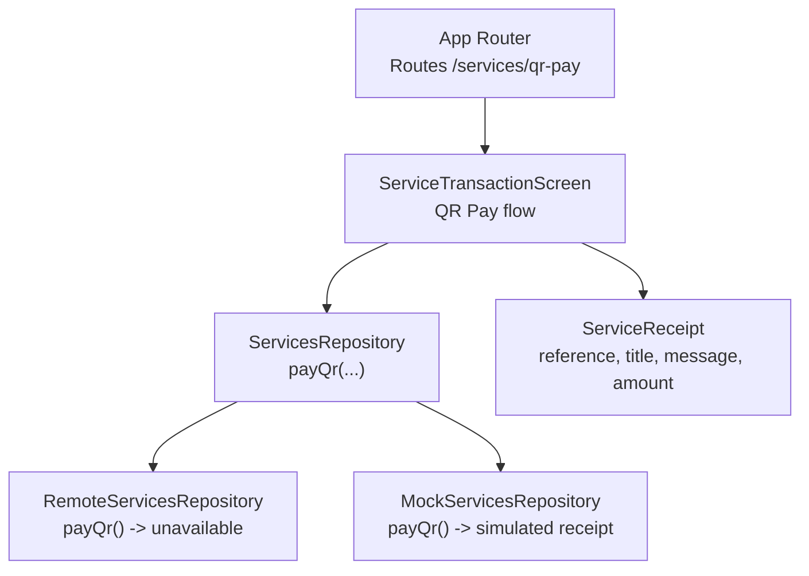
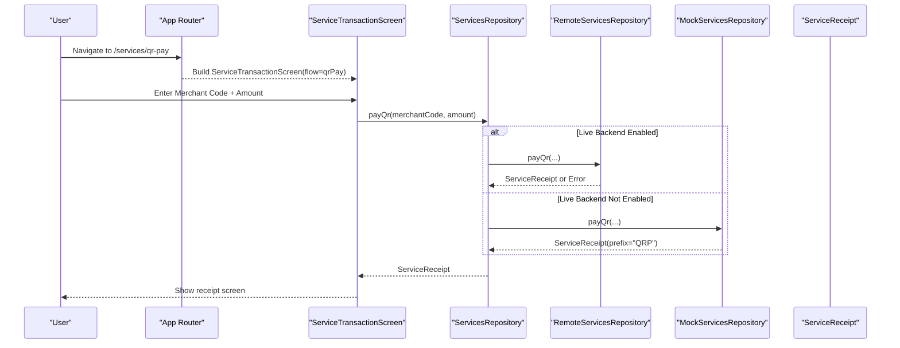
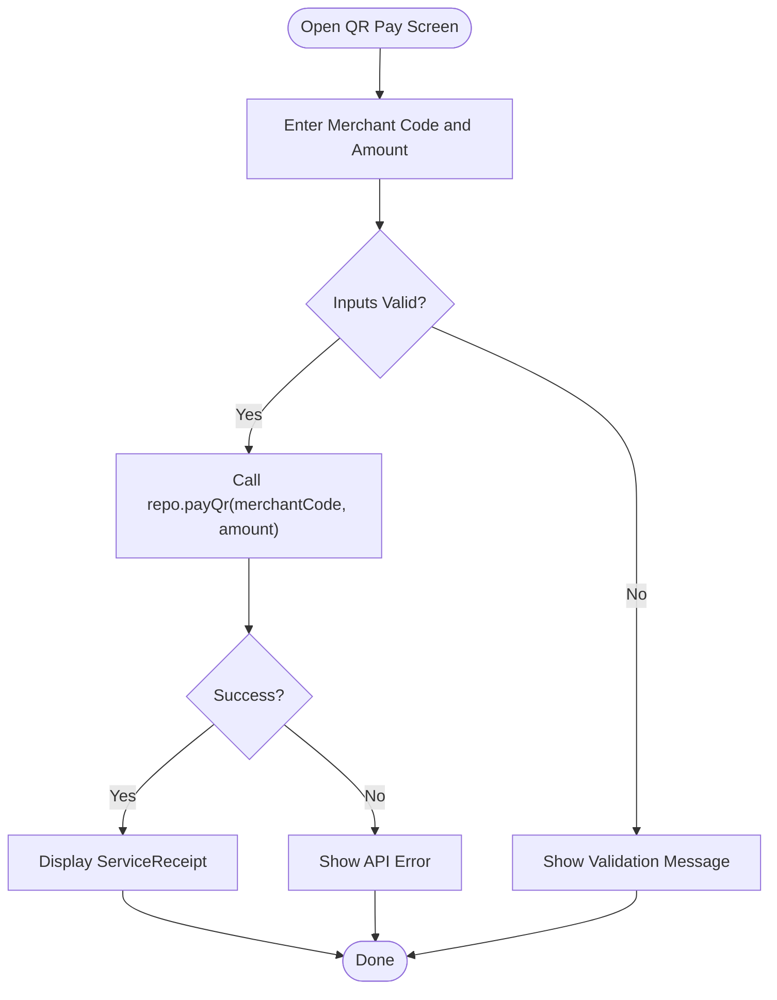
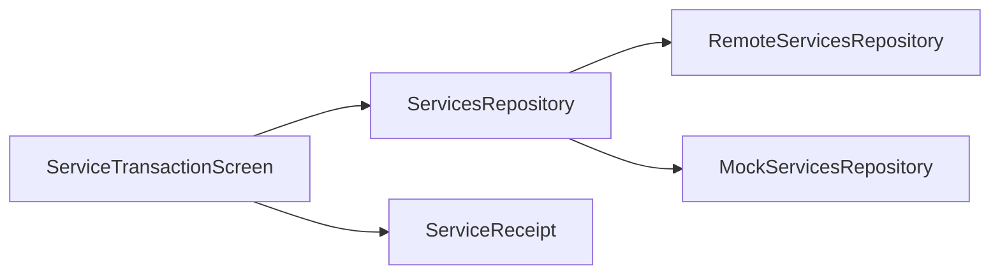

# QR Code Payment System

<cite>
**Referenced Files in This Document**
- [service_transaction_screen.dart](file://lib/features/services/screens/service_transaction_screen.dart)
- [app_router.dart](file://lib/core/router/app_router.dart)
- [services_repository.dart](file://lib/features/services/data/services_repository.dart)
- [remote_services_repository.dart](file://lib/features/services/data/remote_services_repository.dart)
- [mock_services_repository.dart](file://lib/features/services/data/mock_services_repository.dart)
- [service_models.dart](file://lib/features/services/data/service_models.dart)
- [pubspec.yaml](file://pubspec.yaml)
</cite>

## Table of Contents
1. [Introduction](#introduction)
2. [Project Structure](#project-structure)
3. [Core Components](#core-components)
4. [Architecture Overview](#architecture-overview)
5. [Detailed Component Analysis](#detailed-component-analysis)
6. [Dependency Analysis](#dependency-analysis)
7. [Performance Considerations](#performance-considerations)
8. [Troubleshooting Guide](#troubleshooting-guide)
9. [Conclusion](#conclusion)

## Introduction
This document explains the QR code payment system as implemented in the application. The current implementation provides a user-facing flow to initiate a merchant payment using a merchant code, but the live backend integration for QR payments is not yet enabled. A mock implementation simulates success and returns a receipt. There is no QR scanning or QR generation logic in this repository; the UI uses an icon to indicate the feature and collects a merchant code via text input.

Key points:
- QR Pay is one of several service flows (airtime, data, global airtime, GTPay).
- The app routes to a shared transaction screen that adapts its fields based on the selected flow.
- For QR Pay, the user enters a merchant code and amount, then submits the payment request.
- The live repository marks QR payment as unavailable until backend integration is complete.
- Mock repository simulates a successful QR payment and returns a receipt with a “QRP” prefix.

## Project Structure
The QR payment feature spans routing, UI, repository abstraction, and models:

**Diagram sources**
- [app_router.dart:293-299](file://lib/core/router/app_router.dart#L293-L299)
- [service_transaction_screen.dart:33-123](file://lib/features/services/screens/service_transaction_screen.dart#L33-L123)
- [services_repository.dart:73-76](file://lib/features/services/data/services_repository.dart#L73-L76)
- [remote_services_repository.dart:1790-1794](file://lib/features/services/data/remote_services_repository.dart#L1790-L1794)
- [mock_services_repository.dart:304-315](file://lib/features/services/data/mock_services_repository.dart#L304-L315)
- [service_models.dart:165-212](file://lib/features/services/data/service_models.dart#L165-L212)

**Section sources**
- [app_router.dart:293-299](file://lib/core/router/app_router.dart#L293-L299)
- [service_transaction_screen.dart:33-123](file://lib/features/services/screens/service_transaction_screen.dart#L33-L123)
- [services_repository.dart:73-76](file://lib/features/services/data/services_repository.dart#L73-L76)
- [remote_services_repository.dart:1790-1794](file://lib/features/services/data/remote_services_repository.dart#L1790-L1794)
- [mock_services_repository.dart:304-315](file://lib/features/services/data/mock_services_repository.dart#L304-L315)
- [service_models.dart:165-212](file://lib/features/services/data/service_models.dart#L165-L212)

## Core Components
- Routing entry point:
  - The router defines a `/services/qr-pay` route that opens the service transaction screen configured for QR Pay.
- Transaction screen:
  - Displays “QR Pay” with a storefront-style icon and prompts for “Merchant code” and “Amount”.
  - On submit, it calls `repo.payQr(merchantCode, amount)` and shows a receipt if successful.
- Repository interface:
  - Declares `payQr({required String merchantCode, required double amount})`.
- Live repository:
  - Returns an error indicating QR payment is not available yet.
- Mock repository:
  - Simulates a successful QR payment and returns a receipt with reference prefix “QRP”.
- Data model:
  - `ServiceReceipt` carries reference, title, message, amount, timestamps, and optional metadata such as currency and service type.

**Section sources**
- [app_router.dart:293-299](file://lib/core/router/app_router.dart#L293-L299)
- [service_transaction_screen.dart:76-123](file://lib/features/services/screens/service_transaction_screen.dart#L76-L123)
- [service_transaction_screen.dart:147-190](file://lib/features/services/screens/service_transaction_screen.dart#L147-L190)
- [services_repository.dart:73-76](file://lib/features/services/data/services_repository.dart#L73-L76)
- [remote_services_repository.dart:1790-1794](file://lib/features/services/data/remote_services_repository.dart#L1790-L1794)
- [mock_services_repository.dart:304-315](file://lib/features/services/data/mock_services_repository.dart#L304-L315)
- [service_models.dart:165-212](file://lib/features/services/data/service_models.dart#L165-L212)

## Architecture Overview
The QR payment flow follows a standard layered architecture:

**Diagram sources**
- [app_router.dart:293-299](file://lib/core/router/app_router.dart#L293-L299)
- [service_transaction_screen.dart:147-190](file://lib/features/services/screens/service_transaction_screen.dart#L147-L190)
- [services_repository.dart:73-76](file://lib/features/services/data/services_repository.dart#L73-L76)
- [remote_services_repository.dart:1790-1794](file://lib/features/services/data/remote_services_repository.dart#L1790-L1794)
- [mock_services_repository.dart:304-315](file://lib/features/services/data/mock_services_repository.dart#L304-L315)
- [service_models.dart:165-212](file://lib/features/services/data/service_models.dart#L165-L212)

## Detailed Component Analysis

### Routing and Entry Point
- Route path: `/services/qr-pay`
- Builder constructs `ServiceTransactionScreen` with `flow = qrPay`.

Behavior:
- Adds QR Pay to the services navigation tree.
- Delegates all form handling and submission to the shared transaction screen.

**Section sources**
- [app_router.dart:293-299](file://lib/core/router/app_router.dart#L293-L299)

### Transaction Screen (QR Pay Flow)
Responsibilities:
- Presents “QR Pay” title and icon.
- Shows input fields labeled “Merchant code” and “Amount”.
- Validates inputs before submission.
- Calls `repo.payQr(merchantCode, amount)`.
- Displays a receipt upon success.

Validation and UX:
- Minimum length validation for merchant code.
- Positive amount validation.
- Submission state prevents duplicate taps while processing.

**Diagram sources**
- [service_transaction_screen.dart:76-123](file://lib/features/services/screens/service_transaction_screen.dart#L76-L123)
- [service_transaction_screen.dart:125-190](file://lib/features/services/screens/service_transaction_screen.dart#L125-L190)

**Section sources**
- [service_transaction_screen.dart:76-123](file://lib/features/services/screens/service_transaction_screen.dart#L76-L123)
- [service_transaction_screen.dart:125-190](file://lib/features/services/screens/service_transaction_screen.dart#L125-L190)

### Repository Abstraction
- Interface declares `payQr({required String merchantCode, required double amount})`.
- Ensures consistent contract across mock and remote implementations.

Design notes:
- Other methods like Lida Value operations include idempotency references; QR Pay currently does not expose an idempotency key in the interface.

**Section sources**
- [services_repository.dart:73-76](file://lib/features/services/data/services_repository.dart#L73-L76)

### Live Repository Implementation
Current behavior:
- `payQr` returns an error stating QR payment is not available yet.
- Comment indicates MoMo transfer, AdvansisPay, QR Pay, and points redemption must not report success until their lifecycles are integrated.

Implications:
- Users will see an error when attempting QR payment through the live repository.
- Integration work is required to connect to a backend endpoint and process merchant payments.

**Section sources**
- [remote_services_repository.dart:71-77](file://lib/features/services/data/remote_services_repository.dart#L71-L77)
- [remote_services_repository.dart:1790-1794](file://lib/features/services/data/remote_services_repository.dart#L1790-L1794)

### Mock Repository Implementation
Current behavior:
- `payQr` simulates a successful payment after a short delay.
- Returns a `ServiceReceipt` with:
  - Reference prefix “QRP”
  - Title “QR payment complete”
  - Message referencing the merchant code and amount

Use cases:
- Enables UI testing and development without backend integration.
- Demonstrates expected receipt structure for QR payments.

**Section sources**
- [mock_services_repository.dart:304-315](file://lib/features/services/data/mock_services_repository.dart#L304-L315)

### Data Model: ServiceReceipt
Fields relevant to QR payments:
- `reference`: Unique identifier (e.g., “QRP-...”)
- `title`: Human-readable status (“QR payment complete”)
- `message`: Narrative including merchant code and amount
- `amount`: Payment amount
- `createdAt`: Timestamp
- Optional fields: `currency`, `serviceType`, etc.

Usage:
- Displayed by the receipt screen after successful payment.
- Can be extended to include additional QR-specific metadata once backend integration is added.

**Section sources**
- [service_models.dart:165-212](file://lib/features/services/data/service_models.dart#L165-L212)

## Dependency Analysis
- The transaction screen depends on the repository abstraction to execute payments.
- The live repository currently blocks QR payments; the mock repository allows them for development/testing.
- No QR scanning or generation libraries are present in the dependency list.

**Diagram sources**
- [service_transaction_screen.dart:147-190](file://lib/features/services/screens/service_transaction_screen.dart#L147-L190)
- [services_repository.dart:73-76](file://lib/features/services/data/services_repository.dart#L73-L76)
- [remote_services_repository.dart:1790-1794](file://lib/features/services/data/remote_services_repository.dart#L1790-L1794)
- [mock_services_repository.dart:304-315](file://lib/features/services/data/mock_services_repository.dart#L304-L315)
- [service_models.dart:165-212](file://lib/features/services/data/service_models.dart#L165-L212)

**Section sources**
- [pubspec.yaml:30-76](file://pubspec.yaml#L30-L76)

## Performance Considerations
- The mock repository introduces a small artificial delay to simulate network latency.
- The live repository immediately fails for QR payments; integrating a real backend should consider:
  - Idempotency keys to prevent duplicate charges.
  - Short timeouts and retries for transient failures.
  - Caching of merchant metadata only if safe and compliant.

[No sources needed since this section provides general guidance]

## Troubleshooting Guide
Common issues and resolutions:
- QR payment returns “not available”:
  - Cause: Live repository marks QR payment as unavailable.
  - Resolution: Complete backend integration for QR payments.
- Unexpected errors during submission:
  - Check input validation (merchant code length, positive amount).
  - Ensure the repository implementation matches the expected contract.
- Receipt not displayed:
  - Verify that the repository returns a valid `ServiceReceipt`.
  - Confirm the screen handles success and navigates to the receipt view.

**Section sources**
- [remote_services_repository.dart:71-77](file://lib/features/services/data/remote_services_repository.dart#L71-L77)
- [remote_services_repository.dart:1790-1794](file://lib/features/services/data/remote_services_repository.dart#L1790-L1794)
- [service_transaction_screen.dart:125-190](file://lib/features/services/screens/service_transaction_screen.dart#L125-L190)

## Conclusion
The QR code payment system in this repository provides a functional UI flow for entering a merchant code and amount, but the live backend integration is not yet enabled. The mock repository demonstrates the expected receipt format and enables development and testing. To complete the feature:
- Implement `payQr` in the live repository to call the backend.
- Add security measures such as idempotency keys and expiration handling.
- Integrate QR scanning/generation if required by product design.
- Define and enforce QR code format specifications and validation rules.

[No sources needed since this section summarizes without analyzing specific files]