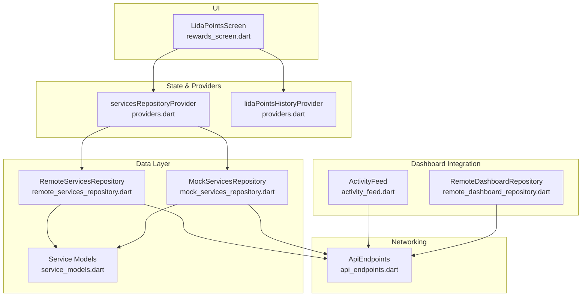
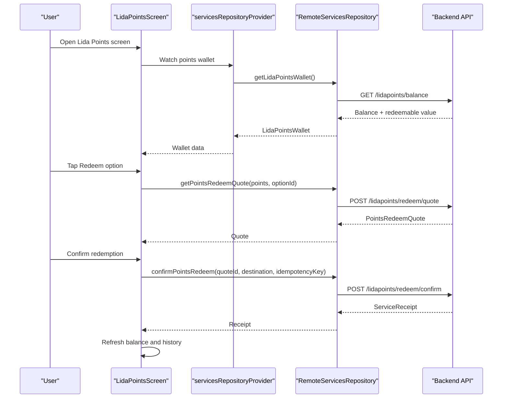
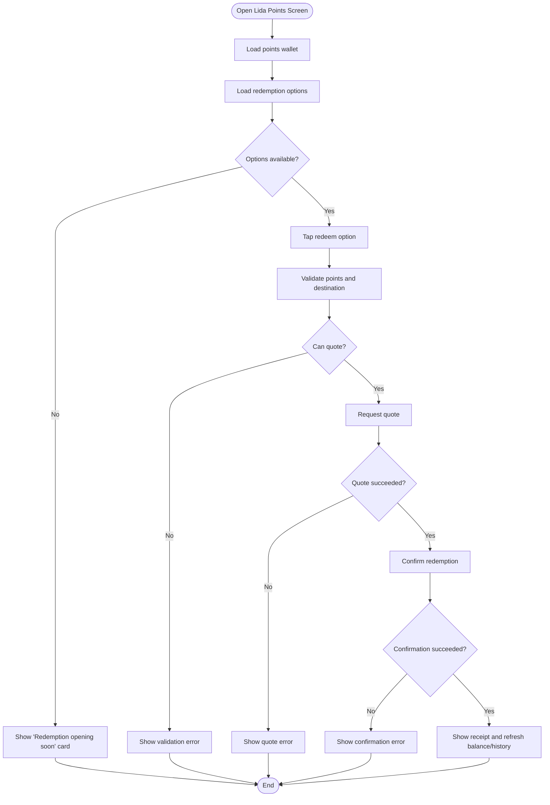
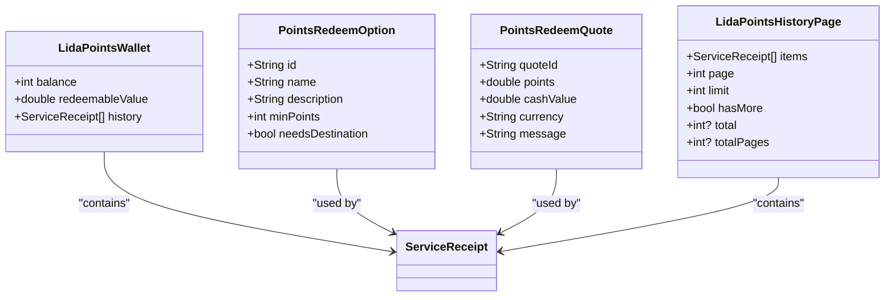
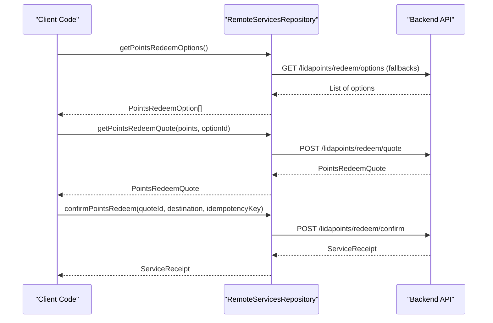
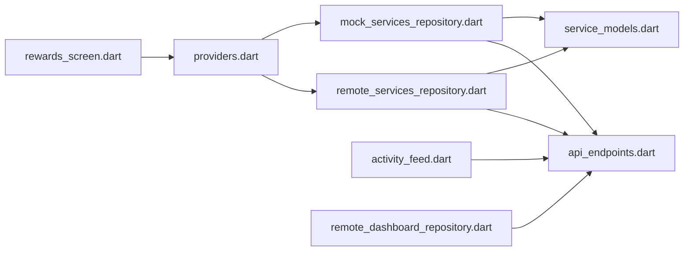

# Rewards and Loyalty Program

<cite>
**Referenced Files in This Document**
- [rewards_screen.dart](file://lib/features/services/screens/rewards_screen.dart)
- [service_models.dart](file://lib/features/services/data/service_models.dart)
- [remote_services_repository.dart](file://lib/features/services/data/remote_services_repository.dart)
- [mock_services_repository.dart](file://lib/features/services/data/mock_services_repository.dart)
- [providers.dart](file://lib/features/services/providers.dart)
- [api_endpoints.dart](file://lib/core/network/api_endpoints.dart)
- [activity_feed.dart](file://lib/features/dashboard/data/activity_feed.dart)
- [remote_dashboard_repository.dart](file://lib/features/dashboard/data/remote_dashboard_repository.dart)
</cite>

## Table of Contents
1. [Introduction](#introduction)
2. [Project Structure](#project-structure)
3. [Core Components](#core-components)
4. [Architecture Overview](#architecture-overview)
5. [Detailed Component Analysis](#detailed-component-analysis)
6. [Dependency Analysis](#dependency-analysis)
7. [Performance Considerations](#performance-considerations)
8. [Troubleshooting Guide](#troubleshooting-guide)
9. [Conclusion](#conclusion)

## Introduction
This document explains the rewards and loyalty program implemented in the LidaPay Flutter application. It covers how users earn points, view their balance, redeem points through a server-driven catalogue, and track activity across transactions. The system is built around:

- A points wallet with balance and cash-equivalent value display.
- A redemption workflow that fetches options, quotes point-to-cash conversion, and confirms redemptions with idempotency protection.
- An activity ledger that merges general transaction history with dedicated Lida Points entries.
- API endpoints for balance, redemption options, quote, confirmation, and history.

The implementation does not define explicit loyalty tiers or expiration policies in the client code; those rules are expected to be enforced by the backend.

## Project Structure
The rewards feature spans UI, data models, repository calls, providers, and shared API endpoint definitions:

**Diagram sources**
- [rewards_screen.dart:17-135](file://lib/features/services/screens/rewards_screen.dart#L17-L135)
- [providers.dart:50-103](file://lib/features/services/providers.dart#L50-L103)
- [remote_services_repository.dart:1825-1872](file://lib/features/services/data/remote_services_repository.dart#L1825-L1872)
- [mock_services_repository.dart:459-502](file://lib/features/services/data/mock_services_repository.dart#L459-L502)
- [service_models.dart:229-357](file://lib/features/services/data/service_models.dart#L229-L357)
- [api_endpoints.dart:52-65](file://lib/core/network/api_endpoints.dart#L52-L65)
- [activity_feed.dart:173-198](file://lib/features/dashboard/data/activity_feed.dart#L173-L198)
- [remote_dashboard_repository.dart:104-119](file://lib/features/dashboard/data/remote_dashboard_repository.dart#L104-L119)

**Section sources**
- [rewards_screen.dart:17-135](file://lib/features/services/screens/rewards_screen.dart#L17-L135)
- [providers.dart:50-103](file://lib/features/services/providers.dart#L50-L103)
- [api_endpoints.dart:52-65](file://lib/core/network/api_endpoints.dart#L52-L65)

## Core Components
- LidaPointsScreen: Displays the points hero card, redemption options, and paginated points activity. It refreshes balance, options, and history on pull-to-refresh and loads more history when scrolling near the bottom.
- Service Models: Define the points wallet, redemption option, redemption quote, and paginated history structures used across the app.
- Remote Services Repository: Implements real API calls for redemption options, quote, confirmation, and history. It retries alternate endpoint variants and enforces idempotency on confirmations.
- Mock Services Repository: Supplies sample redemption options and a deterministic quote for testing.
- Providers: Wire the services repository into Riverpod state, including paginated history loading.
- Activity Feed: Merges general transaction history with Lida Points history for dashboard and other feeds.
- Dashboard Repository: Reads points balance from either the richer rewards endpoint or the legacy bare-number endpoint.

Key responsibilities:
- Earning triggers: Earned points appear as credit rows in the points history feed.
- Redemption workflow: Options → Quote → Confirm with idempotency key.
- Point valuation: Quote returns cash value and currency; the wallet also shows an estimated redeemable value.
- Restrictions: Minimum points per option and optional destination requirement (for example, phone number).

**Section sources**
- [rewards_screen.dart:17-135](file://lib/features/services/screens/rewards_screen.dart#L17-L135)
- [service_models.dart:229-357](file://lib/features/services/data/service_models.dart#L229-L357)
- [remote_services_repository.dart:1825-1872](file://lib/features/services/data/remote_services_repository.dart#L1825-L1872)
- [mock_services_repository.dart:459-502](file://lib/features/services/data/mock_services_repository.dart#L459-L502)
- [providers.dart:50-169](file://lib/features/services/providers.dart#L50-L169)
- [activity_feed.dart:173-198](file://lib/features/dashboard/data/activity_feed.dart#L173-L198)
- [remote_dashboard_repository.dart:104-119](file://lib/features/dashboard/data/remote_dashboard_repository.dart#L104-L119)

## Architecture Overview
The rewards flow integrates UI, providers, repository, and backend endpoints.

**Diagram sources**
- [rewards_screen.dart:648-770](file://lib/features/services/screens/rewards_screen.dart#L648-L770)
- [remote_services_repository.dart:1835-1872](file://lib/features/services/data/remote_services_repository.dart#L1835-L1872)
- [api_endpoints.dart:57-64](file://lib/core/network/api_endpoints.dart#L57-L64)

## Detailed Component Analysis

### Rewards Screen and Redemption Workflow
The rewards screen is the central hub for Lida Points. It shows:
- Hero card with available points and approximate cash value.
- Server-driven redemption options with minimum points and optional destination requirements.
- Paginated points activity ledger.

Redemption steps:
1. Select an option tile.
2. Enter points amount and optional destination if required.
3. Request a quote to lock conversion details.
4. Confirm redemption using the quote ID and a generated idempotency key.
5. On success, invalidate and refresh the points wallet and history.

**Diagram sources**
- [rewards_screen.dart:247-351](file://lib/features/services/screens/rewards_screen.dart#L247-L351)
- [rewards_screen.dart:540-656](file://lib/features/services/screens/rewards_screen.dart#L540-L656)
- [rewards_screen.dart:670-770](file://lib/features/services/screens/rewards_screen.dart#L670-L770)

**Section sources**
- [rewards_screen.dart:17-135](file://lib/features/services/screens/rewards_screen.dart#L17-L135)
- [rewards_screen.dart:247-351](file://lib/features/services/screens/rewards_screen.dart#L247-L351)
- [rewards_screen.dart:540-656](file://lib/features/services/screens/rewards_screen.dart#L540-L656)
- [rewards_screen.dart:670-770](file://lib/features/services/screens/rewards_screen.dart#L670-L770)

### Data Models: Wallet, Options, Quotes, and History
- LidaPointsWallet: Holds integer balance, redeemable cash value, and history receipts.
- PointsRedeemOption: Describes a redemption type, minimum points, description, and whether a destination is required.
- PointsRedeemQuote: Represents a locked quote with quote ID, points, cash value, currency, and message.
- LidaPointsHistoryPage: Paginated page of ServiceReceipt items with pagination metadata.

These models are parsed from loosely shaped backend responses using flexible field mapping.

**Diagram sources**
- [service_models.dart:229-242](file://lib/features/services/data/service_models.dart#L229-L242)
- [service_models.dart:266-314](file://lib/features/services/data/service_models.dart#L266-L314)
- [service_models.dart:316-357](file://lib/features/services/data/service_models.dart#L316-L357)
- [service_models.dart:244-264](file://lib/features/services/data/service_models.dart#L244-L264)

**Section sources**
- [service_models.dart:229-357](file://lib/features/services/data/service_models.dart#L229-L357)

### Repository Implementation: Redemption and History
The remote repository implements:
- Fetching redemption options via a fallback path list.
- Quoting redemption with points and optional option ID.
- Confirming redemption with quote ID, optional destination, and idempotency header.
- Loading paginated points history.

It uses a helper to try multiple endpoint variants and throws a user-friendly error when all paths fail.

**Diagram sources**
- [remote_services_repository.dart:1805-1872](file://lib/features/services/data/remote_services_repository.dart#L1805-L1872)
- [api_endpoints.dart:53-64](file://lib/core/network/api_endpoints.dart#L53-L64)

**Section sources**
- [remote_services_repository.dart:1805-1872](file://lib/features/services/data/remote_services_repository.dart#L1805-L1872)

### Mock Repository: Sample Catalogue and Valuation
The mock repository provides:
- Example redemption options such as airtime top-up, data bundle, cash to mobile money, and Lida Value credit.
- A simple quote calculation where cash value equals points divided by a fixed divisor.

This enables UI testing without hitting the backend.

**Section sources**
- [mock_services_repository.dart:459-502](file://lib/features/services/data/mock_services_repository.dart#L459-L502)

### Providers and State Management
Providers expose:
- The services repository instance bound to the current authenticated user.
- Future providers for points wallet and redemption options.
- A stateful provider for paginated points history with refresh and load-more behavior.

Pagination logic deduplicates items by reference and tracks total counts and availability of more pages.

**Section sources**
- [providers.dart:9-30](file://lib/features/services/providers.dart#L9-L30)
- [providers.dart:50-103](file://lib/features/services/providers.dart#L50-L103)
- [providers.dart:105-169](file://lib/features/services/providers.dart#L105-L169)

### Dashboard Integration: Points in Recent Activity
The dashboard aggregates multiple activity sources, including Lida Points history. Points entries are merged with other transactions, deduplicated by reference, and sorted newest-first.

Points history is fetched separately and mapped into the shared transaction model with unit “PTS”.

**Section sources**
- [activity_feed.dart:7-38](file://lib/features/dashboard/data/activity_feed.dart#L7-L38)
- [activity_feed.dart:173-198](file://lib/features/dashboard/data/activity_feed.dart#L173-L198)
- [activity_feed.dart:260-341](file://lib/features/dashboard/data/activity_feed.dart#L260-L341)

### Points Balance in Dashboard Card
The dashboard repository reads points balance from two possible endpoints:
- The richer rewards balance endpoint.
- The legacy bare-number points endpoint.

If both fail, it degrades gracefully to zero.

**Section sources**
- [remote_dashboard_repository.dart:104-119](file://lib/features/dashboard/data/remote_dashboard_repository.dart#L104-L119)

## Dependency Analysis
The rewards feature depends on:
- API endpoints for balance, redemption options, quote, confirmation, and history.
- Authentication session to attribute operations to the signed-in user.
- Shared network client for HTTP requests.
- Riverpod providers for reactive state.

**Diagram sources**
- [rewards_screen.dart:17-135](file://lib/features/services/screens/rewards_screen.dart#L17-L135)
- [providers.dart:9-30](file://lib/features/services/providers.dart#L9-L30)
- [remote_services_repository.dart:1825-1872](file://lib/features/services/data/remote_services_repository.dart#L1825-L1872)
- [mock_services_repository.dart:459-502](file://lib/features/services/data/mock_services_repository.dart#L459-L502)
- [service_models.dart:229-357](file://lib/features/services/data/service_models.dart#L229-L357)
- [api_endpoints.dart:52-65](file://lib/core/network/api_endpoints.dart#L52-L65)
- [activity_feed.dart:173-198](file://lib/features/dashboard/data/activity_feed.dart#L173-L198)
- [remote_dashboard_repository.dart:104-119](file://lib/features/dashboard/data/remote_dashboard_repository.dart#L104-L119)

**Section sources**
- [api_endpoints.dart:52-65](file://lib/core/network/api_endpoints.dart#L52-L65)
- [providers.dart:9-30](file://lib/features/services/providers.dart#L9-L30)

## Performance Considerations
- Pagination: Points history uses a page size of 20 and supports incremental loading to avoid large payloads.
- Fallback endpoints: Redemption endpoints support alternative route variants to improve resilience.
- Independent failures: Dashboard and activity feed components degrade gracefully when individual endpoints fail.
- Idempotency: Redemption confirmation includes a unique idempotency key to prevent duplicate charges on retry.

[No sources needed since this section provides general guidance]

## Troubleshooting Guide
Common issues and resolutions:
- Redemption unavailable: If no options are returned, the screen shows a “Redemption opening soon” card with retry and invite actions.
- Quote failure: The UI displays a temporary error and allows retrying the quote request.
- Confirmation failure: The UI indicates that points were not deducted and allows retrying.
- History load errors: The screen offers a retry button for initial load and a “Retry” link for pagination errors.

Operational checks:
- Verify that the backend exposes the redemption options, quote, and confirm endpoints.
- Ensure the points history endpoint returns structured rows with references for deduplication.
- Confirm that the idempotency header is included on confirmations.

**Section sources**
- [rewards_screen.dart:247-351](file://lib/features/services/screens/rewards_screen.dart#L247-L351)
- [rewards_screen.dart:670-770](file://lib/features/services/screens/rewards_screen.dart#L670-L770)
- [providers.dart:131-169](file://lib/features/services/providers.dart#L131-L169)
- [remote_services_repository.dart:1805-1872](file://lib/features/services/data/remote_services_repository.dart#L1805-L1872)

## Conclusion
The LidaPay rewards and loyalty program centers on a clear points wallet, a server-driven redemption catalogue, and a robust quote-and-confirm workflow protected by idempotency. Points earning appears as credited entries in the points history feed, while redemption debits are recorded similarly. The dashboard integrates points activity with the broader transaction ledger. Loyalty tier management and expiration policies are not defined in the client code and should be governed by the backend. For best results, ensure the backend consistently returns structured redemption options, accurate quotes, and reliable history entries.

[No sources needed since this section summarizes without analyzing specific files]