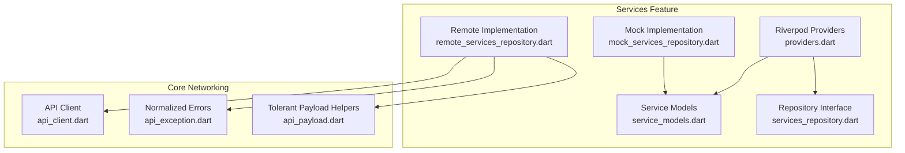
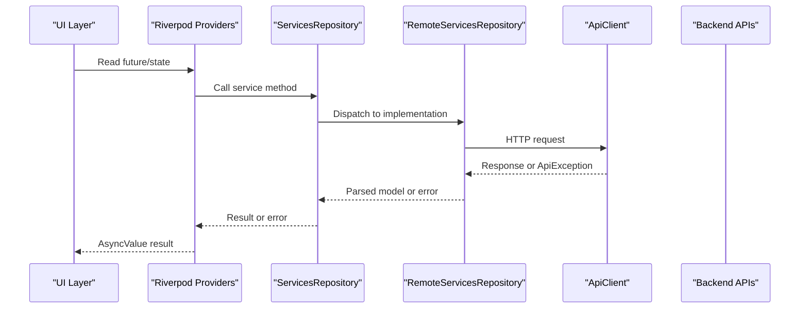
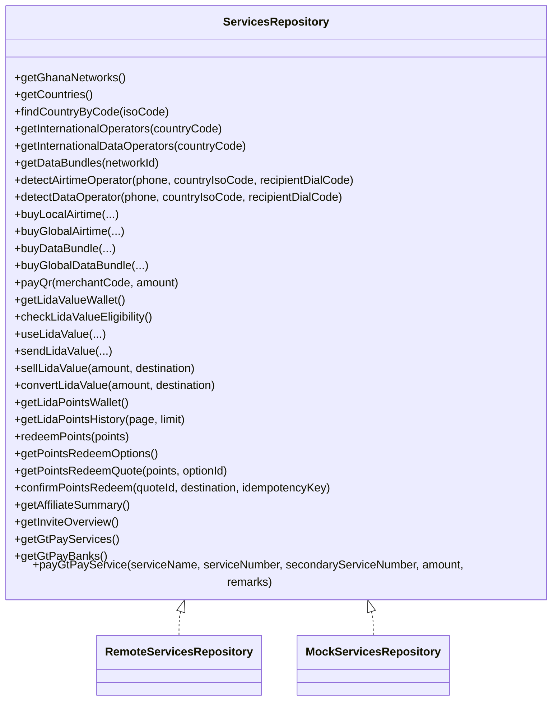
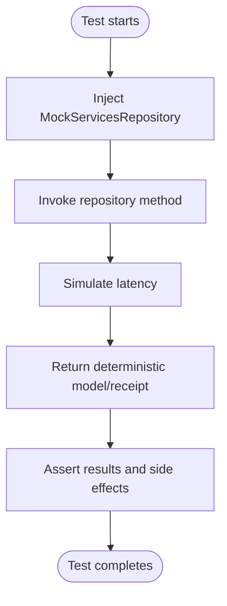
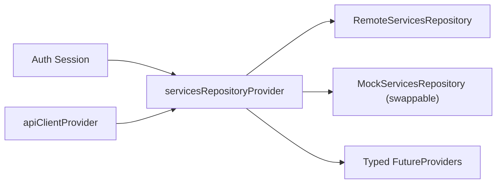
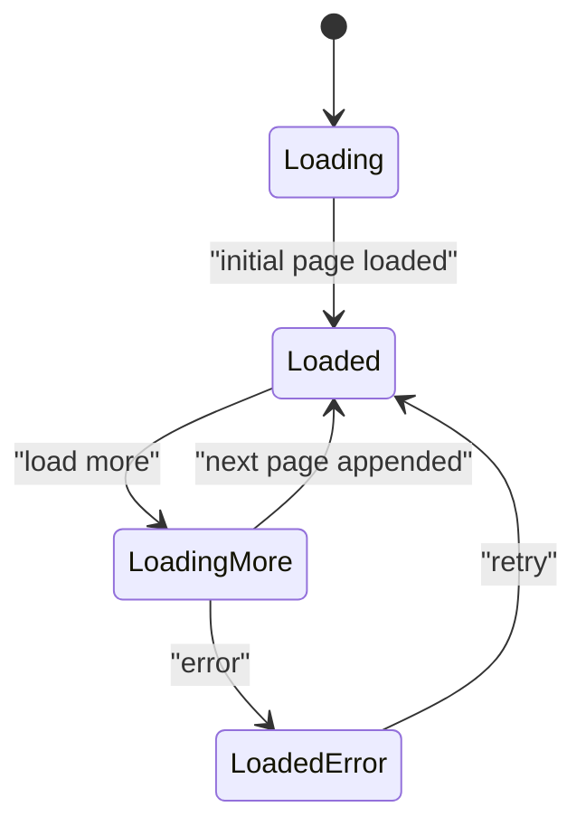
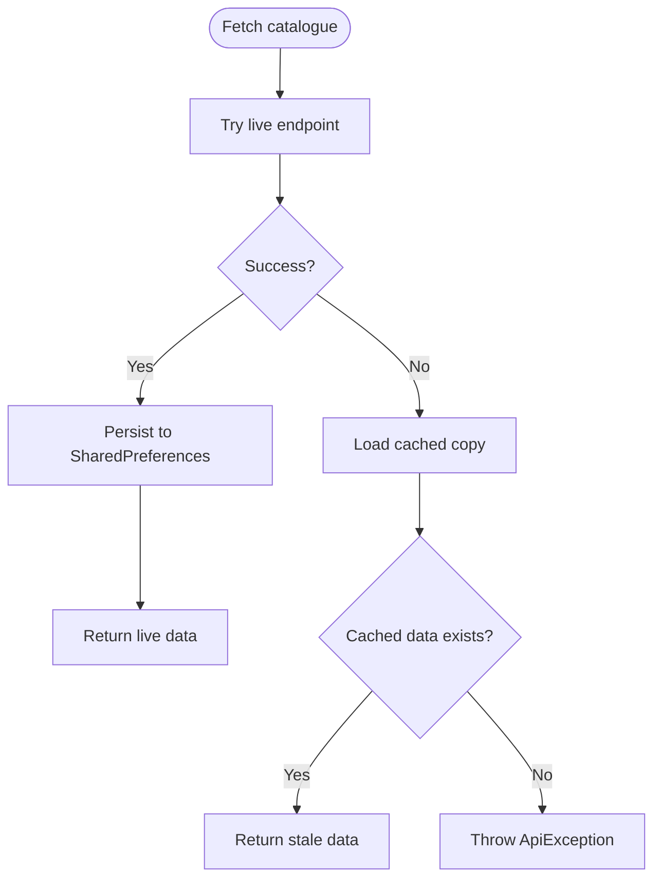
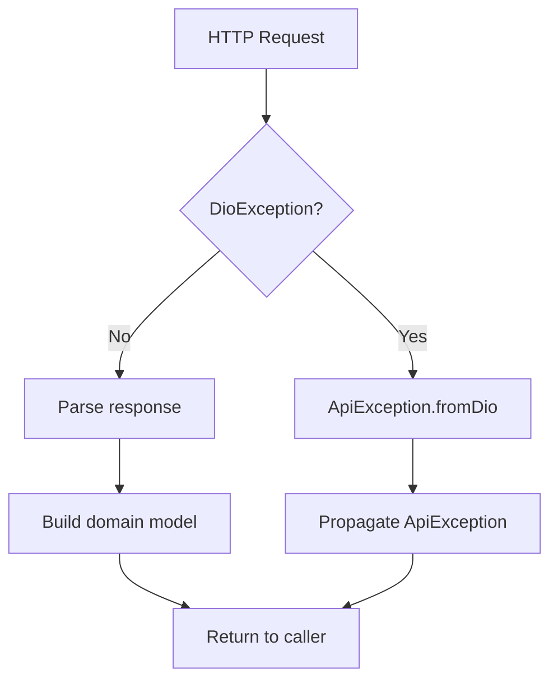
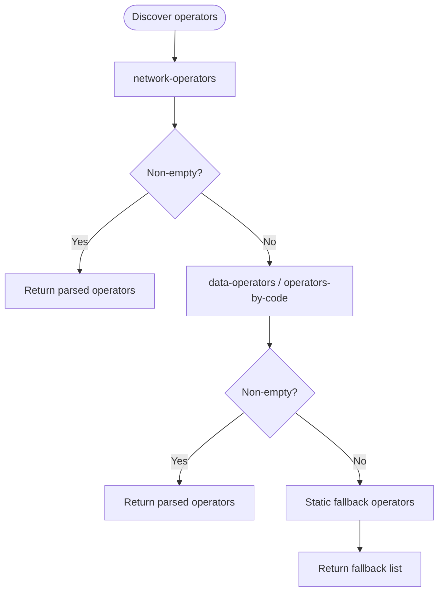
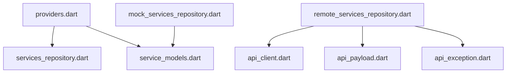

# Service Provider Architecture

<cite>
**Referenced Files in This Document**
- [services_repository.dart](file://lib/features/services/data/services_repository.dart)
- [remote_services_repository.dart](file://lib/features/services/data/remote_services_repository.dart)
- [mock_services_repository.dart](file://lib/features/services/data/mock_services_repository.dart)
- [service_models.dart](file://lib/features/services/data/service_models.dart)
- [providers.dart](file://lib/features/services/providers.dart)
- [api_client.dart](file://lib/core/network/api_client.dart)
- [api_exception.dart](file://lib/core/network/api_exception.dart)
- [api_payload.dart](file://lib/core/network/api_payload.dart)
</cite>

## Table of Contents
1. [Introduction](#introduction)
2. [Project Structure](#project-structure)
3. [Core Components](#core-components)
4. [Architecture Overview](#architecture-overview)
5. [Detailed Component Analysis](#detailed-component-analysis)
6. [Dependency Analysis](#dependency-analysis)
7. [Performance Considerations](#performance-considerations)
8. [Troubleshooting Guide](#troubleshooting-guide)
9. [Conclusion](#conclusion)

## Introduction
This document explains the service provider framework used by the services feature. It covers the repository pattern, the service abstraction layer, mock testing infrastructure, data contracts, and Riverpod-based providers. It also documents service discovery, state management, caching strategies, and error propagation across the ecosystem. The goal is to help developers add new services, implement custom providers, and reason about reliability and performance.

## Project Structure
The services feature follows a consistent layered structure:
- Data models define stable contracts for UI and repositories.
- A repository interface defines the service contract.
- A remote implementation calls the backend through a centralized API client.
- A mock implementation supports tests and offline development.
- Riverpod providers wire the repository into the app and expose typed async state.

**Diagram sources**
- [providers.dart:1-30](file://lib/features/services/providers.dart#L1-L30)
- [services_repository.dart:1-170](file://lib/features/services/data/services_repository.dart#L1-L170)
- [remote_services_repository.dart:1-80](file://lib/features/services/data/remote_services_repository.dart#L1-L80)
- [mock_services_repository.dart:1-24](file://lib/features/services/data/mock_services_repository.dart#L1-L24)
- [service_models.dart:1-40](file://lib/features/services/data/service_models.dart#L1-L40)
- [api_client.dart:1-30](file://lib/core/network/api_client.dart#L1-L30)
- [api_exception.dart:1-20](file://lib/core/network/api_exception.dart#L1-L20)
- [api_payload.dart:1-10](file://lib/core/network/api_payload.dart#L1-L10)

**Section sources**
- [providers.dart:1-30](file://lib/features/services/providers.dart#L1-L30)
- [services_repository.dart:1-170](file://lib/features/services/data/services_repository.dart#L1-L170)
- [remote_services_repository.dart:1-80](file://lib/features/services/data/remote_services_repository.dart#L1-L80)
- [mock_services_repository.dart:1-24](file://lib/features/services/data/mock_services_repository.dart#L1-L24)
- [service_models.dart:1-40](file://lib/features/services/data/service_models.dart#L1-L40)
- [api_client.dart:1-30](file://lib/core/network/api_client.dart#L1-L30)
- [api_exception.dart:1-20](file://lib/core/network/api_exception.dart#L1-L20)
- [api_payload.dart:1-10](file://lib/core/network/api_payload.dart#L1-L10)

## Core Components
- Repository interface: Declares all service operations including network discovery, operator detection, purchases, Lida Value and points flows, GTBank bill-pay, and affiliate/invite endpoints.
- Remote repository: Implements the interface using the shared API client, tolerant payload parsing, and resilient catalog caching.
- Mock repository: Provides deterministic responses with simulated latency for tests and local UX work.
- Service models: Strongly typed data contracts for operators, bundles, receipts, wallets, points, affiliates, and invites.
- Riverpod providers: Expose repository access and typed async state; one provider wires user context into the repository.

Key responsibilities:
- ServicesRepository: Stable contract for all service-related operations.
- RemoteServicesRepository: Network calls, fallbacks, FX enrichment, and catalogue caching.
- MockServicesRepository: Deterministic test data and receipt generation.
- Service models: Shared domain types consumed by UI and repositories.
- Providers: Dependency injection and state exposure for screens and widgets.

**Section sources**
- [services_repository.dart:1-170](file://lib/features/services/data/services_repository.dart#L1-L170)
- [remote_services_repository.dart:1-80](file://lib/features/services/data/remote_services_repository.dart#L1-L80)
- [mock_services_repository.dart:1-24](file://lib/features/services/data/mock_services_repository.dart#L1-L24)
- [service_models.dart:1-40](file://lib/features/services/data/service_models.dart#L1-L40)
- [providers.dart:1-30](file://lib/features/services/providers.dart#L1-L30)

## Architecture Overview
The architecture separates concerns cleanly:
- UI depends on Riverpod providers.
- Providers depend on the repository interface.
- Remote repository depends on ApiClient and tolerant payload helpers.
- ApiClient centralizes HTTP, token refresh, and normalized errors.
- Mock repository replaces remote behavior without changing UI or providers.

**Diagram sources**
- [providers.dart:12-30](file://lib/features/services/providers.dart#L12-L30)
- [remote_services_repository.dart:17-30](file://lib/features/services/data/remote_services_repository.dart#L17-L30)
- [api_client.dart:16-30](file://lib/core/network/api_client.dart#L16-L30)

## Detailed Component Analysis

### Repository Pattern and Abstraction
The repository pattern isolates data source logic behind a single interface. Consumers depend only on ServicesRepository, enabling easy swapping between live and mock implementations.

**Diagram sources**
- [services_repository.dart:3-169](file://lib/features/services/data/services_repository.dart#L3-L169)
- [remote_services_repository.dart:17-30](file://lib/features/services/data/remote_services_repository.dart#L17-L30)
- [mock_services_repository.dart:6-24](file://lib/features/services/data/mock_services_repository.dart#L6-L24)

**Section sources**
- [services_repository.dart:3-169](file://lib/features/services/data/services_repository.dart#L3-L169)

### Service Abstraction Layer
The abstraction layer provides:
- Catalogue discovery: countries, Ghana networks, international operators, data operators.
- Operator detection: airtime and data autodetect with FX enrichment.
- Purchases: local/global airtime and data bundles, QR pay.
- Wallets and points: Lida Value and Lida Points balances, history, redemption flows.
- Affiliate and invite: summary and overview endpoints.
- GTBank bill-pay: service catalog, banks, and payment execution.

These methods are defined once in the repository interface and implemented consistently by both remote and mock providers.

**Section sources**
- [services_repository.dart:3-169](file://lib/features/services/data/services_repository.dart#L3-L169)

### Mock Testing Infrastructure
The mock repository simulates network latency and returns deterministic data structures. Tests can assert on generated receipts, call counts, and parameters. It implements every repository method so UI and integration tests do not need real network access.

**Diagram sources**
- [mock_services_repository.dart:6-24](file://lib/features/services/data/mock_services_repository.dart#L6-L24)

**Section sources**
- [mock_services_repository.dart:6-24](file://lib/features/services/data/mock_services_repository.dart#L6-L24)

### Service Models and Data Contracts
Models define the shape of data exchanged between layers:
- ServiceOption: reusable option type for countries, networks, operators, and services.
- DetectedOperator: operator detection result with min/max amounts, suggested amounts, currencies, FX rate, and logo URL.
- DataBundle: fixed-price data plans.
- ServiceReceipt: transaction receipt with optional pending top-up metadata.
- LidaValueWallet and LidaPointsWallet: wallet balances and histories.
- LidaPointsHistoryPage: paginated points activity.
- PointsRedeemOption and PointsRedeemQuote: redemption options and quotes.
- AffiliateSummary, InvitationLink, InviteOverview: affiliate and invite data.

These models are used by both remote and mock repositories and exposed via providers.

**Section sources**
- [service_models.dart:5-458](file://lib/features/services/data/service_models.dart#L5-L458)

### Provider Wiring and Service Discovery
The services feature exposes a single repository provider that injects user context and the shared API client. Additional providers wrap repository calls into typed FutureProvider instances. Family providers support keyed data such as operators per country and bundles per network.

**Diagram sources**
- [providers.dart:12-30](file://lib/features/services/providers.dart#L12-L30)
- [providers.dart:32-58](file://lib/features/services/providers.dart#L32-L58)
- [providers.dart:176-187](file://lib/features/services/providers.dart#L176-L187)

**Section sources**
- [providers.dart:12-30](file://lib/features/services/providers.dart#L12-L30)
- [providers.dart:32-58](file://lib/features/services/providers.dart#L32-L58)
- [providers.dart:176-187](file://lib/features/services/providers.dart#L176-L187)

### State Management and Pagination
Some features require richer state than simple futures. The Lida Points history uses a StateNotifier to manage loading, pagination, deduplication, and load-more errors.

**Diagram sources**
- [providers.dart:98-169](file://lib/features/services/providers.dart#L98-L169)

**Section sources**
- [providers.dart:98-169](file://lib/features/services/providers.dart#L98-L169)

### Caching Strategy for Catalogue Data
Catalogue endpoints (countries, operators, bundles) change infrequently. The remote repository caches successful payloads locally and serves stale copies when the live call fails. This prevents wizards from dead-ending during provider outages after an initial successful fetch.

**Diagram sources**
- [remote_services_repository.dart:46-69](file://lib/features/services/data/remote_services_repository.dart#L46-L69)

**Section sources**
- [remote_services_repository.dart:46-69](file://lib/features/services/data/remote_services_repository.dart#L46-L69)

### Error Propagation Patterns
Errors are normalized at the networking layer and propagated consistently:
- ApiClient converts Dio exceptions into ApiException with friendly messages and status codes.
- Remote repository throws ApiException for failed requests and missing operators.
- Mock repository throws ApiException directly where appropriate.
- UI consumes these errors through providers and displays actionable messages.

**Diagram sources**
- [api_client.dart:195-202](file://lib/core/network/api_client.dart#L195-L202)
- [api_exception.dart:22-38](file://lib/core/network/api_exception.dart#L22-L38)
- [remote_services_repository.dart:309-334](file://lib/features/services/data/remote_services_repository.dart#L309-L334)

**Section sources**
- [api_client.dart:195-202](file://lib/core/network/api_client.dart#L195-L202)
- [api_exception.dart:22-38](file://lib/core/network/api_exception.dart#L22-L38)
- [remote_services_repository.dart:309-334](file://lib/features/services/data/remote_services_repository.dart#L309-L334)

### Adding a New Service
To add a new service:
1. Define any new data models in service_models.dart if needed.
2. Add the method signature to ServicesRepository.
3. Implement the method in RemoteServicesRepository using ApiClient and tolerant payload helpers.
4. Implement the method in MockServicesRepository with deterministic data.
5. Add a Riverpod provider in providers.dart if you need typed async state.
6. Update tests to cover success, failure, and edge cases.

Example path references:
- Contract definition: [services_repository.dart:3-169](file://lib/features/services/data/services_repository.dart#L3-L169)
- Remote implementation example: [remote_services_repository.dart:98-160](file://lib/features/services/data/remote_services_repository.dart#L98-L160)
- Mock implementation example: [mock_services_repository.dart:27-44](file://lib/features/services/data/mock_services_repository.dart#L27-L44)
- Provider wiring example: [providers.dart:32-58](file://lib/features/services/providers.dart#L32-L58)

**Section sources**
- [services_repository.dart:3-169](file://lib/features/services/data/services_repository.dart#L3-L169)
- [remote_services_repository.dart:98-160](file://lib/features/services/data/remote_services_repository.dart#L98-L160)
- [mock_services_repository.dart:27-44](file://lib/features/services/data/mock_services_repository.dart#L27-L44)
- [providers.dart:32-58](file://lib/features/services/providers.dart#L32-L58)

### Implementing Custom Providers
Custom providers should:
- Depend on the repository interface rather than concrete implementations.
- Use family providers for keyed data like country-specific operators.
- Watch auth session when user context affects billing attribution.
- Surface AsyncValue to UI for loading, data, and error states.

Reference patterns:
- Repository provider with user context: [providers.dart:12-30](file://lib/features/services/providers.dart#L12-L30)
- Family provider for keyed data: [providers.dart:38-49](file://lib/features/services/providers.dart#L38-L49)
- Typed future providers: [providers.dart:32-58](file://lib/features/services/providers.dart#L32-L58)

**Section sources**
- [providers.dart:12-30](file://lib/features/services/providers.dart#L12-L30)
- [providers.dart:38-49](file://lib/features/services/providers.dart#L38-L49)
- [providers.dart:32-58](file://lib/features/services/providers.dart#L32-L58)

### Handling Service Discovery
Operator discovery tries multiple backend routes and falls back gracefully:
- For international operators, it attempts several endpoints and keeps the first non-empty result.
- If all routes fail, it uses static fallbacks based on known prefixes and currency tables.
- FX rates are enriched from Reloadly when absent, with a static table as last resort.

**Diagram sources**
- [remote_services_repository.dart:244-307](file://lib/features/services/data/remote_services_repository.dart#L244-L307)
- [remote_services_repository.dart:427-468](file://lib/features/services/data/remote_services_repository.dart#L427-L468)

**Section sources**
- [remote_services_repository.dart:244-307](file://lib/features/services/data/remote_services_repository.dart#L244-L307)
- [remote_services_repository.dart:427-468](file://lib/features/services/data/remote_services_repository.dart#L427-L468)

## Dependency Analysis
The services feature has clear dependency boundaries:
- Providers depend on the repository interface and models.
- Remote repository depends on ApiClient, ApiEndpoints, ApiException, and ApiPayload.
- ApiClient depends on TokenStore, DeviceIdentity, PushNotificationService, and AppConstants.
- Mock repository depends only on models and Dart standard libraries.

**Diagram sources**
- [providers.dart:1-30](file://lib/features/services/providers.dart#L1-L30)
- [remote_services_repository.dart:1-12](file://lib/features/services/data/remote_services_repository.dart#L1-L12)
- [mock_services_repository.dart:1-5](file://lib/features/services/data/mock_services_repository.dart#L1-L5)
- [api_client.dart:1-12](file://lib/core/network/api_client.dart#L1-L12)
- [api_payload.dart:1-10](file://lib/core/network/api_payload.dart#L1-L10)
- [api_exception.dart:1-10](file://lib/core/network/api_exception.dart#L1-L10)

**Section sources**
- [providers.dart:1-30](file://lib/features/services/providers.dart#L1-L30)
- [remote_services_repository.dart:1-12](file://lib/features/services/data/remote_services_repository.dart#L1-L12)
- [mock_services_repository.dart:1-5](file://lib/features/services/data/mock_services_repository.dart#L1-L5)
- [api_client.dart:1-12](file://lib/core/network/api_client.dart#L1-L12)
- [api_payload.dart:1-10](file://lib/core/network/api_payload.dart#L1-L10)
- [api_exception.dart:1-10](file://lib/core/network/api_exception.dart#L1-L10)

## Performance Considerations
- Catalogue caching reduces repeated network calls and improves resilience during provider outages.
- Tolerant payload parsing avoids brittle JSON mapping and reduces parsing failures.
- Operator discovery retries alternate routes before failing, minimizing false negatives.
- FX enrichment minimizes extra calls by reusing autodetect results and falling back to static tables.
- Pagination for points history avoids loading entire ledgers at once.

[No sources needed since this section provides general guidance]

## Troubleshooting Guide
Common issues and resolutions:
- Authentication failures: ApiClient transparently refreshes tokens once; repeated 401/403 clears the session.
- Network timeouts: ApiException maps timeout/connection errors to friendly messages; retry with caution due to outcomeUnknown flag.
- Missing operators: Ensure phone number normalization and country code; check fallback detection paths.
- Empty operator lists: Verify backend route availability; catalogue cache may serve stale data until refreshed.
- Idempotency: Always reuse clientReference/idempotencyKey for retries to avoid double charges.

Actionable checks:
- Inspect ApiException.message and statusCode for UI messaging.
- Validate input parameters such as phone, countryIsoCode, and recipientDialCode.
- Confirm catalogue cache keys and SharedPreferences usage when diagnosing stale data.
- Use MockServicesRepository to isolate UI and provider logic from backend variability.

**Section sources**
- [api_client.dart:204-265](file://lib/core/network/api_client.dart#L204-L265)
- [api_exception.dart:22-74](file://lib/core/network/api_exception.dart#L22-L74)
- [remote_services_repository.dart:309-334](file://lib/features/services/data/remote_services_repository.dart#L309-L334)
- [remote_services_repository.dart:46-69](file://lib/features/services/data/remote_services_repository.dart#L46-L69)

## Conclusion
The service provider framework cleanly separates concerns through a repository interface, robust remote and mock implementations, strong data models, and Riverpod-based state exposure. It emphasizes resilience via catalogue caching, multi-route operator discovery, tolerant payload parsing, and normalized error propagation. Developers can extend the system by adding methods to the repository interface, implementing them in remote and mock classes, and exposing typed providers for UI consumption.

[No sources needed since this section summarizes without analyzing specific files]