# Services & Utilities

<cite>
**Referenced Files in This Document**
- [api_endpoints.dart](file://lib/core/network/api_endpoints.dart)
- [api_client.dart](file://lib/core/network/api_client.dart)
- [app_router.dart](file://lib/core/router/app_router.dart)
- [services_repository.dart](file://lib/features/services/data/services_repository.dart)
- [remote_services_repository.dart](file://lib/features/services/data/remote_services_repository.dart)
- [service_models.dart](file://lib/features/services/data/service_models.dart)
- [providers.dart](file://lib/features/services/providers.dart)
- [airtime_screen.dart](file://lib/features/services/screens/airtime_screen.dart)
- [rewards_screen.dart](file://lib/features/services/screens/rewards_screen.dart)
- [service_wizard_widgets.dart](file://lib/features/services/widgets/service_wizard_widgets.dart)
</cite>

## Table of Contents
1. [Introduction](#introduction)
2. [Project Structure](#project-structure)
3. [Core Components](#core-components)
4. [Architecture Overview](#architecture-overview)
5. [Detailed Component Analysis](#detailed-component-analysis)
6. [Dependency Analysis](#dependency-analysis)
7. [Performance Considerations](#performance-considerations)
8. [Troubleshooting Guide](#troubleshooting-guide)
9. [Conclusion](#conclusion)

## Introduction
This document explains the services and utilities module that powers airtime top-ups, data bundle purchases, international mobile money transfers, QR code payments, and the rewards system. It focuses on:
- Service provider architecture and repository pattern
- Remote repository implementations for Reloadly, Prymo, GTBank, Lida Value, and Lida Points
- State management using Riverpod providers and state notifiers
- Request flows, payment processing, result handling, and receipt modeling
- Service discovery, error handling, offline fallbacks, availability checks, rate limiting considerations, and user feedback patterns

## Project Structure
The services feature is organized by domain with a clear separation between UI screens, shared wizard widgets, data models, repository interfaces, and remote implementations. Routing connects the app shell to service wizards such as domestic airtime, global airtime, data bundles, QR pay, and GT pay.

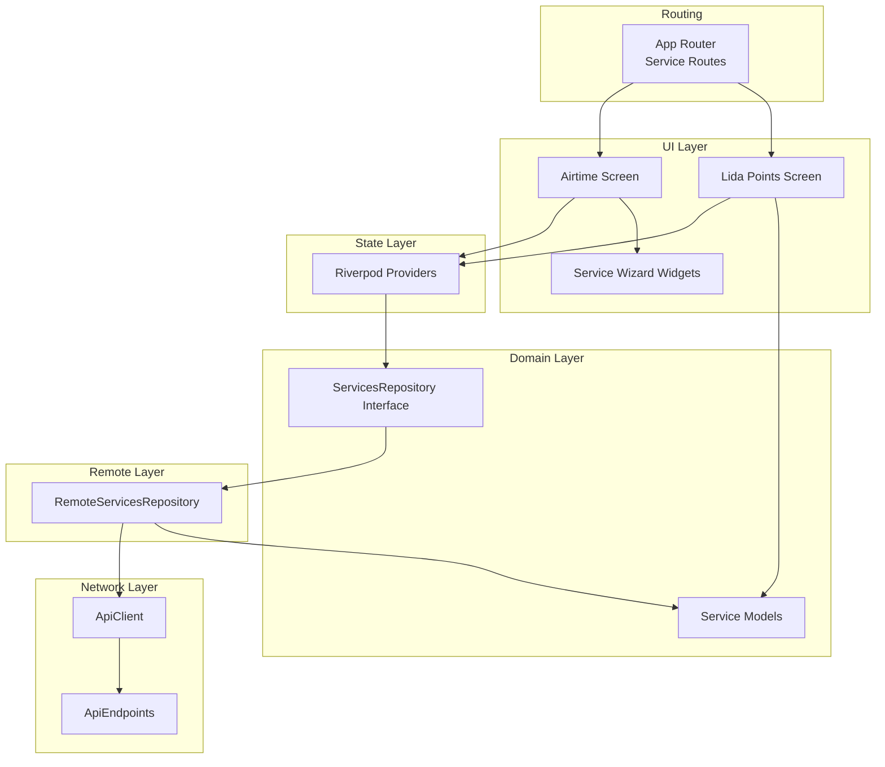

**Diagram sources**
- [app_router.dart:56-64](file://lib/core/router/app_router.dart#L56-L64)
- [app_router.dart:260-335](file://lib/core/router/app_router.dart#L260-L335)
- [providers.dart:12-30](file://lib/features/services/providers.dart#L12-L30)
- [remote_services_repository.dart:17-30](file://lib/features/services/data/remote_services_repository.dart#L17-L30)
- [api_client.dart:16-24](file://lib/core/network/api_client.dart#L16-L24)
- [api_endpoints.dart:69-100](file://lib/core/network/api_endpoints.dart#L69-L100)

**Section sources**
- [app_router.dart:56-64](file://lib/core/router/app_router.dart#L56-L64)
- [app_router.dart:260-335](file://lib/core/router/app_router.dart#L260-L335)
- [providers.dart:12-30](file://lib/features/services/providers.dart#L12-L30)

## Core Components
- ServicesRepository interface defines all service operations: Ghana networks, countries, operator detection, local/global airtime purchases, data bundles, QR pay, Lida Value wallet operations, Lida Points redemption, affiliate summary, invite overview, and GTBank bill-pay endpoints.
- RemoteServicesRepository implements these calls against the backend, adding catalogue caching, operator discovery fallbacks, FX resolution, and idempotency support.
- Service models represent operators, bundles, receipts, wallets, points history, and redeem quotes.
- Riverpod providers expose repositories and cached futures; a state notifier manages paginated points history.
- AirtimeScreen orchestrates the five-step wizard for domestic and international top-ups, including operator autodetection, amount validation, funding selection (mobile money or Lida Value), and receipt display.
- LidaPointsScreen drives the rewards hub: balance, redeem options, quote/confirm flow, and activity ledger.

**Section sources**
- [services_repository.dart:3-169](file://lib/features/services/data/services_repository.dart#L3-L169)
- [remote_services_repository.dart:17-30](file://lib/features/services/data/remote_services_repository.dart#L17-L30)
- [service_models.dart:5-143](file://lib/features/services/data/service_models.dart#L5-L143)
- [providers.dart:12-30](file://lib/features/services/providers.dart#L12-L30)
- [providers.dart:98-169](file://lib/features/services/providers.dart#L98-L169)
- [airtime_screen.dart:31-51](file://lib/features/services/screens/airtime_screen.dart#L31-L51)
- [rewards_screen.dart:17-26](file://lib/features/services/screens/rewards_screen.dart#L17-L26)

## Architecture Overview
The services module follows a layered architecture:
- UI screens drive user interactions and orchestrate steps.
- Riverpod providers supply repository instances and cache asynchronous data.
- Repository interface abstracts business operations.
- Remote repository performs network requests, handles errors, and applies offline fallbacks.
- API client centralizes HTTP behavior, token refresh, and request logging.
- Endpoint constants map routes to OpenAPI paths.

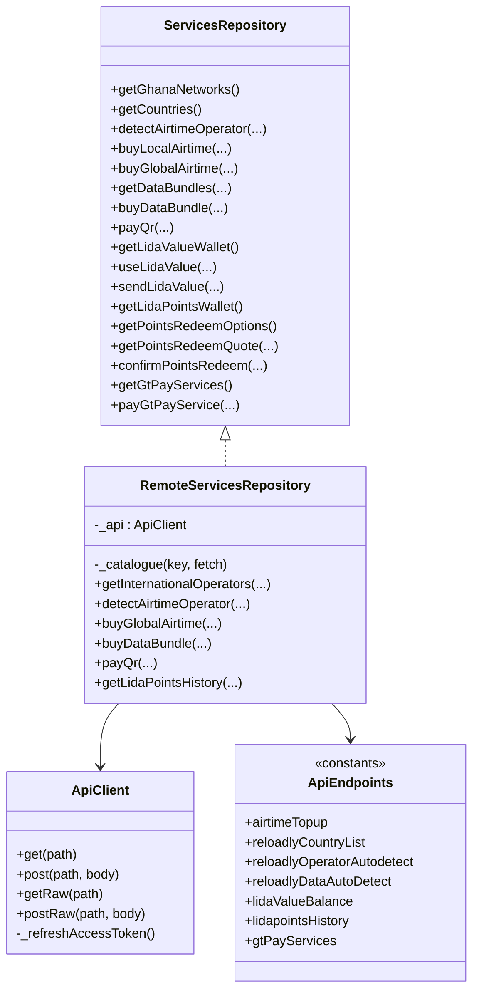

**Diagram sources**
- [services_repository.dart:3-169](file://lib/features/services/data/services_repository.dart#L3-L169)
- [remote_services_repository.dart:17-30](file://lib/features/services/data/remote_services_repository.dart#L17-L30)
- [api_client.dart:16-24](file://lib/core/network/api_client.dart#L16-L24)
- [api_endpoints.dart:69-100](file://lib/core/network/api_endpoints.dart#L69-L100)

## Detailed Component Analysis

### Service Provider Architecture
- The repository provider constructs `RemoteServicesRepository` with the active session’s user identity and the shared `ApiClient`.
- Future providers cache results for Ghana networks, countries, international operators, data bundles, Lida Value wallet, Lida Points wallet, points redeem options, GTBank services/banks, affiliate summary, and invite overview.
- Paginated points history uses a `StateNotifier` controller with loading, more-data, and error states.

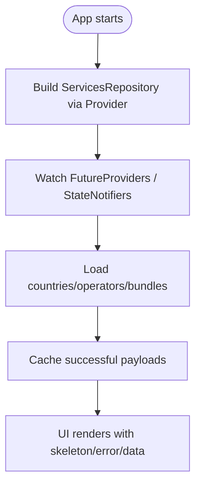

**Diagram sources**
- [providers.dart:12-30](file://lib/features/services/providers.dart#L12-L30)
- [providers.dart:32-58](file://lib/features/services/providers.dart#L32-L58)
- [providers.dart:98-169](file://lib/features/services/providers.dart#L98-L169)

**Section sources**
- [providers.dart:12-30](file://lib/features/services/providers.dart#L12-L30)
- [providers.dart:32-58](file://lib/features/services/providers.dart#L32-L58)
- [providers.dart:98-169](file://lib/features/services/providers.dart#L98-L169)

### Airtime Top-Up Flow
The airtime screen implements a five-step wizard: Country → Network → Phone → Amount → Review. It supports:
- Domestic Ghana top-ups via Prymo networks
- International top-ups via Reloadly
- Operator autodetection with suggested amounts, min/max ranges, and FX rates
- Funding via mobile money checkout or Lida Value debit
- Pending recipient decisions and receipt display

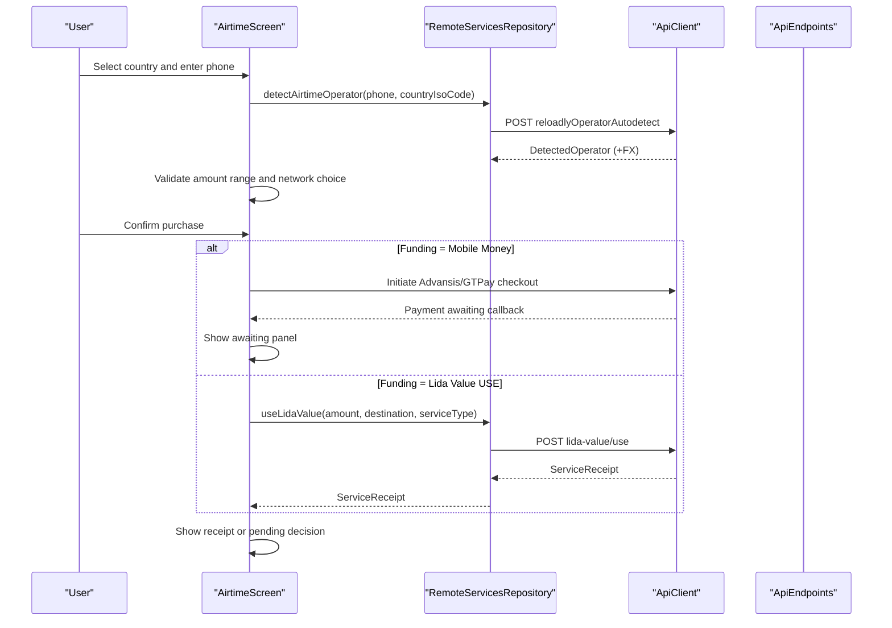

**Diagram sources**
- [airtime_screen.dart:289-305](file://lib/features/services/screens/airtime_screen.dart#L289-L305)
- [airtime_screen.dart:551-605](file://lib/features/services/screens/airtime_screen.dart#L551-L605)
- [remote_services_repository.dart:310-334](file://lib/features/services/data/remote_services_repository.dart#L310-L334)
- [api_endpoints.dart:69-76](file://lib/core/network/api_endpoints.dart#L69-L76)

Key behaviors:
- Operator autodetection debounces input and maps Reloadly operator IDs to Prymo codes for Ghana.
- Amount validation enforces operator min/max and suggested quick amounts.
- Ghana requires explicit network confirmation due to ported numbers.
- Lida Value USE skips country step and locks to Ghana.

**Section sources**
- [airtime_screen.dart:289-305](file://lib/features/services/screens/airtime_screen.dart#L289-L305)
- [airtime_screen.dart:551-605](file://lib/features/services/screens/airtime_screen.dart#L551-L605)
- [remote_services_repository.dart:310-334](file://lib/features/services/data/remote_services_repository.dart#L310-L334)
- [api_endpoints.dart:69-76](file://lib/core/network/api_endpoints.dart#L69-L76)

### Data Bundle Purchases
Data bundle purchases follow the same wizard shape but select a bundle instead of an amount:
- Catalogue retrieval for fixed-price plans attached to Reloadly data operators
- Auto-detection of data operator by MSISDN and country
- Purchase through the data buy endpoint

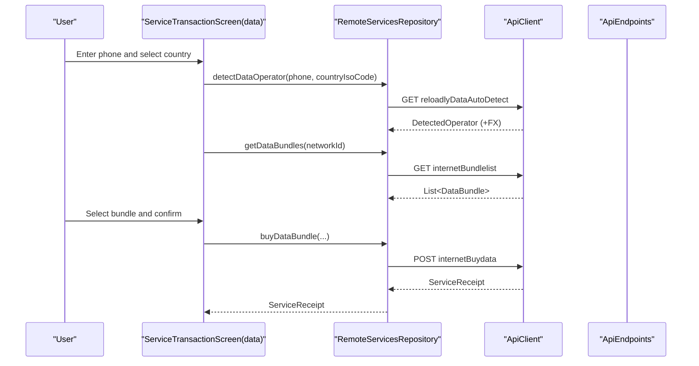

**Diagram sources**
- [remote_services_repository.dart:336-365](file://lib/features/services/data/remote_services_repository.dart#L336-L365)
- [remote_services_repository.dart:51-58](file://lib/features/services/data/services_repository.dart#L51-L58)
- [api_endpoints.dart:71-72](file://lib/core/network/api_endpoints.dart#L71-L72)

**Section sources**
- [remote_services_repository.dart:336-365](file://lib/features/services/data/remote_services_repository.dart#L336-L365)
- [services_repository.dart:51-58](file://lib/features/services/data/services_repository.dart#L51-L58)
- [api_endpoints.dart:71-72](file://lib/core/network/api_endpoints.dart#L71-L72)

### International Mobile Money Transfers
International top-ups are routed through Reloadly:
- Country list and dial-code lookup
- Operator discovery across multiple Reloadly routes with fallbacks
- FX rate resolution per operator
- Purchase via reload-airtime recharge endpoint

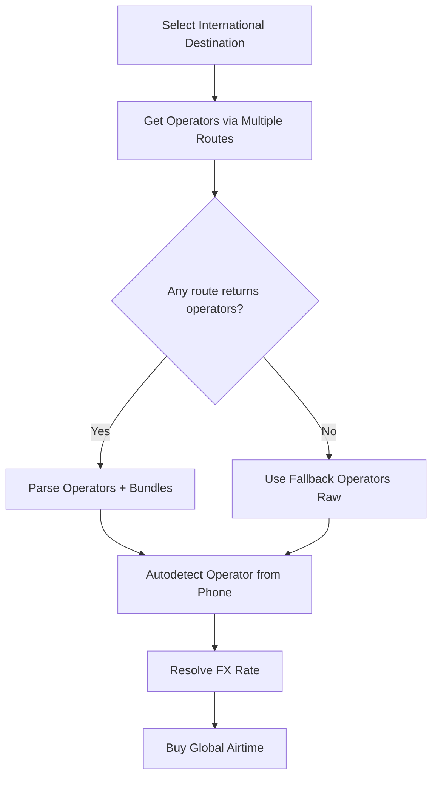

**Diagram sources**
- [remote_services_repository.dart:209-307](file://lib/features/services/data/remote_services_repository.dart#L209-L307)
- [remote_services_repository.dart:372-421](file://lib/features/services/data/remote_services_repository.dart#L372-L421)
- [remote_services_repository.dart:583-694](file://lib/features/services/data/remote_services_repository.dart#L583-L694)
- [api_endpoints.dart:74-89](file://lib/core/network/api_endpoints.dart#L74-L89)

**Section sources**
- [remote_services_repository.dart:209-307](file://lib/features/services/data/remote_services_repository.dart#L209-L307)
- [remote_services_repository.dart:372-421](file://lib/features/services/data/remote_services_repository.dart#L372-L421)
- [remote_services_repository.dart:583-694](file://lib/features/services/data/remote_services_repository.dart#L583-L694)
- [api_endpoints.dart:74-89](file://lib/core/network/api_endpoints.dart#L74-L89)

### QR Code Payments
QR pay is exposed through the services repository and routed under `/services/qr-pay`. The implementation currently marks certain services unavailable until their transaction lifecycles are integrated, returning an API exception indicating unavailability.

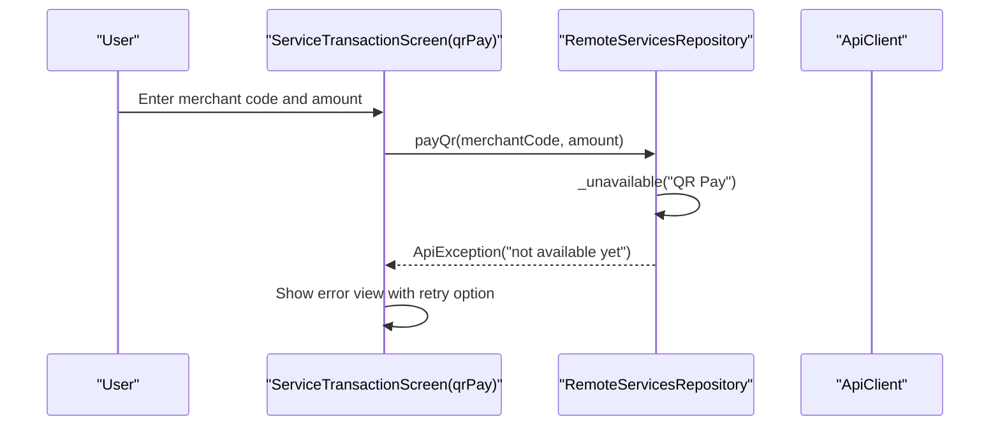

**Diagram sources**
- [remote_services_repository.dart:71-77](file://lib/features/services/data/remote_services_repository.dart#L71-L77)
- [services_repository.dart:73-76](file://lib/features/services/data/services_repository.dart#L73-L76)

**Section sources**
- [remote_services_repository.dart:71-77](file://lib/features/services/data/remote_services_repository.dart#L71-L77)
- [services_repository.dart:73-76](file://lib/features/services/data/services_repository.dart#L73-L76)

### Rewards System (Lida Points)
The rewards screen provides:
- Balance and redeemable value
- Redeem options catalog
- Quote and confirm flow with idempotency keys
- Paginated activity history with load-more support

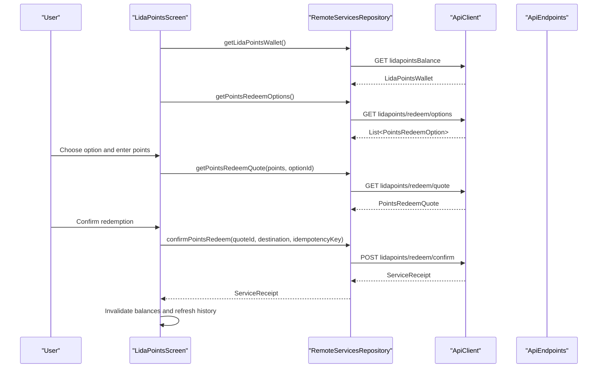

**Diagram sources**
- [rewards_screen.dart:658-770](file://lib/features/services/screens/rewards_screen.dart#L658-L770)
- [services_repository.dart:128-145](file://lib/features/services/data/services_repository.dart#L128-L145)
- [api_endpoints.dart:52-65](file://lib/core/network/api_endpoints.dart#L52-L65)

**Section sources**
- [rewards_screen.dart:658-770](file://lib/features/services/screens/rewards_screen.dart#L658-L770)
- [services_repository.dart:128-145](file://lib/features/services/data/services_repository.dart#L128-L145)
- [api_endpoints.dart:52-65](file://lib/core/network/api_endpoints.dart#L52-L65)

### Service Discovery Mechanism
- Countries are fetched from Reloadly and merged with static entries; dial codes are resolved lazily when missing.
- International operators are discovered via three candidate routes; the first non-empty result wins, otherwise fallback raw operators are generated.
- Operator autodetection returns suggested amounts, min/max, and FX metadata used by the amount step.

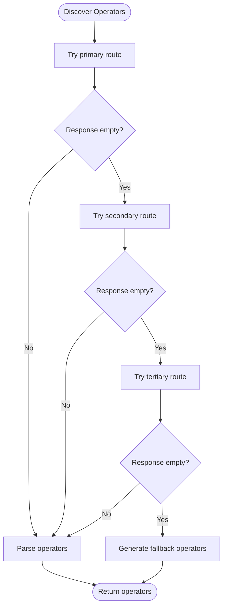

**Diagram sources**
- [remote_services_repository.dart:244-307](file://lib/features/services/data/remote_services_repository.dart#L244-L307)
- [remote_services_repository.dart:583-694](file://lib/features/services/data/remote_services_repository.dart#L583-L694)

**Section sources**
- [remote_services_repository.dart:244-307](file://lib/features/services/data/remote_services_repository.dart#L244-L307)
- [remote_services_repository.dart:583-694](file://lib/features/services/data/remote_services_repository.dart#L583-L694)

### Error Handling Strategies
- API client throws `ApiException` for Dio errors and transparently refreshes access tokens on 401, single-flushing concurrent refresh attempts.
- Repository methods wrap network calls with tolerant parsing helpers and provide fallbacks (static countries, fallback operators, static FX table).
- Unavailable services return explicit API exceptions rather than fake success.
- UI surfaces errors with retry actions and skeleton loaders during async states.

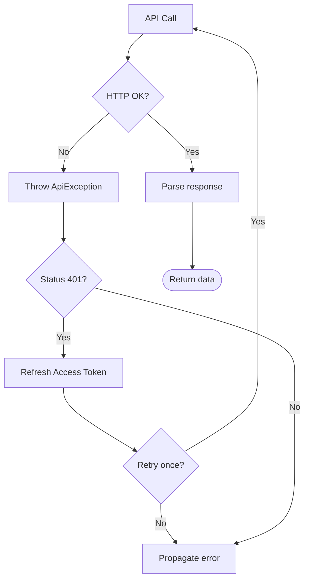

**Diagram sources**
- [api_client.dart:50-83](file://lib/core/network/api_client.dart#L50-L83)
- [api_client.dart:204-265](file://lib/core/network/api_client.dart#L204-L265)
- [remote_services_repository.dart:52-69](file://lib/features/services/data/remote_services_repository.dart#L52-L69)

**Section sources**
- [api_client.dart:50-83](file://lib/core/network/api_client.dart#L50-L83)
- [api_client.dart:204-265](file://lib/core/network/api_client.dart#L204-L265)
- [remote_services_repository.dart:52-69](file://lib/features/services/data/remote_services_repository.dart#L52-L69)

### User Feedback Patterns
- Wizard step bar shows current step, next label, and progress indicators.
- Network step displays detecting spinner and selectable operator tiles with logos.
- Receipts show reference, title, message, amount, currency, and optional pending-top-up details.
- Rewards screen shows skeleton loaders, empty states, pagination footers, and retry buttons.

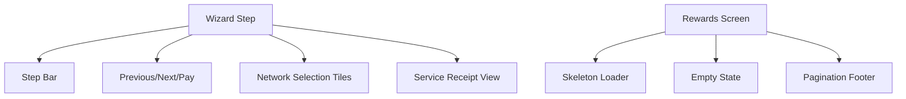

**Diagram sources**
- [service_wizard_widgets.dart:14-126](file://lib/features/services/widgets/service_wizard_widgets.dart#L14-L126)
- [service_wizard_widgets.dart:129-191](file://lib/features/services/widgets/service_wizard_widgets.dart#L129-L191)
- [service_wizard_widgets.dart:222-292](file://lib/features/services/widgets/service_wizard_widgets.dart#L222-L292)
- [rewards_screen.dart:17-135](file://lib/features/services/screens/rewards_screen.dart#L17-L135)

**Section sources**
- [service_wizard_widgets.dart:14-126](file://lib/features/services/widgets/service_wizard_widgets.dart#L14-L126)
- [service_wizard_widgets.dart:129-191](file://lib/features/services/widgets/service_wizard_widgets.dart#L129-L191)
- [service_wizard_widgets.dart:222-292](file://lib/features/services/widgets/service_wizard_widgets.dart#L222-L292)
- [rewards_screen.dart:17-135](file://lib/features/services/screens/rewards_screen.dart#L17-L135)

### Offline Handling and Availability Checks
- Catalogue payloads are persisted to shared preferences; if live calls fail, cached copies are served.
- If no cache exists, static fallbacks (countries, operators, FX rates) keep the wizard usable.
- Some services (QR pay, MoMo transfer, AdvansisPay, points redemption) are marked unavailable until integration completes.
- App lifecycle resume rechecks payment sessions to avoid stalls after browser handovers.

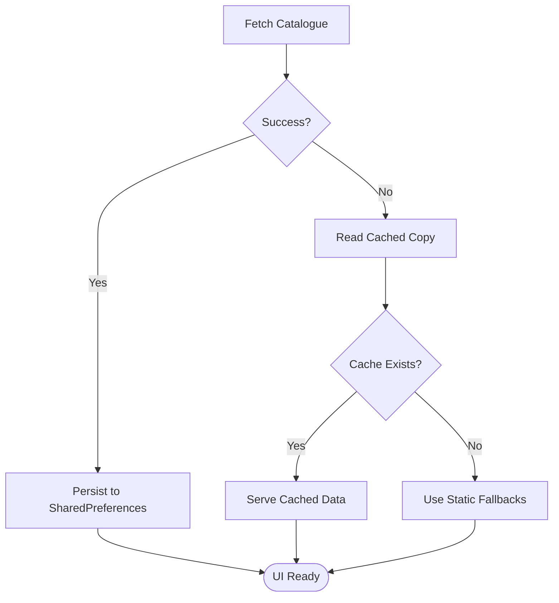

**Diagram sources**
- [remote_services_repository.dart:46-69](file://lib/features/services/data/remote_services_repository.dart#L46-L69)
- [remote_services_repository.dart:157-159](file://lib/features/services/data/remote_services_repository.dart#L157-L159)
- [remote_services_repository.dart:473-544](file://lib/features/services/data/remote_services_repository.dart#L473-L544)
- [airtime_screen.dart:417-427](file://lib/features/services/screens/airtime_screen.dart#L417-L427)

**Section sources**
- [remote_services_repository.dart:46-69](file://lib/features/services/data/remote_services_repository.dart#L46-L69)
- [remote_services_repository.dart:157-159](file://lib/features/services/data/remote_services_repository.dart#L157-L159)
- [remote_services_repository.dart:473-544](file://lib/features/services/data/remote_services_repository.dart#L473-L544)
- [airtime_screen.dart:417-427](file://lib/features/services/screens/airtime_screen.dart#L417-L427)

### Rate Limiting Considerations
- Autodetection is debounced to reduce repeated network calls while typing.
- Operator discovery tries multiple routes sequentially, avoiding unnecessary retries on authentication failures.
- API client sets connect/send timeouts short and receive timeout longer to handle slow provider round-trips without premature cancellation.

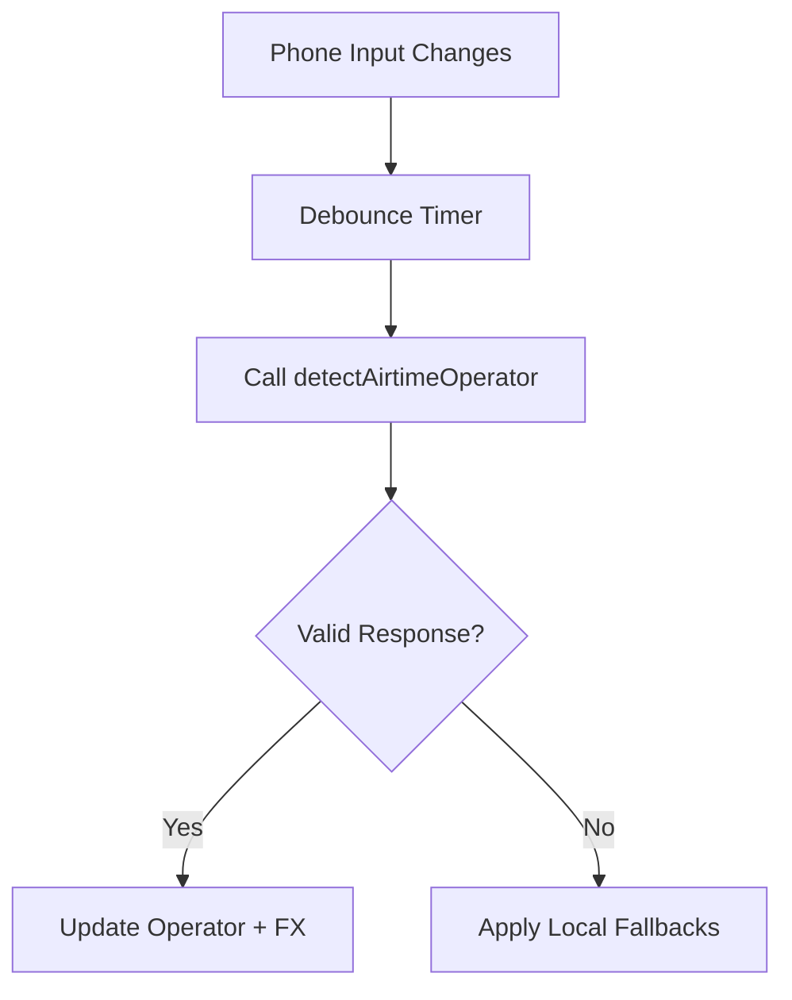

**Diagram sources**
- [airtime_screen.dart:507-532](file://lib/features/services/screens/airtime_screen.dart#L507-L532)
- [remote_services_repository.dart:273-307](file://lib/features/services/data/remote_services_repository.dart#L273-L307)
- [api_client.dart:125-135](file://lib/core/network/api_client.dart#L125-L135)

**Section sources**
- [airtime_screen.dart:507-532](file://lib/features/services/screens/airtime_screen.dart#L507-L532)
- [remote_services_repository.dart:273-307](file://lib/features/services/data/remote_services_repository.dart#L273-L307)
- [api_client.dart:125-135](file://lib/core/network/api_client.dart#L125-L135)

## Dependency Analysis
The services module depends on core networking, routing, and auth/session providers.

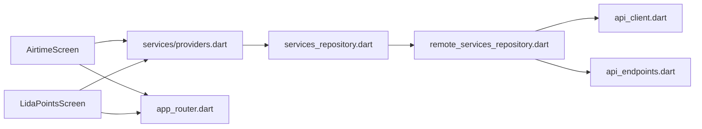

**Diagram sources**
- [airtime_screen.dart:1-30](file://lib/features/services/screens/airtime_screen.dart#L1-L30)
- [rewards_screen.dart:1-16](file://lib/features/services/screens/rewards_screen.dart#L1-L16)
- [providers.dart:1-8](file://lib/features/services/providers.dart#L1-L8)
- [remote_services_repository.dart:1-12](file://lib/features/services/data/remote_services_repository.dart#L1-L12)
- [api_client.dart:1-11](file://lib/core/network/api_client.dart#L1-L11)
- [api_endpoints.dart:1-10](file://lib/core/network/api_endpoints.dart#L1-L10)
- [app_router.dart:28-31](file://lib/core/router/app_router.dart#L28-L31)

**Section sources**
- [airtime_screen.dart:1-30](file://lib/features/services/screens/airtime_screen.dart#L1-L30)
- [rewards_screen.dart:1-16](file://lib/features/services/screens/rewards_screen.dart#L1-L16)
- [providers.dart:1-8](file://lib/features/services/providers.dart#L1-L8)
- [remote_services_repository.dart:1-12](file://lib/features/services/data/remote_services_repository.dart#L1-L12)
- [api_client.dart:1-11](file://lib/core/network/api_client.dart#L1-L11)
- [api_endpoints.dart:1-10](file://lib/core/network/api_endpoints.dart#L1-L10)
- [app_router.dart:28-31](file://lib/core/router/app_router.dart#L28-L31)

## Performance Considerations
- Use cached catalogue data to avoid repeated network calls for rarely changing lists.
- Debounce operator autodetection to minimize redundant requests.
- Prefer family-based providers for keyed data (country-specific operators, network bundles) to share instances.
- Keep timeouts conservative: fast connect/send, generous receive for third-party providers.
- Avoid blocking UI threads; rely on Riverpod async states and skeleton loaders.

[No sources needed since this section provides general guidance]

## Troubleshooting Guide
Common issues and resolutions:
- Operator detection fails: check phone format, ensure country dial code is correct, and verify network connectivity. The UI falls back to local prefix mapping for Ghana.
- No operators listed for a country: try alternative routes; if all fail, static fallbacks may still allow proceeding.
- QR pay unavailable: service is intentionally disabled until integration; retry later.
- Rewards redemption unavailable: server-side options not enabled; invite and earn remains active.
- Payment awaiting callback stalls: resume app lifecycle triggers recheck of payment session.

**Section sources**
- [airtime_screen.dart:584-605](file://lib/features/services/screens/airtime_screen.dart#L584-L605)
- [remote_services_repository.dart:294-307](file://lib/features/services/data/remote_services_repository.dart#L294-L307)
- [remote_services_repository.dart:71-77](file://lib/features/services/data/remote_services_repository.dart#L71-L77)
- [rewards_screen.dart:247-352](file://lib/features/services/screens/rewards_screen.dart#L247-L352)
- [airtime_screen.dart:417-427](file://lib/features/services/screens/airtime_screen.dart#L417-L427)

## Conclusion
The services and utilities module provides a robust, resilient foundation for airtime and data purchases, international top-ups, QR pay placeholders, and a growing rewards system. Its layered architecture, tolerant parsing, offline fallbacks, and clear state management enable smooth user experiences even under unreliable network conditions. Future work should complete integrations for QR pay and mobile money transfers, expand reward redemption options, and continue refining operator discovery and FX accuracy.