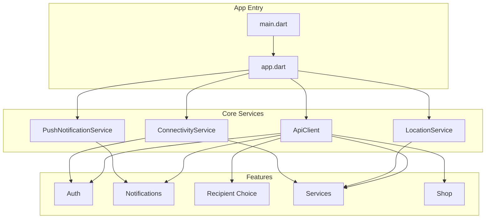
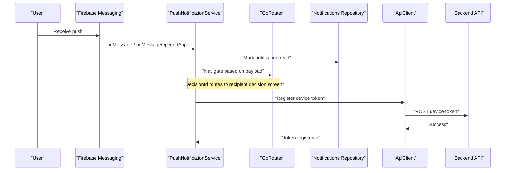
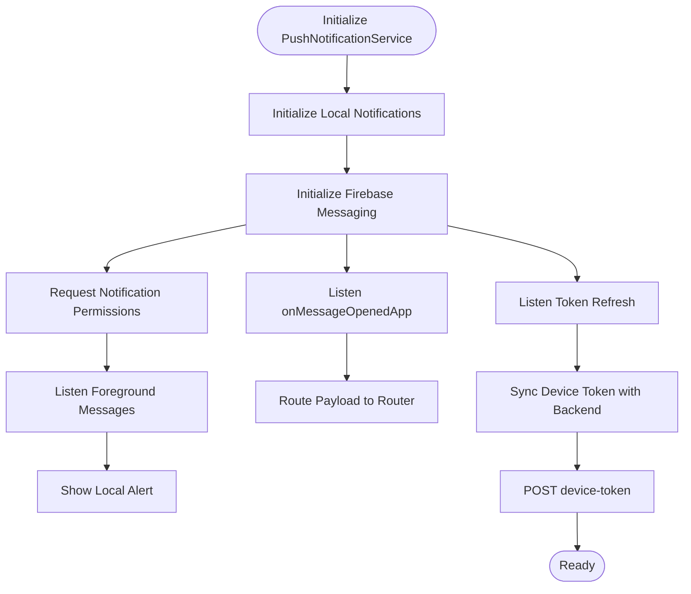
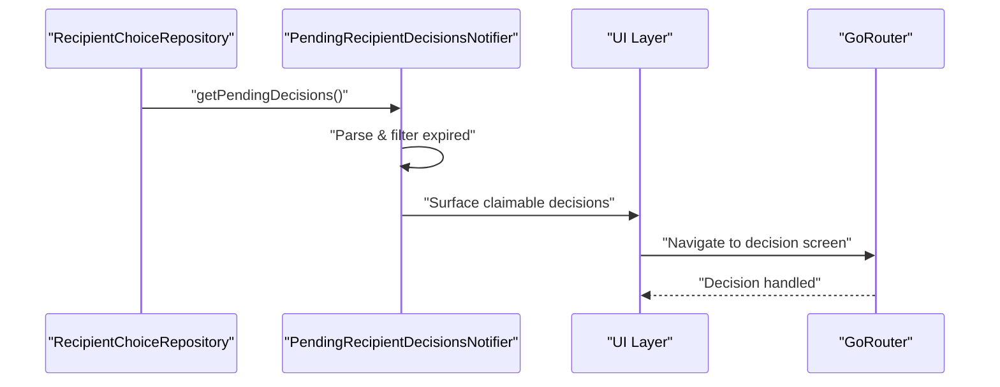
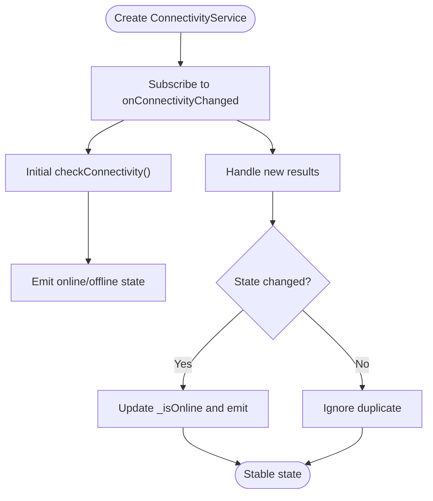
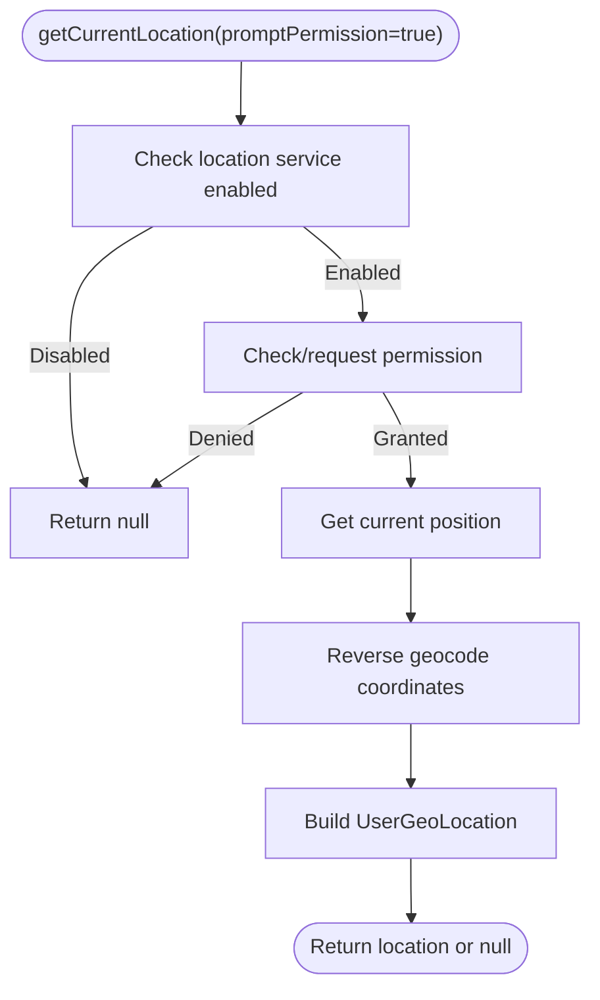
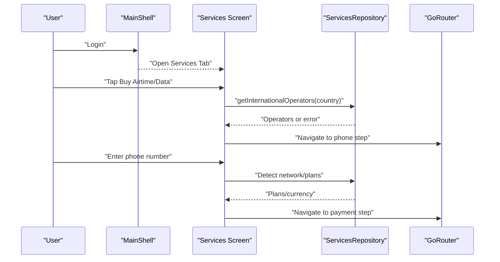
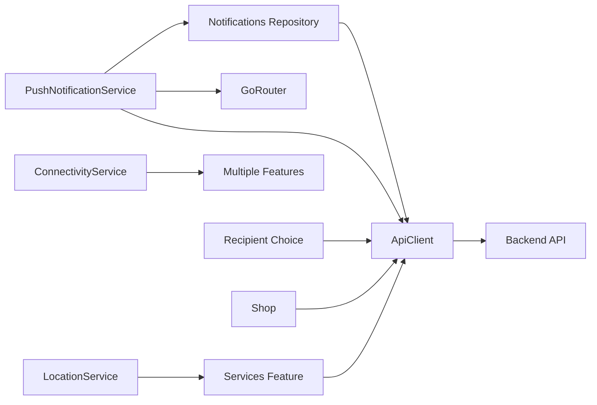

# Integration Testing

<cite>
**Referenced Files in This Document**
- [README.md](file://README.md)
- [pubspec.yaml](file://pubspec.yaml)
- [main.dart](file://lib/main.dart)
- [app.dart](file://lib/app.dart)
- [push_notification_service.dart](file://lib/core/notifications/push_notification_service.dart)
- [connectivity_service.dart](file://lib/core/network/connectivity_service.dart)
- [location_service.dart](file://lib/core/location/location_service.dart)
- [api_client.dart](file://lib/core/network/api_client.dart)
- [fcm_and_pending_decisions_test.dart](file://test/fcm_and_pending_decisions_test.dart)
- [connectivity_service_test.dart](file://test/connectivity_service_test.dart)
- [location_service_test.dart](file://test/location_service_test.dart)
- [service_country_flow_test.dart](file://test/service_country_flow_test.dart)
</cite>

## Table of Contents
1. [Introduction](#introduction)
2. [Project Structure](#project-structure)
3. [Core Components](#core-components)
4. [Architecture Overview](#architecture-overview)
5. [Detailed Component Analysis](#detailed-component-analysis)
6. [Dependency Analysis](#dependency-analysis)
7. [Performance Considerations](#performance-considerations)
8. [Troubleshooting Guide](#troubleshooting-guide)
9. [Conclusion](#conclusion)

## Introduction
This document explains how to perform integration testing for the LidaPay application with a focus on component interaction testing. It covers multi-feature workflows, external service integrations, and platform capabilities such as Firebase Cloud Messaging (FCM), connectivity monitoring, location services, and cross-feature flows like pending recipient decisions and service country selection. The guidance includes strategies for testing with real dependencies where appropriate, mocking third-party SDKs and repositories, and setting up an integration test environment that exercises end-to-end user journeys without relying solely on unit-level isolation.

The repository README documents standard Flutter build and test commands, which are the baseline for running tests locally before integrating more complex scenarios.

**Section sources**
- [README.md:1-47](file://README.md#L1-L47)

## Project Structure
At a high level, the app is a Flutter application under `lib/`, with feature modules under `lib/features/` and shared core logic under `lib/core/`. Tests live under `test/`, including both unit-style and widget/integration-style tests. Key integration points include:
- Core services: FCM push notifications, connectivity monitoring, location resolution, API client, and token storage.
- Feature modules: authentication, notifications, recipient choice, services (airtime/data), shop, payments, and shell navigation.
- Test utilities: mock repositories, stub HTTP adapters, and widget test helpers.

**Diagram sources**
- [main.dart:1-200](file://lib/main.dart#L1-L200)
- [app.dart:1-50](file://lib/app.dart#L1-L50)
- [push_notification_service.dart:28-164](file://lib/core/notifications/push_notification_service.dart#L28-L164)
- [connectivity_service.dart:5-45](file://lib/core/network/connectivity_service.dart#L5-L45)
- [location_service.dart:37-109](file://lib/core/location/location_service.dart#L37-L109)
- [api_client.dart:200-240](file://lib/core/network/api_client.dart#L200-L240)

**Section sources**
- [main.dart:1-200](file://lib/main.dart#L1-L200)
- [app.dart:1-50](file://lib/app.dart#L1-L50)

## Core Components
This section outlines the core components relevant to integration testing and how they interact across features.

- Push notification service: Initializes local notifications and Firebase Messaging, handles foreground/background messages, routes payloads to navigation, and syncs device tokens with the backend.
- Connectivity service: Wraps platform connectivity, exposes online/offline state via streams, and emits changes only when the state transitions.
- Location service: Requests current location, performs reverse geocoding, and returns structured location data or null on failure.
- API client: Handles authenticated requests, refreshes tokens, and attaches device metadata such as FCM token and device identity.

These components are exercised by integration tests that simulate real user flows and external interactions through controlled mocks and stubs.

**Section sources**
- [push_notification_service.dart:28-198](file://lib/core/notifications/push_notification_service.dart#L28-L198)
- [connectivity_service.dart:16-45](file://lib/core/network/connectivity_service.dart#L16-L45)
- [location_service.dart:41-109](file://lib/core/location/location_service.dart#L41-L109)
- [api_client.dart:210-240](file://lib/core/network/api_client.dart#L210-L240)

## Architecture Overview
The following diagram maps the key integration paths between core services and features during typical workflows such as receiving an FCM notification, handling pending decisions, and selecting a service country.

**Diagram sources**
- [push_notification_service.dart:133-198](file://lib/core/notifications/push_notification_service.dart#L133-L198)
- [api_client.dart:218-240](file://lib/core/network/api_client.dart#L218-L240)

## Detailed Component Analysis

### Firebase Cloud Messaging Integration Testing
Integration testing for FCM should cover:
- Token lifecycle: request permissions, retrieve token, handle token refresh, register/unregister token with backend.
- Message handling: foreground display, background handler initialization, cold-start message routing.
- Payload routing: decision IDs, order IDs, and generic notification types route to correct screens.
- Pending payload handling: if no session exists at cold start, store payload and flush once session is available.

Recommended approach:
- Use the push notification service’s public methods and providers to initialize and observe behavior.
- Mock the router and repositories where needed to assert navigation and backend calls.
- Validate that device metadata (platform, deviceId, appVersion, locale) is included when registering tokens.

**Diagram sources**
- [push_notification_service.dart:55-164](file://lib/core/notifications/push_notification_service.dart#L55-L164)
- [push_notification_service.dart:169-198](file://lib/core/notifications/push_notification_service.dart#L169-L198)

Testing strategies:
- Assert that `_handleFcmMessage` routes to the recipient decision screen when a `decisionId` is present.
- Assert that pending payloads are flushed after session becomes available.
- Verify token registration includes device identity fields and FCM token.

**Section sources**
- [push_notification_service.dart:133-198](file://lib/core/notifications/push_notification_service.dart#L133-L198)
- [push_notification_service.dart:273-337](file://lib/core/notifications/push_notification_service.dart#L273-L337)

### Pending Decision Flows Integration Testing
Pending recipient decisions are surfaced from the backend and claimed by UI components so users can act on them. Integration tests should verify:
- Parsing active decisions and skipping expired ones.
- Claiming each pending decision exactly once.
- Routing to the recipient decision screen when a decision notification arrives.

Recommended approach:
- Use a fake repository to return controlled decision payloads.
- Assert the notifier claims decisions and clears them after being surfaced.
- Combine with FCM payload routing to ensure clicking a decision notification navigates correctly.

**Diagram sources**
- [fcm_and_pending_decisions_test.dart:202-266](file://test/fcm_and_pending_decisions_test.dart#L202-L266)

**Section sources**
- [fcm_and_pending_decisions_test.dart:202-266](file://test/fcm_and_pending_decisions_test.dart#L202-L266)

### Connectivity State Management Integration Testing
Connectivity integration tests should validate:
- Initial online state defaults and updates from initial check.
- Transition to offline when connectivity drops to none.
- Reconnection events and deduplication of redundant state emissions.

Recommended approach:
- Inject a fake `Connectivity` implementation that emits controlled results.
- Subscribe to `onConnectivityChanged` and assert event sequences.
- Ensure disposal cleans up subscriptions and controllers.

**Diagram sources**
- [connectivity_service.dart:16-45](file://lib/core/network/connectivity_service.dart#L16-L45)

**Section sources**
- [connectivity_service_test.dart:26-75](file://test/connectivity_service_test.dart#L26-L75)
- [connectivity_service.dart:16-45](file://lib/core/network/connectivity_service.dart#L16-L45)

### Location Services Integration Testing
Location integration tests should verify:
- Fallback location values for Ghana Accra.
- Construction of custom location objects with city, region, and address line.
- Behavior when location services are disabled or permissions are denied (returns null).

Recommended approach:
- Use the location service’s fallback constant and constructor assertions.
- For full integration, mock `Geolocator` and `Geocoding` to control permission and placemark responses.
- Assert that reverse geocoding errors are non-fatal and do not crash the flow.

**Diagram sources**
- [location_service.dart:41-109](file://lib/core/location/location_service.dart#L41-L109)

**Section sources**
- [location_service_test.dart:4-30](file://test/location_service_test.dart#L4-L30)
- [location_service.dart:41-109](file://lib/core/location/location_service.dart#L41-L109)

### Service Country Selection and Cross-Feature Workflows
Service country selection integrates multiple features:
- Authentication to access services.
- Country/operator discovery via external provider catalogs.
- Phone number entry and network detection.
- Data bundle plan selection and charge confirmation.
- Payment method selection and checkout.

Recommended approach:
- Use widget tests to drive login, open services tab, pick country, enter phone number, and confirm charges.
- Mock the services repository to simulate operator catalog failures and plan grids.
- Assert that failures in operator catalogs do not block the phone step and that detected currency is shown correctly.

**Diagram sources**
- [service_country_flow_test.dart:126-309](file://test/service_country_flow_test.dart#L126-L309)

**Section sources**
- [service_country_flow_test.dart:126-309](file://test/service_country_flow_test.dart#L126-L309)

## Dependency Analysis
The following diagram highlights coupling between core services and feature modules, emphasizing integration points tested in this document.

**Diagram sources**
- [push_notification_service.dart:28-198](file://lib/core/notifications/push_notification_service.dart#L28-L198)
- [connectivity_service.dart:5-45](file://lib/core/network/connectivity_service.dart#L5-L45)
- [location_service.dart:37-109](file://lib/core/location/location_service.dart#L37-L109)
- [api_client.dart:210-240](file://lib/core/network/api_client.dart#L210-L240)

**Section sources**
- [push_notification_service.dart:28-198](file://lib/core/notifications/push_notification_service.dart#L28-L198)
- [connectivity_service.dart:5-45](file://lib/core/network/connectivity_service.dart#L5-L45)
- [location_service.dart:37-109](file://lib/core/location/location_service.dart#L37-L109)
- [api_client.dart:210-240](file://lib/core/network/api_client.dart#L210-L240)

## Performance Considerations
- Minimize unnecessary reinitialization of Firebase Messaging and local notifications; guard against repeated initialization.
- Debounce or coalesce connectivity state emissions to avoid excessive UI rebuilds.
- Avoid heavy reverse geocoding in tight loops; cache results where appropriate.
- Ensure token refresh and device token registration are idempotent and resilient to transient network errors.

[No sources needed since this section provides general guidance]

## Troubleshooting Guide
Common issues and resolutions:
- FCM token not registered:
  - Verify Firebase initialization and permission requests succeed.
  - Confirm device identity fields are populated before syncing token.
  - Check backend registration endpoint and response parsing.
- Pending decisions not surfacing:
  - Validate expiration filtering logic.
  - Ensure notifier claims decisions exactly once.
  - Confirm payload routing uses correct decision ID keys.
- Connectivity state not updating:
  - Ensure fake connectivity emits distinct result lists.
  - Verify subscription disposal does not prematurely cancel listeners.
- Location lookup fails:
  - Check platform permissions and GPS enablement.
  - Inspect reverse geocoding errors; treat them as non-fatal.

**Section sources**
- [push_notification_service.dart:108-164](file://lib/core/notifications/push_notification_service.dart#L108-L164)
- [push_notification_service.dart:169-198](file://lib/core/notifications/push_notification_service.dart#L169-L198)
- [connectivity_service_test.dart:43-75](file://test/connectivity_service_test.dart#L43-L75)
- [location_service.dart:41-109](file://lib/core/location/location_service.dart#L41-L109)

## Conclusion
Integration testing for LidaPay should combine real dependency usage where practical with targeted mocking of external SDKs and repositories. Focus on end-to-end flows such as FCM notification handling, pending decision recovery, connectivity state management, and service country selection. Use widget tests to exercise cross-feature workflows and unit-style tests to validate core service behaviors. This approach ensures robust coverage of critical user journeys while maintaining test reliability and speed.

[No sources needed since this section summarizes without analyzing specific files]