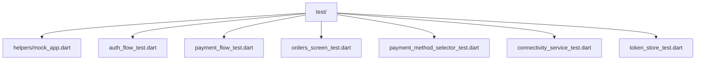
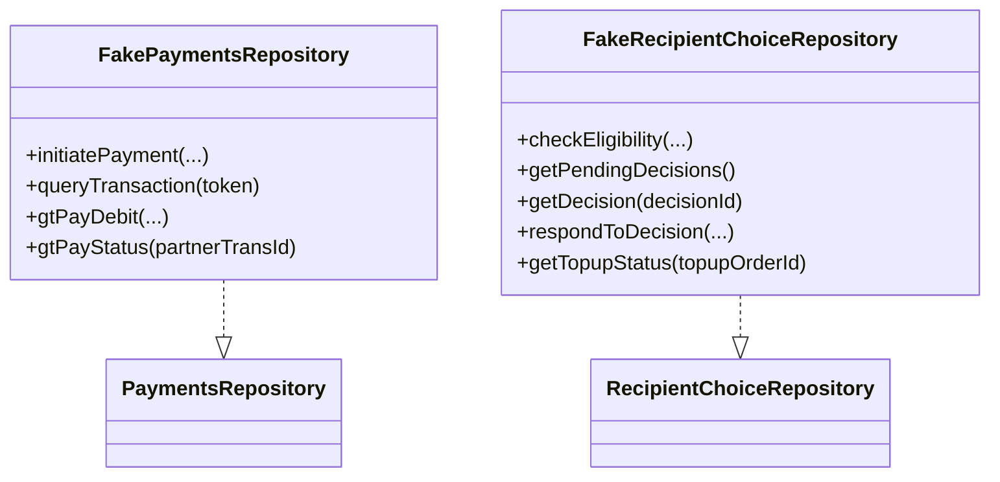
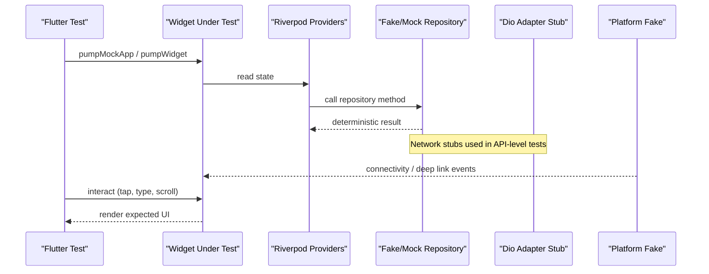
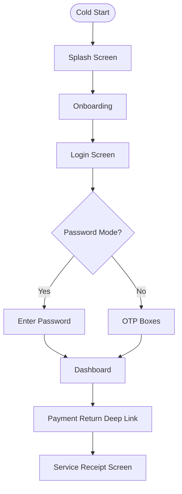
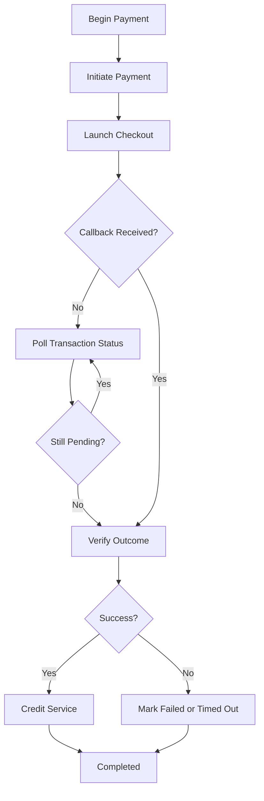
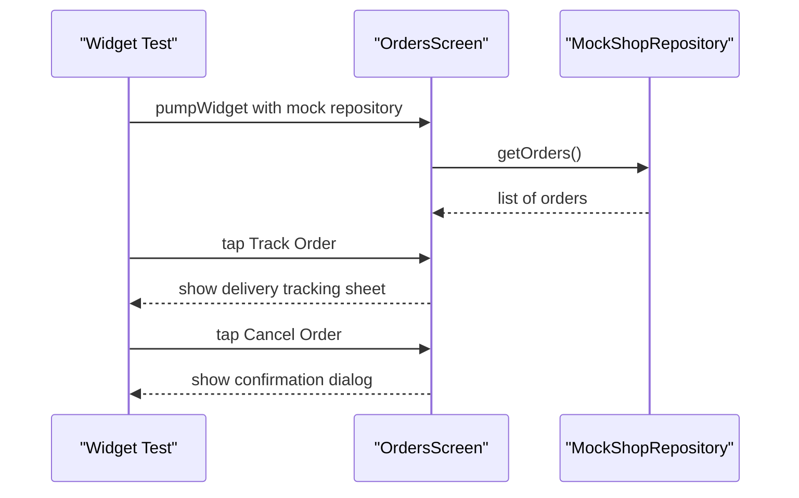
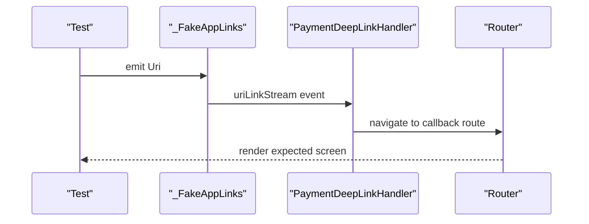
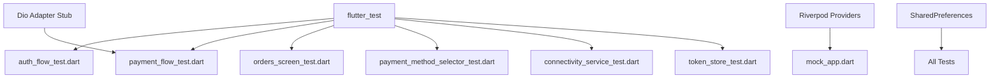

# Testing Strategy

<cite>
**Referenced Files in This Document**   
- [pubspec.yaml](file://pubspec.yaml)
- [mock_app.dart](file://test/helpers/mock_app.dart)
- [auth_flow_test.dart](file://test/auth_flow_test.dart)
- [payment_flow_test.dart](file://test/payment_flow_test.dart)
- [orders_screen_test.dart](file://test/orders_screen_test.dart)
- [payment_method_selector_test.dart](file://test/payment_method_selector_test.dart)
- [connectivity_service_test.dart](file://test/connectivity_service_test.dart)
- [token_store_test.dart](file://test/token_store_test.dart)
</cite>

## Table of Contents
1. [Introduction](#introduction)
2. [Project Structure](#project-structure)
3. [Core Components](#core-components)
4. [Architecture Overview](#architecture-overview)
5. [Detailed Component Analysis](#detailed-component-analysis)
6. [Dependency Analysis](#dependency-analysis)
7. [Performance Considerations](#performance-considerations)
8. [Troubleshooting Guide](#troubleshooting-guide)
9. [Conclusion](#conclusion)
10. [Appendices](#appendices)

## Introduction
This document explains the testing strategy for the LidaPay Flutter application. It covers unit testing, widget testing, integration-style flows, and end-to-end scenarios that are already present in the repository. It also documents the test helpers, mock repositories, fake services, and patterns used to isolate authentication, payment processing, routing, deep links, connectivity, and token storage.

The project uses `flutter_test` as its primary testing framework. There is no explicit usage of Mockito or Mocktail in the analyzed test files; instead, tests rely on:
- Dart classes implementing repository interfaces as fakes.
- Small custom stubs for HTTP adapters and platform channels.
- Provider overrides through Riverpod’s `ProviderScope`.
- `SharedPreferences.setMockInitialValues` for deterministic local state.

## Project Structure
The testing code lives under `test/`. The most important testing entry points are:
- `test/helpers/mock_app.dart`: a shared helper that pumps the full app with mock repositories.
- Feature-specific tests such as `auth_flow_test.dart`, `payment_flow_test.dart`, `orders_screen_test.dart`, and `payment_method_selector_test.dart`.
- Service and domain tests such as `connectivity_service_test.dart` and `token_store_test.dart`.

**Diagram sources**
- [mock_app.dart:1-161](file://test/helpers/mock_app.dart#L1-L161)
- [auth_flow_test.dart:1-408](file://test/auth_flow_test.dart#L1-L408)
- [payment_flow_test.dart:1-786](file://test/payment_flow_test.dart#L1-L786)
- [orders_screen_test.dart:1-106](file://test/orders_screen_test.dart#L1-L106)
- [payment_method_selector_test.dart:1-39](file://test/payment_method_selector_test.dart#L1-L39)
- [connectivity_service_test.dart:1-76](file://test/connectivity_service_test.dart#L1-L76)
- [token_store_test.dart:1-171](file://test/token_store_test.dart#L1-L171)

**Section sources**
- [pubspec.yaml:76-82](file://pubspec.yaml#L76-L82)

## Core Components
The testing strategy centers around four core components:

1. **Shared App Pump Helper**  
   `pumpMockApp` wires the full application into a `ProviderScope` and replaces all feature repositories with mock implementations. This allows widget tests to exercise real screens without touching production APIs.

2. **Fake Repositories**  
   - `FakePaymentsRepository`: returns fixed checkout URLs, tokens, and successful query results so payment sessions can run deterministically.
   - `FakeRecipientChoiceRepository`: returns predictable recipient decisions and topup statuses.

3. **HTTP Stubbing**  
   `payment_flow_test.dart` defines `_StubAdapter`, which captures Dio requests and returns JSON responses. This isolates parsing and request-shape logic from the live backend.

4. **Platform and Storage Fakes**  
   Tests use `SharedPreferences.setMockInitialValues` and implement small fakes for platform abstractions such as `Connectivity` and `SecretStore`.

**Diagram sources**
- [mock_app.dart:29-120](file://test/helpers/mock_app.dart#L29-L120)

**Section sources**
- [mock_app.dart:26-161](file://test/helpers/mock_app.dart#L26-L161)
- [payment_flow_test.dart:20-60](file://test/payment_flow_test.dart#L20-L60)
- [connectivity_service_test.dart:6-24](file://test/connectivity_service_test.dart#L6-L24)
- [token_store_test.dart:5-15](file://test/token_store_test.dart#L5-L15)

## Architecture Overview
The testing architecture follows a layered approach:

- **Widget layer**: Uses `flutter_test` to pump widgets, tap buttons, enter text, scroll, and assert UI state.
- **State layer**: Uses Riverpod providers with overrides to inject mocks.
- **Domain/session layer**: Exercises `PaymentSessionNotifier`, pending payment persistence, and service calls.
- **Network layer**: Uses Dio adapter stubs to validate request bodies, headers, and response parsing.
- **Platform layer**: Fakes connectivity streams, secure storage, and deep link behavior.

**Diagram sources**
- [mock_app.dart:122-161](file://test/helpers/mock_app.dart#L122-L161)
- [payment_flow_test.dart:46-60](file://test/payment_flow_test.dart#L46-L60)
- [auth_flow_test.dart:22-37](file://test/auth_flow_test.dart#L22-L37)
- [connectivity_service_test.dart:6-24](file://test/connectivity_service_test.dart#L6-L24)

## Detailed Component Analysis

### Authentication Flow Testing
Authentication testing covers cold start, onboarding, login via password and OTP, registration, deep-link-based password reset confirmation, and payment return routing.

Key behaviors validated:
- Splash screen renders branding and transitions to onboarding.
- Onboarding skips to login.
- Login accepts phone/email input and switches between OTP boxes and password mode.
- API validation errors are rendered inline.
- Personal and merchant registration wizards complete successfully.
- Deep link `lidapay://auth/password-reset-complete` routes back to login with a confirmation message.
- Payment redirect deep link routes directly to the payment receipt screen without restarting at splash.

**Diagram sources**
- [auth_flow_test.dart:40-101](file://test/auth_flow_test.dart#L40-L101)
- [auth_flow_test.dart:313-405](file://test/auth_flow_test.dart#L313-L405)

**Section sources**
- [auth_flow_test.dart:40-147](file://test/auth_flow_test.dart#L40-L147)
- [auth_flow_test.dart:163-311](file://test/auth_flow_test.dart#L163-L311)
- [auth_flow_test.dart:313-405](file://test/auth_flow_test.dart#L313-L405)

### Payment Process Testing
Payment testing validates both network-layer parsing and session-layer orchestration.

#### Network Layer
- Parses wrapped API payloads with kebab-case fields.
- Sends `shopOrderNumber` and `payTransRef`, but never sends `returnUrl`.
- Sends `redirectUrl` when provided by shop flows.
- Throws on malformed checkout payloads.
- Normalizes Ghana mobile money numbers and validates them before calling GTPay.
- Parses GTPay responses using the inner `Status` field rather than the envelope status.

#### Session Layer
- Begins a payment, persists it, launches checkout, and verifies return callbacks.
- Credits Ghana airtime through the local airtime service after success.
- Ignores mismatched order IDs.
- Retries pending queries until completion.
- Clears pending state on terminal failure.
- Prevents double credit when return and recheck race.
- Credits global airtime through the Reloadly route.
- Cancels unverified initiations.
- Handles declined mobile money by keeping the transaction recoverable and issuing a fresh partner transaction ID on retry.
- Stops polling after an approval window expires and marks the payment timed out.
- Reconciles shop orders when the callback contains the shop order number.

**Diagram sources**
- [payment_flow_test.dart:263-364](file://test/payment_flow_test.dart#L263-L364)
- [payment_flow_test.dart:451-585](file://test/payment_flow_test.dart#L451-L585)
- [payment_flow_test.dart:587-784](file://test/payment_flow_test.dart#L587-L784)

**Section sources**
- [payment_flow_test.dart:20-60](file://test/payment_flow_test.dart#L20-L60)
- [payment_flow_test.dart:64-138](file://test/payment_flow_test.dart#L64-L138)
- [payment_flow_test.dart:229-247](file://test/payment_flow_test.dart#L229-L247)
- [payment_flow_test.dart:263-364](file://test/payment_flow_test.dart#L263-L364)
- [payment_flow_test.dart:451-585](file://test/payment_flow_test.dart#L451-L585)
- [payment_flow_test.dart:587-784](file://test/payment_flow_test.dart#L587-L784)

### Widget Testing Patterns
Widget tests focus on user interactions and UI state:

- **Orders Screen**: verifies order listing, tracking sheet opening, cancellation flow, empty state, and automatic opening of an initial order.
- **Payment Method Selector**: verifies that the payment method sheet opens and wraps correctly on narrow screens.

**Diagram sources**
- [orders_screen_test.dart:11-24](file://test/orders_screen_test.dart#L11-L24)
- [orders_screen_test.dart:26-99](file://test/orders_screen_test.dart#L26-L99)

**Section sources**
- [orders_screen_test.dart:11-106](file://test/orders_screen_test.dart#L11-L106)
- [payment_method_selector_test.dart:5-39](file://test/payment_method_selector_test.dart#L5-L39)

### Integration-Style Testing
Integration-style tests bridge multiple layers without hitting the real backend:

- **Deep Links**: A fake `AppLinks` implementation emits URIs so the app can process password reset completion and payment return deep links.
- **Connectivity**: A fake `Connectivity` implementation drives stream events and asserts online/offline transitions.
- **Token Store**: Tests verify saving, migrating legacy tokens, clearing, biometric session persistence, refresh synchronization, and graceful degradation when the secret store fails.

**Diagram sources**
- [auth_flow_test.dart:22-37](file://test/auth_flow_test.dart#L22-L37)
- [auth_flow_test.dart:313-350](file://test/auth_flow_test.dart#L313-L350)

**Section sources**
- [auth_flow_test.dart:22-37](file://test/auth_flow_test.dart#L22-L37)
- [auth_flow_test.dart:313-405](file://test/auth_flow_test.dart#L313-L405)
- [connectivity_service_test.dart:6-76](file://test/connectivity_service_test.dart#L6-L76)
- [token_store_test.dart:5-171](file://test/token_store_test.dart#L5-L171)

### Test Helpers, Mock Implementations, and Utilities
- **`pumpMockApp`**: Pumps the full app with mock repositories for auth, dashboard, history, notifications, services, shop, payments, and recipient choice. It also overrides the checkout launcher to avoid launching a browser.
- **Fake Repositories**: Provide deterministic outcomes for payment initiation, transaction queries, GTPay debit/status, and recipient decisions.
- **HTTP Adapter Stub**: Captures Dio requests and returns controlled JSON responses for API parsing tests.
- **Platform Fakes**: Custom fakes for `AppLinks`, `Connectivity`, and `SecretStore`.
- **SharedPreferences Mocking**: Used across tests to initialize deterministic local state.

**Section sources**
- [mock_app.dart:26-161](file://test/helpers/mock_app.dart#L26-L161)
- [payment_flow_test.dart:20-60](file://test/payment_flow_test.dart#L20-L60)
- [auth_flow_test.dart:22-37](file://test/auth_flow_test.dart#L22-L37)
- [connectivity_service_test.dart:6-24](file://test/connectivity_service_test.dart#L6-L24)
- [token_store_test.dart:5-15](file://test/token_store_test.dart#L5-L15)

## Dependency Analysis
The tests depend on:
- `flutter_test` for widget and unit testing.
- Riverpod providers for dependency injection during widget tests.
- `shared_preferences` for deterministic local storage.
- Dio adapter stubs for isolated network tests.
- Feature-specific mock repositories located under `lib/features/*/data/mock_*.dart`.

**Diagram sources**
- [pubspec.yaml:76-82](file://pubspec.yaml#L76-L82)
- [mock_app.dart:1-24](file://test/helpers/mock_app.dart#L1-L24)
- [payment_flow_test.dart:1-18](file://test/payment_flow_test.dart#L1-L18)

**Section sources**
- [pubspec.yaml:76-82](file://pubspec.yaml#L76-L82)
- [mock_app.dart:1-24](file://test/helpers/mock_app.dart#L1-L24)

## Performance Considerations
The current test suite focuses on correctness rather than performance measurement. Recommended considerations include:

- Keep widget tests fast by avoiding real network calls and heavy animations.
- Use `pumpAndSettle` only when necessary; prefer targeted `pump` calls for faster feedback.
- Avoid long delays in tests; simulate latency through deterministic queues or zero-delay configuration where possible.
- For load testing, consider external tools against the backend API rather than Flutter widget tests.
- For mobile-specific performance, measure frame rendering and memory usage using Flutter DevTools and platform-native profiling tools.

[No sources needed since this section provides general guidance]

## Troubleshooting Guide
Common issues and how the existing tests address them:

- **Unstable UI timing**: Tests use `pumpAndSettle` and explicit durations to stabilize animations and async work.
- **Deep link routing failures**: Tests simulate deep link URIs and assert navigation to the correct screens.
- **Connectivity flakiness**: Tests drive connectivity streams explicitly and assert state changes.
- **Token storage corruption**: Tests cover failed secret store operations and ensure the app degrades gracefully.
- **Payment session races**: Tests verify that concurrent return and recheck do not cause duplicate credits.

**Section sources**
- [auth_flow_test.dart:40-101](file://test/auth_flow_test.dart#L40-L101)
- [auth_flow_test.dart:313-405](file://test/auth_flow_test.dart#L313-L405)
- [connectivity_service_test.dart:43-76](file://test/connectivity_service_test.dart#L43-L76)
- [token_store_test.dart:157-169](file://test/token_store_test.dart#L157-L169)
- [payment_flow_test.dart:537-551](file://test/payment_flow_test.dart#L537-L551)

## Conclusion
LidaPay’s testing strategy emphasizes deterministic isolation through fake repositories, provider overrides, and platform fakes. Authentication, payment, routing, connectivity, and token storage are covered by focused tests. While Mockito and Mocktail are not used in the analyzed tests, the repository demonstrates robust alternatives using Dart fakes and stubs. Future enhancements should include coverage reporting, CI integration, and additional mobile-specific tests for biometrics, location, and maps.

[No sources needed since this section summarizes without analyzing specific files]

## Appendices

### Testing Best Practices Observed in the Repository
- Initialize `SharedPreferences` with mock values before running tests.
- Replace repositories with fakes or mocks via Riverpod overrides.
- Use small, focused fakes for platform abstractions.
- Assert both UI state and side effects such as service calls and persisted state.
- Handle asynchronous behavior explicitly with `pump`, `pumpAndSettle`, and `pumpEventQueue`.

**Section sources**
- [mock_app.dart:122-161](file://test/helpers/mock_app.dart#L122-L161)
- [payment_flow_test.dart:229-247](file://test/payment_flow_test.dart#L229-L247)
- [connectivity_service_test.dart:33-41](file://test/connectivity_service_test.dart#L33-L41)
- [token_store_test.dart:21-44](file://test/token_store_test.dart#L21-L44)

### Continuous Integration and Coverage Recommendations
- Add a CI step that runs `flutter test` and reports coverage.
- Enforce minimum coverage thresholds for critical domains such as payments, authentication, and token storage.
- Separate fast unit/widget tests from slower integration tests if needed.
- Cache dependencies and build artifacts to speed up CI.

[No sources needed since this section provides general guidance]