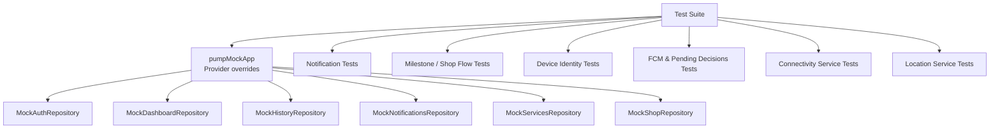
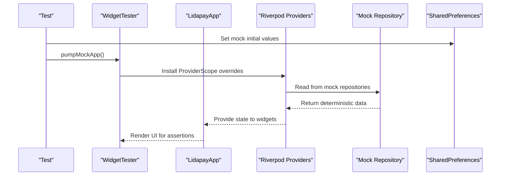
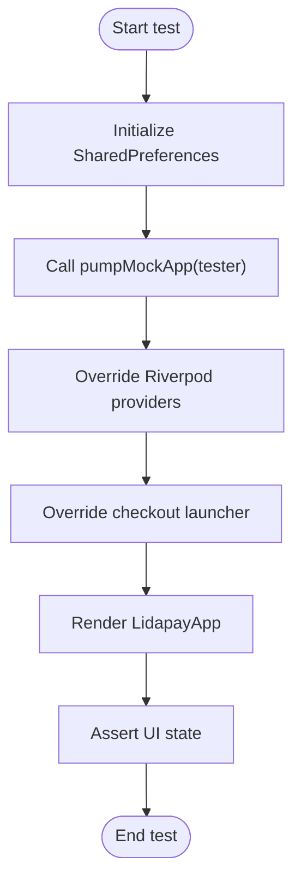
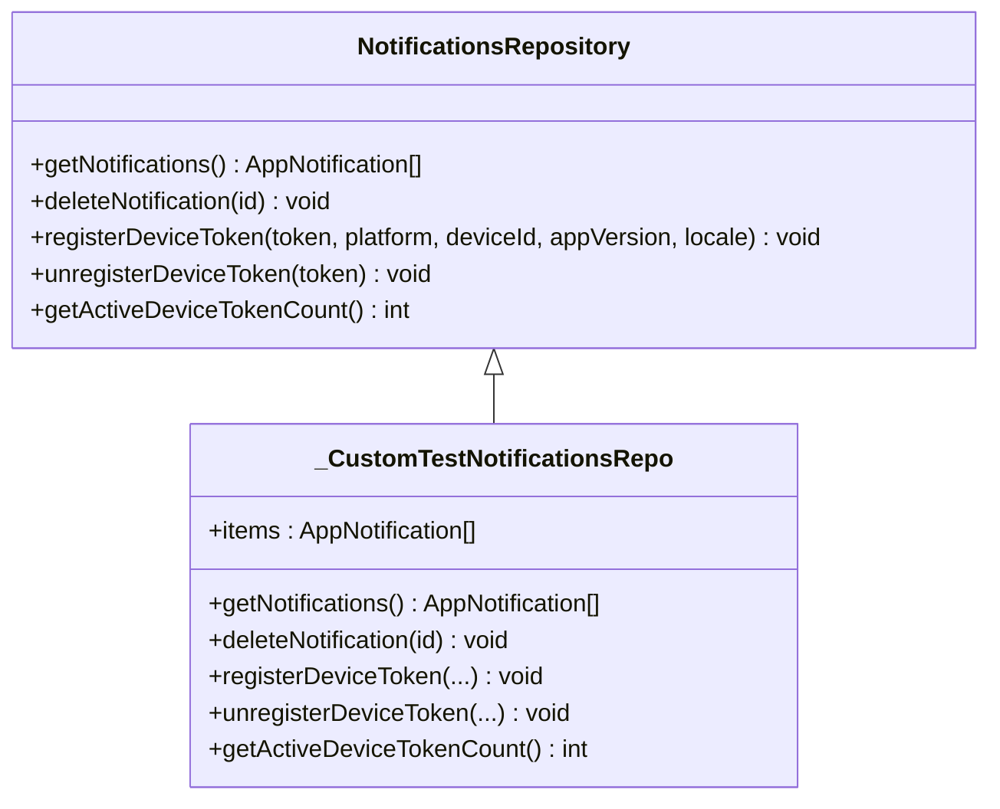
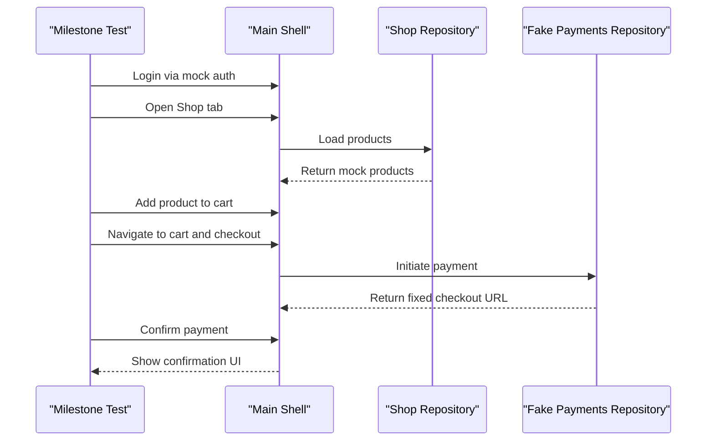
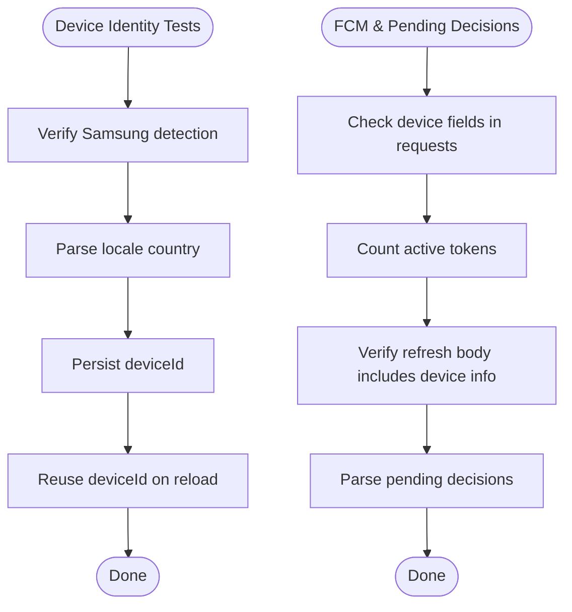
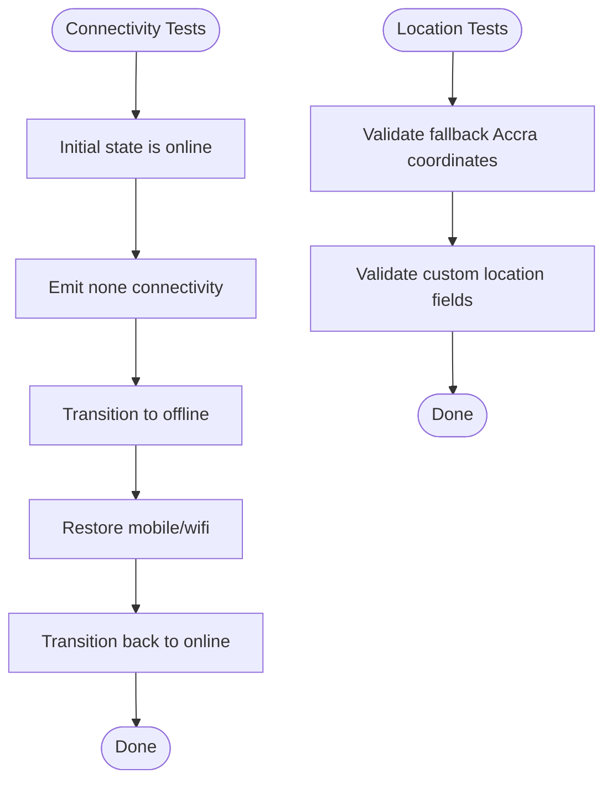
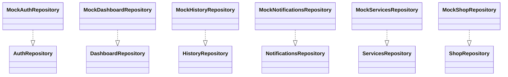
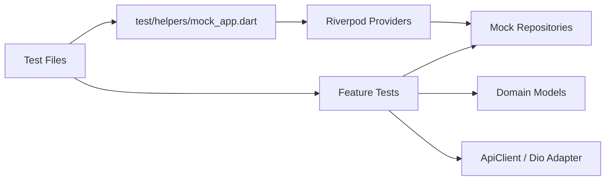

# Testing Utilities & Helpers

<cite>
**Referenced Files in This Document**
- [mock_app.dart](file://test/helpers/mock_app.dart)
- [notification_kind_test.dart](file://test/notification_kind_test.dart)
- [notification_read_test.dart](file://test/notification_read_test.dart)
- [milestone2_test.dart](file://test/milestone2_test.dart)
- [device_identity_test.dart](file://test/device_identity_test.dart)
- [fcm_and_pending_decisions_test.dart](file://test/fcm_and_pending_decisions_test.dart)
- [connectivity_service_test.dart](file://test/connectivity_service_test.dart)
- [location_service_test.dart](file://test/location_service_test.dart)
- [mock_auth_repository.dart](file://lib/features/auth/data/mock_auth_repository.dart)
- [mock_dashboard_repository.dart](file://lib/features/dashboard/data/mock_dashboard_repository.dart)
- [mock_history_repository.dart](file://lib/features/history/data/mock_history_repository.dart)
- [mock_notifications_repository.dart](file://lib/features/notifications/data/mock_notifications_repository.dart)
- [mock_services_repository.dart](file://lib/features/services/data/mock_services_repository.dart)
- [mock_shop_repository.dart](file://lib/features/shop/data/mock_shop_repository.dart)
- [notifications_repository.dart](file://lib/features/notifications/data/notifications_repository.dart)
</cite>

## Table of Contents
1. [Introduction](#introduction)
2. [Project Structure](#project-structure)
3. [Core Components](#core-components)
4. [Architecture Overview](#architecture-overview)
5. [Detailed Component Analysis](#detailed-component-analysis)
6. [Dependency Analysis](#dependency-analysis)
7. [Performance Considerations](#performance-considerations)
8. [Troubleshooting Guide](#troubleshooting-guide)
9. [Conclusion](#conclusion)

## Introduction
This document explains the testing utilities, helpers, and reusable infrastructure used across the LidaPay application. It focuses on how tests avoid live network calls, how mock repositories provide deterministic data, and how shared helpers enable consistent end-to-end flows such as authentication, shop checkout, notifications, device identity, and platform services. It also shows how to extend the framework with new helpers and fixtures while keeping test data predictable and maintainable.

## Project Structure
The testing layer is organized under `test/`. The most important entry point for widget tests is a shared mock app helper that wires Riverpod providers to mock repositories. Feature-specific tests then import this helper or define small local fakes for focused scenarios.

**Diagram sources**
- [mock_app.dart:130-164](file://test/helpers/mock_app.dart#L130-L164)
- [mock_auth_repository.dart:1-218](file://lib/features/auth/data/mock_auth_repository.dart#L1-L218)
- [mock_dashboard_repository.dart:1-131](file://lib/features/dashboard/data/mock_dashboard_repository.dart#L1-L131)
- [mock_history_repository.dart:1-302](file://lib/features/history/data/mock_history_repository.dart#L1-L302)
- [mock_notifications_repository.dart:1-77](file://lib/features/notifications/data/mock_notifications_repository.dart#L1-L77)
- [mock_services_repository.dart:1-652](file://lib/features/services/data/mock_services_repository.dart#L1-L652)
- [mock_shop_repository.dart:1-415](file://lib/features/shop/data/mock_shop_repository.dart#L1-L415)

**Section sources**
- [mock_app.dart:1-165](file://test/helpers/mock_app.dart#L1-L165)

## Core Components
- Shared mock app setup: A single helper pumps the full application with all feature repositories replaced by mocks. It also disables update checks and provides a fake checkout launcher so payment flows can run without a browser.
- Repository fakes: Each domain has a mock repository returning stable datasets with realistic latency. These are used both by the shared mock app and by focused tests.
- Notification helpers: Dedicated tests validate notification classification, read-state merging, unread counts, and user scoping.
- Device identity and platform tests: Tests verify device metadata, locale parsing, persistence of device identifiers, and API request enrichment.
- Connectivity and location helpers: Lightweight tests for connectivity state transitions and location fallback values.

Key responsibilities:
- Deterministic data: Mocks return fixed payloads so assertions do not depend on backend changes.
- Latency simulation: Most mocks add short delays to simulate real loading behavior.
- No live network access: Widget tests override providers; integration-style tests stub HTTP adapters when they need to assert request bodies.

**Section sources**
- [mock_app.dart:28-83](file://test/helpers/mock_app.dart#L28-L83)
- [mock_app.dart:124-164](file://test/helpers/mock_app.dart#L124-L164)
- [mock_notifications_repository.dart:1-77](file://lib/features/notifications/data/mock_notifications_repository.dart#L1-L77)
- [mock_services_repository.dart:1-652](file://lib/features/services/data/mock_services_repository.dart#L1-L652)
- [mock_shop_repository.dart:1-415](file://lib/features/shop/data/mock_shop_repository.dart#L1-L415)

## Architecture Overview
The testing architecture follows a provider-repository pattern:
- Tests pump widgets using `pumpMockApp`, which installs mock repositories into Riverpod.
- UI code consumes repositories through providers, so tests never touch production APIs.
- For tests that must inspect HTTP requests, a custom adapter captures requests and returns controlled JSON responses.

**Diagram sources**
- [mock_app.dart:130-164](file://test/helpers/mock_app.dart#L130-L164)
- [mock_notifications_repository.dart:1-77](file://lib/features/notifications/data/mock_notifications_repository.dart#L1-L77)

## Detailed Component Analysis

### Mock App Setup and Payment Flow Helper
`pumpMockApp` is the central entry point for widget tests. It:
- Initializes `SharedPreferences` with a test instance.
- Overrides core providers including auth, dashboard, history, notifications, services, shop, payments, and recipient choice.
- Replaces the app update repository with a no-op implementation.
- Provides a fake checkout launcher that always succeeds.

Two additional fakes support payment and recipient-choice flows:
- `FakePaymentsRepository`: Returns a fixed checkout URL/token and reports successful transaction queries.
- `FakeRecipientChoiceRepository`: Returns predictable eligibility and decision results.

**Diagram sources**
- [mock_app.dart:130-164](file://test/helpers/mock_app.dart#L130-L164)
- [mock_app.dart:31-83](file://test/helpers/mock_app.dart#L31-L83)

**Section sources**
- [mock_app.dart:28-83](file://test/helpers/mock_app.dart#L28-L83)
- [mock_app.dart:124-164](file://test/helpers/mock_app.dart#L124-L164)

### Notification Classification and Read-State Tests
Notification tests cover two areas:
- Classification logic: Ensures profile updates are classified as security rather than data bundles, and that keywords remain word-boundary safe.
- Read-state behavior: Verifies unread count updates, merging of duplicate messages within a time window, and user scoping.

A custom test repository implements `NotificationsRepository` to supply controlled notification lists and observe provider behavior.

**Diagram sources**
- [notifications_repository.dart:1-28](file://lib/features/notifications/data/notifications_repository.dart#L1-L28)
- [notification_read_test.dart:12-37](file://test/notification_read_test.dart#L12-L37)

Behavioral highlights:
- Marking one notification reduces the unread count immediately.
- Duplicate messages within a short time window merge into one card.
- User scoping matches notifications by user ID, email, or phone number.

**Section sources**
- [notification_kind_test.dart:1-58](file://test/notification_kind_test.dart#L1-L58)
- [notification_read_test.dart:1-266](file://test/notification_read_test.dart#L1-L266)
- [notifications_repository.dart:1-28](file://lib/features/notifications/data/notifications_repository.dart#L1-L28)

### Milestone and Shop Flow Tests
The milestone test demonstrates an end-to-end flow:
- Login via the mock auth repository.
- Browse the shop catalog.
- Open a product sheet, add to cart, and proceed to checkout.
- Fill delivery address and pin coordinates.
- Complete payment through the hosted checkout flow.

It uses `pumpMockApp` and interacts with the app’s main shell tabs, product cards, and checkout screens.

**Diagram sources**
- [milestone2_test.dart:11-28](file://test/milestone2_test.dart#L11-L28)
- [milestone2_test.dart:38-133](file://test/milestone2_test.dart#L38-L133)
- [mock_shop_repository.dart:1-415](file://lib/features/shop/data/mock_shop_repository.dart#L1-L415)
- [mock_app.dart:31-83](file://test/helpers/mock_app.dart#L31-L83)

**Section sources**
- [milestone2_test.dart:1-285](file://test/milestone2_test.dart#L1-L285)

### Device Identity and Platform Metadata Tests
Device identity tests verify:
- Samsung detection regardless of casing.
- Locale country extraction.
- Persistence and reuse of device identifiers across loads.

FCM and pending decisions tests verify:
- Authentication request models include device fields.
- Active device token counting works against a stubbed response.
- Token refresh requests include device identity and token metadata.
- Pending recipient decisions parse active entries and skip expired ones.

**Diagram sources**
- [device_identity_test.dart:1-102](file://test/device_identity_test.dart#L1-L102)
- [fcm_and_pending_decisions_test.dart:73-125](file://test/fcm_and_pending_decisions_test.dart#L73-L125)
- [fcm_and_pending_decisions_test.dart:127-199](file://test/fcm_and_pending_decisions_test.dart#L127-L199)
- [fcm_and_pending_decisions_test.dart:202-266](file://test/fcm_and_pending_decisions_test.dart#L202-L266)

**Section sources**
- [device_identity_test.dart:1-102](file://test/device_identity_test.dart#L1-L102)
- [fcm_and_pending_decisions_test.dart:1-268](file://test/fcm_and_pending_decisions_test.dart#L1-L268)

### Connectivity and Location Service Tests
Connectivity service tests:
- Verify initial online state.
- Assert offline transition when connectivity drops.
- Ensure events are emitted only on state changes.

Location service tests:
- Validate fallback location defaults for Ghana Accra.
- Confirm construction of custom geographic locations.

**Diagram sources**
- [connectivity_service_test.dart:6-24](file://test/connectivity_service_test.dart#L6-L24)
- [connectivity_service_test.dart:29-74](file://test/connectivity_service_test.dart#L29-L74)
- [location_service_test.dart:1-31](file://test/location_service_test.dart#L1-L31)

**Section sources**
- [connectivity_service_test.dart:1-76](file://test/connectivity_service_test.dart#L1-L76)
- [location_service_test.dart:1-31](file://test/location_service_test.dart#L1-L31)

### Mock Repositories and Test Data Generators
Each feature has a dedicated mock repository:
- Auth: Simulates login, OTP challenges, profile updates, and error conditions.
- Dashboard: Provides wallet summary, recent transactions, and flash deals.
- History: Supplies paginated, filterable transactions and statistics.
- Notifications: Returns a curated list of notifications and supports device token operations.
- Services: Covers airtime, data bundles, Lida Value, points, GTPay, and affiliate features.
- Shop: Manages product catalog, categories, cart, orders, and tracking.

These repositories:
- Add artificial latency to mimic network timing.
- Return deterministic data for stable assertions.
- Expose failure paths where needed (for example, invalid credentials or missing orders).

**Diagram sources**
- [mock_auth_repository.dart:1-218](file://lib/features/auth/data/mock_auth_repository.dart#L1-L218)
- [mock_dashboard_repository.dart:1-131](file://lib/features/dashboard/data/mock_dashboard_repository.dart#L1-L131)
- [mock_history_repository.dart:1-302](file://lib/features/history/data/mock_history_repository.dart#L1-L302)
- [mock_notifications_repository.dart:1-77](file://lib/features/notifications/data/mock_notifications_repository.dart#L1-L77)
- [mock_services_repository.dart:1-652](file://lib/features/services/data/mock_services_repository.dart#L1-L652)
- [mock_shop_repository.dart:1-415](file://lib/features/shop/data/mock_shop_repository.dart#L1-L415)

**Section sources**
- [mock_auth_repository.dart:1-218](file://lib/features/auth/data/mock_auth_repository.dart#L1-L218)
- [mock_dashboard_repository.dart:1-131](file://lib/features/dashboard/data/mock_dashboard_repository.dart#L1-L131)
- [mock_history_repository.dart:1-302](file://lib/features/history/data/mock_history_repository.dart#L1-L302)
- [mock_notifications_repository.dart:1-77](file://lib/features/notifications/data/mock_notifications_repository.dart#L1-L77)
- [mock_services_repository.dart:1-652](file://lib/features/services/data/mock_services_repository.dart#L1-L652)
- [mock_shop_repository.dart:1-415](file://lib/features/shop/data/mock_shop_repository.dart#L1-L415)

## Dependency Analysis
The testing dependencies follow clear boundaries:
- Widget tests depend on `pumpMockApp` and feature-specific UI components.
- Integration-style tests depend on `ApiClient`, `TokenStore`, and optional HTTP adapters.
- Domain tests depend on model classes and repository interfaces.

**Diagram sources**
- [mock_app.dart:130-164](file://test/helpers/mock_app.dart#L130-L164)
- [fcm_and_pending_decisions_test.dart:14-41](file://test/fcm_and_pending_decisions_test.dart#L14-L41)

**Section sources**
- [mock_app.dart:1-165](file://test/helpers/mock_app.dart#L1-L165)
- [fcm_and_pending_decisions_test.dart:1-268](file://test/fcm_and_pending_decisions_test.dart#L1-L268)

## Performance Considerations
- Keep mock latency low but realistic to reproduce loading states without slowing tests excessively.
- Avoid unnecessary network calls in widget tests by overriding providers at the root.
- Use deterministic data sets to reduce flakiness and improve assertion stability.
- Prefer scoped provider overrides for focused tests instead of replacing the entire app tree.

[No sources needed since this section provides general guidance]

## Troubleshooting Guide
Common issues and resolutions:
- Tests hitting live APIs: Ensure `SharedPreferences.setMockInitialValues` is called before acquiring the instance, and use `pumpMockApp` to install mock repositories.
- Flaky notification tests: Initialize `TestWidgetsFlutterBinding.ensureInitialized()` and await raw notification providers before asserting unread counts.
- Stale timers in teardown: Avoid long-running timers in mocks; the mock repositories intentionally omit artificial latency where it would cause teardown failures.
- Missing device metadata in requests: Verify that `DeviceIdentity` and `deviceTokenProvider` are configured when constructing `ApiClient` for integration tests.

**Section sources**
- [notification_read_test.dart:39-47](file://test/notification_read_test.dart#L39-L47)
- [mock_notifications_repository.dart:1-77](file://lib/features/notifications/data/mock_notifications_repository.dart#L1-L77)
- [fcm_and_pending_decisions_test.dart:151-199](file://test/fcm_and_pending_decisions_test.dart#L151-L199)

## Conclusion
LidaPay’s testing infrastructure centers on a shared mock app helper and comprehensive mock repositories. This design enables reliable widget tests, stable integration tests, and focused unit tests. By consistently overriding providers, using deterministic data, and simulating latency, the suite avoids live network dependencies while preserving realistic user flows. Extending the framework involves adding new mock repositories, updating `pumpMockApp`, and creating targeted tests that assert behavior without coupling to external systems.

[No sources needed since this section summarizes without analyzing specific files]