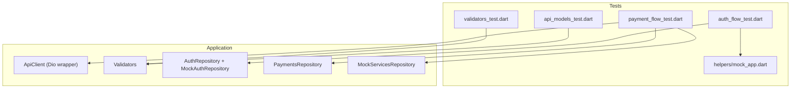
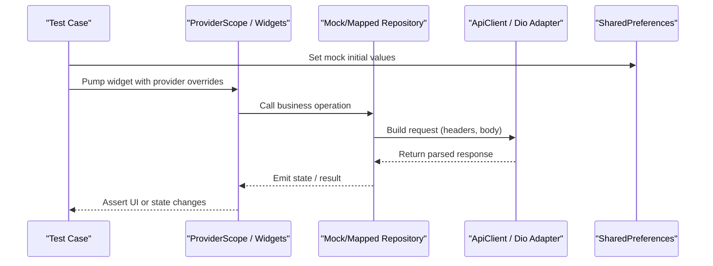
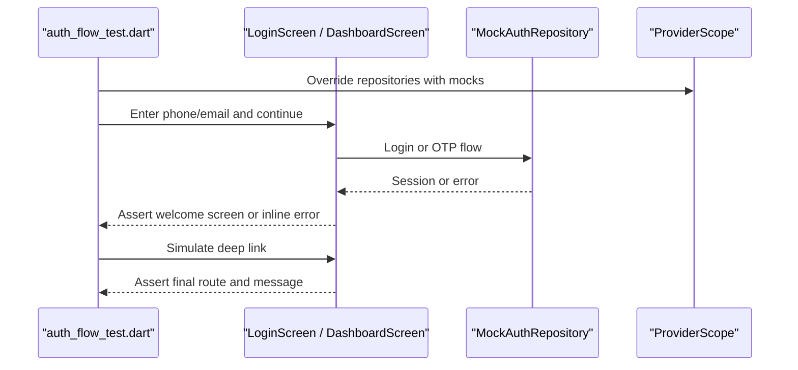
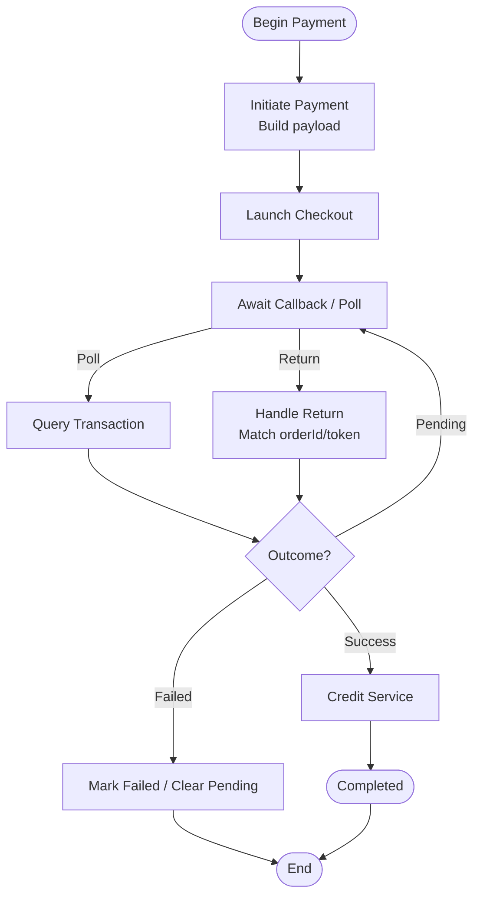
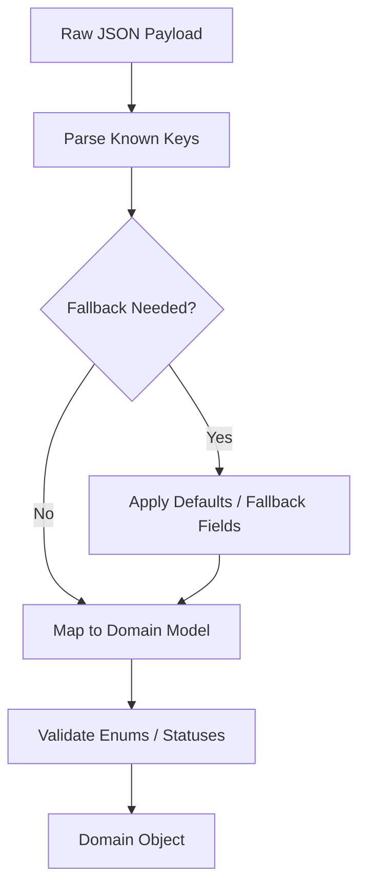
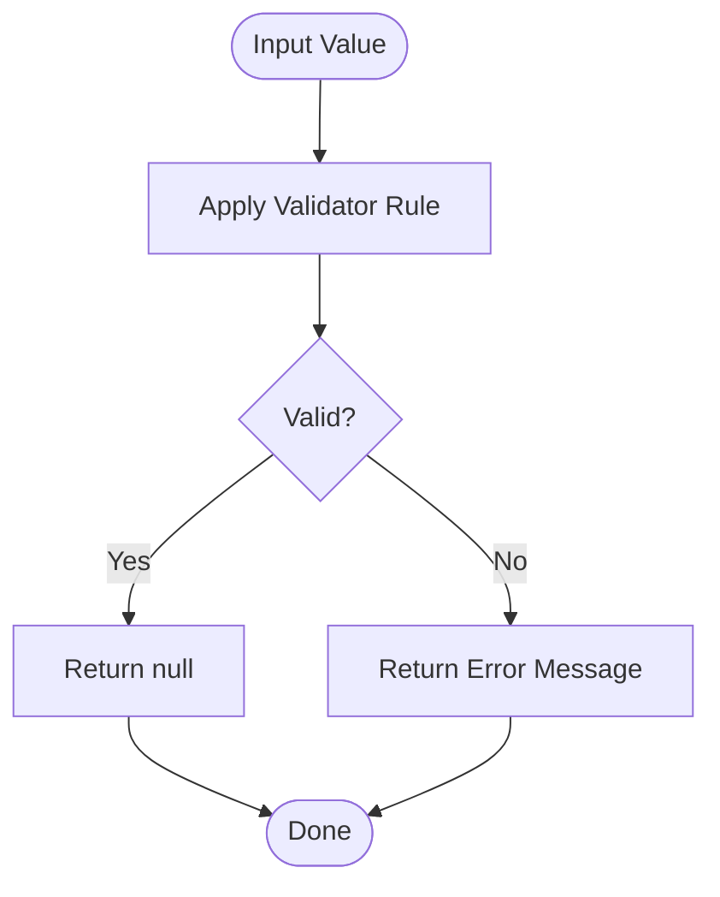
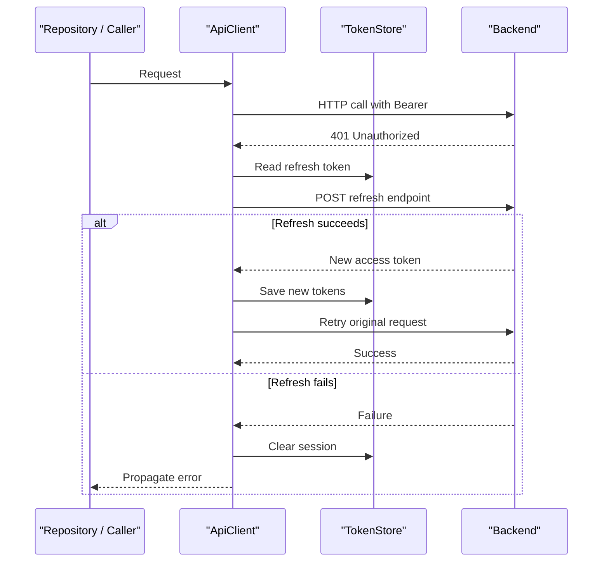
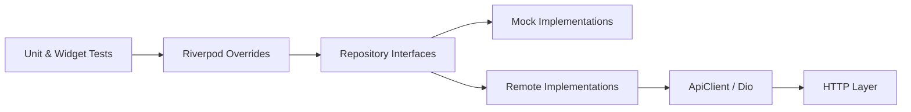

# Unit Testing

<cite>
**Referenced Files in This Document**
- [pubspec.yaml](file://pubspec.yaml)
- [api_client.dart](file://lib/core/network/api_client.dart)
- [validators.dart](file://lib/core/utils/validators.dart)
- [auth_repository.dart](file://lib/features/auth/data/auth_repository.dart)
- [mock_auth_repository.dart](file://lib/features/auth/data/mock_auth_repository.dart)
- [payments_repository.dart](file://lib/features/payments/data/payments_repository.dart)
- [mock_services_repository.dart](file://lib/features/services/data/mock_services_repository.dart)
- [auth_flow_test.dart](file://test/auth_flow_test.dart)
- [payment_flow_test.dart](file://test/payment_flow_test.dart)
- [api_models_test.dart](file://test/api_models_test.dart)
- [validators_test.dart](file://test/validators_test.dart)
- [mock_app.dart](file://test/helpers/mock_app.dart)
</cite>

## Table of Contents
1. [Introduction](#introduction)
2. [Project Structure](#project-structure)
3. [Core Components](#core-components)
4. [Architecture Overview](#architecture-overview)
5. [Detailed Component Analysis](#detailed-component-analysis)
6. [Dependency Analysis](#dependency-analysis)
7. [Performance Considerations](#performance-considerations)
8. [Troubleshooting Guide](#troubleshooting-guide)
9. [Conclusion](#conclusion)

## Introduction
This document explains how the LidaPay application is unit tested using Dart’s testing ecosystem. It focuses on:
- Using `flutter_test` for widget and integration-style tests.
- Isolating business logic through repository interfaces and mock implementations.
- Testing asynchronous flows, deep links, token refresh, payment initiation, query reconciliation, and model parsing.
- Applying best practices for Riverpod provider overrides, test fixtures, and deterministic behavior.

The project uses Flutter and Dart with Riverpod for state management and Dio for HTTP networking. Tests are organized under `test/`, with helpers under `test/helpers/`.

**Section sources**
- [pubspec.yaml:1-151](file://pubspec.yaml#L1-L151)

## Project Structure
The testing strategy is layered:
- Pure unit tests validate utilities, models, and domain logic without UI.
- Widget tests render screens and verify user interactions.
- Repository mocks replace network calls to make tests deterministic.
- Provider overrides inject mocks into the app’s dependency graph.

**Diagram sources**
- [auth_flow_test.dart:1-408](file://test/auth_flow_test.dart#L1-L408)
- [payment_flow_test.dart:1-786](file://test/payment_flow_test.dart#L1-L786)
- [api_models_test.dart:1-157](file://test/api_models_test.dart#L1-L157)
- [validators_test.dart:1-42](file://test/validators_test.dart#L1-L42)
- [mock_app.dart:1-161](file://test/helpers/mock_app.dart#L1-L161)
- [api_client.dart:1-276](file://lib/core/network/api_client.dart#L1-L276)
- [validators.dart:1-103](file://lib/core/utils/validators.dart#L1-L103)
- [auth_repository.dart:1-79](file://lib/features/auth/data/auth_repository.dart#L1-L79)
- [mock_auth_repository.dart:1-218](file://lib/features/auth/data/mock_auth_repository.dart#L1-L218)
- [payments_repository.dart:1-46](file://lib/features/payments/data/payments_repository.dart#L1-L46)
- [mock_services_repository.dart:1-652](file://lib/features/services/data/mock_services_repository.dart#L1-L652)

**Section sources**
- [auth_flow_test.dart:1-408](file://test/auth_flow_test.dart#L1-L408)
- [payment_flow_test.dart:1-786](file://test/payment_flow_test.dart#L1-L786)
- [api_models_test.dart:1-157](file://test/api_models_test.dart#L1-L157)
- [validators_test.dart:1-42](file://test/validators_test.dart#L1-L42)
- [mock_app.dart:1-161](file://test/helpers/mock_app.dart#L1-L161)

## Core Components
This section summarizes the core components that are exercised by tests.

- ApiClient
  - Centralized Dio client with request/response logging, sensitive data redaction, automatic bearer injection, and single-flight token refresh on 401.
  - Used by remote repositories; tests can inject custom Dio instances and adapters to assert payloads and responses.

- Validators
  - Stateless utility class providing email, phone, international phone, OTP, password, and password confirmation validation rules.
  - Password strength scoring is also provided as an enum with a static computation method.

- AuthRepository and MockAuthRepository
  - Abstract contract for authentication operations including login, OTP challenge/verify, profile updates, and password reset/change.
  - Mock implementation simulates latency, success paths, and error codes such as invalid credentials or taken emails.

- PaymentsRepository
  - Contract for initiating payments, querying transaction status, and handling GTPay mobile money debit/status flows.
  - Tests use fakes and mocks to control outcomes and inspect request bodies.

- MockServicesRepository
  - Deterministic service layer mock used across widget and unit tests for airtime, data bundles, wallet, points, and affiliate features.

**Section sources**
- [api_client.dart:1-276](file://lib/core/network/api_client.dart#L1-L276)
- [validators.dart:1-103](file://lib/core/utils/validators.dart#L1-L103)
- [auth_repository.dart:1-79](file://lib/features/auth/data/auth_repository.dart#L1-L79)
- [mock_auth_repository.dart:1-218](file://lib/features/auth/data/mock_auth_repository.dart#L1-L218)
- [payments_repository.dart:1-46](file://lib/features/payments/data/payments_repository.dart#L1-L46)
- [mock_services_repository.dart:1-652](file://lib/features/services/data/mock_services_repository.dart#L1-L652)

## Architecture Overview
The testing architecture emphasizes isolation:
- UI tests pump the full app with provider overrides so all repositories are mocked.
- Business logic tests construct notifiers and repositories directly.
- Network tests wrap Dio with a stub adapter to capture requests and return controlled JSON.
- Model tests parse live-like payloads to ensure robustness against alternate keys and missing fields.

**Diagram sources**
- [auth_flow_test.dart:1-408](file://test/auth_flow_test.dart#L1-L408)
- [payment_flow_test.dart:1-786](file://test/payment_flow_test.dart#L1-L786)
- [mock_app.dart:1-161](file://test/helpers/mock_app.dart#L1-L161)
- [api_client.dart:1-276](file://lib/core/network/api_client.dart#L1-L276)

## Detailed Component Analysis

### Authentication Flow Testing
Authentication tests cover cold start routing, onboarding, login via OTP and password, registration wizards, and deep link handling for password reset completion. The tests:
- Initialize shared preferences and pump the app with all repositories overridden by mocks.
- Interact with login and registration screens, asserting UI transitions and error messages.
- Simulate deep links to verify route handling and post-login states.

**Diagram sources**
- [auth_flow_test.dart:1-408](file://test/auth_flow_test.dart#L1-L408)
- [mock_auth_repository.dart:1-218](file://lib/features/auth/data/mock_auth_repository.dart#L1-L218)
- [mock_app.dart:1-161](file://test/helpers/mock_app.dart#L1-L161)

**Section sources**
- [auth_flow_test.dart:1-408](file://test/auth_flow_test.dart#L1-L408)
- [mock_auth_repository.dart:1-218](file://lib/features/auth/data/mock_auth_repository.dart#L1-L218)
- [mock_app.dart:1-161](file://test/helpers/mock_app.dart#L1-L161)

### Payment Processing Logic Testing
Payment tests validate:
- Initiation payload construction (including shop order number, pay reference, and redirect URL).
- Transaction outcome parsing from various statuses and nested structures.
- Pending payment store persistence and round-trip serialization.
- Payment session lifecycle: begin, handle return, recheck polling, concurrent protection, and terminal failure cleanup.
- GTPay mobile money debit, normalization/validation, pending polling, retry semantics, and expiration handling.
- Deep link parsing for ExpressPay callbacks and shop order reconciliation.

**Diagram sources**
- [payment_flow_test.dart:1-786](file://test/payment_flow_test.dart#L1-L786)
- [payments_repository.dart:1-46](file://lib/features/payments/data/payments_repository.dart#L1-L46)

**Section sources**
- [payment_flow_test.dart:1-786](file://test/payment_flow_test.dart#L1-L786)
- [payments_repository.dart:1-46](file://lib/features/payments/data/payments_repository.dart#L1-L46)

### API Model Parsing Tests
Model tests ensure resilience to backend variations:
- Mapping live transaction rows with documented keys.
- Tolerating alternate key spellings and unknown types.
- Handling empty payloads safely.
- Detecting decision-pending service legs that require recipient action.
- Parsing auth tokens and user profiles with fallbacks.

**Diagram sources**
- [api_models_test.dart:1-157](file://test/api_models_test.dart#L1-L157)

**Section sources**
- [api_models_test.dart:1-157](file://test/api_models_test.dart#L1-L157)

### Validation Functions Testing
Validation tests confirm:
- Ghana phone format acceptance and rejection rules.
- Email validation correctness.
- Password strength scoring categories.

**Diagram sources**
- [validators_test.dart:1-42](file://test/validators_test.dart#L1-L42)
- [validators.dart:1-103](file://lib/core/utils/validators.dart#L1-L103)

**Section sources**
- [validators_test.dart:1-42](file://test/validators_test.dart#L1-L42)
- [validators.dart:1-103](file://lib/core/utils/validators.dart#L1-L103)

### Token Refresh and API Client Behavior
The ApiClient demonstrates robust token refresh behavior:
- Adds Authorization headers and request IDs.
- Redacts sensitive fields in logs.
- On 401, performs a single-flight refresh using a separate Dio instance.
- Retries GET/HEAD/OPTIONS once after successful refresh.
- Clears session on explicit refresh failures or missing tokens.

**Diagram sources**
- [api_client.dart:1-276](file://lib/core/network/api_client.dart#L1-L276)

**Section sources**
- [api_client.dart:1-276](file://lib/core/network/api_client.dart#L1-L276)

## Dependency Analysis
The tests rely on clear boundaries between layers:
- UI tests depend on provider overrides to inject mocks.
- Business logic tests depend on repository interfaces and concrete fakes/mocks.
- Network tests depend on Dio adapters to intercept and assert requests.

**Diagram sources**
- [mock_app.dart:1-161](file://test/helpers/mock_app.dart#L1-L161)
- [auth_repository.dart:1-79](file://lib/features/auth/data/auth_repository.dart#L1-L79)
- [payments_repository.dart:1-46](file://lib/features/payments/data/payments_repository.dart#L1-L46)
- [api_client.dart:1-276](file://lib/core/network/api_client.dart#L1-L276)

**Section sources**
- [mock_app.dart:1-161](file://test/helpers/mock_app.dart#L1-L161)
- [auth_repository.dart:1-79](file://lib/features/auth/data/auth_repository.dart#L1-L79)
- [payments_repository.dart:1-46](file://lib/features/payments/data/payments_repository.dart#L1-L46)
- [api_client.dart:1-276](file://lib/core/network/api_client.dart#L1-L276)

## Performance Considerations
- Use short artificial latencies in mocks to simulate real loading without slowing tests excessively.
- Avoid unnecessary UI pumping; use targeted `pumpAndSettle` durations where needed.
- Prefer direct notifier and repository tests for complex async flows to reduce widget overhead.
- Keep test data small and deterministic to minimize memory churn and flakiness.

[No sources needed since this section provides general guidance]

## Troubleshooting Guide
Common issues and resolutions:
- Flaky timers: Ensure `pumpAndSettle` is used after interactions that trigger animations or delayed tasks.
- Unsettled providers: Wrap tests with `ProviderScope` and override providers consistently via `pumpMockApp`.
- Network calls in tests: Always inject a stub adapter or fake repository; never hit the live API.
- Shared preference state: Reset with `SharedPreferences.setMockInitialValues` before each test.
- Concurrency races: For payment sessions, assert both return and recheck paths to avoid double credits.

**Section sources**
- [auth_flow_test.dart:1-408](file://test/auth_flow_test.dart#L1-L408)
- [payment_flow_test.dart:1-786](file://test/payment_flow_test.dart#L1-L786)
- [mock_app.dart:1-161](file://test/helpers/mock_app.dart#L1-L161)

## Conclusion
The LidaPay test suite combines pure unit tests, widget tests, and repository-driven integration tests to ensure reliability across authentication, payments, model parsing, and validation. By leveraging repository abstractions, mock implementations, provider overrides, and Dio adapters, tests remain isolated, deterministic, and fast. Following the patterns shown here will help maintain high confidence in business logic while keeping UI tests focused on user interactions and navigation.

[No sources needed since this section summarizes without analyzing specific files]