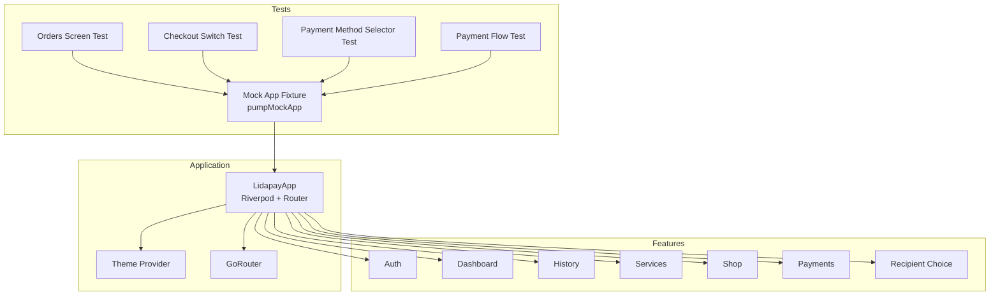
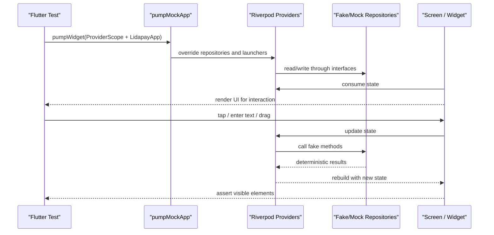
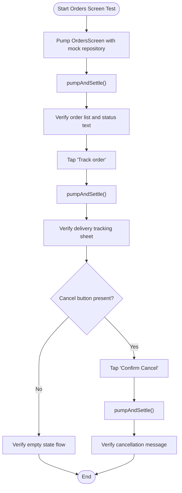
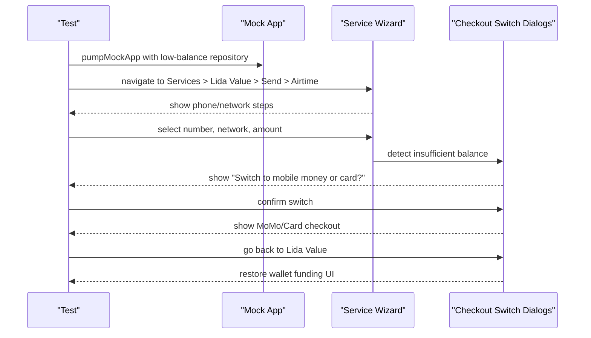
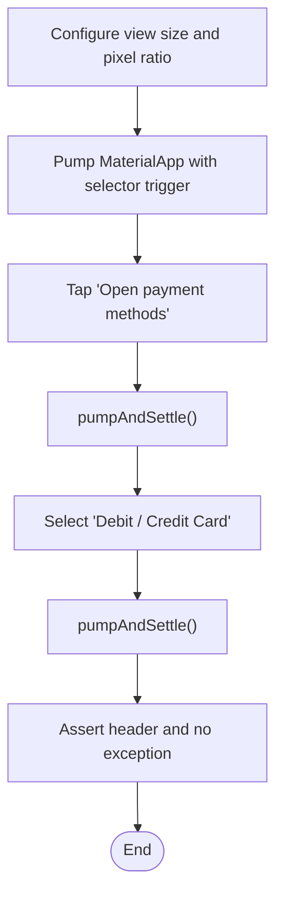
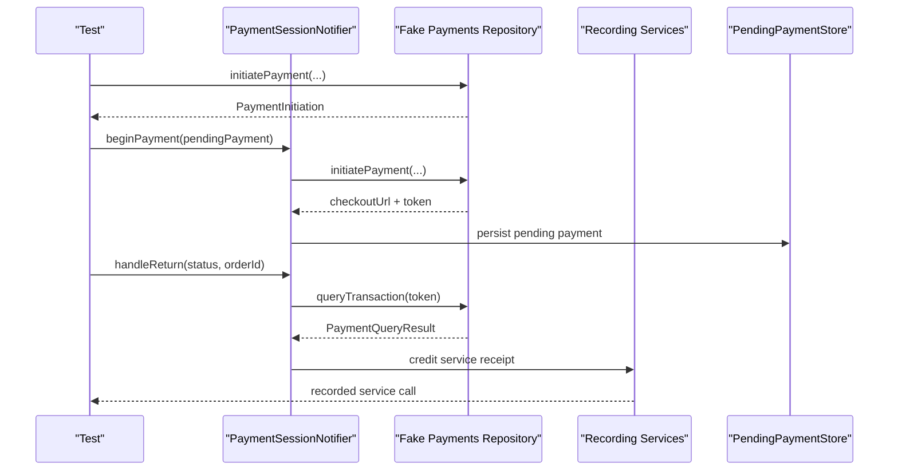
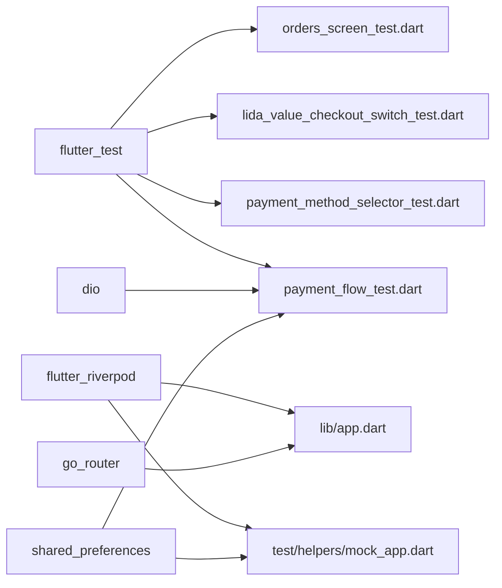

# Widget Testing

<cite>
**Referenced Files in This Document**
- [pubspec.yaml](file://pubspec.yaml)
- [app.dart](file://lib/app.dart)
- [mock_app.dart](file://test/helpers/mock_app.dart)
- [orders_screen_test.dart](file://test/orders_screen_test.dart)
- [lida_value_checkout_switch_test.dart](file://test/lida_value_checkout_switch_test.dart)
- [payment_method_selector_test.dart](file://test/payment_method_selector_test.dart)
- [payment_flow_test.dart](file://test/payment_flow_test.dart)
</cite>

## Table of Contents
1. [Introduction](#introduction)
2. [Project Structure](#project-structure)
3. [Core Components](#core-components)
4. [Architecture Overview](#architecture-overview)
5. [Detailed Component Analysis](#detailed-component-analysis)
6. [Dependency Analysis](#dependency-analysis)
7. [Performance Considerations](#performance-considerations)
8. [Troubleshooting Guide](#troubleshooting-guide)
9. [Conclusion](#conclusion)

## Introduction
This document explains how to write widget tests for the LidaPay Flutter application. It focuses on testing UI components, user interactions, and widget state management using Flutter’s widget testing framework. The guidance is grounded in the repository’s existing test suite and mock setup:

- Screen-level tests verify navigation, lists, dialogs, and sheet flows.
- Custom widget tests validate small interactive components such as checkout switches and payment method selectors.
- End-to-end service flows are tested through a Riverpod-backed app fixture that replaces repositories with deterministic fakes.
- Async behavior, gesture simulation, and provider overrides are demonstrated across order screens, checkout switches, payment method selection, and payment session flows.

The goal is to help you extend these patterns confidently when adding new screens, widgets, or complex UI interactions.

## Project Structure
The project uses a feature-based layout under `lib/features`, with shared core logic under `lib/core`. Tests live under `test/`, including a helper directory for reusable test fixtures.

**Diagram sources**
- [app.dart:55-202](file://lib/app.dart#L55-L202)
- [mock_app.dart:128-160](file://test/helpers/mock_app.dart#L128-L160)

**Section sources**
- [pubspec.yaml:30-79](file://pubspec.yaml#L30-L79)
- [app.dart:55-202](file://lib/app.dart#L55-L202)

## Core Components
The testing foundation relies on three main ideas:

1. **Widget tester usage**: Use `tester.pumpWidget` to render widgets, `tester.tap`/`enterText`/`drag` for gestures, and `expect` for assertions.
2. **Provider overrides**: Replace production providers with mocks or fakes via `ProviderScope.overrides`.
3. **Deterministic fixtures**: Use fake repositories so network calls, browser checkouts, and external services do not run during tests.

Key implementation points:

- The full app can be pumped with `pumpMockApp`, which sets up Riverpod overrides for auth, dashboard, history, notifications, services, shop, payments, recipient choice, and checkout launching.
- For focused screen tests, build a minimal `MaterialApp` with only the required providers overridden.
- For unit-style widget tests, wrap the target widget in a small scaffold or dialog host to simulate real app context.

**Section sources**
- [mock_app.dart:26-81](file://test/helpers/mock_app.dart#L26-L81)
- [mock_app.dart:122-160](file://test/helpers/mock_app.dart#L122-L160)

## Architecture Overview
At runtime, the app wires Riverpod providers, routing, theme, connectivity, push notifications, and deep links. In tests, we replace heavy dependencies with lightweight fakes while keeping the same provider contract.

**Diagram sources**
- [mock_app.dart:128-160](file://test/helpers/mock_app.dart#L128-L160)
- [app.dart:55-202](file://lib/app.dart#L55-L202)

## Detailed Component Analysis

### Testing Order Screens
The orders screen test demonstrates:

- Rendering an order list with items and currency labels.
- Tapping “Track order” to open a delivery tracking sheet.
- Cancelling an order through a confirmation dialog.
- Handling empty order states.
- Opening a specific order detail sheet using an initial order ID.

Recommended pattern:

1. Build a testable screen by wrapping it in `MaterialApp` and overriding only the required provider.
2. Pump once, then `pumpAndSettle` to let async data load.
3. Interact with buttons and sheets using `find.text(...)` and `tester.tap`.
4. Assert visible text and navigation outcomes.

**Diagram sources**
- [orders_screen_test.dart:10-36](file://test/orders_screen_test.dart#L10-L36)
- [orders_screen_test.dart:38-75](file://test/orders_screen_test.dart#L38-L75)
- [orders_screen_test.dart:77-99](file://test/orders_screen_test.dart#L77-L99)

**Section sources**
- [orders_screen_test.dart:10-36](file://test/orders_screen_test.dart#L10-L36)
- [orders_screen_test.dart:38-75](file://test/orders_screen_test.dart#L38-L75)
- [orders_screen_test.dart:77-99](file://test/orders_screen_test.dart#L77-L99)

### Testing Checkout Switches and Wallet Shortfalls
The checkout switch tests cover:

- A dialog that explains switching from Lida Value to mobile money or card.
- Declining or confirming the switch.
- Restoring back to Lida Value when appropriate.
- A full flow where insufficient wallet balance triggers a detour to standard checkout.

Recommended pattern:

1. Use `pumpMockApp` to start the app with mocked services.
2. Simulate login and tab navigation.
3. Scroll to ensure widgets are visible before tapping.
4. Follow the wizard steps and assert transitions between Lida Value and standard checkout flows.
5. Verify reversibility: returning to Lida Value restores the expected wallet funding UI.

**Diagram sources**
- [lida_value_checkout_switch_test.dart:40-46](file://test/lida_value_checkout_switch_test.dart#L40-L46)
- [lida_value_checkout_switch_test.dart:63-109](file://test/lida_value_checkout_switch_test.dart#L63-L109)
- [lida_value_checkout_switch_test.dart:111-140](file://test/lida_value_checkout_switch_test.dart#L111-L140)
- [lida_value_checkout_switch_test.dart:142-216](file://test/lida_value_checkout_switch_test.dart#L142-L216)

**Section sources**
- [lida_value_checkout_switch_test.dart:11-31](file://test/lida_value_checkout_switch_test.dart#L11-L31)
- [lida_value_checkout_switch_test.dart:33-46](file://test/lida_value_checkout_switch_test.dart#L33-L46)
- [lida_value_checkout_switch_test.dart:63-109](file://test/lida_value_checkout_switch_test.dart#L63-L109)
- [lida_value_checkout_switch_test.dart:111-140](file://test/lida_value_checkout_switch_test.dart#L111-L140)
- [lida_value_checkout_switch_test.dart:142-216](file://test/lida_value_checkout_switch_test.dart#L142-L216)

### Testing Payment Method Selectors
The payment method selector test validates responsive behavior:

- Setting a narrow physical size.
- Opening a payment method sheet.
- Selecting a payment option.
- Verifying wrapped headers and absence of exceptions.

Recommended pattern:

1. Configure `tester.view.physicalSize` and `devicePixelRatio`.
2. Wrap the target widget in a `MaterialApp` and `Scaffold`.
3. Trigger the sheet via a button press.
4. Assert visible content and use `takeException()` to catch unexpected errors.

**Diagram sources**
- [payment_method_selector_test.dart:5-37](file://test/payment_method_selector_test.dart#L5-L37)

**Section sources**
- [payment_method_selector_test.dart:5-37](file://test/payment_method_selector_test.dart#L5-L37)

### Testing Payment Flows with Riverpod Providers
The payment flow test covers more than UI:

- Parsing initiation responses.
- Validating request payloads.
- Querying transaction outcomes.
- Managing pending payments.
- Running payment sessions with retries and concurrent handling.
- Mobile money debit and status polling.
- Deep link parsing for payment callbacks.

Recommended pattern:

1. Create a fake HTTP adapter to record requests and return deterministic JSON.
2. Construct an API client with a base URL and token store backed by mock preferences.
3. Implement fake repositories for payments and services.
4. Build a `PaymentSessionNotifier` with controlled query delays and poll attempts.
5. Assert phases, receipts, stored tokens, and service calls.

**Diagram sources**
- [payment_flow_test.dart:20-60](file://test/payment_flow_test.dart#L20-L60)
- [payment_flow_test.dart:62-138](file://test/payment_flow_test.dart#L62-L138)
- [payment_flow_test.dart:229-247](file://test/payment_flow_test.dart#L229-L247)
- [payment_flow_test.dart:451-584](file://test/payment_flow_test.dart#L451-L584)

**Section sources**
- [payment_flow_test.dart:20-60](file://test/payment_flow_test.dart#L20-L60)
- [payment_flow_test.dart:62-138](file://test/payment_flow_test.dart#L62-L138)
- [payment_flow_test.dart:229-247](file://test/payment_flow_test.dart#L229-L247)
- [payment_flow_test.dart:263-364](file://test/payment_flow_test.dart#L263-L364)
- [payment_flow_test.dart:366-415](file://test/payment_flow_test.dart#L366-L415)
- [payment_flow_test.dart:417-449](file://test/payment_flow_test.dart#L417-L449)
- [payment_flow_test.dart:451-584](file://test/payment_flow_test.dart#L451-L584)
- [payment_flow_test.dart:587-784](file://test/payment_flow_test.dart#L587-L784)

## Dependency Analysis
The test suite depends on Flutter’s testing SDK and Riverpod for state management. The app itself depends on GoRouter, Dio, shared preferences, and several feature modules.

**Diagram sources**
- [pubspec.yaml:30-79](file://pubspec.yaml#L30-L79)
- [app.dart:55-202](file://lib/app.dart#L55-L202)
- [mock_app.dart:128-160](file://test/helpers/mock_app.dart#L128-L160)
- [payment_flow_test.dart:20-60](file://test/payment_flow_test.dart#L20-L60)

**Section sources**
- [pubspec.yaml:30-79](file://pubspec.yaml#L30-L79)

## Performance Considerations
When writing widget tests:

- Prefer `pumpAndSettle` after interactions that trigger async work.
- Avoid unnecessary sleeps; rely on settling instead of fixed waits.
- Keep test scopes minimal: only override providers needed for the test.
- Use deterministic fakes to avoid slow network calls.
- Reset view configuration in teardown to prevent cross-test pollution.

These practices keep tests fast, stable, and easy to debug.

## Troubleshooting Guide
Common issues and resolutions:

- **Widgets not found**: Ensure the widget is visible before interacting. Use `ensureVisible` and `pumpAndSettle`.
- **Async state not updated**: Call `pumpAndSettle` after taps or text input.
- **Provider state not applied**: Verify `ProviderScope.overrides` includes the correct provider replacement.
- **View configuration leaks**: Use `addTearDown(tester.view.resetPhysicalSize)` and reset device pixel ratio after tests.
- **Unexpected exceptions**: Capture and inspect exceptions with `tester.takeException()` in responsive UI tests.
- **Network calls in tests**: Replace repositories with fakes and configure mock preferences.

**Section sources**
- [payment_method_selector_test.dart:5-37](file://test/payment_method_selector_test.dart#L5-L37)
- [mock_app.dart:122-160](file://test/helpers/mock_app.dart#L122-L160)

## Conclusion
The LidaPay test suite demonstrates robust patterns for widget testing:

- Use `pumpMockApp` for full-app scenarios with mocked repositories.
- Build minimal provider-scoped widgets for focused screen tests.
- Simulate realistic user gestures and wait for async updates.
- Validate both UI output and underlying state changes.
- Extend these patterns to new screens, custom widgets, and complex flows like checkout switches and payment sessions.

By following these approaches, you can maintain confidence in UI correctness, user interaction reliability, and state consistency across the application.