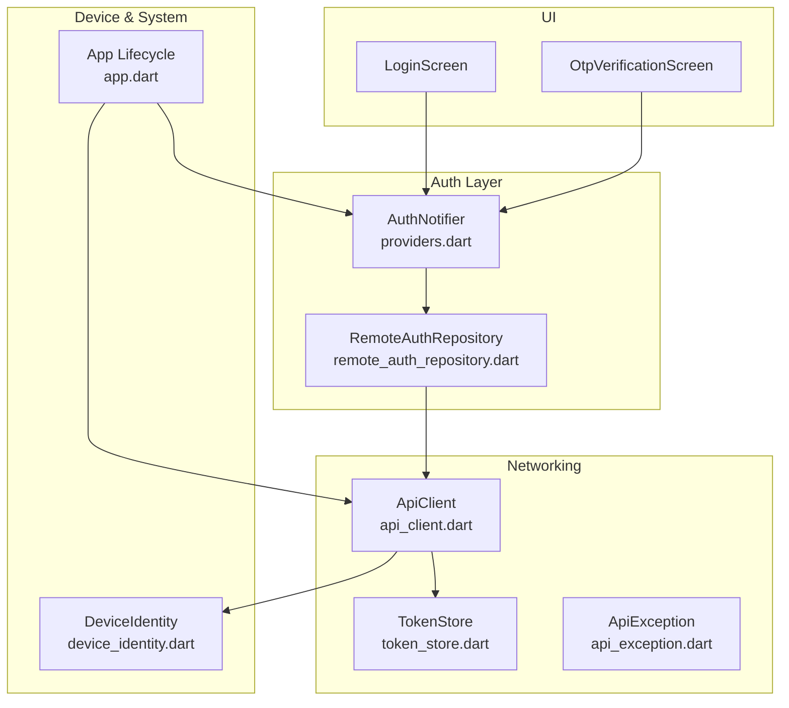
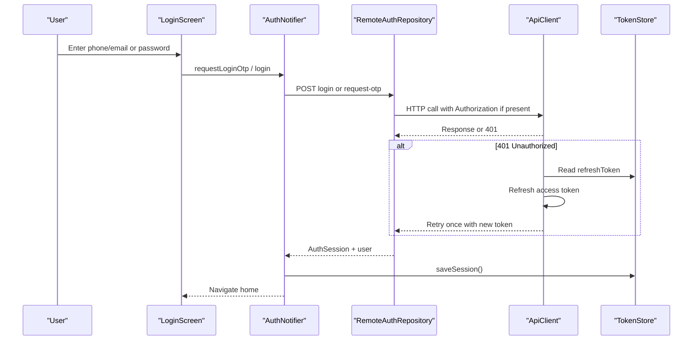
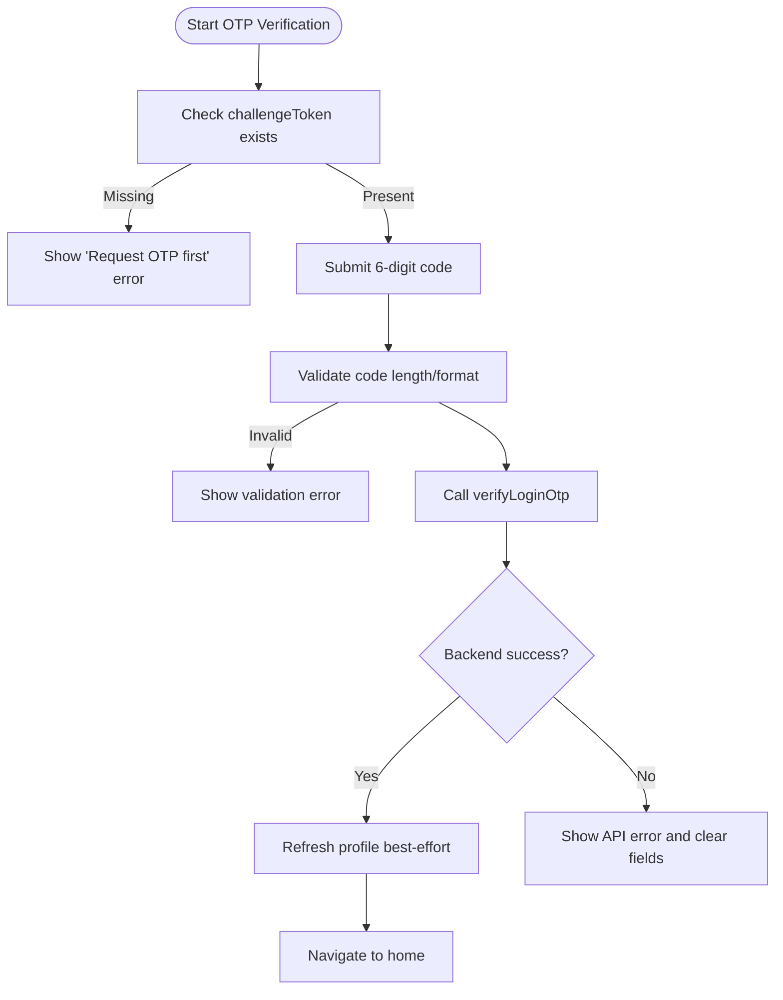
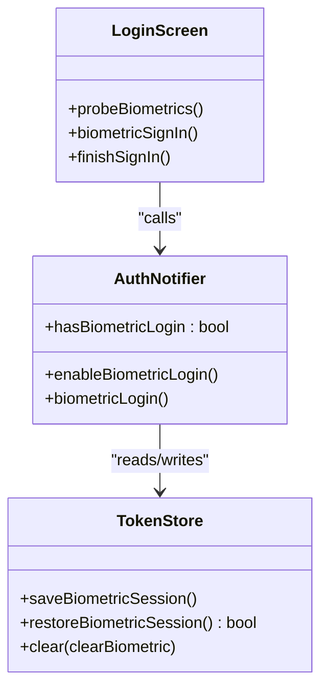
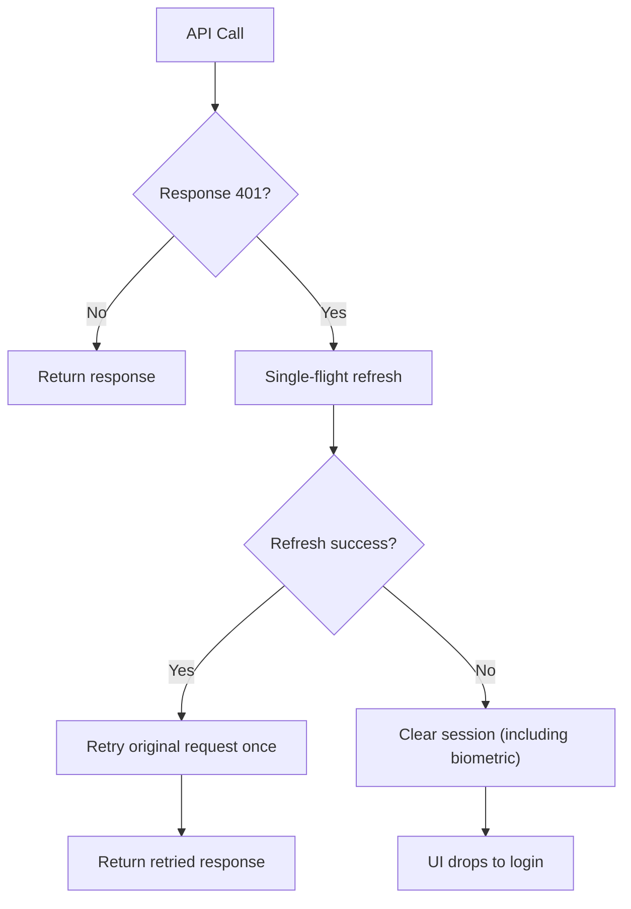
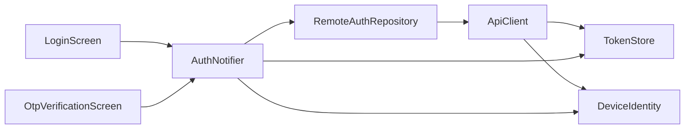

# Authentication & Security Issues

<cite>
**Referenced Files in This Document**
- [app.dart](file://lib/app.dart)
- [providers.dart](file://lib/features/auth/providers.dart)
- [login_screen.dart](file://lib/features/auth/screens/login_screen.dart)
- [otp_verification_screen.dart](file://lib/features/auth/screens/otp_verification_screen.dart)
- [remote_auth_repository.dart](file://lib/features/auth/data/remote_auth_repository.dart)
- [api_client.dart](file://lib/core/network/api_client.dart)
- [token_store.dart](file://lib/core/network/token_store.dart)
- [api_exception.dart](file://lib/core/network/api_exception.dart)
- [device_identity.dart](file://lib/core/device/device_identity.dart)
</cite>

## Table of Contents
1. [Introduction](#introduction)
2. [Project Structure](#project-structure)
3. [Core Components](#core-components)
4. [Architecture Overview](#architecture-overview)
5. [Detailed Component Analysis](#detailed-component-analysis)
6. [Dependency Analysis](#dependency-analysis)
7. [Performance Considerations](#performance-considerations)
8. [Troubleshooting Guide](#troubleshooting-guide)
9. [Conclusion](#conclusion)

## Introduction
This document provides comprehensive troubleshooting guidance for authentication and security-related problems in the LidaPay application. It focuses on:
- Common login failures
- OTP verification issues
- Biometric authentication problems
- Session management and token expiration
- Device identity and secure storage concerns
- Permission-related security issues
- Account lockout scenarios, password reset procedures, and security policy violations

The guidance maps directly to the app’s authentication flow, token handling, device identity reporting, and error translation logic so you can diagnose and resolve issues efficiently.

## Project Structure
Authentication and security are implemented across several layers:
- UI screens handle user input, validation, and navigation.
- The auth provider orchestrates login, OTP flows, profile refresh, biometric sign-in, and logout.
- The remote repository calls backend endpoints and persists sessions.
- The API client injects tokens, handles 401 responses, and transparently refreshes access tokens.
- Token storage manages encrypted persistence and biometric session snapshots.
- Device identity supplies privacy-safe device metadata used during authentication and token refresh.
- App lifecycle hooks refresh profiles and sync notifications when the app resumes.

**Diagram sources**
- [login_screen.dart:177-351](file://lib/features/auth/screens/login_screen.dart#L177-L351)
- [otp_verification_screen.dart:78-125](file://lib/features/auth/screens/otp_verification_screen.dart#L78-L125)
- [providers.dart:51-202](file://lib/features/auth/providers.dart#L51-L202)
- [remote_auth_repository.dart:19-80](file://lib/features/auth/data/remote_auth_repository.dart#L19-L80)
- [api_client.dart:16-84](file://lib/core/network/api_client.dart#L16-L84)
- [token_store.dart:74-170](file://lib/core/network/token_store.dart#L74-L170)
- [device_identity.dart:12-65](file://lib/core/device/device_identity.dart#L12-L65)
- [app.dart:110-125](file://lib/app.dart#L110-L125)

**Section sources**
- [login_screen.dart:177-351](file://lib/features/auth/screens/login_screen.dart#L177-L351)
- [otp_verification_screen.dart:78-125](file://lib/features/auth/screens/otp_verification_screen.dart#L78-L125)
- [providers.dart:51-202](file://lib/features/auth/providers.dart#L51-L202)
- [remote_auth_repository.dart:19-80](file://lib/features/auth/data/remote_auth_repository.dart#L19-L80)
- [api_client.dart:16-84](file://lib/core/network/api_client.dart#L16-L84)
- [token_store.dart:74-170](file://lib/core/network/token_store.dart#L74-L170)
- [device_identity.dart:12-65](file://lib/core/device/device_identity.dart#L12-L65)
- [app.dart:110-125](file://lib/app.dart#L110-L125)

## Core Components
- AuthNotifier (providers.dart): Central state manager for login, OTP challenge/verification, profile refresh, biometric login enablement/restoration, registration, password reset/change, and logout. It also coordinates push notification device token synchronization.
- RemoteAuthRepository (remote_auth_repository.dart): Calls backend endpoints, persists sessions via TokenStore, enriches user data from JWT claims, and validates token presence.
- ApiClient (api_client.dart): Dio-based HTTP client that attaches Authorization headers, redacts sensitive logs, and transparently refreshes access tokens on 401 with single-flight deduplication.
- TokenStore (token_store.dart): Encrypted persistent store for access/refresh tokens and profile snapshot; supports migration from plaintext preferences, biometric session snapshots, and a cleared-stream for UI updates.
- DeviceIdentity (device_identity.dart): Privacy-safe device metadata including a random app-scoped deviceId, platform, app version/build, locale, model, OS version, and manufacturer.
- App Lifecycle (app.dart): On resume, refreshes profile, syncs device token, and flushes pending deep links and notifications.

Key responsibilities for troubleshooting:
- Login and OTP flows originate in UI screens and route through AuthNotifier and RemoteAuthRepository.
- Token refresh and failure handling live in ApiClient and TokenStore.
- Biometric sign-in depends on LocalAuthentication and TokenStore’s biometric session keys.
- Error messages are normalized by ApiException for consistent user-facing messaging.

**Section sources**
- [providers.dart:51-202](file://lib/features/auth/providers.dart#L51-L202)
- [remote_auth_repository.dart:19-80](file://lib/features/auth/data/remote_auth_repository.dart#L19-L80)
- [api_client.dart:16-84](file://lib/core/network/api_client.dart#L16-L84)
- [token_store.dart:74-170](file://lib/core/network/token_store.dart#L74-L170)
- [device_identity.dart:12-65](file://lib/core/device/device_identity.dart#L12-L65)
- [app.dart:110-125](file://lib/app.dart#L110-L125)

## Architecture Overview
The authentication architecture follows a layered approach:
- UI screens validate inputs and trigger actions.
- AuthNotifier coordinates business logic and side effects.
- RemoteAuthRepository performs network calls and persists sessions.
- ApiClient handles token injection, logging, and refresh.
- TokenStore persists secrets securely and emits clear events.
- DeviceIdentity supplies non-sensitive device context.

**Diagram sources**
- [login_screen.dart:177-351](file://lib/features/auth/screens/login_screen.dart#L177-L351)
- [providers.dart:88-163](file://lib/features/auth/providers.dart#L88-L163)
- [remote_auth_repository.dart:19-80](file://lib/features/auth/data/remote_auth_repository.dart#L19-L80)
- [api_client.dart:50-84](file://lib/core/network/api_client.dart#L50-L84)
- [token_store.dart:148-170](file://lib/core/network/token_store.dart#L148-L170)

## Detailed Component Analysis

### Login Flow Troubleshooting
Symptoms:
- “Phone or email is required”
- “Incorrect phone, email, or password. Please try again.”
- “We couldn’t find an account with that email or phone number...”
- OTP pane appears but no code arrives

Debug steps:
1. Validate input: Ensure phone/email format passes local validators before calling the backend.
2. Check OTP challenge: If the proactive OTP challenge fails with a validation 400, the screen falls back to password mode; otherwise surface the error message.
3. Inspect API errors: ApiException translates backend messages into friendly text.
4. Confirm device identity: Ensure deviceId, platform, appVersion, and locale are attached to login/OTP requests.
5. Verify network connectivity: Offline or timeout errors are surfaced with user-friendly messages.

Common causes:
- Invalid identifier or wrong password.
- Backend returning 401 unauthorized.
- Missing or malformed device identity fields.
- Network timeouts or offline state.

Resolution:
- Correct the identifier/password.
- Retry after network recovery.
- Reinstall or clear app data only if device identity is corrupted.
- Use password reset if credentials are lost.

**Section sources**
- [login_screen.dart:177-351](file://lib/features/auth/screens/login_screen.dart#L177-L351)
- [api_exception.dart:43-74](file://lib/core/network/api_exception.dart#L43-L74)
- [device_identity.dart:72-130](file://lib/core/device/device_identity.dart#L72-L130)

### OTP Verification Troubleshooting
Symptoms:
- “Please request a verification code first or sign in with your password.”
- Resend cooldown active
- Incorrect OTP code
- No OTP received

Debug steps:
1. Ensure a challenge was requested: verifyLoginOtp requires a valid challengeToken stored in memory.
2. Resend behavior: Resend is rate-limited both locally and server-side; respect cooldown timers.
3. Input validation: Only six-digit numeric codes are accepted; auto-submit on completion.
4. Profile refresh: After successful OTP verification, the app attempts to refresh the profile to populate user fields.

Common causes:
- Attempting to verify without requesting OTP first.
- Expired or invalid OTP code.
- Rate limiting due to frequent resend attempts.
- Backend not sending SMS OTP yet (UI supports autofill).

Resolution:
- Request a fresh OTP and wait for delivery.
- Respect cooldown timers.
- Clear and re-enter the code carefully.
- If profile fetch fails, the cached profile remains; retry later.

**Diagram sources**
- [providers.dart:107-163](file://lib/features/auth/providers.dart#L107-L163)
- [otp_verification_screen.dart:78-125](file://lib/features/auth/screens/otp_verification_screen.dart#L78-L125)

**Section sources**
- [providers.dart:107-163](file://lib/features/auth/providers.dart#L107-L163)
- [otp_verification_screen.dart:78-125](file://lib/features/auth/screens/otp_verification_screen.dart#L78-L125)

### Biometric Authentication Troubleshooting
Symptoms:
- “Biometric sign-in is not set up. Sign in with your password first.”
- “Biometric sign-in expired. Sign in with your password again.”
- Biometric prompt fails or is unavailable

Debug steps:
1. Check device capability: Probe available biometrics; hide fingerprint/Face ID button if none enrolled.
2. Enable biometric login: After successful password/OTP login, prompt to enable biometric sign-in; this stores a biometric session snapshot.
3. Restore biometric session: Requires a previously saved biometric session with valid access and refresh tokens.
4. Platform exceptions: Non-fatal; allow normal sign-in to proceed even if biometric setup fails.

Common causes:
- No biometrics enrolled or supported on device.
- Biometric session missing or invalidated by backend token rotation.
- Platform channel errors during biometric prompts.

Resolution:
- Enroll biometrics and complete initial password/OTP login to enable.
- If expired, sign in with password to refresh tokens and re-enable.
- Fallback to password/OTP if biometric prompt fails.

**Diagram sources**
- [login_screen.dart:100-121](file://lib/features/auth/screens/login_screen.dart#L100-L121)
- [login_screen.dart:382-485](file://lib/features/auth/screens/login_screen.dart#L382-L485)
- [providers.dart:182-202](file://lib/features/auth/providers.dart#L182-L202)
- [token_store.dart:177-217](file://lib/core/network/token_store.dart#L177-L217)

**Section sources**
- [login_screen.dart:100-121](file://lib/features/auth/screens/login_screen.dart#L100-L121)
- [login_screen.dart:382-485](file://lib/features/auth/screens/login_screen.dart#L382-L485)
- [providers.dart:182-202](file://lib/features/auth/providers.dart#L182-L202)
- [token_store.dart:177-217](file://lib/core/network/token_store.dart#L177-L217)

### Session Management and Token Expiration Troubleshooting
Symptoms:
- Sudden logout after backgrounding/resuming
- Intermittent 401 errors followed by automatic retry
- “Your session expired. Please sign in again.”

Debug steps:
1. Observe 401 handling: ApiClient interceptors detect 401, attempt a single-flight token refresh using the refresh token, then retry GET/HEAD/OPTIONS requests once.
2. Check refresh endpoint: If refresh returns missing access token or explicit rejection (400/401/403), the session is cleared including biometric session.
3. Profile refresh: Best-effort refresh of profile on app resume; 401 clears session.
4. Token persistence: Tokens and profile are migrated to secure storage; broken keystore degrades gracefully to signed-out.

Common causes:
- Expired or rotated refresh token.
- Backend rejecting refresh token.
- Network timeouts during refresh (transient; tokens kept).
- Corrupted secure storage causing load failure.

Resolution:
- Allow automatic retry; if it fails, sign in again.
- Clear app data only if secure storage is corrupted.
- Ensure device has internet connectivity during resume.

**Diagram sources**
- [api_client.dart:50-84](file://lib/core/network/api_client.dart#L50-L84)
- [api_client.dart:211-265](file://lib/core/network/api_client.dart#L211-L265)
- [token_store.dart:219-236](file://lib/core/network/token_store.dart#L219-L236)
- [providers.dart:210-239](file://lib/features/auth/providers.dart#L210-L239)

**Section sources**
- [api_client.dart:50-84](file://lib/core/network/api_client.dart#L50-L84)
- [api_client.dart:211-265](file://lib/core/network/api_client.dart#L211-L265)
- [token_store.dart:219-236](file://lib/core/network/token_store.dart#L219-L236)
- [providers.dart:210-239](file://lib/features/auth/providers.dart#L210-L239)

### Device Identity Problems
Symptoms:
- OTP verification or token refresh includes unknown or missing device fields
- Backend rejects device info

Debug steps:
1. Verify deviceId generation: Random UUID persisted per install; resets on reinstall.
2. Check platform detection: ANDROID/IOS/WEB based on runtime.
3. Validate app version/build: Loaded from package info; fallbacks applied on failure.
4. Locale derivation: ISO-3166 country code extracted from system locale.

Common causes:
- Plugin failures masked by fallbacks.
- Emulators or feature phones lacking device details.
- Inconsistent locale settings.

Resolution:
- Test on real devices.
- Ensure package info and device info plugins are initialized.
- Avoid relying on deviceId for security; it is privacy-friendly and resets on reinstall.

**Section sources**
- [device_identity.dart:12-65](file://lib/core/device/device_identity.dart#L12-L65)
- [device_identity.dart:72-130](file://lib/core/device/device_identity.dart#L72-L130)

### Secure Storage Issues
Symptoms:
- App starts signed out unexpectedly
- Biometric sign-in fails after restore
- Migration warnings or missing tokens

Debug steps:
1. Load behavior: TokenStore.load migrates legacy plaintext tokens to secure storage; if keystore fails, it wipes and signs out gracefully.
2. Save behavior: saveSession writes access/refresh tokens and profile; also syncs biometric session snapshot when refresh material exists.
3. Biometric session: Requires both access and refresh tokens; restoration fails if either is missing or malformed.
4. Clear behavior: Clears in-memory mirror and persistent keys; emits onCleared stream for UI updates.

Common causes:
- OEM ROM keystore corruption after restore.
- Missing refresh token preventing biometric restore.
- Legacy plaintext tokens not migrated.

Resolution:
- Reinstall app to regenerate secure storage.
- Sign in with password to repopulate tokens and re-enable biometrics.
- Ensure SharedPreferences initialization is correct in main.

**Section sources**
- [token_store.dart:74-170](file://lib/core/network/token_store.dart#L74-L170)
- [token_store.dart:177-236](file://lib/core/network/token_store.dart#L177-L236)

### Permission-Related Security Concerns
Symptoms:
- Biometric prompt denied or unavailable
- Push notification token not synced

Debug steps:
1. Biometric permissions: LocalAuthentication probes available biometrics; platform exceptions are caught and do not block sign-in.
2. Push notifications: On app resume, the app syncs device token if a session exists; ensure notifications are enabled at OS level.
3. Edge-to-edge UI: On resume, edge-to-edge mode is reapplied; harmless early init errors are ignored.

Common causes:
- User denies biometric permission.
- OS-level notification permission disabled.
- Early platform channel not attached.

Resolution:
- Guide users to enable biometrics and notifications in OS settings.
- Retry on app resume; errors are handled gracefully.

**Section sources**
- [login_screen.dart:100-121](file://lib/features/auth/screens/login_screen.dart#L100-L121)
- [login_screen.dart:382-485](file://lib/features/auth/screens/login_screen.dart#L382-L485)
- [app.dart:110-125](file://lib/app.dart#L110-L125)

## Dependency Analysis
The authentication subsystem has clear dependencies:
- UI screens depend on AuthNotifier for all auth operations.
- AuthNotifier depends on RemoteAuthRepository, TokenStore, DeviceIdentity, and PushNotificationService.
- RemoteAuthRepository depends on ApiClient and TokenStore.
- ApiClient depends on TokenStore, DeviceIdentity, and PushNotificationService.
- TokenStore depends on SecretStore (secure storage) and SharedPreferences.

**Diagram sources**
- [login_screen.dart:177-351](file://lib/features/auth/screens/login_screen.dart#L177-L351)
- [otp_verification_screen.dart:78-125](file://lib/features/auth/screens/otp_verification_screen.dart#L78-L125)
- [providers.dart:51-202](file://lib/features/auth/providers.dart#L51-L202)
- [remote_auth_repository.dart:19-80](file://lib/features/auth/data/remote_auth_repository.dart#L19-L80)
- [api_client.dart:16-84](file://lib/core/network/api_client.dart#L16-L84)
- [token_store.dart:74-170](file://lib/core/network/token_store.dart#L74-L170)
- [device_identity.dart:12-65](file://lib/core/device/device_identity.dart#L12-L65)

**Section sources**
- [login_screen.dart:177-351](file://lib/features/auth/screens/login_screen.dart#L177-L351)
- [otp_verification_screen.dart:78-125](file://lib/features/auth/screens/otp_verification_screen.dart#L78-L125)
- [providers.dart:51-202](file://lib/features/auth/providers.dart#L51-L202)
- [remote_auth_repository.dart:19-80](file://lib/features/auth/data/remote_auth_repository.dart#L19-L80)
- [api_client.dart:16-84](file://lib/core/network/api_client.dart#L16-L84)
- [token_store.dart:74-170](file://lib/core/network/token_store.dart#L74-L170)
- [device_identity.dart:12-65](file://lib/core/device/device_identity.dart#L12-L65)

## Performance Considerations
- Token refresh is single-flight: concurrent 401s share one refresh operation to avoid race conditions.
- Profile refresh is best-effort with one delayed retry for transient failures; auth failures immediately clear session.
- Logging redacts sensitive fields to prevent accidental exposure while retaining debuggability.
- Secure storage reads are mirrored in memory to avoid blocking network interceptors.

[No sources needed since this section provides general guidance]

## Troubleshooting Guide

### Step-by-Step Debugging of Authentication Flows
1. Identify the entry point:
   - Password login: LoginScreen._submitPassword calls AuthNotifier.login.
   - OTP login: LoginScreen._requestOtpChallenge and _submitOtp call AuthNotifier.requestLoginOtp and verifyLoginOtp.
   - Second-factor OTP: OtpVerificationScreen.verifyOtp calls AuthNotifier.verifyOtp.
2. Validate inputs:
   - Phone/email and password validators must pass.
   - OTP must be exactly six digits.
3. Check API responses:
   - ApiException.fromDio normalizes backend messages.
   - 401 triggers token refresh; retries once for safe methods.
4. Inspect session persistence:
   - TokenStore.saveSession writes tokens and profile.
   - TokenStore.clear emits onCleared to drop UI session.
5. Review device identity:
   - Ensure deviceId, platform, appVersion, and locale are attached.
6. Handle app lifecycle:
   - On resume, profile refresh and device token sync occur.

**Section sources**
- [login_screen.dart:177-351](file://lib/features/auth/screens/login_screen.dart#L177-L351)
- [otp_verification_screen.dart:78-125](file://lib/features/auth/screens/otp_verification_screen.dart#L78-L125)
- [providers.dart:88-163](file://lib/features/auth/providers.dart#L88-L163)
- [api_exception.dart:22-38](file://lib/core/network/api_exception.dart#L22-L38)
- [api_client.dart:50-84](file://lib/core/network/api_client.dart#L50-L84)
- [token_store.dart:148-170](file://lib/core/network/token_store.dart#L148-L170)
- [device_identity.dart:72-130](file://lib/core/device/device_identity.dart#L72-L130)
- [app.dart:110-125](file://lib/app.dart#L110-L125)

### Resolving Token Expiration Issues
- Symptoms: Unexpected logout, repeated 401s, or “session expired”.
- Actions:
  - Allow automatic refresh; if refresh fails (400/401/403), session is cleared.
  - If refresh times out or network error occurs, tokens are retained for retry.
  - Clear app data only if secure storage is corrupted.
  - Re-sign in with password to repopulate tokens and re-enable biometrics.

**Section sources**
- [api_client.dart:211-265](file://lib/core/network/api_client.dart#L211-L265)
- [token_store.dart:219-236](file://lib/core/network/token_store.dart#L219-L236)
- [providers.dart:210-239](file://lib/features/auth/providers.dart#L210-L239)

### Handling Multi-Factor Authentication Failures
- Symptoms: OTP not received, invalid code, or “request OTP first”.
- Actions:
  - Ensure a challenge was requested; verifyLoginOtp requires a valid challengeToken.
  - Respect resend cooldown; backend enforces its own limit.
  - Clear and re-enter OTP; check SMS autofill support.
  - If profile fetch fails post-verify, cached profile remains; retry later.

**Section sources**
- [providers.dart:107-163](file://lib/features/auth/providers.dart#L107-L163)
- [otp_verification_screen.dart:78-125](file://lib/features/auth/screens/otp_verification_screen.dart#L78-L125)

### Addressing Account Lockout Scenarios
- Causes:
  - Repeated incorrect credentials or OTP attempts may trigger backend policies.
  - Invalid login identifiers produce friendly messages.
- Actions:
  - Wait for cooldowns and retry with correct credentials.
  - Use password reset if credentials are forgotten.
  - Contact support if backend lockout persists.

**Section sources**
- [api_exception.dart:43-74](file://lib/core/network/api_exception.dart#L43-L74)

### Password Reset Procedures
- Steps:
  - Request password reset with email or phone via AuthNotifier.requestPasswordReset.
  - Confirm reset with token and new password via confirmPasswordReset.
  - For in-app password change, requestPasswordChange emails a verification link; confirmPasswordChange finalizes the change.
- Notes:
  - Deep links handle post-reset navigation and confirmation states.
  - Login screen shows a snackbar when returning from password reset completion.

**Section sources**
- [providers.dart:312-334](file://lib/features/auth/providers.dart#L312-L334)
- [remote_auth_repository.dart:230-270](file://lib/features/auth/data/remote_auth_repository.dart#L230-L270)
- [login_screen.dart:73-98](file://lib/features/auth/screens/login_screen.dart#L73-L98)

### Security Policy Violations
- Symptoms:
  - Backend returns messages indicating invalid identifiers or unauthorized access.
- Actions:
  - Normalize and display friendly messages via ApiException.
  - Avoid retrying non-idempotent operations when outcomeUnknown is true.
  - Clear session on explicit 401/unauthorized cases.

**Section sources**
- [api_exception.dart:43-74](file://lib/core/network/api_exception.dart#L43-L74)
- [api_client.dart:50-84](file://lib/core/network/api_client.dart#L50-L84)

## Conclusion
This guide mapped LidaPay’s authentication and security flows to their implementation components, providing actionable troubleshooting steps for login failures, OTP issues, biometric problems, session management, device identity, secure storage, and permission concerns. By following the step-by-step debugging procedures and understanding how tokens, device identity, and error translation work together, you can quickly diagnose and resolve most authentication-related issues while maintaining a secure and user-friendly experience.