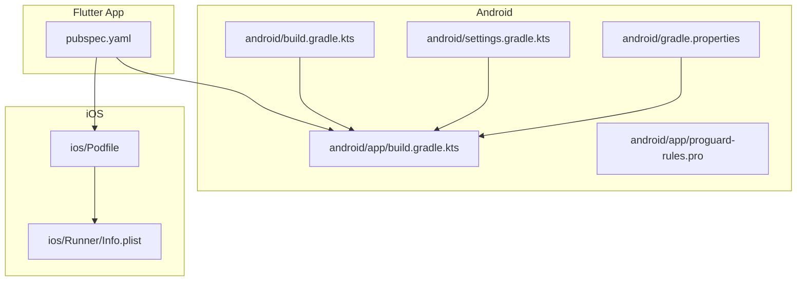
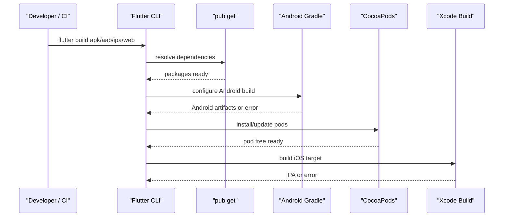
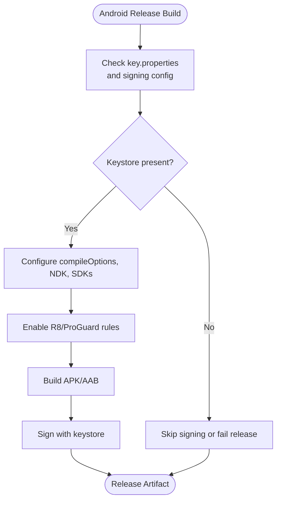
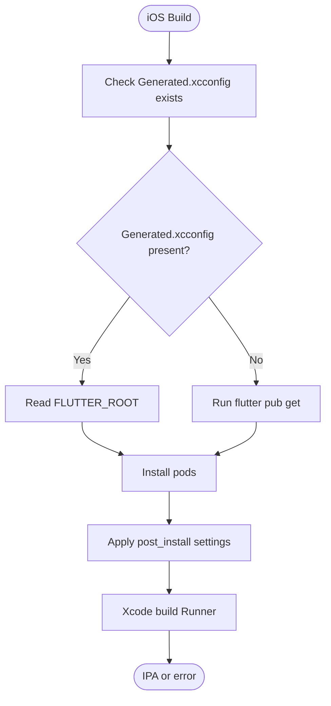
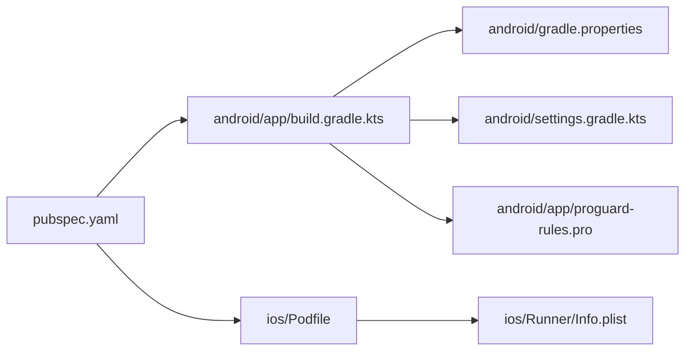

# Build & Deployment Issues

<cite>
**Referenced Files in This Document**
- [pubspec.yaml](file://pubspec.yaml)
- [android/build.gradle.kts](file://android/build.gradle.kts)
- [android/app/build.gradle.kts](file://android/app/build.gradle.kts)
- [android/gradle.properties](file://android/gradle.properties)
- [android/settings.gradle.kts](file://android/settings.gradle.kts)
- [android/app/proguard-rules.pro](file://android/app/proguard-rules.pro)
- [ios/Podfile](file://ios/Podfile)
- [ios/Runner/Info.plist](file://ios/Runner/Info.plist)
</cite>

## Table of Contents
1. [Introduction](#introduction)
2. [Project Structure](#project-structure)
3. [Core Components](#core-components)
4. [Architecture Overview](#architecture-overview)
5. [Detailed Component Analysis](#detailed-component-analysis)
6. [Dependency Analysis](#dependency-analysis)
7. [Performance Considerations](#performance-considerations)
8. [Troubleshooting Guide](#troubleshooting-guide)
9. [Conclusion](#conclusion)

## Introduction
This document provides comprehensive troubleshooting guidance for build and deployment issues across Android, iOS, and web platforms in this Flutter project. It focuses on common Gradle configuration problems, CocoaPods dependency conflicts, Flutter SDK version mismatches, signing certificate issues, app store submission rejections, code signing failures, platform-specific build errors, environment setup, dependency resolution, CI/CD pipeline failures, performance optimization during builds, memory usage issues, and deployment automation problems.

## Project Structure
The project is a multi-platform Flutter application with:
- Android module using Kotlin DSL Gradle scripts and ProGuard/R8 rules
- iOS module using CocoaPods and Xcode workspace
- Web assets and tooling under the web directory
- Flutter package metadata and dependencies defined in pubspec.yaml

**Diagram sources**
- [pubspec.yaml:1-152](file://pubspec.yaml#L1-L152)
- [android/build.gradle.kts:1-25](file://android/build.gradle.kts#L1-L25)
- [android/app/build.gradle.kts:1-99](file://android/app/build.gradle.kts#L1-L99)
- [android/gradle.properties:1-11](file://android/gradle.properties#L1-L11)
- [android/settings.gradle.kts:1-28](file://android/settings.gradle.kts#L1-L28)
- [android/app/proguard-rules.pro:1-29](file://android/app/proguard-rules.pro#L1-L29)
- [ios/Podfile:1-44](file://ios/Podfile#L1-L44)
- [ios/Runner/Info.plist:1-95](file://ios/Runner/Info.plist#L1-L95)

**Section sources**
- [pubspec.yaml:1-152](file://pubspec.yaml#L1-L152)
- [android/build.gradle.kts:1-25](file://android/build.gradle.kts#L1-L25)
- [android/app/build.gradle.kts:1-99](file://android/app/build.gradle.kts#L1-L99)
- [android/gradle.properties:1-11](file://android/gradle.properties#L1-L11)
- [android/settings.gradle.kts:1-28](file://android/settings.gradle.kts#L1-L28)
- [android/app/proguard-rules.pro:1-29](file://android/app/proguard-rules.pro#L1-L29)
- [ios/Podfile:1-44](file://ios/Podfile#L1-L44)
- [ios/Runner/Info.plist:1-95](file://ios/Runner/Info.plist#L1-L95)

## Core Components
- Flutter package definition and SDK constraints (pubspec.yaml)
- Android Gradle configuration and signing (android/build.gradle.kts, android/app/build.gradle.kts, android/gradle.properties, android/settings.gradle.kts)
- Android release shrinking rules (android/app/proguard-rules.pro)
- iOS CocoaPods integration (ios/Podfile)
- iOS runtime configuration and URL schemes (ios/Runner/Info.plist)

Key responsibilities:
- Versioning and dependency management via pubspec.yaml
- Android build toolchain, NDK, Java/Kotlin versions, and signing via Gradle
- iOS platform target and pod installation via Podfile
- Runtime permissions and capabilities via Info.plist

**Section sources**
- [pubspec.yaml:1-152](file://pubspec.yaml#L1-L152)
- [android/app/build.gradle.kts:1-99](file://android/app/build.gradle.kts#L1-L99)
- [android/gradle.properties:1-11](file://android/gradle.properties#L1-L11)
- [android/settings.gradle.kts:1-28](file://android/settings.gradle.kts#L1-L28)
- [android/app/proguard-rules.pro:1-29](file://android/app/proguard-rules.pro#L1-L29)
- [ios/Podfile:1-44](file://ios/Podfile#L1-L44)
- [ios/Runner/Info.plist:1-95](file://ios/Runner/Info.plist#L1-L95)

## Architecture Overview
Build flow overview from Flutter to native targets:

**Diagram sources**
- [pubspec.yaml:1-152](file://pubspec.yaml#L1-L152)
- [android/app/build.gradle.kts:1-99](file://android/app/build.gradle.kts#L1-L99)
- [ios/Podfile:1-44](file://ios/Podfile#L1-L44)

## Detailed Component Analysis

### Android Build System
Responsibilities:
- Repository configuration and shared build directories
- Application plugin, Flutter plugin, and Google Services plugin
- Compile options (Java 17), NDK, min/target SDKs
- Signing configuration for release builds
- R8/ProGuard rules for release shrinkage
- Kotlin JVM target

Common issues and resolutions:
- Missing or invalid keystore properties cause release build failures. Ensure key.properties exists at the expected location and contains required fields. If absent, release signing will be skipped or fail depending on configuration.
- Java/Kotlin version mismatch between Gradle and local JDK can cause compilation errors. The project targets Java 17 and Kotlin JVM 17; ensure your environment uses a compatible JDK.
- Out-of-memory errors during Gradle builds are mitigated by JVM arguments in gradle.properties. Adjust heap sizes if needed for large projects or CI runners.
- NDK and compileSdk versions are derived from Flutter tooling; ensure Flutter SDK is correctly installed and accessible.

**Diagram sources**
- [android/app/build.gradle.kts:55-83](file://android/app/build.gradle.kts#L55-L83)
- [android/app/proguard-rules.pro:1-29](file://android/app/proguard-rules.pro#L1-L29)

**Section sources**
- [android/build.gradle.kts:1-25](file://android/build.gradle.kts#L1-L25)
- [android/app/build.gradle.kts:1-99](file://android/app/build.gradle.kts#L1-L99)
- [android/gradle.properties:1-11](file://android/gradle.properties#L1-L11)
- [android/settings.gradle.kts:1-28](file://android/settings.gradle.kts#L1-L28)
- [android/app/proguard-rules.pro:1-29](file://android/app/proguard-rules.pro#L1-L29)

### iOS Build System (CocoaPods + Xcode)
Responsibilities:
- Define minimum iOS platform
- Disable CocoaPods analytics to reduce build latency
- Integrate Flutter’s generated xcconfig and podhelper
- Configure Runner target and test target
- Post-install hook to apply additional build settings

Common issues and resolutions:
- Missing Generated.xcconfig causes CocoaPods to fail when running pod install manually. Run flutter pub get first to generate required files.
- FLUTTER_ROOT not found indicates misconfiguration or missing generated files. Re-run flutter pub get and ensure paths are correct.
- Resource copy script errors may occur if Pods are not properly installed. Re-run pod install to update resource scripts.

**Diagram sources**
- [ios/Podfile:13-28](file://ios/Podfile#L13-L28)
- [ios/Podfile:39-43](file://ios/Podfile#L39-L43)

**Section sources**
- [ios/Podfile:1-44](file://ios/Podfile#L1-L44)

### Flutter SDK and Dependency Management
Responsibilities:
- Declare Dart SDK constraint and Flutter SDK dependency
- Manage third-party packages and dev dependencies
- Configure Flutter assets and fonts
- Generate launcher icons for Android and iOS

Common issues and resolutions:
- Dart SDK version mismatch between local Flutter SDK and pubspec.yaml environment constraint leads to resolution failures. Align your Flutter/Dart SDK with the declared constraint.
- Package version conflicts can arise from transitive dependencies. Use flutter pub upgrade --major-versions cautiously and verify compatibility.
- Assets or fonts not included due to incorrect paths in pubspec.yaml lead to runtime errors. Validate asset declarations.

**Section sources**
- [pubspec.yaml:1-152](file://pubspec.yaml#L1-L152)

### iOS Runtime Configuration
Responsibilities:
- Provide API keys via environment variables
- Define URL schemes for deep linking
- Set background modes for notifications and fetch
- Configure display name and bundle identifiers

Common issues and resolutions:
- Missing GOOGLE_MAPS_API_KEY at runtime results in map features failing. Ensure the environment variable is set during development and distribution.
- URL scheme misconfiguration prevents deep link handling. Verify CFBundleURLTypes entries match your app’s routing expectations.
- Background modes must include appropriate values for push notifications and background fetch.

**Section sources**
- [ios/Runner/Info.plist:1-95](file://ios/Runner/Info.plist#L1-L95)

## Dependency Analysis
Inter-module relationships and external integrations:

**Diagram sources**
- [pubspec.yaml:1-152](file://pubspec.yaml#L1-L152)
- [android/app/build.gradle.kts:1-99](file://android/app/build.gradle.kts#L1-L99)
- [android/gradle.properties:1-11](file://android/gradle.properties#L1-L11)
- [android/settings.gradle.kts:1-28](file://android/settings.gradle.kts#L1-L28)
- [android/app/proguard-rules.pro:1-29](file://android/app/proguard-rules.pro#L1-L29)
- [ios/Podfile:1-44](file://ios/Podfile#L1-L44)
- [ios/Runner/Info.plist:1-95](file://ios/Runner/Info.plist#L1-L95)

**Section sources**
- [pubspec.yaml:1-152](file://pubspec.yaml#L1-L152)
- [android/app/build.gradle.kts:1-99](file://android/app/build.gradle.kts#L1-L99)
- [android/gradle.properties:1-11](file://android/gradle.properties#L1-L11)
- [android/settings.gradle.kts:1-28](file://android/settings.gradle.kts#L1-L28)
- [android/app/proguard-rules.pro:1-29](file://android/app/proguard-rules.pro#L1-L29)
- [ios/Podfile:1-44](file://ios/Podfile#L1-L44)
- [ios/Runner/Info.plist:1-95](file://ios/Runner/Info.plist#L1-L95)

## Performance Considerations
- Android Gradle memory tuning: The project sets JVM args for Gradle and Kotlin daemon to avoid OOM during builds. If builds still fail with out-of-memory errors, increase org.gradle.jvmargs and kotlin.daemon.jvmargs appropriately for your CI runner capacity.
- CocoaPods analytics disabled: Disabling stats reduces synchronous network calls that can slow down Flutter builds on iOS. Keep this enabled in CI environments to improve throughput.
- R8/ProGuard shrinking: Enabled for release builds to reduce artifact size and improve load times. Ensure keep rules in proguard-rules.pro are accurate to avoid runtime reflection issues.

[No sources needed since this section provides general guidance]

## Troubleshooting Guide

### Android: Gradle Configuration Issues
Symptoms:
- Build fails due to incompatible Java/Kotlin versions
- Out-of-memory errors during Gradle tasks
- Missing repositories or plugin resolution failures

Resolutions:
- Ensure your local JDK matches the project’s Java 17 requirement. Update JAVA_HOME or IDE settings accordingly.
- Increase Gradle JVM heap sizes in gradle.properties if builds exceed available memory.
- Verify repository blocks and plugin versions in settings.gradle.kts and build.gradle.kts.

**Section sources**
- [android/app/build.gradle.kts:33-37](file://android/app/build.gradle.kts#L33-L37)
- [android/app/build.gradle.kts:86-90](file://android/app/build.gradle.kts#L86-L90)
- [android/gradle.properties:1-5](file://android/gradle.properties#L1-L5)
- [android/settings.gradle.kts:13-25](file://android/settings.gradle.kts#L13-L25)

### Android: Signing Certificate Problems
Symptoms:
- Release build fails due to missing keystore or invalid credentials
- Play Store rejects uploads due to signature mismatches

Resolutions:
- Confirm key.properties exists at the expected path and includes storeFile, storePassword, keyAlias, and keyPassword.
- Validate keystore integrity and passwords. Re-sign only if you have the original keystore; otherwise, you cannot publish updates without it.
- Ensure signingConfig is applied to the release buildType.

**Section sources**
- [android/app/build.gradle.kts:3-11](file://android/app/build.gradle.kts#L3-L11)
- [android/app/build.gradle.kts:55-64](file://android/app/build.gradle.kts#L55-L64)
- [android/app/build.gradle.kts:66-83](file://android/app/build.gradle.kts#L66-L83)

### Android: ProGuard/R8 Release Errors
Symptoms:
- Runtime crashes in release builds due to reflection or JSON deserialization issues
- Firebase Messaging services not found at runtime

Resolutions:
- Review and extend proguard-rules.pro to keep classes used via reflection or dynamic loading.
- Keep attributes like Signature and annotations if your libraries rely on them.
- Ensure Firebase messaging service classes are preserved.

**Section sources**
- [android/app/proguard-rules.pro:1-29](file://android/app/proguard-rules.pro#L1-L29)

### iOS: CocoaPods Dependency Conflicts
Symptoms:
- pod install fails due to missing Generated.xcconfig or FLUTTER_ROOT
- Resource copy script errors after pod install
- Slow pod install affecting Flutter build time

Resolutions:
- Run flutter pub get before pod install to generate required xcconfig files.
- Ensure FLUTTER_ROOT is resolvable from Generated.xcconfig.
- Keep COCOAPODS_DISABLE_STATS enabled to reduce latency.
- Re-run pod install to fix resource scripts.

**Section sources**
- [ios/Podfile:4-5](file://ios/Podfile#L4-L5)
- [ios/Podfile:13-28](file://ios/Podfile#L13-L28)
- [ios/Podfile:39-43](file://ios/Podfile#L39-L43)

### iOS: Code Signing Failures
Symptoms:
- Xcode reports provisioning profile or certificate errors
- TestFlight or App Store submissions fail due to signing issues

Resolutions:
- Ensure the correct provisioning profile and certificates are installed in Keychain and Xcode signing settings.
- Verify Bundle Identifier and URL schemes in Info.plist match your Apple Developer account configuration.
- For push notifications, confirm backend and APNS settings align with production vs. development profiles.

**Section sources**
- [ios/Runner/Info.plist:31-43](file://ios/Runner/Info.plist#L31-L43)
- [ios/Runner/Info.plist:88-92](file://ios/Runner/Info.plist#L88-L92)

### Flutter SDK Version Mismatches
Symptoms:
- dart analyze or pub get fails due to SDK constraint violations
- Plugin incompatibilities after upgrading Flutter

Resolutions:
- Align your Flutter SDK with the environment.sdk constraint in pubspec.yaml.
- Use flutter clean and flutter pub get to refresh resolved dependencies.
- Review major version upgrades for breaking changes in critical plugins.

**Section sources**
- [pubspec.yaml:21-23](file://pubspec.yaml#L21-L23)
- [pubspec.yaml:30-76](file://pubspec.yaml#L30-L76)

### App Store Submission Rejections
Symptoms:
- Rejection due to missing privacy descriptions or improper URL schemes
- Push notification entitlements mismatch

Resolutions:
- Add required usage descriptions (e.g., Face ID, location) in Info.plist.
- Validate URL schemes and ensure they are registered in your developer portal.
- Confirm background modes and remote-notification entitlements are configured.

**Section sources**
- [ios/Runner/Info.plist:21-24](file://ios/Runner/Info.plist#L21-L24)
- [ios/Runner/Info.plist:31-43](file://ios/Runner/Info.plist#L31-L43)
- [ios/Runner/Info.plist:88-92](file://ios/Runner/Info.plist#L88-L92)

### Development Environment Setup Issues
Symptoms:
- Android Studio or VS Code cannot find Flutter SDK
- Gradle wrapper or Kotlin compiler errors

Resolutions:
- Ensure local.properties has flutter.sdk set and points to a valid Flutter installation.
- Verify Android SDK and NDK paths are configured.
- Update Gradle wrapper and Kotlin versions if necessary.

**Section sources**
- [android/settings.gradle.kts:1-11](file://android/settings.gradle.kts#L1-L11)
- [android/app/build.gradle.kts:28-32](file://android/app/build.gradle.kts#L28-L32)

### CI/CD Pipeline Failures
Symptoms:
- Builds fail due to missing secrets (keystore, API keys)
- CocoaPods or Gradle cache corruption
- Timeouts due to slow dependency resolution

Resolutions:
- Inject keystore and API keys securely into CI environment variables.
- Cache Flutter SDK, Gradle, and Pods directories to speed up builds.
- Pin versions for Flutter, Gradle, CocoaPods, and Xcode to ensure deterministic builds.
- Enable parallel jobs where supported and monitor memory usage.

[No sources needed since this section provides general guidance]

### Memory Usage and Build Optimization
Symptoms:
- Gradle daemon OOM kills mid-build
- Long pod install times

Resolutions:
- Tune org.gradle.jvmargs and kotlin.daemon.jvmargs based on CI runner capacity.
- Keep COCOAPODS_DISABLE_STATS enabled.
- Use incremental builds and caches for Flutter, Gradle, and Pods.

**Section sources**
- [android/gradle.properties:1-5](file://android/gradle.properties#L1-L5)
- [ios/Podfile:4-5](file://ios/Podfile#L4-L5)

## Conclusion
This guide consolidates the most common build and deployment pitfalls across Android, iOS, and web within this Flutter project. By aligning SDK versions, ensuring proper signing configurations, resolving dependency conflicts, and optimizing build performance, teams can achieve reliable and fast releases. Use the referenced files as anchors for diagnosing and fixing issues, and adopt the recommended practices for CI/CD stability and scalability.