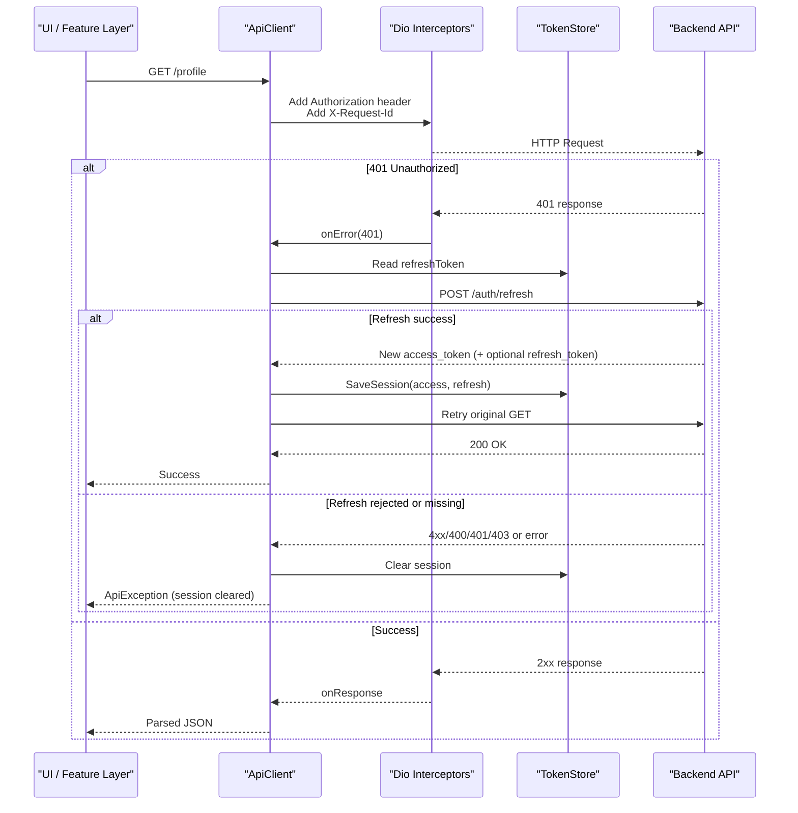
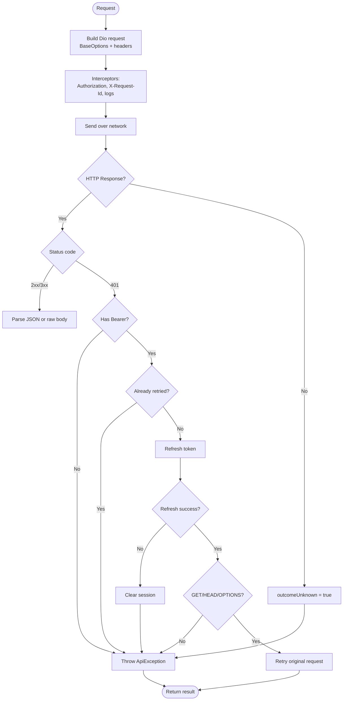
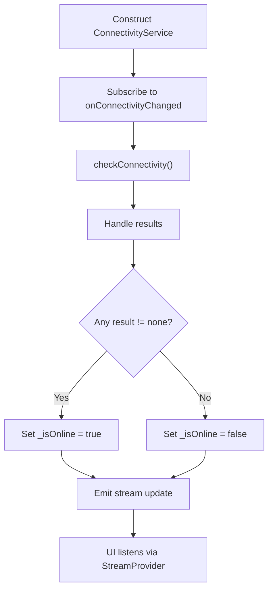
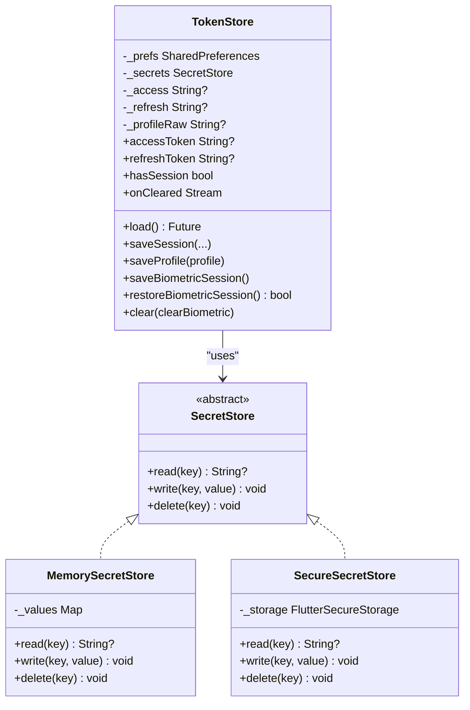
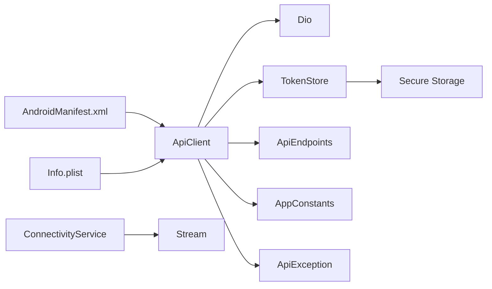

# Network & API Issues

<cite>
**Referenced Files in This Document**
- [api_client.dart](file://lib/core/network/api_client.dart)
- [connectivity_service.dart](file://lib/core/network/connectivity_service.dart)
- [token_store.dart](file://lib/core/network/token_store.dart)
- [api_exception.dart](file://lib/core/network/api_exception.dart)
- [app_constants.dart](file://lib/core/constants/app_constants.dart)
- [api_endpoints.dart](file://lib/core/network/api_endpoints.dart)
- [AndroidManifest.xml](file://android/app/src/main/AndroidManifest.xml)
- [Info.plist](file://ios/Runner/Info.plist)
</cite>

## Table of Contents
1. [Introduction](#introduction)
2. [Project Structure](#project-structure)
3. [Core Components](#core-components)
4. [Architecture Overview](#architecture-overview)
5. [Detailed Component Analysis](#detailed-component-analysis)
6. [Dependency Analysis](#dependency-analysis)
7. [Performance Considerations](#performance-considerations)
8. [Troubleshooting Guide](#troubleshooting-guide)
9. [Conclusion](#conclusion)

## Introduction
This document provides troubleshooting guidance for network and API-related issues in the LidaPay Flutter application. It focuses on diagnosing connectivity problems, analyzing API client behavior, handling authentication token failures, interpreting HTTP errors, and addressing platform-specific networking constraints on Android and iOS. The guidance is derived from the application’s Dio-based API client, connectivity service, token persistence layer, exception model, and platform manifests.

## Project Structure
The networking stack is centered under `lib/core/network`, with configuration constants and endpoint definitions supporting a centralized HTTP client. Platform permissions and background capabilities are declared in the Android manifest and iOS Info.plist.

```mermaid
graph TB
subgraph "Flutter App"
UI["UI Layer"]
Providers["Riverpod Providers"]
end
subgraph "Networking Core"
ApiClient["ApiClient<br/>Dio client + interceptors"]
Connectivity["ConnectivityService<br/>online/offline stream"]
TokenStore["TokenStore<br/>secure session storage"]
ApiException["ApiException<br/>user-friendly errors"]
Endpoints["ApiEndpoints<br/>route paths"]
Constants["AppConstants<br/>base URL + timeouts"]
end
subgraph "Platform"
Android["AndroidManifest.xml<br/>permissions"]
iOS["Info.plist<br/>background modes"]
end
subgraph "Backend"
Backend["LidaPay API<br/>https://api.advansistechnologies.com"]
end
UI --> Providers
Providers --> ApiClient
ApiClient --> Connectivity
ApiClient --> TokenStore
ApiClient --> Endpoints
ApiClient --> Constants
ApiClient --> ApiException
ApiClient --> Backend
Android --> ApiClient
iOS --> ApiClient
```

**Diagram sources**
- [api_client.dart:13-135](file://lib/core/network/api_client.dart#L13-L135)
- [connectivity_service.dart:16-45](file://lib/core/network/connectivity_service.dart#L16-L45)
- [token_store.dart:74-105](file://lib/core/network/token_store.dart#L74-L105)
- [api_exception.dart:5-38](file://lib/core/network/api_exception.dart#L5-L38)
- [api_endpoints.dart:1-6](file://lib/core/network/api_endpoints.dart#L1-L6)
- [app_constants.dart:1-12](file://lib/core/constants/app_constants.dart#L1-L12)
- [AndroidManifest.xml:1-10](file://android/app/src/main/AndroidManifest.xml#L1-L10)
- [Info.plist:88-92](file://ios/Runner/Info.plist#L88-L92)

**Section sources**
- [api_client.dart:13-135](file://lib/core/network/api_client.dart#L13-L135)
- [connectivity_service.dart:16-45](file://lib/core/network/connectivity_service.dart#L16-L45)
- [token_store.dart:74-105](file://lib/core/network/token_store.dart#L74-L105)
- [api_exception.dart:5-38](file://lib/core/network/api_exception.dart#L5-L38)
- [api_endpoints.dart:1-6](file://lib/core/network/api_endpoints.dart#L1-L6)
- [app_constants.dart:1-12](file://lib/core/constants/app_constants.dart#L1-L12)
- [AndroidManifest.xml:1-10](file://android/app/src/main/AndroidManifest.xml#L1-L10)
- [Info.plist:88-92](file://ios/Runner/Info.plist#L88-L92)

## Core Components
- ApiClient: Centralized Dio client that injects authorization headers, logs requests/responses/errors (with sensitive data redaction), handles 401 single-flight token refresh, and maps Dio exceptions to user-friendly `ApiException`.
- ConnectivityService: Wraps `connectivity_plus` to expose an online/offline stream and current state.
- TokenStore: Securely persists access and refresh tokens, supports biometric session snapshots, migration from legacy plaintext storage, and emits a cleared-session stream.
- ApiException: Normalizes Dio errors into actionable messages and flags whether the server outcome is unknown.
- AppConstants: Defines base URL and timeout durations used by the HTTP client.
- ApiEndpoints: Centralizes route paths consumed by the API client and feature layers.

Key responsibilities:
- Network configuration and request lifecycle: [api_client.dart:125-135](file://lib/core/network/api_client.dart#L125-L135)
- Authorization header injection and debug logging: [api_client.dart:25-57](file://lib/core/network/api_client.dart#L25-L57)
- 401 retry and token refresh flow: [api_client.dart:58-83](file://lib/core/network/api_client.dart#L58-L83), [api_client.dart:204-265](file://lib/core/network/api_client.dart#L204-L265)
- Online/offline detection: [connectivity_service.dart:16-45](file://lib/core/network/connectivity_service.dart#L16-L45)
- Token persistence and clearing: [token_store.dart:74-105](file://lib/core/network/token_store.dart#L74-L105), [token_store.dart:148-170](file://lib/core/network/token_store.dart#L148-L170), [token_store.dart:221-236](file://lib/core/network/token_store.dart#L221-L236)
- Error normalization: [api_exception.dart:22-38](file://lib/core/network/api_exception.dart#L22-L38)
- Base URL and timeouts: [app_constants.dart:6-12](file://lib/core/constants/app_constants.dart#L6-L12)

**Section sources**
- [api_client.dart:13-135](file://lib/core/network/api_client.dart#L13-L135)
- [connectivity_service.dart:16-45](file://lib/core/network/connectivity_service.dart#L16-L45)
- [token_store.dart:74-105](file://lib/core/network/token_store.dart#L74-L105)
- [api_exception.dart:5-38](file://lib/core/network/api_exception.dart#L5-L38)
- [app_constants.dart:6-12](file://lib/core/constants/app_constants.dart#L6-L12)
- [api_endpoints.dart:1-6](file://lib/core/network/api_endpoints.dart#L1-L6)

## Architecture Overview
The API client is the single entry point for backend communication. It configures Dio with base URL and timeouts, attaches interceptors for logging and authentication, and converts low-level transport errors into domain exceptions. Authentication uses bearer tokens stored securely; on 401, it attempts a single-flight refresh using the refresh endpoint before retrying once.



**Diagram sources**
- [api_client.dart:25-83](file://lib/core/network/api_client.dart#L25-L83)
- [api_client.dart:204-265](file://lib/core/network/api_client.dart#L204-L265)
- [api_endpoints.dart:6](file://lib/core/network/api_endpoints.dart#L6)
- [token_store.dart:148-170](file://lib/core/network/token_store.dart#L148-L170)

**Section sources**
- [api_client.dart:25-83](file://lib/core/network/api_client.dart#L25-L83)
- [api_client.dart:204-265](file://lib/core/network/api_client.dart#L204-L265)
- [api_endpoints.dart:6](file://lib/core/network/api_endpoints.dart#L6)
- [token_store.dart:148-170](file://lib/core/network/token_store.dart#L148-L170)

## Detailed Component Analysis

### ApiClient: HTTP Client, Logging, and Token Refresh
Responsibilities:
- Configure Dio with base URL and timeouts.
- Inject Authorization and request ID headers.
- Redact sensitive fields in debug logs.
- Convert Dio exceptions to `ApiException`.
- Single-flight 401 refresh with one retry for safe methods.

Key behaviors:
- Timeouts: connect/send use a shorter timeout; receive uses a longer timeout to accommodate slow provider round-trips.
- Sensitive data redaction: keys like password, token, secret, otp, pin are masked in logs.
- 401 handling: only retries GET/HEAD/OPTIONS after successful refresh; marks the request as retried via extra flag to prevent infinite loops.
- Refresh logic: reads refresh token, posts to refresh endpoint, saves new tokens, and clears session on explicit rejection codes.



**Diagram sources**
- [api_client.dart:125-135](file://lib/core/network/api_client.dart#L125-L135)
- [api_client.dart:25-83](file://lib/core/network/api_client.dart#L25-L83)
- [api_client.dart:86-113](file://lib/core/network/api_client.dart#L86-L113)
- [api_client.dart:195-202](file://lib/core/network/api_client.dart#L195-L202)
- [api_client.dart:204-265](file://lib/core/network/api_client.dart#L204-L265)

**Section sources**
- [api_client.dart:125-135](file://lib/core/network/api_client.dart#L125-L135)
- [api_client.dart:25-83](file://lib/core/network/api_client.dart#L25-L83)
- [api_client.dart:86-113](file://lib/core/network/api_client.dart#L86-L113)
- [api_client.dart:195-202](file://lib/core/network/api_client.dart#L195-L202)
- [api_client.dart:204-265](file://lib/core/network/api_client.dart#L204-L265)

### ConnectivityService: Online/Offline Detection
Responsibilities:
- Subscribe to platform connectivity changes.
- Emit a broadcast stream of online/offline state.
- Provide a cached `isOnline` value.

Diagnostic notes:
- The service considers any non-none connectivity result as online.
- Initial check runs on construction; errors during initial check are ignored.



**Diagram sources**
- [connectivity_service.dart:16-45](file://lib/core/network/connectivity_service.dart#L16-L45)

**Section sources**
- [connectivity_service.dart:16-45](file://lib/core/network/connectivity_service.dart#L16-L45)

### TokenStore: Secure Session Persistence
Responsibilities:
- Persist access and refresh tokens in secure storage.
- Migrate legacy plaintext tokens to secure storage.
- Support biometric session snapshots.
- Emit a cleared-session stream when tokens are invalidated.

Important behaviors:
- `load()` migrates legacy keys and degrades gracefully if keystore fails.
- `saveSession()` updates in-memory mirror and writes to secure storage.
- `clear()` wipes persisted secrets and notifies listeners.



**Diagram sources**
- [token_store.dart:26-69](file://lib/core/network/token_store.dart#L26-L69)
- [token_store.dart:74-105](file://lib/core/network/token_store.dart#L74-L105)
- [token_store.dart:120-170](file://lib/core/network/token_store.dart#L120-L170)
- [token_store.dart:177-236](file://lib/core/network/token_store.dart#L177-L236)

**Section sources**
- [token_store.dart:26-69](file://lib/core/network/token_store.dart#L26-L69)
- [token_store.dart:74-105](file://lib/core/network/token_store.dart#L74-L105)
- [token_store.dart:120-170](file://lib/core/network/token_store.dart#L120-L170)
- [token_store.dart:177-236](file://lib/core/network/token_store.dart#L177-L236)

### ApiException: User-Friendly Error Modeling
Responsibilities:
- Normalize Dio errors into friendly messages.
- Preserve backend error codes where available.
- Flag outcomes as unknown when no server response was received.

Common mappings:
- Connection/receive/send timeouts map to a generic timeout message.
- Connection errors map to offline messaging.
- Certain backend messages are sanitized for customer-facing screens.

**Section sources**
- [api_exception.dart:5-38](file://lib/core/network/api_exception.dart#L5-L38)
- [api_exception.dart:40-74](file://lib/core/network/api_exception.dart#L40-L74)

### AppConstants and ApiEndpoints: Configuration and Routes
- Base URL is configurable via build-time environment variable; default points to the live backend.
- Timeouts define connect/send vs receive behavior.
- Endpoint constants centralize route paths consumed by the API client and features.

**Section sources**
- [app_constants.dart:6-12](file://lib/core/constants/app_constants.dart#L6-L12)
- [api_endpoints.dart:1-6](file://lib/core/network/api_endpoints.dart#L1-L6)

## Dependency Analysis
The following diagram shows how core networking components depend on each other and on platform configuration.



**Diagram sources**
- [api_client.dart:1-11](file://lib/core/network/api_client.dart#L1-L11)
- [api_client.dart:125-135](file://lib/core/network/api_client.dart#L125-L135)
- [connectivity_service.dart:1-9](file://lib/core/network/connectivity_service.dart#L1-L9)
- [token_store.dart:1-7](file://lib/core/network/token_store.dart#L1-L7)
- [AndroidManifest.xml:1-10](file://android/app/src/main/AndroidManifest.xml#L1-L10)
- [Info.plist:88-92](file://ios/Runner/Info.plist#L88-L92)

**Section sources**
- [api_client.dart:1-11](file://lib/core/network/api_client.dart#L1-L11)
- [connectivity_service.dart:1-9](file://lib/core/network/connectivity_service.dart#L1-L9)
- [token_store.dart:1-7](file://lib/core/network/token_store.dart#L1-L7)
- [AndroidManifest.xml:1-10](file://android/app/src/main/AndroidManifest.xml#L1-L10)
- [Info.plist:88-92](file://ios/Runner/Info.plist#L88-L92)

## Performance Considerations
- Timeouts: Connect/send timeouts are shorter than receive timeouts to fail fast on dead links while allowing slower third-party endpoints to complete.
- Single-flight refresh: Concurrent 401 errors share one refresh operation to avoid token race conditions.
- Logging overhead: Debug-mode logging adds I/O; ensure it is disabled in release builds to reduce overhead.
- Token persistence: In-memory mirrors avoid disk I/O on hot paths; secure storage is used for persistence.

[No sources needed since this section provides general guidance]

## Troubleshooting Guide

### Common Network Connectivity Problems
Symptoms:
- Frequent “No internet connection” or timeout errors.
- Intermittent failures on certain networks.

Diagnostic steps:
1. Verify device connectivity:
   - Use the app’s online/offline stream to confirm connectivity state transitions.
   - Confirm that at least one connectivity result is not none.
2. Validate platform permissions:
   - Android: Ensure `INTERNET` and `ACCESS_NETWORK_STATE` are present.
   - iOS: Confirm background modes are configured if background fetch is required.
3. Test DNS and reachability:
   - Try accessing the base URL in a browser or via curl to rule out DNS/proxy issues.
4. Inspect connectivity stream emissions:
   - Observe whether the stream reports frequent toggling between online/offline.

Relevant implementation references:
- Connectivity stream and state: [connectivity_service.dart:16-45](file://lib/core/network/connectivity_service.dart#L16-L45)
- Android permissions: [AndroidManifest.xml:1-10](file://android/app/src/main/AndroidManifest.xml#L1-L10)
- iOS background modes: [Info.plist:88-92](file://ios/Runner/Info.plist#L88-L92)

**Section sources**
- [connectivity_service.dart:16-45](file://lib/core/network/connectivity_service.dart#L16-L45)
- [AndroidManifest.xml:1-10](file://android/app/src/main/AndroidManifest.xml#L1-L10)
- [Info.plist:88-92](file://ios/Runner/Info.plist#L88-L92)

### API Timeout Errors
Symptoms:
- Requests time out on connect/send or receive phases.
- Slow providers cause delayed responses.

Diagnostic steps:
1. Identify timeout type:
   - Connection/send timeout indicates network reachability or TLS handshake delays.
   - Receive timeout indicates slow server processing or large payloads.
2. Review configured timeouts:
   - Connect/send timeout is shorter than receive timeout.
3. Check for proxy/firewall interference:
   - Corporate networks may delay TLS handshakes or block domains.
4. Reproduce with reduced payload size:
   - If receive timeouts disappear with smaller payloads, investigate server-side performance.

Relevant implementation references:
- BaseOptions timeouts: [api_client.dart:125-135](file://lib/core/network/api_client.dart#L125-L135)
- Timeout fallback messages: [api_exception.dart:66-74](file://lib/core/network/api_exception.dart#L66-L74)

**Section sources**
- [api_client.dart:125-135](file://lib/core/network/api_client.dart#L125-L135)
- [api_exception.dart:66-74](file://lib/core/network/api_exception.dart#L66-L74)

### Authentication Token Failures
Symptoms:
- Repeated 401 responses.
- Unexpected sign-outs after resume or background tasks.

Diagnostic steps:
1. Check token presence:
   - Ensure access and refresh tokens exist in secure storage.
2. Inspect refresh flow:
   - On 401, the client attempts a single-flight refresh using the refresh endpoint.
   - Only safe methods (GET/HEAD/OPTIONS) are retried after refresh.
3. Validate refresh endpoint response:
   - Missing or invalid access token causes session clear.
   - Explicit rejection codes (400/401/403) during refresh clear the session.
4. Correlate with device info:
   - Refresh includes device platform, ID, app version, locale, and FCM token when available.

Relevant implementation references:
- 401 interceptor logic: [api_client.dart:58-83](file://lib/core/network/api_client.dart#L58-L83)
- Refresh endpoint path: [api_endpoints.dart:6](file://lib/core/network/api_endpoints.dart#L6)
- Refresh logic and token saving: [api_client.dart:211-265](file://lib/core/network/api_client.dart#L211-L265)
- Token store save/clear: [token_store.dart:148-170](file://lib/core/network/token_store.dart#L148-L170), [token_store.dart:221-236](file://lib/core/network/token_store.dart#L221-L236)

**Section sources**
- [api_client.dart:58-83](file://lib/core/network/api_client.dart#L58-L83)
- [api_client.dart:211-265](file://lib/core/network/api_client.dart#L211-L265)
- [api_endpoints.dart:6](file://lib/core/network/api_endpoints.dart#L6)
- [token_store.dart:148-170](file://lib/core/network/token_store.dart#L148-L170)
- [token_store.dart:221-236](file://lib/core/network/token_store.dart#L221-L236)

### HTTP Request/Response Issues
Symptoms:
- Malformed JSON parsing errors.
- Unexpected response shapes.

Diagnostic steps:
1. Enable debug logging:
   - Requests, responses, and errors are printed in debug mode with sensitive fields redacted.
2. Inspect request headers:
   - Ensure Authorization and X-Request-Id are present.
3. Validate response parsing:
   - Some endpoints return raw types; use appropriate client methods (`getRaw`, `postRaw`, etc.).
4. Correlate with backend error shape:
   - Backend NestJS errors include message and error fields; these are normalized.

Relevant implementation references:
- Debug logging and redaction: [api_client.dart:25-57](file://lib/core/network/api_client.dart#L25-L57), [api_client.dart:86-113](file://lib/core/network/api_client.dart#L86-L113)
- Raw response methods: [api_client.dart:147-182](file://lib/core/network/api_client.dart#L147-L182)
- Error normalization: [api_exception.dart:22-38](file://lib/core/network/api_exception.dart#L22-L38)

**Section sources**
- [api_client.dart:25-57](file://lib/core/network/api_client.dart#L25-L57)
- [api_client.dart:86-113](file://lib/core/network/api_client.dart#L86-L113)
- [api_client.dart:147-182](file://lib/core/network/api_client.dart#L147-L182)
- [api_exception.dart:22-38](file://lib/core/network/api_exception.dart#L22-L38)

### CORS or SSL Certificate Issues
Symptoms:
- Browser-based web builds report CORS errors.
- SSL certificate validation failures on custom domains or proxies.

Diagnostic steps:
1. Verify base URL:
   - Ensure `API_BASE_URL` points to a valid HTTPS endpoint.
2. Check server CORS configuration:
   - For web builds, ensure the backend allows the app origin and required headers/methods.
3. Validate certificates:
   - Ensure the server presents a trusted certificate chain.
4. Avoid disabling certificate validation:
   - Do not bypass TLS checks in production; fix server configuration instead.

Relevant implementation references:
- Base URL configuration: [app_constants.dart:6-9](file://lib/core/constants/app_constants.dart#L6-L9)

**Section sources**
- [app_constants.dart:6-9](file://lib/core/constants/app_constants.dart#L6-L9)

### Retry Mechanisms and Idempotency
Current behavior:
- Automatic retry occurs only for safe methods after a successful token refresh.
- Non-safe methods are not retried automatically to prevent duplicate side effects.
- `ApiException.outcomeUnknown` indicates cases where the server may have applied the write despite no response.

Recommendations:
- For idempotent operations, implement client-side retry with exponential backoff and jitter.
- For non-idempotent operations, rely on server idempotency keys or deduplication.
- Surface actionable messages to users based on `ApiException.message` and `statusCode`.

Relevant implementation references:
- Safe-method retry guard: [api_client.dart:71-77](file://lib/core/network/api_client.dart#L71-L77)
- Unknown outcome flag: [api_exception.dart:17-20](file://lib/core/network/api_exception.dart#L17-L20)

**Section sources**
- [api_client.dart:71-77](file://lib/core/network/api_client.dart#L71-L77)
- [api_exception.dart:17-20](file://lib/core/network/api_exception.dart#L17-L20)

### Connection Pooling Problems
Observations:
- The application uses Dio without explicit pooling configuration in the analyzed files.
- Connection reuse depends on Dio’s defaults and underlying platform networking stacks.

Recommendations:
- Monitor connection churn and reconnection spikes.
- Tune keep-alive settings at the platform level if necessary.
- Profile network usage to detect excessive socket creation.

[No sources needed since this section provides general guidance]

### Rate Limiting Scenarios
Observations:
- No built-in rate limiting is implemented in the analyzed networking components.
- Backend may return 429 Too Many Requests or similar status codes.

Recommendations:
- Implement client-side rate limiting per endpoint or globally.
- Respect server-provided retry-after headers when available.
- Exponential backoff with jitter for transient 429/5xx responses.

[No sources needed since this section provides general guidance]

### Platform-Specific Networking Differences

#### Android
- Permissions:
  - Internet access requires `INTERNET`.
  - Network state inspection requires `ACCESS_NETWORK_STATE`.
- Background limitations:
  - Foreground services or work managers may be needed for long-running tasks.
- Proxy/DNS quirks:
  - Some OEM ROMs alter DNS or enforce strict TLS policies.

Relevant implementation references:
- Manifest permissions: [AndroidManifest.xml:1-10](file://android/app/src/main/AndroidManifest.xml#L1-L10)

**Section sources**
- [AndroidManifest.xml:1-10](file://android/app/src/main/AndroidManifest.xml#L1-L10)

#### iOS
- Background modes:
  - `fetch` and `remote-notification` are declared for background tasks.
- ATS (App Transport Security):
  - Ensure backend domains are allowed; do not disable ATS globally.
- Push notifications:
  - Device token is included in refresh requests when available.

Relevant implementation references:
- Background modes: [Info.plist:88-92](file://ios/Runner/Info.plist#L88-L92)
- Refresh includes device token: [api_client.dart:218-224](file://lib/core/network/api_client.dart#L218-L224)

**Section sources**
- [Info.plist:88-92](file://ios/Runner/Info.plist#L88-L92)
- [api_client.dart:218-224](file://lib/core/network/api_client.dart#L218-L224)

## Conclusion
The LidaPay networking stack centers around a robust Dio client with secure token management, structured error modeling, and platform-aware configuration. Most network issues can be diagnosed by correlating connectivity state, timeout categories, token refresh outcomes, and platform permissions. For reliability, implement client-side retry strategies for idempotent operations, respect backend rate limits, and validate platform configurations for CORS and TLS. When troubleshooting, start with connectivity and permissions, then inspect API logs and token flows, and finally validate backend responses and platform-specific constraints.

[No sources needed since this section summarizes without analyzing specific files]